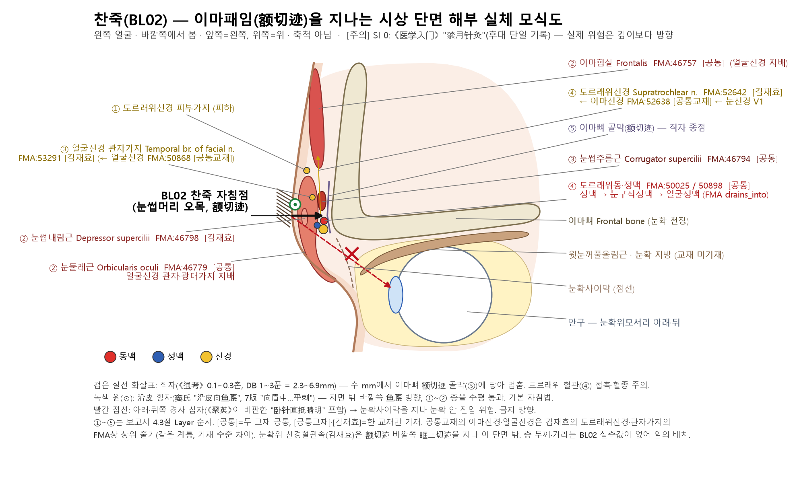
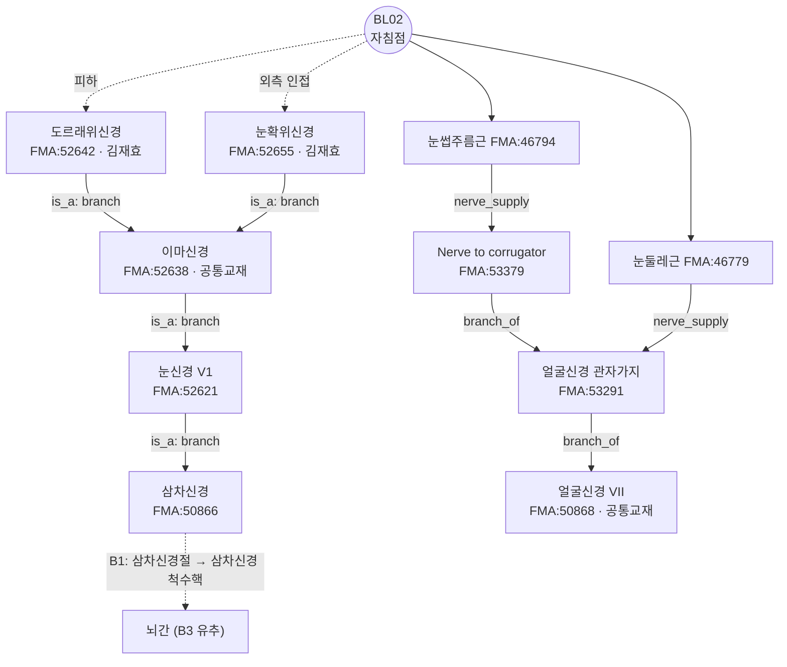

# 찬죽(攢竹, BL2) 해부생리학적 실체 판명 보고서

> **프레임워크**: v2.7 (2026-10-04 개정) · **ARI**: ARI v3.0 | ARI-Core 81.2 ± 1.2 (B) | SI 0 ⚠ | 잠정 가중치 0.40/0.35/0.25 | 민감도(등가중치): 80.2 (B, 등급 불변) · **이중 채점**: 독립 채점자 2인, 조정 완료

---

> **근거 원칙 문서**: `01_Framework/acupoint_anatomical_logic_framework.md` (v2.7) · `01_Framework/layer_b_reference_registry.md` (Layer B 참조 등록부 v1.0)
> **근거 데이터셋** (마스터 데이터셋 레지스트리):
> 1. 역대 침구문헌 자침심도 데이터베이스 시트1 181행(BL02)
> 2. 경혈명·이명 대조 표준 데이터베이스 '경혈 종합 목록' 182행, '본명-이명 일치 목록(Case A)' 4행
> 3. 경혈학 공통교재 해부구조 데이터셋 179번(BL02, 경혈학 上 p.628) · 김재효 교수 경혈 해부구조 데이터셋 179번(BL02)
> **3대 원전** (`01_도서_번역_및_원전/<원전>/chunks_refined/`): 《针灸腧穴通考》 `针灸腧穴通考(上)_561-640.md` (2310~2590행) · 《中国针灸穴位通鉴》 `中国针灸穴位通鉴(上卷)_881-960.md` (2480~2712행) · 《中国针灸证治通鉴》 각 장 처방 조문
> **해부 온톨로지**: FMA(Foundational Model of Anatomy) 5.1.0 로컬 색인 — 교재 구조를 `FMA:ID`로 고정하고 지배신경·신경 줄기를 대조(B1 보조, 등록부 미등재). 대응표 FMA 경혈 해부 온톨로지 매핑 레지스트리, 상세는 부록 A

### 요약
- **⚠ 안전주의 (SI 0)**: 3대 원전에 수록된 《医学入门》 卷一 "禁用针灸"(禁針·禁灸) 기록 때문에 루브릭상 SI가 0이다. 이 기록은 **명대 후대 문헌 1종의 단일 기록**이며, 《黄帝明堂经》·《甲乙经》 이래 대다수 문헌과 자침깊이 DB는 **1~3푼(2.3~6.9mm)** 자입을 기술한다. 자침깊이 DB에는 '0'(금침)이 없다. 실제 위험은 깊이보다 **방향**에 있다. 직자하면 얕은 깊이에서 전두골 额切迹 골면에 닿지만, 하후방(안와 쪽)으로 기울여 깊이 넣으면 안와 안으로 들어갈 수 있고 도르래위 혈관 출혈(혈종)이 생길 수 있다. 고전과 현대 문헌은 대부분 **沿皮 횡자(평자)**를 권한다.
- **실체 판정 — 개연(B)**: BL2의 해부 실체는 额切迹(滑車上切迹)을 지나는 **도르래위(활차상) 신경·동정맥**과 그 위의 **눈썹주름근·눈둘레근**이라는 해석이 2대 교재, 《通考》 【相关解剖学基础】, 규범 해부서(B1-01·B1-03)에서 일치한다. 다만 BL2만 실측한 사체·초음파·MRI 연구가 없고, 반사 기전을 다룬 Layer A 논문도 모두 BL2를 포함한 **복합 혈위 처방**이다. 그래서 "확정"이 아닌 "개연"으로 판정한다.

---

## 1. 문헌 스크리닝 표 (3대 원전 원문 발췌 및 한중 대조)

| # | 문헌(시대) | 원문 (3대 원전 수록 그대로) | 국문 대조 | 원전 위치 |
| :---: | :--- | :--- | :--- | :--- |
| 1 | 《黄帝明堂经》 (한대 계열, 《甲乙经》 卷三 보존) | 攒竹，一名员柱，一名始光，一名夜光，一名明光，在眉头陷者中，足太阳脉气所发。 | 찬죽은 원주·시광·야광·명광이라고도 하며, 눈썹머리의 오목한 곳에 있다. 족태양 맥기가 나오는 곳이다. | 《通考》 名实考 3 (`针灸腧穴通考(上)_561-640.md` 2342행) |
| 2 | 《黄帝明堂经》 佚文 (《甲乙经》 卷三) | 刺入三分，留六呼，灸三壮。 | 3푼 찔러 넣고 6호흡 동안 유침하며 뜸 3장. | 《通考》 【操作】 1(1) (2564행); 《穴位通鉴》 七.1 「《针灸甲乙经》3:42」 |
| 3 | 《素问·气穴论》 王冰注 (당) | 眉本二穴，王冰注曰：攒竹穴也。在眉头陷者中，足太阳脉气所发。 | '眉本 두 혈'을 왕빙은 찬죽으로 주석했다. | 《通考》 名实考 1 (2338행) |
| 4 | 《素问·骨空论》 王冰注 | 在眉头陷者中，脉动应手。 | 눈썹머리 오목한 곳, 맥이 손에 닿는다. | 《通考》 【定位】 2 + 按 "'脉动应手'四字…当系错入" |
| 5 | 《千金翼方》 卷二十七 (당) | 针入一分，留二呼，泻三吸，徐徐出之。忌灸。宜出血涂盐。 | 1푼 자입, 뜸 금기, 출혈 후 소금을 바른다. | 《通考》 【操作】 2 |
| 6 | 《铜人腧穴针灸图经》 卷中 (송) | 宜以细三棱针刺之，宣泄热气。三度刺，目大明。 | 가는 삼릉침으로 찔러 열기를 빼며, 세 번 찌르면 눈이 크게 밝아진다. | 《通考》 【操作】 5; 《穴位通鉴》 七.7(針入一分) |
| 7 | 《窦太师针经》 (금원) | 在两眉头内尖陷中…针入一分，沿皮向鱼腰穴。 | 눈썹머리 안쪽 끝 오목한 곳. 1푼 자입 후 피부를 따라 어요 쪽으로 눕혀 찌른다. | 《通考》 相关穴 1, 【操作】 6(1) |
| 8 | 《针灸聚英》 卷一 (명) | 睛明刺一分半，攒竹刺一分三分，为适浅深之宜。今医家刺攒竹，卧针直抵睛明…非古人意也。 | 찬죽은 1~3푼이 알맞다. 요즘 의가가 침을 눕혀 정명까지 밀어 넣는 것은 옛 뜻이 아니다. | 《通考》 【操作】 8 |
| 9 | 《医学入门》 卷一 (명) | 禁用针灸。 | 침과 뜸을 모두 쓰지 않는다. | 《通考》 【操作】 9 (2594행); 《穴位通鉴》 七.16 「《医学入门》1:3」 |
| 10 | 1957 南京《针灸学》 (현대) | 针三分，挤起眉端肌皮从眉端横针入之，即沿皮横刺。 | 3푼, 눈썹 끝 피부를 집어 올려 횡자. | 《通考》 【操作】 10(1) |
| 11 | 7版《针灸学》 (현대) | 可向眉中或向眼眶内缘平刺或斜刺 0.5~0.8 寸。禁灸。 | 눈썹 중앙 또는 안와 내연 쪽으로 평자·사자 0.5~0.8촌. | 《通考》 【操作】 10(4) |
| 12 | 《针灸腧穴通考》 (黄龙祥, 현대 교감) | 部位：在面部，眉头凹陷中，额切迹处。…针刺操作：直刺 0.1~0.3 寸。 | 위치: 눈썹머리 오목한 곳, 额切迹(이마패임). 직자 0.1~0.3촌. | 【提要索隐】 (2316~2328행) |
| 13 | 《通考》 【相关解剖学基础】 | 内侧者为额切迹或滑车上切迹，有滑车上动脉、静脉和滑车上神经通过。 | 안쪽 것은 额切迹(도르래위패임)이며 도르래위 동·정맥과 도르래위신경이 지난다. | 【定位】 (2390행 이하) |
| 14 | 《通考》 定位 文献分析 | 本穴定位，古代文献无分歧，均定位于"眉头陷者中"。 | 고대 문헌의 위치 기술에는 이견이 없다. | 【定位】 文献分析 |
| 15 | 《中国针灸证治通鉴》 | 呃逆…取穴：攒竹。指压。 / 腰痛…取穴：攒竹。 / 眉目疼痛不能当，攒竹沿皮刺不妨。 | 딸꾹질·요통에 찬죽 단독 / 미목동통에 찬죽 연피자. | `中国针灸证治通鉴_241-320.md` 2254행; `_321-400.md` 14행; `_401-480.md` 184행 |
| 16 | WHO 표준 정위 (2008, B1-05) | In the depression at the medial end of the eyebrow. | 눈썹 내측단 오목한 곳. | B1-05 |

- **삭제한 인용 (원전 확인 불가)**: 구판의 《灵枢·本输》 "攢竹在顏下…眉頭陷者中"은 3대 원전 어디에도 없다(`chunks_refined` 전수 Grep: "在顏下/在颜下" 0건). 《通考》 표제가 "出《黄帝明堂经》", 《穴位通鉴》 출처가 "《针灸甲乙经》3:42"이므로 최초 기술은 《黄帝明堂经》(《甲乙经》 卷三)이다.
- **삭제한 인용 (가공 인용)**: 구판의 《通考》 인용 "眉頭凹陷處, 實爲滑車上神經與滑車上動脈處, 刺深宜斜刺/橫刺 (0.3~0.5寸)"은 《通考》 원문에 없다. 《通考》의 실제 기술은 위 12·13행("直刺 0.1~0.3 寸", "额切迹处", "有滑车上动脉、静脉和滑车上神经通过")이다. 《通考》는 사자·횡자를 자기 권고로 제시하지 않으며, 횡자는 窦氏·南京《针灸学》·7版 교재 등 수록 문헌의 기술이다.

---

## 2. 원천/재인용 구분 표

| 정보 항목 | 원천(최초 기술) | 재인용·주석·후대 변형 | 판정 |
| :--- | :--- | :--- | :--- |
| 위치 | 《黄帝明堂经》 "在眉头陷者中" | 王冰注·《圣惠方》·《铜人》·《大成》 등 동일 문구 재인용. 窦氏 "眉头内尖陷中"은 정밀화 | 원천 일치. 고대 문헌 간 이견 없음(《通考》) |
| 위치 부가 | — | 王冰注 《骨空论》 "脉动应手" | 《通考》 按: 다른 王冰注에 없으므로 **錯入**(혼입) |
| 해부 용어 | — | 1990 국표·6版 교재 "眶上切迹处" | 《通考》 按: "额切迹"과 "眶上切迹"의 혼동. 2006 국표에서 "额切迹"으로 교정 |
| 자입 심도 | 《黄帝明堂经》(《甲乙》) "刺入三分" | 《医心方》 2분, 《千金翼》·《铜人》 1분, 《聚英》 1~3분, 현대 교재 평자 0.5~0.8촌 | 원천 3푼. 후대 1~2푼으로 얕아지고 횡자로 전환 |
| 뜸 | 《黄帝明堂经》 "灸三壮" | 《千金翼》 "忌灸", 《圣惠·针经》 "不宜灸", 窦氏 "禁灸", 현대 교재 "禁灸" | 灸법은 원천과 후대가 상충. 후대 다수가 금구 |
| 금침 | — | 《医学入门》 卷一 "禁用针灸" | 단일 후대 기록. 원천·다수 문헌과 다름 → SI 0 사유(10절) |
| 주치 | 《黄帝明堂经》 風頭痛·眉頭痛·目如欲脫·目䀮䀮不明·癲疾·小兒癇·痔痛 | 《聚英》·《大成》 "泪出，目眩，瞳子痒" | 《通考》 按: 承泣의 주치를 高武가 잘못 끊어 읽어 섞은 것 → 찬죽 주치에서 제외 |
| 이명 | 《黄帝明堂经》 员柱·始光·夜光·明光 | 《铜人》 "光明", 南京《针灸学》 员在·小竹·眉中·元柱 등 | 3절 참조 |

---

## 3. 이명·별칭 검증 표 (KJH DB 대조)

KJH DB(경혈명·이명 대조 표준 데이터베이스 경혈 종합 목록 182행) BL02 이명: **始光, 光明, 圓柱, 夜光, 明光, 眉頭圓柱, 眉本, 魚頭**

| 이명 | 최초 출처 (연대순) | KJH DB | 판정 (《通考》 名实考·按 근거) |
| :--- | :--- | :---: | :--- |
| 员柱(圓柱) | 《黄帝明堂经》 | ○ (圓柱) | 정식 이명 |
| 始光 | 《黄帝明堂经》 | ○ | 정식 이명 |
| 夜光 | 《黄帝明堂经》 | ○ | 정식 이명 |
| 明光 | 《黄帝明堂经》 | ○ | 정식 이명 |
| 眉本 · 眉头 | 《素问》 气穴论·气府论 (王冰注) | ○ (眉本) | 《通考》: 《素问》의 **부위명**이며 혈명이 아님 |
| 光明 | 《铜人腧穴针灸图经》 (송) | ○ | 《通考》: "明光"의 **도치(倒文)**로 의심. **GB37 光明과 동명 충돌**(KJH '본명-이명 일치 목록' Case A: BL02 光明 ↔ GB37 광명). 또 敦煌 《新集备急灸法》·《银海精微》의 '光明'은 눈썹 중앙(鱼腰 위치)의 **동명이혈**로, 찬죽과 다른 혈 |
| 眉头圓柱 | KJH 슬라이드 표기 | ○ | 眉头(부위명) + 圓柱의 결합 표기로 보임. 원전 단독 근거 없음 |
| 鱼头 | 1983 上海 《针灸治疗手册》 | ○ | 현대 별칭(鱼腰·鱼尾에 대응) |
| 员在 | 《甲乙》 판본, 南京 《针灸学》 | × | 《通考》: "员柱"의 **형오(形誤)** |
| 元柱 | 《古今医统大全》 | × | 《通考》: "员柱"의 **동음 차용** |
| 小竹 | 南京 《针灸学》 | × | 《通考》: **眉冲(BL3)의 이명** → 찬죽 이명에서 제외 |
| 眉柱 · 矢光 · 眉中 | 《云岐子》·《杨敬斋》·南京《针灸学》 | × | 후대 이표기. 단독 정보 없음 |
| ~~烏列 · 大空~~ | **근거 없음** | × | KJH DB·3대 원전 어디에도 없음 → **삭제**(구판 오류) |

**혼용 차단 기록**: '光明'으로 검색한 정보는 ① BL2 별명 光明(《铜人》 이후), ② GB37 광명(족소양 낙혈, 하퇴), ③ 敦煌·《银海精微》 光明(눈썹 중앙, 鱼腰 위치) 세 갈래로 나누어 읽어야 한다. 본 보고서의 위치·해부·주치 정보에는 ②·③의 내용이 섞이지 않았다. 연대순 정렬로 해소되므로 S_orig ③ = 75이다.

---

## 4. 3D 공간 좌표 및 Layer 1~5 층차 구조도

### 4.1 정위 이탈 검증 (Δ_discrepancy)
- 고전 "眉头陷者中"과 WHO 2008 "medial end of the eyebrow"는 같은 촉진 랜드마크인 **额切迹(이마패임, 滑車上切迹)**을 가리킨다. 고전·현대 편차는 15mm 미만이므로 **Target 분기 없음**(단일 Target T1).
- 용어 주의: 이 오목은 **额切迹(frontal notch)**이며, 그 외측의 **眶上切迹/孔(supraorbital notch/foramen)**과 다르다(《通考》 文献分析). 구판의 "화차상절노·안화상절노"는 오기이며 **额切迹(도르래위패임)**으로 고친다.

### 4.2 좌표계
- **X축(내외측)**: 정중선에서 외측. 기준선 = 내안각 수직선(WHO). 额切迹은 眶上切迹보다 정중선에 가깝다.
- **Y축(두미)**: 눈썹 내측단 = 안와상연 높이. 위로 眉冲(BL3, 额切迹 직상 입발제 0.5촌)이 이어진다.
- **Z축(깊이)**: 피부에서 전두골 骨面까지. BL2만 연부조직 두께를 실측한 연구는 Layer A에 없다. 따라서 층 경계를 mm로 나누지 않고 **순서만** 제시한다(규범 해부 B1-01·B1-03, 2대 교재 B2-09).

### 4.3 Layer 1~5 층차 (프레임워크 정의 적용)

| Layer (프레임워크 정의) | BL2 해당 구조 | 근거 | 비고 |
| :--- | :--- | :--- | :--- |
| Layer 1 피부·피하 | 피부, 피하조직, 도르래위신경(V1, 이마신경 분지)의 피부 가지 | 김재효 교재, 공통교재(이마신경), B1-01 | 횡자 시 주 자극층 |
| Layer 2 표층근육·근막 | 눈둘레근(안와부), 이마힘살 내측 섬유, 눈썹내림근 | 2대 교재 | 얼굴신경 관자가지 지배 |
| Layer 3 심층근육·운동지 | 눈썹주름근(전두골 내측 기시), 얼굴신경 관자가지 분지 | 2대 교재 | 안검·미간 운동 |
| Layer 4 신경혈관속 | **도르래위 신경·동맥·정맥**(额切迹 출구), 외측에 눈확위 신경혈관속 | 《通考》 相关解剖学基础, 김재효 교재, B1-01 | 출혈(혈종) 주의 |
| Layer 5 골막·심부 | 전두골 额切迹 **골막**(직자 종점). 그 아래·뒤쪽 안와 격막 뒤에 안와 내용물 | B1-01·B1-03 | 안구는 안와상연 **아래·뒤**에 있다. 직자로는 골면에서 멈추며, **하후방 경사 자입** 때만 안와 진입 위험 |

- **구판 정정**: 구판의 "Layer 5 안구, z > 11.5mm 직자 시" 모델은 해부와 맞지 않는다. BL2에서 직자하면 수 mm 깊이에서 전두골에 닿고, 안구는 안와상연 아래에 있다. 위험은 깊이보다 **방향(안와 쪽 경사)**에 달려 있다. 구판의 층 순서(Layer 3=신경혈관, Layer 4=골막)도 프레임워크 정의(Layer 4=신경혈관속, Layer 5=골막)에 맞춰 고쳤다.

### 4.4 단면 모식도

```
                 【찬죽(BL2) 시상 단면 모식도 — 순서 표기, mm 경계는 미실측】

  (위) 이마  ─────────────────────────────────────────────────────
          피부 ── Layer 1: 피부·피하 (도르래위신경 피부가지 V1)
          ─────── Layer 2: 눈둘레근 · 이마힘살 · 눈썹내림근
          ─────── Layer 3: 눈썹주름근 (얼굴신경 관자가지)
          ─────── Layer 4: 도르래위 신경·동정맥 (额切迹 출구)
   ███████████████ Layer 5: 전두골 额切迹 골막  ← 직자(90°)는 여기서 정지
   ███ 전두골 ███╲
                  ╲  안와상연
                   ╲___ 안와 격막 → 안와 내용물(안구는 아래·뒤쪽)
  (아래) 눈

  자침 경로 비교
   ① 沿皮 횡자(窦氏 "沿皮向鱼腰"): Layer 1~2를 수평으로 통과 → 안전 여유 큼
   ② 직자(《通考》 0.1~0.3촌): 骨面(Layer 5)에서 정지, Layer 4 혈관 접촉 가능
   ③ 하후방 경사 심자(예: "卧针直抵睛明", 《聚英》이 비판): 안와 진입 위험 ⚠
```



*그림 4-1. 찬죽 높이 시상 단면 모식도(왼쪽 얼굴을 바깥쪽에서 봄, 앞쪽=왼쪽, 축척 아님). 직자(검은 화살표)는 수 mm에서 이마뼈 额切迹 골막에 닿아 멈추고, 沿皮 횡자(⊙)는 지면 밖 바깥쪽(鱼腰 방향)으로 ①~② 층을 지난다. 아래·뒤쪽 경사 심자(빨간 점선)만 눈확사이막을 지나 눈확 안으로 들어간다. 층 두께·거리는 BL02 실측값이 없어 임의로 배치했다.*

### 4.5 FMA 실체 대조 (Layer별)

구조명은 2대 교재, ID·관계는 FMA 5.1.0(`fma_query.py profile BL02`).

| Layer | 구조 | FMA | FMA 관계 | 지배신경 / 줄기 (FMA) | 척수 분절 |
| :--- | :--- | :--- | :--- | :--- | :--- |
| 1 피하 | 도르래위신경 피부가지 *(김재효: 도르래위신경)* | FMA:52642 | is_a Branch of frontal nerve | 이마신경(FMA:52638) → 눈신경(FMA:52621) → 삼차신경(FMA:50866) | 해당 없음(뇌신경 V1) |
| 1 피하 | 이마신경 *(공통교재)* | FMA:52638 | is_a Branch of ophthalmic nerve | 눈신경 → 삼차신경 | 해당 없음 |
| 2 표층근 | 눈둘레근 *[공통]* | FMA:46779 | is_a Circumorbital muscle | 얼굴신경 광대가지·관자가지의 눈둘레근 가지(FMA:53314·53377) | 해당 없음(뇌신경 VII) |
| 2 표층근 | 이마힘살 *[공통]* | FMA:46757 | is_a Subdivision of occipitofrontalis | **FMA 미기재**(B1-01: 얼굴신경 관자가지) | 해당 없음 |
| 2 표층근 | 눈썹내림근 *(김재효)* | FMA:46798 | is_a Depressor muscle | Nerve to depressor supercilii(FMA:82674) | 해당 없음 |
| 3 심층근 | 눈썹주름근 *[공통]* | FMA:46794 | is_a Circumorbital muscle | Nerve to corrugator supercilii(FMA:53379) → 얼굴신경 관자가지(FMA:53291) → 얼굴신경(FMA:50868) | 해당 없음 |
| 3 운동지 | 얼굴신경 관자가지 *(김재효)* / 얼굴신경 *(공통교재)* | FMA:53291 / 50868 | is_a Branch of facial nerve | 얼굴신경 | 해당 없음 |
| 4 신경혈관속 | 도르래위동맥 *[공통]* | FMA:50025 | is_a Terminal branch of ophthalmic artery | 눈동맥(FMA:49868) → 속목동맥(FMA:3947) | — |
| 4 신경혈관속 | 도르래위정맥 *[공통]* | FMA:50898 | drains_into Angular vein | 눈구석정맥(FMA:50893) → 얼굴정맥(FMA:50874) → 속목정맥(FMA:4724) | — |
| 4 외측 인접 | 눈확위동·정맥·신경 *(김재효)* | FMA:49973 · 50904 · 52655 | 눈확위패임(FMA:57390) 통과 — 단면 밖 | 이마신경 → 눈신경 | — |
| 5 골막 | 이마뼈 · 이마패임(额切迹) | FMA:52734 · FMA:57409 (synonym Frontal notch) | — | — | — |

- **FMA 주석 1 — 분절**: BL02 구조의 신경은 모두 뇌신경(삼차신경 V1, 얼굴신경 VII)이라 FMA `segmental_supply`가 없다. 8.3 B-Check ②는 척수 분절 대신 **V1 신경 영역 정합**으로 판정한다(기존 판정 유지).
- **FMA 주석 2 — 눈구석정맥 교통**: FMA는 눈구석정맥을 얼굴정맥 지류로만 기록하고, 위눈정맥(→ 해면정맥굴)과의 교통은 기재하지 않는다. 이 교통은 규범 해부(B1-01)에 근거하며, 도르래위정맥 출혈·감염 시 고려할 경로로만 기술한다.
- **FMA 주석 3 — 이마힘살 지배**: FMA에 이마힘살의 `nerve_supply`가 없다. 얼굴신경 관자가지 지배는 B1-01로 기술한다.

---

## 5. 자침 깊이 계산표

출처: 역대 침구문헌 자침심도 데이터베이스 시트1 181행(BL02). 규칙: 정수 = 푼, '0' = 금침, blank = 미기술. 환산: 1푼 = 2.3mm(한대 기준).

| 문헌 (DB 열) | DB 값(푼) | 환산 심도(mm) | 도달 Layer (직자 가정) | 비고 |
| :--- | :---: | :---: | :--- | :--- |
| 황제명당경 (황룡상 감수편찬) | 3 | 6.9 | Layer 4~5 (骨面 근접) | 원천 |
| 침구갑을경 | 3 | 6.9 | Layer 4~5 | 원천 보존본 |
| 침구경험방 | 1 | 2.3 | Layer 1~2 | |
| 동의보감 (인용: 동인) | **1** | **2.3** | Layer 1~2 | 구판의 '3푼'은 오류 → DB 값 1푼으로 정정 |
| 경락수혈학 공통교재 (최소~최대) | 2~3 | 4.6~6.9 | Layer 2~5 | 구판의 '현대 교재 3~5푼'은 오류 |
| 침구의학 공통교재 (최소~최대) | 2~3 | 4.6~6.9 | Layer 2~5 | |
| 침구수혈통고 (최소~최대) | 1~3 | 2.3~6.9 | Layer 1~5 | 《通考》 "直刺 0.1~0.3 寸" |
| 선호 자침법 열 (경락수혈학·통고) | blank | — | — | 미기술(결측) |
| *(DB 밖)* 《医学入门》 卷一 | *금침 기술* | — | — | "禁用针灸". DB에 '0'으로 들어 있지 않음. 3대 원전에만 수록 |

- **범위**: DB 값 전체 2.3~6.9mm. DB에 '0'은 없다. 구판의 평균 μ = 9.2mm, 표준편차 σ = 1.8mm는 출처가 없고 DB와 맞지 않아 **삭제**했다.
- **각도 보정 예시** ($z_{vertical} = L \times \sin\theta$): 窦氏 沿皮자(θ ≈ 15°)로 원천 3푼(L = 6.9mm)을 넣으면 $z = 6.9 \times \sin 15^\circ \approx 1.8\text{mm}$로 Layer 1~2에 머문다. 이것은 각도 효과를 보여 주는 계산 예시이며, BL2 실측값이 아니다. 구판의 $11.5 \times \sin 20^\circ$ 계산은 근거 없는 5푼 입력을 써서 삭제했다.

---

## 6. 해부학 구조 교재 비교표 (공통교재 vs 김재효 교재)

| 비교 항목 | 경혈학 공통교재 (공통교재 데이터셋 179번, 경혈학 上 p.628) | 김재효 교재 데이터셋 (179번) | FMA 판별 | 공통점 / 차이점 |
| :--- | :--- | :--- | :--- | :--- |
| 근육 | 눈둘레근, 이마힘살, 눈썹주름근 | 눈둘레근, 눈썹내림근, 눈썹주름근, 뒤통수이마근의 이마힘살 | 공통 FMA:46779·46757·46794 / 김재효 단독 FMA:46798 | 공통 3종. 김재효 교재는 눈썹내림근을 더함 |
| 신경 | 얼굴신경, 이마신경 | 눈확위신경, 도르래위신경, 얼굴신경의 관자가지 | 공통교재 FMA:50868·52638 / 김재효 FMA:52655·52642·53291 — **FMA `is_a`·줄기상 공통교재 항목이 김재효 항목의 상위 줄기** | 이마신경(frontal n.)은 눈확위·도르래위신경의 모신경이므로 계층상 맞다. 김재효 교재가 분지 수준으로 더 구체적 |
| 혈관 | 도르래위동·정맥 | 눈확위동·정맥, 도르래위동·정맥 | 공통 FMA:50025·50898 / 김재효 단독 FMA:49973·50904 | 도르래위동·정맥은 공통. 김재효 교재는 외측 눈확위동·정맥을 더함 |

**FMA로 본 교재 차이의 의미**: FMA 프로파일의 두 교재 비교는 공통 5 · 공통교재 단독 2 · 김재효 단독 6이지만, 공통교재 단독 2종(이마신경 FMA:52638, 얼굴신경 FMA:50868)은 김재효 단독 신경 3종(도르래위신경·눈확위신경 → 이마신경, 관자가지 → 얼굴신경)의 **FMA상 직속 줄기**다. 따라서 신경 항목의 차이는 상충이 아니라 **기재 수준(줄기 vs 가지)의 차이**이고, 실질 차이는 김재효 교재의 눈썹내림근과 바깥쪽 눈확위 신경혈관속(额切迹 바깥 眶上切迹, BL02 직하가 아님)뿐이다. 기존 판정($S_{clarity}$ 75)을 바꾸지 않는다.

- **판정**: 핵심 구조(눈둘레근·눈썹주름근·이마힘살, 도르래위 혈관, 이마신경 계통)가 일치한다. 《通考》 【相关解剖学基础】(额切迹 = 도르래위 동정맥·신경 통과)와 규범 해부서 B1-01·B1-03도 같다. 단 BL2 특이 실측 논문이 없어 S_clarity = 75이다.
- **도식 표기**: 4.4 모식도의 Layer 1~5에 두 교재 공통 구조를 반영했다. 눈확위 신경혈관속은 额切迹 외측(眶上切迹)에 있으므로 BL2 직하가 아니라 **외측 인접 구조**로 본다.

---

## 7. 공간 변위 분기 추론도

**해당 없음.** 고전("眉头陷者中")과 WHO 2008 정위가 같은 额切迹을 가리키고 편차가 15mm 미만이다. Target 1 단일 분석이며 ΔARI-Core 판정도 적용하지 않는다.

---

## 8. 생의학적 반사 기전도 및 외부 검색 로그

### 8.1 반사 기전도 (Layer B 매핑)

```
[구심] BL2 피부·근막 자극 → 도르래위신경 (V1 안신경 → 이마신경 분지)        B1-01, B1-02
          │  섬유형: 직접 측정 없음 (동물 삼차신경절 P2X3만, papers.id 1998)  B3-06 (유추)
          ▼
[중추] 삼차신경절 → 삼차신경 척수핵 (관문조절·진통)                           B3-07, B3-11 (유추)
          │        → 위침분비핵(상타액핵) → 날개입천장신경절 → 눈물샘        B3-05 (유추)
          ▼
[원심·표적] 눈물 분비·안표면 염증 조절 (동물: VIP/AQP5, α7nAChR/NF-κB)       B3-14 (범위 밖 틀, 유추)
            papers.id 1981, 1997, 1999 (동물·복합 혈위)
[인체] 건성안·안면신경염 임상 (복합 혈위·점안제 병용)                         B4-04, B4-05
            papers.id 1979, 1994, 2000
```

**말초 구심 경로의 FMA 고정**: 위 회로의 첫 구간(자침점 → 삼차신경)은 FMA 관계로 아래와 같이 고정된다. 실선은 FMA에 기재된 관계, 점선은 FMA에 없어 B1로 보완한 연결이다.



*그림 8-1. FMA 5.1.0 관계로 그린 BL02 말초 경로. 감각(구심)은 V1, 근육 운동은 VII 계통으로 나뉜다. 근육 지배(VII)는 운동 원심 경로이므로 반사 구심 경로로 쓰지 않는다.*

- **정정**: 구판의 "상뇌간 신경절"은 존재하지 않는 구조다. 눈물샘 부교감 경로는 **위침분비핵(상타액핵) → 얼굴신경(큰바위신경) → 날개입천장신경절 → 눈물샘**이다(B1-02 범위). 구판의 "활차상동정맥 자율신경 수용체" 주장은 근거가 없어 삭제했다.
- **분절 대응(②)**: 두면부는 척수 분절 대신 **삼차신경 V1 영역**으로 판단한다. 자극 부위(도르래위신경)와 표적(각막·결막·눈물샘 감각)이 같은 V1 분포 안에 있다.
- **혈위 특이성 한계 (중요)**: 아래 Layer A 논문은 **모두 BL2를 포함한 복합 혈위 처방**이다. BL2만 자극하여 안과 효과나 기전을 측정한 연구는 **0편**이다. pack에서 BL2 단독 자침 논문은 papers.id 2008 하나뿐이다. 이 논문은 급성 요추 염좌 증례군(2003)으로, 안과 주치·기전과 관계없어 채점에 쓰지 않았다. 따라서 위 회로의 ③·④·⑤ 단계는 BL2 고유 기전이 아니라 "**눈 주위 복합 자극의 기전을 BL2에 유추**"한 수준이다(B4-05 혈위 특이성 반증 측면).

### 8.2 Layer A 논문 표 (pack_BL2.md)

| papers.id | 연도 | 저널 | 제목 | PMID / DOI | 설계 (BL2 관련성) |
| :---: | :---: | :--- | :--- | :--- | :--- |
| 1979 | 2022 | Zhongguo Zhen Jiu | Effect of acupuncture on dry eye and tear inflammatory factors | 36484191 / 10.13703/j.0255-2930.20220318-0001 | 인체 임상, 건성안(pack 분류: 비RCT, 채점자는 RCT로 기술). 복합 혈위 |
| 1981 | 2022 | Zhen Ci Yan Jiu | Acupuncture mitigates ocular surface inflammatory response via α7nAChR/NF-κB p65 signaling in dry eye guinea pigs | 36453674 / 10.13702/j.1000-0607.20220015 | 동물(기니피그). 복합 혈위 |
| 1994 | 2025 | Zhongguo Zhen Jiu | Penetrating needling of three eye acupoints combined with sodium hyaluronate eye drops for dry eye: a randomized controlled trial | 40369920 / 10.13703/j.0255-2930.20240521-0002 | 인체 RCT. 눈 주위 3혈 투자 + 점안제 병용 |
| 1997 | 2023 | Zhen Ci Yan Jiu | Acupuncture promotes tear secretion by up-regulating VIP/cAMP/PKA/AQP5 signaling in guinea pigs with aqueous tear deficiency | 37879953 / 10.13702/j.1000-0607.20230061 | 동물(기니피그). 복합 혈위 |
| 1998 | 2022 | Zhen Ci Yan Jiu | Effect of electroacupuncture on ocular surface sensory neuralgia and expression of P2X3 receptor and PKC in cornea and trigeminal ganglion… | 35616412 / 10.13702/j.1000-0607.20210607 | 동물(기니피그). 복합 혈위 |
| 1999 | 2020 | Zhen Ci Yan Jiu | Effect of acupuncture on expression of transfer growth factor-β1 in lacrimal gland of rabbits with dry eye | 32959555 / 10.13702/j.1000-0607.190977 | 동물(토끼). 복합 혈위 |
| 2000 | 2020 | Zhen Ci Yan Jiu | Influence on orbicularis oculi muscle in the patients with facial neuritis treated with the penetrating needling… | 32959557 / 10.13702/j.1000-0607.190894 | 인체 비RCT. BL2→EX-HN4(鱼腰) 투자 + BL62 |
| 2001 | 2019 | Zhen Ci Yan Jiu | Acupuncture of intraorbital and extraorbital acupoints reduces apoptosis of retinal ganglion… | 31056882 / 10.13702/j.1000-0607.180440 | 동물(토끼 NAION). 복합 혈위 |
| 2003 | 2026 | PubMed (pack 표기) | Acupuncture alleviates form-deprivation myopia by promoting dopamine secretion and suppressing ferroptosis… | 42779258 / 10.14670/hh-25-141 | 동물(근시 모델). 복합 혈위. 채점자 B만 계수 |
| *(참고)* 2008 | 2003 | J Acupunct Tuina Sci | Treatment of 55 cases of acute lumbar sprain by puncturing acupoint Cuanzhu (BL 2) | — / 10.1007/bf02845431 | 인체 증례군. **BL2 단독**이나 요추 염좌(안과 주치·기전 아님). 채점 미사용 |

- 채점자별 BL2 포함 Layer A 계수: A 8편, B 9편(2003 포함). pack의 다른 논문(안면마비·삼차신경통 등 1980~1996, 2004~2007)은 제목상 BL2 포함 여부가 확인되지 않아 채점에 쓰지 않았다. 로컬 매핑 506·795는 종설·영상 일반 연구이고, 2002는 쥐 혈위 아틀라스로 BL2 실측이 아니다.

### 8.3 B-Check 6항목 채점표

| 항목 | 채점자 A | 채점자 B | 최종 | Layer B 참조 ID | papers.id | 근거 요지 |
| :---: | :---: | :---: | :---: | :--- | :--- | :--- |
| ① 자침 심도의 말초신경·혈관 실체 | 2 | 2 | **2** | B1-01, B1-03, B1-05, B2-09 (+FMA) | — | 2대 교재와 규범 해부서, 《通考》가 额切迹의 도르래위 신경혈관속·눈썹주름근·눈둘레근을 일치하게 기술. 교재 구조 13종 모두 FMA 정확 대응(FMA:52642·50025·50898·46794·46779 등, 4.5절). 영상 실측 없음 |
| ② 분절 정합 (삼차신경 V1 영역) | 2 | 2 | **2** | B1-01, B1-02 (+FMA) | — | 도르래위신경(V1) 피부영역 ↔ 각막·결막·눈물샘 감각(V1). FMA 줄기: 도르래위신경 → 이마신경 → 눈신경(FMA:52621) → 삼차신경(FMA:50866). 척수 분절 대신 뇌신경 영역으로 판정(FMA segmental_supply 해당 없음) |
| ③ 구심 섬유형·수용체 | 1 | 1 | **1** | B3-06 | 1998 | 기니피그 삼차신경절 P2X3/PKC(동물·복합 혈위). BL2 구심 섬유형 직접 측정 없음 |
| ④ 중추 중계·경로 | 1 | 1 | **1** | B3-05, B3-07, B3-11 | 1998 | 삼차신경 척수핵·위침분비핵 경로는 등록부 범위 밖 유추. 중추 경로 측정 논문 없음 |
| ⑤ 원심 경로·효과 방향 | 1 | 1 | **1** | B3-14 | 1981, 1997, 1999 | 동물에서 눈물 분비 증가·안표면 항염증. 고전 '流泪/迎风冷泪'(유루 과다)와 건성안 모델(분비 촉진)은 방향이 직접 대응하지 않아 유추 |
| ⑥ 인체 전환 근거 | 1 | 1 | **1** | B4-04, B4-05 | 1979, 1994, 2000 | 인체 RCT·임상 있으나 복합 혈위·점안제 병용으로 BL2 특이성 분리 불가. 신경영상·자율신경 지표 없음 |
| **합계** | **8** | **8** | **8 / 12** | | | **판정: 부합** (≥ 8, ①·② ≥ 1). ⑥ = 1이므로 '동물 한정' 표지 없음. 상충(0점) 항목 없음 → '가설' 제한 없음 |

- 부합 판정은 **복합 혈위 연구를 BL2에 유추**한 결과다. BL2 단독 연구가 생기기 전까지는 8.1의 회로를 "BL2 포함 눈 주위 자극의 개연 기전"으로 읽는다.

### 8.4 외부 검색 로그 (sync_log, 2026-10-04·2026-10-23 Rank 6 실행)

| 일시 | 소스 | HTTP | 수집 | 중복제거 | 신규 | 쿼리 |
|---|---|---|---|---|---|---|
| 2026-10-04T09:52:17 | pubmed | 200 | 16 | — | — | ("BL2" OR "Cuanzhu" OR "攢竹") AND (acupuncture OR electroacupuncture) AND (nerve OR reflex OR autonomic OR mechanism OR anatomy) |
| 2026-10-04T09:52:17 | openalex | 200 | 23 | — | — | doi_starts_with:10.13703,title_and_abstract.search:"Cuanzhu" OR "BL2" \| doi_starts_with:10.13702,title_and_abstract.search:"Cuanzhu" OR "BL2" \| has_doi:true,tit… |
| 2026-10-04T09:52:17 | crossref | 200 | 1 | — | — | Cuanzhu acupuncture nerve reflex |
| 2026-10-04T09:52:17 | all | — | 40 | 10 | 30 | |
| 2026-10-23T21:43:19 | pubmed | 200 | 16 | — | — | ("BL2" OR "Cuanzhu" OR "攒竹") AND (acupuncture OR electroacupuncture) AND (nerve OR reflex OR autonomic OR mechanism OR anatomy) |
| 2026-10-23T21:43:19 | openalex | 200 | 23 | — | — | doi_starts_with:10.13703 / 10.13702 · title_and_abstract.search:"Cuanzhu" OR "BL2" … |
| 2026-10-23T21:43:19 | crossref | 200 | 1 | — | — | Cuanzhu acupuncture nerve reflex |
| 2026-10-23T21:43:19 | all | — | 40 | 37 | 3 | 기존 병합 27 · 배치 내 중복 10 |

- **2026-10-23 재실행 신규 3편**: papers.id 2246(PMID 34085472, 말초성 안면마비 회복기 흉쇄유돌근 배열자), 2247(PMID 38373760, 부등시성 약시 아동 시력), 2248(PMID 21823275, 급성기 특발성 안면마비). 세 편 모두 BL2를 포함한 **복합 혈위 임상**이고 BL2 단독 기전 측정이 없어 B-Check·ARI 판정을 바꾸지 않는다(8.1 "복합 혈위 한계" 그대로).

---

## 9. 주치증 분리 표 (단독 자침 vs 복합 배오 처방)

$P_{single}$은 **정량 산출하지 않는다**. 구판의 0.90~0.94와 'Level A'는 산출 근거가 없어 삭제했다. 아래는 원전 조문을 단독 기록과 배오 기록으로 나눈 질적 분류다.

| 주치 | 단독(BL2만) 기록 | 복합 배오 기록 | 판정 |
| :--- | :--- | :--- | :--- |
| 目不明·目中熱痛·瞼瞤動 (눈 침침·안통·눈꺼풀 떨림) | 《黄帝明堂经》 주치(목䀮䀮不明), 《千金翼》 "攒竹主目视不明，目中热痛及瞤", 《铜人》 "三度刺，目大明" | 《针灸集成》 眼 처방 다수(睛明·丝竹空·太阳·合谷 배합) | **단독 근거 있음**. 《通考》: 고금 주치가 안질환에 집중 |
| 目赤腫痛 (결막 충혈·부종) | 《世医得效方》 "赤眼…针攒竹穴即安"(耳後 紅筋 挑刺 병행), 《通玄指要赋》 "脑昏目赤，泻攒竹" | 《针灸集成》 第十六方 등 | 단독 근거 있음. 삼릉침 출혈법과 연결 |
| 眉棱骨痛·前頭痛 | 《黄帝明堂经》 "眉頭痛", 《玉龙歌》 "眉目疼痛…攒竹沿皮刺" | 《玉龙歌》 头维 병용, 《针灸集要》 丰隆 병용 | 단독·배오 혼재 |
| 流淚·迎風冷淚 | — | 《针灸集成》 第十一方(合谷·大小骨空), 현대 처방(睛明·风池·肝俞) | **배오 파생**. 《聚英》의 "泪出，目眩，瞳子痒"은 承泣 주치 오귀속(《通考》 按) |
| 風頭痛·項强·癲疾·小兒癇 | 《黄帝明堂经》 | 《千金》 다혈 배합 | 《通考》: 눈 증상(目如欲脫·目系急·目上插)이 함께 있을 때만 취혈 |
| 痔痛 | 《黄帝明堂经》 | — | 《通考》: 고금 임상 사례 없음, 검증 필요 |
| 呃逆 (딸꾹질) | 《证治通鉴》 "取穴：攒竹。指压" | 《针灸治疗学》(中脘·内关 등) | 현대 단독 보고. 《通考》: 특이성 미검증, 주치에서 보류 |
| 腰痛·急性腰扭傷 | 《证治通鉴》 "取穴：攒竹"(中国针灸 1982); papers.id 2008 | 《江西中医药》 2002(阳陵泉 병용) | 현대 단독 보고. 해부 기전 미상 |

---

## 10. ARI v3.0 프로파일 평가표 및 최종 결론

**Target T1 (단일)**: 《黄帝明堂经》·《甲乙经》 "在眉頭陷者中" = WHO 2008 "눈썹 내측단 오목, 내안각 직상"(额切迹/滑車上切迹)

### 10.1 하위 점수 표

| 지표 | 채점자 A | 채점자 B | 평균 | 루브릭 단계 근거 요지 | 근거 포인터 |
| :--- | :---: | :---: | :---: | :--- | :--- |
| S_orig | 93.75 | 87.5 | **90.6** | 원천이 위치·심도를 모두 지정, 고대 위치 이견 없음, 光明 혼용은 연대순으로 해소, 《通考》 교감 반영 | `针灸腧穴通考(上)_561-640.md` 名实考·定位·操作; `中国针灸穴位通鉴(上卷)_881-960.md` 二.别名·七; KJH Case A |
| S_clarity | 75 | 75 | **75** | 2대 교재 일치 + 규범 해부서·FMA 표준 실체 확인(신경 차이는 FMA상 줄기/가지 수준 차이). BL2 특이 사체·영상 실측 없음 → 100 미달 | 공통교재 데이터셋·김재효 179번; 《通考》 相关解剖学基础; B1-01, B1-05, B2-09; FMA:52642·52638 |
| S_reflex | 75 | 75 | **75** | 인체 연구 + 동물 다수 + B-Check 8. 모두 복합 혈위라 100 불가 | papers.id 1979, 1981, 1994, 1997, 1998, 1999, 2000, 2001, 2003 |
| S_safety → SI | 0 | 0 (조정 전 75) | **0** | 금침 문헌(《医学入门》 "禁用针灸") 존재 → 루브릭 0 | 《通考》 【操作】 9; 《穴位通鉴》 七.16; 자침깊이 DB 181행('0' 없음) |

### 10.2 S_orig 하위 4항목

| 하위 항목 | A | B | 평균 | 근거 |
| :--- | :---: | :---: | :---: | :--- |
| ① 최초 기술 명확성 | 100 | 100 | 100 | 《黄帝明堂经》(《甲乙》 卷三) "在眉頭陷者中" + "刺入三分" |
| ② 후대 문헌 일치율 | 100 | 100 | 100 | 《通考》 "古代文献无分歧"; 《穴位通鉴》 "历代文献记载一致" |
| ③ 이명 혼용 해소 | 75 | 75 | 75 | 光明 ↔ GB37·敦煌 光明 동명 → 연대순 정렬로 해소 |
| ④ 《通考》 교감에 의한 전사 오류 교정 | 100 | 75 | 87.5 | 员在 형오, "脉动应手" 錯入, 《聚英》 承泣 주치 오귀속, 眶上切迹/额切迹 혼동 교정 |
| **S_orig** | **93.75** | **87.5** | **90.6** | |

### 10.3 게이트 적용 내역

| 게이트 | 조건 | 적용 여부 |
| :--- | :--- | :--- |
| 게이트 1 | S_orig < 50 또는 S_clarity < 50 → 최고 C | 미적용 (90.6 / 75) |
| 게이트 2 | Layer A 0편 → S_reflex ≤ 25, (H) | 미적용 (BL2 포함 Layer A 8~9편. 단 모두 복합 혈위) |
| 게이트 3 | SI ≤ 25 → ⚠ 안전주의 | **적용** (SI 0) |

### 10.4 종합 프로파일

| 항목 | 값 |
| :--- | :--- |
| ARI-Core (잠정 가중치 0.40/0.35/0.25) | 채점자 A 82.5, 채점자 B 80.0 → **81.2 ± 1.2** |
| 등급·표지 | **B (개연, Probable)** — H 표지 없음 |
| SI | **0 ⚠** (안전주의) |
| 등가중치 민감도 (1/3씩) | 80.2 → B, **등급 불변** |
| 분기 판정 | 해당 없음 (단일 Target) |

**표준 표기**: `ARI v3.0 | ARI-Core 81.2 ± 1.2 (B) | SI 0 ⚠ | 잠정 가중치 0.40/0.35/0.25 | 민감도(등가중치): 80.2 (B, 등급 불변)`

### 10.5 조정 기록

- 조정 후 15점 이상 불일치 항목: 없음(`needs_adjudication` 빈 목록).
- **S_safety 조정 (A 0 / B 75 → 0)**: 두 채점자 모두 《穴位通鉴》·《针灸腧穴通考》(上)_561-640.md 【操作】 9에 수록된 《医学入门》 卷一 "禁用针灸"를 확인했다. 정본 4.2의 SI 0단계("금침 문헌 존재")를 문언대로 적용하여 B를 0으로 조정했다 → ⚠ 안전주의. 자침깊이 DB의 다수 문헌은 1~3푼(2.3~6.9mm)이고 금침 기록은 단일 후대 문헌임을 본문에 함께 적었다. DB 기준만 쓰면 SI는 75(사자·횡자로 회피 가능, 문헌에 각도·심도 제한 명시)가 된다.
- 灸법 상충(《甲乙》 灸三壯 vs 《千金翼》 忌灸·窦氏 禁灸)과 ⑤항 효과 방향(고전 流淚 vs 건성안 분비 촉진)은 직접 상충이 아니므로 B-Check '가설' 제한을 적용하지 않았다.

### 10.6 최종 결론

1. **⚠ 안전 경고 (먼저 읽을 것)**: SI 0은 《医学入门》 卷一 "禁用针灸"라는 **명대 후대 문헌 1종의 단일 기록**에서 나온다. 《黄帝明堂经》·《甲乙经》(3푼)부터 《千金翼》·《铜人》·窦氏(1분), 《聚英》(1~3분), 현대 교재와 《通考》(0.1~0.3촌)까지 **대다수 문헌은 1~3푼(2.3~6.9mm)** 자입을 인정한다. 실제 주의점은 다음과 같다. ① 안와 쪽(하후방)으로 기울여 깊이 넣지 않는다(《聚英》이 비판한 "卧针直抵睛明" 포함). ② 额切迹을 지나는 도르래위 혈관 출혈(혈종)에 주의한다. ③ 沿皮 횡자(평자)를 기본으로 한다. 이 혈은 뜸도 후대 다수 문헌이 금지한다.
2. **실체 판정 — 개연(B, ARI-Core 81.2 ± 1.2)**: BL2의 해부 실체는 **额切迹(도르래위패임)에서 나오는 도르래위 신경(V1)·동정맥**과 그 위의 **눈썹주름근·눈둘레근**으로 보는 것이 가장 개연성이 높다. 고전 정위·2대 교재·《通考》 해부 기술·규범 해부서가 이 점에서 일치한다. 하지만 BL2만 실측한 사체·영상 연구가 없어 "확정"으로 올리지 않는다.
3. **반사 기전**: B-Check 8/12로 부합한다. 삼차신경 V1 구심 → 삼차신경 척수핵·위침분비핵 → 눈물샘·안표면으로 이어지는 경로는 **BL2를 포함한 복합 혈위 연구(동물 다수, 인체 3편)를 BL2에 유추**한 것이다. BL2 단독 기전 연구는 없다.
4. **고전 주치**: 안질환(目不明·目赤腫痛·瞼瞤動)과 眉棱骨痛은 단독 기록이 있다. 流淚 계열은 배오 파생이거나 承泣 주치가 잘못 섞인 것이다.
5. **산출식 버전**: ARI v3.0, 잠정 가중치(미검증). 구판 v2.6 점수와 비교하지 않는다. 동일 산출물 간(보고서 ↔ 데이터북) 수치 대조는 정합성 감사일 뿐 신뢰도 근거가 아니다. 신뢰도는 이중 채점으로만 판단한다.

---

## 부록 A. FMA 해부 실체 프로파일 (FMA 5.1.0)

생성: `python .claude/skills/acupoint-anatomy/scripts/fma/fma_query.py profile BL02 --md` (2026-10-23). 대응 수준 `exact`는 교재 영문 용어가 FMA 라벨·동의어·라틴명과 정규화 후 정확히 일치한 것이다(김재효 교재의 오탈자 "supraorbial"도 정규화로 정확 대응).

| 구분 | 교재 용어 | FMA 실체 | 대응 | 출처 | 신경 지배 / 상위 줄기 |
| :--- | :--- | :--- | :--- | :--- | :--- |
| 근육 | 눈썹주름근 (corrugator supercilii) | FMA:46794 Corrugator supercilii | exact | 공통교재·김재효 | FMA:53379 → 얼굴신경 관자가지 → 얼굴신경 |
| 근육 | 눈썹내림근 (depressor supercilii) | FMA:46798 Depressor supercilii | exact | 김재효 | FMA:82674 Nerve to depressor supercilii |
| 근육 | 이마힘살 (frontal belly of occipitofrontalis) | FMA:46757 Frontalis | exact | 공통교재·김재효 | FMA 미기재 |
| 근육 | 눈둘레근 (orbicularis oculi) | FMA:46779 Orbicularis oculi | exact | 공통교재·김재효 | FMA:53314 · 53377 (얼굴신경 광대·관자가지의 눈둘레근 가지) |
| 신경 | 얼굴신경 (facial nerve) | FMA:50868 Facial nerve | exact | 공통교재 | is_a Cranial nerve |
| 신경 | 이마신경 (frontal nerve) | FMA:52638 Frontal nerve | exact | 공통교재 | FMA:52621 Ophthalmic nerve → FMA:50866 Trigeminal nerve |
| 신경 | 눈확위신경 (supraorbital nerve) | FMA:52655 Supra-orbital nerve | exact | 김재효 | FMA:52638 → 52621 → 50866 |
| 신경 | 도르래위신경 (supratrochlear nerve) | FMA:52642 Supratrochlear nerve | exact | 김재효 | FMA:52638 → 52621 → 50866 |
| 신경 | 얼굴신경의 관자가지 | FMA:53291 Temporal branch of facial nerve | exact | 김재효 | FMA:50868 |
| 혈관 | 눈확위동맥 | FMA:49973 Supra-orbital artery | exact | 김재효 | FMA:49868 Ophthalmic artery → FMA:3947 Internal carotid artery |
| 혈관 | 눈확위정맥 | FMA:50904 Supra-orbital vein | exact | 김재효 | FMA:50893 Angular vein → FMA:50874 Facial vein |
| 혈관 | 도르래위동맥 | FMA:50025 Supratrochlear artery | exact | 공통교재·김재효 | FMA:49868 → 3947 |
| 혈관 | 도르래위정맥 | FMA:50898 Supratrochlear vein | exact | 공통교재·김재효 | FMA:50893 → 50874 → FMA:4724 Internal jugular vein |

- 분절 합집합: **FMA 기재 없음**(모두 뇌신경 V1·VII 계통).
- 두 교재 비교: 공통 FMA 실체 5 · 공통교재 단독 2(FMA:50868·52638) · 김재효 단독 6. 공통교재 단독 2종은 김재효 단독 신경의 FMA상 줄기다(6절).
- 인용 한계: FMA는 정상 성인 규범 해부 온톨로지로 혈위 특이 심도·변이·반사 기능의 근거가 아니다. 이마힘살 지배 미기재, 눈구석정맥-위눈정맥 교통 미기재는 B1-01로 보완했다(4.5절).

---

## v2.7 FMA 보강 이력 (2026-10-23)

| 위치 | 원래 내용 | 바꾼 내용 | 근거 |
| :--- | :--- | :--- | :--- |
| 머리말 | — | FMA 5.1.0 해부 온톨로지 줄 추가 | FMA 경혈 해부 온톨로지 매핑 레지스트리 |
| 4.4절 | 문자 시상 단면도만 | 그림 4-1 시상 단면 해부 모식도(PNG) 추가 | `.claude/skills/acupoint-anatomy/scripts/fma/figures/BL02_cross_section.py` |
| 4.5절 신설 | — | Layer별 FMA 대조표, FMA 주석 3건(분절 해당 없음, 눈구석정맥 교통 미기재, 이마힘살 지배 미기재) | `fma_query.py profile BL02`, `entity 50893`, `ancestors 53379` |
| 6절 | 교재 비교 4열 | FMA 판별 열, 신경 차이 = 줄기/가지 기재 수준 차이 해석 | FMA is_a·branch_of 사슬 |
| 8.1절 | 문자 반사 기전도 | 그림 8-1 FMA 말초 경로(Mermaid) 추가 | FMA:52642→52638→52621→50866; 53379→53291→50868 |
| 8.3절 | B-Check ①·② 근거 | FMA ID·줄기 포인터 추가(점수 불변: ①=2, ②=2) | 4.5절 |
| 8.4절 | 2026-10-04 로그 | 2026-10-23 Rank 6 재실행 행 추가(신규 3편: papers.id 2246·2247·2248, 모두 복합 혈위 → 판정 불변) | `_metadata.sync_log` 2026-10-23T21:43:19 |
| 10.1절 | $S_{clarity}$ 근거 | FMA 표준 실체 확인 병기(점수 불변 75) | 6절·부록 A |
| 부록 A 신설 | — | FMA 프로파일 표 | `fma_query.py profile BL02 --md` |
| ARI | ARI-Core 81.2 ± 1.2 (B), SI 0 ⚠ | **변경 없음** — FMA는 B1 보조 근거로 루브릭 단계를 바꾸지 않음 | 스킬 5-1절 |
| 정본 정합 점검 | — | v2.7 대비 구판 표현·비루브릭 점수·'확정' 판정 문구 없음 확인(S_orig 평균 93.75/87.5는 루브릭 하위 4항목 평균으로 허용) | 정본 Rank 7·4.2 |
| 구판 보관 | — | 보강 전 md·html·xlsx를 `_구판_v2.7_20261023/`에 보관 | — |

---

## v2.7 개정 이력 (2026-10-04)

| 위치 | 원래 내용 | 바꾼 내용 | 근거 |
| :--- | :--- | :--- | :--- |
| 머리말 | "Version 2.6", "22대 Master ASIA Algorithm" | v2.7 프레임워크·ARI v3.0 표기 블록 | `01_Framework/acupoint_anatomical_logic_framework.md` |
| 구 2.1-1 | 《灵枢·本输》 "攢竹在顏下…眉頭陷者中"을 원천 기술로 인용 | 삭제. 최초 기술 = 《黄帝明堂经》(《甲乙》 卷三) | `针灸腧穴通考(上)_561-640.md` 2310·2342행; `中国针灸穴位通鉴(上卷)_881-960.md` 2482행; chunks_refined 전수 Grep 0건 |
| 구 2.1-4, 8.1 | 《通考》 "實爲滑車上神經與滑車上動脈處, 刺深宜斜刺/橫刺(0.3~0.5寸)" | 가공 인용 삭제. 실제 원문 "直刺 0.1~0.3 寸", "额切迹处", 相关解剖学基础 문구로 대체 | `针灸腧穴通考(上)_561-640.md` 2316~2328행, 【定位】, 【操作】 |
| 구 2.1-3, 5절 | 《동의보감》(동인) 자입 3푼 | 1푼(2.3mm) | 자침깊이 xlsx 시트1 181행 '동의보감'=1, 인용=동인 |
| 구 5절 | 현대 교재 3~5푼(6.9~11.5mm), μ = 9.2mm, σ = 1.8mm | 공통교재 2~3푼(4.6~6.9mm). μ·σ 삭제, DB 범위 2.3~6.9mm | 자침깊이 xlsx 181행 |
| 구 5절 | 침구경험방 누락 | 침구경험방 1푼 추가 | 자침깊이 xlsx 181행 |
| 구 1절 | 이명 烏列·大空·元柱 | 烏列·大空 삭제(근거 없음), 元柱 = 员柱 동음 차용. KJH 이명 8종 표로 정리 | 경혈명·이명 대조 표준 데이터베이스 경혈 종합 목록 182행; 《通考》 名实考 7 按 |
| 구 1절 | 光明 동명 충돌 미기술, "완전 여과" 백분율 표현 | GB37 光明·敦煌 光明 동명이혈 분리 기록 추가 | KJH '본명-이명 일치 목록' 4행; 《通考》 同名异穴 按 |
| 구 4.1·7절 | "화차상절노/안화상절노(Supratrochlear Notch)" | 额切迹(도르래위패임, frontal notch). 眶上切迹과 구분 | 《通考》 국표 수정 按, 文献分析 |
| 구 4.2·7절 | Layer 5 = 안구, "z > 11.5mm 직자 시" 위험 | 직자는 전두골 额切迹 골막에서 정지. 위험은 하후방 경사 자입. 층 순서를 프레임워크 정의로 정정 | 프레임워크 Rank 5 Layer 정의; B1-01·B1-03; final_BL02 rationale S_safety |
| 구 5절 | $11.5 \times \sin 20^\circ = 3.9$mm, "안구 위험 완전 차단" | 근거 없는 입력 삭제, 6.9mm × sin15° 예시로 교체(실측 아님 명기) | 자침깊이 xlsx 181행 |
| 구 3절·6절 | P_single 0.90~0.94, 'Level A' | 삭제. 9절 단독/배오 질적 분리표로 대체 | 산출 근거 없음; 《证治通鉴》·《通考》 适应症 조문 |
| 구 6절 | "상뇌간 신경절", "활차상동정맥 자율신경 수용체" | 위침분비핵 → 날개입천장신경절 경로로 정정, 수용체 주장 삭제. Layer B ID·papers.id 부착 | B1-02, B3-05; papers.id 1981·1997·1998·1999 |
| 신설 8절 | Layer A·B-Check·검색 로그 없음 | Layer A 표, B-Check 표(8/12 부합), sync_log 표 추가. 복합 혈위 한계 명기 | pack_BL2.md; final_BL02.json bcheck |
| 구 8.2절 | 5요인 ARI 평가표(S_tongkao 포함) | ARI v3.0 프로파일(10절)로 교체 | final_BL02.json |
| 구 9절 | md ↔ xlsx 수치 일치를 신뢰도 근거로 서술 | 삭제. 정합성 감사일 뿐 신뢰도 근거가 아님을 명기 | 프레임워크 Rank 7 상호 검증 조항 |
| 신설 2·3·5·9절 | 원천/재인용 표, 이명 표, 자침 깊이 계산표, 주치 분리표 없음 | 원자료로 작성 | 《通考》·《穴位通鉴》·《证治通鉴》 chunks; KJH·자침깊이 xlsx |
| 구 4·5·6절 | LaTeX 이스케이프 손상(탭·개행 문자로 깨진 `\text`, `\rightarrow`) | 수식 재작성 | — |
| 구판 점수 | 구판 v2.6 점수 96.5(5요인, 비교 불가) | ARI v3.0: ARI-Core 81.2 ± 1.2 (B), SI 0 ⚠ | final_BL02.json |
| 미확인 | 《동의보감》 원문 자체 | 3대 원전·로컬 자료에 《동의보감》 원문 chunk가 없어 자침깊이 DB 값(1푼, 동인 인용)만 반영 | 자침깊이 xlsx 181행 |
