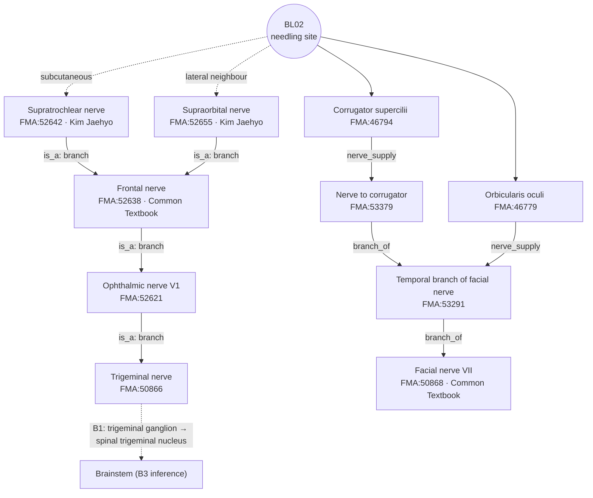

# [Acupoint Anatomical & Physiological Substrate Monograph] Cuanzhu (攢竹, BL2)

> **Framework**: v2.7 (revised 2026-10-04) · **ARI**: ARI v3.0 | ARI-Core 81.2 ± 1.2 (B) | SI 0 ⚠ | provisional weights 0.40/0.35/0.25 | sensitivity (equal weights): 80.2 (B, grade unchanged) · **Dual scoring**: two independent raters, adjudication completed

---

> **Governing principle documents**: Acupoint Substrate Identification Logic Framework (canonical) (v2.7) · Layer B Reference Registry v1.0
> **Source datasets** (Master Datasets Registry):
> 1. Classical Needling Depth Database, sheet 1, row 181 (BL02)
> 2. Acupoint Nomenclature & Alias Comparative Database, 'Comprehensive acupoint list' sheet, row 182; 'Primary name–alias match list (Case A)' sheet, row 4
> 3. Common Textbook Anatomical Structure Dataset entry 179 (BL02, *Acupoint Studies* vol. 1, p. 628) · Kim Jaehyo Anatomical Structure Dataset entry 179 (BL02)
> **Three Primary Classics** (refined editions): *Zhenjiu Shuxue Tongkao* (《針灸腧穴通考》) (上) PDF pp. 561–640 (lines 2310–2590) · *Zhongguo Zhenjiu Xuewei Tongjian* (《中國針灸穴位通鑑》) (上卷) PDF pp. 881–960 (lines 2480–2712) · *Zhongguo Zhenjiu Zhengzhi Tongjian* (《中國針灸證治通鑑》), prescription entries in each chapter
> **Anatomical Ontology**: local index of the FMA (Foundational Model of Anatomy) 5.1.0 — textbook structures are pinned to `FMA:ID`s and their innervation and nerve trunks are cross-checked (B1 supplementary, not yet in the registry). Mapping table: FMA Acupoint Anatomical Ontology Mapping Registry; details in Appendix A
> **Note on script**: Classical quotations and TCM terms are given in Traditional Chinese (繁體字). The cited refined editions are in simplified script; PDF page ranges and line numbers refer to those editions.

### Summary
- **⚠ Safety caution (SI 0)**: Under the rubric the SI is 0 because the three primary classics record the statement "禁用針灸" (no needling, no moxibustion; 禁針·禁灸) from vol. 1 of *Yixue Rumen* (《醫學入門》). This is **a single record in one later, Ming-dynasty text**; most texts from the *Huangdi Mingtang Jing* (《黃帝明堂經》) and *Jiayi Jing* (《甲乙經》) onward, and the needling-depth DB, describe an insertion of **1–3 fen (2.3–6.9 mm)**. The needling-depth DB contains no '0' (contraindicated for needling) entry. The real risk lies in **direction** rather than depth. A perpendicular needle reaches the bony surface of the frontal bone at the frontal notch (額切跡) at a shallow depth, but a needle angled inferoposteriorly (toward the orbit) and inserted deeply can enter the orbit and may cause bleeding (haematoma) from the supratrochlear vessels. Most classical and modern texts recommend **transverse (horizontal) insertion along the skin (沿皮)**.
- **Substrate verdict — probable (B)**: The two textbooks, the 【相關解剖學基礎】 (relevant anatomical basis) section of the *Tongkao* (《通考》) and the normative anatomy references (B1-01, B1-03) agree in interpreting the anatomical substrate of BL2 as the **supratrochlear nerve and artery/vein** passing through the frontal notch (額切跡, 滑車上切跡) and the overlying **corrugator supercilii and orbicularis oculi**. However, there is no cadaveric, ultrasound or MRI study that measures BL2 alone, and all Layer A papers dealing with reflex mechanisms use **multi-point prescriptions** that include BL2. The verdict is therefore "probable", not "confirmed".

---

## 1. Classical Literature Screening Table (Excerpts from the Three Primary Classics & Chinese–English Comparison)

| # | Text (era) | Original text (as recorded in the three primary classics) | English rendering | Location in the classics |
| :---: | :--- | :--- | :--- | :--- |
| 1 | *Huangdi Mingtang Jing* (《黃帝明堂經》) (Han-dynasty lineage, preserved in vol. 3 of the *Jiayi Jing* (《甲乙經》)) | 攢竹，一名員柱，一名始光，一名夜光，一名明光，在眉頭陷者中，足太陽脈氣所發。 | Cuanzhu (攢竹) is also called Yuanzhu (員柱), Shiguang (始光), Yeguang (夜光) and Mingguang (明光); it lies in the depression at the head of the eyebrow, where the Qi (氣) of the Foot Taiyang Vessel (足太陽脈) emerges. | *Tongkao* (《通考》) 名實考 3 (《針灸腧穴通考》(上) PDF pp. 561–640 line 2342) |
| 2 | *Huangdi Mingtang Jing* (《黃帝明堂經》), lost text (vol. 3 of the *Jiayi Jing* (《甲乙經》)) | 刺入三分，留六呼，灸三壯。 | Insert 3 fen, retain for 6 breaths, moxibustion with 3 cones. | *Tongkao* (《通考》) 【操作】 1(1) (line 2564); *Xuewei Tongjian* (《穴位通鑑》) 七.1 「《針灸甲乙經》3:42」 |
| 3 | Wang Bing's (王冰) commentary on 《素問·氣穴論》 (Tang) | 眉本二穴，王冰注曰：攢竹穴也。在眉頭陷者中，足太陽脈氣所發。 | Wang Bing glosses 'the two Meiben (眉本) points' as Cuanzhu (攢竹). | *Tongkao* (《通考》) 名實考 1 (line 2338) |
| 4 | Wang Bing's (王冰) commentary on 《素問·骨空論》 | 在眉頭陷者中，脈動應手。 | In the depression at the head of the eyebrow, where the pulse is felt under the finger. | *Tongkao* (《通考》) 【定位】 2 + note (按) "'脈動應手'四字…當係錯入" |
| 5 | *Qianjin Yifang* (《千金翼方》) vol. 27 (Tang) | 針入一分，留二呼，瀉三吸，徐徐出之。忌灸。宜出血塗鹽。 | Insert 1 fen; moxibustion contraindicated; after bloodletting, apply salt. | *Tongkao* (《通考》) 【操作】 2 |
| 6 | *Tongren Shuxue Zhenjiu Tujing* (《銅人腧穴針灸圖經》), middle volume (Song) | 宜以細三稜針刺之，宣泄熱氣。三度刺，目大明。 | Prick with a fine three-edged needle to drain heat Qi (熱氣); after three prickings the eyes become very bright. | *Tongkao* (《通考》) 【操作】 5; *Xuewei Tongjian* (《穴位通鑑》) 七.7 (針入一分) |
| 7 | *Dou Taishi Zhenjing* (《竇太師針經》) (Jin–Yuan) | 在兩眉頭內尖陷中…針入一分，沿皮向魚腰穴。 | In the depression at the inner tip of the heads of both eyebrows. Insert 1 fen, then lay the needle along the skin toward Yuyao (魚腰). | *Tongkao* (《通考》) 相關穴 1, 【操作】 6(1) |
| 8 | *Zhenjiu Juying* (《針灸聚英》) vol. 1 (Ming) | 睛明刺一分半，攢竹刺一分三分，為適淺深之宜。今醫家刺攢竹，臥針直抵睛明…非古人意也。 | 1–3 fen is appropriate for Cuanzhu (攢竹). Physicians today who lay the needle flat and push it all the way to Jingming (睛明) do not follow the intent of the ancients. | *Tongkao* (《通考》) 【操作】 8 |
| 9 | *Yixue Rumen* (《醫學入門》) vol. 1 (Ming) | 禁用針灸。 | Use neither needling nor moxibustion. | *Tongkao* (《通考》) 【操作】 9 (line 2594); *Xuewei Tongjian* (《穴位通鑑》) 七.16 「《醫學入門》1:3」 |
| 10 | 1957 Nanjing 《針灸學》 (modern) | 針三分，擠起眉端肌皮從眉端橫針入之，即沿皮橫刺。 | 3 fen; pinch up the skin at the end of the eyebrow and insert transversely. | *Tongkao* (《通考》) 【操作】 10(1) |
| 11 | 7th-edition 《針灸學》 (modern) | 可向眉中或向眼眶內緣平刺或斜刺 0.5~0.8 寸。禁灸。 | Horizontal or oblique insertion of 0.5–0.8 cun toward the middle of the eyebrow or the inner margin of the orbit. | *Tongkao* (《通考》) 【操作】 10(4) |
| 12 | *Zhenjiu Shuxue Tongkao* (《針灸腧穴通考》) (Huang Longxiang (黃龍祥), modern collation) | 部位：在面部，眉頭凹陷中，額切跡處。…針刺操作：直刺 0.1~0.3 寸。 | Location: in the depression at the head of the eyebrow, at the frontal notch (額切跡). Perpendicular insertion 0.1–0.3 cun. | 【提要索隱】 (lines 2316–2328) |
| 13 | *Tongkao* (《通考》) 【相關解剖學基礎】 | 內側者為額切跡或滑車上切跡，有滑車上動脈、靜脈和滑車上神經通過。 | The medial one is the frontal notch (額切跡, supratrochlear notch), through which the supratrochlear artery, vein and nerve pass. | 【定位】 (line 2390 onward) |
| 14 | *Tongkao* (《通考》), textual analysis of location (定位·文獻分析) | 本穴定位，古代文獻無分歧，均定位於"眉頭陷者中"。 | Ancient texts do not differ on the location. | 【定位】 文獻分析 |
| 15 | *Zhongguo Zhenjiu Zhengzhi Tongjian* (《中國針灸證治通鑑》) | 呃逆…取穴：攢竹。指壓。 / 腰痛…取穴：攢竹。 / 眉目疼痛不能當，攢竹沿皮刺不妨。 | Cuanzhu (攢竹) alone for hiccup (呃逆) and low back pain (腰痛) / transverse insertion along the skin at Cuanzhu (攢竹) for pain of the eyebrow and eye (眉目疼痛). | 《中國針灸證治通鑑》 PDF pp. 241–320 line 2254; PDF pp. 321–400 line 14; PDF pp. 401–480 line 184 |
| 16 | WHO standard location (2008, B1-05) | In the depression at the medial end of the eyebrow. | In the depression at the medial end of the eyebrow. | B1-05 |

- **Deleted citation (cannot be verified in the classics)**: the earlier edition's 《靈樞·本輸》 "攢竹在顏下…眉頭陷者中" does not appear in any of the three primary classics (full Grep of the refined classics: "在顏下/在颜下" 0 hits). Since the *Tongkao* (《通考》) heading reads "出《黃帝明堂經》" and the *Xuewei Tongjian* (《穴位通鑑》) source is "《針灸甲乙經》3:42", the earliest description is the *Huangdi Mingtang Jing* (《黃帝明堂經》) (vol. 3 of the *Jiayi Jing* (《甲乙經》)).
- **Deleted citation (fabricated quotation)**: the earlier edition's *Tongkao* (《通考》) quotation "眉頭凹陷處, 實爲滑車上神經與滑車上動脈處, 刺深宜斜刺/橫刺 (0.3~0.5寸)" does not exist in the *Tongkao* (《通考》) text. What the *Tongkao* (《通考》) actually says is in rows 12 and 13 above ("直刺 0.1~0.3 寸", "額切跡處", "有滑車上動脈、靜脈和滑車上神經通過"). The *Tongkao* (《通考》) does not present oblique or transverse insertion as its own recommendation; transverse insertion is described by the texts it collects, such as Dou (竇氏), Nanjing 《針灸學》 and the 7th-edition textbook.

---

## 2. Primary Source vs. Secondary Quotation Table

| Item | Primary source (earliest description) | Secondary quotation, commentary, later variants | Verdict |
| :--- | :--- | :--- | :--- |
| Location | *Huangdi Mingtang Jing* (《黃帝明堂經》) "在眉頭陷者中" | The same wording is re-quoted by Wang Bing's (王冰) commentary, 《聖惠方》, 《銅人》, 《大成》 and others. Dou's (竇氏) "眉頭內尖陷中" is a refinement | Consistent with the primary source. No disagreement among ancient texts (《通考》) |
| Additional location detail | — | Wang Bing's (王冰) commentary on 《骨空論》 "脈動應手" | *Tongkao* (《通考》) note: absent from Wang Bing's other commentaries, therefore **錯入** (interpolation) |
| Anatomical term | — | 1990 national standard and 6th-edition textbook "眶上切跡處" | *Tongkao* (《通考》) note: confusion of "額切跡" (frontal notch) with "眶上切跡" (supraorbital notch). Corrected to "額切跡" in the 2006 national standard |
| Insertion depth | *Huangdi Mingtang Jing* (《黃帝明堂經》) (《甲乙》) "刺入三分" | 《醫心方》 2 fen, 《千金翼》 and 《銅人》 1 fen, 《聚英》 1–3 fen, modern textbooks horizontal insertion 0.5–0.8 cun | Primary source 3 fen. Later texts become shallower (1–2 fen) and switch to transverse insertion |
| Moxibustion | *Huangdi Mingtang Jing* (《黃帝明堂經》) "灸三壯" | 《千金翼》 "忌灸", 《聖惠·針經》 "不宜灸", Dou (竇氏) "禁灸", modern textbooks "禁灸" | Moxibustion (灸法) conflicts between the primary source and later texts. Most later texts prohibit moxibustion |
| Needling contraindication | — | *Yixue Rumen* (《醫學入門》) vol. 1 "禁用針灸" | A single later record, at variance with the primary source and most texts → reason for SI 0 (Section 10) |
| Indications | *Huangdi Mingtang Jing* (《黃帝明堂經》): 風頭痛 · 眉頭痛 · 目如欲脫 · 目䀮䀮不明 · 癲疾 · 小兒癇 · 痔痛 | 《聚英》 and 《大成》 "淚出，目眩，瞳子癢" | *Tongkao* (《通考》) note: Gao Wu (高武) misread the punctuation and mixed in the indications of Chengqi (承泣) → excluded from the indications of Cuanzhu (攢竹) |
| Aliases | *Huangdi Mingtang Jing* (《黃帝明堂經》) 員柱 · 始光 · 夜光 · 明光 | 《銅人》 "光明", Nanjing 《針灸學》 員在 · 小竹 · 眉中 · 元柱, etc. | See Section 3 |

---

## 3. Alias Verification Table (KJH DB Cross-check)

BL02 aliases in the KJH DB (Acupoint Nomenclature & Alias Comparative Database, 'Comprehensive acupoint list' sheet, row 182): **始光, 光明, 圓柱, 夜光, 明光, 眉頭圓柱, 眉本, 魚頭**

| Alias | Earliest source (chronological) | KJH DB | Verdict (based on the *Tongkao* (《通考》) 名實考 and notes) |
| :--- | :--- | :---: | :--- |
| 員柱 (圓柱) | *Huangdi Mingtang Jing* (《黃帝明堂經》) | ○ (圓柱) | Formal alias |
| 始光 | *Huangdi Mingtang Jing* (《黃帝明堂經》) | ○ | Formal alias |
| 夜光 | *Huangdi Mingtang Jing* (《黃帝明堂經》) | ○ | Formal alias |
| 明光 | *Huangdi Mingtang Jing* (《黃帝明堂經》) | ○ | Formal alias |
| 眉本 · 眉頭 | 《素問》 氣穴論 · 氣府論 (Wang Bing's (王冰) commentary) | ○ (眉本) | *Tongkao* (《通考》): a **region name** in the *Suwen* (《素問》), not a point name |
| 光明 | *Tongren Shuxue Zhenjiu Tujing* (《銅人腧穴針灸圖經》) (Song) | ○ | *Tongkao* (《通考》): suspected **inversion (倒文)** of "明光". **Same-name clash with Guangming (光明, GB37)** (KJH 'Primary name–alias match list' Case A: BL02 光明 ↔ GB37 Guangming). In addition, the '光明' of the Dunhuang 《新集備急灸法》 and 《銀海精微》 is a **different point with the same name (同名異穴)** at the middle of the eyebrow (the position of Yuyao (魚腰)), not Cuanzhu (攢竹) |
| 眉頭圓柱 | KJH slide notation | ○ | Appears to be a combined notation of 眉頭 (region name) + 圓柱. No independent basis in the classics |
| 魚頭 | 1983 Shanghai 《針灸治療手冊》 | ○ | Modern alias (corresponding to 魚腰 and 魚尾) |
| 員在 | *Jiayi Jing* (《甲乙》) editions, Nanjing 《針灸學》 | × | *Tongkao* (《通考》): **graphic error (形誤)** for "員柱" |
| 元柱 | 《古今醫統大全》 | × | *Tongkao* (《通考》): **homophonic substitution** for "員柱" |
| 小竹 | Nanjing 《針灸學》 | × | *Tongkao* (《通考》): **alias of Meichong (眉衝, BL3)** → excluded from the aliases of Cuanzhu (攢竹) |
| 眉柱 · 矢光 · 眉中 | 《雲岐子》 · 《楊敬齋》 · Nanjing 《針灸學》 | × | Later variant spellings. No independent information |
| ~~烏列 · 大空~~ | **No basis** | × | Absent from the KJH DB and all three primary classics → **deleted** (error in the earlier edition) |

**Record of confusion blocking**: information retrieved under '光明' must be read as three separate strands: ① 光明 as an alias of BL2 (from 《銅人》 onward); ② Guangming (光明, GB37) (Connecting point (絡穴) of the Foot Shaoyang (足少陽), lower leg); ③ the 光明 of Dunhuang and 《銀海精微》 (middle of the eyebrow, the position of Yuyao (魚腰)). No content from ② or ③ has been mixed into the location, anatomy or indications in this report. Since the confusion is resolved by chronological ordering, S_orig ③ = 75.

---

## 4. 3D Spatial Coordinates & Layer 1–5 Anatomical Substrate Diagram

### 4.1 Location Discrepancy Check (Δ_discrepancy)
- The classical "眉頭陷者中" and the WHO 2008 "medial end of the eyebrow" point to the same palpable landmark, the **frontal notch (額切跡, 滑車上切跡)**. The classical–modern deviation is under 15 mm, so there is **no Target split** (single Target T1).
- Terminology caution: this depression is the **frontal notch (額切跡)**, distinct from the more lateral **supraorbital notch/foramen (眶上切跡/孔)** (*Tongkao* (《通考》) textual analysis). The earlier edition's garbled terms "hwachasangjeolno / anhwasangjeolno" are errors and are corrected to **frontal notch (額切跡; supratrochlear notch)**.

### 4.2 Coordinate System
- **X axis (medial–lateral)**: lateral from the midline. Reference line = vertical line through the inner canthus (WHO). The frontal notch (額切跡) lies closer to the midline than the supraorbital notch (眶上切跡).
- **Y axis (cranial–caudal)**: medial end of the eyebrow = level of the supraorbital margin. Above it lies Meichong (眉衝, BL3; directly above the frontal notch, 0.5 cun within the anterior hairline).
- **Z axis (depth)**: from the skin to the bony surface of the frontal bone. Layer A contains no study measuring soft-tissue thickness at BL2 alone. Layer boundaries are therefore not given in mm; **only the order** is presented (normative anatomy B1-01 and B1-03, the two textbooks B2-09).

### 4.3 Layers 1–5 (Framework Definitions Applied)

| Layer (framework definition) | Corresponding structures at BL2 | Basis | Remarks |
| :--- | :--- | :--- | :--- |
| Layer 1 Skin & subcutis | Skin, subcutaneous tissue, cutaneous branches of the supratrochlear nerve (V1, branch of the frontal nerve) | Kim Jaehyo textbook, Common Textbook (frontal nerve), B1-01 | Main stimulated layer in transverse insertion |
| Layer 2 Superficial muscle & fascia | Orbicularis oculi (orbital part), medial fibres of frontalis, depressor supercilii | Both textbooks | Innervated by the temporal branches of the facial nerve |
| Layer 3 Deep muscle & motor branches | Corrugator supercilii (arising from the medial frontal bone), temporal branches of the facial nerve | Both textbooks | Movement of the eyelid and glabella |
| Layer 4 Neurovascular bundle | **Supratrochlear nerve, artery and vein** (exiting at the frontal notch (額切跡)); supraorbital neurovascular bundle laterally | *Tongkao* (《通考》) 相關解剖學基礎, Kim Jaehyo textbook, B1-01 | Caution: bleeding (haematoma) |
| Layer 5 Periosteum & deep | **Periosteum** of the frontal bone at the frontal notch (額切跡) (end point of perpendicular insertion). Below and behind it, the orbital contents lie behind the orbital septum | B1-01, B1-03 | The eyeball lies **below and behind** the supraorbital margin. A perpendicular needle stops at the bone surface; there is a risk of entering the orbit **only with inferoposteriorly angled insertion** |

- **Correction of the earlier edition**: the earlier model "Layer 5 eyeball, when inserted perpendicularly at z > 11.5 mm" does not fit the anatomy. A perpendicular needle at BL2 reaches the frontal bone at a depth of a few mm, and the eyeball lies below the supraorbital margin. The risk depends on **direction (angling toward the orbit)** rather than depth. The earlier edition's layer order (Layer 3 = neurovascular, Layer 4 = periosteum) has also been corrected to the framework definitions (Layer 4 = neurovascular bundle, Layer 5 = periosteum).

### 4.4 Sectional Schematic

```
                 [Cuanzhu (BL2) sagittal section — order only; mm boundaries not measured]

  (up) Forehead  ─────────────────────────────────────────────────────
          Skin ── Layer 1: Skin & subcutis (cutaneous branches of supratrochlear n., V1)
          ─────── Layer 2: Orbicularis oculi · frontalis · depressor supercilii
          ─────── Layer 3: Corrugator supercilii (temporal branches of facial n.)
          ─────── Layer 4: Supratrochlear n., a. & v. (exit at frontal notch)
   ███████████████ Layer 5: Periosteum of frontal bone at frontal notch  <- perpendicular (90°) stops here
   ███ Frontal bone ███╲
                       ╲  Supraorbital margin
                        ╲___ Orbital septum -> orbital contents (eyeball lies below and behind)
  (down) Eye

  Comparison of needle paths
   ① Transverse along the skin (Dou: "沿皮向魚腰"): passes horizontally through Layers 1-2 -> wide safety margin
   ② Perpendicular (Tongkao 0.1-0.3 cun): stops at bone surface (Layer 5); may contact Layer 4 vessels
   ③ Deep insertion angled inferoposteriorly (e.g. "臥針直抵睛明", criticised in Juying): risk of entering the orbit ⚠
```


*Figure 4-1. Schematic sagittal section at the level of Cuanzhu (攢竹) (left side of the face viewed from the lateral side, anterior = left, not to scale). A perpendicular needle (black arrow) reaches and stops at the periosteum of the frontal bone at the frontal notch (額切跡) within a few mm, while transverse insertion along the skin (沿皮, ⊙) passes through layers ①–② outward, out of the plane of the page (toward Yuyao (魚腰)). Only deep insertion angled inferoposteriorly (red dashed line) passes through the orbital septum into the orbit. Layer thicknesses and distances are arbitrary because no BL02-specific measurements exist.*

### 4.5 FMA Substrate Cross-check (by Layer)

Structure names from the two textbooks; IDs and relations from FMA 5.1.0 (FMA profile query).

| Layer | Structure | FMA | FMA relation | Innervation / trunk (FMA) | Spinal segment |
| :--- | :--- | :--- | :--- | :--- | :--- |
| 1 Subcutis | Cutaneous branches of supratrochlear nerve *(Kim Jaehyo: supratrochlear nerve)* | FMA:52642 | is_a Branch of frontal nerve | Frontal nerve (FMA:52638) → ophthalmic nerve (FMA:52621) → trigeminal nerve (FMA:50866) | Not applicable (cranial nerve V1) |
| 1 Subcutis | Frontal nerve *(Common Textbook)* | FMA:52638 | is_a Branch of ophthalmic nerve | Ophthalmic nerve → trigeminal nerve | Not applicable |
| 2 Superficial muscle | Orbicularis oculi *[both]* | FMA:46779 | is_a Circumorbital muscle | Branches to orbicularis oculi from the zygomatic and temporal branches of the facial nerve (FMA:53314 · 53377) | Not applicable (cranial nerve VII) |
| 2 Superficial muscle | Frontalis *[both]* | FMA:46757 | is_a Subdivision of occipitofrontalis | **Not recorded in FMA** (B1-01: temporal branches of the facial nerve) | Not applicable |
| 2 Superficial muscle | Depressor supercilii *(Kim Jaehyo)* | FMA:46798 | is_a Depressor muscle | Nerve to depressor supercilii (FMA:82674) | Not applicable |
| 3 Deep muscle | Corrugator supercilii *[both]* | FMA:46794 | is_a Circumorbital muscle | Nerve to corrugator supercilii (FMA:53379) → temporal branch of facial nerve (FMA:53291) → facial nerve (FMA:50868) | Not applicable |
| 3 Motor branch | Temporal branch of facial nerve *(Kim Jaehyo)* / facial nerve *(Common Textbook)* | FMA:53291 / 50868 | is_a Branch of facial nerve | Facial nerve | Not applicable |
| 4 Neurovascular bundle | Supratrochlear artery *[both]* | FMA:50025 | is_a Terminal branch of ophthalmic artery | Ophthalmic artery (FMA:49868) → internal carotid artery (FMA:3947) | — |
| 4 Neurovascular bundle | Supratrochlear vein *[both]* | FMA:50898 | drains_into Angular vein | Angular vein (FMA:50893) → facial vein (FMA:50874) → internal jugular vein (FMA:4724) | — |
| 4 Lateral neighbour | Supraorbital artery, vein & nerve *(Kim Jaehyo)* | FMA:49973 · 50904 · 52655 | Pass through the supraorbital notch (FMA:57390) — outside the section | Frontal nerve → ophthalmic nerve | — |
| 5 Periosteum | Frontal bone · frontal notch (額切跡) | FMA:52734 · FMA:57409 (synonym Frontal notch) | — | — | — |

- **FMA note 1 — segments**: all nerves of the BL02 structures are cranial nerves (trigeminal V1, facial VII), so FMA has no `segmental_supply`. B-Check ② in 8.3 is judged by **concordance within the V1 nerve territory** instead of spinal segments (existing verdict kept).
- **FMA note 2 — angular vein communication**: FMA records the angular vein only as a tributary of the facial vein and does not record its communication with the superior ophthalmic vein (→ cavernous sinus). This communication is based on normative anatomy (B1-01) and is described only as a route to consider in supratrochlear venous bleeding or infection.
- **FMA note 3 — innervation of frontalis**: FMA has no `nerve_supply` for frontalis. Innervation by the temporal branches of the facial nerve is stated on the basis of B1-01.

---

## 5. Needling Depth Calculation Table

Source: Classical Needling Depth Database, sheet 1, row 181 (BL02). Rules: integer = fen, '0' = contraindicated for needling (禁針), blank = not described. Conversion: 1 fen = 2.3 mm (Han-dynasty standard).

| Text (DB column) | DB value (fen) | Converted depth (mm) | Layer reached (assuming perpendicular insertion) | Remarks |
| :--- | :---: | :---: | :--- | :--- |
| *Huangdi Mingtang Jing* (《黃帝明堂經》, ed. Huang Longxiang) | 3 | 6.9 | Layer 4–5 (near the bone surface) | Primary source |
| *Zhenjiu Jiayi Jing* (《針灸甲乙經》) | 3 | 6.9 | Layer 4–5 | Text preserving the primary source |
| *Chimgu Gyeongheombang* (《鍼灸經驗方》) | 1 | 2.3 | Layer 1–2 | |
| *Dongui Bogam* (《東醫寶鑑》, citing 《銅人》) | **1** | **2.3** | Layer 1–2 | The earlier edition's '3 fen' was an error → corrected to the DB value of 1 fen |
| Korean common textbook, *Meridian and Acupoint Studies* (經絡腧穴學) (min–max) | 2–3 | 4.6–6.9 | Layer 2–5 | The earlier edition's 'modern textbooks 3–5 fen' was an error |
| Korean common textbook, *Acupuncture and Moxibustion Medicine* (鍼灸醫學) (min–max) | 2–3 | 4.6–6.9 | Layer 2–5 | |
| *Zhenjiu Shuxue Tongkao* (《針灸腧穴通考》) (min–max) | 1–3 | 2.3–6.9 | Layer 1–5 | *Tongkao* (《通考》) "直刺 0.1~0.3 寸" |
| Preferred-needling-method columns (*Meridian and Acupoint Studies*, *Tongkao*) | blank | — | — | Not described (missing) |
| *(outside the DB)* *Yixue Rumen* (《醫學入門》) vol. 1 | *contraindication described* | — | — | "禁用針灸". Not entered as '0' in the DB. Recorded only in the three primary classics |

- **Range**: all DB values 2.3–6.9 mm. There is no '0' in the DB. The earlier edition's mean μ = 9.2 mm and standard deviation σ = 1.8 mm had no source and did not match the DB, so they were **deleted**.
- **Angle-correction example** ($z_{vertical} = L \times \sin\theta$): inserting the primary-source 3 fen (L = 6.9 mm) along the skin as Dou (竇氏) describes (θ ≈ 15°) gives $z = 6.9 \times \sin 15^\circ \approx 1.8\text{mm}$, remaining in Layer 1–2. This is a worked example of the angle effect, not a BL2 measurement. The earlier edition's $11.5 \times \sin 20^\circ$ calculation used an unsupported 5-fen input and was deleted.

---

## 6. Textbook Comparison Table of Anatomical Structures (Common Textbook vs. Kim Jaehyo Textbook)

| Category | Common Textbook of Acupoint Studies (Common Textbook dataset entry 179, *Acupoint Studies* vol. 1, p. 628) | Kim Jaehyo textbook dataset (entry 179) | FMA adjudication | Similarities / differences |
| :--- | :--- | :--- | :--- | :--- |
| Muscles | Orbicularis oculi, frontalis, corrugator supercilii | Orbicularis oculi, depressor supercilii, corrugator supercilii, frontal belly of occipitofrontalis | Shared FMA:46779 · 46757 · 46794 / Kim Jaehyo only FMA:46798 | 3 shared. The Kim Jaehyo textbook adds depressor supercilii |
| Nerves | Facial nerve, frontal nerve | Supraorbital nerve, supratrochlear nerve, temporal branches of the facial nerve | Common Textbook FMA:50868 · 52638 / Kim Jaehyo FMA:52655 · 52642 · 53291 — **in FMA `is_a` and trunk relations, the Common Textbook items are the parent trunks of the Kim Jaehyo items** | The frontal nerve is the parent nerve of the supraorbital and supratrochlear nerves, so the hierarchy is consistent. The Kim Jaehyo textbook is more specific, at branch level |
| Vessels | Supratrochlear artery & vein | Supraorbital artery & vein, supratrochlear artery & vein | Shared FMA:50025 · 50898 / Kim Jaehyo only FMA:49973 · 50904 | Supratrochlear artery and vein are shared. The Kim Jaehyo textbook adds the lateral supraorbital artery and vein |

**What FMA shows about the textbook differences**: in the FMA profile comparison of the two textbooks there are 5 shared, 2 Common-Textbook-only and 6 Kim-Jaehyo-only items, but the 2 Common-Textbook-only items (frontal nerve FMA:52638, facial nerve FMA:50868) are the **direct parent trunks in FMA** of the 3 Kim-Jaehyo-only nerves (supratrochlear and supraorbital nerves → frontal nerve; temporal branches → facial nerve). The difference in the nerve items is therefore not a conflict but **a difference in the level recorded (trunk vs. branch)**; the only substantive differences are depressor supercilii in the Kim Jaehyo textbook and the lateral supraorbital neurovascular bundle (at the supraorbital notch (眶上切跡) lateral to the frontal notch (額切跡), not directly beneath BL02). The existing verdict ($S_{clarity}$ 75) is unchanged.

- **Verdict**: the core structures (orbicularis oculi, corrugator supercilii, frontalis, supratrochlear vessels, frontal nerve system) agree. The *Tongkao* (《通考》) 【相關解剖學基礎】 (frontal notch (額切跡) = passage of the supratrochlear artery, vein and nerve) and the normative anatomy references B1-01 and B1-03 say the same. However, there is no BL2-specific measurement paper, so S_clarity = 75.
- **Diagram notation**: the structures shared by both textbooks are reflected in Layers 1–5 of the 4.4 schematic. The supraorbital neurovascular bundle lies lateral to the frontal notch (額切跡) (at the supraorbital notch (眶上切跡)), so it is treated not as directly beneath BL2 but as a **lateral neighbouring structure**.

---

## 7. Spatial Displacement Branching Diagram

**Not applicable.** The classical ("眉頭陷者中") and WHO 2008 locations point to the same frontal notch (額切跡), with a deviation under 15 mm. Single Target 1 analysis; the ΔARI-Core verdict is not applied either.

---

## 8. Biomedical Reflex Pathway Diagram & External Search Log

### 8.1 Reflex Pathway Diagram (Layer B Mapping)

```
[Afferent] BL2 skin/fascia stimulation -> supratrochlear n. (V1 ophthalmic n. -> branch of frontal n.)   B1-01, B1-02
          │  Fibre type: no direct measurement (animal trigeminal ganglion P2X3 only, papers.id 1998)   B3-06 (inference)
          ▼
[Central] Trigeminal ganglion -> spinal trigeminal nucleus (gate control, analgesia)              B3-07, B3-11 (inference)
          │        -> superior salivatory nucleus -> pterygopalatine ganglion -> lacrimal gland   B3-05 (inference)
          ▼
[Efferent/target] Tear secretion, modulation of ocular-surface inflammation (animal: VIP/AQP5, α7nAChR/NF-κB)   B3-14 (out-of-scope framework, inference)
            papers.id 1981, 1997, 1999 (animal, multi-point)
[Human] Clinical studies in dry eye and facial neuritis (multi-point, with eye drops)             B4-04, B4-05
            papers.id 1979, 1994, 2000
```

**Pinning the peripheral afferent pathway with FMA**: the first segment of the circuit above (needling site → trigeminal nerve) is pinned by FMA relations as follows. Solid lines are relations recorded in FMA; dashed lines are links absent from FMA and supplemented from B1.



*Figure 8-1. Peripheral pathway of BL02 drawn from FMA 5.1.0 relations. Sensation (afferent) belongs to the V1 system and muscle movement to the VII system. Muscle innervation (VII) is a motor efferent pathway and is not used as the afferent limb of the reflex.*

- **Correction**: the earlier edition's "upper brainstem ganglion" is a non-existent structure. The parasympathetic pathway to the lacrimal gland is **superior salivatory nucleus → facial nerve (greater petrosal nerve) → pterygopalatine ganglion → lacrimal gland** (scope of B1-02). The earlier edition's claim of "autonomic receptors of the supratrochlear artery and vein" had no basis and was deleted.
- **Segmental correspondence (②)**: for the head and face, the judgement is made by the **trigeminal V1 territory** instead of spinal segments. The stimulation site (supratrochlear nerve) and the target (sensation of the cornea, conjunctiva and lacrimal gland) lie within the same V1 distribution.
- **Limit of point specificity (important)**: the Layer A papers below are **all multi-point prescriptions that include BL2**. There are **0** studies that stimulated BL2 alone and measured an ophthalmic effect or mechanism. The only paper in the pack using BL2 alone is papers.id 2008, a case series of acute lumbar sprain (2003) unrelated to the ophthalmic indications and mechanisms, and it was not used for scoring. Steps ③, ④ and ⑤ of the circuit above are therefore not a BL2-specific mechanism but "**an inference to BL2 from the mechanism of combined periocular stimulation**" (the counter-evidence aspect of point specificity, B4-05).

### 8.2 Layer A Papers (evidence pack)

| papers.id | Year | Journal | Title | PMID / DOI | Design (relevance to BL2) |
| :---: | :---: | :--- | :--- | :--- | :--- |
| 1979 | 2022 | Zhongguo Zhen Jiu | Effect of acupuncture on dry eye and tear inflammatory factors | 36484191 / 10.13703/j.0255-2930.20220318-0001 | Human clinical, dry eye (pack classification: non-RCT; raters described it as an RCT). Multi-point |
| 1981 | 2022 | Zhen Ci Yan Jiu | Acupuncture mitigates ocular surface inflammatory response via α7nAChR/NF-κB p65 signaling in dry eye guinea pigs | 36453674 / 10.13702/j.1000-0607.20220015 | Animal (guinea pig). Multi-point |
| 1994 | 2025 | Zhongguo Zhen Jiu | Penetrating needling of three eye acupoints combined with sodium hyaluronate eye drops for dry eye: a randomized controlled trial | 40369920 / 10.13703/j.0255-2930.20240521-0002 | Human RCT. Penetrating needling of 3 periocular points + eye drops |
| 1997 | 2023 | Zhen Ci Yan Jiu | Acupuncture promotes tear secretion by up-regulating VIP/cAMP/PKA/AQP5 signaling in guinea pigs with aqueous tear deficiency | 37879953 / 10.13702/j.1000-0607.20230061 | Animal (guinea pig). Multi-point |
| 1998 | 2022 | Zhen Ci Yan Jiu | Effect of electroacupuncture on ocular surface sensory neuralgia and expression of P2X3 receptor and PKC in cornea and trigeminal ganglion… | 35616412 / 10.13702/j.1000-0607.20210607 | Animal (guinea pig). Multi-point |
| 1999 | 2020 | Zhen Ci Yan Jiu | Effect of acupuncture on expression of transfer growth factor-β1 in lacrimal gland of rabbits with dry eye | 32959555 / 10.13702/j.1000-0607.190977 | Animal (rabbit). Multi-point |
| 2000 | 2020 | Zhen Ci Yan Jiu | Influence on orbicularis oculi muscle in the patients with facial neuritis treated with the penetrating needling… | 32959557 / 10.13702/j.1000-0607.190894 | Human non-RCT. Penetrating needling BL2 → EX-HN4 (Yuyao (魚腰)) + BL62 |
| 2001 | 2019 | Zhen Ci Yan Jiu | Acupuncture of intraorbital and extraorbital acupoints reduces apoptosis of retinal ganglion… | 31056882 / 10.13702/j.1000-0607.180440 | Animal (rabbit NAION). Multi-point |
| 2003 | 2026 | PubMed (as given in the pack) | Acupuncture alleviates form-deprivation myopia by promoting dopamine secretion and suppressing ferroptosis… | 42779258 / 10.14670/hh-25-141 | Animal (myopia model). Multi-point. Counted by rater B only |
| *(reference)* 2008 | 2003 | J Acupunct Tuina Sci | Treatment of 55 cases of acute lumbar sprain by puncturing acupoint Cuanzhu (BL 2) | — / 10.1007/bf02845431 | Human case series. **BL2 alone**, but lumbar sprain (not an ophthalmic indication or mechanism). Not used in scoring |

- Layer A papers including BL2 counted by each rater: A 8, B 9 (including 2003). The other papers in the pack (facial palsy, trigeminal neuralgia, etc.; 1980–1996, 2004–2007) could not be confirmed from their titles to include BL2 and were not used in scoring. Locally mapped 506 and 795 are reviews or general imaging studies, and 2002 is a rat acupoint atlas, not a BL2 measurement.

### 8.3 B-Check Six-Item Scoring Table

| Item | Rater A | Rater B | Final | Layer B reference IDs | papers.id | Rationale |
| :---: | :---: | :---: | :---: | :--- | :--- | :--- |
| ① Peripheral nerve/vessel substrate at needling depth | 2 | 2 | **2** | B1-01, B1-03, B1-05, B2-09 (+FMA) | — | The two textbooks, normative anatomy and the *Tongkao* (《通考》) agree in describing the supratrochlear neurovascular bundle, corrugator supercilii and orbicularis oculi at the frontal notch (額切跡). All 13 textbook structures map exactly to FMA (FMA:52642 · 50025 · 50898 · 46794 · 46779, etc.; Section 4.5). No imaging measurement |
| ② Segmental concordance (trigeminal V1 territory) | 2 | 2 | **2** | B1-01, B1-02 (+FMA) | — | Cutaneous territory of the supratrochlear nerve (V1) ↔ sensation of the cornea, conjunctiva and lacrimal gland (V1). FMA trunk: supratrochlear nerve → frontal nerve → ophthalmic nerve (FMA:52621) → trigeminal nerve (FMA:50866). Judged by cranial nerve territory instead of spinal segments (FMA segmental_supply not applicable) |
| ③ Afferent fibre type & receptors | 1 | 1 | **1** | B3-06 | 1998 | Guinea-pig trigeminal ganglion P2X3/PKC (animal, multi-point). No direct measurement of BL2 afferent fibre type |
| ④ Central relay & pathway | 1 | 1 | **1** | B3-05, B3-07, B3-11 | 1998 | The spinal trigeminal nucleus and superior salivatory nucleus pathways are inferences outside the registry's scope. No paper measures the central pathway |
| ⑤ Efferent pathway & direction of effect | 1 | 1 | **1** | B3-14 | 1981, 1997, 1999 | Increased tear secretion and ocular-surface anti-inflammation in animals. The classical '流淚 / 迎風冷淚' (excessive lacrimation) and the dry-eye model (promotion of secretion) do not correspond directly in direction, hence inference |
| ⑥ Human translation | 1 | 1 | **1** | B4-04, B4-05 | 1979, 1994, 2000 | Human RCTs and clinical studies exist, but multi-point designs and concomitant eye drops make BL2 specificity impossible to isolate. No neuroimaging or autonomic indices |
| **Total** | **8** | **8** | **8 / 12** | | | **Verdict: concordant** (≥ 8, ① and ② ≥ 1). ⑥ = 1, so no 'animal only' flag. No conflicting (0-point) item → no 'hypothesis' restriction |

- The concordant verdict is the result of **inferring to BL2 from multi-point studies**. Until BL2-alone studies exist, the circuit in 8.1 should be read as "the probable mechanism of periocular stimulation including BL2".

### 8.4 External Search Log (sync_log; Rank 6 runs of 2026-10-04 and 2026-10-23)

| Timestamp | Source | HTTP | Fetched | Duplicates removed | New | Query |
|---|---|---|---|---|---|---|
| 2026-10-04T09:52:17 | pubmed | 200 | 16 | — | — | ("BL2" OR "Cuanzhu" OR "攢竹") AND (acupuncture OR electroacupuncture) AND (nerve OR reflex OR autonomic OR mechanism OR anatomy) |
| 2026-10-04T09:52:17 | openalex | 200 | 23 | — | — | doi_starts_with:10.13703,title_and_abstract.search:"Cuanzhu" OR "BL2" \| doi_starts_with:10.13702,title_and_abstract.search:"Cuanzhu" OR "BL2" \| has_doi:true,tit… |
| 2026-10-04T09:52:17 | crossref | 200 | 1 | — | — | Cuanzhu acupuncture nerve reflex |
| 2026-10-04T09:52:17 | all | — | 40 | 10 | 30 | |
| 2026-10-23T21:43:19 | pubmed | 200 | 16 | — | — | ("BL2" OR "Cuanzhu" OR "攒竹") AND (acupuncture OR electroacupuncture) AND (nerve OR reflex OR autonomic OR mechanism OR anatomy) |
| 2026-10-23T21:43:19 | openalex | 200 | 23 | — | — | doi_starts_with:10.13703 / 10.13702 · title_and_abstract.search:"Cuanzhu" OR "BL2" … |
| 2026-10-23T21:43:19 | crossref | 200 | 1 | — | — | Cuanzhu acupuncture nerve reflex |
| 2026-10-23T21:43:19 | all | — | 40 | 37 | 3 | 27 already merged · 10 duplicates within the batch |

- **3 new papers in the 2026-10-23 re-run**: papers.id 2246 (PMID 34085472, row-needling of sternocleidomastoid in the recovery phase of peripheral facial palsy), 2247 (PMID 38373760, visual acuity in children with anisometropic amblyopia), 2248 (PMID 21823275, acute idiopathic facial palsy). All three are **multi-point clinical studies** that include BL2 and do not measure a BL2-alone mechanism, so they do not change the B-Check or ARI verdict (the "multi-point limitation" of 8.1 stands).

---

## 9. Classical Indications Stratification Table (Single-Point Needling vs. Combination Prescriptions)

$P_{single}$ is **not calculated quantitatively**. The earlier edition's 0.90–0.94 and 'Level A' had no basis for calculation and were deleted. Below is a qualitative classification of classical entries into single-point records and combination records.

| Indication | Single-point (BL2 only) records | Combination records | Verdict |
| :--- | :--- | :--- | :--- |
| Blurred vision (目不明) · heat and pain in the eye (目中熱痛) · twitching of the eyelid (瞼瞤動) | Indications in the *Huangdi Mingtang Jing* (《黃帝明堂經》) (目䀮䀮不明), 《千金翼》 "攢竹主目視不明，目中熱痛及瞤", 《銅人》 "三度刺，目大明" | Many eye prescriptions in 《針灸集成》 (combined with Jingming (睛明), Sizhukong (絲竹空), Taiyang (太陽), Hegu (合谷)) | **Single-point basis exists**. *Tongkao* (《通考》): indications past and present concentrate on eye disorders |
| Red, swollen and painful eyes (目赤腫痛) (conjunctival injection and swelling) | 《世醫得效方》 "赤眼…針攢竹穴即安" (together with pricking of the red vessels behind the ear (耳後紅筋)), 《通玄指要賦》 "腦昏目赤，瀉攢竹" | 《針灸集成》 prescription 16 and others | Single-point basis exists. Linked to bloodletting with the three-edged needle |
| Pain of the supraorbital ridge (眉棱骨痛) · frontal headache (前頭痛) | *Huangdi Mingtang Jing* (《黃帝明堂經》) "眉頭痛", 《玉龍歌》 "眉目疼痛…攢竹沿皮刺" | 《玉龍歌》 with Touwei (頭維), 《針灸集要》 with Fenglong (豐隆) | Mixture of single-point and combination |
| Lacrimation (流淚) · cold tears on exposure to wind (迎風冷淚) | — | 《針灸集成》 prescription 11 (Hegu (合谷), Dagukong (大骨空), Xiaogukong (小骨空)), modern prescriptions (Jingming (睛明), Fengchi (風池), Ganshu (肝俞)) | **Derived from combinations**. The "淚出，目眩，瞳子癢" of 《聚英》 is a misattribution of Chengqi (承泣) indications (*Tongkao* (《通考》) note) |
| Wind headache (風頭痛) · stiff neck (項強) · epilepsy (癲疾) · infantile convulsions (小兒癇) | *Huangdi Mingtang Jing* (《黃帝明堂經》) | Multi-point combinations in 《千金》 | *Tongkao* (《通考》): selected only when eye symptoms (目如欲脫 · 目系急 · 目上插) are also present |
| Haemorrhoidal pain (痔痛) | *Huangdi Mingtang Jing* (《黃帝明堂經》) | — | *Tongkao* (《通考》): no clinical cases past or present; needs verification |
| Hiccup (呃逆) | 《證治通鑑》 "取穴：攢竹。指壓" | 《針灸治療學》 (Zhongwan (中脘), Neiguan (內關), etc.) | Modern single-point report. *Tongkao* (《通考》): specificity unverified; withheld from the indications |
| Low back pain (腰痛) · acute lumbar sprain (急性腰扭傷) | 《證治通鑑》 "取穴：攢竹" (中國針灸 1982); papers.id 2008 | 《江西中醫藥》 2002 (with Yanglingquan (陽陵泉)) | Modern single-point report. Anatomical mechanism unknown |

---

## 10. ARI v3.0 Profile Evaluation & Final Conclusion

**Target T1 (single)**: *Huangdi Mingtang Jing* (《黃帝明堂經》) and *Jiayi Jing* (《甲乙經》) "在眉頭陷者中" = WHO 2008 "depression at the medial end of the eyebrow, directly above the inner canthus" (frontal notch (額切跡) / 滑車上切跡)

### 10.1 Sub-scores

| Index | Rater A | Rater B | Mean | Rubric-level rationale | Evidence pointers |
| :--- | :---: | :---: | :---: | :--- | :--- |
| S_orig | 93.75 | 87.5 | **90.6** | The primary source specifies both location and depth; no ancient disagreement on location; the 光明 confusion is resolved chronologically; *Tongkao* (《通考》) collation reflected | 《針灸腧穴通考》(上) PDF pp. 561–640 名實考 · 定位 · 操作; 《中國針灸穴位通鑑》(上卷) PDF pp. 881–960 二.別名 · 七; KJH Case A |
| S_clarity | 75 | 75 | **75** | The two textbooks agree + standard entities confirmed by normative anatomy and FMA (the nerve difference is a trunk/branch-level difference in FMA). No BL2-specific cadaveric or imaging measurement → below 100 | Common Textbook dataset and Kim Jaehyo entry 179; *Tongkao* (《通考》) 相關解剖學基礎; B1-01, B1-05, B2-09; FMA:52642 · 52638 |
| S_reflex | 75 | 75 | **75** | Human studies + many animal studies + B-Check 8. All multi-point, so 100 not possible | papers.id 1979, 1981, 1994, 1997, 1998, 1999, 2000, 2001, 2003 |
| S_safety → SI | 0 | 0 (75 before adjudication) | **0** | A text prohibiting needling exists (*Yixue Rumen* (《醫學入門》) "禁用針灸") → rubric 0 | *Tongkao* (《通考》) 【操作】 9; *Xuewei Tongjian* (《穴位通鑑》) 七.16; needling-depth DB row 181 (no '0') |

### 10.2 S_orig Sub-items

| Sub-item | A | B | Mean | Basis |
| :--- | :---: | :---: | :---: | :--- |
| ① Clarity of earliest description | 100 | 100 | 100 | *Huangdi Mingtang Jing* (《黃帝明堂經》) (vol. 3 of 《甲乙》) "在眉頭陷者中" + "刺入三分" |
| ② Agreement in later texts | 100 | 100 | 100 | *Tongkao* (《通考》) "古代文獻無分歧"; *Xuewei Tongjian* (《穴位通鑑》) "歷代文獻記載一致" |
| ③ Resolution of alias confusion | 75 | 75 | 75 | 光明 ↔ same name as GB37 and the Dunhuang 光明 → resolved by chronological ordering |
| ④ Correction of transcription errors by *Tongkao* (《通考》) collation | 100 | 75 | 87.5 | Corrections: graphic error 員在, interpolation "脈動應手", misattribution of Chengqi (承泣) indications in 《聚英》, confusion of 眶上切跡 / 額切跡 |
| **S_orig** | **93.75** | **87.5** | **90.6** | |

### 10.3 Gates Applied

| Gate | Condition | Applied |
| :--- | :--- | :--- |
| Gate 1 | S_orig < 50 or S_clarity < 50 → maximum C | Not applied (90.6 / 75) |
| Gate 2 | 0 Layer A papers → S_reflex ≤ 25, (H) | Not applied (8–9 Layer A papers including BL2, though all multi-point) |
| Gate 3 | SI ≤ 25 → ⚠ safety caution | **Applied** (SI 0) |

### 10.4 Overall Profile

| Item | Value |
| :--- | :--- |
| ARI-Core (provisional weights 0.40/0.35/0.25) | Rater A 82.5, Rater B 80.0 → **81.2 ± 1.2** |
| Grade & flags | **B (Probable)** — no H flag |
| SI | **0 ⚠** (safety caution) |
| Equal-weight sensitivity (1/3 each) | 80.2 → B, **grade unchanged** |
| Branch decision | Not applicable (single Target) |

**Standard notation**: `ARI v3.0 | ARI-Core 81.2 ± 1.2 (B) | SI 0 ⚠ | provisional weights 0.40/0.35/0.25 | sensitivity (equal weights): 80.2 (B, grade unchanged)`

### 10.5 Adjudication Record

- Items differing by 15 points or more after adjudication: none (`needs_adjudication` empty).
- **S_safety adjudication (A 0 / B 75 → 0)**: both raters confirmed the *Yixue Rumen* (《醫學入門》) vol. 1 "禁用針灸" recorded in the *Xuewei Tongjian* (《穴位通鑑》) and in 《針灸腧穴通考》(上) PDF pp. 561–640 【操作】 9. Level 0 of canonical section 4.2 ("a text prohibiting needling exists") was applied literally and B was adjusted to 0 → ⚠ safety caution. The text also notes that most texts in the needling-depth DB give 1–3 fen (2.3–6.9 mm) and that the prohibition is a single record in a later text. On the DB criterion alone, the SI would be 75 (avoidable by oblique or transverse insertion; angle and depth limits stated in the literature).
- The conflict over moxibustion (灸法) (《甲乙》 灸三壯 vs. 《千金翼》 忌灸 and Dou (竇氏) 禁灸) and the direction of effect in item ⑤ (classical 流淚 vs. promotion of secretion in dry eye) are not direct conflicts, so the B-Check 'hypothesis' restriction was not applied.

### 10.6 Final Conclusion

1. **⚠ Safety warning (read first)**: SI 0 derives from **a single record in one later, Ming-dynasty text**, the "禁用針灸" of *Yixue Rumen* (《醫學入門》) vol. 1. From the *Huangdi Mingtang Jing* (《黃帝明堂經》) and *Jiayi Jing* (《甲乙經》) (3 fen), through 《千金翼》, 《銅人》 and Dou (竇氏) (1 fen) and 《聚英》 (1–3 fen), to modern textbooks and the *Tongkao* (《通考》) (0.1–0.3 cun), **most texts accept an insertion of 1–3 fen (2.3–6.9 mm)**. The practical precautions are: ① do not angle the needle toward the orbit (inferoposteriorly) and insert deeply (including the "臥針直抵睛明" criticised in 《聚英》); ② beware of bleeding (haematoma) from the supratrochlear vessels passing through the frontal notch (額切跡); ③ use transverse (horizontal) insertion along the skin (沿皮) as the default. Most later texts also prohibit moxibustion at this point.
2. **Substrate verdict — probable (B, ARI-Core 81.2 ± 1.2)**: the most probable anatomical substrate of BL2 is the **supratrochlear nerve (V1), artery and vein emerging from the frontal notch (額切跡; supratrochlear notch)** and the overlying **corrugator supercilii and orbicularis oculi**. The classical location, the two textbooks, the anatomical description in the *Tongkao* (《通考》) and the normative anatomy references agree on this. However, there is no cadaveric or imaging study measuring BL2 alone, so the verdict is not raised to "confirmed".
3. **Reflex mechanism**: concordant at B-Check 8/12. The pathway trigeminal V1 afferent → spinal trigeminal nucleus and superior salivatory nucleus → lacrimal gland and ocular surface is **inferred to BL2 from multi-point studies that include BL2 (mostly animal, 3 human)**. There is no BL2-alone mechanism study.
4. **Classical indications**: eye disorders (目不明 · 目赤腫痛 · 瞼瞤動) and pain of the supraorbital ridge (眉棱骨痛) have single-point records. The lacrimation (流淚) group is either derived from combinations or results from the mistaken inclusion of Chengqi (承泣) indications.
5. **Formula version**: ARI v3.0, provisional weights (unvalidated). Not compared with the earlier v2.6 score. Numerical comparison between outputs of the same work (report ↔ databook) is only a consistency audit, not evidence of reliability. Reliability is judged only by dual scoring.

---

## Appendix A. FMA Anatomical Substrate Profile (FMA 5.1.0)

Generated by FMA 5.1.0 acupoint profile query (BL02; 2026-10-23). Match level `exact` means the textbook's English term matched an FMA label, synonym or Latin name exactly after normalisation (the Kim Jaehyo textbook's typo "supraorbial" also matched exactly after normalisation).

| Category | Textbook term | FMA substrate | Match | Source | Innervation / parent trunk |
| :--- | :--- | :--- | :--- | :--- | :--- |
| Muscle | Corrugator supercilii | FMA:46794 Corrugator supercilii | exact | Common Textbook · Kim Jaehyo | FMA:53379 → temporal branch of facial nerve → facial nerve |
| Muscle | Depressor supercilii | FMA:46798 Depressor supercilii | exact | Kim Jaehyo | FMA:82674 Nerve to depressor supercilii |
| Muscle | Frontal belly of occipitofrontalis | FMA:46757 Frontalis | exact | Common Textbook · Kim Jaehyo | Not recorded in FMA |
| Muscle | Orbicularis oculi | FMA:46779 Orbicularis oculi | exact | Common Textbook · Kim Jaehyo | FMA:53314 · 53377 (branches to orbicularis oculi from the zygomatic and temporal branches of the facial nerve) |
| Nerve | Facial nerve | FMA:50868 Facial nerve | exact | Common Textbook | is_a Cranial nerve |
| Nerve | Frontal nerve | FMA:52638 Frontal nerve | exact | Common Textbook | FMA:52621 Ophthalmic nerve → FMA:50866 Trigeminal nerve |
| Nerve | Supraorbital nerve | FMA:52655 Supra-orbital nerve | exact | Kim Jaehyo | FMA:52638 → 52621 → 50866 |
| Nerve | Supratrochlear nerve | FMA:52642 Supratrochlear nerve | exact | Kim Jaehyo | FMA:52638 → 52621 → 50866 |
| Nerve | Temporal branches of the facial nerve | FMA:53291 Temporal branch of facial nerve | exact | Kim Jaehyo | FMA:50868 |
| Vessel | Supraorbital artery | FMA:49973 Supra-orbital artery | exact | Kim Jaehyo | FMA:49868 Ophthalmic artery → FMA:3947 Internal carotid artery |
| Vessel | Supraorbital vein | FMA:50904 Supra-orbital vein | exact | Kim Jaehyo | FMA:50893 Angular vein → FMA:50874 Facial vein |
| Vessel | Supratrochlear artery | FMA:50025 Supratrochlear artery | exact | Common Textbook · Kim Jaehyo | FMA:49868 → 3947 |
| Vessel | Supratrochlear vein | FMA:50898 Supratrochlear vein | exact | Common Textbook · Kim Jaehyo | FMA:50893 → 50874 → FMA:4724 Internal jugular vein |

- Union of segments: **not recorded in FMA** (all cranial nerve V1 and VII systems).
- Comparison of the two textbooks: 5 shared FMA entities · 2 Common Textbook only (FMA:50868 · 52638) · 6 Kim Jaehyo only. The 2 Common-Textbook-only items are the FMA parent trunks of the Kim-Jaehyo-only nerves (Section 6).
- Limits of citation: FMA is a normative ontology of adult anatomy and is not evidence of point-specific depth, variation or reflex function. The missing innervation of frontalis and the missing angular vein–superior ophthalmic vein communication were supplemented from B1-01 (Section 4.5).

---

## v2.7 FMA Supplement History (2026-10-23)

| Location | Original content | Change | Basis |
| :--- | :--- | :--- | :--- |
| Header | — | Added FMA 5.1.0 anatomical ontology line | FMA Acupoint Anatomical Ontology Mapping Registry |
| Section 4.4 | Text sagittal-section diagram only | Added Figure 4-1, sagittal-section anatomical schematic (PNG) | figure-generation script (internal) |
| Section 4.5 (new) | — | FMA cross-check table by layer; 3 FMA notes (segments not applicable, angular vein communication not recorded, innervation of frontalis not recorded) | FMA profile query, `entity 50893`, `ancestors 53379` |
| Section 6 | 4-column textbook comparison | FMA adjudication column; interpretation of the nerve difference as a difference in recorded level (trunk/branch) | FMA is_a / branch_of chains |
| Section 8.1 | Text reflex pathway diagram | Added Figure 8-1, FMA peripheral pathway (Mermaid) | FMA:52642→52638→52621→50866; 53379→53291→50868 |
| Section 8.3 | B-Check ①, ② rationale | Added FMA IDs and trunk pointers (scores unchanged: ① = 2, ② = 2) | Section 4.5 |
| Section 8.4 | 2026-10-04 log | Added rows for the 2026-10-23 Rank 6 re-run (3 new papers: papers.id 2246 · 2247 · 2248, all multi-point → verdict unchanged) | `_metadata.sync_log` 2026-10-23T21:43:19 |
| Section 10.1 | $S_{clarity}$ rationale | Noted FMA confirmation of standard entities (score unchanged at 75) | Section 6, Appendix A |
| Appendix A (new) | — | FMA profile table | FMA profile query |
| ARI | ARI-Core 81.2 ± 1.2 (B), SI 0 ⚠ | **No change** — FMA is B1-supplementary evidence and does not change rubric levels | Skill section 5-1 |
| Canonical consistency check | — | Confirmed against v2.7 that there is no earlier-edition wording, no non-rubric score and no 'confirmed' verdict wording (S_orig means 93.75/87.5 are allowed as means of the 4 rubric sub-items) | Canonical Rank 7 · 4.2 |
| Archive of earlier edition | — | Pre-supplement md, html and xlsx kept in the internal archive | — |

---

## v2.7 Revision History (2026-10-04)

| Location | Original content | Change | Basis |
| :--- | :--- | :--- | :--- |
| Header | "Version 2.6", "22nd-generation Master ASIA Algorithm" | v2.7 framework and ARI v3.0 notation block | Acupoint Substrate Identification Logic Framework (canonical) |
| Former 2.1-1 | 《靈樞·本輸》 "攢竹在顏下…眉頭陷者中" cited as the primary description | Deleted. Earliest description = *Huangdi Mingtang Jing* (《黃帝明堂經》) (vol. 3 of 《甲乙》) | 《針灸腧穴通考》(上) PDF pp. 561–640 lines 2310, 2342; 《中國針灸穴位通鑑》(上卷) PDF pp. 881–960 line 2482; full Grep of the refined classics, 0 hits |
| Former 2.1-4, 8.1 | *Tongkao* (《通考》) "實爲滑車上神經與滑車上動脈處, 刺深宜斜刺/橫刺(0.3~0.5寸)" | Fabricated quotation deleted. Replaced by the actual text "直刺 0.1~0.3 寸", "額切跡處" and the 相關解剖學基礎 wording | 《針灸腧穴通考》(上) PDF pp. 561–640 lines 2316–2328, 【定位】, 【操作】 |
| Former 2.1-3, Section 5 | *Dongui Bogam* (《東醫寶鑑》) (citing 《銅人》) insertion 3 fen | 1 fen (2.3 mm) | Needling-depth xlsx sheet 1 row 181, 'Dongui Bogam' = 1, cited source = 《銅人》 |
| Former Section 5 | Modern textbooks 3–5 fen (6.9–11.5 mm), μ = 9.2 mm, σ = 1.8 mm | Common textbooks 2–3 fen (4.6–6.9 mm). μ and σ deleted; DB range 2.3–6.9 mm | Needling-depth xlsx row 181 |
| Former Section 5 | *Chimgu Gyeongheombang* (《鍼灸經驗方》) missing | Added *Chimgu Gyeongheombang* (《鍼灸經驗方》) 1 fen | Needling-depth xlsx row 181 |
| Former Section 1 | Aliases 烏列 · 大空 · 元柱 | 烏列 and 大空 deleted (no basis); 元柱 = homophonic substitution for 員柱. The 8 KJH aliases arranged in a table | Acupoint Nomenclature & Alias Comparative Database 'Comprehensive acupoint list' row 182; *Tongkao* (《通考》) 名實考 7, note |
| Former Section 1 | Same-name clash of 光明 not described; percentage expression "complete filtering" | Added separate records of the same-name different points GB37 光明 and Dunhuang 光明 | KJH 'Primary name–alias match list' row 4; *Tongkao* (《通考》) 同名異穴 note |
| Former 4.1, Section 7 | "hwachasangjeolno / anhwasangjeolno (Supratrochlear Notch)" | Frontal notch (額切跡; supratrochlear notch). Distinguished from the supraorbital notch (眶上切跡) | *Tongkao* (《通考》) note on the national-standard correction, textual analysis |
| Former 4.2, Section 7 | Layer 5 = eyeball, risk "when inserted perpendicularly at z > 11.5 mm" | A perpendicular needle stops at the periosteum of the frontal bone at the frontal notch (額切跡). The risk lies in inferoposteriorly angled insertion. Layer order corrected to the framework definitions | Framework Rank 5 Layer definitions; B1-01 · B1-03; final_BL02 rationale S_safety |
| Former Section 5 | $11.5 \times \sin 20^\circ = 3.9$ mm, "risk to the eyeball completely eliminated" | Unsupported input deleted; replaced by the example 6.9 mm × sin 15° (stated as not a measurement) | Needling-depth xlsx row 181 |
| Former Sections 3, 6 | P_single 0.90–0.94, 'Level A' | Deleted. Replaced by the qualitative single/combination table in Section 9 | No basis for calculation; indication entries in 《證治通鑑》 and 《通考》 |
| Former Section 6 | "Upper brainstem ganglion", "autonomic receptors of the supratrochlear artery and vein" | Corrected to the superior salivatory nucleus → pterygopalatine ganglion pathway; receptor claim deleted. Layer B IDs and papers.id attached | B1-02, B3-05; papers.id 1981 · 1997 · 1998 · 1999 |
| New Section 8 | No Layer A, B-Check or search log | Added Layer A table, B-Check table (8/12 concordant) and sync_log table. Multi-point limitation stated | evidence pack; B-Check scoring record |
| Former Section 8.2 | Five-factor ARI evaluation table (including S_tongkao) | Replaced by the ARI v3.0 profile (Section 10) | dual-scoring record |
| Former Section 9 | md ↔ xlsx numerical agreement described as evidence of reliability | Deleted. Stated that this is only a consistency audit, not evidence of reliability | Framework Rank 7 cross-verification clause |
| New Sections 2, 3, 5, 9 | No primary/secondary table, alias table, needling depth table or indication separation table | Compiled from the source data | *Tongkao* (《通考》), *Xuewei Tongjian* (《穴位通鑑》) and *Zhengzhi Tongjian* (《證治通鑑》) chunks; KJH and needling-depth xlsx |
| Former Sections 4, 5, 6 | Damaged LaTeX escapes (`\text`, `\rightarrow` broken by tab and newline characters) | Formulae rewritten | — |
| Earlier-edition score | Earlier v2.6 score 96.5 (five factors, not comparable) | ARI v3.0: ARI-Core 81.2 ± 1.2 (B), SI 0 ⚠ | dual-scoring record |
| Unverified | The original text of *Dongui Bogam* (《東醫寶鑑》) itself | No chunk of the *Dongui Bogam* (《東醫寶鑑》) original is available in the three primary classics or local materials, so only the needling-depth DB value (1 fen, citing 《銅人》) is reflected | Needling-depth xlsx row 181 |

---

## English Edition Revision History (2026-10-24)

| Location | Original content | Change | Basis |
| :--- | :--- | :--- | :--- |
| Whole document | Automatically generated "English" edition: Korean body text with only some terms replaced | Fully translated into English from the Korean edition (same content, scores and evidence pointers); Traditional Chinese (繁體字) given for point, meridian and classic names, TCM concepts, indications and classical quotations | Korean edition |
| Title, body | Duplicated annotations such as "Zanzhu (攅竹, BL02)(BL02)" and the misspelt pinyin 'Zanzhu' / variant character '攅' | Duplicates removed; standard form Cuanzhu (攢竹) used | — |
| Figure 4-1 | Image path corrupted by term replacement (`BL02_Zanzhu (攅竹, BL02)_…png`), so the image was missing from the HTML | Restored to the actual file name | File in the report folder |
| Classical quotations | Simplified characters (e.g. 攒竹, 针, 额切迹) | Converted to Traditional characters; file names, line pointers and search-query strings unchanged | Routing rule on Traditional Chinese collation |
