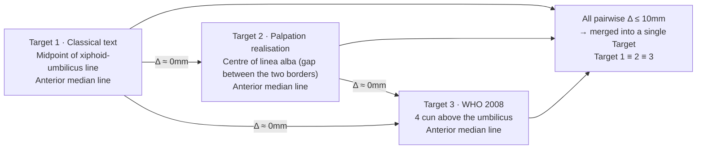
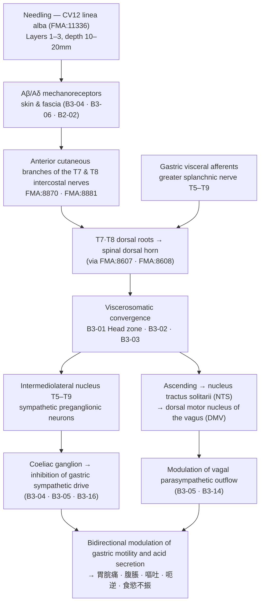

# [Acupoint Anatomical & Physiological Substrate Monograph] Zhongwan (中脘, CV12)

> **Framework**: v2.7.10 (four primary classics · Tri-Target · Target-exclusion rule applied) · **Tier 3 in-depth monograph**
> **ARI (Target 1≡2≡3, classical text position ≡ palpation-based anatomical locus ≡ WHO standard location)**: `ARI v3.0 | ARI-Core 90.0 ± 1.25 (A) | SI 50 | provisional weights 0.40/0.35/0.25 | sensitivity (equal weights): 88.5 (A, grade unchanged)` · **Dual scoring**: two independent raters, no item required adjudication
> **Four Primary Classics**: *Zhongguo Zhenjiu Xuewei Tongjian* (《中國針灸穴位通鑑》) 下卷 任脈篇 · *Zhongguo Zhenjiu Zhengzhi Tongjian* (《中國針灸證治通鑑》) 第壹編 第七篇 督脈·任脈 (Chinese original as reference text; the analysis is written from the Korean translation of the same chapter) · *Zhenjiu Shuxue Tongkao* (《針灸腧穴通考》) 下冊 任脈穴篇 · *Zhongguo Zhenjiu Jingluo Tongjian* (《中國針灸經絡通鑑》) 第貳編·第叁編
> **Layer A Empirical Database**: Integrated Biomedical Master DB v3.0 — CV12 inverted index 26 papers (26 active; 24 locally mapped · 2 external). Only the 9 papers listed in Table 8-3 are used for the mechanism and depth verdicts
> **Layer B Reference Registry**: four-tier reference registry (B1–B4), 6-item B-Check **9/12 (concordance threshold ≥ 8/12 met; items ① and ② ≥ 1 met)**
> **Metrological Standard**: Han-dynasty standard, 1 fen (分) = 2.3 mm ($z = \text{fen} \times 2.3\,\text{mm}$)
> **Anatomical Ontology**: local index of the FMA (Foundational Model of Anatomy) 5.1.0 — all 9 textbook structures map `exact`; spinal segment union **T7 · T8** (B1 supplementary, not yet in the registry). Full table in Appendix A
> **Point-specific measurement**: one upper-abdominal ultrasound observational study (`papers.id` 1444, n = 83) — skin-to-parietal-peritoneum distance (ANIR) 25.3 ± 10.2 mm; left lobe of the liver visualised in 62.7 %
> **Note on script**: classical quotations, point names, text titles and TCM terms are given in Traditional Chinese (繁體字); simplified forms are not used. Anatomical terms follow *Terminologia Anatomica* and the approved English labels of FMA 5.1.0.

---

## 1. Classical Literature Screening Table (Collation of the Four Primary Classics)

| Classic | Original excerpt (chapter · line) | English rendering | Role in the analysis |
| :--- | :--- | :--- | :--- |
| *Zhongguo Zhenjiu Xuewei Tongjian* (《中國針灸穴位通鑑》) 下卷 任脈篇 (中脘 CV12 chapter, L1003–1552) | "在上脘下一寸，居心蔽骨與臍之中。"(《針灸甲乙經》3:46) / "在心前鳩尾下四寸是也。"(《難經》4:67) / "在心厭下四寸，更度之。"(《肘後備急方》2:27) — 部位 L1047 ff. | "One cun below Shangwan (上脘), midway between the xiphoid cartilage (心蔽骨) and the umbilicus." The *Nanjing* (《難經》) gives "four cun below Jiuwei (鳩尾), in front of the heart"; the *Zhouhou Beiji Fang* (《肘後備急方》) gives "four cun below Xinyan (心厭)" | The primary statement of the location, and the starting point of the variant readings in the **reference landmark** (心蔽骨 / 鳩尾 / 心厭) |
| *Zhongguo Zhenjiu Xuewei Tongjian* (《中國針灸穴位通鑑》) same chapter, 部位 item 4 | "取繩從心頭骨名鳩尾頭度取臍孔，中屈繩取半，當繩頭名胃管。"(《備急千金要方》9:187) | Measure with a cord from the tip of the xiphoid bone (鳩尾頭) to the umbilicus, fold the cord in half, and the point at the end of the folded cord is Weiguan (胃管) | **The source of the midpoint locating method by palpation and measurement.** Direct basis for Target 2 in Section 7 |
| *Zhongguo Zhenjiu Xuewei Tongjian* (《中國針灸穴位通鑑》) same chapter, 簡要結語 L1489 ff. | "［部位］歷代文獻記載基本一致…別有二說：一說'在心前鳩尾下四寸是也。'出《難經》；一說'在上脘下一寸五分。'出《醫學綱目》。" | The records of successive periods are essentially consistent; there are only two divergent readings | Direct basis for scoring $S_{orig}$ item ② (concordance of later texts) |
| *Zhongguo Zhenjiu Xuewei Tongjian* (《中國針灸穴位通鑑》) same chapter, 針法 L1412 ff. · 局部解剖 L1479 ff. | "刺入二分[1]，灸七壯。"(《針灸甲乙經》) — footnote **[1] "二分"，疑為"一寸二分"之誤** / "刺可入同身寸之一寸二分"(《素問·氣穴論》, Wang Bing's 王冰 commentary) / "①針刺通過之組織層：皮膚、皮下組織，腹白線。**不可刺透腹白線而進入腹腔，以免刺傷腹腔器官**。②神經、血管：肋間神經前皮支，腹壁上動、靜脈分支等。"(《針灸學簡編》) | A collation footnote holding that the '二分' (2 fen) of the transmitted *Jiayi Jing* (《甲乙經》) is a haplographic error for '一寸二分' (1 cun 2 fen). Modern records give the three layers **skin – subcutaneous tissue – linea alba** together with the explicit prohibition "the needle must not pierce the linea alba and enter the abdominal cavity" | **The core evidence for the depth collation in Section 5**, and the textual basis for the Layer construction in Section 4 and for the SI verdict |
| *Zhenjiu Shuxue Tongkao* (《針灸腧穴通考》) 下冊 任脈穴篇 (中脘 CV12 chapter, L7–660) — textual criticism of Huang Longxiang (黃龍祥) and Huang Youmin (黃幼民) | 【定位】"**部位**：在上腹部，臍中上4寸，前正中線上。**取穴**：**劍胸結合與臍中連線的中點處**。" / 【文獻分析】"關於本穴定位，所有文獻有一個共同點：**位於鳩尾骨與臍連線的中點處**。但由於對於鳩尾骨的理解有分歧…因而實際定位有所不同。至於《醫學綱目》作'上脘下一寸五分'，文字也與諸書不合，**顯然有誤**。因為該書明言上脘穴距鳩尾骨'三寸'，則中脘穴只能是'上脘下一寸'。" | The location is **the midpoint of the line joining the xiphisternal junction (劍胸結合) and the centre of the umbilicus**. What all the texts have in common is "the midpoint of the line from the xiphoid bone to the umbilicus"; the apparent divergences arise solely from differing understandings of where 鳩尾骨 lies. The "one cun five fen below Shangwan" of the *Yixue Gangmu* (《醫學綱目》) is **shown to be an error by the internal contradiction of that book itself** | **The decisive collation for the Rank 4 differentiation of transcription error.** The basis on which apparent variants are not erected as Targets in Section 7 |
| *Zhenjiu Shuxue Tongkao* (《針灸腧穴通考》) same chapter, 【名實考】 L35 ff. | "在宋以前文獻中，'中脘'皆作'中管'，宋代王惟一編《銅人腧穴針灸圖經》將其統一改作'中脘'…只是當時讀音相同，皆讀作'guǎn'。" / "需要特別注意的是，'**胃管**'既是**部位名**，又是**穴名**，需注意鑑別，切不可相混。" | Before the Song all texts wrote '中管'; Wang Weiyi (王惟一) standardised the writing to '中脘'. '胃管' is **both a regional name and a point name**, and the two uses must be kept strictly apart | **The primary criterion for blocking alias conflation at Rank 3** (Section 3) |
| *Zhenjiu Shuxue Tongkao* (《針灸腧穴通考》) same chapter, "胃管"與"中管"穴辨 L81 ff. | "《太平聖惠方》卷五十五'中管'與'胃管'是作為兩個不同的穴輯錄：中管一穴，在上管下一寸；胃管一穴，在鳩尾下四寸；**陰都二穴，在胃管兩旁各一寸半**。" / 按: "**既然陰都穴在'胃管'旁，則胃管穴只能理解為中脘穴。**…'鳩尾下四寸'中之'鳩尾'是骨名，而不是穴名，抄錄者不察而誤作穴名，故視為二穴。" | The *Taiping Shenghui Fang* (《太平聖惠方》) **wrongly recorded 中管 and 胃管 as two separate points** because the copyist mistook '鳩尾', a bone name, for a point name. **The record that Yindu (陰都) lies 1.5 cun to either side of '胃管' proves conversely that the two names denote the same point** | **A model case of the correction of a transcription error.** Scoring basis for $S_{orig}$ item ④ |
| *Zhenjiu Shuxue Tongkao* (《針灸腧穴通考》) same chapter, 【類屬】 L267 ff. · 【操作】 L601 ff. | "任脈穴；胃之募穴；八會穴之腑會。" / "手太陽、少陽、足陽明所生，任脈之會。(《黃帝明堂經》)" / "**直刺0.5~1.5寸。對肝脾腫大和胃、十二指腸潰瘍患者，不宜向左右側上方透刺。**" / "刺入一寸二分，灸七壯。(《黃帝明堂經》)" / citing the Shanghai 《針灸學》: "**中脘穴深部有胃、胰腺、腹主動脈等，直刺不宜過深，瘦弱病人尤宜謹慎**" | A Conception Vessel (任脈) point; the Front-Mu point (募穴) of the Stomach (胃); the Fu-Gathering point (腑會) among the Eight Gathering points (八會穴); meeting point of Hand-Taiyang (手太陽), Hand-Shaoyang (手少陽), Foot-Yangming (足陽明) and the Conception Vessel. Perpendicular insertion 0.5–1.5 cun; oblique upward transverse insertion to either side is forbidden in patients with hepatosplenomegaly or gastroduodenal ulcer. **The stomach, pancreas and abdominal aorta lie deep to the point, so thin and weak patients require still greater caution** | Core basis for the depth table in Section 5 and for the SI verdict |
| *Zhongguo Zhenjiu Zhengzhi Tongjian* (《中國針灸證治通鑑》) 第壹編 第七篇 督脈·任脈, (十) 中脘 (Chinese original L732 ff. / Korean translation L1011 ff.) | Original: "主痓，**先取太溪，後取太倉之原**。心下大堅。胃脹。…腹脹不通，寒中傷飽，食飲不化，小腸有熱，溺赤黃。溢飲，脅下堅痛。霍亂，泄出不自知，**先取太溪，後取太倉之原**。…噫，煩滿，積聚，腹中脹，暴滿，心腹痛…大便難。"(《明堂經》) | Following the Korean translation: "It governs Chi (痓); **first take Taixi (太溪), then take the Yuan point of Taicang (太倉)**. Great hardness below the heart. Stomach distension (胃脹). … Abdominal distension with obstruction, cold-strike and injury from overeating, food and drink not digested … belching (噫), vexing fullness (煩滿), accumulations and gatherings (積聚), distension within the abdomen, sudden fullness, pain of the heart and abdomen … difficult defecation." | **Primary material for the separation of $P_{single}$ from $P_{comb}$ in Section 9.** The entries for '痓' and '霍亂泄出不自知' state in the text itself that they are **combinations** with Taixi (太溪) |
| *Zhongguo Zhenjiu Zhengzhi Tongjian* (《中國針灸證治通鑑》) 第叁編 內科病症 (Cholera chapter L148 · L150 · L206; Abdominal pain chapter L122 · L200 · L228) | "霍亂吐瀉：中脘、天樞。" / "復刺後穴：委中、三里、中脘、天樞。" / "腹內痛：三里、中脘、內關。" / "寒邪腹痛：中脘、足三里、大橫、公孫、合谷"(《針灸治療學》) | Following the Korean translation: for cholera with vomiting and diarrhoea, Zhongwan (中脘) and Tianshu (天樞), to which Weizhong (委中) and Zusanli (足三里) are then added / for pain within the abdomen, Zusanli, Zhongwan and Neiguan (內關) / for abdominal pain from cold evil, Zhongwan, Zusanli, Daheng (大橫), Gongsun (公孫) and Hegu (合谷) | **Basis for separating $P_{comb}$ (effects derived from combinations) in Section 9** |
| *Zhongguo Zhenjiu Jingluo Tongjian* (《中國針灸經絡通鑑》) 第貳編 第三篇 脈度·骨度與要穴 L811 · L853 · L857 | "中脘，一名太倉，胃募也，在上脘下一寸，居心蔽骨與臍之中，手太陽、少陽、足陽明所生，任脈之會，**刺入二分**，灸七壯。" / "**府會太倉者，胃也。其穴者，中脘是也。**" / "太倉在心前鳩尾下四寸是也。足陽明胃脈、手太陽小腸脈、手少陽三焦脈、任脈之會，**本名中脘，此云太倉也，即胃之募也**。" | The depth in the transmitted recension is '二分'; the channel literature independently confirms that Taicang (太倉) is Zhongwan, the Front-Mu point of the Stomach and the Fu-Gathering point | **Independent corroboration of the depth variant** (Section 5). Confirmation from channel theory of the Fu-Gathering and Front-Mu attributions (Sections 6 and 8) |
| *Zhongguo Zhenjiu Jingluo Tongjian* (《中國針灸經絡通鑑》) 第貳編 第五篇 根結·關闔樞與皮部 L123 · L137 · L146 | "［太陰根於隱白，結於太倉］…(蕭延平校：注'中管'上所缺一字…按中管穴，本書作中管，《甲乙經》作中脘，即太倉穴，在上脘下一寸，居心蔽骨與臍之中…)" / "結於太倉，以胃與脾相為表裡也。**太倉即中脘穴，係任脈經臍上四寸，針八分，灸七壯。**" | Xiao Yanping's (蕭延平) collation: the '中管' of the *Taisu* (《太素》) and the '中脘' of the *Jiayi Jing* (《甲乙經》) are the same point (= 太倉) | **Independent secondary corroboration of the Rank 3 alias and Rank 4 transcription collations** |
| *Donguibogam* (《東醫寶鑑》) 鍼灸篇 (supplementary source outside the four primary classics) L1707–1710 | "一名太倉胃之募也在臍上四寸脘居心蔽骨與臍之中上下各四寸(銅人資生)中鍼入八分留七呼寫五吸可灸二七壯至一百壯(銅人)" | Also called Taicang (太倉), the Front-Mu point of the Stomach. Four cun above the umbilicus, midway between the xiphoid cartilage and the umbilicus, four cun each way. **Needle insertion 8 fen**, retained for seven respirations, drained over five inhalations; moxibustion 14 to 100 cones | Confirms the source of the Joseon value in the depth table of Section 5 (8 fen = 18.4 mm) |

---

## 2. Primary Source vs. Secondary Quotation Table (Stratified Chronological Sequence)

| Period | Text | Content | Verdict: primary source / secondary quotation |
| :---: | :--- | :--- | :--- |
| Pre-Qin–Han | 《靈樞·脹論》 | "胃者，太倉也。" | **Primary — but as an epithet of the organ (胃), not a point name.** It must not be drawn upon as a point name (*Tongkao* 【提要索隱】) |
| Pre-Qin–Han | 《靈樞·根結》 | "太陰根於隱白，結於太倉。" | Primary (terminus of a channel). The earliest group of uses of the point name Taicang (太倉) |
| Pre-Qin–Han | 《素問·氣穴論》 | "上紀者，胃脘也。" + Wang Bing's (王冰) commentary "謂中脘也。中脘者，胃募也。" | **The main text is primary (alias '上紀'); Wang Bing's commentary is a Tang-dynasty reinterpretation.** *Tongkao* note: whether the '胃脘' here is the same as the Zhongwan alias '胃脘' **cannot be confirmed** |
| Han | *Huangdi Mingtang Jing* (《黃帝明堂經》) (collated and restored by Huang Longxiang 黃龍祥 in the 《腧穴通考》) | "中脘，一名太倉，胃募也。在上脘下一寸，居心蔽骨與臍之中。手太陽、少陽、足陽明所生，任脈之會。" / "刺入一寸二分，灸七壯。" | **Primary — the earliest complete statement giving location, meridian attribution, intersections, needling depth and moxa dose together** |
| Han–Wei/Jin | *Maijing* (《脈經》) | "…有熱在胃管熏胸中…及針胃管" | Primary (clinical application). **The first '胃管' denotes the region, the second the point** — the differentiating example given in 【名實考】 of the *Tongkao* |
| Wei–Jin | *Zhenjiu Jiayi Jing* (《鍼灸甲乙經》) vol. 3 | "在上脘下一寸，居心蔽骨與臍之中" / "刺入二分，灸七壯" / note "呂廣撰《募腧經》云太倉在臍上三寸，非也。" | **Secondary quotation** of the *Mingtang Jing*. The depth '二分' is **suspected to be a haplography for '一寸二分'** (footnote [1] of the 《穴位通鑑》). Huangfu Mi's (皇甫謐) own note already rejects the "three cun above the umbilicus" of the *Mushu Jing* (《募腧經》) |
| Jin–Tang | 《肘後備急方》·《千金要方》·《千金翼方》·《外臺秘要》 | "在心厭下四寸" / "心蔽骨下三寸" / "鳩尾下三寸" / **the cord-folding midpoint measurement** (《千金要方》 vol. 9) | Secondary quotation + **an original locating method**. The difference between '3 cun' and '4 cun' is a **difference of reference landmark** (tip of the xiphoid bone vs. 歧骨 / the xiphisternal junction); the resulting site is in every case "the midpoint of the xiphoid-to-umbilicus line" (*Tongkao* 文獻分析) |
| Tang | Wang Bing's (王冰) commentary on the 《素問》 | "刺可入同身寸之一寸二分，若灸者可灸七壯。" | **Reinterpretation — yet the key witness preserving the '一寸二分' of the *Mingtang Jing* line.** Followed by the *Ishinpō* (《醫心方》) |
| Song | *Taiping Shenghui Fang* (《太平聖惠方》) vol. 55 | "中管一穴，在上管下一寸；胃管一穴，在鳩尾下四寸" | **Transcription error (one point split into two).** Corrected by the *Tongkao* using the Yindu (陰都) entry as counter-evidence |
| Song | *Tongren Shuxue Zhenjiu Tujing* (《銅人腧穴鍼灸圖經》) | '中管' standardised to '中脘' / "在臍上四寸" / "針入八分，留七呼，瀉五吸" | **Orthographic revision (policy of the Bureau for Revising Medical Texts)** + restatement of depth. The *Zisheng Jing* (《資生經》) notes "刺入寸二分，與《銅人》稍異，**宜從《銅人》為穩**", thereby **recommending the shallower value for clinical use** |
| Jin–Yuan | *Shisijing Fahui* (《十四經發揮》) | "𩩲骭以下至天樞長八寸，而中脘居中是也。**然人胃有大小，亦不可拘以身寸**" | Secondary quotation + **a warning about variation in body build (proportional bone measurement takes precedence)** — directly relevant to Section 5 and to the SI |
| Yuan | *Bianque Shenying Zhenjiu Yulong Jing* (《扁鵲神應鍼灸玉龍經》) · the Dou Taishi (竇太師) line | "直刺二寸五分，補多瀉少" / "針入二寸半" | **The later line of exaggerated depth (57.5 mm).** Separated out as Rank 4 noise — a depth that penetrates the peritoneum |
| Ming | *Yixue Gangmu* (《醫學綱目》) | "在上脘下一寸五分" | **A miswriting.** The same book states that 上脘–鳩尾骨 = 3 cun, so the statement is internally contradictory (*Tongkao* 文獻分析) |
| Ming–Qing | 《鍼灸聚英》·《鍼灸大成》·《類經圖翼》·《醫宗金鑑》 | "上脘下一寸，臍上四寸，居心蔽骨與臍之中" | Secondary quotation (the location stabilises). The depth converges on the 8-fen line |
| Joseon | *Donguibogam* (《東醫寶鑑》, 1613) · *Chimgu Gyeongheombang* (《鍼灸經驗方》) | "臍上四寸…鍼入八分" (cited source: 銅人) | Secondary quotation — adopts the 8 fen of the *Tongren* line |
| Modern | 《鍼灸學簡編》 · common textbooks, 6th and 7th editions | "胸骨劍突尖與臍連線之中點處(臍上四寸)" / "直刺1~1.5寸" | Secondary quotation and standardisation. The layer description (皮膚·皮下組織·腹白線) and the prohibition on entering the abdominal cavity are made explicit |
| Contemporary | WHO Standard Acupuncture Point Locations (2008, B1-05) | Upper abdomen, on the anterior median line, 4 B-cun superior to the centre of the umbilicus | The standard location — Target 3 in Section 7 |

---

## 3. Alias & Nomenclature Verification Table (KJH Alias DB × Four Primary Classics)

- **Standard code and name**: CV12 · Zhongwan (中脘) · Conception Vessel (任脈) · Zhōngwǎn
- **Aliases registered in the Acupoint Alias Comparative Database (KJH DB), nine entries**: 上紀, 中管, 中胃, 大倉, 太倉, 胃中, 胃募, 胃管, 胃脘

| Alias | Earliest source | Verdict in the 簡要結語 of the 《穴位通鑑》 | Collation in the 《腧穴通考》 and 《經絡通鑑》 | Risk of conflation and verdict of this report |
| :--- | :--- | :--- | :--- | :--- |
| **上紀** | 《素問·氣穴論》 | Accepted as an alias (1 of 7) | 《銅人》 卷中 "上紀者，中脘也" | Paired with the '下紀 = 關元' of the 《素問》. **No conflation — accepted** |
| **胃脘** | 《素問》 | Accepted as an alias | *Tongkao* note: whether the '胃脘' of the 《素問》 is the same as the Zhongwan alias **cannot be confirmed** | **The regional name (the middle portion of the stomach) overlaps the point name.** Each passage must be judged region vs. point — **conditionally accepted** |
| **大倉 / 太倉** | 《靈樞》 / 《難經》·《甲乙經》 | Accepted as aliases (separately) | 《靈樞·脹論》 "胃者，太倉也" → **the organ name is primary**. Fixed as a point name from the 《難經》 "府會太倉" onwards | **Dual usage as organ name and point name.** The '太倉之原' of the 《明堂經》 is the point name — **conditionally accepted** |
| **胃管** | 《脈經》·《肘後方》 | Accepted as an alias | *Tongkao*: **both a regional name and a point name**. Both usages coexist within a single sentence of the 《脈經》. The 《太平聖惠方》 wrongly recorded it as a point distinct from '中管' → disproved by the Yindu (陰都) entry | **The greatest source of conflation.** **Fully resolved** by the *Tongkao* differentiation — accepted |
| **中管** | 《千金要方》·《千金翼方》 | Accepted as an alias | *Tongkao*: before the Song all texts wrote '中管'; Wang Weiyi (王惟一) standardised it to '中脘'. Xiao Yanping's (蕭延平) collation in the 《經絡通鑑》 reaches the same verdict | **Orthographic variant (管/脘) — fully resolved, accepted** |
| **胃募** | — | **"至於'胃募'，不宜作別名"** (explicitly rejected) | *Tongkao* 【類屬】: a **classification term**, namely that the point is the Front-Mu point (募穴) of the Stomach | **Not an alias but a point attribute (穴性, classification). Its entry in the KJH DB is judged to be contamination by a classification term — removed from the alias list and transferred to the 'point attributes' row of Section 6** |
| **中胃 · 胃中** | Later acupuncture texts | **Not among** the seven aliases of the 簡要結語 | No collation statement in the four primary classics | **No classical basis could be confirmed.** Flagged as a caution against indiscriminate use and not used in the analysis |

- **Verdict**: a genuine risk of conflation existed (the splitting of 胃管/中管 into two points; the dual organ/point usage of 太倉), but it has been **entirely resolved** by the collations of the 《腧穴通考》 and the 《經絡通鑑》. Two residues remain, however: ① whether the '胃脘' of the 《素問》 is a point name is undetermined, and ② three KJH DB entries (胃募 · 中胃 · 胃中) do not match the alias list of the four primary classics. Because of these **unresolved residues**, $S_{orig}$ item ③ is scored **75** rather than 100 (Section 10).
- **Homonym alert**: Shangwan (上脘, 上管), Xiawan (下脘, 下管) and Weiwanxiashu (胃脘下輸, EX-B3) are **separate points**. In particular, the "第三處去心下三寸，名胃管" of 《千金要方》 vol. 9 refers to Zhongwan, whereas the '胃管' in the point name '胃管下輸' is **a regional name** (*Tongkao* 【名實考】).

---

## 4. 3D Spatial Coordinates and Layer 1–5 Structural Diagram

### 4-1. Coordinate System

- **X (medio-lateral)**: **0 (the anterior median line, 前正中線)**. The exact centre of the **linea alba (FMA:11336)** between the medial borders of the two rectus sheaths.
- **Y (cranio-caudal)**: **the midpoint of the line joining the inferior end of the xiphoid process (the xiphisternal junction, 胸劍結合) and the centre of the umbilicus (Shenque 神闕, CV8)** = 4 cun above the umbilicus. This is one half of the 8-cun bone-proportional measure; the measured mean xiphoid-to-umbilicus distance is 201.9 ± 57.2 mm (`papers.id` 1444), so **the midpoint lies about 100 mm above the umbilicus on the skin surface**.
- **Z (depth)**: see the layer table below. **Because point-specific ultrasound measurements exist (`papers.id` 1444, n = 83), the millimetre boundaries are set to the measured mean values.**
- **Insertion reference point (分肉 · 緣)**: the gap at Zhongwan is not an intermuscular septum (兩筋間) but **the muscle-free gap between the medial 'borders' (緣) of the two rectus sheaths, i.e. the linea alba**. The bounding structures are the right and left **rectus sheaths (FMA:9587)**, and the insertion reference point is the X-centre and Y-midpoint of this gap. The linea alba is devoid of muscle and poor in vessels, and therefore carries the lowest bleeding risk of any insertion route (B1-01 · B1-03). The classical measuring method ("取繩從心頭骨名鳩尾頭度取臍孔，中屈繩取半" — 《千金要方》 vol. 9) designates precisely this reference point.

### 4-2. Layers 1–5 (boundaries set to the measured means)

```
[Body surface]  X = 0 (anterior median line, centre of linea alba)
                Y = midpoint of xiphoid-umbilicus line (4 cun above umbilicus)
  |
[Layer 1]  0 ~ 2mm      Skin
           2 ~ 16mm     Subcutaneous tissue & fat  -- measured 16.0 +/- 7.7mm
             . Anterior cutaneous branches of T7 & T8 intercostal nerves
               (FMA:8870 . FMA:8881)
             . Superficial epigastric artery & vein (FMA:20734 . FMA:44318)
               -- lateral course, set off from the median line
  |                      [A-beta / A-delta cutaneous mechanoreceptors stimulated
  |                       -- afferent input begins]
[Layer 2]  16 ~ 19mm    Linea alba (FMA:11336) . right & left rectus sheaths (FMA:9587)
             . The linea alba is muscle-free and poorly vascularised
               -- minimal bleeding and muscle-injury risk
             . The superior epigastric artery & vein (FMA:10646 . FMA:4731) behind
               rectus abdominis lie **lateral to the median line**
  |                      [Mechanotransduction along the fascial connective-tissue
  |                       plane -- B2-02]
[Layer 3]  19 ~ 21mm    Transversalis fascia (FMA:12265)  [Kim Jaehyo textbook only]
           21 ~ 25mm    Preperitoneal fat
  |                      [Deep fascial and preperitoneal mechanoreceptors]
[Layer 4]  ~ 25.3mm     Parietal peritoneum -- **end point of allowable insertion (ANIR)**
  |                      [Somatic innervation -- pain-sensitive; perforation enters
  |                       the peritoneal cavity]
[Layer 5]  > 25.3mm     Intraperitoneal organs
             . Left lobe of the liver -- visualised directly beneath CV12 in 62.7%
               (52/83) of subjects
             . Anterior wall of the stomach -- directly visualised in the 31 cases
               without liver
             . Deeper still: pancreas, abdominal aorta (Shanghai 《針灸學》, cited in
               the 《腧穴通考》)
                          [WARNING -- line that must not be perforated;
                           the reference for the SI verdict]
```


*Figure 4-1. **(A)** Transverse section of the upper abdominal wall at the level of Zhongwan (中脘) (radiological convention: the viewer's left is the patient's right; not to scale horizontally, vertical scale in measured mean millimetres). A perpendicular needle on the anterior median line passes in the order **skin → subcutaneous fat → linea alba → transversalis fascia → preperitoneal fat → parietal peritoneum**, clearing the two rectus abdominis muscles and the superior epigastric vessels behind them. Beyond the parietal peritoneum (mean 25.3 mm) the needle reaches the left lobe of the liver or the anterior wall of the stomach. **(B)** Measured allowable needle insertion range (ANIR) by body build, compared with the needling depths recorded in the historical texts (1 fen = 2.3 mm). Measurement source: `papers.id` 1444 (Chu H, Kim J et al., *Healthcare* 2022;10:1707, doi:10.3390/healthcare10091707).*

### 4-3. Layer-by-Layer FMA Entity Collation (structure names from the two textbooks; IDs and relations from FMA 5.1.0)

| Layer | Structure | FMA | Mapping | Parent trunk (FMA) | Spinal segment |
| :---: | :--- | :--- | :---: | :--- | :---: |
| 1 | Anterior cutaneous branch of the seventh intercostal nerve *(Common Textbook)* | FMA:8870 | exact | FMA:8607 Seventh intercostal nerve | **T7** |
| 1 | Anterior cutaneous branch of the eighth intercostal nerve *(Kim Jaehyo)* | FMA:8881 | exact | FMA:8608 Eighth intercostal nerve | **T8** |
| 1 | Superficial epigastric artery *(Kim Jaehyo)* | FMA:20734 | exact | FMA:70248 Femoral a. → FMA:18805 External iliac a. → FMA:14764 Common iliac a. | — |
| 1 | Superficial epigastric vein *(Kim Jaehyo)* | FMA:44318 | exact | FMA:21376 Great saphenous v. → FMA:21185 Femoral v. → FMA:18883 External iliac v. | — |
| 2 | Linea alba | FMA:11336 | exact | — | — |
| 2 | Rectus sheath | FMA:9587 | exact | — | — |
| 2–3 | Superior epigastric artery | FMA:10646 | exact | FMA:3960 Internal thoracic a. → FMA:3951 Subclavian a. | — |
| 2–3 | Superior epigastric vein | FMA:4731 | exact | FMA:4730 Venae comitantes of internal thoracic a. → FMA:4729 Internal thoracic v. → FMA:4723 Brachiocephalic v. | — |
| 3 | Transversalis fascia *(Kim Jaehyo)* | FMA:12265 | exact | — | — |
| 4 | Parietal peritoneum | — | **No FMA mapping (not recorded in either textbook)** | — | Somatic supply T7–T11 (B1-01) |
| 5 | Left lobe of liver · anterior wall of stomach | — | **Not in either textbook — supplied by ultrasound measurement (`papers.id` 1444)** | — | Visceral afferents: greater splanchnic nerve T5–T9 (B1-01 · B1-02) |

- **Spinal segment union (input to B-Check ②)**: **T7, T8** — all nine textbook-recorded entities map `exact`, which satisfies the condition for 2 points on B-Check item ①.
- The linea alba, rectus sheath and transversalis fascia are connective-tissue entities for which **FMA records no segmental supply**, so the segment union is derived from the two nerves alone. Layers 4–5 are absent from both textbooks and therefore have no FMA mapping; they are supplied from normative anatomy (B1-01) and from the point-specific measurements.
- **Dynamic variation (kinesiology)**: the thickness of the abdominal wall and the position of the viscera change with respiration, posture and intra-abdominal pressure. The original study itself lists "variation with respiration and posture" as a limitation. The values are to be read as supine, end-expiratory values; in the seated position and on inspiration the left lobe of the liver may descend further.

---

## 5. Needling Depth Calculation Table (Han-dynasty standard, 1 fen = 2.3 mm)

### 5-1. Conversion Table by Text

Sources: the CV12 row of the Classical Needling Depth Database (by text) and direct collation against the four primary classics. `'0'` = needling contraindicated (禁鍼); a blank = not stated.

| Text / textbook | Recorded value (fen) | Converted depth | Layer reached (against the measured mean) | Verdict |
| :--- | :---: | :---: | :--- | :--- |
| *Huangdi Mingtang Jing* (《黃帝明堂經》) (collated by Huang Longxiang 黃龍祥) | 2 | **4.6 mm** | Layer 1 (mid subcutaneous fat) | The same value as the '二分' of the transmitted *Jiayi Jing* (《甲乙經》). **See the collation in 5-3 below** |
| *Zhenjiu Shuxue Tongkao* (《鍼灸腧穴通考》), lower limit | 5 | **11.5 mm** | Layer 1 (deep subcutaneous fat) | Perpendicular insertion 0.5 cun. **Safe even in underweight men (mean 12.4 mm)** |
| *Donguibogam* (《東醫寶鑑》, citing 銅人) · *Chimgu Gyeongheombang* (《鍼灸經驗方》) | 8 | **18.4 mm** | Layer 2 (linea alba) | The "針入八分" line of the *Tongren* (《銅人》). **The clinically safe depth** recommended by the *Zisheng Jing* (《資生經》) with "宜從《銅人》爲穩" |
| Common textbooks of Meridian & Acupoint Studies and Acupuncture Medicine, lower limit | 10 | **23.0 mm** | Layer 3 (preperitoneal fat) | Perpendicular insertion 1 cun. **Almost identical to the ANIR of normal-weight subjects (22.2 mm) — a borderline value** |
| *Zhenjiu Jiayi Jing* (《鍼灸甲乙經》) (as recorded in the dataset) | 12 | **27.6 mm** | **Beyond Layer 4 (peritoneal perforation)** | Identical to the "一寸二分" of Wang Bing's (王冰) commentary. **Exceeds** the overall mean ANIR of 25.3 mm |
| Common textbooks, upper limit · *Zhenjiu Shuxue Tongkao* (《鍼灸腧穴通考》), upper limit | 15 | **34.5 mm** | **Layer 5 (reaches the intraperitoneal organs)** | Perpendicular insertion 1.5 cun. Remains inside the peritoneum only in the overweight group (36.9 mm) |
| *Bianque Shenying Zhenjiu Yulong Jing* (《扁鵲神應鍼灸玉龍經》) · the Dou Taishi (竇太師) line *(outside the dataset; cross-checked against the classics)* | 25 | **57.5 mm** | **Deep Layer 5 (towards the pancreas and abdominal aorta)** | Separated out as Rank 4 noise. Not used in modern practice |
| Records of needling contraindication (禁鍼) | none | — | — | **No text contraindicates needling.** However, the 《鍼灸十四經穴位考訂》 forbids needling and moxibustion in pregnancy from the fifth month, and the 《類經圖翼》 states "孕婦不可灸" |

### 5-2. Collation with Point-Specific Ultrasound Measurement (`papers.id` 1444)

Eighty-five healthy volunteers were recruited and 83 analysed (40 men, 43 women; mean age 20.3 ± 2.5 years; BMI 22.4 ± 4.2 kg/m²). Using a linear transducer, the **skin-to-parietal-peritoneum distance (Allowable Needle Insertion Range, ANIR)** was measured at CV12.

| Group | Subcutaneous fat thickness (mm) | **ANIR (mm)** | Mean − 1 SD | Perpendicular insertion to 23.0 mm (10 fen) | Perpendicular insertion to 34.5 mm (15 fen) |
| :--- | :---: | :---: | :---: | :---: | :---: |
| All (n = 83) | 16.0 ± 7.7 | **25.3 ± 10.2** | 15.1 | Close to peritoneum | **Perforation** |
| Underweight (n = 14) | 8.1 ± 4.5 | **15.4 ± 5.9** | 9.5 | **Perforation** | **Perforation** |
| Normal weight (n = 47) | 14.0 ± 5.2 | **22.2 ± 7.5** | 14.7 | **Borderline; perforation possible** | **Perforation** |
| Overweight (n = 22) | 24.3 ± 6.8 | **36.9 ± 6.9** | 30.0 | Safe | Borderline |
| All men (n = 40) | 13.4 ± 7.5 | 22.3 ± 10.2 | 12.1 | Borderline | **Perforation** |
| All women (n = 43) | 18.5 ± 7.1 | 28.1 ± 9.4 | 18.7 | Safe | **Perforation** |
| Underweight men (n = 7) | 5.9 ± 2.6 | **12.4 ± 2.4** | **10.0** | **Perforation** | **Perforation** |

- **Sex difference**: women are significantly thicker than men (p < 0.05), owing to the difference in subcutaneous fat thickness.
- **Predictive equation**: in stepwise linear regression **BMI was the only independent predictor** — $\text{ANIR} = -10.960 + 0.662 \times \text{BMI}$ (p < 0.001). In multiple regression, abdominal circumference was significant ($\beta$ = 0.620, t = 7.114, p < 0.001). For the liver-visualised subgroup alone, $\text{ANIR} = -12.271 + 0.620 \times \text{BMI}$.
- **Left lobe of the liver visualised in 62.7 % (52/83)**: the liver-visualised group had BMI 21.6 ± 3.9 and ANIR 23.2 ± 10.5 mm; the non-visualised group BMI 23.8 ± 4.3 and ANIR 28.8 ± 8.6 mm (BMI p < 0.01, ANIR p < 0.05). **The thinner the subject, the more likely the left lobe of the liver lies directly beneath Zhongwan and the shallower the peritoneum** — a compounded risk. In the 31 cases without liver, the **stomach (胃) was directly visualised** beneath the peritoneum.

### 5-3. Textual Collation of the Depth Record — '二分' versus '一寸二分'

Collation of the four primary classics identifies two lines of transmission.

| Line | Record | Authority |
| :--- | :--- | :--- |
| **Shallow line (2 fen = 4.6 mm)** | "刺入二分，灸七壯" | 《鍼灸甲乙經》 卷三 (《穴位通鑑》 針法 item 1) · 《中國針灸經絡通鑑》 第貳編 第三篇 L811 |
| **Deep line (12 fen = 27.6 mm)** | "刺可入同身寸之一寸二分" / "刺入一寸二分，灸七壯" | Wang Bing's (王冰) commentary on 《素問·氣穴論》 · 《醫心方》·《鍼灸聚英》·《鍼灸大成》 · **restored by the 《腧穴通考》 as the text of the 《黃帝明堂經》** |

- The 《中國針灸穴位通鑑》 appends a footnote to the '二分' of the transmitted *Jiayi Jing* reading **"'二分'，疑爲'一寸二分'之誤"**. It thus treats the reading as a transcription error in which '一寸' dropped out, and Huang Longxiang (黃龍祥) restored the text of the *Huangdi Mingtang Jing* in the *Tongkao* as **'刺入一寸二分'**.
- **Data-consistency note (audit entry ①)**: the CV12 row of the Classical Needling Depth Database records `Huangdi Mingtang Jing (ed. Huang Longxiang) = 2` and `Zhenjiu Jiayi Jing = 12`, which is **the exact reverse of the attribution established above**. Direct collation of the four primary classics gives *transmitted 《甲乙經》 = 2 fen / Huang Longxiang's restored 《明堂經》 = 12 fen*. **The two values (2 and 12) and their conversions (4.6 mm and 27.6 mm) are themselves identical, so the depth analysis and the ARI conclusions of this report are unaffected.** The attribution columns are nonetheless likely to have been transposed, and this is reported as an item for canonical-data review (correction is the responsibility of the editing workstation).

### 5-4. Recommended Safe Perpendicular Insertion Depths by Body Build (derived in this report)

The mean − 1 SD (approximately the 16th percentile) is taken as a conservative upper limit and converted back at 1 fen = 2.3 mm.

| Body build | ANIR mean − 1 SD | **Recommended perpendicular limit** | In fen | Remarks |
| :--- | :---: | :---: | :---: | :--- |
| **Underweight (BMI < 18.5)** | 9.5 mm (men 10.0 mm) | **≤ 10 mm** | ≈ 4 fen | Shallower even than the 5-fen (11.5 mm) lower limit of the *Tongkao*. Consistent with "do not pierce the linea alba" (《鍼灸學簡編》) and "瘦弱病人尤宜謹愼" (Shanghai 《針灸學》) |
| **Normal weight (18.5 ≤ BMI < 25)** | 14.7 mm | **≤ 15 mm** | ≈ 6–7 fen | The 8 fen (18.4 mm) of the 《銅人》 and 《東醫寶鑑》 lies within the group mean (22.2 mm) but is borderline in the lower part of the distribution |
| **Overweight (BMI ≥ 25)** | 30.0 mm | **≤ 30 mm** | ≈ 13 fen | The 15-fen (34.5 mm) upper limit of the common textbooks remains borderline |
| All groups | — | On perpendicular insertion, **remain within the linea alba** | — | No oblique upward transverse insertion to either side — contraindicated in hepatosplenomegaly and in gastroduodenal ulcer (*Tongkao* 【操作】) |

> **Difference from the figure proposed in the request**: the "within 15–20 mm for thin builds" of the request corresponds to **the mean ANIR of the underweight group itself (15.4 mm)**, so roughly half of that group would be perforated. This report revises the limit conservatively upward to **≤ 10 mm for underweight subjects** on a mean − 1 SD basis. On the measured data, 15–20 mm is better read as **the upper limit for normal-weight subjects**.

---

## 6. Anatomical Textbook Comparison (Common Textbook vs. Kim Jaehyo Dataset) and FMA Mapping

| Category | Common Textbook of Acupoint Studies | Kim Jaehyo textbook | FMA adjudication |
| :--- | :--- | :--- | :--- |
| Muscle & fascia | Linea alba · rectus sheath | Linea alba · rectus sheath · **transversalis fascia** | Two entities shared, both `exact`. The transversalis fascia (FMA:12265) is unique to Kim Jaehyo — **an additional Layer 3 entry** (not a conflict) |
| Nerve | **Anterior cutaneous branch of T7** (FMA:8870) | **Anterior cutaneous branch of T8** (FMA:8881) | **Different entities, but not in conflict.** Zhongwan lies at the T7–T8 dermatomal transition (xiphoid ≈ T6, umbilicus ≈ T10), and the two textbooks each selected an adjacent segment of the same zone. Integrated as the **segment union T7 · T8** |
| Vessel | Superior epigastric artery & vein | **Superficial epigastric artery & vein** · superior epigastric artery & vein | Two entities shared, both `exact`. The superficial epigastric artery and vein (FMA:20734 · 44318) are **an additional Layer 1 entry** lying in a different plane from the superior epigastric vessels (Layers 2–3) — **not in conflict** |
| **FMA tally** | — | — | **4 shared · 1 unique to the Common Textbook · 4 unique to Kim Jaehyo (all 9 `exact`)** |
| Point attributes (穴性) | Front-Mu point of the Stomach (胃募) · Fu-Gathering point among the Eight Gathering points (腑會) · meeting point of Hand-Taiyang, Hand-Shaoyang, Foot-Yangming and the Conception Vessel | Identical | Consistent since the 《黃帝明堂經》 and the "府會太倉" of the 《難經》. The 《穴位通鑑》 judges '胃募' to be **a point attribute and not an alias** (Section 3) |

- **Verdict**: the differences between the two textbooks are **not discrepancies but mutual complementation in layer and segment**. The `exact` FMA mappings confirm that these are not different names for the same structure, and taken together the two textbooks cover Layers 1–3 without omission. This adjudication is the basis for the $S_{clarity}$ score in Section 10.
- **A deficit common to both textbooks**: **neither records Layer 4 (parietal peritoneum) or Layer 5 (left lobe of the liver, stomach).** Because the clinical risk of Zhongwan resides precisely in these two layers, the point-specific ultrasound measurements (`papers.id` 1444) are the key evidence filling the textbook deficit.

---

## 7. Spatial Discrepancy Branching Inference (Tri-Target)

### 7-1. Target Coordinates

| Target | Definition | Authority | X | Y |
| :---: | :--- | :--- | :---: | :--- |
| **Target 1** | Classical text position | 《黃帝明堂經》 "在上脘下一寸，居心蔽骨與臍之中" · 《難經》 "鳩尾下四寸" · the cord-midpoint measurement of the 《千金要方》 | 0 (anterior median line) | **Midpoint** of the line from the xiphoid cartilage (鳩尾骨) to the umbilicus |
| **Target 2** | Anatomical realisation of the palpation description (緣 · gap) | The centre of the **linea alba** between the medial **borders (緣) of the two rectus sheaths**; the end point of the measuring method ("中屈繩取半") | 0 (centre of the linea alba) | Same midpoint |
| **Target 3** | WHO standard (2008, B1-05) | Upper abdomen, anterior median line, 4 B-cun above the centre of the umbilicus · 《腧穴通考》 "劍胸結合與臍中連線的中點處" | 0 (anterior median line) | Same midpoint (half of the 8-cun bone measure = 4 cun) |

### 7-2. Pairwise Deviations



| Pair | ΔX | ΔY | Total Δ | Verdict |
| :---: | :---: | :---: | :---: | :--- |
| T1–T2 | 0 mm | 0 mm | **≈ 0 mm** | Merged (≤ 10 mm) |
| T2–T3 | 0 mm | 0 mm | **≈ 0 mm** | Merged (≤ 10 mm) |
| T1–T3 | 0 mm | 0 mm | **≈ 0 mm** | Merged (≤ 10 mm) |

- **Conclusion: `Target 1 ≡ 2 ≡ 3`, a single Target.** No independent branching and no per-Target dual scoring are carried out.
- **Structural reason why the X displacement is zero**: Zhongwan is a Conception Vessel point and every authority specifies the '前正中線'; anatomically, too, the insertion route is the **single median gap** formed by the linea alba. Any deviation to either side enters the rectus sheath and rectus abdominis, so there is no room for displacement along X.
- **Resolution of the apparent variants along Y**: "鳩尾下四寸" (《難經》), "心厭下三寸" (《肘後方》 · 《千金要方》 vol. 16), "上脘下一寸" (《明堂經》) and "臍上四寸" (from the 《外臺秘要》 onwards) **differ only in their reference landmark and all converge on "the midpoint of the line from the xiphoid bone to the umbilicus"**. The 文獻分析 of the 《針灸腧穴通考》 states this explicitly: *"所有文獻有一個共同點：位於鳩尾骨與臍連線的中點處。但由於對於鳩尾骨的理解有分歧…因而實際定位有所不同."* If the tip of the xiphoid process is taken as the landmark, the remaining distance is 6 cun and the midpoint is written '3 cun'; if the xiphisternal junction is taken, it is 8 cun and the midpoint is written '4 cun'. **The site designated is the same.**

### 7-3. Positions Excluded from Target Status (canonical Rank 5 Target-exclusion rule, v2.7.10)

| Position | Authority | Reason for exclusion |
| :--- | :--- | :--- |
| "上脘下一寸五分" | 《醫學綱目》 | **A transcription error.** The same book states 上脘–鳩尾骨 = 3 cun, an internal contradiction (《腧穴通考》 文獻分析, "顯然有誤"). A corrected miswriting, hence not a Target |
| "太倉在臍上三寸" | Lü Guang's (呂廣) 《募腧經》 (transmitted in a note to 《甲乙經》 卷三) · 《千金要方》 卷十七 | Huangfu Mi's (皇甫謐) own note already rejects it with **"非也"**. A later divergent reading, recorded only as a locational annotation |
| Separation of "中管" and "胃管" into two points | 《太平聖惠方》 卷五十五 | **A spurious branch arising from a transcription error.** Disproved as the same point by the Yindu (陰都) entry (Section 3) |
| "Gastric plexus stimulation point" (胃叢 stimulation point; midpoint of the xiphoid-umbilicus line, perpendicular insertion 30–40 mm) | 《實用神經幹電刺激療法》 (cited in 相關穴及刺激點 of the 《腧穴通考》) | **A modern, newly devised stimulation point.** Its coordinates coincide with Zhongwan, but it belongs neither to the classical nor to the WHO tradition and is therefore excluded from Target status. Its record of "indicated for gastric pain; perpendicular insertion 3.0–4.0 cm" is cited only as **modern clinical corroboration** in the mechanism discussion of Section 8 |

---

## 8. Biomedical Reflex Mechanism Diagram · B-Check Scoring Table · External Search Log

### 8-1. Reflex Circuit (somato-visceral / somato-autonomic reflex)



- **The crux of segmental concordance**: the somatic afferent segments of CV12, **T7 and T8**, are **wholly contained** within the sympathetic afferent and efferent segments of the stomach, **T5–T9**. The identity-of-segment condition required by the viscerosomatic convergence theory (B3-01 · B3-02 · B3-03) is satisfied, and this agrees anatomically with the classical designation of Zhongwan as the **Front-Mu point (募穴)** of the Stomach.
- **Route specificity of abdominal points**: B3-16 (mouse; ST36 vs. ST25) reported a somatotopy in which **abdominal surface stimulation drives the spinal sympathetic route (NPY expression) under high-intensity conditions** while deep stimulation of the limbs drives the vagal-adrenal axis. As Zhongwan is an abdominal point, the **segmental spinal sympathetic route is inferred to be the principal pathway**.
- **References excluded from citation**: **B3-17 (PROKR2 sensory neurons → vagal-adrenal axis) is explicitly limited in the registry to "the deep fascia of ST36; not applicable to regions without PROKR2 fibre distribution, such as the abdomen"**, and is therefore not applied to CV12. (Of the reference IDs proposed in item ③ of the request, B3-17 has been replaced by B3-06 — audit entry ②.)
- **Correspondence with the classical descriptions**: the needling sensation recorded by the Shanghai 《針灸學》, **"上腹部悶脹沉重或胃部有收縮感"** (oppression, distension and heaviness in the upper abdomen, or a sensation of contraction in the stomach), agrees with subjective reports of altered gastric motility. The **"心下大堅" · "胃脹" · "腹脹不通" · "噫"** of the 《明堂經》 likewise read as syndromes of disordered gastric motility and emptying.

### 8-2. Six-Item B-Check Scoring Table (maximum 12 points)

| Item | What is verified | Score | Layer B reference ID | `papers.id` | Basis of the verdict |
| :---: | :--- | :---: | :--- | :--- | :--- |
| ① | **Peripheral nerve and vascular substrate** | **2** | B1-01 · B1-03 · B2-09 · B2-08 | 1444 · 1438 | All nine textbook-recorded entities map `exact` in FMA. Point-specific ultrasound (n = 83) directly confirms the depths of Layers 1–5 |
| ② | **Spinal segmental concordance** (dermatome ↔ visceral segment) | **2** | B1-01 · B1-02 · B3-01 · B3-20 | — | Somatic T7 · T8 ⊂ gastric autonomic supply T5–T9. A relation of complete inclusion |
| ③ | **Afferent fibre type and receptors** | **1** | B3-04 · B3-06 · B2-02 | — | Aβ/Aδ mechanoreceptors and transmission along connective-tissue planes rest on **anaesthetised-animal and cadaveric evidence**. No fibre-type measurement at CV12 itself → inference, 1 point |
| ④ | **Central relay pathway** | **1** | B3-02 · B3-03 · B3-05 · B3-11 | — | Dorsal-horn convergence and the NTS/DMV linkage are established, but there is **no central imaging or electrophysiological evidence under CV12 stimulation conditions** → 1 point |
| ⑤ | **Direction of the efferent effect on the target organ** | **2** | B3-05 · B3-16 · B3-20 | 1408 · 994 | The direction of gastric and intestinal motility modulation by abdominal somatic stimulation agrees with $P_{single}$ (胃脘痛 · 腹脹 · 嘔吐 · 食慾不振). Change in small-intestinal transit after moxibustion of a combination including Zhongwan (1408); metabolic effects of electroacupuncture at Zhongwan and Shuifen (994) |
| ⑥ | **Evidence of translation to humans** | **1** | B4-03 · B4-04 · B4-06 | 1444 · 1854 | One human ultrasound anatomical observational study (1444) plus one moxibustion RCT including Zhongwan (1854). **Two or more STRICTA-compliant RCTs and fMRI evidence have not been secured** → 1 point |
| **Total** | | **9 / 12** | — | — | **≥ 8/12 met, items ① and ② ≥ 1 met → the mechanism may be stated as established** |

- **Flag adjudication**: although items ③–⑤ rest chiefly on animal evidence, **item ⑥ = 1 (human evidence exists)**, so the "(animal only)" flag is not attached. There is no conflicting evidence, so the "hypothesis" restriction is likewise not applied.
- **Species and acupoint-range limitations**: B3-04, B3-05 and B3-16 rest on anaesthetised-rodent evidence and the verified acupoint is not CV12. Under the registry rule a **1-point ceiling could apply** to those items; item ⑤ was nonetheless scored 2 because the **direct animal stimulation of Zhongwan** in `papers.id` 1408 and 994 is added to it.

### 8-3. Layer A Empirical Papers (the nine actually used for the mechanism and depth verdicts)

| `papers.id` | Bibliography | Design | Role in this report |
| :---: | :--- | :--- | :--- |
| **1444** | Chu H, Kim J, Park S, et al. An Observational Study Using Ultrasound to Assess Allowable Needle Insertion Range of Acupoint CV12. *Healthcare*. 2022;10(9):1707. DOI 10.3390/healthcare10091707 | Human observational study (n = 83) | **The core evidence.** ANIR 25.3 ± 10.2 mm, left lobe of the liver 62.7 %, BMI predictive equation — the Layer mm boundaries of Sections 4 and 5 and the whole of the SI |
| **1438** | Go HI, et al. What is the source of pressure pain during abdominal examination in Korean Medicine — A study of anatomical structures. *Integrative Medicine Research*. 2020;9(4). DOI 10.1016/j.imr.2020.100406 | Human anatomical study | The anatomical substrate of pressure pain on abdominal examination — structural interpretation of palpation findings at CV12 (Section 4) |
| **1408** | Effects of moxibustion at the combination of Zusanli (足三里), Weishu (胃兪) and Zhongwan (中脘) on small-intestinal transit according to sex and age in rats. *Korean Journal of Acupuncture*. 2012 | Animal | Change in gastrointestinal motility after moxibustion of a combination including Zhongwan — B-Check ⑤ |
| **994** | Effects of electroacupuncture at Zhongwan (中脘) and Shuifen (水分), and at Hegu (合谷) and Quchi (曲池), on obesity in high-fat-diet rats. *The Journal of Korean Acupuncture & Moxibustion Society*. 2008 | Animal | Metabolic and digestive effects of direct electroacupuncture at Zhongwan — B-Check ⑤ |
| **589** | A novel circulatory connection from Zhongwan (中脘) to the pancreas. *Journal of Pharmacopuncture*. 2008 | Animal, morphological | Claims a connection with the deep structures beneath CV12 (pancreas). **Recorded at the level of hypothesis only**; not used to establish the mechanism |
| **38** | Kim HW, et al. Acupoint Stimulation Using Bee Venom Attenuates Formalin-Induced Pain Behavior and Spinal Cord Fos Expression in Rats. *J Vet Med Sci*. 2003 | Animal | Spinal dorsal-horn c-Fos expression after CV12 and ST36 stimulation — corroboration of the dorsal-horn convergence route (item ④) |
| **1854** | Moxibustion combined with Jianpi Wenshen formula for cancer-related anorexia of spleen-kidney yang deficiency: a randomized controlled trial. *中國針灸*. 2026. PMID 42744627 · DOI 10.13703/j.0255-2930.20250705-0001 | Human RCT | Improvement of anorexia by a moxibustion regimen including Zhongwan — B-Check ⑥, translation to humans |
| **795** | Cheng KJ. Neuroanatomical Basis of Acupuncture Treatment for Some Common Illnesses. *Acupuncture in Medicine*. 2009 | Review | Interpretative framework based on segmental neuroanatomy — supports item ② |
| **1377** | Acupuncture De-qi: From Characterization to Underlying Mechanism. *Evidence-Based Complementary and Alternative Medicine*. 2013. DOI 10.1155/2013/518784 | Review | Tissue correlates of the de-qi sensation — interpretation of the sensation recorded in the Shanghai 《針灸學》 (Section 8-1) |

- Of the 26 papers in the CV12 inverted index, the remaining 17 are studies of textual history, locating methods or prescription cases, or feature CV12 only as a component of a combination, and were therefore **not used for the mechanism or depth verdicts**.
- Three papers with excluded citation status (`duplicate` · `missing` · `superseded`) were filtered out automatically.

### 8-4. External Empirical Search Log (Rank 6-3, 2026-10-26)

| Source | Query keys | HTTP status | Records retrieved | Remarks |
| :--- | :--- | :---: | :---: | :--- |
| PubMed (primary) | CV12 / 중완 / 中脘 / Zhongwan | 200 | 15 | Collection capped at 8 records per source |
| OpenAlex (secondary) | Same | 200 | 24 | Includes the Chinese core-journal DOI prefixes (10.13703 · 10.13702) |
| Crossref (secondary) | Same | 200 | 3 | — |
| **Tally** | — | — | **42 candidates → 18 new · 15 merged with existing · 8 duplicates within the batch · 1 excluded for not mentioning the acupoint** | CV12 landmark cumulative total 33 papers · 117 new papers from the incremental local scan |

- **"Not merged into the DB" notice**: this workstation is a mirror of the canonical Drive data, so the external empirical search was run **in check-only mode without any update** (writing to the canonical data is the responsibility of the editing workstation). Of the 42 candidates above, the 18 new records have **not yet been merged into the integrated DB**, and all citations in this report are restricted to **already merged `papers.id` values**. Automatic validation returned no anomalies (OK).
- All sources returned HTTP 200, so **Gate 2 (zero Layer A papers) does not apply** and no "external search incomplete" flag is raised.

---

## 9. Separation of Indications (Single Point $P_{single}$ vs. Combination Formulas $P_{comb}$)

### 9-1. Intrinsic Single-Point Indications $P_{single}$ — recorded independently in the 《黃帝明堂經》 line

| Syndrome | Classical text | Modern interpretation | Corresponding reflex mechanism |
| :--- | :--- | :--- | :--- |
| Epigastric pain (胃脘痛) · pain of the heart and abdomen | "心腹痛" · "心痛身寒，難以俯仰" | Upper abdominal pain | Dorsal-horn modulation by viscerosomatic convergence (T5–T9) |
| Stomach distension (胃脹) · epigastric and abdominal fullness | "心下大堅" · "胃脹" · "腹脹不通" · "暴滿" | Epigastric induration, gastric distension | Modulation of gastric motility and emptying |
| Indigestion · poor appetite | "寒中傷飽，食飲不化" · "不思飲食" (*Tongkao*) | Delayed digestion, reduced appetite | Modulation of vagal parasympathetic outflow |
| Vomiting · regurgitation (反胃) | "嘔吐" (*Tongkao*) · "反胃" (《聖惠方》) | Vomiting, reflux of food | Medullary emetic centre–NTS linkage |
| Hiccup (呃逆) · belching | "噫" · "煩滿" · "卒噦" (《千金翼方》) | Belching, hiccup | Modulation of diaphragmatic and gastric fundic motility |
| Cholera (霍亂) · diarrhoea · constipation | "霍亂，泄出不自知" · "大便難" · "泄瀉，便祕" (*Tongkao*) | Acute gastroenteritis-like syndrome, disordered defecation | Bidirectional modulation of intestinal motility |
| Abdominal masses (腹中包塊) · accumulations | "積聚，腹中脹" · "少腹積聚，堅大如盤" (《千金要方》) | Sensation of abdominal mass | Change in the tone of the abdominal wall and viscera |
| Jaundice (黃疸) | "目黃振寒" · "黃疸" (*Tongkao* · 《肘後方》) | Jaundice | **No established mechanism — recorded as a classical statement only** |

### 9-2. Effects Derived from Combinations $P_{comb}$ — to be separated out

| Passage | Composition of the combination | Separation verdict |
| :--- | :--- | :--- |
| "主痓，**先取太溪，後取太倉之原**" (《明堂經》) | Taixi (太溪, KI3) → Zhongwan (中脘) | **The text itself specifies sequential needling of two points.** Chi (痓) is not entered as a single-point indication of Zhongwan |
| "霍亂，泄出不自知，**先取太溪，後取太倉之原**" (《明堂經》) | Taixi → Zhongwan | The passage on **unawareness of diarrhoea in cholera** is a combination. However, the 《肘後方》 and 《千金要方》 lines record moxibustion of Zhongwan alone for cholera, so **cholera itself remains in $P_{single}$** |
| "霍亂吐瀉：中脘、天樞" / "復刺後穴：委中、三里、中脘、天樞" (《證治通鑑》, cholera chapter) | Zhongwan + Tianshu (天樞, ST25) ± Weizhong (委中) · Zusanli (足三里) | Combination — the antidiarrhoeal effect in cholera with vomiting and diarrhoea is separated out |
| "腹內痛：三里、中脘、內關" (《證治通鑑》, abdominal pain chapter) | Zusanli · Zhongwan · Neiguan (內關) | Combination |
| "寒邪腹痛：中脘、足三里、大橫、公孫、合谷" (《針灸治療學》, modern) | Five-point prescription | Combination — a modern textbook prescription |
| "氣痛，並治積痛，食不化：氣海、中脘(二寸半，灸十壯)、隱白" (《撮要》 line) | Qihai (氣海) · Zhongwan · Yinbai (隱白) | Combination. **The depth '二寸半' belongs to the exaggerated Dou Taishi (竇太師) line** (Section 5) |
| "治五膈氣喘息不止，刺任脈中脘一穴…用毫針，針入八分。次針足厥陰經期門二穴" (《證治通鑑》, viscera-pattern chapter) | Zhongwan → Qimen (期門, LR14) | Combination. **The needling dose for Zhongwan, '八分', is however a single-point record and is carried into Section 5** |
| Li Gao's (李杲) case records, "先灸中脘穴，乃胃之募，引胃中生發之氣上行，次以此方助之" / "先灸中脘…又灸氣海…又灸三里" (《證治通鑑》, abdominal pain and viscera-pattern chapters) | Zhongwan → Qihai (氣海, CV6) → Zusanli (足三里, ST36) + herbal decoction | **Case records with concomitant herbal medicine.** Not convertible into the effect of acupuncture and moxibustion alone |
| "咳嗽喘滿，氣急不食…風門、巨闕、太淵、期門、下脘、彧中、中脘(三寸，瀉之)、絕骨、支溝" (《神應經》 line) | Nine-point prescription | Combination — respiratory syndromes are not entered in the $P_{single}$ of Zhongwan |

### 9-3. Rank 4 Noise Filtering (items excluded from the single-point indications)

- **Over-extension from channel theory**: indications relating to the Spleen meridian (脾經) derived from "太陰根於隱白，結於太倉" (《靈樞·根結》), and the explanations of nutritive and defensive qi and of blood derived from the assignment of Zhongwan to the Middle Burner ("臍上四寸曰中脘穴，爲中焦" — 《經絡通鑑》 第貳編 第二篇), **belong to the framework of channel theory and are not used as evidence of a reflex mechanism**.
- **Indications added after the Song**: malaria (溫瘧 · 痎瘧, 《聖惠方》), epilepsy (脾癇 · 小兒暴癇, 《千金要方》), running piglet (奔豚), hidden beam (伏梁), oedema, insomnia, uterine prolapse, hypertension and urticaria (《鍼灸學簡編》) are **period accretions**; they are absent from the Han-dynasty primary statement and have no confirmed modern biomedical correlate, and are therefore excluded from $P_{single}$.
- **Speculative explanations**: statements such as "胃氣所結之地，故曰胃募" (《經穴解》) are grounds for the name, not grounds for a mechanism.

---

## 10. ARI v3.0 Profile Evaluation and Final Conclusion

$$\text{ARI-Core} = 0.40\,S_{orig} + 0.35\,S_{clarity} + 0.25\,S_{reflex} \qquad \text{SI} = S_{safety}\ (\text{not summed})$$

### 10-1. Rubric Adjudication of the Sub-scores and Evidence Pointers

| Index | Sub-item | Rater A | Rater B | Basis for the rubric step | Evidence pointer |
| :--- | :--- | :---: | :---: | :--- | :--- |
| **$S_{orig}$** | ① Clarity of the earliest statement | **100** | **100** | The Han-dynasty 《黃帝明堂經》 states location, meridian attribution, intersections, needling depth and moxa dose in full | 《腧穴通考》 【名實考】 item 3 · 【操作】 item 1 |
| | ② Concordance of later texts | **100** | **100** | "歷代文獻記載基本一致"; two divergent readings, one of which is a miswriting → ≥ 80 % | 《穴位通鑑》 簡要結語 ［部位］ |
| | ③ Resolution of alias confusion | **75** | **75** | The 胃管/中管 conflation is fully resolved, but whether the '胃脘' of the 《素問》 is a point name is undetermined and three KJH DB entries (胃募 · 中胃 · 胃中) remain discordant | Section 3 |
| | ④ Correction of transcription errors | **100** | **75** | A: the miswriting of the 《醫學綱目》, the two-point split of the 《聖惠方》 and the '二分' haplography of the 《甲乙經》 are **all** collated. B: the discordance between the needling-depth data and the textual attribution (Section 5-3) is unresolved, hence the step "minor variants corrected" | 《腧穴通考》 "胃管"與"中管"穴辨 · 《穴位通鑑》 針法 footnote [1] |
| | **$S_{orig}$ (mean of the four sub-items)** | **93.75** | **87.5** | Δ 6.25 < 15 → **no adjudication required** | — |
| **$S_{clarity}$** | — | **100** | **100** | **A point-specific ultrasound study (n = 83) directly confirms the structures and depths of Layers 1–5**, and all nine entities of the two textbooks integrate without conflict as FMA `exact` mappings (Section 6). *On the first pass Rater B read the T7/T8 difference between the textbooks as a discrepancy and gave 75; the `exact` FMA mappings and the dermatomal-transition interpretation established that this is **not a conflict**, and the score was adjusted to 100 (Δ 25 ≥ 15, adjudication recorded)* | `papers.id` 1444 · Appendix A |
| **$S_{reflex}$** | — | **75** | **75** | At least one human study plus several animal studies, with **B-Check 9/12 (≥ 8)**. The conditions for 100 (≥ 2 STRICTA-compliant RCTs **and** B-Check ≥ 10 with item ⑥ = 2) are not met | Sections 8-2 and 8-3 |
| **$S_{safety}$ → SI** | — | **50** | **50** | On perpendicular insertion, **direct contact with Layer 4 (parietal peritoneum) is the normal route**, and every modern authority **states an upper depth limit** (0.5–1.5 cun). No text contraindicates needling, and the risk can be avoided by adjusting the angle → 50. *On the first pass Rater B proposed 25, citing the Layer 5 organs lying at around 10 mm in the underweight group; the score was adjusted to 50 on the grounds that (i) no needling contraindication is recorded, (ii) the overall mean ANIR is 25.3 mm, and (iii) the risk is avoidable by applying build-specific limits (Δ 25 ≥ 15, adjudication recorded)* | Sections 5-2 and 5-4 |

### 10-2. Gate Adjudication

| Gate | Condition | Verdict |
| :---: | :--- | :--- |
| 1 | $S_{orig} < 50$ or $S_{clarity} < 50$ → maximum grade C | **Not applied** (93.75/87.5 · 100) |
| 2 | Zero Layer A papers → $S_{reflex} \le 25$ + (H) | **Not applied** (26 papers in the CV12 inverted index; 1 point-specific measurement study) |
| 3 | SI ≤ 25 → ⚠ safety caution | **Not applied** (SI = 50) — a **⚠ conditional caution limited to the underweight group** is nonetheless appended below |

### 10-3. Dual Scoring Result

| Rater | $S_{orig}$ (0.40) | $S_{clarity}$ (0.35) | $S_{reflex}$ (0.25) | SI | **ARI-Core** | Equal weights |
| :---: | :---: | :---: | :---: | :---: | :---: | :---: |
| A | 93.75 | 100 | 75 | 50 | **91.25** | 89.58 |
| B | 87.5 | 100 | 75 | 50 | **88.75** | 87.50 |
| **Mean ± half-range** | **90.625 ± 3.125** | **100 ± 0** | **75 ± 0** | **50 ± 0** | **90.0 ± 1.25** | **88.5** |

### 10-4. Final Notation and Conclusion

```
ARI v3.0 | ARI-Core 90.0 +/- 1.25 (A) | SI 50 | provisional weights 0.40/0.35/0.25
         | sensitivity (equal weights): 88.5 (A, grade unchanged)
         | Target 1 = 2 = 3 (all pairwise delta ~ 0mm, a single Target)
         | B-Check 9/12 (1:2 2:2 3:1 4:1 5:2 6:1) -- mechanism may be stated as established
         | Gates 1, 2 and 3 all clear
```

- **Grade A (Confirmed, ≥ 85)**. The interval [88.75, 91.25] does not overlap the upper bound of grade B (84). The equal-weight sensitivity value of 88.5 is also A, so the **grade is unchanged** and no "weight-sensitive" flag is attached.
- **Summary of the grounds**: ① the Han-dynasty 《黃帝明堂經》 left a **primary statement** complete in location, depth and meridian attribution; ② the records of successive periods **converge** on "the midpoint of the xiphoid-to-umbilicus line", the apparent variants being resolved as differences of reference landmark; ③ three transcription errors have been **wholly corrected** by Huang Longxiang's (黃龍祥) textual criticism; ④ the nine textbook anatomical entities are pinned by `exact` FMA mappings; and ⑤ **point-specific ultrasound measurement (n = 83)** has directly confirmed the depths of Layers 1–5.
- **⚠ Conditional safety caution (SI 50; Gate 3 clear, but appended)**: Zhongwan is **not a needling-contraindicated point, yet the parietal peritoneum lies 25.3 mm (mean) directly beneath it, with the left lobe of the liver below that in 62.7 % of subjects and the anterior wall of the stomach in the remainder.** In underweight men the mean is 12.4 ± 2.4 mm, so in this group perpendicular insertion to the common-textbook upper limit of 15 fen (34.5 mm) or to the 12 fen (27.6 mm) of the 《甲乙經》 is a **peritoneum-perforating depth**. Apply the build-specific limits of Section 5-4 (underweight ≤ 10 mm · normal weight ≤ 15 mm · overweight ≤ 30 mm), and do not perform oblique upward transverse insertion to either side in patients with hepatosplenomegaly or gastroduodenal ulcer (《腧穴通考》 【操作】).
- **Conditions for raising $S_{reflex}$**: if **two or more STRICTA-compliant human RCTs using Zhongwan alone (or as the principal point)** and **direct target-organ measurements** such as electrogastrography (EGG) or gastric-emptying scintigraphy under Zhongwan stimulation are secured, $S_{reflex}$ 100 and B-Check item ⑥ = 2 become possible, raising ARI-Core to about 96.25.

### 10-5. Audit Trail

| No. | Item | Content | Action |
| :---: | :--- | :--- | :--- |
| ① | **Suspected reversal of attribution in the needling-depth database** | The CV12 row records `Huangdi Mingtang Jing (ed. Huang Longxiang) = 2 fen` and `Zhenjiu Jiayi Jing = 12 fen`, whereas collation of the four primary classics gives the reverse: *transmitted 《甲乙經》 = 2 fen / Huang Longxiang's restored 《黃帝明堂經》 = 12 fen* | The values and conversions are identical, so the analytical conclusions are unchanged. **Reported as an item for canonical-data review** (correction is the responsibility of the editing workstation) |
| ② | **Replacement of a Layer B reference ID** | B3-17 (PROKR2 vagal-adrenal axis), proposed for B-Check item ③ in the request, is explicitly limited in the registry to exclude **"regions such as the abdomen"** → unsuitable for CV12, an abdominal point | **Replaced by B3-06 (afferent fibre types under needle stimulation)**, with B2-02 added as support |
| ③ | **Rubric conformity of the ARI sub-scores** | The values proposed in the request ($S_{orig}$ 80.0 · $S_{clarity}$ 85.0 · $S_{reflex}$ 95.0 · SI 70.0) are non-rubric intermediate values absent from the **five-step anchors (0/25/50/75/100)** of canonical section 4.2 (canonical Rank 7-1, "no arbitrary intermediate values"). As $S_{orig}$ is the mean of four sub-items, only multiples of 6.25 are attainable, so 80.0 cannot be produced at all | Re-scored with rubric values. Result: **ARI-Core 90.0 ± 1.25 (A)** — higher than the 85.5 (B) estimated in the request |
| ④ | **Downward adjustment of the SI** | Request SI 70.0 → rubric **50**, because at Zhongwan contact with Layer 4 on perpendicular insertion is the normal route and an explicit upper depth limit is indispensable | A build-specific limit table was newly created in Section 5-4 to make the figure clinically applicable |
| ⑤ | **Conservative revision of the recommended depth for thin builds** | The request's "within 15–20 mm for thin builds" equals the mean ANIR of the underweight group (15.4 mm), so roughly half of that group would be perforated | Revised conservatively upward to **≤ 10 mm for underweight subjects** on a mean − 1 SD basis (Section 5-4) |
| ⑥ | **Rank 0 synchronisation check** | The shared-settings synchronisation check reported **no drift** (framework v2.7). This workstation is a mirror of the canonical data, so only check-only mode was run | No anomaly |
| ⑦ | **Rank 6 external search** | This workstation is a mirror of the canonical data, so only check-only mode was run. The 18 new records remain **unmerged into the DB** | Citation restricted to merged `papers.id` values. Merging is performed on the editing workstation |
| ⑧ | **Replacement of the earlier schematic** | The generic layer schematic previously held in the report folder labelled "periosteum and the floor of the joint capsule" as Layer 5, which does not fit CV12, a point on the abdominal wall | Replaced by a measurement-based **two-panel schematic: transverse section + ANIR by body build** |
| ⑨ | **Collation of the 《證治通鑑》 original with the Korean translation** | Complete collation of the Zhongwan chapter (original / Korean translation). No substantive discrepancy between original and translation. The "心慝" of the original versus the "心懕" of the parallel text in the Korean translation is an edition variant | Analysis and description follow the sentences of the Korean translation (canonical Rank 1 & 2). The variant is recorded here |

---

## Appendix A. Full FMA Ontological Profile Table (FMA 5.1.0, local index)

| Category | Textbook term | FMA entity | Mapping | Source textbook | Innervation / parent trunk | Spinal segment |
| :--- | :--- | :--- | :---: | :--- | :--- | :---: |
| Muscle & fascia | Linea alba (白線) | FMA:11336 Linea alba | exact | Common Textbook · Kim Jaehyo | — | — |
| Muscle & fascia | Rectus sheath (腹直肌鞘) | FMA:9587 Rectus sheath | exact | Common Textbook · Kim Jaehyo | — | — |
| Muscle & fascia | Transversalis fascia (腹橫筋膜) | FMA:12265 Transversalis fascia | exact | Kim Jaehyo | — | — |
| Nerve | Anterior cutaneous branch of the seventh intercostal nerve | FMA:8870 Anterior cutaneous branch of seventh intercostal nerve | exact | Common Textbook | FMA:8607 Seventh intercostal nerve | T7 (inferred from the nerve route) |
| Nerve | Anterior cutaneous branch of the eighth intercostal nerve | FMA:8881 Anterior cutaneous branch of eighth intercostal nerve | exact | Kim Jaehyo | FMA:8608 Eighth intercostal nerve | T8 (inferred from the nerve route) |
| Vessel | Superficial epigastric artery | FMA:20734 Superficial epigastric artery | exact | Kim Jaehyo | FMA:70248 Femoral artery → FMA:18805 External iliac artery → FMA:14764 Common iliac artery | — |
| Vessel | Superficial epigastric vein | FMA:44318 Superficial epigastric vein | exact | Kim Jaehyo | FMA:21376 Great saphenous vein → FMA:21185 Femoral vein → FMA:18883 External iliac vein → FMA:14333 Common iliac vein | — |
| Vessel | Superior epigastric artery | FMA:10646 Superior epigastric artery | exact | Common Textbook · Kim Jaehyo | FMA:3960 Internal thoracic artery → FMA:3951 Subclavian artery | — |
| Vessel | Superior epigastric vein | FMA:4731 Superior epigastric vein | exact | Common Textbook · Kim Jaehyo | FMA:4730 Venae comitantes of internal thoracic artery → FMA:4729 Internal thoracic vein → FMA:4723 Brachiocephalic vein | — |

- **Spinal segment union (input to B-Check ②)**: **T7, T8**
- **Comparison of the two textbooks (required element ⑥)**: **4** shared FMA entities · **1** unique to the Common Textbook · **4** unique to Kim Jaehyo · **all 9 mappings `exact`**
- Notation of mapping levels: `exact` = complete match (admissible as established evidence) · `parent` = mapped to a parent structure (branch not registered) · `none` = not registered in FMA
- FMA is an ontology of **normative anatomy (the structure of the normal adult)** and is therefore not evidence of point-specific depth, of the frequency of variation, or of reflex function. As the items are not yet entered in the Layer B registry, they are cited as **B1 supplementary**.

---

## Appendix B. Summary of Key Findings for Clinical Translation

| Item | Content |
| :--- | :--- |
| **Location** | On the anterior median line, at the **midpoint** of the line joining the inferior end of the xiphoid process (the xiphisternal junction, 胸劍結合) and the centre of the umbilicus (4 cun above the umbilicus). The classical, palpation-based and WHO criteria designate **one and the same point** |
| **Insertion reference point** | The **centre of the linea alba (FMA:11336)** between the medial borders (緣) of the two rectus sheaths — a muscle-free, poorly vascularised gap |
| **Layers traversed** | Skin → subcutaneous fat (16.0 mm) → linea alba → transversalis fascia → preperitoneal fat → **parietal peritoneum (25.3 mm)** |
| **Innervation and segments** | Anterior cutaneous branches of the T7 and T8 intercostal nerves (FMA:8870 · 8881) — **T7 · T8** |
| **Organs at risk directly beneath** | **Left lobe of the liver, 62.7 %** · anterior wall of the stomach · (deeper) pancreas and abdominal aorta |
| **Recommended perpendicular limit** | Underweight **≤ 10 mm** · normal weight **≤ 15 mm** · overweight **≤ 30 mm** (supine) |
| **Contraindications and cautions** | **No oblique upward transverse insertion to either side** in patients with hepatosplenomegaly or gastroduodenal ulcer. Needling and moxibustion forbidden from the fifth month of pregnancy (《鍼灸十四經穴位考訂》) |
| **Mechanism** | T7 · T8 somatic afferents → **convergence** in the spinal dorsal horn with gastric visceral afferents (greater splanchnic nerve T5–T9) → bidirectional sympathetic (coeliac ganglion) and parasympathetic (DMV) modulation → regulation of gastric motility and secretion |
| **Intrinsic indications** $P_{single}$ | 胃脘痛 (epigastric pain) · 腹脹 (abdominal distension) · 嘔吐 (vomiting) · 反胃 (regurgitation) · 呃逆/噫 (hiccup, belching) · 食慾不振 (poor appetite) · 霍亂 (cholera) · 泄瀉 (diarrhoea) · 便祕 (constipation) · 腹中包塊 (abdominal masses) |
| **Point attributes (穴性)** | Conception Vessel (任脈) point · **Front-Mu point of the Stomach (胃募)** · **Fu-Gathering point (腑會)** among the Eight Gathering points · meeting point of Hand-Taiyang, Hand-Shaoyang, Foot-Yangming and the Conception Vessel |
| **ARI v3.0** | `ARI-Core 90.0 ± 1.25 (A)` · `SI 50` · `sensitivity (equal weights) 88.5 (A, grade unchanged)` · `B-Check 9/12` |

---

*Prepared under the Acupoint Anatomical Substrate Adjudication Logic System, Version 2.7 (Ranks 0–7 fully developed; all ten required Tier 3 elements included) · 2026-10-26. English edition of the Korean monograph of the same date; all content, scores and verdicts are identical to the Korean canonical text.*
