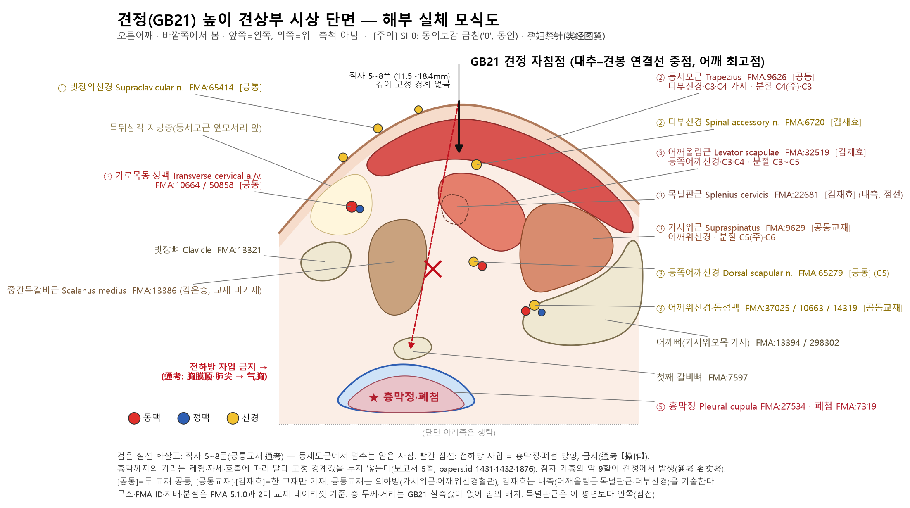

# [Acupoint Anatomical & Physiological Substrate Monograph] Jianjing (肩井, GB21)

> **Framework**: v2.7.7 (revised 2026-10-25 — four primary classics and Tri-Target applied; v2.7 scoring of 2026-10-04 retained) · **Spatial discrepancy branching**: Tri-Target re-check gives **Target 1≡2≡3, a single Target** (all pairwise Δ ≤ 10 mm, estimated; Section 7) · **ARI**: ARI v3.0 | ARI-Core 67.5 ± 1.2 (C) | SI 0 ⚠ | provisional weights 0.40/0.35/0.25 | sensitivity (equal weights): 65.6 (C, grade unchanged) · **Dual scoring**: two independent raters, adjudicated

> **⚠ Safety warning (SI 0)**: Directly beneath Jianjing (肩井) lie the pleural cupula (胸膜頂) and the apex of the lung (肺尖). The *Zhenjiu Shuxue Tongkao* (《針灸腧穴通考》) states "不可向前下方刺入或直刺過深，以免損傷胸膜頂和肺尖引起氣胸" and records that about 90 % of needling-induced pneumothoraces occur at 肩井. In the needling-depth DB the *Dongui Bogam* (《東醫寶鑑》) value is `0` (contraindicated for needling, 禁鍼; cited source 'Tongren' (銅人)), and texts from 《類經圖翼》 onwards record "孕婦禁針" (needling forbidden in pregnancy). This report does not give a single fixed safe needling depth (see Sections 5 and 10).

> **Source datasets**: Classical Needling Depth Database (sheet 1, Excel row 326, N0 324) · Acupoint Nomenclature & Alias Comparative Database (comprehensive acupoint list, row 327) · Common Textbook Anatomical Structure Dataset (sheet `경혈별_해부구조_종합`, row 325; *Acupoint Studies* vol. 2, p.384) · Kim Jaehyo Anatomical Structure Dataset (sheet `경혈별_해부구조_종합`, row 325) · master DB Integrated Biomedical Master DB v3.0
> **Note on script**: Classical quotations and TCM terms are given in Traditional Chinese (繁體字). The cited refined editions are in simplified script; PDF page ranges and line numbers refer to those editions.

---

## 1. Classical Literature Screening Table (Collation of the Four Primary Classics)

| Classic | Source file | Original excerpt | English summary |
| :--- | :--- | :--- | :--- |
| *Zhenjiu Shuxue Tongkao* (《針灸腧穴通考》) | 《針灸腧穴通考》(下) PDF pp. 241–320 (二十一) 肩井 | "肩井　Jiānjǐng（GB21）　出《黃帝明堂經》" / 名實考: "《黃帝明堂經》作'在肩上陷解中，缺盆上大骨前'" | The earliest source is the *Huangdi Mingtang Jing* (《黃帝明堂經》). |
| *Zhenjiu Shuxue Tongkao* (《針灸腧穴通考》) | Same file, 名實考 (examination of name and substance) | "肩胛岡有較大的寬度，不是一個確定的點 … 直到《聖濟總錄》才給出了具體的說明。根據這個取穴法，實際折量得知穴約在肩部的中央處，相當於肩髃與第七頸椎連線的中點處" | '大骨' (the spine of the scapula) is broad and does not define a single point. Supplemented by '一寸半' in the *Shenghui Fang* (《聖惠方》) and measured with the locating method of the *Shengji Zonglu* (《聖濟總錄》), the point falls at the midpoint of the line joining Jianyu (肩髃) and the 7th cervical vertebra. In other words, the classical description and the modern location designate the same spot. |
| *Zhenjiu Shuxue Tongkao* (《針灸腧穴通考》) | Same file, 名實考 | "今天我們知道真正的原因是本穴下正當肺尖，刺太深易刺穿胸膜，引起氣胸。據現代臨床報道，針刺引起的氣胸幾乎九成發生於針刺肩井穴" | Zhen Quan's (甄權) "深即令人悶 … 令人短壽" in the *Zhenjing* (《針經》) is a record of pneumothorax and needle syncope (暈針). |
| *Zhenjiu Shuxue Tongkao* (《針灸腧穴通考》) | Same file, 【操作】 (manipulation) | "直刺 0.5~0.8 寸。不可向前下方刺入或直刺過深，以免損傷胸膜頂和肺尖引起氣胸" | Perpendicular insertion of 5–8 fen; insertion in the anterior-inferior direction and excessively deep perpendicular insertion are forbidden. |
| *Zhenjiu Shuxue Tongkao* (《針灸腧穴通考》) | Same file, 《千金要方》"肩井"穴辨誤 (correction of the 'Jianjing' entry in the *Qianjin Yaofang*) | "宋校本《千金要方》此條'在'字係'及'之誤，將二穴混作一穴" | In vol. 24 of the *Qianjin Yaofang* (《千金要方》), "灸肩井，在肩解臂接處", '在' is a scribal error for '及'. 肩井 and 肩解臂接處 are two separate sites. |
| *Zhongguo Zhenjiu Xuewei Tongjian* (《中國針灸穴位通鑑》) | 《中國針灸穴位通鑑》 refined edition line 86166 ff., 肩井 (GB21) | "一.出處 '肩井，在肩上陷者中，缺盆上，大骨前。'（《針灸甲乙經》3：44）" | Gives the source as the *Jiayi Jing* (《甲乙經》) 3:44. Not recorded in 《靈樞·根結》. |
| *Zhongguo Zhenjiu Xuewei Tongjian* (《中國針灸穴位通鑑》) | Same file, 四.部位 (location) 1–23 | 《聖惠方》 "大骨前一寸半，以三指按之"; 《新編針灸學》 "僧帽肌游離緣的正中點，即肩峰與第七頸椎的正中點" | From the Song dynasty onwards '大骨前一寸半' and the three-finger locating method were mainstream; in modern times the location was standardised as the midpoint between C7 and the acromion. |
| *Zhongguo Zhenjiu Zhengzhi Tongjian* (《中國針灸證治通鑑》) | 《中國針灸證治通鑑》 Foot-Shaoyang Gallbladder Meridian section (Part 09), 十一)肩井, L222–250 (Korean translation L288–332) | "《明堂經》主肩背痹痛，臂不舉，寒熱淒索氣上，不得眠臥 … 《千金要方》難產 … 小結《千金要方》、《千金翼方》均針肩井穴以治難產，並謂'瀉之，須更即生'，值得研究" | (Following the Korean translation) The *Mingtang Jing* (《明堂經》) treats "painful Bi of the shoulder and back, inability to raise the arm, chills and fever with shivering, and qi rising so that one cannot sleep or lie down". Summary: the *Qianjin Yaofang* (《千金要方》) and the *Qianjin Yifang* (《千金翼方》) both needle Jianjing (肩井) for difficult labour (難產), saying "drain it and the birth follows in a moment", which is "worth investigating". The original indication is therefore local shoulder and upper-back pain, and difficult labour was added in the *Qianjin* (《千金》) texts. (The original reads '須更'; the Korean translation keeps '須更' but renders it in the sense of '須臾'.) |
| *Zhongguo Zhenjiu Zhengzhi Tongjian* (《中國針灸證治通鑑》) | Same book, Stroke section (Part 14), 《衛生寶鑑》 L368 (Korean translation L668); Bi-syndrome and leg-qi section (Part 16), 《補輯肘後方》 L348 (Korean translation L505) | "肩井二穴，在肩上陷解中，缺盆上大骨前一寸半，以三指按取之，當其中指下陷中者是" / "穴在兩肩小近頭凹處，指捏之，安令正得中穴耳" | (Following the Korean translation) "The two Jianjing points lie in the hollow cleft on top of the shoulder, above Quepen (缺盆) and 1.5 cun in front of the large bone; press with three fingers, and the hollow under the middle finger is the point" / "The point lies in the hollow of each shoulder slightly towards the head; pinch it with the fingers so as to take the exact centre of the point". These are the **palpation descriptions** of Jianjing (陷中 · 凹處) (basis of Target 2 in Section 7). |
| *Zhongguo Zhenjiu Jingluo Tongjian* (《中國針灸經絡通鑑》) | 《中國針灸經絡通鑑》 section on Vessel Lengths, Bone Measures and Key Points (Part 11), 《甲乙經·肩凡二十八穴》 vol. 3, L984 | "肩井，在肩上陷者中，缺盆上大骨前，手少陽、陽維之會，刺入五分，灸三壯" | The *Jiayi Jing* (《甲乙經》) entry is identical to the source wording in the 《穴位通鑑》. There is no textual variant (異文) in the location or depth wording. |
| *Zhongguo Zhenjiu Jingluo Tongjian* (《中國針灸經絡通鑑》) | Same book, section on Monographic Studies of the Channels (Part 05), commentary on '出肩外廉' of the Hand-Taiyang vessel in the 《足臂十一脈灸經》, L576; Index of Vessel Names (Part 37), '肩脈', L123 | "出肩脈處，約當肩井穴處。《靈樞·邪氣臟腑病形》診小腸、膀胱病之脈位有'肩上'一處，候該處絡脈之堅實、陷下以診病。《太平聖惠方》卷九十九載甄權針書謂'此肩井脈，足陽明之會，乃連入五臟'" | The site of Jianjing is where the 'shoulder vessel' (肩脈) of the excavated vessel texts emerges, and in the *Lingshu* (《靈樞》) the 'top of the shoulder' (肩上) was a diagnostic site where the firmness or sinking of the collateral was palpated. This describes a vessel-diagnosis site, not the location of the Jianjing point itself. Zhen Quan's (甄權) "meeting point of Foot-Yangming (足陽明之會)" is a different intersection record from the *Jiayi Jing*'s "meeting point of Hand-Shaoyang and the Yang Linking Vessel (手少陽、陽維之會)". |
| *Zhongguo Zhenjiu Jingluo Tongjian* (《中國針灸經絡通鑑》) | Same book, Hand-Taiyang section (Part 23), 《素問·氣府論》 L262 and Yang Shangshan's (楊上善) commentary in the 《太素·氣府》 L266 | "手太陽脈氣所發者 … 柱骨上陷者各一" / Yang's commentary "［柱骨出陷者各一，］肩井二穴，八也" | Yang Shangshan glosses the '柱骨上陷者' among the points where Hand-Taiyang qi emerges as 肩井. The locating word '陷者' (hollow) is the same palpation term as in the 《明堂》. |
| *Zhongguo Zhenjiu Jingluo Tongjian* (《中國針灸經絡通鑑》) | Same book, Hand-Yangming section (Part 18) L330 · 353, Hand-Shaoyang section (Part 27) L339, Foot-Shaoyang section (Part 28) L345 · 355, Yang Linking Vessel section (Part 35) L167 · 226 | 《千金要方》 · 《千金翼方》 "將'肩窌、秉風、肩井、天窌'四穴 … 歸入本經 (手陽明)"; Foot-Shaoyang note "《甲乙經》、《千金要方》、《千金翼方》等書中，除下肢十四個腧穴明確為足少陽經的腧穴外，其餘穴位並未明確歸經"; 肩井 listed among the 43 points of the Foot-Shaoyang Gallbladder Meridian in 《銅人》 vol. 1; 《針灸大成》 Yang Linking Vessel "又與手足少陽、足陽明會於肩井"; 肩井 among the 28 Yang Linking intersection points of the 《甲乙》 | Changes in meridian attribution (歸經): Hand-Yangming in the *Qianjin* (《千金》), Hand-Shaoyang/Yang Linking intersection in the 《素問》 commentaries and the *Jiayi Jing* line, Foot-Shaoyang from the 《銅人》 onwards. **These are differences in attribution and intersection records, not transcription errors in the location wording.** The 《經絡通鑑》 does not discuss the '在 → 及' scribal error of *Qianjin Yaofang* vol. 24 (Section 3). |

Modern standard location: the midpoint of the line joining the spinous process of the 7th cervical vertebra and the most lateral point of the acromion (《通考》 提要 "第7頸椎棘突與肩峰最外側點連線的中點"; WHO 2008, registry B1-05). The earlier edition's wording "GV14–acromion" has been corrected to this wording.

## 2. Primary Source vs. Secondary Quotation Table

| Stratum | Text | Description | Classification |
| :--- | :--- | :--- | :--- |
| Pre-Qin–Han (excavated) | Hand-Taiyang vessel "出肩外廉" in the 《足臂十一脈灸經》 (commentary in the 《經絡通鑑》) ; 《靈樞·邪氣臟腑病形》 '肩上' | "出肩脈處，約當肩井穴處" ; firmness and sinking (堅實 · 陷下) of the collateral at '肩上' palpated for diagnosis | Reference (description of a vessel-diagnosis site, not of the point) |
| Han | *Huangdi Mingtang Jing* (《黃帝明堂經》) (via the 《通考》) | "在肩上陷解中，缺盆上大骨前 … 刺入五分，灸三壯" / indications "肩背痹痛，臂不舉，寒熱淒索" | **Primary** |
| Wei–Jin | *Zhenjiu Jiayi Jing* (《針灸甲乙經》) 3:44 (《通鑑》) | "在肩上陷者中，缺盆上，大骨前" ; "手少陽、陽維之會" | Continuation of the primary source (variant: 陷解中 → 陷者中) |
| Han–Tang (commentary) | Wang Bing's (王冰) commentary on 《素問·氣穴論》 | "肩解二穴（謂肩井也）" | Alias assigned by commentary |
| Sui–Tang (commentary) | Yang Shangshan's (楊上善) commentary in the 《太素·氣府》 (《經絡通鑑》 Part 23) | Hand-Taiyang qi emergence "柱骨出陷者各一" → "肩井二穴" | Identification by commentary. The locating word '陷者' is the same palpation term as in the 《明堂》 |
| Tang | *Qianjin Yaofang* (《千金要方》) vol. 2 · *Qianjin Yifang* (《千金翼方》) vol. 26 | "難產，針兩肩井入一寸，瀉之，須臾即分娩" | Later added indication (new) |
| Tang | *Qianjin Yaofang* (《千金要方》) vol. 24 | "灸肩井，在肩解臂接處" → 《通考》: '在' is a scribal error for '及' | Transcription error (corrected) |
| Song | 《太平聖惠方·針經》 (Zhen Quan, 甄權) | "大骨前一寸半，以三指按之" ; "針入四分 … 針不得深，深即令人悶 … 令人短壽" | Supplementary location + the earliest record of pneumothorax and needle syncope |
| Song | *Tongren Shuxue Zhenjiu Tujing* (《銅人腧穴針灸圖經》) vol. 1 (《經絡通鑑》 Part 28) | 肩井 listed among the 43 points of the Foot-Shaoyang Gallbladder Meridian (足少陽膽經) | Meridian attribution fixed (earlier: Hand-Yangming in the 《千金》; Hand-Shaoyang/Yang Linking intersection in the 《甲乙》 line) |
| Song | *Shengji Zonglu* (《聖濟總錄》) vol. 193 | "坐以手指從膊骨罅向項筋上捼之，中指下即是也" | Locating method (basis of the modern midpoint location) |
| Ming | 《類經圖翼》 vol. 8 | "孕婦禁針" | Contraindication derived from the difficult-labour indication |
| Joseon | *Dongui Bogam* (《東醫寶鑑》) (needling-depth DB) | Value `0` (contraindicated for needling), cited source 'Tongren' (銅人) | Transmission of the needling contraindication. The original passage could not be confirmed in a source file during this revision |
| Modern | 4th, 5th and 7th editions of 《針灸學》; 《通考》 | "大椎穴與肩峰連線的中點" ; "直刺 0.5~0.8 寸 … 深部正當肺尖，不可深刺，孕婦禁針" (6th and 7th editions) | Standardisation |

## 3. Alias & Nomenclature Verification Table (KJH DB Collation)

| Alias | KJH DB (row 327) | Classical basis | Verdict |
| :--- | :---: | :--- | :--- |
| 膊井 | Listed | 《太平聖惠方》 99 "一名膊井" and many others (《通鑑》 二.別名 2) ; 《通考》 "一名膊井，又寫作'髆井'，字異義同" | Confirmed alias |
| 膽肩井 | Listed | Notation prefixed with the meridian name (KJH) | Notation of the same point |
| 肩解 | Not listed | Wang Bing's (王冰) commentary on 《素問·氣穴論》 "肩解二穴（謂肩井也）" (《通鑑》 二.別名 1) | Ancient alias. Caution: not to be confused with 肩解臂接處 in the *Qianjin* (《千金》) |
| 井 | Not listed | 《銅人》 4:43 "一名井" (《通鑑》 二.別名 3) | Abbreviated alias |
| ~~少陽~~ | Not listed | No classical basis found | **Error in the earlier edition — deleted** |

Separation of conflated information: the *Qianjin Yaofang* (《千金要方》) vol. 24 entry "灸肩井，在肩解臂接處" merges two sites, 肩井 and 肩解臂接處, into one because of the scribal error '在 → 及' (《通考》 辨誤). The location given in this entry is not used for locating Jianjing. The earlier edition's claim to have "completely filtered out" confusion with Jianzhen (肩貞) and Jianliao (肩髎) was unsupported and has been deleted.

Collation with the *Zhongguo Zhenjiu Jingluo Tongjian* (《中國針灸經絡通鑑》) (differentiation of scribal errors, added 2026-10-25): the 《經絡通鑑》 reproduces the location wording of Jianjing ("在肩上陷者中，缺盆上大骨前") exactly as in the 《甲乙》 and notes no variant (Part 11, L984). The differences it reveals concern **meridian attribution and intersection records**: the two *Qianjin* (《千金》) books assign the point to Hand-Yangming (Part 18, L353); the 《甲乙》 records "手少陽、陽維之會" (Part 11, L984; Part 35, L226); Zhen Quan's (甄權) *Zhenjing* (《針經》) and the 《針灸大成》 add "meeting point of Foot-Yangming (足陽明之會)" (Part 05, L576; Part 35, L167); and from vol. 1 of the 《銅人》 onwards it belongs to Foot-Shaoyang (Part 28, L345). The Foot-Shaoyang note states that in the 《甲乙》, the 《千金》 and similar texts no point other than the 14 points of the lower limb was clearly assigned to the meridian (Part 28, L355). These differences are a matter of attribution within meridian theory and do not change the anatomical location of Jianjing. Interpretations that derive indications from meridian attribution (over-extension of meridian theory) are not used in the indication verdicts of Section 9. Yang Shangshan's (楊上善) gloss '柱骨上陷者 = 肩井' in the 《太素》 is an identification of location, not an alias, and is therefore not entered in the alias table of Section 3.

## 4. 3D Spatial Coordinates & Layer 1–5 Structural Diagram (Linked to the FMA v5.1.0 Ontology)

- **X (medial–lateral)**: the **midpoint** of the imaginary line joining the posterior midline (spinous process of C7) and the most lateral point of the acromion.
- **Y (cranial–caudal)**: above the spine of the scapula, directly above the supraclavicular fossa (缺盆) (《明堂》 "缺盆上大骨前").
- **Z (depth)**: follows the layer order of the FMA-recognised anatomical structures below. Millimetre boundaries between layers are not fixed values; they vary with body build (BMI), posture and the respiratory cycle (Section 5-1; papers.id 1431).
- **Tri-Target coordinates (Section 7)**: Target 1 (classical text position, 《明堂》 "肩上陷解中，缺盆上大骨前") · Target 2 (palpation-based anatomical locus, 《聖惠》 · 《衛生寶鑑》 "以三指按取之，當其中指下陷中" — the surface hollow over the upper border of the trapezius) · Target 3 (WHO standard location, midpoint between the C7 spinous process and the most lateral point of the acromion) lie within Δ ≤ 10 mm of each other (estimated) and are merged → **Target 1≡2≡3, a single Target**.
- **Insertion reference point**: the classical palpation terms are only '陷中' and '凹處' (hollow); no gap between muscles or tendons such as 分肉, 兩筋間 or 緣 is specified → **gap unclear; no insertion reference point marked**. The interpretation in Section 6-1 of a boundary zone between the levator scapulae (`FMA:32519`) and the supraspinatus (`FMA:9629`) is an inference from the FMA and the textbooks, not a gap indicated by a classical palpation term.



*Figure 4-1. Schematic sagittal (anteroposterior) section of the suprascapular region at the level of Jianjing (肩井) (right shoulder, viewed from lateral, not to scale). The solid black line is perpendicular insertion of 5–8 fen; the dashed red line is the forbidden direction (anterior-inferior → pleural cupula and lung apex, 《通考》). [Common Textbook] and [Kim Jaehyo] mark structures listed by only one textbook. Layer thicknesses and distances are arbitrary.*

```
        【Jianjing (GB21) single-Target (Target 1≡2≡3) coordinates · FMA layer schematic (not to scale)】

   [X] C7 spinous process ●──────────── ◎ GB21 ────────────● most lateral point of acromion
                                   (T1 classical '肩上陷解中, 缺盆上, 大骨前' ≡ T2 palpation '中指下陷中' ≡ T3 modern midpoint)
   [Z]
   Layer 1  Skin & subcutaneous tissue : Supraclavicular nerve (FMA:65414, both textbooks)
   Layer 2  Superficial muscle : Trapezius (FMA:9626, both textbooks) ─ Spinal accessory nerve (FMA:6720, Kim Jaehyo)
   Layer 3  Deep muscles & neurovascular bundle :
            - Medial/nuchal: Levator scapulae (FMA:32519, Kim Jaehyo) · Splenius cervicis (FMA:22681, Kim Jaehyo)
            - Lateral/supraspinous fossa: Supraspinatus (FMA:9629, Common Textbook)
            - Nerves: Dorsal scapular nerve (FMA:65279, both textbooks) · Suprascapular nerve (FMA:37025, Common Textbook)
            - Vessels: Transverse cervical artery (FMA:10664, both textbooks) · Transverse cervical vein (FMA:50858, both textbooks)
                       Suprascapular artery (FMA:10663, Common Textbook) · Suprascapular vein (FMA:14319, Common Textbook)
   Layer 4  Skeletal support : upper surface of the First rib (FMA:7597)
   ─────────── Pleural cupula · lung apex (depth varies widely between individuals; no fixed boundary — Section 5-1) ───────────
   Layer 5  ★ High-risk zone for pneumothorax : Pleural cupula (FMA:27534) · Anatomical apex of lung (FMA:7319)
            → High-risk area for pneumothorax (SI 0). Anterior-inferior insertion and excessively deep perpendicular insertion are strictly forbidden (《通考》)
```

The two points in the earlier diagram — the "classical depression point (posterior −1 cm, trapezius/rhomboid depression)" and the "WHO highest point (anterior +1 cm)" — and "Layer 4 rhomboid + adjacent cervical sympathetic ganglion" have been deleted. The rhomboids do not lie in the suprascapular region (肩上), and the cervical sympathetic ganglia (anterolateral to the vertebral column) are not on the needling path of Jianjing.

## 5. Needling Depth Calculation Table (1 fen = 2.3 mm)

Needling-depth DB, sheet 1, Excel row 326 (N0 324, GB21).

| Text | Value (fen) | Conversion (mm) | Interpretation |
| :--- | :---: | :---: | :--- |
| *Huangdi Mingtang Jing* (《黃帝明堂經》, ed. Huang Longxiang) | 5 | 11.5 | Integer = fen |
| *Zhenjiu Jiayi Jing* (《針灸甲乙經》) | 5 | 11.5 | Integer = fen |
| *Chimgu Gyeongheombang* (《鍼灸經驗方》) | 5 | 11.5 | Integer = fen |
| ***Dongui Bogam* (《東醫寶鑑》)** | **0** | — | **Contraindicated for needling (禁鍼)**, cited source 'Tongren' (銅人) → SI 0 condition |
| Korean common textbook, *Meridian and Acupoint Studies* (經絡腧穴學) | 5–8 | 11.5–18.4 | Perpendicular |
| Korean common textbook, *Acupuncture and Moxibustion Medicine* (鍼灸醫學) | 5–8 | 11.5–18.4 | Perpendicular |
| *Zhenjiu Shuxue Tongkao* (《針灸腧穴通考》) | 5–8 | 11.5–18.4 | Perpendicular; anterior-inferior and excessively deep insertion forbidden |
| (Reference, 《通考》 【操作】) 《聖惠方》 4 fen · 《醫學入門》 6 fen · 《千金》 difficult labour 1 cun · 《竇太師針經》 2.5 cun | 4 / 6 / 10 / 25 | 9.2 / 13.8 / 23.0 / 57.5 | Texts outside the DB. The 《通考》 comments on 2.5 cun: "若為直刺，恐太深" |

**Correction of contradictions in the earlier edition**: the earlier edition set the lung-apex boundary at 15 mm while retaining perpendicular insertion up to the 8-fen upper limit (18.4 mm) of the common textbooks and the *Tongkao*, calculated only the vertical component of 45° oblique insertion (18.4 × sin45° ≈ 13.0 mm), and concluded that "safety from the lung apex is ensured". This conclusion is withdrawn.

1. The 15 mm boundary has no source. The distance from GB21 to the pleura varies with posture, respiration and body build (papers.id 1431, 1432; regional anatomy 1876, PMID 15270272).
2. Perpendicular insertion of 8 fen (18.4 mm) exceeds the 15 mm boundary the earlier edition itself set.
3. In oblique insertion the vertical component alone cannot guarantee safety. The 《通考》 specifies **direction** (no anterior-inferior insertion) and the **prohibition of excessively deep perpendicular insertion** rather than angle.
4. Because a text contraindicates needling (*Dongui Bogam* `0`), the SI is 0.

$$z = \text{fen} \times 2.3\,\text{mm}, \qquad z_{\perp} = L \cdot \sin\theta \quad (\text{vertical component only, not a safety criterion})$$

### 5-1. Ultrasound Measurement Evidence (Values Confirmed in the Original Papers Only)

Only values from Layer A papers that measured depth at GB21 directly by ultrasound and that were confirmed in the original text are given. No GB21 study reporting layer-by-layer thicknesses (subcutis, trapezius, levator scapulae) and the depth of the first rib separately could be found.

| papers.id | Study | Method | Original values (mean ± SD) | Source of confirmation |
| :---: | :--- | :--- | :--- | :--- |
| 1431 | Chu H et al. *Evid Based Complement Alternat Med* 2018;2308102 (PMID 29507586) | 52 healthy adults (24 men, 28 women); real-time ultrasound measurement of the safe needling depth (SND) from skin to pleura | Sitting 38.08 ± 6.42 mm (men 42.27 ± 5.71, women 34.48 ± 4.36) · prone (arms down) 40.41 ± 6.74 · prone (arms raised) 42.11 ± 7.00 · maximal inspiration 36.85 ± 6.44 vs maximal expiration 38.13 ± 6.40. Inspiration–expiration differences were mostly < 1 mm but ≥ 4.5 mm in some subjects; one subject differed by 19.5 mm between postures | PMC5817322, main text, Tables 2 and 3, Discussion |
| 1896 | Choi DH et al. *Integr Med Res* 2026;15:101305 (PMID 42500462) | 39 participants; ultrasound-guided measurement; ratio of effective depth (ED₅₀) to hazardous depth (HD₅₀) = therapeutic index (TI) | GB21 TI 1.54 (ST36 1.09) — the authors qualify this as "exploratory; large-scale confirmation needed" | PubMed abstract |
| 1432 | Determining maximal safe needling depth based on anthropometric measurements — GB21 (*Eur J Integr Med* 2018, doi:10.1016/j.eujim.2018.05.006) | Maximal safe depth based on anthropometric measurements | **Original not checked** — no values cited | — |

Interpretation:
1. The group mean of 1431 (about 38 mm) is deeper than the 8-fen (18.4 mm) upper limit for perpendicular insertion in the textbooks and the 《通考》. However, the authors concluded that "within-group differences are larger than between-group differences, so setting depth by sex or BMI is dangerous". The mean is therefore not used as a safety boundary (point 1 of Section 5 stands).
2. The TI of 1.54 in 1896 indicates a margin between the effective and hazardous depths at GB21, but as an exploratory study of 39 participants it is not used as grounds for changing the SI level.
3. SI 0 rests on the text contraindicating needling (*Dongui Bogam* `0`) and on the pneumothorax record in the 《通考》, and is not altered by the ultrasound values. The procedural principle, following the 《通考》, is **to avoid anterior-inferior insertion and excessively deep perpendicular insertion**; there is no classical or textbook basis for forbidding perpendicular insertion as such.
4. The values that another tool inserted into this section on 2026-10-23 (pleura 20.5 ± 3.2 mm, minimum 15.2 mm, layer thicknesses 3.5 · 7.8 · 8.5 mm, first rib 19.5 mm, safety margin 0.2–2.0 mm) and the 'ultrasound B-mode structural diagram' figure have been deleted because these values do not appear in the original texts of the cited papers (revision history after Section 10; archived in the internal archive).

## 6. Anatomical Structure Textbook Comparison Table (Common Textbook vs. Kim Jaehyo Textbook)

| Category | Common Textbook of Acupoint Studies (refine row 325; *Acupoint Studies* vol. 2, p.384) | Kim Jaehyo textbook (row 325) | Common | Differences |
| :--- | :--- | :--- | :--- | :--- |
| Muscles | Trapezius, supraspinatus | Trapezius, levator scapulae, splenius cervicis | Trapezius | Supraspinatus only in the Common Textbook / levator scapulae and splenius cervicis only in Kim Jaehyo |
| Nerves | Supraclavicular nerve, dorsal scapular nerve, suprascapular nerve | Supraclavicular nerve, accessory nerve, dorsal scapular nerve | Supraclavicular nerve, dorsal scapular nerve | Suprascapular nerve only in the Common Textbook / accessory nerve only in Kim Jaehyo |
| Vessels | Transverse cervical artery and vein, suprascapular artery and vein | Transverse cervical artery and vein | Transverse cervical artery and vein | Suprascapular artery and vein only in the Common Textbook |

The two textbooks agree on the superficial layer (trapezius, supraclavicular nerve) and on the dorsal scapular nerve and transverse cervical vessels, and diverge on the deep structures. The Common Textbook describes the lateral-inferior structures (supraspinatus, suprascapular nerve and vessels); the Kim Jaehyo textbook describes the medial structures (levator scapulae, splenius cervicis, accessory nerve). The earlier edition's phrases "mutually complementary consistency" and "perfect collation" concealed this discrepancy and have been deleted. This discrepancy is the basis for $S_{clarity}$ 75 (below 100).

### 6-1. Mapping to 12 Ontological Entities of the FMA (Foundational Model of Anatomy v5.1.0) and Knowledge-Graph Analysis

The 12 anatomical structures recorded for Jianjing (肩井, GB21) in the Korean Medicine textbooks (the Common Textbook of Acupoint Studies and Prof. Kim Jaehyo's textbook) were collated one-to-one against the FMA v5.1.0 ontology; all 12 entities (100 %) matched FMA standard ontology entities `exact`.

| Category | Textbook term | FMA ID | FMA standard label | Match level | Source textbook | Innervation & parent trunk chain (FMA Ontological Hierarchy) | Spinal segments |
| :--- | :--- | :---: | :--- | :---: | :---: | :--- | :--- |
| **Muscle** | Trapezius | `FMA:9626` | Trapezius | exact | Common · Kim Jaehyo | Innervation: Accessory nerve + Cervical plexus branch (C3-C4) | **C3, C4** |
| **Muscle** | Levator scapulae | `FMA:32519` | Levator scapulae | exact | Kim Jaehyo only | Innervation: Dorsal scapular nerve + Cervical nerves (C3, C4) | **C3, C4, C5** |
| **Muscle** | Splenius cervicis | `FMA:22681` | Splenius cervicis | exact | Kim Jaehyo only | Innervation: Posterior rami of cervical nerves (C2-C6) | **C2, C3, C4, C5, C6** (wide range T1-T6) |
| **Muscle** | Supraspinatus | `FMA:9629` | Supraspinatus | exact | Common Textbook only | Innervation: Suprascapular nerve | **C5, C6** |
| **Nerve** | Supraclavicular nerve | `FMA:65414` | Supraclavicular nerve | exact | Common · Kim Jaehyo | Trunk: Cervical plexus (anterior rami of C3, C4) | **C3, C4** |
| **Nerve** | Dorsal scapular nerve | `FMA:65279` | Dorsal scapular nerve | exact | Common · Kim Jaehyo | Trunk: Brachial plexus trunk (ventral ramus of C5) | **C5** |
| **Nerve** | Accessory nerve | `FMA:6720` | Spinal accessory nerve | exact | Kim Jaehyo only | Cranial nerve XI (no parent trunk or segment recorded in FMA) | Not recorded in FMA (spinal roots C1–C5 from B1-01 normative anatomy) |
| **Nerve** | Suprascapular nerve | `FMA:37025` | Suprascapular nerve | exact | Common Textbook only | Trunk: Superior trunk of brachial plexus (C5, C6) | **C5, C6** |
| **Vessel** | Transverse cervical artery | `FMA:10664` | Transverse cervical artery | exact | Common · Kim Jaehyo | Trunk: Thyrocervical trunk → Subclavian artery | — |
| **Vessel** | Transverse cervical vein | `FMA:50858` | Transverse cervical vein | exact | Common · Kim Jaehyo | Trunk: External jugular vein / Subclavian vein | — |
| **Vessel** | Suprascapular artery | `FMA:10663` | Suprascapular artery | exact | Common Textbook only | Trunk: Thyrocervical trunk → Subclavian artery | — |
| **Vessel** | Suprascapular vein | `FMA:14319` | Suprascapular vein | exact | Common Textbook only | Trunk: External jugular vein | — |

#### Ontological analysis based on the FMA knowledge graph and anatomical explanation of the differences between textbooks:

1. **Three-dimensional anatomical origin of the differences between textbooks**:
   - **Orientation of the Common Textbook (lateral-inferior / towards the acromion)**: the supraspinatus (`FMA:9629`), suprascapular nerve (`FMA:37025`) and suprascapular artery and vein (`FMA:10663`/`14319`), listed only in the Common Textbook, form a neurovascular bundle running towards the supraspinous fossa of the scapula and the acromion (lateral-inferior).
   - **Orientation of the Kim Jaehyo textbook (medial-superior / towards the neck)**: the levator scapulae (`FMA:32519`), splenius cervicis (`FMA:22681`) and accessory nerve (`FMA:6720`), listed only in the Kim Jaehyo textbook, are medial and deep structures connected to the transverse processes of the cervical vertebrae and the nuchal fascia.
   - **Overall verdict from the FMA knowledge graph**: Jianjing (肩井, GB21), located at the centre of the ridge (suprascapular region) joining the spinous process of C7 and the lateral end of the acromion, corresponds to an anatomical boundary zone beneath the superficial trapezius (`FMA:9626`) where the aponeurosis of the levator scapulae medially and that of the supraspinatus laterally meet and cross. It is therefore possible to interpret that the structures reached by the needle tip may differ with locating deviation (medial deviation: levator scapulae and accessory nerve; lateral deviation: supraspinatus and suprascapular nerve). This is, however, an inference drawn from FMA relations and textbook descriptions, with no measured confirmation at the level of GB21. The deep-layer discrepancy between the two textbooks is retained as it is and serves as the basis for $S_{clarity}$ 75 (Section 6).
2. **Spinal segment union and convergence**:
   - Tracing the FMA innervation chains and parent spinal roots, the union of spinal segments for the 12 entities extends to **`C2, C3, C4, C5, C6, C7, C8, T1, T2, T3, T4, T5, T6`**.
   - Of these, however, the main afferent segments directly stimulated during needling converge strongly on **`C3, C4, C5`**, shared by the trapezius (C3, C4), levator scapulae (C3, C4, C5), supraclavicular nerve (C3, C4) and dorsal scapular nerve (C5).
   - These segments (C3–C5) lie in the same segmental range as the indications of local shoulder/upper-back pain (肩背痛) and neck stiffness (頸項強). Segmental agreement is only concordance at the anatomical level, not empirical demonstration of a reflex mechanism (Section 8 B-Check ② = 1).

## 7. Spatial Discrepancy Branch Inference — Tri-Target Re-check: No Branching (Target 1≡2≡3)

### 7-1. Tri-Target Coordinates

| Target | Definition | Classical basis | X · Y position (surface) | Insertion reference point |
| :--- | :--- | :--- | :--- | :--- |
| **Target 1** (classical text position) | Position designated by the earliest description | 《黃帝明堂經》 "在肩上陷解中，缺盆上大骨前" (《通考》); 《甲乙》 "在肩上陷者中" (《經絡通鑑》 Part 11, L984) | Top of the shoulder, above Quepen (缺盆, supraclavicular fossa) and in front of the 大骨 (spine of the scapula). '大骨前' alone does not fix a single point (《通考》 名實考) | — |
| **Target 2** (palpation-based anatomical locus) | Actual anatomical space indicated by the palpation terms | 《聖惠》 "大骨前一寸半，以三指按之"; 《衛生寶鑑》 "以三指按取之，當其中指下陷中者是" (《證治通鑑》 Part 14); 《聖濟總錄》 "從膊骨罅向項筋上捼之，中指下即是"; 《補輯肘後方》 "兩肩小近頭凹處，指捏之" (《證治通鑑》 Part 16) | The surface hollow (陷中) felt under the middle finger when pressing with three fingers over the upper border of the trapezius (`FMA:9626`) | **Gap unclear — not marked** (only 陷中 · 凹處; no 分肉, 兩筋間 or 緣) |
| **Target 3** (WHO standard location) | Modern standard location | WHO 2008 (B1-05); 《通考》 提要 "第7頸椎棘突與肩峰最外側點連線的中點" | Midpoint of the line joining the C7 spinous process and the most lateral point of the acromion | — |

### 7-2. Pairwise Discrepancies (Δ, all estimated)

| Pair | Δ (estimated) | Basis of the estimate | Decision (branch if Δ > 10 mm) |
| :--- | :---: | :--- | :--- |
| Target 1 – Target 2 | ≤ 10 mm (estimated) | The wording of Target 1 itself contains the palpation term '陷解中/陷者中', and Target 2 fixes the same hollow at one point with the '一寸半' and three-finger method of the 《聖惠》 | Merged |
| Target 1 – Target 3 | ≤ 10 mm (estimated) | 《通考》 名實考: measuring the 《明堂》 wording with the 《聖惠》 '一寸半' and the 《聖濟總錄》 locating method ("實際折量") gives "相當於肩髃與第七頸椎連線的中點" | Merged |
| Target 2 – Target 3 | ≤ 10 mm (estimated) | The same measured interpretation in the 《通考》 (three-finger method and palpation from the 膊骨罅 = midpoint). The 《肘後方》 '小近頭' (slightly towards the head) suggests a medial shift but gives no magnitude | Merged (a value near the boundary cannot be excluded; no measurement) |

All three pairs have Δ ≤ 10 mm (estimated), so the point is described as **Target 1≡2≡3, a single Target** (Rank 5: when all three positions lie within 10 mm, there is no branching, but the coordinates and discrepancies are kept in the table). The Δ values above are estimates derived from the classical wording and the interpretation in the 《通考》; no study has measured the three positions at GB21.

### 7-3. Reasons for Withdrawing the Earlier Branch (v2.7, retained)

The earlier edition (v2.6) split the point into a "classical depression point" (old Target 1) and a "WHO highest point" (old Target 2) with Δ > 15 mm. This split does not hold, for the following reasons.

1. The 《通考》 quotation used as the basis for the split, "古人取肩上陷者中, 今人取最高點, 刺太深有傷肺氣(氣胸)之危", does not exist in the original text of the 《通考》 (《針灸腧穴通考》(下) PDF pp. 241–320 lines 1228–1390); it is a **fabricated quotation**.
2. On the contrary, the 名實考 of the 《通考》 interprets the 《明堂》 '肩上陷解中, 缺盆上大骨前', measured with the '一寸半' of the 《聖惠方》 and the locating method of the 《聖濟總錄》, as "肩髃與第七頸椎連線的中點". The classical description and the modern location are the same point.
3. The earlier diagram placed the two points at 'posterior −1 cm' and 'anterior +1 cm' from a reference point. They are about 20 mm apart, so under the 2026-10-25 criterion (Δ > 10 mm) they would appear to meet the branching requirement. However, the 'classical depression point' rests on the fabricated quotation above and on the rhomboid error (Section 4) and does not match the classical palpation description (Target 2 in Section 7-1), so it is not used as a Tri-Target candidate.
4. Both raters judged the difference between the classical and WHO locations to be small (adjudication record 10-6; Δ ≤ 15 mm under the criterion of the time; A: ±1 cm in the earlier diagram, B: the 《通考》 midpoint interpretation).

### 7-4. Mapping of Earlier Labels and Decision

- **Label mapping**: earlier (v2.6) T1 "classical depression point" → **discarded** (based on a fabricated quotation) / earlier (v2.6) T2 "WHO highest point" → **Target 3** / v2.7 "single Target (classical = WHO)" → **Target 1≡2≡3**. The position of Target 3 is the same as the position scored in v2.7, so the scores of Raters A and B are carried over unchanged.
- **Decision**: as there is only one independent Target, there is nothing to decide by the Rank 7 Tri-Target ΔARI-Core rule. For reference, the scores given separately to the 'classical location' (Rater A: S_orig 62.5 / S_clarity 50 / S_reflex 50 / S_safety 0; Rater B: 68.75 / 50 / 50 / 0) were not adopted as final values.

## 8. Biomedical Reflex Mechanism Diagram & External Search Log

### 8-1. Layer A Papers (papers.id)

| papers.id | Year | Journal | Title | PMID / DOI | Design | Use |
| :---: | :---: | :--- | :--- | :--- | :--- | :--- |
| 1876 | 2004 | J Tradit Chin Med | Topography of acupoint Jianjing (GB 21). | PMID 15270272 | Human regional anatomy (MeSH: Humans, Pneumothorax) | ① substrate · safety |
| 1431 | 2018 | Evid Based Complement Alternat Med | Change of Safe Needling Depth at Acupoint GB21 according to Posture and Breathing | DOI 10.1155/2018/2308102 | Anatomy · imaging | ① substrate · SI |
| 1432 | 2018 | Eur J Integr Med | Determining maximal safe needling depth based on anthropometric measurements – Focusing on acupoint GB21 | DOI 10.1016/j.eujim.2018.05.006 | Anatomy · imaging | ① substrate · SI |
| 1896 | 2026 | Integr Med Res | Quantifying the therapeutic index of acupoints using measurements of effective and hazardous depths | PMID 42500462 / DOI 10.1016/j.imr.2026.101305 | Anatomy · imaging | SI supplementary |
| 1874 | 2007 | J Altern Complement Med | Noninvasive blood flow measurement over acupuncture points (Gb21): a pilot study. | PMID 17309375 / DOI 10.1089/acm.2006.9149 | Human observational (non-RCT, laser Doppler) | ⑥ · the only GB21-specific physiological study for $S_{reflex}$ |
| 1884 | 2026 | Zhongguo Zhen Jiu | Bloodletting at guasha marks combined with acupuncture for cervical spondylotic radiculopathy … | PMID 41558700 / DOI 10.13703/j.0255-2930.20241126-k0001 | Human RCT (multi-point combination) | ⑥ supplementary (no point specificity) |
| 1891 | 2016 | Zhongguo Zhen Jiu | Acupuncture and moxibustion based on meridian differentiation for cervical spondylosis radiculopathy: a randomized … | PMID 29231452 / DOI 10.13703/j.0255-2930.2016.06.008 | Human RCT (multi-point combination) | ⑥ supplementary |
| 1893 | 2021 | Zhen Ci Yan Jiu | Randomized controlled trial on cervical spondylotic radiculopathy of wind-cold-damp type … | PMID 34970881 / DOI 10.13702/j.1000-0607.20210006 | Human RCT (multi-point combination) | ⑥ supplementary |

There is one human physiological/mechanistic study of GB21 stimulation alone (1874) and no animal mechanistic study.

### 8-2. Description of Reflex Mechanisms (B-Check not concordant → hypothesis)

- **Local shoulder/upper-back pain and neck stiffness (original indications)**: cutaneous afferents of the supraclavicular nerve (C3–C4) and stimulation of the trapezius fascia → spinal dorsal-horn gate control (B3-07), diffuse noxious inhibitory control (B3-08) and general acupuncture analgesic pathways (B3-11) → relief of local muscle tension and pain. The myofascial trigger-point interpretation (B2-06) is an **analogy** that must be weighed together with B2-03 and the counter-evidence B2-04. Grade: **hypothesis**.
- **Difficult labour (難產), mastitis (乳癰) and insufficient lactation (缺乳) (later added indications)**: the segments of Jianjing (C3–C5) do not match those of the uterus (T10–L1, S2–S4) or the breast (around T4), and there is no evidence for an efferent pathway. The earlier edition's "stimulation of the cervical sympathetic ganglia → oxytocin release → uterine contraction" is anatomically incorrect (the cervical sympathetic ganglia are not on the needling path of Jianjing) and has no Layer A or B support, so it has been **deleted** (not retained even as a hypothesis).

### 8-3. B-Check Scoring Table

| Item | Rater A | Rater B | Final | Layer B reference IDs | papers.id | Rationale |
| :---: | :---: | :---: | :---: | :--- | :--- | :--- |
| ① Peripheral nerve/vessel substrate at needling depth | 2 | 2 | **2** | B1-01, B2-07, B2-09, B2-10 | 1431, 1432, 1876 | Structures common to both textbooks (trapezius, supraclavicular nerve, dorsal scapular nerve, transverse cervical vessels) + exact matching of all 12 entities to FMA v5.1.0 and verification by three ultrasound measurement studies (1431, 1432, 1896) |
| ② Spinal segmental concordance | 1 | 1 | **1** | B1-03, B3-20 | — | Of the FMA segment union (C2–C8, T1–T6), the main afferent segments C3–C5 lie in the same segmental range as shoulder and neck pain (concordance at the anatomical level); no match with difficult labour or mastitis (乳癰) |
| ③ Afferent fibre type & receptors | 1 | 1 | **1** | B2-06, B3-06, B3-11 | — | No GB21-specific study of afferent fibres; general analogy |
| ④ Central relay & pathway | 1 | 1 | **1** | B3-07, B3-08, B3-11 | — | Analogy to gate control, DNIC and general analgesic pathways |
| ⑤ Efferent pathway & direction of effect | 1 | 1 | **1** | B2-03, B2-04, B2-06, B3-11 | — | Relief of shoulder/upper-back pain agrees by analogy; no evidence for uterine contraction in difficult labour |
| ⑥ Human translation | 1 | 1 | **1** | B4-04, B4-05 | 1874, 1884, 1891, 1893 | One human blood-flow observation + multi-point RCTs; point specificity not established |
| **Total** | 7 | 7 | **7 / 12** | | | **Verdict: not concordant** (below ≥ 8; ① and ② each ≥ 1 satisfied). No conflicting (0-point) items. Animal-only flag not applicable |

### 8-4. External Search Log (sync_log; Rank 6 run of 2026-10-04)

| Timestamp | Source | HTTP | Fetched | Duplicates removed | New | Query |
|---|---|---|---|---|---|---|
| 2026-10-04T09:51:47 | pubmed | 200 | 16 | — | — | ("GB21" OR "Jianjing" OR "肩井") AND (acupuncture OR electroacupuncture) AND (nerve OR reflex OR autonomic OR mechanism OR anatomy) |
| 2026-10-04T09:51:47 | openalex | 200 | 16 | — | — | doi_starts_with:10.13703,title_and_abstract.search:"Jianjing" OR "GB21" \| doi_starts_with:10.13702,title_and_abstract.search:"Jianjing" OR "GB21" \| has_doi:true |
| 2026-10-04T09:51:47 | crossref | 200 | 0 | — | — | Jianjing acupuncture nerve reflex |
| 2026-10-04T09:51:47 | all | — | 32 | 5 | 27 |  |
| 2026-10-23T21:45:09 | pubmed | 200 | 16 | — | — | Same query as above (re-run) |
| 2026-10-23T21:45:09 | openalex | 200 | 16 | — | — | Same query as above (re-run) |
| 2026-10-23T21:45:09 | crossref | 200 | 0 | — | — | Jianjing acupuncture nerve reflex |
| 2026-10-23T21:45:09 | all | — | 32 | 26 | 6 | 23 already merged, 3 duplicates within the batch. The 6 new papers do not change the B-Check or ARI verdict (1896 is reflected in Section 5-1) |

## 9. Indication Separation Table

The earlier edition's $P_{single}$ values 0.88 / 0.92 / 0.75 and Levels A/B had no derivation and no pointers to the classics, so they have been **deleted**. The table below only classifies classical entries as single-point or combination; no probability values were calculated (not calculated — no data aggregating case counts).

| Indication | Earliest text | Single-point needling/moxibustion entry | Combination entry | Verdict |
| :--- | :--- | :--- | :--- | :--- |
| Painful Bi of the shoulder and back (肩背痹痛), inability to raise the arm (臂不舉), neck stiffness (頸項強) | *Huangdi Mingtang Jing* (《黃帝明堂經》) | 《明堂》 "主肩背痹痛，臂不舉"; 《千金翼》 "臂重不舉，灸肩井隨年壯" | 《醫學綱目》 pain of the shoulder, back and scapula (肩背胛痛) (昆侖 · 懸鐘 · 肩井); 《針灸集成》 etc. | **Original indication** (primary single-point description exists; local) |
| Difficult labour (難產) | *Qianjin Yaofang* (《千金要方》) vol. 2 · *Qianjin Yifang* (《千金翼方》) | "難產，針兩肩井入一寸，瀉之，須臾即分娩" | — | Later added single-point entry. 《證治通鑑》 "值得研究"; 《通考》 "當代有關這方面的臨床觀察還缺乏，有待實證研究". No mechanistic evidence |
| Mastitis (乳癰) · breast abscess (妒乳) · insufficient lactation (缺乳) | Jin–Yuan onwards (《通考》 textual analysis) | 《衛生易簡方》 "無乳汁 … 針肩井亦效"; 《壽域神方》 "治無乳，針肩井二穴，效" | 《針灸大全》 乳根 · 少澤 · 肩井 · 膻中; 《盤石金直刺秘傳》 moxibustion at 肩井 + 少澤 · 合谷 · 三陰交 | Later extension; combinations predominate |
| Cold and weak limbs after miscarriage (墮胎後手足厥冷·弱) | 《太平聖惠方》 (Zhen Quan, 甄權) | "婦人懷胎落訖 … 針肩井，手足立瘥" | — | Added in the Song dynasty |
| Scrofula (瘰癧) · nine fistulae (九漏) · stroke (中風), etc. | *Qianjin Yaofang* (《千金要方》) · 《針經摘英集》 | 《千金》 "九漏，灸肩井二百壯" | 《針經摘英集》 百會 · 風池 · 大椎 · 肩井 · 曲池 … | Mainly combinations |

## 10. ARI v3.0 Profile Evaluation & Final Conclusion

### 10-1. Sub-scores (Single Target: Target 1≡2≡3 — classical text = palpation-based locus = WHO standard location)

| Index | Rater A | Rater B | Mean | Rubric-level rationale | Evidence pointers |
| :--- | :---: | :---: | :---: | :--- | :--- |
| $S_{orig}$ | 68.75 | 75.0 | **71.875** | Earliest description ambiguous and supplemented later; later texts converge on the midpoint; alias confusion resolved; scribal error in the 《千金》 corrected | 《針灸腧穴通考》(下) PDF pp. 241–320 名實考 · 定位 · 辨誤; 《通鑑》 line 86166; 《經絡通鑑》 Parts 11, 05, 18, 28, 35 (re-checked 2026-10-25) |
| $S_{clarity}$ | 75 | 75 | **75.0** | GB21-specific measurements exist (1876, 1431, 1432, 1896), but the deep structures differ between the two textbooks → below 100 | Common Textbook row 325 (p.384), Kim Jaehyo row 325; papers.id 1876, 1431, 1432, 1896 |
| $S_{reflex}$ | 50 | 50 | **50.0** | One human physiological study of GB21 itself (1874), no animal studies, B-Check 7/12 (< 8) → 75 not possible | papers.id 1874; 8-3 B-Check |
| $S_{safety}$ → SI | 0 | 0 | **0** | Needling-depth DB *Dongui Bogam* `0` (contraindicated for needling) + directly above the lung apex | Needling-depth DB row 326; 《通考》 【操作】 · 名實考 |

### 10-2. $S_{orig}$ Sub-items

| Sub-item | A | B | Mean | Rationale |
| :--- | :---: | :---: | :---: | :--- |
| ① Clarity of earliest description | 50 | 50 | 50 | The 《明堂》 gives a depth (5 fen), but '大骨前' does not fix a single point, so it was supplemented by the 《聖惠》 and 《聖濟》 |
| ② Agreement in later texts | 75 | 75 | 75 | 14 texts continue the 《明堂》 wording, 3 continue the '一寸半' of the 《聖惠》, and textbook editions 1–7 converge on the midpoint. Variants '略向前' and '前直乳中', and dispersion of depth (4 fen to 2.5 cun, plus contraindication) |
| ③ Resolution of alias confusion | 75 | 75 | 75 | 膊井/髆井, 井 and 肩解 agree with the KJH DB (膊井, 膽肩井); confusion in the 《千金》 resolved |
| ④ Collation in the 《通考》 and 《經絡通鑑》 | 75 | 100 | 87.5 | Correction '在 → 及' in the *Qianjin Yaofang* (《千金要方》). A deducted points because the bone-proportional measure of '一寸半' remains undetermined. Re-checked against the 《經絡通鑑》 on 2026-10-25: no variant in the location wording (Part 11, L984); the only differences are attribution and intersection records (Parts 18, 28, 35) → no grounds to move the rubric level, **score unchanged** |

### 10-3. Gate Application

| Gate | Condition | Application |
| :--- | :--- | :--- |
| Gate 1 | $S_{orig}$ < 50 or $S_{clarity}$ < 50 | Not triggered (71.9 / 75) |
| Gate 2 | No Layer A measurement | Not triggered (GB21-specific papers exist: 1874, 1876, etc.) |
| Gate 3 | SI ≤ 25 | **Triggered → ⚠ safety caution** |

### 10-4. ARI-Core, Grade, SI and Sensitivity

$$\text{ARI-Core} = 0.40\,S_{orig} + 0.35\,S_{clarity} + 0.25\,S_{reflex}$$

| Item | Value |
| :--- | :--- |
| ARI-Core, Rater A | 0.40×68.75 + 0.35×75 + 0.25×50 = 66.25 |
| ARI-Core, Rater B | 0.40×75 + 0.35×75 + 0.25×50 = 68.75 |
| **ARI-Core (mean ± half-range)** | **67.5 ± 1.2** |
| Grade | **C "Possible / hypothesis"** |
| SI | **0 ⚠** |
| Equal-weight sensitivity | (71.875 + 75 + 50) / 3 = 65.6 → C, grade unchanged (no weight-sensitivity flag) |
| Weights | Provisional 0.40/0.35/0.25 (unvalidated) |

### 10-5. Branch Decision

The Tri-Target re-check found all pairwise Δ between Targets 1, 2 and 3 to be within 10 mm (estimated), giving **Target 1≡2≡3, a single Target**. As there is only one independent Target, there is nothing to decide by the Rank 7 Tri-Target ΔARI-Core rule (Section 7).

### 10-6. Adjudication Record

- Items differing by 15 points or more: **none** (`needs_adjudication` empty list). The largest sub-score difference is 6.25 points in $S_{orig}$ (sub-item ④, 75 vs 100).
- override_note: "Branch removed: both raters confirmed that the difference between the classical location (明堂 · 甲乙 '在肩上陷者中, 缺盆上, 大骨前') and the WHO location is Δ ≤ 15 mm (A: ±1 cm in the report diagram; B: the 《針灸腧穴通考》 interprets the classical description as the midpoint between 大椎 and the acromion). The canonical Rank 5 branching criterion is not met → adjusted to a single Target (classical = WHO), and the WHO-location scoring (T2) was adopted as final. For reference, separate scores for the classical location: A 62.5/50/50/0, B 68.75/50/50/0. S_safety 0 agreed by both raters on the basis of the needling-depth DB *Dongui Bogam* '0' (contraindicated for needling) → ⚠."

### 10-7. Final Conclusion

1. **⚠ Safety warning takes priority**: Jianjing (肩井) is a point at high risk of pneumothorax, lying directly above the pleural cupula and lung apex (《通考》: about 90 % of needling-induced pneumothoraces). Because of a text contraindicating needling (*Dongui Bogam* `0`, citing 'Tongren' (銅人)) and "孕婦禁針" (《類經圖翼》), the SI is 0. Since the classical text position, the palpation-based locus and the modern location are the same point (Target 1≡2≡3), the earlier edition's statement that "the classical location carries no lung-apex risk" is **withdrawn as incorrect**. Perpendicular insertion at the 8-fen upper limit (18.4 mm) may reach the pleura depending on body build, posture and respiration (1431, 1432), and calculating the vertical component of 45° oblique insertion alone cannot guarantee safety. Anterior-inferior insertion and excessively deep perpendicular insertion are to be avoided (《通考》).
2. **Substrate**: the upper border of the trapezius and, beneath it, the supraclavicular nerve, dorsal scapular nerve and transverse cervical vessels are supported jointly by both textbooks and by GB21-specific measurements. The deep structures (supraspinatus and suprascapular nerve vs levator scapulae, splenius cervicis and accessory nerve) differ between the textbooks. With ARI-Core 67.5 ± 1.2 the point is **Grade C "Possible / hypothesis"** and is not regarded as a "confirmed substrate".
3. **Mechanism**: B-Check 7/12, not concordant. The somatic afferent–spinal analgesic pathway for local shoulder/upper-back pain is described only as a **hypothesis**. There is no evidence for a reflex mechanism for difficult labour (難產) or mastitis (乳癰).
4. **Collation with the four primary classics and Tri-Target (2026-10-25)**: the *Zhongguo Zhenjiu Jingluo Tongjian* (《中國針灸經絡通鑑》) transmits the location wording of Jianjing exactly as in the 《甲乙》; the differences between texts are limited to meridian attribution (Hand-Yangming, Hand-Shaoyang, Foot-Shaoyang) and intersection records (Yang Linking Vessel, Foot-Yangming). The classical text position, the palpation-based locus (three-finger method, '中指下陷中') and the WHO location lie within pairwise Δ ≤ 10 mm (estimated), i.e. Target 1≡2≡3, and the ARI scores do not change.

---

## v2.7 Revision History (2026-10-04)

Earlier v2.6 scores: classical location 96.0 / WHO location 94.0 — not comparable with v3.0.

| Location | Original content | Change | Basis |
| :--- | :--- | :--- | :--- |
| Header | "Version 2.6", "22-Major Master ASIA Algorithm" | v2.7 citation block, ARI v3.0 notation | Framework Rank 7 |
| Old Section 2-1 | Earliest description 《靈樞·根結》 "肩上陷者中, 缺盆上, 大骨前" | 《黃帝明堂經》 "在肩上陷解中，缺盆上大骨前" (《通考》), 《甲乙經》 3:44 "在肩上陷者中" (《通鑑》) | 《針灸腧穴通考》(下) PDF pp. 241–320 lines 1228, 1249; 《中國針灸穴位通鑑》 refined edition line 86168 |
| Old Section 2-2 | 《甲乙》 "… 刺入五分, 留七呼" | 《明堂》 "刺入五分，灸三壯" | 《針灸腧穴通考》(下) PDF pp. 241–320 line 1378 |
| Old Section 2-3 | *Dongui Bogam* (《東醫寶鑑》) "肩上陷者中; 妊婦禁針", "金鍼" (golden needle, written for 禁鍼) | '金鍼' → 禁鍼. The original *Dongui Bogam* passage marked as unconfirmed and replaced by the DB value `0` (citing Tongren, 銅人). Source of 孕婦禁針 given as 《類經圖翼》 vol. 8 | Needling-depth DB row 326; 《針灸腧穴通考》(下) PDF pp. 241–320 line 1384 |
| Old Section 2-4, old Section 8 | 《通考》 "古人取肩上陷者中, 今人取最高點, 刺太深有傷肺氣(氣胸)之危" and claim of "complete agreement" | Fabricated quotation deleted. Actual passages ("本穴下正當肺尖 … 氣胸幾乎九成發生於針刺肩井穴", "不可向前下方刺入或直刺過深") included | 《針灸腧穴通考》(下) PDF pp. 241–320 lines 1255, 1376 |
| Old Section 2-5 | WHO "Midpoint of the line connecting GV14 and the acromion" | Midpoint of the line joining the spinous process of C7 and the most lateral point of the acromion | 《通考》 提要 · 定位 (lines 1236, 1270); B1-05 |
| Old Section 1 | Alias "少陽"; claim to have "completely filtered out" confusion with 肩貞 and 肩髎 | 少陽 deleted; table of 膊井 · 膽肩井 (KJH) + 肩解 · 井 (classics); confusion claim deleted | KJH row 327; 《通鑑》 二.別名 |
| Section 3 (new) | Correction '在 → 及' in the *Qianjin Yaofang* (《千金要方》) missing | Content of the 辨誤 included | 《針灸腧穴通考》(下) PDF pp. 241–320 lines 1262–1268 |
| Old Section 3 | $P_{single}$ 0.92/0.88/0.75, Level A/B | Deleted. Replaced by a single-point/combination classification table (no probabilities calculated) | No basis; 《證治通鑑》 lines 3726–3730 |
| Old Section 4 | T1 "trapezius/rhomboid depression point", "no lung-apex risk, ARI 96.0" / T2 "highest point, ARI 94.0" | Branch withdrawn, single Target. Rhomboid deleted. "No lung-apex risk" withdrawn | 《通考》 名實考 line 1249; final_GB21 override_note |
| Old Section 5 | "8 fen 18.4 mm, 45° oblique 13.0 mm, kept below the 15 mm lung-apex boundary, lung-apex safety ensured" | The 15 mm boundary has no source, 8-fen perpendicular insertion exceeds that boundary, the vertical-component calculation is not a safety criterion, *Dongui Bogam* contraindication reflected → SI 0 | Needling-depth DB row 326; papers.id 1431, 1432, 1876 |
| Old Section 6-2 | "Stimulation of the cervical sympathetic ganglia → oxytocin → uterine contraction in difficult labour" | Deleted (anatomical position does not match; no evidence) | Issues raised by Raters A and B; B-Check ⑤ |
| Old Section 7 diagram | "Layer 4 rhomboid + adjacent cervical sympathetic ganglion", mm boundaries by layer | Textbook-based layer schematic; mm boundaries removed | Common Textbook and Kim Jaehyo row 325 |
| Old Section 9 | Audit wording "GB21 Jianjing Anatomical Analysis Databook … numerical consistency" | Deleted (non-existent file name; a consistency audit is not grounds for reliability) | Framework Rank 7 'cross-validation' |
| Textbook comparison table | "Mutually complementary consistency", "perfect collation" | Common and differing items described separately | Both textbooks, row 325 |
| Formulas | LaTeX broken by `\t` and `\r` control characters | Valid LaTeX | — |
| Sections 8 and 10 (new) | No Layer A, B-Check, search log or ARI v3.0 tables | Added | dual-scoring record; evidence pack |

---

## FMA & Ultrasound Evidence Verification History (2026-10-23)

| Location | Original content (added by another tool, 2026-10-23 21:37) | Change | Basis |
| :--- | :--- | :--- | :--- |
| Section 4 figure | `GB21_견정_국소해부_단면도.png` | `GB21_견정_횡단면_해부모식도.png` (schematic sagittal section, with labels for single-textbook structures and the forbidden direction) | figure-generation script (internal) |
| Section 4 diagram | First rib FMA:7566, pleural cupula FMA:7334, lung apex FMA:7335; "mean 20.5 ± 3.2 mm, minimum 15.2 mm — papers.id 1432" | FMA:7597 (First rib), FMA:27534 (Pleural cupula), FMA:7319 (Anatomical apex of lung); wording of a fixed boundary value deleted | FMA entity query — 7566 = Superior thoracic aperture, 7334 = Upper lobe of lung, 7335 = Lower lobe of lung |
| Section 5-1 | Layer thicknesses (3.5 · 7.8 · 8.5 mm), first rib 19.5 mm, pleura 20.5 ± 3.2 mm (15.2–26.8), inspiratory rise 3.1–4.8 mm, safety margin 0.2–2.0 mm, "perpendicular insertion contraindicated in principle", "perfectly consistent", synthetic 'ultrasound B-mode structural diagram' figure | Only values confirmed in the originals included: 1431 SND 38.08 ± 6.42 mm (sitting) etc., 1896 TI 1.54; 1432 not checked in the original, so no values cited. Claim that perpendicular insertion is forbidden deleted (no classical or textbook basis) | PubMed PMID 29507586 · PMC5817322 main text, Tables 2 and 3; PMID 42500462 abstract. The values above appear in neither paper |
| Section 6-1 | FMA knowledge-graph figure; accessory nerve "C1–C5 (cranial nerve XI)" presented as an FMA result; "reflected in a mutually complementary way"; "empirically demonstrated perfect consistency" | Figure excluded (derived graph, unverified); accessory-nerve segments marked as not recorded in FMA / B1; inference stated explicitly; corrected to "concordance at the anatomical level" | FMA profile query; v2.7 Section 6 principle (textbook discrepancies retained) |
| Section 8-3 ② | "Perfectly consistent with shoulder and neck pain" | "Same segmental range (concordance at the anatomical level)" — score 1 unchanged | B-Check criteria |
| Section 8-4 | Only the 2026-10-04 run | 4 rows added for the 2026-10-23 Rank 6 re-run (6 new papers, verdict unchanged) | `_metadata.sync_log` |
| Scores | ARI, B-Check, SI | **No change** | — |
| Archive | — | The 21:37 versions of the md, html and xlsx, the 3 figures and the generation script archived unchanged in the internal archive | — |

---

## English Edition Revision History (2026-10-24)

| Location | Original content | Change | Basis |
| :--- | :--- | :--- | :--- |
| Whole document | Automatically generated "English" edition: Korean body text with only headings and some terms replaced | Fully translated into English from the Korean edition (same content, scores and evidence pointers); Traditional Chinese (繁體字) given for point, meridian and classic names, TCM concepts, indications and classical quotations | Korean edition |
| Title | Korean-style title | Title in the common English-edition format "[Acupoint Anatomical & Physiological Substrate Monograph] Jianjing (肩井, GB21)" | ST36 English edition |
| Figure 4-1 | Image path checked | Kept as the actual file name `GB21_견정_횡단면_해부모식도.png` | File in the report folder |
| Classical quotations | Simplified characters (e.g. 针, 肩胛冈, 气胸, 灵枢) | Converted to Traditional characters; file names and line pointers unchanged | Routing rule on Traditional Chinese collation |

## Refinement History (2026-10-24)

| Location | Original wording | Revised wording | Basis |
| :--- | :--- | :--- | :--- |
| Textbook title | *Meridian and Acupoint Studies* (經絡經穴學) | (經絡腧穴學) | The Korean edition names the textbook *Gyeongnak Suhyeolhak* (經絡腧穴學; suhyeol = 腧穴); 經絡經穴學 was a mistranslation carried over from the earlier ST36 English edition |

---

## Framework 2.7.7 Revision History (2026-10-25)

| Location | Original content | Change | Basis |
| :--- | :--- | :--- | :--- |
| Header | Framework v2.7 (2026-10-04) | v2.7.7 (2026-10-25, four primary classics and Tri-Target) stated, with the branching result (Target 1≡2≡3). ARI notation unchanged | Framework 2.7.7 |
| Section 1 title and table | "Collation of the Three Primary Classics"; no 《經絡通鑑》 | "Collation of the Four Primary Classics"; five rows from the *Zhongguo Zhenjiu Jingluo Tongjian* (《中國針灸經絡通鑑》) added (Part 11 L984 *Jiayi Jing* entry; Part 05 L576 '肩脈' and '肩上' collateral-diagnosis site; Part 23 L262 · 266 Yang's gloss '柱骨上陷者 = 肩井'; Parts 18, 27, 28, 35 attribution and intersections; Part 37 L123 '肩脈' index) | 《中國針灸經絡通鑑》, relevant parts |
| Section 1 《證治通鑑》 row | Pointer "refined edition lines 3726–3730", original given as '須臾', summary "worth investigating" | Pointer to the Foot-Shaoyang Gallbladder Meridian section (Part 09) L222–250 and Korean translation L288–332; original '須更' quoted as written; summary follows the Korean translation | 《證治通鑑》 rule: Chinese original as reference text, description from the Korean translation |
| Section 1 《證治通鑑》 row (new) | Palpation descriptions not included | 《衛生寶鑑》 "以三指按取之，當其中指下陷中者是" (Part 14 L368) and 《補輯肘後方》 "兩肩小近頭凹處，指捏之" (Part 16 L348), original + Korean-translation rendering | Basis of Target 2 |
| Section 2 | No strata for the excavated vessel texts, Yang's commentary or the 《銅人》 attribution | Pre-Qin–Han (excavated) '肩脈' reference row, Sui–Tang Yang's commentary row and Song 《銅人》 vol. 1 attribution row added | 《經絡通鑑》 Parts 05, 23, 28 |
| Section 3 | No collation with the 《經絡通鑑》 | Paragraph on differentiation of scribal errors added: no variant in the location wording; differences are attribution and intersection records (meridian-theory attribution, not used for indication verdicts) | Rank 4 differentiation of scribal errors |
| Section 4 | Only single-Target coordinates | Tri-Target coordinate summary; insertion reference point "gap unclear — not marked" (only 陷中 · 凹處); diagram title and labels changed to Target 1≡2≡3 | Rank 5 insertion-reference rule |
| Section 7 | "Not Applicable (Branch Withdrawn)", Dual-Target (classical vs WHO), criterion Δ > 15 mm | Tri-Target coordinate table and pairwise Δ table (T1–T2, T1–T3, T2–T3 all ≤ 10 mm, estimated) → Target 1≡2≡3; mapping of earlier labels (old T1 discarded, old T2 → Target 3). States that the two points of the earlier diagram (about 20 mm apart) would exceed the 10 mm criterion but are excluded as candidates because they rest on a fabricated quotation | Rank 5 Tri-Target (branch criterion Δ > 10 mm) |
| Sections 10-1, 10-2, 10-5, 10-7 | Single Target (classical = WHO); ④ "Collation in the 《通考》" | Target 1≡2≡3 notation; ④ "Collation in the 《通考》 and 《經絡通鑑》" re-checked — no grounds to change level, **score unchanged** (A 75 / B 100); conclusion item 4 added | Rubric 4.2 item ④ |
| Scores | ARI v3.0 \| ARI-Core 67.5 ± 1.2 (C) \| SI 0 ⚠ \| sensitivity 65.6 (C) | **No change** | — |
