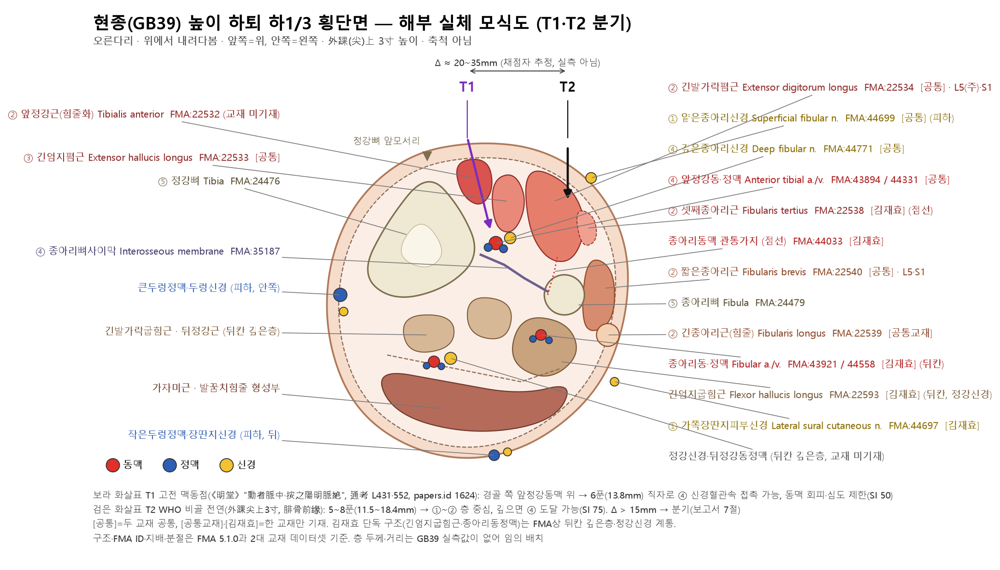

# 🔬 [경혈 해부생리학 실체 판명 학술 모노그래프] 현종(懸鍾, GB39) — 이명 絶骨

> **프레임워크**: v2.7 (2026-10-04 개정) · **ARI**: T1 `ARI v3.0 | ARI-Core 51.2 ± 0 (D·H) | SI 50 | 잠정 가중치 0.40/0.35/0.25 | 민감도(등가중치): 47.9 (D, 등급 불변)`
> T2 `ARI v3.0 | ARI-Core 55 ± 0 (C) | SI 75 | 잠정 가중치 0.40/0.35/0.25 | 민감도(등가중치): 54.2 (D, 등급 변동 → 가중치 민감)` · **이중 채점**: 독립 채점자 2인, 조정 완료

> **핵심 3대 원전**: 《中国针灸穴位通鉴》 · 《中国针灸证治通鉴》 · 《针灸腧穴通考》(黄龙祥)
> **Layer A 실증 DB**: 통합 생의학 마스터 DB v3.0 — GB39 근거 묶음: 랜드마크 29편·로컬 매핑 18편 중 **GB39가 실제 포함된 기전·임상 연구 5편**(papers.id 1610·1612·1615·1902·1903, 모두 복합 혈위 또는 동물) + 정위 문헌 연구 1편(1624)
> **Layer B 참조 등록부**: 4계층 참조 등록부(B1~B4) (B-Check 6항목, 부합 기준 ≥ 8/12)
> **자침깊이 DB**: 역대 침구문헌 자침심도 데이터베이스 시트1 344행(N0=342)
> **해부 온톨로지**: FMA(Foundational Model of Anatomy) 5.1.0 로컬 색인 — 교재 구조를 `FMA:ID`로 고정하고 지배신경·척수 분절·신경 줄기를 대조(B1 보조, 등록부 미등재). 대응표 FMA 경혈 해부 온톨로지 매핑 레지스트리, 상세는 부록 A
> **도량형 환산**: 한대(漢代) 기준 1푼(分) = 2.3mm ($z = \text{푼} \times 2.3\text{mm}$), 1촌 = 10푼 = 23mm(심도 환산용. 체표 위치는 골도 비례 촌)
> **분석 Target**: **T1** 고전 원전 정위(《黄帝明堂经》 "在足外踝上三寸動者(脈)中, 足三陽絡, 按之陽明脈絶乃取之" = 경골 쪽 앞정강동맥 박동점) / **T2** WHO·현행 교재 정위(外踝尖上 3寸, 腓骨前緣)

> **요약**: 구판 보고서는 고전 "動脈中"을 종아리동맥 관통가지로 보고 Δ 3~7mm로 단일 분석했다. 그러나 《针灸腧穴通考》와 papers.id 1624는 그 맥이 **앞정강동맥**이고 원위치가 **경골 쪽**이라고 본다. 두 채점자가 각각 추정한 Δ는 약 20~35mm(> 15mm)이므로 T1·T2로 분기했다. ΔARI-Core = 3.8(< 10)이어서 **어느 Target도 우위로 선언하지 않고 둘을 병기**한다. 두 Target 모두 B-Check 미부합이므로 반사 기전은 **가설**이다.

---

## 🏛️ 1. 문헌 스크리닝 표 (3대 원전 원문 발췌 및 한중 대조)

| 문헌 (출처 파일·행) | 원문 발췌 (정위·심도) | 주치 | 교감 및 비고 |
| :--- | :--- | :--- | :--- |
| **《针灸腧穴通考》** 悬钟 조 (《针灸腧穴通考》(下) PDF 321–400쪽 L529–658, 인쇄 p.1106–1109) 및 阳辅 조 "'阳辅'、'悬钟'与'绝骨'穴辨" (같은 파일 L414–437) | "悬钟，在足外踝上三寸动者中，足三阳络，按之阳明脉绝乃取之。"(《黄帝明堂经》, L421) / "悬钟，一名绝骨，在外踝上三寸动者中，足三阳络。"(《千金要方》卷二十九, L426·558) / 현대 【定位】 "外踝尖上 3 寸，腓骨前缘"(L569) | "主腹满，胃中有热不嗜食，小儿腹满不能食饮。"(《黄帝明堂经》, L542) | ① "《黄帝明堂经》所谓'阳明脉'……也即足背动脉，由于它是胫前动脉的下行支……人体测量学调查的结果表明：在外踝上三寸，靠近足阳明经脉行处，用力按压，则冲阳脉搏动消失……后人及今人……将悬钟穴定于足少阳经脉线上……此处不仅不能触及动脉搏动，通过按压也不能使足背处的冲阳脉搏动消失"(L548–552). ② "既是'按之阳明脉绝'处，则定位宜略偏向胫侧……因而出现了名实分离的现象"(L431). ③ "'绝骨'穴不见于《黄帝明堂经》"(L431), "'绝骨'归入奇穴类"(L437). ④ 归经 按: "将这样一个位于阳明脉上而又主治阳明胃病的腧穴归入足少阳经，难以成立"(L615). ⑤ "《黄帝明堂经》的'悬钟'已经名存实亡了"(L658). **《通考》에는 淺腓骨神經·腓骨動脈 관통가지에 관한 기술이 없다.** |
| **《中国针灸穴位通鉴》** 悬钟 조 (《中国针灸穴位通鉴》(下卷) PDF 161–240쪽 L52–346) | 出处 "悬钟，在足外踝上三寸动者脉中，足三阳经，按之阳明脉绝乃取之。"(《针灸甲乙经》3:55, L54 — OCR "经"은 《通考》·L136 "足三阳络"에 따라 "络"으로 읽음) / 部位 24항(L80–132), 예: "在足外踝上三寸动脉中。"(《铜人》5:20·《聚英》·《大成》, L90), "足外踝上三寸动脉中，寻摸尖骨者是。足三阳之大络，按之阳明脉绝乃取之。"(《针灸大成》7:209, L110) / "刺入六分，留七呼，灸五壮。"(《甲乙》 등, L236) | "腹满，胃中有热，不嗜食，悬钟主之。"(《甲乙》9:124), "小儿腹满，不能食饮，悬钟主之。"(《甲乙》12:154) (L154–156) | 释义: "穴在足外踝上三寸动者脉中，即胫前动脉处"(《经穴释义汇解》, L74). 局部解剖: "在腓骨前缘……有胫前动脉的分支，分布着腓浅神经"(《新针灸学》), "腓浅神经；腓深神经；胫前动脉"(《针灸学简编》) (L276–288). 简要结语: 별명 绝骨 "首出《备急千金要方》卷29"(L342), "髓会不宜作别名"(L292) |
| **《中国针灸证治通鉴》** (정제본 7개 청크, 悬钟·绝骨 출현 196회/165행) | (처방집 — 정위 기술 거의 없음) | "乃若胃热治悬钟"(PDF 161–240쪽 L4132), "腹满不食：中脘针，绝骨、下三里"(PDF 241–320쪽 L2972) | 출현 문맥(±80자, 중복 허용 참고치): 하지 痿·痹·足·胫·膝 113, 脚气 20, 中风 16, 疟 11, 项·颈 9, 胃·腹满 7, 落枕 2. 대부분 足三里 등과의 **배오** 처방. PDF 1–80쪽 L1236 按: "'绝骨'穴不见于《明堂经》，后世医家或以之为悬钟穴，或以之为阳辅穴" |

---

## 📜 2. 원천/재인용 구분 표 (시대별 문헌 층차 정렬)

| 층차 | 문헌 | 정위 | 심도 | 주치 | 판정 |
| :--- | :--- | :--- | :--- | :--- | :--- |
| 원천 (한) | 《黄帝明堂经》(《甲乙》 3:55 경유) | 在足外踝上三寸**動者(脈)中**, 足三陽絡, **按之陽明脈絶乃取之** | 刺入六分, 留七呼, 灸五壮 | 腹满, 胃中有热, 不嗜食; 小儿腹满不能食饮 | **원천 = T1** (맥 기준 정위, 골성 지표 없음) |
| 별계 (진) | 《脉经》 10:88 | "在外踝上三寸，直绝骨是也" (陽蹻/陽維 자침처) | 刺入五分 | — | 같은 높이의 다른 계통 기술 |
| 수당 재인용 | 《千金要方》 卷29 | "悬钟，一名绝骨，在外踝上三寸动者中" | — | — | **絶骨을 현종 이명으로 처음 연결** |
| 수당 별계 | 《千金要方》 卷7·8·18, 《外台》 19, 《医心方》 8 | 絶骨: "外踝上一夫，亦云四寸"(卷7), "外踝上三寸宛宛中"(卷18), "外踝上骨绝头陷中"(《外台》) | — | 卷18 絶骨 22病(逆气, 虚劳, 喉痹, **颈项强**, 肠痔…); 卷30 悬钟 五淋·湿痹流肿 | 골성 정위로 이동 시작. 卷30 주치는 《明堂》 **陽輔** 주치(《通考》 按) |
| 송대 재인용 | 《太平圣惠方》, 《铜人》 5:20 | "在外踝上三寸宛宛中" / "在足外踝上三寸動脈中" | 针六分, 灸三~五壮 | 腹满·不嗜食 + 腿胯连膝胫痹麻(陽輔 주치 혼입) | 원정위 문구 유지, 주치 혼입 |
| 명대 변형 | 《针灸聚英》, 《针灸大成》 7:209, 《循经考穴编》, 《类经图翼》 | "足外踝上三寸動脈中, 尋摸尖骨者是 … 按之陽明脈絶乃取之", "绝骨尖间筋骨缝中是悬钟", "当骨尖前动脉中" | 《指微》 斜入二寸許, 窦氏 二寸半, 横透三阴交 | 《资生经》 경유 《千金》 絶骨 주치(颈项强 등) 전재 | 골성 지표("尖骨·筋骨缝") 병기 |
| 현대 | 통편 교재 2·4·5판 "腓骨后缘" → 6·7판·WHO "腓骨前缘" | 外踝尖上 3寸, 腓骨前缘 | 直刺 0.5~0.8寸 | 项强, 胸胁胀痛, 下肢痿痹; 7판 痴呆·中风(髓海) | **T2**. 원주치(위병) 탈락 |

---

## 🔍 3. 이명·별칭 검증 표 (KJH DB 대조를 통한 혼용 차단)

| 이명 | KJH DB (경혈명·이명 대조 표준 데이터베이스 경혈 종합 목록) | 2대 교재 이명 열 | 원전 근거 | 혼용 위험 | 처리 |
| :--- | :--- | :--- | :--- | :--- | :--- |
| **絶骨** | GB39 행 345 "絶骨, 足三陽絡, 髓會" **및** GB38 陽輔 행 344 "分肉, 分間, 絶骨" | 공통교재 343행·김재효 343행(GB39), 각 342행(GB38)에 모두 등재 | 《明堂》에 없음(《通考》 L431). 현종 이명으로는 《千金》 卷29가 처음(《通鉴》 L342). 초기 "絶骨" = 外踝上七寸 위(陽輔 부근), 수당 이후 = 外踝上三四寸 | **높음** — 같은 이명이 GB38·GB39 두 혈에 걸림 | 연대순 분리: 《千金》 卷7·8·18·30의 "絶骨" 정위·주치는 현종 원주치와 구분. 《通考》는 "絶骨"을 기혈로 분리 제안(L437) |
| 足三陽絡 | GB39 행 345 | 두 교재 등재 | 《甲乙》 3:55 "足三陽絡" | 낮음 | 혈성(穴性) 기술이지 독립 명칭은 아님 |
| 髓會 | GB39 행 345 | 두 교재 등재 | 《難經》 45難 "髓會絶骨" — "絶骨"이 어느 혈인지 문헌상 확정되지 않음 | 중간 | 《通鉴》 "髓会不宜作别名"(L292). 이론 분류로만 취급 |
| 懸鍾/悬钟 | 본명 懸鍾 | — | 《甲乙》 3:55 | 없음 | 본명 이체자. 구판의 "縣鍾" 표기는 출전 미확인으로 삭제 |

> 구판의 "絶骨은 甲乙經 이후 모든 문헌에서 GB39와 동일혈, 혼용 위험 없음", "絶骨 = 비골의 고대 이칭"은 원자료와 맞지 않아 삭제했다.

---

## 📐 4. 3D 공간 좌표 및 Layer 1~5 층차 구조도

### 4-1. Target별 좌표 (추정 — 혈위 특이 영상 실측 없음)

| 축 | T1 고전 맥동점 | T2 WHO 비골 전연 |
| :--- | :--- | :--- |
| Y (근위–원위) | 外踝(尖) 위 3寸(골도 비례, 체형 의존) | 外踝尖 위 3寸 |
| X (내–외측) | 경골 앞모서리와 종아리뼈 앞모서리 사이, 경골 쪽으로 치우친 앞정강동맥 주행선(《通考》 L431 "宜略偏向胫侧"; papers.id 1624 "胫骨前嵴与腓骨前缘之间") | 종아리뼈 앞모서리 |
| Z (깊이) | 앞정강동·정맥과 깊은종아리신경이 골간막 앞에 있는 깊이(규범 해부상 체형에 따라 대략 10~20mm, 채점자 추정) | 표준 직자 5~8푼 = 11.5~18.4mm |
| 촉진 지표 | 박동 촉지(마른 사람) 또는 세게 눌러 冲阳(족등동맥) 박동 소실 | 골성 지표(종아리뼈 앞모서리) |

### 4-2. Layer 구조 (규범 해부 B1-01·B1-03·B1-06 및 2대 교재 기준, 깊이는 추정)

| Layer | T1 고전 맥동점 | T2 WHO 비골 전연 |
| :---: | :--- | :--- |
| 1 피부·피하 | 얕은종아리신경 피부가지(이 높이에서는 이미 근막을 뚫고 피하 주행), 피정맥 | **얕은종아리신경**(피하 주행), 가쪽장딴지피부신경(김재효) |
| 2 표층근·근막 | 종아리 근막, 폄근지지대 근위부 | 종아리 근막, 짧은종아리근·긴종아리근 힘줄, 긴발가락폄근 |
| 3 심층근 | 긴엄지폄근·긴발가락폄근(앞정강근 힘줄과의 사이) | 긴발가락폄근 심부, 셋째종아리근(김재효) |
| **4 신경혈관속** | **앞정강동·정맥 + 깊은종아리신경** — 6푼(13.8mm) 직자로 직접 접촉 가능 | **앞정강동·정맥 + 깊은종아리신경**(앞칸 깊은 곳, 채점자 추정 18mm 안팎), 종아리동맥 관통가지(골간막 관통, 김재효) |
| 5 골막 | 경골 외측면·골간막 | 종아리뼈 골막 |

```
   (내측) 경골 앞모서리                             종아리뼈 앞모서리 (외측)
        │앞정강근건 긴엄지폄근건 긴발가락폄근             │  짧은/긴종아리근
        │          │          ●T1            │            ●T2
피부────┼──────────┼──────────┼──────────────┼────────────┼──── L1 (얕은종아리신경: T2 쪽 피하)
근막────┼──────────┼──────────┼──────────────┼────────────┼──── L2
        │          │          ▼ 약 10~20mm   │            ▼ 11.5~18.4mm(5~8푼)
        │ [L4 앞정강동·정맥 + 깊은종아리신경 — 골간막 앞]   ◀── T2에서 깊게 찌르면 도달 가능
 골간막 ═══════════════════════════════════════════════════════ L5 (경골·종아리뼈 골막)
                              ●─────── Δ ≈ 20~35mm ───────●
                          (X 20~30mm · 3D 20~35mm, 채점자 2인 독립 추정)
```



*그림 4-1. 현종 높이(外踝上3寸) 하퇴 하1/3 횡단면 모식도(오른다리, 위에서 내려다봄, 축척 아님). 보라 화살표 T1은 경골 쪽 앞정강동맥 박동점에서 6푼 직자 시 Layer 4 신경혈관속에 이르는 경로, 검은 화살표 T2는 비골 전연 5~8푼 직자 경로다. 층 두께·거리와 Δ는 실측값이 아니다(채점자 추정).*

### 4-3. FMA 실체 대조 (Layer별) — 구조명은 2대 교재, ID·관계는 FMA 5.1.0

| Layer | 구조 | FMA | FMA 구획·관계 | 지배신경 / 줄기 (FMA) | 척수 분절 (FMA) |
| :--- | :--- | :--- | :--- | :--- | :--- |
| 1 피하 | 얕은종아리신경 | FMA:44699 | is_a Branch of common fibular nerve | 온종아리신경 → 궁둥신경 → 엉치신경얼기 | FMA 미기재 |
| 1 피하 | 가쪽장딴지피부신경 *(김재효)* | FMA:44697 | is_a Cutaneous branch of common fibular nerve | 온종아리신경 → 궁둥신경 → 엉치신경얼기 | FMA 미기재 |
| 2~3 앞칸 | 긴발가락폄근 | FMA:22534 | contained_in Space of anterior compartment of leg (FMA:85203) | Nerve to EDL (FMA:80068) ← 깊은종아리신경 | **L5(주)**·S1 |
| 2~3 앞칸 | 긴엄지폄근 | FMA:22533 | contained_in 앞칸 공간(FMA:85203) | Nerve to EHL (FMA:80065) ← 깊은종아리신경 | **L5(주)**·S1 |
| 2~3 앞칸 | 셋째종아리근 *(김재효)* | FMA:22538 | contained_in 앞칸 공간(FMA:85203) | Nerve to fibularis tertius (FMA:80071) ← 깊은종아리신경 | L5·S1 |
| 2~3 가쪽칸 | 짧은종아리근 | FMA:22540 | contained_in Space of lateral compartment of leg (FMA:85206) | Nerve to fibularis brevis (FMA:80082) ← **얕은종아리신경** | L5·S1 |
| 2~3 가쪽칸 | 긴종아리근 *(공통교재)* | FMA:22539 | contained_in 가쪽칸 공간(FMA:85206) | Nerve to fibularis longus (FMA:80079) ← 얕은종아리신경 | L4·L5·S1 |
| 4 신경혈관속 | 깊은종아리신경 | FMA:44771 | is_a Branch of common fibular nerve | 온종아리신경 → 궁둥신경 → 엉치신경얼기 | FMA 미기재 |
| 4 신경혈관속 | 앞정강동맥 · 앞정강정맥 | FMA:43894 · FMA:44331 | branch_of External iliac artery(FMA 모델링) / tributary_of Popliteal vein | — | — |
| (뒤칸) | 긴엄지굽힘근 *(김재효)* | FMA:22593 | contained_in Space of deep part of posterior compartment of leg (FMA:312109) | Nerve to FHL (FMA:80098) ← **정강신경** | **S1·S2(주)**·L5 |
| (뒤칸) | 종아리동맥 · 종아리정맥 *(김재효)* | FMA:43921 · FMA:44558 | 종아리정맥: drains_into Femoral vein(아래 주석) | — | — |
| (뒤칸→앞) | 종아리동맥 관통가지 *(김재효)* | FMA:44033 | branch of Peroneal artery(FMA:43921) | — | — |
| 5 골막 | 정강뼈 · 종아리뼈 · 종아리뼈사이막 | FMA:24476 · FMA:24479 · FMA:35187 | — | — | — |

- FMA는 앞칸 근육(긴발가락폄근·긴엄지폄근·셋째종아리근)의 근육가지를 깊은종아리신경의 *안쪽종말가지(FMA:44777, 발목 아래 구간)* 가지로 기록한다. 규범 해부(B1-01)에서 이 근육가지는 하퇴에서 깊은종아리신경 줄기에서 나오므로 **깊은종아리신경 수준까지만** FMA를 인용한다.
- FMA는 종아리정맥(FMA:44558)을 *Tributary of femoral vein*(drains_into Femoral vein)으로 둔다. 규범 해부에서 종아리정맥은 뒤정강정맥과 합쳐 오금정맥으로 가므로 이 관계는 FMA 모델링 특성으로 보고 인용하지 않는다(B1-01로 기술).
- FMA 분절은 근육의 `segmental_supply`에만 있고 신경 자체에는 없다. 신경 분절(온종아리신경 L4~S2 등)은 B1-01·B1-02로 기술한다.

---

## 📏 5. 자침 깊이 계산표 (한대 2.3mm 환산 및 Layer 도달 범위)

| 문헌 | 값 | 환산 | T1 도달 Layer | T2 도달 Layer | 출처 |
| :--- | :---: | :---: | :--- | :--- | :--- |
| 황제명당경(황룡상 감수편찬) | 6푼 | 13.8mm | L4 (박동점 바로 아래 신경혈관속) | L2~3 | 자침깊이 DB 344행 |
| 침구갑을경 | 6푼 | 13.8mm | L4 | L2~3 | 같은 행 |
| 침구경험방 | 6푼 | 13.8mm | L4 | L2~3 | 같은 행 |
| 동의보감(동인 인용) | 6푼 | 13.8mm | L4 | L2~3 | 같은 행 |
| 경락수혈학 공통교재 | 5~8푼 | 11.5~18.4mm | L3~4 | L2~4 | 같은 행 (선호 자침법 blank = 미기술) |
| 침구의학 공통교재 | 5~8푼 | 11.5~18.4mm | L3~4 | L2~4 | 같은 행 |
| 《针灸腧穴通考》 | 5~8푼 | 11.5~18.4mm | L3~4 | L2~4 | 같은 행 (선호 자침법 blank) |
| 《脉经》 10:88 | 5푼 | 11.5mm | — | — | 《通鉴》 L234 (DB 미수록) |
| 《扁鹊神应针灸玉龙经》 | 横针 2.5푼 / 针 3푼 | 5.75 / 6.9mm | — | — | 《通鉴》 L248 |
| 《针灸聚英》·《大成》 引 《指微》 | 斜入 2寸許 | ≈ 46mm | — | 사자 시 앞칸 관통 가능 | 《通鉴》 L250·256 |
| 《针方六集》 窦氏 | 针入 2寸半 | 57.5mm | — | 하퇴 앞·뒤칸 관통, 종아리동맥 도달 가능 | 《通鉴》 L258 |
| 《循经考穴编》 | 横透三阴交 / 凌氏 横针 1寸 | 횡자 | — | 앞·뒤칸 관통 | 《通鉴》 L260 |
| 《针灸学简编》 | 3~5푼 | 6.9~11.5mm | — | L1~3 | 《通鉴》 L274 |

- 자침깊이 DB에 **금침('0') 없음**. "갑을경 경혈 분류 및 배열순서" 열의 34는 배열 번호이지 깊이가 아니다(구판이 깊이 표에 넣은 것을 삭제).
- 구판의 μ = 6.2푼, σ = 1.0푼은 산출 근거가 없어 삭제했다.
- **T1 안전 주의**: 정의상 동맥 박동점 바로 위에 찌르므로 6푼 직자로 Layer 4에 닿는다. 박동을 확인하고 동맥을 비껴 찌르거나 깊이를 약 10mm 이내로 제한해야 한다(채점자 A 권고, 실측 없음).
- **T2 안전 주의**: 5~6푼은 Layer 2~3에 머물지만 8푼(18.4mm) 이상, 마른 사람, 《指微》·窦氏 심자에서는 앞정강동맥·깊은종아리신경(Layer 4)에 닿을 수 있다. 영상 실측이 없어 10mm 여유는 확인되지 않았다.

---

## 📚 6. 해부학 구조 교재 비교표 (공통교재 vs 김재효 교재)

| 구분 | 경혈학 공통교재 (경혈학 공통교재 해부구조 데이터셋 343행, 경혈학 하 p.457) | 김재효 교재 (김재효 교수 경혈 해부구조 데이터셋 343행) | 공통 | 차이 및 해석 |
| :--- | :--- | :--- | :--- | :--- |
| 근육 | 긴발가락폄근, 긴엄지폄근, 짧은종아리근, 긴종아리근 | 짧은종아리근, 긴발가락폄근, 긴엄지폄근, 셋째종아리근, **긴엄지굽힘근** | 긴발가락폄근, 긴엄지폄근, 짧은종아리근 | 공통교재만 긴종아리근(이 높이에서는 주로 힘줄). 김재효만 셋째종아리근과 **뒤칸 근육인 긴엄지굽힘근** — 깊이 찌르거나 비골 뒤쪽(구 교재 "腓骨后缘")까지 포함한 목록으로 보임 |
| 신경 | 얕은종아리신경, 깊은종아리신경 | 가쪽장딴지피부신경, 깊은종아리신경, 얕은종아리신경 | 얕은·깊은종아리신경 | 김재효는 피부신경(가쪽장딴지피부신경) 추가 |
| 혈관 | 앞정강동·정맥 | 앞정강동·정맥, **종아리동맥 관통가지**, **종아리동·정맥** | 앞정강동·정맥 | 김재효는 골간막을 관통하는 가지와 뒤칸의 종아리동·정맥 추가 |

- 두 교재 모두 혈관 첫 항목으로 **앞정강동·정맥**을 든다. 이는 고전 "動者中"의 실체를 앞정강동맥으로 보는 《通考》·《经穴释义汇解》·papers.id 1624와 같은 구조다. 다만 두 교재의 정위 문구는 비골 전연(T2)이어서 **좌표는 T1과 다르다**.
- 구판의 "상호 보완적 정합", "층차별 신경 지배 완벽 대조"는 실제 차이(뒤칸 구조 포함 여부)를 가렸으므로 삭제했다. 이 불일치를 추론으로 조정해야 하므로 두 Target 모두 $S_{clarity}$ 50 단계다.
**FMA 판별** (부록 A): 두 교재 공통 FMA 실체 7개 · 공통교재 단독 1개(긴종아리근 FMA:22539) · 김재효 단독 6개(셋째종아리근 22538, 긴엄지굽힘근 22593, 가쪽장딴지피부신경 44697, 종아리동맥 43921·정맥 44558, 종아리동맥 관통가지 44033). "fibularis/peroneus" 영문 이표기는 같은 FMA ID로 판별되어 실제 차이가 아니다.

- **FMA로 본 차이의 의미**: 공통 구조와 공통교재 단독 긴종아리근은 모두 FMA상 앞칸·가쪽칸(FMA:85203·85206)과 **온종아리신경 줄기**(깊은·얕은종아리신경)에 속한다. 김재효 단독 구조 가운데 긴엄지굽힘근은 *뒤칸 깊은층*(FMA:312109)이고 **정강신경** 지배(S1·S2 주)이며, 종아리동·정맥도 뒤칸 구조다. 따라서 두 교재 차이는 같은 칸 안의 기재 범위 차이가 아니라 **김재효 목록이 종아리뼈사이막 뒤(다른 칸·다른 신경 줄기)까지 포함하는가**의 차이이며, 위 해석("깊이 찌르거나 비골 뒤쪽까지 포함한 목록")을 FMA 구획·신경 계통으로 뒷받침한다. 이 판별은 $S_{clarity}$ 50 단계(추론 조정)를 바꾸지 않는다.
- 구판이 "動脈中"의 실체로 지목한 **종아리동맥 관통가지**는 김재효 교재에만 있고, 골간막을 뚫고 나오는 깊은 가지라서 체표 박동 촉지점으로 보기 어렵다(B1-01). 고전 원전·《通考》에 이 해석의 근거는 없다.

---

## 🔀 7. 공간 변위 분기 추론도

```
       경골 앞모서리                                                                종아리뼈 앞모서리
             │                                                                              │
             │   [T1 고전 맥동점]                              [T2 WHO 현행]                │
             │   外踝上三寸 動者(脈)中                         外踝尖上3寸                  │
             │   按之陽明脈絶 → 冲阳 박동 소실                 腓骨前緣                     │
             │   실체: 앞정강동맥 + 깊은종아리신경 (L4)        실체: 얕은종아리신경(L1)     │
             │   주치: 腹满·胃中有热·不嗜食 (《明堂》)              + 폄근·종아리근 (L2~3)  │
             │   근거: 《通考》 L431·552, 《经穴释义汇解》,    주치: 项强·下肢痿痹          │
             │         papers.id 1624                                (《千金》 絶骨 계통)   │
             │   ●────────────────────── Δ ≈ 20~35 mm (> 15 mm) ───────────────────────●    │
```

| 항목 | 내용 |
| :--- | :--- |
| Y축 차이 | 없음(둘 다 外踝 위 3寸). 단 《千金》 卷7 "一夫, 亦云四寸" 계열은 별도 |
| X축 차이 | 앞정강동맥 주행선(경골 쪽) ↔ 종아리뼈 앞모서리: 약 20~30mm (채점자 B, 중앙값 약 25mm) |
| 3D 차이 | 약 20~35mm (채점자 A, X축 + 깊이 차 포함) |
| 판정 | $\Delta_{discrepancy} > 15\text{mm}$ → **T1·T2 독립 분기** (정본 Rank 5) |
| 구판 Δ | 0.3~0.7cm — "動脈中 = 종아리동맥 관통가지"라는 근거 없는 동정에 기댄 과소 추정이어서 폐기 |
| 이견 | papers.id 1624는 T1 위치(胫骨前嵴과 腓骨前缘 사이)를 지지하면서도 "在外踝上３寸处，用手摸到跳动的动脉是很难的……也不容易"라 하여 박동·冲阳 소실의 **재현성**에 의문을 둔다. 《通考》의 "人体测量学调查"는 서지가 제시되지 않았다. 이 이견은 정위 쟁점이며 기전 상충은 아니다 |

**분기 판정**: ΔARI-Core = 55.0 − 51.2 = **3.8 (< 10)**. 두 구간 [51.2, 51.2]·[55, 55]는 겹치지 않지만 Δ 기준을 충족하지 못한다 → **우위 Target 없음. T1·T2를 병기한다.**

---

## 🧬 8. 생의학적 반사 기전도 및 외부 검색 로그

### ① Layer A 논문 표 (GB39 자체 연구 우선)

| papers.id | 연도 | 저널 | 제목 | PMID / DOI | 설계 | 사용 |
| :---: | :---: | :--- | :--- | :--- | :--- | :--- |
| 1624 | 2021 | 针刺研究 46(1):73-75 | 关于悬钟穴定位的探讨 / Location of acupoint Xuanzhong (GB39) — 刘佳男 등 | PMID 33559430 / DOI 10.13702/j.1000-0607.200282 (본문 PDF) | 문헌 연구(정위) | T1 정위 근거: "悬钟穴定位应该准确描述为：'足外踝上３寸，胫骨前嵴与腓骨前缘之间'", "动者脉中" = 胫前动脉(李鼎 인용). 박동 촉지 곤란 지적 |
| 1610 | 2003 | 대한침구학회지 | 치매와 관련된 뇌영역에 투사되는 경혈(SJ5, PC6, SP6 및 GB39)의 탐색에 관한 신경해부학적 연구 | — | 동물 신경추적 | T2 B-Check ④ |
| 1612 | 2006 | 대한한의학회지 | 양릉천-현종 전침치료가 뇌경색환자 및 정상인의 뇌혈류에 미치는 영향 | — | 인체 비RCT(배혈) | T2 B-Check ④⑥ |
| 1615 | 2013 | 대한침구의학회지 | 懸鍾(GB39)·陽陵泉(GB34)의 電鍼 및 레이저침이 白鼠의 神經病理性 疼痛에 미치는 영향 | DOI 10.13045/acupunct.2013012 | 동물(배혈) | T2 B-Check ③⑤ |
| 1903 | 2019 | Zhen Ci Yan Jiu | Electroacupuncture at "Zusanli"(ST36) and "Xuanzhong"(GB39) improves inflammatory reactions… | 31532135 / 10.13702/j.1000-0607.180555 | 동물(배혈) | T2 B-Check ⑤ |
| 1902 | 2024 | Zhongguo Zhen Jiu | Electroacupuncture for the prevention of chemotherapy-induced peripheral neuropathy: a randomized controlled trial | 39658376 / 10.13703/j.0255-2930.20240222-k0001 | 인체 RCT(다혈위) | T2 B-Check ⑥ (GB39 단독 효과 분리 불가) |
| 1904 | 2002 | Am J Physiol Regul Integr Comp Physiol | Effect of electroacupuncture on pressor reflex during gastric distension | 12388466 / 10.1152/ajpregu.00192.2002 | 동물 | T1 B-Check ③~⑤ **유추**(다른 혈위·동물) |
| 1620 | 2017 | 针灸临床杂志 | 髓会绝骨的文献研究及临床应用概论 | — | 문헌 연구 | 髓會 이론 참고(채점 불산입) |

- **불산입**: 1842·1905·1845·1922(종설·데이터마이닝), 1910·1915·1924·1925·1911(제목상 GB39 포함 또는 단독성 미확인), 1913(근막 발통점 초음파 유도 임상 — GB39 해부 실측 아님), 그 밖의 로컬 매핑 논문(관련성 없음).
- **T1 기준 경혈 특이 Layer A = 0편**(위 연구는 모두 현행 비골 쪽 정위에 자침) → 게이트 2. **T2 기준 = 4편**(1610·1612·1615·1903, 조정 결과 `layerA_point_specific`).

### ② B-Check 채점표

**T1 고전 맥동점**

| 항목 | 내용 | 채점자 A | 채점자 B | 최종 | Layer B 참조 ID | papers.id | 근거 요지 |
| :---: | :--- | :---: | :---: | :---: | :--- | :--- | :--- |
| ① | 자침 심도의 말초신경·혈관 실체 | 1 | 1 | **1** | B1-01, B1-03, B1-06, B2-09 (+FMA) | 1624 | 앞정강동·정맥 + 깊은종아리신경은 규범 해부·2대 교재·FMA(FMA:43894·44331·44771 exact)로 확인되나 T1 위치 실측 없음, 1624는 박동 촉지 곤란 지적 |
| ② | 척수 분절 정합 | 1 | 1 | **1** | B1-03, B3-05 (+FMA) | — | 깊은종아리신경 L4~L5(S1)(FMA: 앞칸 근육 segmental_supply L5 주·S1) vs 원주치 위(T6~T9 내장절·미주) 분절 불일치, 상척수성 유추만 가능 |
| ③ | 구심 섬유형·수용체 | 1 | 1 | **1** | B3-05, B3-06, B3-12 | 1904 | 심부 근·혈관주위 Ⅲ/Ⅳ군 구심은 마취 동물 일반 기전, T1 미검증 |
| ④ | 중추 중계·경로 | 1 | 1 | **1** | B3-05, B3-12 | 1904 | 뒷다리 체성 자극 → 연수(rVLM/NTS·미주) 경로는 동물·다른 혈위 근거 |
| ⑤ | 원심 경로·효과 방향 vs $P_{single}$ | 1 | 1 | **1** | B3-05 | 1904 | 원주치(腹满·胃中有热·不嗜食)와 하지 자극의 미주성 위운동 조절 방향은 개념상 부합하나 T1 직접 근거 없음 |
| ⑥ | 인체 전환 근거 | 0 | 0 | **0** | B4-05 | — | T1 정위로 자침한 인체 연구 없음 |
| **합계** | | 5 | 5 | **5/12** | | | **미부합 → 가설(H)**. ③~⑤ 동물·유추, ⑥ = 0 → (동물 한정) |

**T2 WHO 비골 전연**

| 항목 | 내용 | 채점자 A | 채점자 B | 최종 | Layer B 참조 ID | papers.id | 근거 요지 |
| :---: | :--- | :---: | :---: | :---: | :--- | :--- | :--- |
| ① | 자침 심도의 말초신경·혈관 실체 | 1 | 1 | **1** | B1-01, B1-03, B2-09 (+FMA) | — | 얕은·깊은종아리신경, 앞정강동·정맥은 규범 해부·2대 교재·FMA(FMA:44699·44771·43894 exact)로 확인되나 교재 간 혈관 구성이 다르고(김재효 뒤칸 구조 포함, FMA 구획으로 확인) GB39 실측 없음 |
| ② | 척수 분절 정합 | 1 | 1 | **1** | B1-03, B3-05, B3-20 (+FMA) | — | L4~S1 피절·근절(FMA 분절 합집합 L4·L5·S1·S2, S2는 김재효 단독 뒤칸 긴엄지굽힘근)은 국소 하지 주치와 맞음. 원주치 위병(T6~T9)·구판 頸項强痛(C3~C5)과는 분절 불일치 |
| ③ | 구심 섬유형·수용체 | 1 | 1 | **1** | B3-04, B3-06, B3-11, B3-17 | 1615 | 일반 구심 섬유 틀과 GB39·GB34 배혈 동물 연구뿐. B3-17은 ST36 검증 범위 밖 → 유추 |
| ④ | 중추 중계·경로 | 1 | 1 | **1** | B3-05, B3-07, B3-11 | 1610, 1612 | GB39 뇌 투사 신경추적(동물), GB34-GB39 전침 뇌혈류(인체, 배혈) — 경로 특정 근거 없음 |
| ⑤ | 원심 경로·효과 방향 vs $P_{single}$ | 1 | 1 | **1** | B3-05, B3-11, B3-16 | 1615, 1903 | 국소 진통·항염 방향은 하지 주치와 동물 수준에서 부합. 위병 원주치·경항 원격 효과의 GB39 근거 없음 |
| ⑥ | 인체 전환 근거 | 1 | 1 | **1** | B4-03, B4-04, B4-05 | 1612, 1902 | 인체 근거는 배혈 전침(비RCT 뇌혈류, 다혈위 RCT)뿐. 혈위 비특이성 반증(B4-04·B4-05) 병기 |
| **합계** | | 6 | 6 | **6/12** | | | **미부합 → 반사 기전은 가설**. 동물 위주, ⑥은 배혈 근거 |

### ③ 외부 검색 로그 (sync_log, 2026-10-04·2026-10-23 Rank 6 실행)

| 일시 | 소스 | HTTP | 수집 | 중복제거 | 신규 | 쿼리 |
| :--- | :--- | :---: | :---: | :---: | :---: | :--- |
| 2026-10-04T09:51:54 | pubmed | 200 | 16 | — | — | ("GB39" OR "Xuanzhong" OR "懸鍾") AND (acupuncture OR electroacupuncture) AND (nerve OR reflex OR autonomic OR mechanism OR anatomy) |
| 2026-10-04T09:51:54 | openalex | 200 | 24 | — | — | doi_starts_with:10.13703,title_and_abstract.search:"Xuanzhong" OR "GB39" \| doi_starts_with:10.13702,title_and_abstract.search:"Xuanzhong" OR "GB39" \| has_doi:tr… |
| 2026-10-04T09:51:54 | crossref | 200 | 0 | — | — | Xuanzhong acupuncture nerve reflex |
| 2026-10-04T09:51:54 | all | — | 40 | 13 | 27 | |
| 2026-10-23T21:43:36 | pubmed | 200 | 16 | — | — | ("GB39" OR "Xuanzhong" OR "悬钟") AND (acupuncture OR electroacupuncture) AND (nerve OR reflex OR autonomic OR mechanism OR anatomy) \| … AND ("Zhongguo Zhen Jiu"[Journal] OR "Zhen Ci Yan Jiu"[Journal]) |
| 2026-10-23T21:43:36 | openalex | 200 | 24 | — | — | doi_starts_with:10.13703 / 10.13702 / has_doi:true, "Xuanzhong" OR "GB39" |
| 2026-10-23T21:43:36 | crossref | 200 | 0 | — | — | Xuanzhong acupuncture nerve reflex |
| 2026-10-23T21:43:36 | all | — | 40 | 33 | 7 | merged_into_existing=23, batch_dups=10 |

- 2026-10-23 재실행의 신규 7편은 이번 FMA 보강에서 판정에 넣지 않았다(B-Check·ARI 불변). 다음 정기 개정에서 GB39 단독성·설계를 검토해 반영한다.

### ④ 반사 기전 가설도 (두 Target 모두 B-Check 미부합 → 가설)

```
T1 (가설, 동물·유추)                               T2 (가설, 동물·배혈 근거)
앞정강동맥 주위·깊은종아리신경 구심(L4~L5)          얕은종아리신경(피하)·폄근/종아리근 구심(L4~S1)
   │ 분절 불일치(위 T6~T9) → 상척수성 경로만 가능        │ 분절성: 국소 하지 진통(B3-07·B3-11, 1615)
   ▼                                                    ▼
연수 NTS/rVLM·미주 운동핵 (B3-05·B3-12, 1904 유추)    상척수 진통·뇌혈류 조절(1610·1612, 배혈)
   ▼                                                    ▼
위운동·위 기능 조절 → 腹满·胃中有热·不嗜食(원주치)     下肢痿痹·足胫痛(국소 주치)
```

- 구판의 "공통비골신경(L4-S1) 자극 → 척수 C3-C5 분절 상행 → 경항부 근이완 반사"는 Layer B 등록부와 Layer A 어디에도 근거가 없어 **삭제**했다.
- 구판의 "8푼 자침 시 비골 골막 자극 = 髓會의 해부학적 기반"도 근거가 없어 삭제했다(髓會는 이론 분류로만 취급).

### ⑤ 말초 구심 경로의 FMA 고정 (두 Target 공통 앞단)

위 가설도의 첫 구간(자침점 → 척수)은 FMA 관계로 아래와 같이 고정된다. T1·T2 모두 같은 **온종아리신경 → 궁둥신경 → 엉치신경얼기** 줄기로 모이고, 차이는 T1이 깊은종아리신경·앞정강동맥 쪽(Layer 4), T2가 얕은종아리신경·가쪽칸 쪽(Layer 1~3)에서 시작한다는 점이다. 김재효 단독 뒤칸 구조(긴엄지굽힘근)는 정강신경 계통이다. 이 구조 사슬은 가설도의 해부 앞단일 뿐이며 B-Check 점수를 바꾸지 않는다.

```mermaid
flowchart TB
  T1(("T1 고전 맥동점<br/>경골 쪽")) --> ATA["앞정강동맥 FMA:43894"]
  T1 --> DFN["깊은종아리신경<br/>FMA:44771"]
  T2(("T2 비골 전연")) --> SFN["얕은종아리신경<br/>FMA:44699 (피하)"]
  T2 --> FB["짧은종아리근 FMA:22540<br/>분절 L5·S1"]
  T2 --> EDL["긴발가락폄근 FMA:22534<br/>분절 L5(주)·S1"]
  T2 -. "깊이 찌르면" .-> DFN
  EDL -- nerve_supply --> DFN
  FB -- nerve_supply --> SFN
  DFN -- "is_a: branch" --> CFN["온종아리신경<br/>FMA:19039"]
  SFN -- "is_a: branch" --> CFN
  CFN -- branch_of --> SCI["궁둥신경<br/>FMA:19034"]
  FHL["긴엄지굽힘근 FMA:22593<br/>김재효 · 뒤칸 · S1·S2(주)"] -- nerve_supply --> TIB["정강신경<br/>FMA:19035"]
  TIB -- branch_of --> SCI
  SCI -- branch_of --> SAC["엉치신경얼기<br/>FMA:5909"]
  SAC --> SEG["척수 L4~S2<br/>(분절: 근육 segmental_supply)"]
```



*그림 8-1. FMA 5.1.0 관계로 그린 GB39 말초 구심 경로. 실선은 FMA에 기재된 관계(`nerve_supply`·`branch_of`), "is_a"는 클래스명에서 이은 줄기, 점선은 T2 심자 시 도달 가능 경로다.*

---

## ⚖️ 9. 주치증 분리 표 (단독 자침 $P_{single}$ vs 복합 배오 처방)

| 주치 | 최초 출전 | 구분 | 판정 | 근거 |
| :--- | :--- | :--- | :--- | :--- |
| **腹满, 胃中有热, 不嗜食** | 《黄帝明堂经》(《甲乙》 9:124) | **$P_{single}$ (원주치)** | 현종 고유 주치. T1(앞정강동맥·족양명 맥상)과 정합 | 《通考》 L542·647·658; 《通鉴》 L154 |
| **小儿腹满不能食饮** | 《黄帝明堂经》(《甲乙》 12:154) | **$P_{single}$ (원주치)** | 같음 | 《通鉴》 L156 |
| 五淋; 湿痹流肿, 髀筋急瘈, 胫痛 | 《千金要方》 卷30 "悬钟主…" | 혼입 | 《明堂》 **陽輔** 주치의 오록 | 《通考》 L627–630 按 |
| 腿胯连膝胫痹麻; 膝胫连腰痛, 筋挛急, 足不收履 | 《太平圣惠方·明堂》 | 혼입 | 陽輔·臨泣 주치 혼입 | 《通考》 L563–566·632–638 按 |
| 颈项强, 喉痹, 鼻衄, 肠痔, 逆气, 虚劳 등 | 《千金要方》 卷18 "絶骨" 22病 (外踝上三寸宛宛中, 灸) | 혼입(이명 경유) | 《资生经》 경유로 《聚英》·《大成》 현종 조에 전재된 **絶骨** 주치 | 《通考》 L645–647 按 |
| 落枕 | 현대 《针灸学简编》 ("配大椎、后溪治落枕"), 임상 보고(针灸临床杂志 1999) | 배오·현대 | 고전 근거 없음. 단독 근거로 보지 않음 | 《通鉴》 L230·342; 《通考》 L686 |
| 下肢痿痹, 足胫挛痛, 脚气 | 《千金》·《外台》 脚气 灸法(三里 + 絶骨), 현대 교재 | 배오 중심 | 국소 주치로 T2 해부와 정합하나 고전 출전은 絶骨 배오 처방 | 《通鉴》 L158–176; 《证治通鉴》 문맥 빈도 |
| 中风, 半身不遂 | 《太平圣惠方》(三里 + 絶骨 灸), 7판 교재 "髓海不足" | $P_{comb}$ / 이론 | 배오 처방 및 髓會 이론 파생 | 《通考》 L670–672 临床应用 (4)–(6) |
| 髓病, 痴呆(髓海) | 《難經》 45難, 7판 교재 | 이론 | 관념 이론 확장 → 여과 | 《通鉴》 L146–148 |

> 구판의 $P_{single}$ "頸項强痛·落枕·下肢痿痹·足脛疼痛"은 원주치(비위병)를 빠뜨리고 《千金》 絶骨 계통·현대 배오 주치를 단독 효능으로 잘못 분류했다. 위 표로 교체한다.

---

## 📊 10. ARI v3.0 프로파일 평가표 및 최종 결론

$$\text{ARI-Core} = 0.40\,S_{orig} + 0.35\,S_{clarity} + 0.25\,S_{reflex} \quad (\text{잠정 가중치, 미검증})$$
$$\text{SI} = S_{safety} \quad (\text{합산하지 않음})$$

### 10-1. T1 고전 맥동점 (外踝上三寸 動者脈中, 按之陽明脈絶)

| 지표 | 채점자 A | 채점자 B | 평균 | 루브릭 단계 근거 요지 | 근거 포인터 |
| :--- | :---: | :---: | :---: | :--- | :--- |
| $S_{orig}$ | 68.75 | 68.75 | **68.75** | 하위 4항목 평균(아래 표) | 《通考》 L414–437·529–658; 《通鉴》 L54–132 |
| $S_{clarity}$ | 50 (조정 전 75) | 50 | **50** | 앞정강동맥 + 깊은종아리신경은 B1·교재 혈관 목록과 맞으나 교재 정위는 T2 좌표이고 T1 실측 없음 → "교재와 정위 불일치를 추론으로 조정" | B1-01·B1-03·B1-06; 교재 xlsx 343행; papers.id 1624 |
| $S_{reflex}$ | 25 | 25 | **25** | T1 정위 자침 Layer A 0편 → 게이트 2 | B-Check 5/12; 1904는 유추 근거 |
| $S_{safety}$ → SI | 50 | 50 | **50** | 박동점 직자 6~8푼이 Layer 4 신경혈관속에 직접 닿음 → 심도 상한·동맥 회피 명시 필수. 금침 없음, 심부 장기 없음 | 자침깊이 DB 344행 |

| $S_{orig}$ 하위 항목 | A | B | 평균 | 근거 |
| :--- | :---: | :---: | :---: | :--- |
| ① 최초 기술 명확성 | 75 | 75 | 75 | 《明堂》 높이·심도·촉진 조작 기준 명확, 횡위치(경골 쪽)는 "按之陽明脈絶"에서 추론 |
| ② 후대 문헌 일치율 | 50 | 50 | 50 | "動(者)脈中·按之陽明脈絶" 유지 약 12~13/24항(약 50~55%), 나머지는 宛宛中·尖骨·筋骨缝·腓骨前/后缘으로 이동 |
| ③ 이명 혼용 해소 | 75 | 75 | 75 | 絶骨의 GB38·GB39 혼용을 《通考》가 연대순으로 정리 |
| ④ 《通考》 교감 | 75 | 75 | 75 | 陽輔 주치 혼입·宋臣 순서 개변·이문 교감, 원정위 복원 제시. "人体测量学调查" 서지 미제시 |
| **평균** | 68.75 | 68.75 | **68.75** | |

- **게이트**: 게이트 2(경혈 특이 Layer A 0편 → $S_{reflex}$ ≤ 25, H 표지). 게이트 1·3 해당 없음.
- **ARI-Core** = 0.40×68.75 + 0.35×50 + 0.25×25 = **51.2 ± 0 → D·H (미판정·가설)**.
- **SI** = **50**.
- **등가중치 민감도**: (68.75 + 50 + 25) / 3 = **47.9 → D**, 등급 불변.

### 10-2. T2 WHO 비골 전연 (外踝尖上 3寸, 腓骨前緣)

| 지표 | 채점자 A | 채점자 B | 평균 | 루브릭 단계 근거 요지 | 근거 포인터 |
| :--- | :---: | :---: | :---: | :--- | :--- |
| $S_{orig}$ | 62.5 | 62.5 | **62.5** | 하위 4항목 평균(아래 표) | 《通考》 L529–658; KJH 344·345행 |
| $S_{clarity}$ | 50 | 50 | **50** | 2대 교재 혈관·심층 구조 불일치(뒤칸 구조 포함 여부), 고전 촉진 지표가 현 위치에서 재현되지 않음, GB39 실측(PMID) 없음 → 추론 조정 | 교재 xlsx 343행; 《通考》 L552 |
| $S_{reflex}$ | 50 | 50 | **50** | GB39 포함 동물 연구 3편 + 인체 배혈 연구, B-Check 6/12 → "동물 연구 + B-Check 6~7" 단계 | papers.id 1610·1612·1615·1902·1903 |
| $S_{safety}$ → SI | 75 | 75 | **75** | 표준 5~8푼은 Layer 2~3 중심, 깊으면 Layer 4(앞정강동맥·깊은종아리신경) 도달 가능하나 0.5~0.8寸 제한으로 회피 가능. 금침 없음 | 자침깊이 DB 344행; 《通鉴》 L250–260 |

| $S_{orig}$ 하위 항목 | A | B | 평균 | 근거 |
| :--- | :---: | :---: | :---: | :--- |
| ① 최초 기술 명확성 | 75 | 75 | 75 | 《明堂》 높이·심도 명확, 비골 전연이라는 골성 지표는 원전에 없음 |
| ② 후대 문헌 일치율 | 50 | 50 | 50 | 횡위치가 宛宛中·筋骨缝·腓骨后缘(2·4·5판)·腓骨前缘(6·7판)으로 갈림 |
| ③ 이명 혼용 해소 | 50 | 50 | 50 | KJH·2대 교재가 絶骨을 GB38·GB39 양쪽에 등재 — 현행 표준에서 일부 미해소 |
| ④ 《通考》 교감 | 75 | 75 | 75 | 《通考》 교감 존재(주치 혼입·순서 개변) |
| **평균** | 62.5 | 62.5 | **62.5** | |

- **게이트**: 해당 없음($S_{orig}$·$S_{clarity}$ ≥ 50, 경혈 특이 Layer A 4편, SI > 25).
- **ARI-Core** = 0.40×62.5 + 0.35×50 + 0.25×50 = **55.0 ± 0 → C (가능·가설)**.
- **SI** = **75**.
- **등가중치 민감도**: (62.5 + 50 + 50) / 3 = **54.2 → D**, 등급 변동 → **가중치 민감**.

### 10-3. 분기 판정

| Target | ARI-Core (± 반범위) | 구간 | 등급·표지 | SI |
| :--- | :---: | :---: | :---: | :---: |
| T1 고전 맥동점 | 51.2 ± 0 | [51.2, 51.2] | D·H | 50 |
| T2 WHO 비골 전연 | 55.0 ± 0 | [55, 55] | C (가중치 민감) | 75 |

ΔARI-Core = **3.8 < 10** → 정본 규칙에 따라 **우위 Target을 선언하지 않는다.** 두 Target을 병기한다. (T2의 C 등급도 등가중치에서는 D로 내려가므로 두 Target의 실질 차이는 작다.)

### 10-4. 조정 기록

| Target | 항목 | 불일치 | 조정 내용 |
| :---: | :--- | :--- | :--- |
| T1 | $S_{clarity}$ | A 75 / B 50 (25점 차, ≥ 15) | 두 교재의 앞정강동·정맥 기재는 WHO 위치의 심층 구조 기술이며 고전 맥동점 자체의 실측·교재 일치가 아니므로 정본 4.2의 50단계("교재와 정위 불일치를 추론으로 조정") 적용 → A를 50으로 조정 |
| T1 | 분기 근거 | — | 두 채점자 독립 추정 Δ ≈ 20~35mm(중앙값 약 25mm) > 15mm → T1·T2 분기. papers.id 1624의 "박동 촉지 곤란"은 정위 쟁점이며 기전 상충 아님 |
| T2 | — | 15점 이상 불일치 없음 | 구판 "L4-S1→C3-C5 체성-체성 이완 반사"는 근거 없는 서술로 삭제(B-Check에 반영 안 함). 頸項强 주치는 《千金》 "絶骨" 주치 혼입(Rank 3) |

### 10-5. 최종 결론

- **T1 고전 맥동점** — **미판정·가설(D·H)**. 《黄帝明堂经》의 현종은 골성 지표가 아니라 맥으로 정한 혈이다. 外踝 위 3寸의 박동처를 세게 눌러 족등(冲阳) 박동이 사라지는 곳이다. 이 맥은 **앞정강동맥**이며(《通考》 L548–552, 《经穴释义汇解》, papers.id 1624), 위치는 경골 앞모서리와 종아리뼈 앞모서리 사이의 경골 쪽이다. 실체 후보는 **앞정강동·정맥 + 깊은종아리신경(Layer 4)**이고, 원주치는 **腹满·胃中有热·不嗜食**(위병)이다. 다만 이 위치에 자침한 Layer A 연구가 없고(게이트 2), 1624가 박동 촉지·冲阳 소실의 재현이 어렵다고 보고해 촉진 표지의 재현성은 검증되지 않았다. 반사 기전(하지 체성 구심 → 연수·미주 → 위 기능)은 동물·다른 혈위 근거에서 유추한 **가설(동물 한정)**이다. 박동점 바로 위에 찌르므로 동맥을 비껴 찌르고 깊이를 제한해야 한다(SI 50).
- **T2 WHO 비골 전연** — **가능·가설(C, 가중치 민감)**. 실체는 피하의 **얕은종아리신경**과 긴발가락폄근·짧은종아리근(Layer 1~3)이며, 깊이 찌르면 앞칸의 앞정강동맥·깊은종아리신경(Layer 4)에 닿을 수 있다. 이 위치는 《千金》 이후 絶骨 계통의 골성 정위가 쌓여 생긴 것이고, 《通考》는 여기서는 박동도 冲阳 소실도 재현되지 않아 원래의 현종과 "名实分离"되었다고 본다. 현대 주치(项强·下肢痿痹)는 《千金》 絶骨·陽輔 주치에서 왔다. GB39 포함 연구는 모두 배혈·동물 수준이며 B-Check 6/12로 미부합이므로 반사 기전은 **가설**이다.
- **분기**: ΔARI-Core 3.8 < 10 → 우위 없음. 두 Target을 병기한다. 구판의 "실체 확정" 결론과 《通考》 교차 "완전 일치" 주장은 가공 인용에 근거한 것이어서 철회한다.

---

## 부록 A. FMA 해부 실체 프로파일 (FMA 5.1.0)

생성: FMA 5.1.0 경혈 프로파일 조회(GB39, 2026-10-23). 대응 수준 `exact`는 교재 영문 용어가 FMA 라벨·동의어·라틴명과 정규화 후 정확히 일치한 것이다.

| 구분 | 교재 용어 | FMA 실체 | 대응 | 출처 | 신경 지배 / 상위 줄기 | 척수 분절 |
| :--- | :--- | :--- | :--- | :--- | :--- | :--- |
| 근육 | 긴발가락폄근 (extensor digitorum longus) | FMA:22534 Extensor digitorum longus | exact | 공통교재·김재효 | FMA:80068 Nerve to EDL → 깊은종아리신경 → 온종아리신경 | L5(주), S1(부) |
| 근육 | 긴엄지폄근 (extensor hallucis longus) | FMA:22533 Extensor hallucis longus | exact | 공통교재·김재효 | FMA:80065 Nerve to EHL → 깊은종아리신경 → 온종아리신경 | L5(주), S1(부) |
| 근육 | 짧은종아리근 (fibularis / peroneus brevis) | FMA:22540 Fibularis brevis | exact | 공통교재·김재효 | FMA:80082 Nerve to fibularis brevis → 얕은종아리신경 → 온종아리신경 → 궁둥신경 | L5, S1 |
| 근육 | 긴종아리근 (peroneus longus) | FMA:22539 Fibularis longus | exact | 공통교재 | FMA:80079 Nerve to fibularis longus → 얕은종아리신경 → 온종아리신경 → 궁둥신경 | L4, L5, S1 |
| 근육 | 셋째종아리근 (fibularis tertius) | FMA:22538 Fibularis tertius | exact | 김재효 | FMA:80071 Nerve to fibularis tertius → 깊은종아리신경 → 온종아리신경 | L5, S1 |
| 근육 | 긴엄지굽힘근 (flexor hallucis longus) | FMA:22593 Flexor hallucis longus | exact | 김재효 | FMA:80098 Nerve to FHL → 정강신경 → 궁둥신경 → 엉치신경얼기 | S1·S2(주), L5(부) |
| 신경 | 깊은종아리신경 (deep fibular / deep peroneal nerve) | FMA:44771 Deep fibular nerve | exact | 공통교재·김재효 | FMA:19039 → FMA:19034 → FMA:5909 | — |
| 신경 | 가쪽장딴지피부신경 | FMA:44697 Lateral sural cutaneous nerve | exact | 김재효 | FMA:19039 → FMA:19034 → FMA:5909 | — |
| 신경 | 얕은종아리신경 (superficial fibular / peroneal nerve) | FMA:44699 Superficial fibular nerve | exact | 공통교재·김재효 | FMA:19039 → FMA:19034 → FMA:5909 | — |
| 혈관 | 앞정강동맥 | FMA:43894 Anterior tibial artery | exact | 공통교재·김재효 | FMA:18805 External iliac artery → FMA:14764 Common iliac artery | — |
| 혈관 | 앞정강정맥 | FMA:44331 Anterior tibial vein | exact | 공통교재·김재효 | FMA:44327 Popliteal vein → … → Inferior vena cava | — |
| 혈관 | 종아리동맥 | FMA:43921 Peroneal artery | exact | 김재효 | — | — |
| 혈관 | 종아리정맥 | FMA:44558 Fibular vein | exact | 김재효 | (FMA: drains_into Femoral vein — 4-3 주석, 인용 안 함) | — |
| 혈관 | 종아리동맥의 관통가지 | FMA:44033 Perforating branch of fibular artery | exact | 김재효 | FMA:43921 Peroneal artery | — |

- 분절 합집합(B-Check ② 입력): **L4, L5, S1, S2** (S2는 김재효 단독 뒤칸 긴엄지굽힘근에서만 옴)
- 두 교재 비교: 공통 FMA 실체 7 · 공통교재 단독 1 · 김재효 단독 6
- 인용 한계: FMA는 정상 성인 규범 해부 온톨로지로, 혈위 특이 심도·변이 빈도·반사 기능의 근거가 아니다. 앞칸 근육가지의 기원(안쪽종말가지 기록), 종아리정맥의 넙다리정맥 직접 유입 기록, 신경 분절 미기재는 4-3 주석대로 B1로 보완했다. T1 경골 쪽 맥동점 자체는 FMA 대상이 아니다(정위 쟁점).

---

## v2.7 FMA 보강 이력 (2026-10-23)

| 위치 | 원래 내용 | 바꾼 내용 | 근거 |
| :--- | :--- | :--- | :--- |
| 머리말 | — | FMA 5.1.0 해부 온톨로지 줄 추가 | FMA 경혈 해부 온톨로지 매핑 레지스트리 |
| 4절 | 문자 층차도만 | 그림 4-1 횡단면 모식도(T1·T2 병기), 4-3 Layer별 FMA 대조표, FMA 모델링 한계 주석 3건 | FMA 프로파일 조회; 그림 생성 스크립트(내부) |
| 6절 | 교재 비교 | FMA 판별(공통 7·공통교재 단독 1·김재효 단독 6), 김재효 단독 구조의 뒤칸·정강신경 소속을 FMA 구획으로 확인 | FMA contained_in FMA:85203·85206·312109 |
| 8절 ② | B-Check ①·② 근거 | T1·T2 모두 FMA ID·segmental_supply 포인터 추가(**점수 불변**: T1 5/12, T2 6/12) | FMA segmental_supply |
| 8절 ③ | 2026-10-04 로그 | 2026-10-23 Rank 6 재실행 행 추가(PubMed 16·OpenAlex 24·Crossref 0, 신규 7) — 신규 논문은 판정 미반영 | `_metadata.sync_log` GB39 2026-10-23T21:43:36 |
| 8절 ⑤ | — | 그림 8-1 FMA 말초 구심 경로(Mermaid) | FMA:44771·44699→19039→19034→5909; FMA:22593→19035 |
| 부록 A | — | FMA 프로파일 표 | FMA 프로파일 조회 |
| ARI | T1 51.2 ± 0 (D·H) / T2 55.0 ± 0 (C) | **변경 없음** — FMA는 B1 보조 근거로 루브릭 단계를 바꾸지 않음 | 스킬 5-1절 |
| 구판 보관 | — | 보강 전 md·html·xlsx를 구판 보관본(내부)에 보관 | — |

---

## v2.7 개정 이력 (2026-10-04)

| 위치 | 원래 내용 | 바꾼 내용 | 근거 |
| :--- | :--- | :--- | :--- |
| 머리말 | v2.6, 자침깊이 DB 링크가 로직 원칙 xlsx로 잘못 연결 | v2.7 인용 블록(T1·T2 ARI 표기), 자침깊이 DB 링크 정정 | final_GB39M 표기; 마스터 데이터셋 |
| 2.4·7.1·9절 《通考》 인용 | "懸鍾(絶骨)穴位於外踝上三寸, 腓骨前緣… 淺腓骨神經(L4-S1)… 腓骨動脈 관통지… '動脈'은 腓骨動脈 관통지의 박동"(통고 고증란), "5개 항목 완전 일치" | **가공 인용으로 삭제.** 실제 《通考》 원문(맥 기준 정위, 앞정강동맥, 경골 쪽, 名实分离, 名存实亡, 归经 불합리)으로 교체. 《通考》에 淺腓骨神經·腓骨動脈 관통가지 기술 없음 | 《针灸腧穴通考》(下) PDF 321–400쪽 L431·437·542·548–552·615·658 |
| 1·2.2.1·5.1절 원문 | 《甲乙》 "在足外踝上三寸動脈中", 《明堂》 "在足外踝上三寸" | "在足外踝上三寸動者脈中, 足三陽絡, 按之陽明脈絶乃取之" 전문 복원 | 《中国针灸穴位通鉴》(下卷) PDF 161–240쪽 L54; 《通考》 L421 |
| 2.2.1절 銅人·千金·大成 | 《銅人》 "絶骨穴在足外踝上三寸", 《千金》 "絶骨, 在外踝上三寸", 《大成》 "足外踝上三寸, 足少陽, 陽維之會" | 《銅人》 5:20 "在足外踝上三寸動脈中", 《千金》 卷29 "悬钟，一名绝骨，在外踝上三寸动者中，足三阳络", 《大成》 7:209 "足外踝上三寸動脈中，尋摸尖骨者是。足三陽之大絡，按之陽明脈絶乃取之" | 《通鉴》 L90·110; 《通考》 L426 |
| 2.1절 이명 | 絶骨 "甲乙經 이후 모든 문헌에서 동일혈, 혼용 위험 없음", "비골의 고대 이칭", 縣鍾 | 絶骨은 《明堂》에 없고 《千金》 卷29에서 처음 현종 이명. KJH·2대 교재가 GB38에도 등재 → 혼용 위험 높음. 縣鍾 삭제, 足三陽絡 추가 | KJH 경혈 종합 목록 344·345행; 공통교재·김재효 xlsx 342·343행; 《通鉴》 L342; 《通考》 L431 |
| 2.2.2·2.2.3절 깊이 | "갑을경 34"를 깊이 값처럼 수록, μ 6.2푼·σ 1.0푼 | 34는 배열 번호로 명시, 통계 삭제, 《脉经》·《玉龙经》·《指微》·窦氏·横透 등 이질 심도 추가 | 자침깊이 xlsx 시트1 344행; 《通鉴》 L234–274 |
| 2.3·3.2절 주치 | $P_{single}$ = 頸項强痛·落枕·下肢痿痹·足脛疼痛, 원주치 누락 | $P_{single}$ = 腹满·胃中有热·不嗜食·小儿腹满(《明堂》). 頸項强 = 《千金》 卷18 絶骨 주치 혼입, 落枕 = 현대 《针灸学简编》(배오), 五淋·湿痹 = 陽輔 주치 혼입 | 《通考》 L542·627–647·686; 《通鉴》 L154–156·230·342 |
| 4.2절 Δ | 0.3~0.7cm, "분리 기준 미달, 단일 분석" | Δ ≈ 20~35mm(채점자 2인 독립 추정) → T1·T2 분기, 7절 신설 | 채점 조정 기록; papers.id 1624 |
| 5.1·6.2절 "動脈中" 실체 | 종아리동맥 관통가지 | 앞정강동맥(종아리동맥 관통가지 해석은 원전 근거 없음) | 《通考》 L548–552; 《通鉴》 L74; papers.id 1624 |
| 5.3·8.1절 Layer | 얕은종아리신경 8~14mm(Layer 3b), 비골 골막 Layer 4, 피질골 "金禁" | 얕은종아리신경 = Layer 1(피하), Layer 4 = 앞정강동·정맥 + 깊은종아리신경, Layer 5 = 골막. "金禁" 삭제(DB에 '0' 없음) | 정본 Rank 5 Layer 정의; 자침깊이 xlsx 344행; B1-01·B1-03 |
| 5.2절 안전 | "비골동맥 본간 손상 위험 없음", Layer 4 위험 구조 누락 | T1·T2별 Layer 4(앞정강동맥·깊은종아리신경) 접촉 가능성과 심자 기록(《指微》 46mm, 窦氏 57.5mm) 명시 | S_safety 채점 근거 |
| 6.1·9절 기전 | "L4-S1 → C3-C5 분절 상행 → 경항부 근이완 반사", "골막 자극 = 髓會 기반" | 삭제. B-Check 근거 기반 가설도로 교체 | 등록부·Layer A 근거 없음(final T2 override_note) |
| Rank 5 교재표 | "상호 보완적 정합", "완벽 대조" | 실제 차이(긴엄지굽힘근·종아리동정맥·셋째종아리근 vs 긴종아리근) 분석 | 공통교재·김재효 xlsx 각 343행 |
| 8절 | Layer A·B-Check·검색 로그 없음 | papers.id 표(1624 정위 결론 인용 포함), T1·T2 B-Check(5/12·6/12), sync_log 표 추가 | 근거 묶음; B-Check 채점 기록; 1624 본문 PDF |
| 8절 papers.id 1624 서지 | (인용 없음) | 针刺研究 2021;46(1), DOI 10.13702/j.1000-0607.200282. 마스터 DB의 저널 표기(World Journal of Acupuncture-Moxibustion)는 본문 PDF와 다름(DB 정정 필요) | `03_주제별_경혈고증_연구보고서/현종혈_고증_및_문헌연구/04_참고논문_PDF/2021-침자연구-Location of acupoint Xuanzhong_GB39.pdf` |
| 8절 감사표 | 보고서↔엑셀 "전 항목 일치" 정합성 감사 | 삭제(동일 산출물 간 대조는 신뢰도 근거가 아님, 정본 Rank 7) | 정본 Rank 7 상호 검증 조항 |
| 10절 | v2.6 5요인 ARI | T1 51.2 ± 0 (D·H) / T2 55 ± 0 (C, 가중치 민감), 하위 항목·게이트·분기·조정 기록 | 이중 채점 기록 |
| 10절 | — | 구판 v2.6 점수 93.6(비교 불가) | 구판 보고서 구판 보관본(내부) |
| 확인 못 한 항목 | — | 《難經》 45難 "髓會絶骨"의 陽輔 귀속설은 3대 원전 청크에서 원문을 직접 찾지 못해 "귀속 미확정"으로만 기술. 《通考》 "人体测量学调查"의 서지 미확인. T1·T2의 mm 단위 Δ·깊이는 채점자 추정이며 영상 실측 없음 | — |

## 2026-10-24 정제 이력

| 위치 | 원래 표현 | 바꾼 표현 | 근거 |
| :--- | :--- | :--- | :--- |
| 머리말 링크 | 로컬 절대 경로 링크(다른 PC에서 열리지 않음) | 프로젝트 기준 상대 링크 | 스킬 경로 표기 규칙(드라이브 문자 절대경로 금지) |
| 8절 papers.id 1624 | 저널 "针刺研究 46(1) (DB 저널 표기: World Journal of Acupuncture-Moxibustion)", "PMID 없음" | "针刺研究 46(1):73-75", PMID 33559430. 마스터 DB `papers` 1624의 `journal`을 Zhen Ci Yan Jiu (针刺研究)로 정정(백업 `backup/*20261024_refine1624*`), export-xlsx·validate OK | PubMed PMID 33559430 메타데이터(Zhen Ci Yan Jiu 2021;46(1):73-5, DOI 10.13702/j.1000-0607.200282)·본문 PDF |
