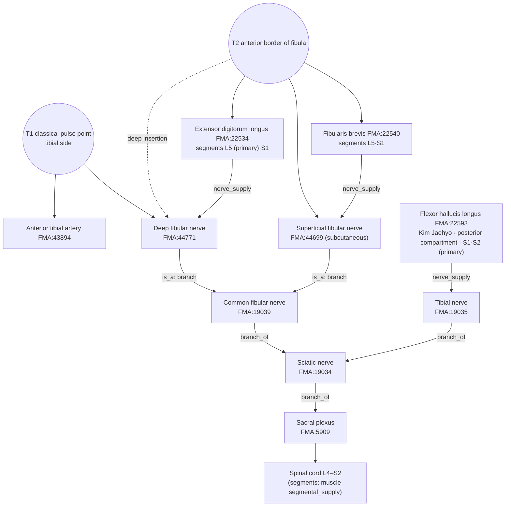

# [Acupoint Anatomical & Physiological Substrate Monograph] Xuanzhong (懸鍾, GB39) — alias Juegu (絕骨)

> **Framework**: v2.7 (revised 2026-10-04) · **ARI**: T1 `ARI v3.0 | ARI-Core 51.2 ± 0 (D·H) | SI 50 | provisional weights 0.40/0.35/0.25 | sensitivity (equal weights): 47.9 (D, grade unchanged)`
> T2 `ARI v3.0 | ARI-Core 55 ± 0 (C) | SI 75 | provisional weights 0.40/0.35/0.25 | sensitivity (equal weights): 54.2 (D, grade changes → weight-sensitive)` · **Dual scoring**: two independent raters, adjudicated

> **Three Primary Classics**: *Zhongguo Zhenjiu Xuewei Tongjian* (《中國針灸穴位通鑑》) · *Zhongguo Zhenjiu Zhengzhi Tongjian* (《中國針灸證治通鑑》) · *Zhenjiu Shuxue Tongkao* (《針灸腧穴通考》) (Huang Longxiang, 黃龍祥)
> **Layer A Empirical Database**: Integrated Biomedical Master DB v3.0 — GB39 evidence pack: of 29 landmark papers and 18 locally mapped papers, **5 mechanistic/clinical studies that actually include GB39** (papers.id 1610 · 1612 · 1615 · 1902 · 1903, all multi-point or animal) + 1 textual study on location (1624)
> **Layer B Reference Registry**: [`layer_b_reference_registry.md`](../../../../01_Framework/layer_b_reference_registry.md) (6-item B-Check, concordance threshold ≥ 8/12)
> **Needling-depth DB**: Classical Needling Depth Database sheet 1, row 344 (N0 = 342)
> **Anatomical Ontology**: local index of the FMA (Foundational Model of Anatomy) 5.1.0 — textbook structures are pinned to `FMA:ID`s and their innervation, spinal segments and nerve trunks are cross-checked (B1 supplementary, not yet in the registry). Mapping table: FMA Acupoint Anatomical Ontology Mapping Registry; details in Appendix A.
> **Metrological Standard**: Han-dynasty (漢代) standard, 1 fen (分) = 2.3 mm ($z = \text{fen} \times 2.3\,\text{mm}$), 1 cun = 10 fen = 23 mm (for depth conversion; surface positions use bone-proportional cun)
> **Analysis Targets**: **T1** classical source location (*Huangdi Mingtang Jing* (《黃帝明堂經》) "在足外踝上三寸動者(脈)中, 足三陽絡, 按之陽明脈絕乃取之" = the anterior tibial artery pulse point on the tibial side) / **T2** WHO and current-textbook location (外踝尖上 3寸, 腓骨前緣)
> **Note on script**: Classical quotations and TCM terms are given in Traditional Chinese (繁體字). The cited source files are simplified-script editions, so the file names and line numbers in `code` refer to those files as they are named on disk.

> **Summary**: The earlier edition took the classical "動脈中" to be the perforating branch of the fibular artery and analysed a single point with Δ 3–7 mm. However, the *Zhenjiu Shuxue Tongkao* (《針灸腧穴通考》) and papers.id 1624 hold that the vessel is the **anterior tibial artery** and that the original position is **on the tibial side**. The Δ estimated independently by each of the two raters is about 20–35 mm (> 15 mm), so the analysis branches into T1 and T2. ΔARI-Core = 3.8 (< 10), so **neither Target is declared superior and both are reported side by side**. For both Targets the B-Check is not concordant, so the reflex mechanism is a **hypothesis**.

---

## 🏛️ 1. Classical Literature Screening Table (Excerpts from the Three Primary Classics with Chinese–Korean Collation)

| Text (source file & line) | Original excerpt (location & depth) | Indications | Collation & remarks |
| :--- | :--- | :--- | :--- |
| ***Zhenjiu Shuxue Tongkao* (《針灸腧穴通考》)**, entry 懸鍾 (`针灸腧穴通考(下)_321-400.md` L529–658, printed pp.1106–1109) and the entry 陽輔 "'陽輔'、'懸鍾'與'絕骨'穴辨" (same file, L414–437) | "懸鍾，在足外踝上三寸動者中，足三陽絡，按之陽明脈絕乃取之。" (《黃帝明堂經》, L421) / "懸鍾，一名絕骨，在外踝上三寸動者中，足三陽絡。" (《千金要方》 卷二十九, L426 · 558) / modern 【定位】 "外踝尖上 3 寸，腓骨前緣" (L569) | "主腹滿，胃中有熱不嗜食，小兒腹滿不能食飲。" (《黃帝明堂經》, L542) | ① "《黃帝明堂經》所謂'陽明脈'……也即足背動脈，由於它是脛前動脈的下行支……人體測量學調查的結果表明：在外踝上三寸，靠近足陽明經脈行處，用力按壓，則衝陽脈搏動消失……後人及今人……將懸鍾穴定於足少陽經脈線上……此處不僅不能觸及動脈搏動，通過按壓也不能使足背處的衝陽脈搏動消失" (L548–552). ② "既是'按之陽明脈絕'處，則定位宜略偏向脛側……因而出現了名實分離的現象" (L431). ③ "'絕骨'穴不見於《黃帝明堂經》" (L431), "'絕骨'歸入奇穴類" (L437). ④ Meridian attribution (歸經), note (按): "將這樣一個位於陽明脈上而又主治陽明胃病的腧穴歸入足少陽經，難以成立" (L615). ⑤ "《黃帝明堂經》的'懸鍾'已經名存實亡了" (L658). **The 《通考》 contains no description of the superficial fibular nerve (淺腓骨神經) or the perforating branch of the fibular artery (腓骨動脈).** |
| ***Zhongguo Zhenjiu Xuewei Tongjian* (《中國針灸穴位通鑑》)**, entry 懸鍾 (`中国针灸穴位通鉴(下卷)_161-240.md` L52–346) | Source (出處) "懸鍾，在足外踝上三寸動者脈中，足三陽經，按之陽明脈絕乃取之。" (《針灸甲乙經》 3:55, L54 — the OCR reading "經" is read as "絡" following the 《通考》 and L136 "足三陽絡") / 24 location (部位) entries (L80–132), e.g. "在足外踝上三寸動脈中。" (《銅人》 5:20 · 《聚英》 · 《大成》, L90), "足外踝上三寸動脈中，尋摸尖骨者是。足三陽之大絡，按之陽明脈絕乃取之。" (《針灸大成》 7:209, L110) / "刺入六分，留七呼，灸五壯。" (《甲乙》 etc., L236) | "腹滿，胃中有熱，不嗜食，懸鍾主之。" (《甲乙》 9:124), "小兒腹滿，不能食飲，懸鍾主之。" (《甲乙》 12:154) (L154–156) | Explanation of the name (釋義): "穴在足外踝上三寸動者脈中，即脛前動脈處" (《經穴釋義匯解》, L74). Regional anatomy: "在腓骨前緣……有脛前動脈的分支，分佈著腓淺神經" (《新針灸學》), "腓淺神經；腓深神經；脛前動脈" (《針灸學簡編》) (L276–288). Concluding remarks: the alias 絕骨 "首出《備急千金要方》卷29" (L342), "髓會不宜作別名" (L292) |
| ***Zhongguo Zhenjiu Zhengzhi Tongjian* (《中國針灸證治通鑑》)** (`中国针灸证治通鉴_*.md`, 7 chunks; 懸鍾 and 絕骨 occur 196 times on 165 lines) | (Prescription collection — almost no location descriptions) | "乃若胃熱治懸鍾" (`_161-240.md` L4132), "腹滿不食：中脘針，絕骨、下三里" (`_241-320.md` L2972) | Context of occurrences (±80 characters, overlap allowed, reference values): lower-limb wei (痿), bi (痹), foot (足), shin (脛), knee (膝) 113; leg qi (腳氣) 20; stroke (中風) 16; malaria (瘧) 11; nape/neck (項 · 頸) 9; stomach/abdominal fullness (胃 · 腹滿) 7; stiff neck (落枕) 2. Mostly **combination** prescriptions with 足三里 and others. `_1-80.md` L1236, note (按): "'絕骨'穴不見於《明堂經》，後世醫家或以之為懸鍾穴，或以之為陽輔穴" |

---

## 📜 2. Primary Source vs. Secondary Quotation Table (Historical Stratification by Era)

| Stratum | Text | Location | Depth | Indications | Verdict |
| :--- | :--- | :--- | :--- | :--- | :--- |
| Primary (Han) | *Huangdi Mingtang Jing* (《黃帝明堂經》) (via 《甲乙》 3:55) | 在足外踝上三寸**動者(脈)中**, 足三陽絡, **按之陽明脈絕乃取之** | 刺入六分, 留七呼, 灸五壯 | 腹滿, 胃中有熱, 不嗜食; 小兒腹滿不能食飲 | **Primary = T1** (location defined by the pulse; no bony landmark) |
| Separate tradition (Jin) | 《脈經》 10:88 | "在外踝上三寸，直絕骨是也" (needling site for 陽蹻/陽維) | 刺入五分 | — | Description from a different tradition at the same height |
| Sui–Tang secondary | 《千金要方》 卷29 | "懸鍾，一名絕骨，在外踝上三寸動者中" | — | — | **First to link 絕骨 as an alias of Xuanzhong (懸鍾)** |
| Sui–Tang separate tradition | 《千金要方》 卷7 · 8 · 18, 《外臺》 19, 《醫心方》 8 | 絕骨: "外踝上一夫，亦云四寸" (卷7), "外踝上三寸宛宛中" (卷18), "外踝上骨絕頭陷中" (《外臺》) | — | 卷18 絕骨, 22 disorders (逆氣, 虛勞, 喉痹, **頸項強**, 腸痔…); 卷30 懸鍾 五淋 · 濕痹流腫 | Shift towards a bony location begins. The 卷30 indications are the 《明堂》 indications of **陽輔** (《通考》 note) |
| Song secondary | 《太平聖惠方》, 《銅人》 5:20 | "在外踝上三寸宛宛中" / "在足外踝上三寸動脈中" | 針六分, 灸三~五壯 | 腹滿 · 不嗜食 + 腿胯連膝脛痹麻 (陽輔 indications mixed in) | Wording of the original location kept; indications mixed |
| Ming modification | 《針灸聚英》, 《針灸大成》 7:209, 《循經考穴編》, 《類經圖翼》 | "足外踝上三寸動脈中, 尋摸尖骨者是 … 按之陽明脈絕乃取之", "絕骨尖間筋骨縫中是懸鍾", "當骨尖前動脈中" | 《指微》 斜入二寸許, 竇氏 二寸半, 橫透三陰交 | 《千金》 絕骨 indications (頸項強 etc.) reproduced via 《資生經》 | Bony landmarks ("尖骨 · 筋骨縫") added alongside |
| Modern | Unified textbooks, 2nd, 4th and 5th editions "腓骨後緣" → 6th and 7th editions and WHO "腓骨前緣" | 外踝尖上 3寸, 腓骨前緣 | 直刺 0.5~0.8寸 | 項強, 胸脇脹痛, 下肢痿痹; 7th edition 痴呆 · 中風 (髓海) | **T2**. Original indications (stomach disorders) dropped |

---

## 🔍 3. Alias & Nomenclature Verification Table (Blocking Conflation by KJH DB Collation)

| Alias | KJH DB (Acupoint Nomenclature & Alias Comparative Database, comprehensive acupoint list) | Alias columns of the two textbooks | Classical basis | Risk of conflation | Handling |
| :--- | :--- | :--- | :--- | :--- | :--- |
| **絕骨** | GB39 row 345 "絕骨, 足三陽絡, 髓會" **and** GB38 陽輔 row 344 "分肉, 分間, 絕骨" | Listed in both the Common Textbook row 343 and Kim Jaehyo row 343 (GB39), and in row 342 of each (GB38) | Not in the 《明堂》 (《通考》 L431). First given as an alias of Xuanzhong (懸鍾) in 《千金》 卷29 (《通鑑》 L342). Early "絕骨" = 7 cun above the lateral malleolus (外踝上七寸, near 陽輔); from the Sui–Tang onwards = 3–4 cun above the lateral malleolus (外踝上三四寸) | **High** — the same alias attaches to two points, GB38 and GB39 | Separated chronologically: the "絕骨" locations and indications in 《千金》 卷7 · 8 · 18 · 30 are kept apart from the original indications of Xuanzhong. The 《通考》 proposes treating "絕骨" separately as an extra point (L437) |
| 足三陽絡 | GB39 row 345 | Listed in both textbooks | 《甲乙》 3:55 "足三陽絡" | Low | A description of point character (穴性), not an independent name |
| 髓會 | GB39 row 345 | Listed in both textbooks | 《難經》 Difficulty 45 (45難) "髓會絕骨" — which point "絕骨" denotes is not settled in the literature | Medium | 《通鑑》 "髓會不宜作別名" (L292). Treated only as a theoretical classification |
| 懸鍾/悬钟 | Standard name 懸鍾 | — | 《甲乙》 3:55 | None | Character variants of the standard name. The earlier edition's spelling "縣鍾" was deleted because its source could not be confirmed |

> The earlier edition's statements "絕骨 is the same point as GB39 in all texts since the *Jiayi Jing* (甲乙經), with no risk of conflation" and "絕骨 = an ancient name for the fibula" do not match the source data and have been deleted.

---

## 📐 4. 3D Spatial Coordinates & Layer 1–5 Structural Diagram

### 4-1. Coordinates by Target (Estimated — No Point-Specific Imaging Measurement)

| Axis | T1 classical pulse point | T2 WHO anterior border of fibula |
| :--- | :--- | :--- |
| Y (proximal–distal) | 3 cun above the (tip of the) lateral malleolus (外踝(尖)) (bone-proportional, depends on body build) | 3 cun above the tip of the lateral malleolus (外踝尖) |
| X (medial–lateral) | Between the anterior border of the tibia and the anterior border of the fibula, on the course of the anterior tibial artery, shifted towards the tibia (《通考》 L431 "宜略偏向脛側"; papers.id 1624 "脛骨前嵴與腓骨前緣之間") | Anterior border of the fibula |
| Z (depth) | Depth at which the anterior tibial artery and veins and the deep fibular nerve lie in front of the interosseous membrane (roughly 10–20 mm depending on body build in normative anatomy; raters' estimate) | Standard perpendicular insertion 5–8 fen = 11.5–18.4 mm |
| Palpation landmark | Palpable pulse (in thin subjects), or the point where firm pressure abolishes the 衝陽 (dorsalis pedis) pulse | Bony landmark (anterior border of the fibula) |

### 4-2. Layer Structure (Based on Normative Anatomy B1-01 · B1-03 · B1-06 and the Two Textbooks; Depths Estimated)

| Layer | T1 classical pulse point | T2 WHO anterior border of fibula |
| :---: | :--- | :--- |
| 1 Skin & subcutis | Cutaneous branches of the superficial fibular nerve (at this level it has already pierced the fascia and runs subcutaneously), cutaneous veins | **Superficial fibular nerve** (subcutaneous course), lateral sural cutaneous nerve (Kim Jaehyo) |
| 2 Superficial muscle & fascia | Crural fascia, proximal part of the extensor retinaculum | Crural fascia, tendons of fibularis brevis and fibularis longus, extensor digitorum longus |
| 3 Deep muscle | Extensor hallucis longus and extensor digitorum longus (between them and the tendon of tibialis anterior) | Deep part of extensor digitorum longus, fibularis tertius (Kim Jaehyo) |
| **4 Neurovascular bundle** | **Anterior tibial artery and veins + deep fibular nerve** — can be contacted directly by perpendicular insertion of 6 fen (13.8 mm) | **Anterior tibial artery and veins + deep fibular nerve** (deep in the anterior compartment, raters' estimate around 18 mm), perforating branch of the fibular artery (piercing the interosseous membrane, Kim Jaehyo) |
| 5 Periosteum | Lateral surface of the tibia · interosseous membrane | Periosteum of the fibula |

```
   (medial) anterior border of tibia                 anterior border of fibula (lateral)
        │TA tendon  EHL tendon  EDL                    │  fibularis brevis/longus
        │          │          ●T1            │            ●T2
Skin────┼──────────┼──────────┼──────────────┼────────────┼──── L1 (superficial fibular n.: subcutaneous on T2 side)
Fascia──┼──────────┼──────────┼──────────────┼────────────┼──── L2
        │          │          ▼ ~10–20 mm    │            ▼ 11.5–18.4 mm (5–8 fen)
        │ [L4 anterior tibial a./vv. + deep fibular n. — in front of interosseous membrane]  ◀── reachable by deep insertion at T2
 Interosseous membrane ════════════════════════════════════════ L5 (tibial and fibular periosteum)
                              ●─────── Δ ≈ 20–35 mm ───────●
                          (X 20–30 mm · 3D 20–35 mm, independent estimates by 2 raters)
```


*Figure 4-1. Schematic cross-section of the lower third of the leg at the level of Xuanzhong (懸鍾) (外踝上3寸) (right leg, viewed from above, not to scale). The purple arrow T1 is the path by which perpendicular insertion of 6 fen at the anterior tibial artery pulse point on the tibial side reaches the Layer 4 neurovascular bundle; the black arrow T2 is the path of perpendicular insertion of 5–8 fen at the anterior border of the fibula. Layer thicknesses, distances and Δ are not measured values (raters' estimates).*

### 4-3. FMA Substrate Cross-check by Layer — Structure Names from the Two Textbooks; IDs and Relations from FMA 5.1.0

| Layer | Structure | FMA | FMA compartment / relation | Innervation / trunk (FMA) | Spinal segment (FMA) |
| :--- | :--- | :--- | :--- | :--- | :--- |
| 1 Subcutis | Superficial fibular nerve | FMA:44699 | is_a Branch of common fibular nerve | Common fibular n. → sciatic n. → sacral plexus | Not recorded in FMA |
| 1 Subcutis | Lateral sural cutaneous nerve *(Kim Jaehyo)* | FMA:44697 | is_a Cutaneous branch of common fibular nerve | Common fibular n. → sciatic n. → sacral plexus | Not recorded in FMA |
| 2–3 Anterior compartment | Extensor digitorum longus | FMA:22534 | contained_in Space of anterior compartment of leg (FMA:85203) | Nerve to EDL (FMA:80068) ← deep fibular n. | **L5 (primary)** · S1 |
| 2–3 Anterior compartment | Extensor hallucis longus | FMA:22533 | contained_in anterior compartment space (FMA:85203) | Nerve to EHL (FMA:80065) ← deep fibular n. | **L5 (primary)** · S1 |
| 2–3 Anterior compartment | Fibularis tertius *(Kim Jaehyo)* | FMA:22538 | contained_in anterior compartment space (FMA:85203) | Nerve to fibularis tertius (FMA:80071) ← deep fibular n. | L5 · S1 |
| 2–3 Lateral compartment | Fibularis brevis | FMA:22540 | contained_in Space of lateral compartment of leg (FMA:85206) | Nerve to fibularis brevis (FMA:80082) ← **superficial fibular n.** | L5 · S1 |
| 2–3 Lateral compartment | Fibularis longus *(Common Textbook)* | FMA:22539 | contained_in lateral compartment space (FMA:85206) | Nerve to fibularis longus (FMA:80079) ← superficial fibular n. | L4 · L5 · S1 |
| 4 Neurovascular bundle | Deep fibular nerve | FMA:44771 | is_a Branch of common fibular nerve | Common fibular n. → sciatic n. → sacral plexus | Not recorded in FMA |
| 4 Neurovascular bundle | Anterior tibial artery · anterior tibial vein | FMA:43894 · FMA:44331 | branch_of External iliac artery (FMA modelling) / tributary_of Popliteal vein | — | — |
| (Posterior compartment) | Flexor hallucis longus *(Kim Jaehyo)* | FMA:22593 | contained_in Space of deep part of posterior compartment of leg (FMA:312109) | Nerve to FHL (FMA:80098) ← **tibial n.** | **S1 · S2 (primary)** · L5 |
| (Posterior compartment) | Fibular artery · fibular vein *(Kim Jaehyo)* | FMA:43921 · FMA:44558 | Fibular vein: drains_into Femoral vein (see note below) | — | — |
| (Posterior → anterior) | Perforating branch of fibular artery *(Kim Jaehyo)* | FMA:44033 | branch of Peroneal artery (FMA:43921) | — | — |
| 5 Periosteum | Tibia · fibula · interosseous membrane of leg | FMA:24476 · FMA:24479 · FMA:35187 | — | — | — |

- FMA records the muscular branches to the anterior-compartment muscles (extensor digitorum longus, extensor hallucis longus, fibularis tertius) as branches of the *medial terminal branch of the deep fibular nerve (FMA:44777, the segment below the ankle)*. In normative anatomy (B1-01) these muscular branches arise from the trunk of the deep fibular nerve in the leg, so this report cites FMA **only down to the level of the deep fibular nerve**.
- FMA places the fibular vein (FMA:44558) as a *Tributary of femoral vein* (drains_into Femoral vein). In normative anatomy the fibular veins join the posterior tibial veins and continue into the popliteal vein, so this relation is regarded as a feature of FMA modelling and is not cited (described per B1-01).
- FMA gives segments only in the `segmental_supply` of muscles, not for nerves themselves. Nerve segments (e.g. common fibular nerve L4–S2) are given per B1-01 and B1-02.

---

## 📏 5. Needling Depth Calculation Table (Han-Dynasty 2.3 mm Conversion and Layer Reached)

| Text | Value | Conversion | Layer reached at T1 | Layer reached at T2 | Source |
| :--- | :---: | :---: | :--- | :--- | :--- |
| *Huangdi Mingtang Jing* (《黃帝明堂經》, compiled and edited by Huang Longxiang) | 6 fen | 13.8 mm | L4 (neurovascular bundle directly beneath the pulse point) | L2–3 | Needling-depth DB row 344 |
| *Zhenjiu Jiayi Jing* (《針灸甲乙經》) | 6 fen | 13.8 mm | L4 | L2–3 | Same row |
| *Chimgu Gyeongheombang* (《鍼灸經驗方》) | 6 fen | 13.8 mm | L4 | L2–3 | Same row |
| *Dongui Bogam* (《東醫寶鑑》, citing 《銅人》) | 6 fen | 13.8 mm | L4 | L2–3 | Same row |
| Korean common textbook, *Meridian and Acupoint Studies* (經絡腧穴學) | 5–8 fen | 11.5–18.4 mm | L3–4 | L2–4 | Same row (preferred needling method blank = not described) |
| Korean common textbook, *Acupuncture and Moxibustion Medicine* (鍼灸醫學) | 5–8 fen | 11.5–18.4 mm | L3–4 | L2–4 | Same row |
| *Zhenjiu Shuxue Tongkao* (《針灸腧穴通考》) | 5–8 fen | 11.5–18.4 mm | L3–4 | L2–4 | Same row (preferred needling method blank) |
| 《脈經》 10:88 | 5 fen | 11.5 mm | — | — | 《通鑑》 L234 (not in the DB) |
| 《扁鵲神應針灸玉龍經》 | transverse needle (橫針) 2.5 fen / needle (針) 3 fen | 5.75 / 6.9 mm | — | — | 《通鑑》 L248 |
| 《針灸聚英》 · 《大成》 citing 《指微》 | 斜入 2寸許 | ≈ 46 mm | — | Oblique insertion may traverse the anterior compartment | 《通鑑》 L250 · 256 |
| 《針方六集》 竇氏 | 針入 2寸半 | 57.5 mm | — | May traverse the anterior and posterior compartments of the leg and reach the fibular artery | 《通鑑》 L258 |
| 《循經考穴編》 | 橫透三陰交 / 凌氏 橫針 1寸 | Transverse insertion | — | Traverses the anterior and posterior compartments | 《通鑑》 L260 |
| 《針灸學簡編》 | 3–5 fen | 6.9–11.5 mm | — | L1–3 | 《通鑑》 L274 |

- The needling-depth DB contains **no contraindication ('0')**. The value 34 in the column "Jiayi Jing point classification and order" is a sequence number, not a depth (the earlier edition had entered it in the depth table; deleted).
- The earlier edition's μ = 6.2 fen and σ = 1.0 fen had no derivation and have been deleted.
- **T1 safety caution**: by definition the needle is inserted directly over an arterial pulse point, so perpendicular insertion of 6 fen reaches Layer 4. The pulse should be located and the artery avoided, or the depth limited to about 10 mm (Rater A's recommendation; no measurement).
- **T2 safety caution**: 5–6 fen stays within Layers 2–3, but at 8 fen (18.4 mm) or more, in thin subjects, and with the deep insertions of the 《指微》 and 竇氏, the needle may reach the anterior tibial artery and deep fibular nerve (Layer 4). Without imaging measurements a 10 mm margin has not been confirmed.

---

## 📚 6. Anatomical Structure Textbook Comparison Table (Common Textbook vs. Kim Jaehyo Textbook)

| Category | Common Textbook of Acupoint Studies (Common Textbook Anatomical Structure Dataset row 343; *Acupoint Studies* vol. 2, p.457) | Kim Jaehyo textbook (Kim Jaehyo Anatomical Structure Dataset row 343) | Common | Differences & interpretation |
| :--- | :--- | :--- | :--- | :--- |
| Muscles | Extensor digitorum longus, extensor hallucis longus, fibularis brevis, fibularis longus | Fibularis brevis, extensor digitorum longus, extensor hallucis longus, fibularis tertius, **flexor hallucis longus** | Extensor digitorum longus, extensor hallucis longus, fibularis brevis | Fibularis longus only in the Common Textbook (mainly tendon at this level). Fibularis tertius and the **posterior-compartment muscle flexor hallucis longus** only in Kim Jaehyo — apparently a list that includes deep insertion or the region behind the fibula (older textbooks' "腓骨後緣") |
| Nerves | Superficial fibular nerve, deep fibular nerve | Lateral sural cutaneous nerve, deep fibular nerve, superficial fibular nerve | Superficial and deep fibular nerves | Kim Jaehyo adds a cutaneous nerve (lateral sural cutaneous nerve) |
| Vessels | Anterior tibial artery and veins | Anterior tibial artery and veins, **perforating branch of the fibular artery**, **fibular artery and veins** | Anterior tibial artery and veins | Kim Jaehyo adds the branch piercing the interosseous membrane and the fibular artery and veins of the posterior compartment |

- Both textbooks list the **anterior tibial artery and veins** first among the vessels. This is the same structure as the one the 《通考》, the 《經穴釋義匯解》 and papers.id 1624 identify as the substrate of the classical "動者中". However, both textbooks' location wording is the anterior border of the fibula (T2), so **the coordinates differ from T1**.
- The earlier edition's "mutually complementary consistency" and "perfect layer-by-layer collation of innervation" concealed the actual difference (whether posterior-compartment structures are included) and have been deleted. Because this discrepancy has to be reconciled by inference, both Targets are at the $S_{clarity}$ 50 level.
**FMA adjudication** (Appendix A): 7 FMA entities common to both textbooks · 1 only in the Common Textbook (fibularis longus FMA:22539) · 6 only in Kim Jaehyo (fibularis tertius 22538, flexor hallucis longus 22593, lateral sural cutaneous nerve 44697, fibular artery 43921 and vein 44558, perforating branch of the fibular artery 44033). The English spelling variants "fibularis/peroneus" resolve to the same FMA IDs and are not real differences.

- **Meaning of the differences in the light of FMA**: the common structures and fibularis longus (Common Textbook only) all belong, in FMA, to the anterior and lateral compartments (FMA:85203 · 85206) and to the **common fibular nerve trunk** (deep and superficial fibular nerves). Among the Kim Jaehyo-only structures, flexor hallucis longus lies in the *deep part of the posterior compartment* (FMA:312109) and is innervated by the **tibial nerve** (S1 · S2 primary), and the fibular artery and veins are also posterior-compartment structures. The difference between the two textbooks is therefore not a difference in coverage within the same compartment but **whether the Kim Jaehyo list extends behind the interosseous membrane of the leg (a different compartment and a different nerve trunk)**, and the FMA compartments and nerve systems support the interpretation above ("a list that includes deep insertion or the region behind the fibula"). This adjudication does not change the $S_{clarity}$ 50 level (reconciliation by inference).
- The **perforating branch of the fibular artery**, which the earlier edition identified as the substrate of "動脈中", appears only in the Kim Jaehyo textbook and, as a deep branch emerging through the interosseous membrane, is unlikely to be a surface-palpable pulse point (B1-01). The classical sources and the 《通考》 give no basis for this interpretation.

---

## 🔀 7. Spatial Discrepancy Branch Inference Diagram

```
   anterior border of tibia                                                     anterior border of fibula
             │                                                                              │
             │   [T1 classical pulse point]                    [T2 current WHO]             │
             │   外踝上三寸 動者(脈)中                          外踝尖上3寸                  │
             │   按之陽明脈絕 → 衝陽 pulse abolished            腓骨前緣                     │
             │   Substrate: anterior tibial a. + deep          Substrate: superficial       │
             │              fibular n. (L4)                    fibular n. (L1)              │
             │   Indications: 腹滿·胃中有熱·不嗜食 (《明堂》)     + extensors/fibulares (L2–3) │
             │   Basis: 《通考》 L431·552, 《經穴釋義匯解》,     Indications: 項強·下肢痿痹    │
             │          papers.id 1624                         (《千金》 絕骨 tradition)     │
             │   ●────────────────────── Δ ≈ 20–35 mm (> 15 mm) ───────────────────────●    │
```

| Item | Content |
| :--- | :--- |
| Y-axis difference | None (both 3 cun above the lateral malleolus (外踝)). The 《千金》 卷7 "一夫, 亦云四寸" tradition is separate |
| X-axis difference | Course of the anterior tibial artery (tibial side) ↔ anterior border of the fibula: about 20–30 mm (Rater B, median about 25 mm) |
| 3D difference | About 20–35 mm (Rater A, including X-axis and depth difference) |
| Verdict | $\Delta_{discrepancy} > 15\text{mm}$ → **independent T1 and T2 branches** (canonical Rank 5) |
| Earlier-edition Δ | 0.3–0.7 cm — an underestimate resting on the unsupported identification "動脈中 = perforating branch of the fibular artery"; discarded |
| Dissent | papers.id 1624 supports the T1 position (between 脛骨前嵴 and 腓骨前緣) but, stating "在外踝上３寸處，用手摸到跳動的動脈是很難的……也不容易", questions the **reproducibility** of the pulse and of the abolition of the 衝陽 pulse. No bibliographic reference is given for the 《通考》's "人體測量學調查". This dissent concerns location, not a conflict about mechanism |

**Branch decision**: ΔARI-Core = 55.0 − 51.2 = **3.8 (< 10)**. The two intervals [51.2, 51.2] and [55, 55] do not overlap, but the Δ criterion is not met → **no superior Target. T1 and T2 are reported side by side.**

---

## 🧬 8. Biomedical Reflex Mechanism Diagram & External Search Log

### ① Layer A Papers (GB39-specific studies first)

| papers.id | Year | Journal | Title | PMID / DOI | Design | Use |
| :---: | :---: | :--- | :--- | :--- | :--- | :--- |
| 1624 | 2021 | 針刺研究 46(1):73–75 | 關於懸鍾穴定位的探討 / Location of acupoint Xuanzhong (GB39) — Liu Jianan (劉佳男) et al. | PMID 33559430 / DOI 10.13702/j.1000-0607.200282 (full-text PDF) | Textual study (location) | Basis for the T1 location: "懸鍾穴定位應該準確描述為：'足外踝上３寸，脛骨前嵴與腓骨前緣之間'", "動者脈中" = 脛前動脈 (citing Li Ding, 李鼎). Notes the difficulty of palpating the pulse |
| 1610 | 2003 | Journal of Korean Acupuncture & Moxibustion Society | A neuroanatomical study of acupoints (SJ5, PC6, SP6 and GB39) projecting to brain regions related to dementia [in Korean] | — | Animal neural tracing | T2 B-Check ④ |
| 1612 | 2006 | Journal of the Korean Oriental Medicine Society | Effects of Yanglingquan (陽陵泉)–Xuanzhong (懸鍾) electroacupuncture on cerebral blood flow in patients with cerebral infarction and in healthy subjects [in Korean] | — | Human non-RCT (point combination) | T2 B-Check ④⑥ |
| 1615 | 2013 | Journal of Korean Acupuncture & Moxibustion Medicine Society | Effects of electroacupuncture and laser acupuncture at 懸鍾 (GB39) and 陽陵泉 (GB34) on neuropathic pain in rats (白鼠) [in Korean] | DOI 10.13045/acupunct.2013012 | Animal (point combination) | T2 B-Check ③⑤ |
| 1903 | 2019 | Zhen Ci Yan Jiu | Electroacupuncture at "Zusanli"(ST36) and "Xuanzhong"(GB39) improves inflammatory reactions… | 31532135 / 10.13702/j.1000-0607.180555 | Animal (point combination) | T2 B-Check ⑤ |
| 1902 | 2024 | Zhongguo Zhen Jiu | Electroacupuncture for the prevention of chemotherapy-induced peripheral neuropathy: a randomized controlled trial | 39658376 / 10.13703/j.0255-2930.20240222-k0001 | Human RCT (multiple points) | T2 B-Check ⑥ (effect of GB39 alone cannot be separated) |
| 1904 | 2002 | Am J Physiol Regul Integr Comp Physiol | Effect of electroacupuncture on pressor reflex during gastric distension | 12388466 / 10.1152/ajpregu.00192.2002 | Animal | T1 B-Check ③–⑤ **analogy** (other points, animal) |
| 1620 | 2017 | 針灸臨床雜誌 | 髓會絕骨的文獻研究及臨床應用概論 | — | Textual study | Reference for the 髓會 theory (not counted in scoring) |

- **Not counted**: 1842 · 1905 · 1845 · 1922 (reviews, data mining), 1910 · 1915 · 1924 · 1925 · 1911 (GB39 inclusion or single-point status unconfirmed from the title), 1913 (ultrasound-guided myofascial trigger-point clinical study — not an anatomical measurement at GB39), and other locally mapped papers (not relevant).
- **Point-specific Layer A for T1 = 0 papers** (all the studies above needle the current fibular-side location) → Gate 2. **For T2 = 4 papers** (1610 · 1612 · 1615 · 1903; adjudicated result `layerA_point_specific`).

### ② B-Check Scoring Tables

**T1 classical pulse point**

| Item | Content | Rater A | Rater B | Final | Layer B reference IDs | papers.id | Rationale |
| :---: | :--- | :---: | :---: | :---: | :--- | :--- | :--- |
| ① | Peripheral nerve/vessel substrate at needling depth | 1 | 1 | **1** | B1-01, B1-03, B1-06, B2-09 (+FMA) | 1624 | The anterior tibial artery and veins + deep fibular nerve are confirmed by normative anatomy, the two textbooks and FMA (FMA:43894 · 44331 · 44771 exact), but there is no measurement at the T1 position, and 1624 notes the difficulty of palpating the pulse |
| ② | Spinal segmental concordance | 1 | 1 | **1** | B1-03, B3-05 (+FMA) | — | Deep fibular nerve L4–L5 (S1) (FMA: segmental_supply of the anterior-compartment muscles, L5 primary, S1) vs the stomach (T6–T9 visceral segments, vagal) of the original indications: segments do not match; only a supraspinal analogy is possible |
| ③ | Afferent fibre type & receptors | 1 | 1 | **1** | B3-05, B3-06, B3-12 | 1904 | Group III/IV afferents from deep muscle and perivascular tissue are a general mechanism in anaesthetised animals; not verified at T1 |
| ④ | Central relay & pathway | 1 | 1 | **1** | B3-05, B3-12 | 1904 | The hindlimb somatic stimulation → medulla (rVLM/NTS, vagal) pathway rests on animal evidence from other points |
| ⑤ | Efferent pathway & direction of effect vs $P_{single}$ | 1 | 1 | **1** | B3-05 | 1904 | The original indications (腹滿 · 胃中有熱 · 不嗜食) and vagal regulation of gastric motility by lower-limb stimulation agree conceptually in direction, but there is no direct evidence for T1 |
| ⑥ | Human translation | 0 | 0 | **0** | B4-05 | — | No human study needling at the T1 location |
| **Total** | | 5 | 5 | **5/12** | | | **Not concordant → hypothesis (H)**. ③–⑤ animal/analogy, ⑥ = 0 → (animal only) |

**T2 WHO anterior border of fibula**

| Item | Content | Rater A | Rater B | Final | Layer B reference IDs | papers.id | Rationale |
| :---: | :--- | :---: | :---: | :---: | :--- | :--- | :--- |
| ① | Peripheral nerve/vessel substrate at needling depth | 1 | 1 | **1** | B1-01, B1-03, B2-09 (+FMA) | — | The superficial and deep fibular nerves and anterior tibial artery and veins are confirmed by normative anatomy, the two textbooks and FMA (FMA:44699 · 44771 · 43894 exact), but the vascular composition differs between the textbooks (Kim Jaehyo includes posterior-compartment structures, confirmed by FMA compartments) and there is no measurement at GB39 |
| ② | Spinal segmental concordance | 1 | 1 | **1** | B1-03, B3-05, B3-20 (+FMA) | — | L4–S1 dermatomes and myotomes (FMA segment union L4 · L5 · S1 · S2; S2 comes only from flexor hallucis longus, a posterior-compartment muscle listed only by Kim Jaehyo) fit the local lower-limb indications. Segments do not match the original stomach indications (T6–T9) or the earlier edition's 頸項強痛 (C3–C5) |
| ③ | Afferent fibre type & receptors | 1 | 1 | **1** | B3-04, B3-06, B3-11, B3-17 | 1615 | Only a general afferent-fibre framework and an animal study combining GB39 and GB34. B3-17 lies outside the scope verified at ST36 → analogy |
| ④ | Central relay & pathway | 1 | 1 | **1** | B3-05, B3-07, B3-11 | 1610, 1612 | Neural tracing of GB39 brain projections (animal); GB34–GB39 electroacupuncture and cerebral blood flow (human, combination) — no evidence specifying the pathway |
| ⑤ | Efferent pathway & direction of effect vs $P_{single}$ | 1 | 1 | **1** | B3-05, B3-11, B3-16 | 1615, 1903 | Local analgesic and anti-inflammatory directions agree with the lower-limb indications at the animal level. No GB39 evidence for the original stomach indications or for remote effects on the neck |
| ⑥ | Human translation | 1 | 1 | **1** | B4-03, B4-04, B4-05 | 1612, 1902 | Human evidence consists only of combined-point electroacupuncture (non-RCT cerebral blood flow, multi-point RCT). Counter-evidence on point non-specificity (B4-04 · B4-05) stated alongside |
| **Total** | | 6 | 6 | **6/12** | | | **Not concordant → reflex mechanism is a hypothesis**. Mainly animal; ⑥ rests on combined-point evidence |

### ③ External Search Log (sync_log; Rank 6 runs of 2026-10-04 and 2026-10-23)

| Timestamp | Source | HTTP | Fetched | Duplicates removed | New | Query |
| :--- | :--- | :---: | :---: | :---: | :---: | :--- |
| 2026-10-04T09:51:54 | pubmed | 200 | 16 | — | — | ("GB39" OR "Xuanzhong" OR "懸鍾") AND (acupuncture OR electroacupuncture) AND (nerve OR reflex OR autonomic OR mechanism OR anatomy) |
| 2026-10-04T09:51:54 | openalex | 200 | 24 | — | — | doi_starts_with:10.13703,title_and_abstract.search:"Xuanzhong" OR "GB39" \| doi_starts_with:10.13702,title_and_abstract.search:"Xuanzhong" OR "GB39" \| has_doi:tr… |
| 2026-10-04T09:51:54 | crossref | 200 | 0 | — | — | Xuanzhong acupuncture nerve reflex |
| 2026-10-04T09:51:54 | all | — | 40 | 13 | 27 | |
| 2026-10-23T21:43:36 | pubmed | 200 | 16 | — | — | ("GB39" OR "Xuanzhong" OR "悬钟") AND (acupuncture OR electroacupuncture) AND (nerve OR reflex OR autonomic OR mechanism OR anatomy) \| … AND ("Zhongguo Zhen Jiu"[Journal] OR "Zhen Ci Yan Jiu"[Journal]) |
| 2026-10-23T21:43:36 | openalex | 200 | 24 | — | — | doi_starts_with:10.13703 / 10.13702 / has_doi:true, "Xuanzhong" OR "GB39" |
| 2026-10-23T21:43:36 | crossref | 200 | 0 | — | — | Xuanzhong acupuncture nerve reflex |
| 2026-10-23T21:43:36 | all | — | 40 | 33 | 7 | merged_into_existing=23, batch_dups=10 |

- The 7 new papers from the 2026-10-23 re-run were not included in the verdict in this FMA supplement (B-Check and ARI unchanged). Their GB39 single-point status and design will be reviewed and reflected in the next scheduled revision.

### ④ Reflex Mechanism Hypothesis Diagram (B-Check not concordant for both Targets → hypothesis)

```
T1 (hypothesis, animal/analogy)                          T2 (hypothesis, animal/combined-point evidence)
Afferents around anterior tibial a. · deep fibular n.     Superficial fibular n. (subcutis) · extensor/fibularis
(L4–L5)                                                   afferents (L4–S1)
   │ segmental mismatch (stomach T6–T9)                      │ segmental: local lower-limb analgesia
   │ → only a supraspinal pathway possible                   │ (B3-07 · B3-11, 1615)
   ▼                                                         ▼
Medullary NTS/rVLM · vagal motor nucleus                  Supraspinal analgesia · cerebral blood flow
(B3-05 · B3-12, analogy from 1904)                        regulation (1610 · 1612, combined points)
   ▼                                                         ▼
Regulation of gastric motility/function                   下肢痿痹 · 足脛痛 (local indications)
→ 腹滿 · 胃中有熱 · 不嗜食 (original indications)
```

- The earlier edition's "stimulation of the common fibular nerve (L4-S1) → ascent to spinal segments C3-C5 → reflex relaxation of neck muscles" has no basis in either the Layer B registry or Layer A and has been **deleted**.
- The earlier edition's "stimulation of the fibular periosteum at 8-fen needling = the anatomical basis of 髓會" also has no basis and has been deleted (髓會 is treated only as a theoretical classification).

### ⑤ FMA Anchoring of the Peripheral Afferent Pathway (Front End Common to Both Targets)

The first segment of the hypothesis diagram above (needling point → spinal cord) is anchored by FMA relations as follows. Both T1 and T2 converge on the same trunk, **common fibular nerve → sciatic nerve → sacral plexus**; the difference is that T1 starts on the side of the deep fibular nerve and anterior tibial artery (Layer 4) and T2 on the side of the superficial fibular nerve and lateral compartment (Layers 1–3). The posterior-compartment structure listed only by Kim Jaehyo (flexor hallucis longus) belongs to the tibial nerve system. This structural chain is only the anatomical front end of the hypothesis diagram and does not change the B-Check score.



*Figure 8-1. Peripheral afferent pathway of GB39 drawn from FMA 5.1.0 relations. Solid lines are relations recorded in FMA (`nerve_supply` · `branch_of`); "is_a" marks trunks linked from class names; the dashed line is the path reachable by deep insertion at T2.*

---

## ⚖️ 9. Indication Separation Table (Single-Point Needling $P_{single}$ vs. Combination Prescriptions)

| Indication | Earliest source | Type | Verdict | Basis |
| :--- | :--- | :--- | :--- | :--- |
| **Abdominal fullness (腹滿), heat in the stomach (胃中有熱), no desire to eat (不嗜食)** | *Huangdi Mingtang Jing* (《黃帝明堂經》) (《甲乙》 9:124) | **$P_{single}$ (original indication)** | Indication proper to Xuanzhong (懸鍾). Consistent with T1 (anterior tibial artery, on the foot-yangming vessel) | 《通考》 L542 · 647 · 658; 《通鑑》 L154 |
| **Abdominal fullness and inability to eat or drink in children (小兒腹滿不能食飲)** | *Huangdi Mingtang Jing* (《黃帝明堂經》) (《甲乙》 12:154) | **$P_{single}$ (original indication)** | Same | 《通鑑》 L156 |
| 五淋; 濕痹流腫, 髀筋急瘈, 脛痛 | 《千金要方》 卷30 "懸鍾主…" | Mixed in | Misrecorded 《明堂》 indications of **陽輔** | 《通考》 L627–630, note |
| 腿胯連膝脛痹麻; 膝脛連腰痛, 筋攣急, 足不收履 | 《太平聖惠方·明堂》 | Mixed in | Indications of 陽輔 and 臨泣 mixed in | 《通考》 L563–566 · 632–638, note |
| 頸項強, 喉痹, 鼻衄, 腸痔, 逆氣, 虛勞, etc. | 《千金要方》 卷18 "絕骨", 22 disorders (外踝上三寸宛宛中, moxibustion) | Mixed in (via the alias) | **絕骨** indications reproduced in the Xuanzhong entries of the 《聚英》 and 《大成》 via the 《資生經》 | 《通考》 L645–647, note |
| Stiff neck (落枕) | Modern 《針灸學簡編》 ("配大椎、後溪治落枕"), clinical report (針灸臨床雜誌 1999) | Combination · modern | No classical basis. Not regarded as single-point evidence | 《通鑑》 L230 · 342; 《通考》 L686 |
| Wei-bi of the lower limb (下肢痿痹), spasm and pain of the foot and shin (足脛攣痛), leg qi (腳氣) | 《千金》 · 《外臺》 moxibustion for 腳氣 (三里 + 絕骨), modern textbooks | Mainly combination | Local indication consistent with T2 anatomy, but the classical source is a 絕骨 combination prescription | 《通鑑》 L158–176; context frequency in the 《證治通鑑》 |
| Stroke (中風), hemiplegia (半身不遂) | 《太平聖惠方》 (三里 + 絕骨 moxibustion), 7th-edition textbook "髓海不足" | $P_{comb}$ / theory | Derived from combination prescriptions and the 髓會 theory | 《通考》 L670–672, clinical application (臨床應用) (4)–(6) |
| Marrow disorders (髓病), dementia (痴呆) (sea of marrow, 髓海) | 《難經》 Difficulty 45 (45難), 7th-edition textbook | Theory | Extension of speculative theory → filtered out | 《通鑑》 L146–148 |

> The earlier edition's $P_{single}$ "頸項強痛 · 落枕 · 下肢痿痹 · 足脛疼痛" omitted the original indications (spleen–stomach disorders) and misclassified indications from the 《千金》 絕骨 tradition and modern combinations as single-point effects. It is replaced by the table above.

---

## 📊 10. ARI v3.0 Profile Evaluation & Final Conclusion

$$\text{ARI-Core} = 0.40\,S_{orig} + 0.35\,S_{clarity} + 0.25\,S_{reflex} \quad (\text{provisional weights, unvalidated})$$
$$\text{SI} = S_{safety} \quad (\text{not added in})$$

### 10-1. T1 Classical Pulse Point (外踝上三寸 動者脈中, 按之陽明脈絕)

| Index | Rater A | Rater B | Mean | Rubric-level rationale | Evidence pointers |
| :--- | :---: | :---: | :---: | :--- | :--- |
| $S_{orig}$ | 68.75 | 68.75 | **68.75** | Mean of the 4 sub-items (table below) | 《通考》 L414–437 · 529–658; 《通鑑》 L54–132 |
| $S_{clarity}$ | 50 (75 before adjudication) | 50 | **50** | The anterior tibial artery + deep fibular nerve agree with B1 and the textbooks' vessel lists, but the textbooks' location is the T2 coordinate and there is no measurement at T1 → "discrepancy between textbook and location reconciled by inference" | B1-01 · B1-03 · B1-06; textbook xlsx row 343; papers.id 1624 |
| $S_{reflex}$ | 25 | 25 | **25** | 0 Layer A papers needling at the T1 location → Gate 2 | B-Check 5/12; 1904 is analogical evidence |
| $S_{safety}$ → SI | 50 | 50 | **50** | Perpendicular insertion of 6–8 fen at the pulse point directly reaches the Layer 4 neurovascular bundle → a depth limit and arterial avoidance must be stated. No contraindication, no deep organs | Needling-depth DB row 344 |

| $S_{orig}$ sub-item | A | B | Mean | Rationale |
| :--- | :---: | :---: | :---: | :--- |
| ① Clarity of earliest description | 75 | 75 | 75 | The 《明堂》 is clear on height, depth and the palpation procedure; the transverse position (tibial side) is inferred from "按之陽明脈絕" |
| ② Agreement in later texts | 50 | 50 | 50 | About 12–13 of 24 entries (about 50–55 %) keep "動(者)脈中 · 按之陽明脈絕"; the rest move to 宛宛中 · 尖骨 · 筋骨縫 · 腓骨前/後緣 |
| ③ Resolution of alias confusion | 75 | 75 | 75 | The 《通考》 sorts out chronologically the conflation of 絕骨 between GB38 and GB39 |
| ④ Collation in the 《通考》 | 75 | 75 | 75 | Collation of the mixed-in 陽輔 indications, the reordering by Song officials (宋臣) and textual variants; restoration of the original location proposed. No bibliographic reference for the "人體測量學調查" |
| **Mean** | 68.75 | 68.75 | **68.75** | |

- **Gates**: Gate 2 (0 point-specific Layer A papers → $S_{reflex}$ ≤ 25, H flag). Gates 1 and 3 not applicable.
- **ARI-Core** = 0.40×68.75 + 0.35×50 + 0.25×25 = **51.2 ± 0 → D·H (undetermined / hypothesis)**.
- **SI** = **50**.
- **Equal-weight sensitivity**: (68.75 + 50 + 25) / 3 = **47.9 → D**, grade unchanged.

### 10-2. T2 WHO Anterior Border of Fibula (外踝尖上 3寸, 腓骨前緣)

| Index | Rater A | Rater B | Mean | Rubric-level rationale | Evidence pointers |
| :--- | :---: | :---: | :---: | :--- | :--- |
| $S_{orig}$ | 62.5 | 62.5 | **62.5** | Mean of the 4 sub-items (table below) | 《通考》 L529–658; KJH rows 344 · 345 |
| $S_{clarity}$ | 50 | 50 | **50** | Vessels and deep structures differ between the two textbooks (whether posterior-compartment structures are included), the classical palpation landmark cannot be reproduced at the current position, no GB39 measurement (PMID) → reconciliation by inference | Textbook xlsx row 343; 《通考》 L552 |
| $S_{reflex}$ | 50 | 50 | **50** | 3 animal studies including GB39 + human combined-point studies, B-Check 6/12 → "animal studies + B-Check 6–7" level | papers.id 1610 · 1612 · 1615 · 1902 · 1903 |
| $S_{safety}$ → SI | 75 | 75 | **75** | Standard 5–8 fen is centred on Layers 2–3; deeper insertion may reach Layer 4 (anterior tibial artery, deep fibular nerve), avoidable by the 0.5–0.8 cun limit. No contraindication | Needling-depth DB row 344; 《通鑑》 L250–260 |

| $S_{orig}$ sub-item | A | B | Mean | Rationale |
| :--- | :---: | :---: | :---: | :--- |
| ① Clarity of earliest description | 75 | 75 | 75 | The 《明堂》 is clear on height and depth; the bony landmark 'anterior border of the fibula' is not in the original source |
| ② Agreement in later texts | 50 | 50 | 50 | The transverse position splits into 宛宛中 · 筋骨縫 · 腓骨後緣 (2nd, 4th, 5th editions) · 腓骨前緣 (6th, 7th editions) |
| ③ Resolution of alias confusion | 50 | 50 | 50 | KJH and the two textbooks list 絕骨 under both GB38 and GB39 — partly unresolved in the current standard |
| ④ Collation in the 《通考》 | 75 | 75 | 75 | Collation exists in the 《通考》 (mixed-in indications, reordering) |
| **Mean** | 62.5 | 62.5 | **62.5** | |

- **Gates**: not applicable ($S_{orig}$ and $S_{clarity}$ ≥ 50, 4 point-specific Layer A papers, SI > 25).
- **ARI-Core** = 0.40×62.5 + 0.35×50 + 0.25×50 = **55.0 ± 0 → C (possible / hypothesis)**.
- **SI** = **75**.
- **Equal-weight sensitivity**: (62.5 + 50 + 50) / 3 = **54.2 → D**, grade changes → **weight-sensitive**.

### 10-3. Branch Decision

| Target | ARI-Core (± half-range) | Interval | Grade · flag | SI |
| :--- | :---: | :---: | :---: | :---: |
| T1 classical pulse point | 51.2 ± 0 | [51.2, 51.2] | D·H | 50 |
| T2 WHO anterior border of fibula | 55.0 ± 0 | [55, 55] | C (weight-sensitive) | 75 |

ΔARI-Core = **3.8 < 10** → under the canonical rule **no superior Target is declared.** The two Targets are reported side by side. (T2's grade C also drops to D under equal weights, so the substantive difference between the two Targets is small.)

### 10-4. Adjudication Record

| Target | Item | Disagreement | Adjudication |
| :---: | :--- | :--- | :--- |
| T1 | $S_{clarity}$ | A 75 / B 50 (25-point difference, ≥ 15) | The two textbooks' listing of the anterior tibial artery and veins describes the deep structures at the WHO position and is not a measurement or textbook agreement for the classical pulse point itself, so level 50 of canonical 4.2 ("discrepancy between textbook and location reconciled by inference") applies → A adjusted to 50 |
| T1 | Basis for branching | — | Independent estimates by the two raters, Δ ≈ 20–35 mm (median about 25 mm) > 15 mm → T1/T2 branch. The "difficulty of palpating the pulse" in papers.id 1624 concerns location, not a conflict about mechanism |
| T2 | — | No disagreement of 15 points or more | The earlier edition's "L4-S1 → C3-C5 somato-somatic relaxation reflex" was an unsupported statement and has been deleted (not reflected in the B-Check). The 頸項強 indication is the 《千金》 "絕骨" indication mixed in (Rank 3) |

### 10-5. Final Conclusion

- **T1 classical pulse point** — **undetermined / hypothesis (D·H)**. Xuanzhong (懸鍾) in the *Huangdi Mingtang Jing* (《黃帝明堂經》) is a point defined not by a bony landmark but by a pulse: the pulsating site 3 cun above the lateral malleolus (外踝) where firm pressure abolishes the pulse on the dorsum of the foot (衝陽). This vessel is the **anterior tibial artery** (《通考》 L548–552, 《經穴釋義匯解》, papers.id 1624), and the position lies between the anterior border of the tibia and the anterior border of the fibula, on the tibial side. The candidate substrate is the **anterior tibial artery and veins + deep fibular nerve (Layer 4)**, and the original indications are **abdominal fullness (腹滿), heat in the stomach (胃中有熱) and no desire to eat (不嗜食)** (stomach disorders). However, there is no Layer A study needling at this position (Gate 2), and 1624 reports that palpation of the pulse and abolition of the 衝陽 pulse are hard to reproduce, so the reproducibility of the palpation landmark is unverified. The reflex mechanism (lower-limb somatic afferents → medulla and vagus → gastric function) is a **hypothesis (animal only)** inferred from animal evidence at other points. Because the needle is inserted directly over the pulse point, the artery must be avoided and the depth limited (SI 50).
- **T2 WHO anterior border of fibula** — **possible / hypothesis (C, weight-sensitive)**. The substrate is the subcutaneous **superficial fibular nerve** and extensor digitorum longus and fibularis brevis (Layers 1–3); deep insertion may reach the anterior tibial artery and deep fibular nerve of the anterior compartment (Layer 4). This position results from the accumulation, from the 《千金》 onwards, of bony locations of the 絕骨 tradition, and the 《通考》 holds that, since neither the pulse nor abolition of the 衝陽 pulse can be reproduced here, it has undergone "名實分離" from the original Xuanzhong. The modern indications (項強 · 下肢痿痹) come from the 《千金》 indications of 絕骨 and 陽輔. All studies including GB39 are at the combined-point or animal level, and with B-Check 6/12 (not concordant) the reflex mechanism is a **hypothesis**.
- **Branch**: ΔARI-Core 3.8 < 10 → no superiority. The two Targets are reported side by side. The earlier edition's conclusion of a "confirmed substrate" and its claim of "complete agreement" with the 《通考》 rested on fabricated quotations and are withdrawn.

---

## Appendix A. FMA Anatomical Substrate Profile (FMA 5.1.0)

Generated by: `python .claude/skills/acupoint-anatomy/scripts/fma/fma_query.py profile GB39 --md` (2026-10-23). The match level `exact` means that the textbook's English term matched an FMA label, synonym or Latin name exactly after normalisation.

| Category | Textbook term | FMA entity | Match | Source | Innervation / parent trunk | Spinal segments |
| :--- | :--- | :--- | :--- | :--- | :--- | :--- |
| Muscle | Extensor digitorum longus | FMA:22534 Extensor digitorum longus | exact | Common Textbook · Kim Jaehyo | FMA:80068 Nerve to EDL → deep fibular n. → common fibular n. | L5 (primary), S1 (secondary) |
| Muscle | Extensor hallucis longus | FMA:22533 Extensor hallucis longus | exact | Common Textbook · Kim Jaehyo | FMA:80065 Nerve to EHL → deep fibular n. → common fibular n. | L5 (primary), S1 (secondary) |
| Muscle | Fibularis brevis (fibularis / peroneus brevis) | FMA:22540 Fibularis brevis | exact | Common Textbook · Kim Jaehyo | FMA:80082 Nerve to fibularis brevis → superficial fibular n. → common fibular n. → sciatic n. | L5, S1 |
| Muscle | Fibularis longus (peroneus longus) | FMA:22539 Fibularis longus | exact | Common Textbook | FMA:80079 Nerve to fibularis longus → superficial fibular n. → common fibular n. → sciatic n. | L4, L5, S1 |
| Muscle | Fibularis tertius | FMA:22538 Fibularis tertius | exact | Kim Jaehyo | FMA:80071 Nerve to fibularis tertius → deep fibular n. → common fibular n. | L5, S1 |
| Muscle | Flexor hallucis longus | FMA:22593 Flexor hallucis longus | exact | Kim Jaehyo | FMA:80098 Nerve to FHL → tibial n. → sciatic n. → sacral plexus | S1 · S2 (primary), L5 (secondary) |
| Nerve | Deep fibular nerve (deep fibular / deep peroneal nerve) | FMA:44771 Deep fibular nerve | exact | Common Textbook · Kim Jaehyo | FMA:19039 → FMA:19034 → FMA:5909 | — |
| Nerve | Lateral sural cutaneous nerve | FMA:44697 Lateral sural cutaneous nerve | exact | Kim Jaehyo | FMA:19039 → FMA:19034 → FMA:5909 | — |
| Nerve | Superficial fibular nerve (superficial fibular / peroneal nerve) | FMA:44699 Superficial fibular nerve | exact | Common Textbook · Kim Jaehyo | FMA:19039 → FMA:19034 → FMA:5909 | — |
| Vessel | Anterior tibial artery | FMA:43894 Anterior tibial artery | exact | Common Textbook · Kim Jaehyo | FMA:18805 External iliac artery → FMA:14764 Common iliac artery | — |
| Vessel | Anterior tibial vein | FMA:44331 Anterior tibial vein | exact | Common Textbook · Kim Jaehyo | FMA:44327 Popliteal vein → … → Inferior vena cava | — |
| Vessel | Fibular artery | FMA:43921 Peroneal artery | exact | Kim Jaehyo | — | — |
| Vessel | Fibular vein | FMA:44558 Fibular vein | exact | Kim Jaehyo | (FMA: drains_into Femoral vein — note in 4-3, not cited) | — |
| Vessel | Perforating branch of fibular artery | FMA:44033 Perforating branch of fibular artery | exact | Kim Jaehyo | FMA:43921 Peroneal artery | — |

- Segment union (input to B-Check ②): **L4, L5, S1, S2** (S2 comes only from flexor hallucis longus, a posterior-compartment muscle listed only by Kim Jaehyo)
- Comparison of the two textbooks: 7 common FMA entities · 1 Common Textbook only · 6 Kim Jaehyo only
- Limits of citation: FMA is an ontology of normative adult anatomy and is not evidence for point-specific depth, frequency of variation or reflex function. The origin of the anterior-compartment muscular branches (recorded from the medial terminal branch), the recorded direct drainage of the fibular vein into the femoral vein, and the absence of nerve segments were supplemented from B1 as noted in 4-3. The T1 pulse point on the tibial side is itself not an FMA object (a question of location).

---

## v2.7 FMA Supplement History (2026-10-23)

| Location | Original content | Change | Basis |
| :--- | :--- | :--- | :--- |
| Header | — | FMA 5.1.0 anatomical ontology line added | FMA Acupoint Anatomical Ontology Mapping Registry |
| Section 4 | Text layer diagram only | Figure 4-1 cross-sectional schematic (T1 and T2 shown together), 4-3 FMA cross-check table by layer, 3 notes on the limits of FMA modelling | `fma_query.py profile GB39`; figure script `.claude/skills/acupoint-anatomy/scripts/fma/figures/GB39_cross_section.py` |
| Section 6 | Textbook comparison | FMA adjudication (7 common · 1 Common Textbook only · 6 Kim Jaehyo only); membership of the Kim Jaehyo-only structures in the posterior compartment and tibial nerve confirmed by FMA compartments | FMA contained_in FMA:85203 · 85206 · 312109 |
| Section 8 ② | Basis of B-Check ① and ② | FMA ID and segmental_supply pointers added for both T1 and T2 (**scores unchanged**: T1 5/12, T2 6/12) | FMA segmental_supply |
| Section 8 ③ | 2026-10-04 log | Rows added for the 2026-10-23 Rank 6 re-run (PubMed 16 · OpenAlex 24 · Crossref 0, 7 new) — new papers not reflected in the verdict | `_metadata.sync_log` GB39 2026-10-23T21:43:36 |
| Section 8 ⑤ | — | Figure 8-1 FMA peripheral afferent pathway (Mermaid) | FMA:44771 · 44699 → 19039 → 19034 → 5909; FMA:22593 → 19035 |
| Appendix A | — | FMA profile table | `fma_query.py profile GB39 --md` |
| ARI | T1 51.2 ± 0 (D·H) / T2 55.0 ± 0 (C) | **No change** — FMA is B1 supplementary evidence and does not change rubric levels | Skill section 5-1 |
| Archive of earlier edition | — | md, html and xlsx before the supplement archived in `_구판_v2.7_20261023/` | — |

---

## v2.7 Revision History (2026-10-04)

| Location | Original content | Change | Basis |
| :--- | :--- | :--- | :--- |
| Header | v2.6; needling-depth DB link wrongly pointing to the logic-principles xlsx | v2.7 citation block (T1 and T2 ARI notation); needling-depth DB link corrected | final_GB39M notation; Master Datasets Registry |
| 《通考》 quotations in Sections 2.4, 7.1 and 9 | "懸鍾(絕骨)穴位於外踝上三寸, 腓骨前緣… 淺腓骨神經(L4-S1)… 腓骨動脈 perforating branch… '動脈' is the pulse of the perforating branch of the fibular artery" (Tongkao collation column), "complete agreement on 5 items" | **Deleted as fabricated quotations.** Replaced by the actual text of the 《通考》 (pulse-based location, anterior tibial artery, tibial side, 名實分離, 名存實亡, implausible meridian attribution). The 《通考》 contains no description of the 淺腓骨神經 or the perforating branch of the 腓骨動脈 | `针灸腧穴通考(下)_321-400.md` L431 · 437 · 542 · 548–552 · 615 · 658 |
| Original text in Sections 1, 2.2.1 and 5.1 | 《甲乙》 "在足外踝上三寸動脈中", 《明堂》 "在足外踝上三寸" | Full text "在足外踝上三寸動者脈中, 足三陽絡, 按之陽明脈絕乃取之" restored | `中国针灸穴位通鉴(下卷)_161-240.md` L54; 《通考》 L421 |
| 銅人 · 千金 · 大成 in Section 2.2.1 | 《銅人》 "絕骨穴在足外踝上三寸", 《千金》 "絕骨, 在外踝上三寸", 《大成》 "足外踝上三寸, 足少陽, 陽維之會" | 《銅人》 5:20 "在足外踝上三寸動脈中", 《千金》 卷29 "懸鍾，一名絕骨，在外踝上三寸動者中，足三陽絡", 《大成》 7:209 "足外踝上三寸動脈中，尋摸尖骨者是。足三陽之大絡，按之陽明脈絕乃取之" | 《通鑑》 L90 · 110; 《通考》 L426 |
| Aliases in Section 2.1 | 絕骨 "the same point in all texts since the *Jiayi Jing* (甲乙經), no risk of conflation", "ancient name for the fibula", 縣鍾 | 絕骨 is absent from the 《明堂》 and first becomes an alias of Xuanzhong in 《千金》 卷29. KJH and the two textbooks also list it under GB38 → high risk of conflation. 縣鍾 deleted, 足三陽絡 added | KJH comprehensive acupoint list rows 344 · 345; Common Textbook and Kim Jaehyo xlsx rows 342 · 343; 《通鑑》 L342; 《通考》 L431 |
| Depth in Sections 2.2.2 and 2.2.3 | "Jiayi Jing 34" entered as if it were a depth value; μ 6.2 fen, σ 1.0 fen | 34 stated to be a sequence number; statistics deleted; heterogeneous depths from the 《脈經》, 《玉龍經》, 《指微》, 竇氏, 橫透 etc. added | Needling-depth xlsx sheet 1 row 344; 《通鑑》 L234–274 |
| Indications in Sections 2.3 and 3.2 | $P_{single}$ = 頸項強痛 · 落枕 · 下肢痿痹 · 足脛疼痛; original indications omitted | $P_{single}$ = 腹滿 · 胃中有熱 · 不嗜食 · 小兒腹滿 (《明堂》). 頸項強 = 《千金》 卷18 絕骨 indication mixed in; 落枕 = modern 《針灸學簡編》 (combination); 五淋 · 濕痹 = 陽輔 indications mixed in | 《通考》 L542 · 627–647 · 686; 《通鑑》 L154–156 · 230 · 342 |
| Δ in Section 4.2 | 0.3–0.7 cm, "below the separation criterion, single analysis" | Δ ≈ 20–35 mm (independent estimates by 2 raters) → T1/T2 branch; Section 7 newly created | final_GB39M.json override_note; papers.id 1624 |
| Substrate of "動脈中" in Sections 5.1 and 6.2 | Perforating branch of the fibular artery | Anterior tibial artery (the perforating-branch interpretation has no basis in the classical sources) | 《通考》 L548–552; 《通鑑》 L74; papers.id 1624 |
| Layers in Sections 5.3 and 8.1 | Superficial fibular nerve at 8–14 mm (Layer 3b), fibular periosteum as Layer 4, cortical bone "金禁" | Superficial fibular nerve = Layer 1 (subcutis), Layer 4 = anterior tibial artery and veins + deep fibular nerve, Layer 5 = periosteum. "金禁" deleted (no '0' in the DB) | Canonical Rank 5 layer definitions; needling-depth xlsx row 344; B1-01 · B1-03 |
| Safety in Section 5.2 | "No risk of injury to the main trunk of the fibular artery"; Layer 4 risk structures omitted | Possibility of contact with Layer 4 (anterior tibial artery, deep fibular nerve) stated for T1 and T2 separately, together with records of deep insertion (《指微》 46 mm, 竇氏 57.5 mm) | final_GB39M.json S_safety rationale |
| Mechanism in Sections 6.1 and 9 | "L4-S1 → ascent to segments C3-C5 → reflex relaxation of neck muscles", "periosteal stimulation = basis of 髓會" | Deleted. Replaced by a hypothesis diagram based on the B-Check evidence | No basis in the registry or Layer A (final T2 override_note) |
| Rank 5 textbook table | "Mutually complementary consistency", "perfect collation" | Actual differences analysed (flexor hallucis longus, fibular artery and veins, fibularis tertius vs fibularis longus) | Common Textbook and Kim Jaehyo xlsx, row 343 each |
| Section 8 | No Layer A, B-Check or search log | papers.id table (including quotation of the location conclusion of 1624), B-Check for T1 and T2 (5/12 · 6/12), sync_log table added | pack_GB39.md; final_GB39M.json bcheck; 1624 full-text PDF |
| Section 8, bibliographic data for papers.id 1624 | (Not cited) | 針刺研究 2021;46(1), DOI 10.13702/j.1000-0607.200282. The journal name recorded in the master DB (World Journal of Acupuncture-Moxibustion) differs from the full-text PDF (DB correction needed) | `03_주제별_경혈고증_연구보고서/현종혈_고증_및_문헌연구/04_참고논문_PDF/2021-침자연구-Location of acupoint Xuanzhong_GB39.pdf` |
| Section 8 audit table | Consistency audit of report ↔ Excel, "all items agree" | Deleted (comparing outputs of the same process is not grounds for reliability; canonical Rank 7) | Canonical Rank 7 cross-validation clause |
| Section 10 | v2.6 five-factor ARI | T1 51.2 ± 0 (D·H) / T2 55 ± 0 (C, weight-sensitive); sub-items, gates, branch and adjudication record | final_GB39M.json |
| Section 10 | — | Earlier v2.6 score 93.6 (not comparable) | Earlier report in `_구판_v2.6/` |
| Items not confirmed | — | The attribution of 《難經》 Difficulty 45 (45難) "髓會絕骨" to 陽輔 could not be found directly in the chunks of the three primary classics and is described only as "attribution undetermined". Bibliographic data for the 《通考》's "人體測量學調查" unconfirmed. The mm-level Δ and depths for T1 and T2 are raters' estimates, without imaging measurement | — |

---

## English Edition Revision History (2026-10-24)

| Location | Original content | Change | Basis |
| :--- | :--- | :--- | :--- |
| Whole document | Automatically generated "English" edition: Korean body text with only headings and some terms replaced | Fully translated into English from the Korean edition (same content, scores and evidence pointers); Traditional Chinese (繁體字) given for point, meridian and classic names, TCM concepts, indications and classical quotations | Korean edition `GB39_현종_해부생리_실체판명_보고서.md` |
| Title | Korean title with duplicated name annotations | Title in the common English-edition format "[Acupoint Anatomical & Physiological Substrate Monograph] Xuanzhong (懸鍾, GB39)"; duplicates removed | ST36 English edition |
| Figure 4-1 | Image path checked | Kept as the actual file name `GB39_현종_횡단면_해부모식도.png` | File in the report folder |
| Layer A papers 1610, 1612, 1615 | Korean-language titles | Given as English translations marked "[in Korean]" | Master DB |
| Diagrams (text and Mermaid) | Korean labels | Labels translated into English; structure, FMA IDs and relations unchanged | — |
| Classical quotations | Simplified characters (e.g. 悬钟, 绝骨, 胫, 针) | Converted to Traditional characters; file names, links and line pointers unchanged | Routing rule on Traditional Chinese collation |

## Refinement History (2026-10-24)

| Location | Original wording | Revised wording | Basis |
| :--- | :--- | :--- | :--- |
| Header links | Absolute `file:///g:/내 드라이브/도서 번역/…` links (do not open on other PCs) | Links relative to the project root (`도서 번역`) | Skill path rule (no drive-letter absolute paths) |
| Textbook title | *Meridian and Acupoint Studies* (經絡經穴學) | (經絡腧穴學) | The Korean edition names the textbook *Gyeongnak Suhyeolhak* (經絡腧穴學; suhyeol = 腧穴); 經絡經穴學 was a mistranslation carried over from the earlier ST36 English edition |
| Section 8, papers.id 1624 | Journal "針刺研究 46(1) (journal as recorded in the DB: World Journal of Acupuncture-Moxibustion)", "No PMID" | "針刺研究 46(1):73–75", PMID 33559430. In the master DB, `journal` of `papers` 1624 corrected to Zhen Ci Yan Jiu (針刺研究) (backup `backup/*20261024_refine1624*`); export-xlsx and validate OK | PubMed PMID 33559430 metadata (Zhen Ci Yan Jiu 2021;46(1):73-5, DOI 10.13702/j.1000-0607.200282) and the full-text PDF |
