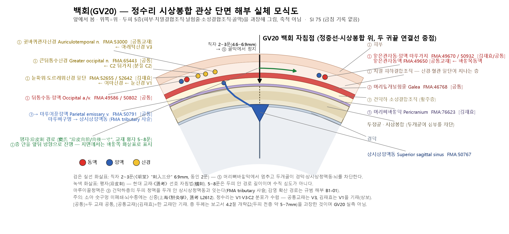
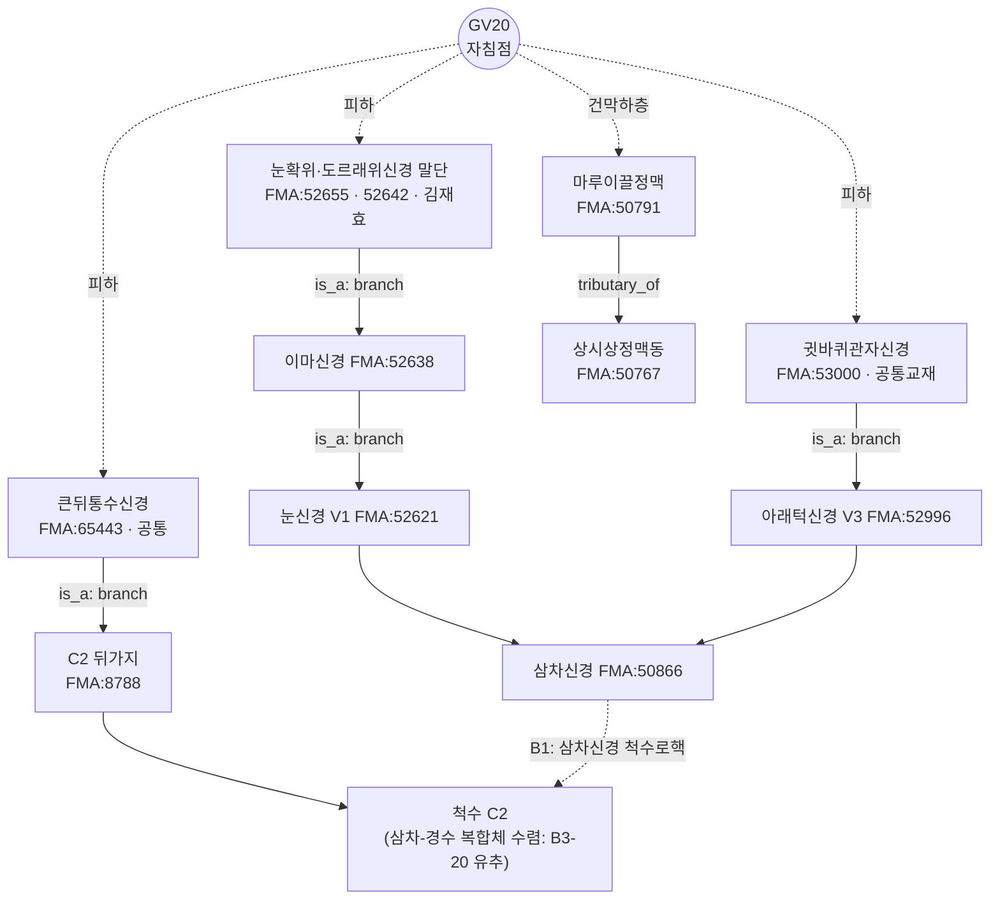

# GV20 (百會, 백회) 해부생리 실체 판명 보고서

> **프레임워크**: v2.7 (2026-10-04 개정) · **ARI**: ARI v3.0 | ARI-Core 71.2 ± 2.5 (B) | SI 75 | 잠정 가중치 0.40/0.35/0.25 | 민감도(등가중치): 68.8 (C, 등급 변동 → 가중치 민감) · **이중 채점**: 독립 채점자 2인, 조정 완료

> **근거 자료**: 3대 원전 `01_도서_번역_및_원전/<원전>/chunks_refined/` · 이명 DB `02_Master_Datasets/경혈명_비교_정리_KJH.xlsx` · 자침깊이 DB `02_Master_Datasets/침구문헌별 자침깊이 정리_AI 분석용.xlsx` · 교재 데이터셋 `02_Master_Datasets/경혈학공통교재 경혈_해부구조_데이터셋_refine.xlsx`, `02_Master_Datasets/김재효 수업_경혈_해부구조_데이터셋.xlsx` · Layer A `02_Master_Datasets/경혈_생의학_신경반사_마스터DB.json` · Layer B `01_Framework/layer_b_reference_registry.md`
> **최초 작성**: 2026-07-31 (v2.6) · **개정**: 2026-10-04 (v2.7, 구판은 `_구판_v2.6/` 보관) · **FMA 보강**: 2026-10-23 (보강 전 판은 `_구판_v2.7_20261023/`)
> **해부 온톨로지**: FMA(Foundational Model of Anatomy) 5.1.0 로컬 색인 — 교재 구조를 `FMA:ID`로 고정하고 신경 줄기·척수 분절·정맥 배출 사슬을 대조(B1 보조, 등록부 미등재). 대응표 `02_Master_Datasets/FMA/acupoint_fma_mapping.json`, 상세는 부록 A

---

## 0. 요약 결론

- **판정: 개연(Probable, 등급 B), 실체 확정 아님.** ARI-Core 71.2 ± 2.5이고 구간(68.8~73.8)이 B/C 경계(70)에 걸쳐 있다. 등가중치로 다시 계산하면 68.8(C)이므로 **가중치 민감** 표지를 단다.
- **해부 실체(개연)**: 두정부 정중선 시상봉합 위의 두피. 피부·치밀 피하결합조직(큰뒤통수신경·삼차신경 V1 말단, 뒤통수동맥·얕은관자동맥 마루가지 문합) → 머리덮개널힘줄(galea) → 건막하 소성결합조직(마루이끌정맥 통과) → 머리뼈바깥막. 2대 교재가 핵심 구조에 일치하지만 GV20 부위를 사체·영상으로 직접 실측한 Layer A 논문은 없다.
- **반사 기전: 가설.** B-Check 6/12로 **미부합**이다. Layer A는 동물 전침 연구(대부분 다른 혈과 병용)가 중심이고 인체 연구는 비RCT·소규모다.
- **안전(SI 75)**: 자침깊이 DB에 금침('0') 기록이 없다. 고전 심도 2~3푼(4.6~6.9mm)은 두피 전층 두께(약 5~7mm) 안팎이므로 직자하면 머리뼈바깥막(골막)에 닿을 수 있다. 그러나 두개골이 상시상정맥동과 뇌를 막고 있다. 원전은 직자 '刺入三分'(《黄帝明堂经》)도 허용하므로 "직자 절대 금지"는 원전과 맞지 않는다. 다만 소아 숫구멍(囟門)이 닫히지 않은 경우와 뇌수종에는 신중해야 한다(上海《针灸学》, 《通考》 인용).

---

## 기본 정보

| 항목 | 내용 | 근거 |
|:---|:---|:---|
| 경혈 부호 | GV20 (督脈) | — |
| 명칭 | 백회 百會 / 百会, Bǎihuì | — |
| 최초 출전 | 《黄帝明堂经》 | 针灸腧穴通考(下)_401-480.md L2387 "出《黄帝明堂经》" |
| 맥기소발 | **督脉、足太阳之会**(《黄帝明堂经》). "手足少阳·足厥阴 교회"는 《针灸聚英》 등 후대 문헌의 기술 | 针灸腧穴通考(下)_401-480.md 【类属】; 穴位通鉴(上卷)_241-320.md 五.归经与穴性 2항 |
| 고전 정위 | "在前顶后一寸五分，顶中央旋毛中，陷可容指" | 针灸腧穴通考(下)_401-480.md L2433 |
| 현대 표준 정위 | 머리부위, 앞머리털경계 정중 직상 5촌(또는 두 귀끝 연결선 중점) | B1-05; 通考 【定位】 部位·取穴 |
| 원전 자침 | 刺入三分(《黄帝明堂经》) / 针入二分(《铜人》) / 窦氏 '沿皮向前·向后一寸' | 针灸腧穴通考(下)_401-480.md L2592~2600 |
| 현대 자침 | 平刺 0.5~0.8寸(4~7판 《针灸学》); 국내 교재 5~8푼 횡자 | 通考 【操作】 7항; 자침깊이 DB 시트1 행46 |

---

## 1. 문헌 스크리닝 표 (3대 원전 원문 대조)

| 원전 | 파일·행 | 원문 | 한국어 대조 |
|:---|:---|:---|:---|
| 《中国针灸穴位通鉴》 | 中国针灸穴位通鉴(上卷)_241-320.md L1374 | "百会，一名三阳五会，在前顶后一寸五分。顶中央旋毛中陷可容指。督脉足太阳之会。"（《针灸甲乙经》3：39） | 백회는 일명 삼양오회. 전정 뒤 1촌 5푼, 정수리 가운데 가마(旋毛) 속, 손가락이 들어갈 만한 오목. 독맥·족태양의 회합 |
| 《中国针灸穴位通鉴》 | 同 L1589 | "刺入三分，灸三壮。"（《针灸甲乙经》3：39） | 3푼 찌르고 뜸 3장 |
| 《中国针灸穴位通鉴》 | 同 L1654 | "[别名]有十 … 至于涅丸宫（出《中华针灸学》）泥丸宫、维会（出《针灸学》）均不见于古代针灸文献，不可从。" | 열환궁·니환궁·유회는 고대 침구 문헌에 보이지 않으므로 따를 수 없음 |
| 《针灸腧穴通考》 | 针灸腧穴通考(下)_401-480.md L2397 | "【名实考】一名三阳五会（《黄帝明堂经》）；一名天满（《针灸资生经》）。… 宋以前针灸方中'顶上回毛'、'顶上旋毛'、'顶上回发'等，均指本穴，今人不识，以为别是一穴，归入奇穴类。" | 이명은 삼양오회(명당경)와 천만(자생경). 송 이전 '정상회모·정상선모'도 본혈인데 오늘날 별혈(기혈)로 오인 |
| 《针灸腧穴通考》 | 同 L2414 | "《窦太师针经》'维会'者 … 乃'脐中'穴别名，吴崐注极是。现存甲抄本两见于'神阙'与本穴下，误也 …《针灸聚英》所说'巅上'乃本穴之部位" | '유회'는 제중(신궐)의 별명. 갑초본이 백회 아래에도 적은 것은 잘못. '전상'은 본혈의 부위어 |
| 《针灸腧穴通考》 | 同 L2462 | "今实际观察发现：头顶旋毛处确有明显的凹陷（也有个体不明显）… 应当优先采用体表标志定位 … 如果被检者有两个旋毛和凹陷者，以靠近中线者为准。" | 가마 부위에 실제로 오목이 있음(개인차). 골도 절량보다 체표 표지를 우선. 가마가 둘이면 정중선에 가까운 쪽 |
| 《针灸腧穴通考》 | 同 L2476~2479 | "主痎疟。癫疾。耳鸣。痉。顶上痛，风头重，目如脱，不可左右顾。热病汗出而善呕。小儿惊痫。（《黄帝明堂经》）… 百会、玉枕主卒起僵仆 … **按**：此乃《黄帝明堂经》'囟会'穴主治，孙思邈误录于此。" | 명당경 원주치. 《千金》 '졸기강부'는 신회 주치를 잘못 옮긴 것 |
| 《针灸腧穴通考》 | 同 L2501 | "不能因为本穴有治疗'脱肛'作用，就类推出：凡是脏器下垂的病症皆可治疗。因此 7 版教材中'胃下垂、肾下垂'二症暂不收录。" | 탈항 치료 효과로부터 모든 내장 하수를 유추하면 안 됨. 7판의 위하수·신하수 삭제 |
| 《针灸腧穴通考》 | 同 L2592~2612 | "【操作】斜刺或平刺。1. 刺入三分，灸五壮。（《黄帝明堂经》）… 4. 针入二分，得气即泻 …（《铜人》）… 8. 可向前后或左右横刺 0.5~1.5 寸 … 注意：针刺时如小儿囟门未合，以及脑积水思考，均宜谨慎。（上海《针灸学》）" | 사자·평자. 명당경 3푼, 동인 2푼. 상해 《针灸学》: 소아 숫구멍 미폐쇄·뇌수종 시 신중 |
| 《中国针灸证治通鉴》 | 中国针灸证治通鉴_321-400.md L1543 | "小儿脱肛泻血，每厕脏腑撮痛不可忍者，灸百会一穴三壮，在头中心陷者是也，炷如小麦大。"（《太平圣惠方·明堂》卷一百） | 소아 탈항 하혈에 백회 한 혈에 뜸 3장 |
| 《中国针灸证治通鉴》 | 同 L1559 | "治脱肛刺督脉百会一穴，在顶中央旋毛中可容豆，针入二分，可灸七壮，至七七壮，即止。"（《针经摘英集》） | 탈항에 백회 한 혈 자침 2푼 |
| 《中国针灸证治通鉴》 | 中国针灸证治通鉴_161-240.md L3126 | "治风头痛方……又方：灸百会三、二七即瘥。" | 풍두통에 백회 뜸 |
| 《中国针灸证治通鉴》 | 同 L1106 | "尸厥暴死不省人事：百会、人中、哑门、臑会、合谷、中冲。" | 시궐 — 배혈 처방(배오 파생) |

> 2.4·7.1절(구판)에 있던 《通考》 '해부 기술' 인용("帽狀腱膜 … 上矢狀竇 … 枕大神經·眶上神經 수렴")은 **원문에 없는 가공 인용이므로 삭제했다**. 《通考》 GV20 조(L2387~2612)에는 해부 구조 기술이 없다.

---

## 2. 원천/재인용 구분 표

| 층차 | 시기 | 문헌 | 기술 내용 | 원천/재인용 | 근거 포인터 |
|:---|:---|:---|:---|:---|:---|
| 원천 | 한대 | 《黄帝明堂经》 | 위치("前顶后一寸五分，顶中央旋毛中，陷可容指"), 심도("刺入三分，灸五壮"), "督脉、足太阳之会", 주치(痎疟·癫疾·耳鸣·痉·顶上痛·小儿惊痫 등) | **원천(최우선)** | 通考 L2397, L2433, L2476, L2594 |
| 재인용 | 진대 | 《针灸甲乙经》 | 명당경 문구 승계, "一名三阳五会", "刺入三分，灸三壮" | 재인용(뜸 장수 이문) | 穴位通鉴 L1374, L1589 |
| 별계 정위 | 진·당 | 《肘后备急方》·《外台秘要》 | "当鼻中，入发际五寸"; 外台 尸厥 "针入三分补之" | 독립 표현(같은 지점) | 通考 【定位】 2항; 穴位通鉴 L1518 |
| 별계 정위 | 당 | 《千金要方》 | "穴在当顶上正中央是"; 卷三十 "卒起僵仆"(→ 囟会 주치 오록) | 재인용 + 전사 오류 | 通考 【定位】 3항, L2479 |
| 후대 | 송 | 《太平圣惠方》·《铜人》 | "在头中心陷者中"; "针入二分，得气即泻"; 脱肛 단독 뜸 | 재인용 + 신규 주치 | 通考 【操作】 2·4항; 证治通鉴 L1543 |
| 후대 | 송 | 《针灸资生经》 | "一名天满" | 신규 이명 | 通考 L2402 |
| 후대 | 원·명 | 窦太师针灸·《针方六集》 | "针入二分，前病者沿皮向前一寸，后病者沿皮向后一寸"; "维会" 오록 | 신규 자법 + 전사 오류 | 通考 L2404, L2600 |
| 후대 | 명 | 《针灸聚英》·《针灸大成》 | "一名巅上"(부위어), "直两耳尖", "手足三阳督脉之会", "百病皆治" | 재인용 + 과잉 확장 | 通考 【定位】 9항; 穴位通鉴 L1542 |
| 현대 | 1957~ | 남경 《针灸学》·4~7판 교재 | 일본 교재 유래 별명(岭上·三阳·五会 등), 平刺 0.5~0.8寸, 阴挺·不寐·胃下垂 | 현대 해석 | 通考 L2408, L2498, 【操作】 7항 |

> 《针灸大成》 "橫刺 0.5~1.0寸"(구판 2.2.1)은 3대 원전에서 확인되지 않는다. 《针灸大成》은 정위 문구 승계(通考 【定位】 1항)와 별명 "三阳·五会"(穴位通鉴 L1654)에서만 확인되어 해당 행을 삭제했다.

---

## 3. 이명·별칭 검증 표 (KJH DB 대조)

KJH DB(`경혈명_비교_정리_KJH.xlsx`, '경혈 종합 목록' 행 47) GV20 이명: 三陽五會, 天山, 天滿, 巓上, 泥丸宮, 涅丸宮, 維會, 鬼門(天滿·巓上 중복 기재).

| 이명 | 최초 출전(원전 확인) | 판정 | 혼용 위험·조치 |
|:---|:---|:---|:---|
| 三陽五會 | 《黄帝明堂经》(通考 L2397); 《甲乙》·《外台》 승계(穴位通鉴 L1654) | **확정 이명** | 낮음. "三陽"·"五會"로 나누는 것(《徐氏针灸大全》·《针灸大成》)은 잘못(通考 L2414) |
| 天滿 | 《针灸资生经》 卷一(通考 L2402) | **확정 이명(송대)** | 낮음. 《普济方》 '天蒲'는 오기(穴位通鉴 L1654) |
| 巓上 | 《针灸聚英》 卷一(通考 L2407) | **부위어**(본혈의 부위 명칭) | 낮음. '岭上'은 '巓上'의 오기(通考 L2414) |
| 頂上回毛·頂上旋毛·頂上回發 | 송 이전 침구방(《千金》 卷五 등) | **본혈 지칭**(通考 L2397) | 별혈(기혈)로 오인하지 말 것 |
| 泥丸宮 / 泥丸 | 《普济本事方》 卷二(通考 L2403) — 도가 용어 | 도가 술어, 침구 이명 아님 | 해부 분석에서 제외 |
| 涅丸宮 | 《中华针灸学》 (근대, 穴位通鉴 L1396) | 근대 문헌 이명, "不可从"(穴位通鉴 L1426) | 해부 분석에서 제외 |
| **維會** | 《窦太师针经》 甲抄本 | **오록** — 원래 **脐中(神阙, CV8)** 별명(通考 L2404~2414, 吴崐 주) | **높음.** KJH DB에서도 CV08 신궐의 이명으로 등재(행 11). 《标幽赋》 "越人针维会"의 시궐 치험을 백회로 귀속하면 안 됨 |
| **鬼門** | 원전에서 GV20 이명으로 확인 안 됨. 《千金要方》 卷十四 "囟上主之。一名鬼门"은 **囟会(GV22)** | **타혈(GV22) 이명 혼입 의심** | **높음.** KJH DB도 GV22 신회 이명에 鬼門 등재(행 49). GV22 주치('邪病鬼癫')를 GV20에 섞지 말 것 |
| **天山** | 3대 원전 검색에서 확인 안 됨 | **출전 미확인** | 보류. 정보 분리 대상(사용하지 않음) |

---

## 4. 3D 공간 좌표 및 Layer 1~5 층차 구조도

### 4.1 좌표

| 축 | 값 | 근거 |
|:---:|:---|:---|
| X (내외측) | 0 (정중선, 시상봉합 위) | 通考 【定位】; B1-05 |
| Y (근위-원위) | 앞머리털경계 정중 직상 5촌(뒤머리털경계 위 7촌). 고전 표지: 가마(旋毛) 오목 | 通考 【定位】 1·8항; B1-05 |
| Z (깊이) | 피부면 → 머리뼈바깥막 약 5~7mm(두정부 두피 전층, 개략값·실측 아님) | B1-01, B1-03 (규범 해부); GV20 특이 실측 없음 |

> 구판의 "Nasion 기준 약 135mm" 절대 거리는 근거가 없어 삭제했다.

### 4.2 Layer 1~5 층차 (정본 Layer 정의에 맞춤, 깊이는 피부면 기준 누적 개략값)

| 정본 Layer | 두피 층 | 누적 깊이(개략) | GV20 구조 (2대 교재 데이터셋) | 자침 관련 |
|:---:|:---|:---:|:---|:---|
| Layer 1 (피부·피하) | 피부 + 치밀 피하결합조직 | 0 ~ 약 4mm | 큰뒤통수신경(C2)·삼차신경 V1 말단(위눈확·도르래위신경)·귓바퀴관자신경(V3) 말단; 뒤통수동·정맥, 얕은관자동·정맥 마루가지 | 평자 경로의 주 통과층 |
| Layer 2 (표층 근막) | 머리덮개널힘줄(galea / epicranial aponeurosis) | 약 4 ~ 5mm | 이마힘살·뒤통수힘살을 잇는 널힘줄 | 평자 시 galea 위 또는 아래로 진행 |
| Layer 3 (건막 간극) | 건막하 소성결합조직 | 약 5 ~ 6.5mm | 마루이끌정맥(parietal emissary vein)이 통과 | 활주층 |
| Layer 4 (신경혈관속) | 해당 없음 | — | GV20 부위에는 주요 신경간·동맥 박동부가 없음(두피 혈관·신경은 Layer 1에 분포) | — |
| Layer 5 (골막) | 머리뼈바깥막(pericranium) → 두정골(시상봉합) | 약 5.5 ~ 7mm 이후 | 그 아래 두개골(두정부 약 5~7mm, B1-01) → 경막 → 상시상정맥동 | 직자 3푼(6.9mm) 시 골막 접촉 가능. 두개골이 심부 차단 |

> 구판 수치(모상건막 1~6mm, 골막 8~12mm, 외판 12~18mm, 상시상정맥동 17mm)는 두피 전층 약 5~7mm와 맞지 않고 출처도 없어 폐기했다. 위 깊이도 규범 해부서에서 추정한 개략값이며, GV20 부위 초음파·MRI 실측 논문(B2-10 유형)은 Layer A에서 찾지 못했다.

### 4.3 단면 모식도

```
 피부면 ─────────── 旋毛 오목 (X=0, 앞머리털경계 위 5촌) ────────────
  Layer 1  피부 + 치밀 피하결합조직     ~0–4mm
           [큰뒤통수N(C2) · V1(위눈확/도르래위N) · 귓바퀴관자N(V3) 말단]
           [뒤통수A·V + 얕은관자A·V 마루가지 문합]
           ←── 평자(平刺)/沿皮刺 경로: 窦氏 '沿皮向前/向後一寸' ──→
  Layer 2  머리덮개널힘줄 (galea)        ~4–5mm
  Layer 3  건막하 소성결합조직           ~5–6.5mm   [마루이끌정맥 관통]
  Layer 5  머리뼈바깥막 (pericranium)    ~5.5–7mm   ← 직자 刺入三分(6.9mm) 도달 가능
  ═══════  두정골 (시상봉합)  약 5–7mm 두께 ═══════════════════════════
           경막 · 상시상정맥동 · 대뇌 (두개골로 차단)
```



*그림 4-1. 백회 높이 관상 단면 모식도(앞에서 봄, 두피 5층을 과장해 그림, 축척 아님). 직자 2~3푼은 머리뼈바깥막에서 멈추고 두정골이 경막·상시상정맥동·뇌를 차단한다. 평자(沿皮刺)는 피부·치밀 피하결합조직 안을 앞뒤로 진행한다. 마루이끌정맥은 건막하층을 두개 안 상시상정맥동과 잇는다. 층 두께는 4.2절 개략값을 과장한 것이며 GV20 실측이 아니다.*

### 4.4 FMA 실체 대조 (Layer별)

구조명은 2대 교재, ID·관계는 FMA 5.1.0(`fma_query.py profile GV20`).

| Layer | 구조 | FMA | FMA 관계 | 신경 줄기 / 혈관 사슬 (FMA) | 척수 분절 |
|:---|:---|:---|:---|:---|:---|
| 1 피하 | 큰뒤통수신경 *[공통]* | FMA:65443 | is_a Branch of posterior ramus of second cervical nerve | C2 뒤가지(FMA:8788) → 목신경 | **C2**(신경 경로 추론) |
| 1 피하 | 눈확위·도르래위신경 말단 *(김재효)* | FMA:52655 · 52642 | is_a Branch of frontal nerve | 이마신경 → 눈신경 V1 → 삼차신경 | 해당 없음(뇌신경) |
| 1 피하 | 귓바퀴관자신경 *(공통교재)* | FMA:53000 | is_a Branch of mandibular nerve | 아래턱신경 V3(FMA:52996) → 삼차신경 | 해당 없음(뇌신경) |
| 1 피하 | 뒤통수동맥 *[공통]* | FMA:49586 | is_a Subdivision of external carotid artery | 바깥목동맥(FMA:10635) | — |
| 1 피하 | 얕은관자동맥 *(공통교재)* · 마루가지 *(김재효)* | FMA:49650 · 49670 | 마루가지 is_a Branch of superficial temporal artery | 얕은관자동맥 → 바깥목동맥 | — |
| 1 피하 | 뒤통수정맥 *[공통]* · 얕은관자정맥 *[공통]* | FMA:50802 · 50932 | 얕은관자정맥 drains_into Retromandibular vein | 뒤통수정맥 → 깊은목정맥(FMA:4746) / 얕은관자정맥 → 턱뒤정맥 → 바깥목정맥 | — |
| 2 표층 근막 | 머리덮개널힘줄 *[공통]* | FMA:46768 | is_a Aponeurosis | — | — |
| 3 건막 간극 | 마루이끌정맥 *[공통]* | FMA:50791 | is_a Emissary vein | 상시상정맥동(FMA:50767) → 가로정맥굴 → 구불정맥굴 → 속목정맥 | — |
| 5 골막 | 머리뼈바깥막 *(김재효)* · 두정골 · 시상봉합 · 마루뼈구멍 | FMA:76623 · 9613 · 52929 · 53145 | — | — | — |

- **FMA 주석 1 — 뒤통수정맥 분류 오류**: FMA는 뒤통수정맥(FMA:50802)을 `is_a Superior superficial cerebral vein`(대뇌 표재정맥)으로 분류한다. 뒤통수정맥은 두피 정맥이므로 이 분류는 FMA 모델링 오류로 보고 인용하지 않는다(배출 사슬 `tributary_of Deep cervical vein`만 참고).
- **FMA 주석 2 — 분절**: FMA 분절은 큰뒤통수신경의 C2(신경 줄기 추론)만 있다. V1·V3 말단은 뇌신경이라 분절이 없다. 8.3 B-Check ②(1점)의 "V1·C2 수렴" 판단과 같다.
- **FMA 주석 3 — 신경 분포**: FMA는 신경의 피부 분포 영역(어디까지 닿는지)을 기록하지 않는다. 눈확위·도르래위신경·귓바퀴관자신경이 정수리에 닿는다는 것은 교재·B1-01에 근거하며, FMA는 구조의 동일성과 줄기만 고정한다.

---

## 5. 자침 깊이 계산표

자침깊이 DB(`침구문헌별 자침깊이 정리_AI 분석용.xlsx`, 시트1 행46, N0=44) 원값. 1푼 = 2.3mm.

| DB 열 | 값 | 해석 | 환산 심도 | 도달 Layer(직자 가정) |
|:---|:---:|:---|:---:|:---|
| 황제명당경_황룡상 감수편찬 | 3 | 3푼 | 6.9mm | Layer 5 골막 접촉 가능(두개골 차단) |
| 갑을경 경혈 분류 및 배열순서 | 2 | **배열 순서 값(심도 아님)** | — | — |
| 침구갑을경 | 3 | 3푼 | 6.9mm | Layer 5 골막 접촉 가능 |
| 침구경험방 | 2 | 2푼 | 4.6mm | Layer 1~2 |
| 동의보감 (인용: 동인) | 2 | 2푼 | 4.6mm | Layer 1~2 |
| 경락수혈학 공통교재 최소~최대 | 5~8 | 5~8푼, **선호 자침법: 횡자** | 11.5~18.4mm(경로 길이) | 평자이므로 수직 심도는 두피 두께 이내 |
| 침구의학 공통교재 최소~최대 | 5~8 | 5~8푼 | 11.5~18.4mm(경로 길이) | 同上 |
| 《침구수혈통고》 최소·최대 | '.' | **blank(미기술)** — 결측 처리, 금침 아님 | — | — |
| 《침구수혈통고》 선호 자침법 | 횡자 | 通考 【操作】 "斜刺或平刺" | — | — |

- **금침('0') 기록: 없음.**
- 고전 직자 범위: 2~3푼 = 4.6~6.9mm. 원전에 각도 기재는 없으며(명당경 "刺入三分", 동인 "针入二分"), 窦氏 이후 沿皮刺가 명시된다.
- 현대 평자 5~8푼은 두피 안을 지나는 경로 길이이므로 수직 심도로 환산하지 않는다(구판의 θ=15°/20° 삼각법과 μ 2.6푼·σ 0.4푼은 근거 없는 임의값이어서 삭제했다).
- 체형 변수: 소아 숫구멍 미폐쇄·뇌수종에는 신중(上海《针灸学》, 通考 L2612).

---

## 6. 해부학 구조 교재 비교표

| 구분 | 경혈학 공통교재 (refine.xlsx, 해부구조_개별항목_상세 행216~221, 《경혈학 하》 p.761) | 김재효 교재 (데이터셋, 해부구조_개별항목_상세 행321~330) | FMA 판별 | 공통점 / 차이점 |
|:---|:---|:---|:---|:---|
| 근육·근막 | 머리덮개널힘줄(galea aponeurotica) | 머리덮개널힘줄(epicranial aponeurosis), **머리뼈바깥막(pericranium)** | 공통 FMA:46768(두 영문 표기가 같은 실체) / 김재효 단독 FMA:76623 | 공통: galea. 김재효만 골막 기재(Layer 5 표기) |
| 신경 | 큰뒤통수신경, **귓바퀴관자신경** | 큰뒤통수신경, **위도르래신경·위눈확신경**(2026 수업자료에서 도르래위신경·눈확위신경 CN5로 중복 기재) | 공통 FMA:65443 / 공통교재 단독 FMA:53000(V3) / 김재효 단독 FMA:52642·52655(V1) — 줄기가 서로 다름 | 공통: 큰뒤통수신경(C2). 차이: 공통교재는 V3(귓바퀴관자), 김재효는 V1(위눈확·도르래위) |
| 혈관 | 뒤통수동·정맥, 얕은관자동·정맥, 마루이끌정맥 | 뒤통수동·정맥, 얕은관자동·정맥의 마루가지, 마루이끌정맥 | 공통 FMA:49586·50802·50932·50791 / 공통교재 단독 FMA:49650(줄기) / 김재효 단독 FMA:49670(마루가지) | 일치(김재효가 마루가지로 구체화) |

> 정수리 피부는 V1·V3·C2 분포가 수렴하는 부위이므로(B1-01, B1-03) 두 교재의 신경 차이는 상충이 아니라 상보로 본다. 구판 표의 "공통교재: 이마힘살·도르래위신경", "김재효: 뒤통수이마근"은 데이터셋과 맞지 않아 고쳤다.

**FMA로 본 교재 차이의 의미**: FMA 프로파일의 두 교재 비교는 공통 6 · 공통교재 단독 2 · 김재효 단독 4다. 혈관 차이(얕은관자동맥 FMA:49650 vs 마루가지 FMA:49670)는 FMA상 **줄기와 그 가지**로 같은 계통이다. 반면 신경 차이는 줄기가 다르다 — 공통교재의 귓바퀴관자신경은 **아래턱신경(V3)**, 김재효의 눈확위·도르래위신경은 **이마신경 → 눈신경(V1)** 계통이다. 따라서 신경 항목은 "같은 신경을 다른 수준으로 적은 것"이 아니라 **정수리에 닿는 서로 다른 신경 영역을 각각 하나씩 적은 것**이며, 위 상보 판정을 FMA가 뒷받침한다. $S_{clarity}$ 단계는 바꾸지 않는다.

---

## 7. 공간 변위 분기 추론

| 구분 | 정위 | 근거 |
|:---|:---|:---|
| 고전 원전 위치 | 가마(旋毛) 오목 — 체표 표지 우선, 가마가 둘이면 정중선에 가까운 쪽 | 通考 L2462 |
| 현대 WHO 위치 | 앞머리털경계 정중 직상 5촌 / 두 귀끝 연결선 중점 | B1-05 |
| Δ_discrepancy | **미실측.** 구판의 "0.5~1.0cm"는 근거가 없다 | — |

- papers.id **1961** (PMID 42343518, 《中国针灸》 2026, 체표 형태 기반 GV20 정위 연구)은 가마의 투영 위치와 귀끝 연결선 중점–앞머리털경계 거리가 이론적 골도 위치와 다르다고 보고한다(초록 스니펫). 따라서 가마 위치와 골도 위치는 일치한다고 가정할 수 없다.
- 판정: 조정 결과에 따라 **단일 Target(T1)**으로 채점했다. 두 위치는 같은 두정부 정중선 두피 층에 있어서 해부 층 구성이 바뀌지 않는다. 다만 Δ가 15mm를 넘는지는 검증되지 않았으므로, 1961의 수치를 확인한 뒤 분기 여부를 다시 판단해야 한다(미판정 쟁점).

---

## 8. 생의학적 반사 기전도 및 외부 검색 로그

### 8.1 Layer A 논문 (마스터 DB `papers.id`)

**GV20 정위 연구**

| papers.id | 연도 | 저널 | 제목 | PMID / DOI | 설계 |
|:---:|:---:|:---|:---|:---|:---|
| 1961 | 2026 | Zhongguo Zhen Jiu | Identification and investigation of acupoint localization based on the surface morphological characteristics of governor vessel on the head: taking Baihui (GV20) as an example | 42343518 / 10.13703/j.0255-2930.20250402-k0003 | 체표 형태 측정(정위, 기전 편수 불산입) |

**인체 연구 (GV20 포함)**

| papers.id | 연도 | 저널 | 제목 | PMID / DOI | 설계 |
|:---:|:---:|:---|:---|:---|:---|
| 1977 | 2009 | J Acupunct Meridian Stud | Acute Effects of Acupuncture Treatment with Baihui (GV20) on Human Arterial Stiffness and Wave Reflection | — / 10.1016/s2005-2901(09)60045-5 | 인체 생리실험(추정) |
| 1978 | 2010 | J Acupunct Tuina Sci | Clinical observation on suspended moxibustion at Baihui (GV 20) for insomnia | — / 10.1007/s11726-010-0042-7 | 인체 관찰(비RCT) |
| 1974 | 2026 | Front Neurosci | Immediate large-scale cortical network changes following acupuncture in patients with disorders of consciousness: a resting-state fNIRS study | — / 10.3389/fnins.2026.1917107 | 인체(비RCT) |
| 1976 | 2026 | Front Neurol | Clinical and neurophysiological effects of manual acupuncture for upper-limb motor dysfunction after ischemic stroke | 42712438 / 10.3389/fneur.2026.1886740 | 인체 RCT(GV20 단독 여부 불명) |
| 1972 | 2026 | Preprints.org | Modulation of Implicit Sequence Learning and Neural Oscillations by Acupuncture at Baihui (GV20) and Sishencong (EX-HN1) … 256-Channel EEG | — / 10.20944/preprints202609.2422.v1 | 인체 EEG, 비심사 preprint, 배혈 병용 |

**동물 연구 (대부분 GV26·GV24 등과 병용 전침)**

| papers.id | 연도 | 저널 | 제목(요약) | PMID / DOI | 설계 |
|:---:|:---:|:---|:---|:---|:---|
| 1946 | 2024 | CNS Neurosci Ther | EA ameliorates neuroinflammation by inhibiting TRPV4 channel in ischemic stroke | 38334061 / 10.1111/cns.14618 | 동물 |
| 1948 | 2025 | Biomolecules | Multi-omics integration: EA ameliorates cognitive impairment in AD | 41301403 / 10.3390/biom15111486 (저널·DOI 불일치, 확인 필요) | 동물 |
| 1949 | 2022 | CNS Neurosci Ther | EA ameliorates postoperative cognitive dysfunction via NLRP3 | 34951130 / 10.1111/cns.13784 | 동물 |
| 1950 | 2025 | Transl Psychiatry | 5-HT necessary for EA-mediated improvement of post-stroke depression | 41053079 / 10.1038/s41398-025-03621-y | 동물 |
| 1951 | 2022 | J Surg Res | EA relieves hippocampal injury by HO-1 | 35016152 / 10.1016/j.jss.2021.12.013 | 동물 |
| 1952 | 2025 | CNS Neurosci Ther | EA prevents AD-like phenotypes in APP/PS1 mice | 41367129 / 10.1002/cns.70696 | 동물 |
| 1953 | 2022 | Zhen Ci Yan Jiu | EA on complement C1q and microglia phagocytosis in hippocampus of SAMP8 mice | 35764513 / 10.13702/j.1000-0607.20210573 | 동물 |
| 1954 | 2026 | Zhen Ci Yan Jiu | EA at different time points on cuproptosis-related proteins | 42779400 / 10.13702/j.1000-0607.20260490 | 동물 |
| 1849 | 2026 | Zhen Ci Yan Jiu | EA improves glycolysis in AD model mice via HIF-1α/PFKFB3 | 42779398 / 10.13702/j.1000-0607.20251094 | 동물 |
| 1955 | 2026 | Zhen Ci Yan Jiu | EA improving central sensitization in NERD rats | 42621713 / 10.13702/j.1000-0607.20260161 | 동물 |
| 1956 | 2026 | Zhen Ci Yan Jiu | "Tiaoshen Tongluo" EA improves learning-memory via microglial polarization | 42621712 / 10.13702/j.1000-0607.20251014 | 동물 |
| 1957 | 2026 | Zhen Ci Yan Jiu | EA improves synaptic plasticity via Glu/GABA balance in mPFC | 42621709 / 10.13702/j.1000-0607.20250806 | 동물 |
| 1958 | 2026 | Zhen Ci Yan Jiu | EA on motor function and PGC-1α/FNDC5/BDNF in SAMP8 mice | 42482583 / 10.13702/j.1000-0607.20250437 | 동물 |
| 1966 | 2026 | Zhen Ci Yan Jiu | EA on hippocampal myelin and Rac1/PAK1/LIMK1/cofilin in AD | 42185061 / 10.13702/j.1000-0607.20250434 | 동물 |
| 1967 | 2026 | Zhen Ci Yan Jiu | EA brain-gut co-treatment in cerebral ischemia (TMAO-HMGB1/NLRP3) | 42015634 / 10.13702/j.1000-0607.20250084 | 동물 |
| 1968 | 2026 | Zhen Ci Yan Jiu | Scalp-acupoint cluster puncture and hippocampal synaptic plasticity | 42015638 / 10.13702/j.1000-0607.20250733 | 동물 |
| 1969 | 2026 | Zhen Ci Yan Jiu | EA alleviating learning and memory impairment in post-stroke cognitive impairment | 42015633 / 10.13702/j.1000-0607.20250123 | 동물 |
| 1971 | 2026 | Front Aging Neurosci | EA inhibits pyroptosis to improve motor function in MPTP mouse PD model | — / 10.3389/fnagi.2026.1968826 | 동물 |

> 종설·데이터마이닝(1947, 1970, 1973, 478)은 기전 편수에 넣지 않았다. GV20 혈위 특이 사체·초음파·MRI 심도 실측 논문은 없다(506은 두침 표적 영상 분석으로 GV20 심도 실측이 아님).

### 8.2 Layer B 신경회로 매핑 (가설)

B-Check가 미부합(6/12)이므로 아래 경로는 모두 **가설**이다.

| 고전 주치(P_single) | 가설 경로 | Layer B 참조 | Layer A |
|:---|:---|:---|:---|
| 顶上痛·头痛 | 정수리 피부 V1·C2 구심 → 삼차-경수 복합체 수렴 (유추) | B1-01, B1-02, B3-20 | 직접 근거 없음 |
| 中风·神昏·癫疾 | 두피 구심 자극 → 중추 신경염증·시냅스 가소성 변화 (동물, 중계 경로 미규명) | B3-11, B3-14 | 1946, 1949, 1952, 1956, 1967, 1969; 인체 1974 |
| 小儿惊痫·神志 | 동물 5-HT·mPFC Glu/GABA 변화 (동물 한정) | B3-10, B3-11 | 1950, 1957 |
| 不寐(현대 주치) | 근거 미흡 — 관찰 연구만 있음 | B4-04, B4-05 | 1978 |

> 구판 6장의 "RAS 각성", "전정-피질 경로", "세로토닌/멜라토닌 분비", "두정부 피질 직접 진동 자극(역설적 억제)", "DMN 활성 조절"은 Layer A·B 근거가 없어 삭제했다.

**말초 구심 경로의 FMA 고정**: 가설 회로의 첫 구간(자침점 → 척수·뇌간 입구)은 FMA 관계로 아래와 같이 고정된다. 실선은 FMA 기재 관계, "is_a"는 클래스명에서 이은 줄기, 점선은 FMA 밖(B1·B3 유추)이다. 이 구간은 해부 고정일 뿐이며 B-Check 미부합(6/12) 판정을 바꾸지 않는다.



*그림 8-1. FMA 5.1.0 관계로 그린 GV20 말초 경로. 구심 신경은 C2와 삼차신경(V1·V3) 두 계통이고, 두 계통은 삼차-경수 복합체에서 수렴한다는 것이 B3-20 유추다(FMA 밖). 마루이끌정맥 → 상시상정맥동 사슬은 반사 경로가 아니라 해부적 연결(감염 확산 경로, B1-01)로만 표시했다.*

### 8.3 B-Check 채점표

| 항목 | 채점자 A | 채점자 B | 최종 | 참조 ID | papers.id | 근거 요지 |
|:---|:---:|:---:|:---:|:---|:---|:---|
| ① 자침 심도의 말초신경·혈관 실체 | 2 | 1 | **1** | B1-01, B1-03, B2-09 (+FMA) | 1961 | 2대 교재와 규범 해부서가 galea·큰뒤통수신경·V1 말단·뒤통수/얕은관자동맥·마루이끌정맥을 기재. 교재 구조 12종 모두 FMA 대응(FMA:46768·65443·50791 등, 4.4절; 얕은관자정맥 1행만 마루가지→줄기 상위 대응). 그러나 GV20 특이 사체·영상 심도 실측이 없음(1961은 체표 형태 측정) |
| ② 척수 분절 정합 | 1 | 1 | **1** | B1-01, B1-02, B3-20 (+FMA) | — | V1·C2 피절 수렴과 두통·항강은 분절 대응을 유추할 수 있음(FMA: 큰뒤통수신경 → C2 뒤가지, 분절 합집합 C2). 신지·중풍·탈항은 분절 정합으로 설명되지 않음 |
| ③ 구심 섬유형·수용체 | 1 | 1 | **1** | B3-06, B3-10, B3-11 | 1946 | GV20 특이 구심 섬유 실측 없음. 1946(TRPV4)은 뇌 조직 표적. 일반 침 구심 체계에서 유추 |
| ④ 중추 중계·경로 | 1 | 1 | **1** | B1-02, B3-11 | 1949, 1950, 1955, 1957, 1969 | 동물에서 해마·mPFC·배측솔기핵 5-HT 변화(다혈 병용). 말초→중추 중계 경로 미규명 |
| ⑤ 원심 경로·효과 방향 | 1 | 1 | **1** | B3-14 | 1946, 1949, 1950, 1952, 1956, 1967 | 신경염증 억제·인지 개선 방향이 중풍·신지 주치와 일치하나 동물·병용 한정 |
| ⑥ 인체 전환 근거 | 1 | 1 | **1** | B4-03, B4-04, B4-05 | 1972, 1974, 1976, 1977, 1978 | 인체 피질 네트워크·동맥경직도·EEG 연구가 있으나 비RCT·preprint·병용. 혈위 특이성 반증(B4-04, B4-05) 미해결 |
| **합계** | 7 | 6 | **6 / 12** | | | |
| **판정·표지** | | | **미부합** | | | ①·② 각 1점이나 합계 < 8. ⑥ = 1이므로 "(동물 한정)" 표지 없음. 상충 근거 없음(1961은 정위 쟁점이며 기전 상충이 아니어서 "가설" 등급 제한 미적용, 조정 기록 참조). 반사 기전 기술은 가설로 한정 |

### 8.4 외부 검색 로그 (sync_log, 2026-10-04·2026-10-23 Rank 6 실행)

| 일시 | 소스 | HTTP | 수집 | 중복제거 | 신규 | 쿼리 |
|---|---|---|---|---|---|---|
| 2026-10-04T09:52:10 | pubmed | 200 | 16 | — | — | ("GV20" OR "Baihui" OR "百會") AND (acupuncture OR electroacupuncture) AND (nerve OR reflex OR autonomic OR mechanism OR anatomy) \| ("GV20" OR "Baihui" OR "百會") A |
| 2026-10-04T09:52:10 | openalex | 200 | 24 | — | — | doi_starts_with:10.13703,title_and_abstract.search:"Baihui" OR "GV20" \| doi_starts_with:10.13702,title_and_abstract.search:"Baihui" OR "GV20" \| has_doi:true,tit |
| 2026-10-04T09:52:10 | crossref | 200 | 2 | — | — | Baihui acupuncture nerve reflex |
| 2026-10-04T09:52:10 | all | — | 42 | 9 | 33 |  |
| 2026-10-23T21:43:54 | pubmed | 200 | 16 | — | — | ("GV20" OR "Baihui" OR "百会") AND (acupuncture OR electroacupuncture) AND (nerve OR reflex OR autonomic OR mechanism OR anatomy) |
| 2026-10-23T21:43:54 | openalex | 200 | 24 | — | — | doi_starts_with:10.13703 / 10.13702 · title_and_abstract.search:"Baihui" OR "GV20" … |
| 2026-10-23T21:43:54 | crossref | 200 | 2 | — | — | Baihui acupuncture nerve reflex |
| 2026-10-23T21:43:54 | all | — | 42 | 32 | 10 | 기존 병합 29 · 배치 내 중복 3 |

- **2026-10-23 재실행 신규 10편**(papers.id 2256~2265): 전침 뇌허혈·미세아교세포(2256 PMID 40831324, 2259 PMID 39834103 — GV14·GV20 등 병용 동물), 급성 허혈성 뇌졸중 혈장 IL-17/IL-10(2257 PMID 35938325), 전침 예처치 종설(2258 PMID 39361504), 교대근무 수면장애 调神针法 RCT(2260 PMID 42864286, 다혈 처방), 혈관성 치매 종설의 종설(2261), GV24·GV20 MCAO/R 쥐(2262, preprint), 고혈압 심근비대(2263), 한의 진료지침 혈위 데이터마이닝(2264), 안면마비 증례(2265). 모두 **다혈 병용·동물·종설**이며 GV20 단독 구심 경로를 측정한 연구가 없어 B-Check(6/12, 미부합)·ARI 판정을 바꾸지 않는다. 2260은 인체 RCT이나 다혈 처방이라 ⑥ = 1 유지.

---

## 9. 주치증 분리 표 (P_single vs 배오 파생)

### 9.1 노이즈 여과

| 항목 | 출전 | 처리 |
|:---|:---|:---|
| 泥丸宮·泥丸 | 《普济本事方》 卷二 — 도가 술어(通考 L2414) | 해부 분석에서 제외 |
| "百病皆治" | 《针灸聚英》 1:122, 《古今医统大全》(穴位通鉴 L1542 일대) | 과잉 확장. P_single에서 제외 |
| "百脉之所会"(穴名 해석) | 穴名释义(穴位通鉴 L1404·L1414) | 경락론적 명칭 해석. 제외 |
| 卒起僵仆 | 《千金要方》 卷三十 → 囟会 주치 오록(通考 L2479) | **GV20 주치에서 삭제** |
| 维会 尸厥 치험(《标幽赋》·《通玄指要赋》) | 脐中(神阙) 별명 오록(通考 L2414) | **GV20 근거에서 삭제** |
| 胃下垂·肾下垂 | 7판 《针灸学》 | 通考가 "暂不收录"(L2501). 제외 |
| (구판) "通百脈", "督脈統諸陽", "火穴 성질" | 3대 원전 chunk 검색에서 확인 안 됨 | 출전 미확인 — 삭제 |

### 9.2 단독(P_single) vs 배오 분리

| 주치 | 원전 단독 기록 | 배오 기록 | 판정 |
|:---|:---|:---|:---|
| 顶上痛·风头重·头痛 | 《黄帝明堂经》 원주치(通考 L2476); "治风头痛方……灸百会"(证治通鉴_161-240 L3126) | 《针灸集要》 百会+合谷·攒竹 등 | **P_single** |
| 癫疾·小儿惊痫 | 《黄帝明堂经》 원주치; 仓公法 "狂痫不识人 … 灸百会九壮"(《千金》 卷十四) | 多穴 灸方(《千金》 卷五) | **P_single** |
| 痎疟·耳鸣·痉·目如脱·热病汗出善呕 | 《黄帝明堂经》 원주치 | — | **P_single(원전)** — 현대 교재에서는 대부분 누락 |
| 眩晕(头目眩痛) | 《太平圣惠方·明堂》 "主头目眩痛"(通考 【适应症】 4항) | 风池+百会 등 | P_single(송대 추가) |
| 中风·神昏·尸厥 | 《针经摘英集》 "治中风，手足不遂，针百会 … 针入二分"; 《外台》 尸厥 "针百会 … 针入三分补之" | 《千金》 卷八 다혈 灸방; 证治通鉴_161-240 L1106 尸厥 6혈 처방 | 단독 + 배오 혼재 |
| **脱肛** | **《千金要方》 卷五 "小儿脱肛方：灸顶上旋毛中三壮"; 《太平圣惠方·明堂》 "灸百会一穴三壮"; 《针经摘英集》 "刺督脉百会一穴"**(通考 L2575; 证治通鉴_321-400 L1543·L1559) | 百会+长强·鸠尾 등(《席弘赋》, 현대 논문) | **P_single** (구판의 "배오 파생"은 오류) |
| 阴挺(子宫脱垂) | 원전 단독 기록 미확인 | — | 현대 교재(2판 이후) 주치. 고전 근거 보류 |
| 不寐(失眠) | 원전 단독 기록 없음(《太平圣惠方》은 오히려 "多睡") | 현대 灸 百会+涌泉 등 | 현대 교재(5판 이후) 주치. P_single 고전 근거 없음 |
| 健忘 | 《太平圣惠方·针经》 "忘前失后", 《铜人》 "健忘" | — | P_single(송대 추가) |

---

## 10. ARI v3.0 프로파일 평가표 및 최종 결론

**Target T1**: 고전 원전 정위(《黄帝明堂经》 "在前顶后一寸五分，顶中央旋毛中，陷可容指") ≈ WHO 앞머리털경계 정중 직상 5촌. 단일 Target(분기 없음, Δ 미실측은 7절 참조).

### 10.1 하위 점수

| 지표 | 채점자 A | 채점자 B | 평균 | 루브릭 단계 근거 요지 | 근거 포인터 |
|:---|:---:|:---:|:---:|:---|:---|
| S_orig (0.40, 잠정) | 75.0 | 87.5 | **81.25** | 최초 기술이 위치·심도를 명시하고 후대 일치율 ≥ 80%. 이명 혼용과 전사 오류 교정은 원전으로 해소할 수 있으나 구판 보고서가 적용하지 못함(A 50/50, B 75/75) | 通考 L2397~2414, L2433, L2479, L2594 |
| S_clarity (0.35, 잠정) | 75 | 75 | **75** | 2대 교재가 galea·큰뒤통수신경·뒤통수/얕은관자 혈관·마루이끌정맥에 일치하고 B1·FMA 표준 실체로 확인(신경 차이는 V1/V3 서로 다른 줄기의 상보, 6절). GV20 특이 실측 논문 없음 → 100 불가 | 교재 데이터셋 행216~221 / 행321~330; B1-01, B1-03; papers.id 1961; FMA:46768·65443·50791 |
| S_reflex (0.25, 잠정) | 50 | 50 | **50** | 동물 연구 다수 + 인체 비RCT. B-Check 6~7 → 50 단계 | papers.id 1946~1978(8.1절); B-Check 6/12 |
| S_safety → SI | 75 | 75 | **75** | 금침 없음. 직자 6.9mm는 골막 접촉 가능하나 두개골이 심부를 차단. 원전이 사자·평자·沿皮刺를 명시하여 회피 가능. ≥ 10mm 여유 조건(100)은 충족 못 함 | 자침깊이 DB 행46; 通考 【操作】, L2612 |

### 10.2 S_orig 하위 4항목

| 하위 항목 | 채점자 A | 채점자 B | 근거 |
|:---|:---:|:---:|:---|
| ① 최초 기술 명확성 | 100 | 100 | 《黄帝明堂经》이 위치와 심도("刺入三分")를 모두 지정 |
| ② 후대 문헌 일치율 | 100 | 100 | 《通考》 【定位】 1항에서 14종이 같은 문구를 승계. 肘后·外台·千金·聚英·金鉴도 같은 지점 → ≥ 80% |
| ③ 이명 혼용 해소 | 50 | 75 | 원전은 维会(神阙 오록)·巅上(부위어)·岭上(오기)·泥丸宫(도가 술어)을 해소함. 구판 보고서는 维会를 확정 이명으로 분류하고 天满·巅上 출전을 잘못 적었으며 KJH의 天山·涅丸宫·鬼门을 누락함(본 개정에서 3절로 정정) |
| ④ 《通考》 전사 오류 교정 | 50 | 75 | 《通考》가 《千金》 '卒起僵仆'(囟会 오록), 维会 중복 기재, 7판 胃下垂·肾下垂를 교정. 구판의 《通考》 인용은 가공이었음(본 개정에서 삭제·정정) |
| 평균 | 75.0 | 87.5 | |

### 10.3 게이트 적용 내역

| 게이트 | 조건 | 결과 |
|:---|:---|:---|
| 게이트 1 | S_orig < 50 또는 S_clarity < 50 → 최고 C | 미적용 (81.25, 75) |
| 게이트 2 | Layer A 0편 → S_reflex ≤ 25, (H) | 미적용 (Layer A 23편, 혈위 관련 17편) |
| 게이트 3 | SI ≤ 25 → ⚠ | 미적용 (SI 75) |

### 10.4 ARI-Core·등급·SI·민감도

| 항목 | 값 |
|:---|:---|
| ARI-Core 채점자 A | 0.40×75 + 0.35×75 + 0.25×50 = **68.75** |
| ARI-Core 채점자 B | 0.40×87.5 + 0.35×75 + 0.25×50 = **73.75** |
| **ARI-Core (평균 ± 반범위)** | **71.2 ± 2.5** |
| 등급·표지 | **B (개연, Probable)**, 표지 없음. ± 구간 하단(68.75)은 C 구간 |
| SI | **75** (등급 미부여) |
| 등가중치 민감도 | (81.25 + 75 + 50) / 3 = **68.8 (C)** → 등급 변동 → **가중치 민감** |
| 산출식 | ARI v3.0, 잠정 가중치 0.40/0.35/0.25(미검증) |

### 10.5 분기 판정

Target이 하나이므로 ΔARI-Core 판정은 해당 없다. 1961의 정위 쟁점으로 Δ > 15mm가 확인되면 Target 2(WHO 골도 위치)를 따로 채점해야 한다.

### 10.6 조정 기록

| 지표 | A–B 차이 | 15점 이상 | 조정 내용 |
|:---|:---:|:---:|:---|
| S_orig | 12.5 | 아니오 | 평균 사용 |
| S_clarity | 0 | 아니오 | — |
| S_reflex | 0 | 아니오 | — |
| S_safety | 0 | 아니오 | — |
| 조정 메모 | needs_adjudication: 없음 | | 채점자 B의 상충 기록(papers.id 1961, 旋毛 위치 ≠ 골도 위치)은 정위 쟁점이며 반사 기전 상충이 아니므로 B-Check 판정에 '가설'을 적용하지 않음. 해당 쟁점은 본문 정위·분기 절(7절)에 명시. 15점 이상 불일치 항목 없음. |

### 10.7 최종 결론

1. GV20의 해부 실체는 **개연(B)** 수준이다. 두정부 정중선 시상봉합 위 두피에서 피부·치밀 피하층(큰뒤통수신경 C2 + 삼차신경 V1/V3 말단, 뒤통수동맥–얕은관자동맥 마루가지 문합)과 머리덮개널힘줄(galea)이 핵심이고, 그 아래가 건막하 소성결합조직(마루이끌정맥)과 머리뼈바깥막이다. 혈위 특이 실측이 없어 "확정"은 아니다.
2. 원전 정위는 체표 표지인 **가마 오목(旋毛中，陷可容指)**이고, 《通考》는 골도 절량보다 체표 표지를 우선하라고 한다. 가마와 골도 5촌 위치의 차이는 papers.id 1961이 시사하지만 수치 검증은 남아 있다.
3. 반사 기전은 **가설**이다(B-Check 6/12, 미부합). 동물 전침 연구는 중풍·인지·신지 방향과 일치하지만 다른 혈과 병용한 것이 많고, 인체 전환 근거는 비RCT 수준이다.
4. 안전: SI 75. 원전 심도(2~3푼, 4.6~6.9mm)는 직자도 허용되며 두개골이 심부를 차단한다. 평자·沿皮刺는 골막 접촉을 피하는 선택지다. 소아 숫구멍 미폐쇄·뇌수종에는 신중해야 한다.
5. 원전 고유 주치는 头痛·顶上痛, 癫疾·小儿惊痫, 痎疟·耳鸣·痉이고, 脱肛도 단독 시술 기록이 있다. 不寐·阴挺·胃下垂는 현대 교재가 추가한 주치다.

---

## 부록 A. FMA 해부 실체 프로파일 (FMA 5.1.0)

생성: `python .claude/skills/acupoint-anatomy/scripts/fma/fma_query.py profile GV20 --md` (2026-10-23).

| 구분 | 교재 용어 | FMA 실체 | 대응 | 출처 | 상위 줄기 / 배출 사슬 | 분절 |
|:---|:---|:---|:---|:---|:---|:---|
| 근막 | 머리덮개널힘줄 (galea aponeurotica / epicranial aponeurosis) | FMA:46768 Aponeurosis of epicranius | exact | 공통교재·김재효 | — | — |
| 근막 | 머리뼈바깥막 (pericranium) | FMA:76623 Pericranium | exact | 김재효 | — | — |
| 신경 | 귓바퀴관자신경 (auriculotemporal nerve) | FMA:53000 Auriculotemporal nerve | exact | 공통교재 | FMA:52996 Mandibular nerve → FMA:50866 Trigeminal nerve | — |
| 신경 | 큰뒤통수신경 (greater occipital nerve) | FMA:65443 Greater occipital nerve | exact | 공통교재·김재효 | FMA:8788 Posterior ramus of second cervical nerve | C2(추론) |
| 신경 | 눈확위신경 (supraorbital nerve) | FMA:52655 Supra-orbital nerve | exact | 김재효 | FMA:52638 → 52621 Ophthalmic nerve → 50866 | — |
| 신경 | 도르래위신경 (supratrochlear nerve) | FMA:52642 Supratrochlear nerve | exact | 김재효 | FMA:52638 → 52621 → 50866 | — |
| 혈관 | 뒤통수동맥 | FMA:49586 Occipital artery | exact | 공통교재·김재효 | FMA:10635 External carotid artery | — |
| 혈관 | 뒤통수정맥 | FMA:50802 Occipital vein | exact | 공통교재·김재효 | FMA:4746 Deep cervical vein (is_a 분류 오류, 4.4절 주석 1) | — |
| 혈관 | 얕은관자동맥의 마루가지 | FMA:49670 Parietal branch of superficial temporal artery | exact | 김재효 | FMA:49650 → 10635 | — |
| 혈관 | 얕은관자동맥 | FMA:49650 Superficial temporal artery | exact | 공통교재 | FMA:10635 → FMA:3939 Common carotid artery | — |
| 혈관 | 얕은관자정맥 (마루가지 포함) | FMA:50932 Superficial temporal vein | exact / parent(branch_of) | 공통교재·김재효 | FMA:50928 Retromandibular vein → FMA:13110 External jugular vein | — |
| 혈관 | 마루이끌정맥 (parietal emissary vein) | FMA:50791 Parietal emissary vein | exact | 공통교재·김재효 | FMA:50767 Superior sagittal sinus → 가로·구불정맥굴 → 속목정맥 | — |

- 분절 합집합(B-Check ② 입력): **C2**(큰뒤통수신경). V1·V3는 뇌신경이라 분절 없음.
- 두 교재 비교: 공통 6 · 공통교재 단독 2(FMA:53000·49650) · 김재효 단독 4(FMA:76623·52655·52642·49670).
- 대응 수준: 김재효의 "얕은관자정맥의 마루가지"는 FMA에 정맥 마루가지 실체가 없어 얕은관자정맥(FMA:50932)에 **상위 구조 대응**(parent)으로 연결했다.
- 인용 한계: FMA는 규범 해부 온톨로지로 혈위 특이 심도·피부 분포 영역·반사 기능의 근거가 아니다. 뒤통수정맥 is_a 오류는 인용하지 않았다.

---

## v2.7 FMA 보강 이력 (2026-10-23)

| 위치 | 원래 내용 | 바꾼 내용 | 근거 |
|:---|:---|:---|:---|
| 머리말 | — | FMA 5.1.0 해부 온톨로지 줄, FMA 보강 일자 추가 | `02_Master_Datasets/FMA/acupoint_fma_mapping.json` |
| 4.3절 | 문자 단면도만 | 그림 4-1 관상 단면 해부 모식도(PNG) 추가 | `.claude/skills/acupoint-anatomy/scripts/fma/figures/GV20_cross_section.py` |
| 4.4절 신설 | — | Layer별 FMA 대조표, FMA 주석 3건(뒤통수정맥 is_a 분류 오류, 분절 C2만, 피부 분포 미기재) | `fma_query.py profile GV20`, `entity 50802` |
| 6절 | 교재 비교 4열 | FMA 판별 열, 신경 차이 = V1/V3 서로 다른 줄기(상보) 해석, 혈관 차이 = 줄기/가지 | FMA is_a 사슬 |
| 8.2절 | 가설 회로 표 | 그림 8-1 FMA 말초 경로(Mermaid) 추가 — 판정(미부합 6/12) 불변 | FMA:65443→8788; 52655→52638→52621; 53000→52996; 50791→50767 |
| 8.3절 | B-Check ①·② 근거 | FMA ID·분절(C2) 포인터 추가(점수 불변: ①=1, ②=1) | 4.4절 |
| 8.4절 | 2026-10-04 로그 | 2026-10-23 Rank 6 재실행 행 추가(신규 10편 papers.id 2256~2265, 모두 다혈·동물·종설 → 판정 불변) | `_metadata.sync_log` 2026-10-23T21:43:54 |
| 10.1절 | $S_{clarity}$ 근거 | FMA 확인 병기(점수 불변 75) | 6절·부록 A |
| 부록 A 신설 | — | FMA 프로파일 표 | `fma_query.py profile GV20 --md` |
| ARI | ARI-Core 71.2 ± 2.5 (B, 가중치 민감), SI 75 | **변경 없음** | 스킬 5-1절 |
| 정본 정합 점검 | — | v2.7 대비 구판 표현·비루브릭 점수·'확정' 판정 문구 없음 확인('확정 이명'은 이명 판정 용어로 B-Check 판정과 무관) | 정본 Rank 7·4.2 |
| 구판 보관 | — | 보강 전 md·html·xlsx를 `_구판_v2.7_20261023/`에 보관 | — |

---

## v2.7 개정 이력 (2026-10-04)

| 위치(구판) | 원래 내용 | 바꾼 내용 | 근거 |
|:---|:---|:---|:---|
| 머리말 | Framework v2.6, 22대 Master ASIA, Principle n·Line n | v2.7 표기 블록, 구판 프레임워크 참조 삭제 | 01_Framework/acupoint_anatomical_logic_framework.md |
| 머리말 링크 | 자침깊이 DB 링크가 로직 원칙 xlsx로 연결 | 올바른 파일명 `침구문헌별 자침깊이 정리_AI 분석용.xlsx` | 02_Master_Datasets 파일 목록 |
| 1. 경혈 성질 | 足太陽·手少陽·足少陽·足厥陰 교회 | 원전은 "督脉、足太阳之会". 手足少阳·厥阴은 후대 | 通考 【类属】; 穴位通鉴 五.归经 |
| 1. 고전 정위 | 《甲乙經》 "…旋毛中" | 《黄帝明堂经》 "…旋毛中，陷可容指" | 通考 L2433 |
| 1. 고전 자침법 | 사자 2–3푼 | 원전은 각도 미기재 刺入三分/针入二分, 窦氏 沿皮刺 | 通考 L2594~2600 |
| 2.1 이명 | 三陽五會 출전 《甲乙》·《千金》 | 《黄帝明堂经》(《甲乙》·《外台》 승계) | 通考 L2397; 穴位通鉴 L1654 |
| 2.1 이명 | 天滿 출전 《甲乙經》 주 | 《针灸资生经》 卷一 | 通考 L2402; 穴位通鉴 L1382 |
| 2.1 이명 | 巔上 출전 《千金要方》, 확정 이명 | 《针灸聚英》 卷一, 부위어 | 通考 L2407, L2414 |
| 2.1 이명 | 維會 = 《外臺秘要》 확정 이명, 위험 低 | 脐中(神阙) 별명 오록, 위험 高 | 通考 L2404~2414; KJH 행11 |
| 2.1 이명 | 天山·涅丸宮·鬼門 누락 | 추가(鬼門 = 囟会 이명 혼입 의심, 天山 출전 미확인) | KJH 행47·49; 通考 L2703 |
| 2.1 이명 | 泥丸宮 출전 "道家 내단 문헌" | 《普济本事方》 卷二(도가 술어) | 通考 L2403, L2414 |
| 2.2.1 | 《針灸大成》 "橫刺0.5~1.0寸" | 원전 확인 불가로 삭제 | 通考 【操作】; 穴位通鉴 L1589~1704 |
| 2.2.2 | '갑을경 경혈 분류 기준 순서' 2 = 2푼(4.6mm) | 배열 순서 값(심도 아님) | 자침깊이 DB 시트1 행2 열머리, 행46 |
| 2.2.3 | μ 2.6푼, σ 0.4푼 | 삭제(근거 없는 통계) | 자침깊이 DB 행46 |
| 2.3 | 증치통감 원문 없음 | 원문 4건 수록 | 证治通鉴_321-400 L1543·L1559, _161-240 L1106·L3126 |
| 2.4 | 《通考》 "帽狀腱膜…上矢狀竇…枕大神經…眶上神經" 인용 | **가공 인용 삭제**, 실제 名实考·定位·适应症·操作 구절로 교체 | 通考 L2387~2612(해부 기술 없음) |
| 3.1 | "通百脈" 여과 | 원전 미확인. 실제 "百脉之所会" 穴名释义로 교체 | 穴位通鉴 L1404·L1414 |
| 3.2 | 脫肛 = 배오 파생(長强·承山 필수) | P_single(단독 뜸·침 기록) | 通考 L2575; 证治通鉴_321-400 L1543·L1559 |
| 3.2 | 失眠 = 단독 유효 | 원전 근거 없음, 현대 교재 주치 | 通考 L2498(5판 이후) |
| 3.2 | 子宮脫垂 = 배오 파생(氣海·足三里) | 현대 교재 주치, 고전 근거 보류(배오 출전 미확인) | 通考 【适应症】 9항 |
| 2.3 | 胃下垂 選穴 | 7판 교재 주치, 《通考》가 삭제 권고 | 通考 L2501 |
| 3.2 / 신설 | 《千金》 卒起僵仆 미반영 | 囟会 주치 오록으로 삭제 | 通考 L2479 |
| 3.3 | "督脈統諸陽", "火穴" 여과 | 원전 미확인으로 삭제 | 3대 원전 chunk Grep 0건 |
| 4.1 | Nasion 기준 135mm | 삭제(근거 없음) | — |
| 4.2 | Δ 0.5–1.0cm, 분리 불필요 | Δ 미실측, 1961 정위 쟁점 명시 | papers.id 1961 |
| 5.2 | θ=15°/20° 삼각법 수직 심도 | 삭제(임의 각도) | 자침깊이 DB 행46 |
| 5.2 | "외판 두께 5–7mm, 직자 3푼 = 외판 도달" | 직자 3푼 = 골막 접촉 가능, 두개골 차단 | B1-01, B1-03 |
| 5.3·8.1 | Layer 2 galea 1–6mm, 골막 8–12mm, 외판 12–18mm, 上矢狀竇 17mm | 두피 전층 약 5–7mm 기준 개략값으로 재작성, 정본 Layer 정의(골막=Layer 5)에 맞춤 | B1-01, B1-03; framework Rank 5 |
| 6.1 | RAS 각성·전정-피질·세로토닌/멜라토닌·역설적 억제·DMN | 삭제, Layer B ID·papers.id 기반 가설 표로 교체 | B-Check 6/12; 8.1절 |
| 6.2 | 신경 표의 枕小神經 등 | 교재 데이터셋 기반으로 재구성 | 교재 데이터셋 |
| 7.1 | 《通考》 교차 검증 5항목 "완전 일치" | **가공 비교 삭제** | 通考 L2387~2612 |
| 7.2 | 구판 5요인 ARI 94.9 | ARI v3.0 프로파일 71.2 ± 2.5 (B), SI 75 | final_GV20.json |
| 8.2 | 정합성 감사(전 항목 일치) | 삭제(동일 산출물 대조는 신뢰도 근거 아님) | framework Rank 7 |
| Rank 5 비교표 | 공통교재 "이마힘살·도르래위신경", 김재효 "뒤통수이마근" | 데이터셋 값(공통: 큰뒤통수신경·귓바퀴관자신경; 김재효: 머리뼈바깥막·위눈확·도르래위신경) | refine.xlsx 행216~221; 김재효 행321~330 |
| 9. 결론 | "최종 확정 해부학적 실체", "직자 절대 금지" | 개연(B), 직자 원전 허용·두개골 차단, 소아 신중 | 通考 L2594, L2612 |
| 신설 | — | 8절(Layer A·B-Check·검색 로그), 10절(ARI v3.0), 1·2·3·5·6·9절 재구성 | WRITER_BRIEF |
| 구판 점수 | — | 구판 v2.6 점수 94.9(비교 불가) | _구판_v2.6/ |
