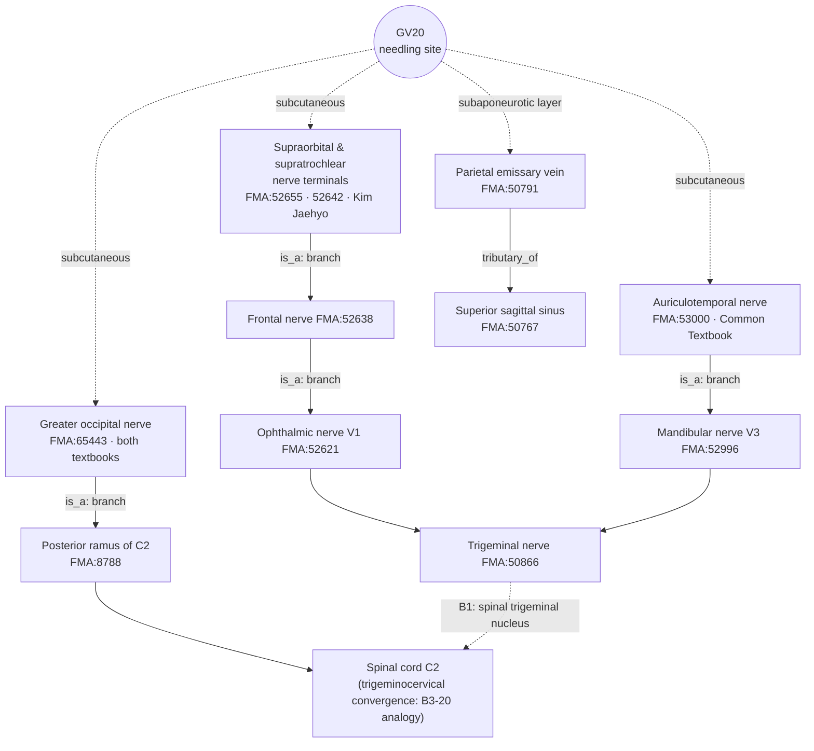

# [Acupoint Anatomical & Physiological Substrate Monograph] Baihui (百會, GV20)

> **Framework**: v2.7 (revised 2026-10-04) · **ARI**: ARI v3.0 | ARI-Core 71.2 ± 2.5 (B) | SI 75 | provisional weights 0.40/0.35/0.25 | sensitivity (equal weights): 68.8 (C, grade changes → weight-sensitive) · **Dual scoring**: completed by two independent raters

> **Source materials**: three primary classics (refined editions) · alias DB Acupoint Nomenclature & Alias Comparative Database · needling-depth DB Classical Needling Depth Database · textbook datasets Common Textbook Anatomical Structure Dataset, Kim Jaehyo Anatomical Structure Dataset · Layer A Integrated Biomedical Master DB v3.0 · Layer B Layer B Reference Registry
> **First written**: 2026-07-31 (v2.6) · **Revised**: 2026-10-04 (v2.7; the earlier edition is kept in the internal archive) · **FMA supplement**: 2026-10-23 (the pre-supplement edition is kept in the internal archive)
> **Anatomical Ontology**: local index of the FMA (Foundational Model of Anatomy) 5.1.0 — textbook structures are pinned to `FMA:ID`s and their nerve trunks, spinal segments and venous drainage chains are cross-checked (B1 supplementary, not yet in the registry). Mapping table: FMA Acupoint Anatomical Ontology Mapping Registry; details in Appendix A.
> **Note on script**: Classical quotations and TCM terms are given in Traditional Chinese (繁體字). The cited refined editions are in simplified script; PDF page ranges and line numbers refer to those editions.

---

## 0. Summary Conclusion

- **Verdict: probable (grade B); the substrate is not established.** ARI-Core is 71.2 ± 2.5, and the interval (68.8–73.8) straddles the B/C boundary (70). Recomputed with equal weights it is 68.8 (C), so the report carries a **weight-sensitive** flag.
- **Anatomical substrate (probable)**: the scalp over the sagittal suture on the parietal midline. Skin and dense subcutaneous connective tissue (terminals of the greater occipital nerve and of the trigeminal nerve V1; anastomosis of the occipital artery with the parietal branch of the superficial temporal artery) → epicranial aponeurosis (galea) → subaponeurotic loose connective tissue (traversed by the parietal emissary vein) → pericranium. The two textbooks agree on the core structures, but there is no Layer A paper with direct cadaveric or imaging measurement at the GV20 site.
- **Reflex mechanism: hypothesis.** B-Check 6/12, i.e. **not concordant**. Layer A consists mainly of animal electroacupuncture studies (mostly combined with other points); human studies are non-RCT and small.
- **Safety (SI 75)**: the needling-depth DB has no 'Contraindicated for needling (禁鍼)' ('0') record. The classical depth of 2–3 fen (分) (4.6–6.9 mm) is about the full thickness of the scalp (about 5–7 mm), so perpendicular insertion may touch the pericranium (periosteum). The skull, however, shields the superior sagittal sinus and the brain. The classics also allow perpendicular insertion, '刺入三分' (*Huangdi Mingtang Jing* (《黃帝明堂經》)), so "perpendicular insertion absolutely forbidden" is inconsistent with the classics. Caution is nonetheless required when an infant's fontanelle (囟門) has not closed and in hydrocephalus (Shanghai 《針灸學》, as cited in the *Tongkao* (《通考》)).

---

## Basic Information

| Item | Content | Basis |
|:---|:---|:---|
| Point code | GV20 (Governor Vessel (督脈)) | — |
| Name | Baihui 百會 / 百会, Bǎihuì | — |
| Earliest source | *Huangdi Mingtang Jing* (《黃帝明堂經》) | 《針灸腧穴通考》(下) PDF pp. 401–480 L2387 "出《黃帝明堂經》" |
| Meridian qi convergence (脈氣所發) | **督脈、足太陽之會** (crossing point of the Governor Vessel (督脈) and the foot Taiyang (足太陽)) (《黃帝明堂經》). The "crossing point of the hand and foot Shaoyang (手足少陽) and the foot Jueyin (足厥陰)" is a statement of later texts such as *Zhenjiu Juying* (《針灸聚英》) | 《針灸腧穴通考》(下) PDF pp. 401–480 【類屬】; `《穴位通鑑》(上卷) PDF pp. 241–320` 五.歸經與穴性, item 2 |
| Classical location | "在前頂後一寸五分，頂中央旋毛中，陷可容指" | 《針灸腧穴通考》(下) PDF pp. 401–480 L2433 |
| Modern standard location | On the head, 5 cun directly above the midpoint of the anterior hairline (or the midpoint of the line joining the apices of the two auricles) | B1-05; Tongkao 【定位】 location and point-finding |
| Classical needling | 刺入三分 (《黃帝明堂經》) / 針入二分 (*Tongren* (《銅人》)) / Dou's (竇氏) '沿皮向前·向後一寸' | 《針灸腧穴通考》(下) PDF pp. 401–480 L2592–2600 |
| Modern needling | 平刺 0.5–0.8 寸 (4th–7th editions of 《針灸學》); Korean textbooks: transverse insertion 5–8 fen | Tongkao 【操作】, item 7; needling-depth DB sheet 1, row 46 |

---

## 1. Classical Literature Screening Table (Collation of the Three Primary Classics)

| Classic | File & line | Original text | English collation |
|:---|:---|:---|:---|
| *Zhongguo Zhenjiu Xuewei Tongjian* (《中國針灸穴位通鑑》) | 《中國針灸穴位通鑑》(上卷) PDF pp. 241–320 L1374 | "百會，一名三陽五會，在前頂後一寸五分。頂中央旋毛中陷可容指。督脈足太陽之會。"（《針灸甲乙經》3：39） | Baihui is also called Sanyang Wuhui (三陽五會). 1 cun 5 fen behind Qianding (前頂), in the hair whorl (旋毛) at the centre of the vertex, in a depression that admits a finger. Crossing point of the Governor Vessel (督脈) and the foot Taiyang (足太陽) |
| *Zhongguo Zhenjiu Xuewei Tongjian* (《中國針灸穴位通鑑》) | same, L1589 | "刺入三分，灸三壯。"（《針灸甲乙經》3：39） | Insert 3 fen; moxibustion 3 cones |
| *Zhongguo Zhenjiu Xuewei Tongjian* (《中國針灸穴位通鑑》) | same, L1654 | "[別名]有十 … 至於涅丸宮（出《中華針灸學》）泥丸宮、維會（出《針灸學》）均不見於古代針灸文獻，不可從。" | 涅丸宮, 泥丸宮 and 維會 do not appear in ancient acupuncture literature and should not be followed |
| *Zhenjiu Shuxue Tongkao* (《針灸腧穴通考》) | 《針灸腧穴通考》(下) PDF pp. 401–480 L2397 | "【名實考】一名三陽五會（《黃帝明堂經》）；一名天滿（《針灸資生經》）。… 宋以前針灸方中'頂上回毛'、'頂上旋毛'、'頂上回髮'等，均指本穴，今人不識，以為別是一穴，歸入奇穴類。" | The aliases are 三陽五會 (*Mingtang Jing*) and 天滿 (*Zisheng Jing*). The pre-Song '頂上回毛' and '頂上旋毛' also denote this point, but are now mistaken for a separate (extra) point |
| *Zhenjiu Shuxue Tongkao* (《針灸腧穴通考》) | same, L2414 | "《竇太師針經》'維會'者 … 乃'臍中'穴別名，吳崐注極是。現存甲抄本兩見於'神闕'與本穴下，誤也 …《針灸聚英》所說'巔上'乃本穴之部位" | '維會' is an alias of Qizhong (臍中, Shenque (神闕)). Its additional entry under Baihui in the Jia manuscript (甲抄本) is an error. '巔上' is a location term for this point |
| *Zhenjiu Shuxue Tongkao* (《針灸腧穴通考》) | same, L2462 | "今實際觀察發現：頭頂旋毛處確有明顯的凹陷（也有個體不明顯）… 應當優先採用體表標誌定位 … 如果被檢者有兩個旋毛和凹陷者，以靠近中線者為準。" | A depression actually exists at the hair whorl (with individual variation). Surface landmarks take precedence over bone-proportional measurement. With two whorls, use the one closer to the midline |
| *Zhenjiu Shuxue Tongkao* (《針灸腧穴通考》) | same, L2476–2479 | "主痎瘧。癲疾。耳鳴。痙。頂上痛，風頭重，目如脫，不可左右顧。熱病汗出而善嘔。小兒驚癇。（《黃帝明堂經》）… 百會、玉枕主卒起僵仆 … **按**：此乃《黃帝明堂經》'囟會'穴主治，孫思邈誤錄於此。" | Original indications in the *Mingtang Jing*. The 《千金》 indication 'sudden collapse on rising (卒起僵仆)' is a mistaken transfer of an indication of Xinhui (囟會) |
| *Zhenjiu Shuxue Tongkao* (《針灸腧穴通考》) | same, L2501 | "不能因為本穴有治療'脫肛'作用，就類推出：凡是臟器下垂的病症皆可治療。因此 7 版教材中'胃下垂、腎下垂'二症暫不收錄。" | The effect on prolapse of the rectum (脫肛) must not be extrapolated to all visceral ptosis; gastroptosis (胃下垂) and nephroptosis (腎下垂) of the 7th edition are removed |
| *Zhenjiu Shuxue Tongkao* (《針灸腧穴通考》) | same, L2592–2612 | "【操作】斜刺或平刺。1. 刺入三分，灸五壯。（《黃帝明堂經》）… 4. 針入二分，得氣即瀉 …（《銅人》）… 8. 可向前後或左右橫刺 0.5~1.5 寸 … 注意：針刺時如小兒囟門未合，以及腦積水思考[sic]，均宜謹慎。（上海《針灸學》）" | Oblique or transverse insertion. *Mingtang Jing* 3 fen, *Tongren* 2 fen. Shanghai 《針灸學》: caution with an unclosed infant fontanelle and in patients with hydrocephalus (the source's '思考' is read as a misprint for '患者', patients; the quotation is left as printed) |
| *Zhongguo Zhenjiu Zhengzhi Tongjian* (《中國針灸證治通鑑》) | 《中國針灸證治通鑑》 PDF pp. 321–400 L1543 | "小兒脫肛瀉血，每廁臟腑撮痛不可忍者，灸百會一穴三壯，在頭中心陷者是也，炷如小麥大。"（《太平聖惠方·明堂》卷一百） | For prolapse of the rectum with bloody stools (脫肛瀉血) in children, 3 moxa cones at Baihui alone |
| *Zhongguo Zhenjiu Zhengzhi Tongjian* (《中國針灸證治通鑑》) | same, L1559 | "治脫肛刺督脈百會一穴，在頂中央旋毛中可容豆，針入二分，可灸七壯，至七七壯，即止。"（《針經摘英集》） | For prolapse of the rectum, needle Baihui alone to 2 fen |
| *Zhongguo Zhenjiu Zhengzhi Tongjian* (《中國針灸證治通鑑》) | 《中國針灸證治通鑑》 PDF pp. 161–240 L3126 | "治風頭痛方……又方：灸百會三、二七即瘥。" | Moxibustion at Baihui for wind headache (風頭痛) |
| *Zhongguo Zhenjiu Zhengzhi Tongjian* (《中國針灸證治通鑑》) | same, L1106 | "尸厥暴死不省人事：百會、人中、啞門、臑會、合谷、中衝。" | Corpse-like reversal (尸厥) — multi-point prescription (derived from combination) |

> The *Tongkao* 'anatomical description' quotation in Sections 2.4 and 7.1 of the earlier edition ("帽狀腱膜 … 上矢狀竇 … convergence of 枕大神經 and 眶上神經") **was a fabricated quotation not found in the original text and has been deleted**. The *Tongkao* entry on GV20 (L2387–2612) contains no description of anatomical structures.

---

## 2. Primary Source vs. Secondary Quotation Table

| Stratum | Period | Classical source | Textual description | Primary / secondary | Evidence pointer |
|:---|:---|:---|:---|:---|:---|
| Primary | Han | *Huangdi Mingtang Jing* (《黃帝明堂經》) | Location ("前頂後一寸五分，頂中央旋毛中，陷可容指"), depth ("刺入三分，灸五壯"), "督脈、足太陽之會", indications (痎瘧 · 癲疾 · 耳鳴 · 痙 · 頂上痛 · 小兒驚癇, etc.) | **Primary (highest priority)** | Tongkao L2397, L2433, L2476, L2594 |
| Secondary | Jin | *Zhenjiu Jiayi Jing* (《針灸甲乙經》) | Inherits the *Mingtang Jing* wording; "一名三陽五會"; "刺入三分，灸三壯" | Secondary (variant number of moxa cones) | Xuewei Tongjian L1374, L1589 |
| Independent location | Jin & Tang | *Zhouhou Beiji Fang* (《肘後備急方》) · *Waitai Miyao* (《外臺秘要》) | "當鼻中，入髮際五寸"; Waitai, for 尸厥, "針入三分補之" | Independent wording (same site) | Tongkao 【定位】, item 2; Xuewei Tongjian L1518 |
| Independent location | Tang | *Qianjin Yaofang* (《千金要方》) | "穴在當頂上正中央是"; vol. 30, "卒起僵仆" (→ indication of 囟會 mistakenly transferred) | Secondary + transcription error | Tongkao 【定位】, item 3, L2479 |
| Later | Song | *Taiping Shenghui Fang* (《太平聖惠方》) · *Tongren* (《銅人》) | "在頭中心陷者中"; "針入二分，得氣即瀉"; moxibustion at this point alone for 脫肛 | Secondary + new indication | Tongkao 【操作】, items 2 and 4; Zhengzhi Tongjian L1543 |
| Later | Song | *Zhenjiu Zisheng Jing* (《針灸資生經》) | "一名天滿" | New alias | Tongkao L2402 |
| Later | Yuan & Ming | Dou Taishi's acupuncture (竇太師針灸) · *Zhenfang Liuji* (《針方六集》) | "針入二分，前病者沿皮向前一寸，後病者沿皮向後一寸"; "維會" mistakenly recorded | New needling technique + transcription error | Tongkao L2404, L2600 |
| Later | Ming | *Zhenjiu Juying* (《針灸聚英》) · *Zhenjiu Dacheng* (《針灸大成》) | "一名巔上" (location term), "直兩耳尖", "手足三陽督脈之會", "百病皆治" | Secondary + over-extension | Tongkao 【定位】, item 9; Xuewei Tongjian L1542 |
| Modern | 1957– | Nanjing 《針灸學》 · 4th–7th edition textbooks | Aliases of Japanese-textbook origin (嶺上 · 三陽 · 五會, etc.), 平刺 0.5–0.8 寸, 陰挺 · 不寐 · 胃下垂 | Modern interpretation | Tongkao L2408, L2498, 【操作】, item 7 |

> The *Zhenjiu Dacheng* (《針灸大成》) "橫刺 0.5~1.0寸" (earlier edition, 2.2.1) cannot be confirmed in the three primary classics. The *Zhenjiu Dacheng* is attested only as inheriting the location wording (Tongkao 【定位】, item 1) and the aliases "三陽 · 五會" (Xuewei Tongjian L1654), so that row has been deleted.

---

## 3. Alias Verification Table (KJH DB Collation)

GV20 aliases in the KJH DB (Acupoint Nomenclature & Alias Comparative Database, sheet `경혈 종합 목록`, row 47): 三陽五會, 天山, 天滿, 巓上, 泥丸宮, 涅丸宮, 維會, 鬼門 (天滿 and 巓上 entered twice).

| Alias | Earliest source (verified in the classics) | Adjudication | Risk of confusion & action |
|:---|:---|:---|:---|
| 三陽五會 | *Huangdi Mingtang Jing* (《黃帝明堂經》) (Tongkao L2397); inherited by 《甲乙》 and 《外臺》 (Xuewei Tongjian L1654) | **Confirmed alias** | Low. Splitting it into "三陽" and "五會" (《徐氏針灸大全》 · 《針灸大成》) is an error (Tongkao L2414) |
| 天滿 | *Zhenjiu Zisheng Jing* (《針灸資生經》), vol. 1 (Tongkao L2402) | **Confirmed alias (Song dynasty)** | Low. 《普濟方》 '天蒲' is a scribal error (Xuewei Tongjian L1654) |
| 巓上 | *Zhenjiu Juying* (《針灸聚英》), vol. 1 (Tongkao L2407) | **Location term** (name of the site of this point) | Low. '嶺上' is a scribal error for '巓上' (Tongkao L2414) |
| 頂上回毛 · 頂上旋毛 · 頂上回髮 | Pre-Song acupuncture prescriptions (《千金》 vol. 5, etc.) | **Denote this point** (Tongkao L2397) | Do not mistake for a separate (extra) point |
| 泥丸宮 / 泥丸 | *Puji Benshi Fang* (《普濟本事方》), vol. 2 (Tongkao L2403) — Daoist term | Daoist term, not an acupuncture alias | Excluded from anatomical analysis |
| 涅丸宮 | 《中華針灸學》 (modern; Xuewei Tongjian L1396) | Alias from modern literature; "不可從" (Xuewei Tongjian L1426) | Excluded from anatomical analysis |
| **維會** | Jia manuscript (甲抄本) of 《竇太師針經》 | **Mistaken entry** — originally an alias of **Qizhong (臍中, Shenque (神闕), CV8)** (Tongkao L2404–2414, Wu Kun's (吳崐) commentary) | **High.** The KJH DB also lists it as an alias of CV08 Shenque (row 11). The 尸厥 case of "越人針維會" in 《標幽賦》 must not be attributed to Baihui |
| **鬼門** | Not confirmed as a GV20 alias in the classics. "囟上主之。一名鬼門" in *Qianjin Yaofang* (《千金要方》) vol. 14 refers to **Xinhui (囟會, GV22)** | **Suspected intrusion of another point's (GV22) alias** | **High.** The KJH DB also lists 鬼門 as an alias of GV22 Xinhui (row 49). Do not mix GV22 indications ('邪病鬼癲') into GV20 |
| **天山** | Not found in a search of the three primary classics | **Source unverified** | On hold. To be kept separate (not used) |

---

## 4. 3D Spatial Coordinates & Layer 1–5 Structure Diagram

### 4.1 Coordinates

| Axis | Value | Basis |
|:---:|:---|:---|
| X (medial–lateral) | 0 (midline, over the sagittal suture) | Tongkao 【定位】; B1-05 |
| Y (proximal–distal) | 5 cun directly above the midpoint of the anterior hairline (7 cun above the posterior hairline). Classical landmark: the depression at the hair whorl (旋毛) | Tongkao 【定位】, items 1 and 8; B1-05 |
| Z (depth) | Skin surface → pericranium about 5–7 mm (full thickness of the parietal scalp; approximate, not measured) | B1-01, B1-03 (normative anatomy); no GV20-specific measurement |

> The earlier edition's absolute distance of "about 135 mm from the nasion" had no basis and has been deleted.

### 4.2 Layers 1–5 (aligned with the canonical Layer definitions; depths are approximate cumulative values from the skin surface)

| Canonical Layer | Scalp layer | Cumulative depth (approx.) | GV20 structures (two textbook datasets) | Relevance to needling |
|:---:|:---|:---:|:---|:---|
| Layer 1 (skin & subcutis) | Skin + dense subcutaneous connective tissue | 0 to about 4 mm | Greater occipital nerve (C2), terminals of trigeminal V1 (supraorbital and supratrochlear nerves) and of the auriculotemporal nerve (V3); occipital artery and vein, parietal branches of the superficial temporal artery and vein | Main layer traversed by the transverse-insertion path |
| Layer 2 (superficial fascia) | Epicranial aponeurosis (galea / epicranial aponeurosis) | about 4 to 5 mm | Aponeurosis joining the frontal and occipital bellies | In transverse insertion the needle runs above or below the galea |
| Layer 3 (aponeurotic space) | Subaponeurotic loose connective tissue | about 5 to 6.5 mm | Traversed by the parietal emissary vein | Gliding layer |
| Layer 4 (neurovascular bundle) | Not applicable | — | No major nerve trunk or palpable arterial pulse at the GV20 site (scalp vessels and nerves are distributed in Layer 1) | — |
| Layer 5 (periosteum) | Pericranium → parietal bone (sagittal suture) | from about 5.5 to 7 mm | Below it the skull (about 5–7 mm at the vertex, B1-01) → dura mater → superior sagittal sinus | Perpendicular insertion of 3 fen (6.9 mm) may touch the periosteum. The skull blocks deeper penetration |

> The earlier edition's figures (galea aponeurotica 1–6 mm, periosteum 8–12 mm, outer table 12–18 mm, superior sagittal sinus 17 mm) did not fit a full scalp thickness of about 5–7 mm and had no source, so they were discarded. The depths above are also approximate values estimated from normative anatomy texts; no ultrasound or MRI measurement paper at the GV20 site (B2-10 type) was found in Layer A.

### 4.3 Cross-sectional Schematic

```
 Skin surface ───── depression at 旋毛 (X=0, 5 cun above anterior hairline) ─────
  Layer 1  Skin + dense subcutaneous CT      ~0–4mm
           [greater occipital N (C2) · V1 (supraorbital/supratrochlear N) · auriculotemporal N (V3) terminals]
           [anastomosis of occipital A·V + parietal br. of superficial temporal A·V]
           ←── transverse (平刺)/沿皮刺 path: Dou's '沿皮向前/向後一寸' ──→
  Layer 2  Epicranial aponeurosis (galea)    ~4–5mm
  Layer 3  Subaponeurotic loose CT           ~5–6.5mm   [traversed by parietal emissary v.]
  Layer 5  Pericranium                       ~5.5–7mm   ← reachable by perpendicular 刺入三分 (6.9mm)
  ═══════  Parietal bone (sagittal suture)  about 5–7mm thick ════════════════
           Dura mater · superior sagittal sinus · cerebrum (shielded by the skull)
```


*Figure 4-1. Coronal schematic at the level of Baihui (百會, GV20) (viewed from the front; the five scalp layers are exaggerated; not to scale). Perpendicular insertion of 2–3 fen stops at the pericranium, and the parietal bone shields the dura mater, superior sagittal sinus and brain. Transverse insertion (沿皮刺) runs forward or backward within the skin and dense subcutaneous connective tissue. The parietal emissary vein connects the subaponeurotic layer with the intracranial superior sagittal sinus. Layer thicknesses exaggerate the approximate values of Section 4.2 and are not GV20 measurements.*

### 4.4 FMA Substrate Cross-check (by Layer)

Structure names from the two textbooks; IDs and relations from FMA 5.1.0 (FMA profile query).

| Layer | Structure | FMA | FMA relation | Nerve trunk / vascular chain (FMA) | Spinal segment |
|:---|:---|:---|:---|:---|:---|
| 1 Subcutis | Greater occipital nerve *[both textbooks]* | FMA:65443 | is_a Branch of posterior ramus of second cervical nerve | Posterior ramus of C2 (FMA:8788) → cervical nerve | **C2** (inferred from the nerve path) |
| 1 Subcutis | Supraorbital and supratrochlear nerve terminals *(Kim Jaehyo)* | FMA:52655 · 52642 | is_a Branch of frontal nerve | Frontal n. → ophthalmic n. V1 → trigeminal n. | Not applicable (cranial nerve) |
| 1 Subcutis | Auriculotemporal nerve *(Common Textbook)* | FMA:53000 | is_a Branch of mandibular nerve | Mandibular n. V3 (FMA:52996) → trigeminal n. | Not applicable (cranial nerve) |
| 1 Subcutis | Occipital artery *[both textbooks]* | FMA:49586 | is_a Subdivision of external carotid artery | External carotid a. (FMA:10635) | — |
| 1 Subcutis | Superficial temporal artery *(Common Textbook)* · parietal branch *(Kim Jaehyo)* | FMA:49650 · 49670 | parietal branch is_a Branch of superficial temporal artery | Superficial temporal a. → external carotid a. | — |
| 1 Subcutis | Occipital vein *[both textbooks]* · superficial temporal vein *[both textbooks]* | FMA:50802 · 50932 | superficial temporal vein drains_into Retromandibular vein | Occipital v. → deep cervical v. (FMA:4746) / superficial temporal v. → retromandibular v. → external jugular v. | — |
| 2 Superficial fascia | Epicranial aponeurosis *[both textbooks]* | FMA:46768 | is_a Aponeurosis | — | — |
| 3 Aponeurotic space | Parietal emissary vein *[both textbooks]* | FMA:50791 | is_a Emissary vein | Superior sagittal sinus (FMA:50767) → transverse sinus → sigmoid sinus → internal jugular v. | — |
| 5 Periosteum | Pericranium *(Kim Jaehyo)* · parietal bone · sagittal suture · parietal foramen | FMA:76623 · 9613 · 52929 · 53145 | — | — | — |

- **FMA note 1 — misclassification of the occipital vein**: FMA classifies the occipital vein (FMA:50802) as `is_a Superior superficial cerebral vein` (a superficial cerebral vein). The occipital vein is a scalp vein, so this classification is regarded as an FMA modelling error and is not cited (only the drainage chain `tributary_of Deep cervical vein` is used for reference).
- **FMA note 2 — segments**: the only FMA segment is C2 of the greater occipital nerve (inferred from the nerve trunk). The V1 and V3 terminals are cranial nerves and have no segment. This agrees with the "V1–C2 convergence" judgement of B-Check ② (1 point) in Section 8.3.
- **FMA note 3 — nerve distribution**: FMA does not record the cutaneous territory of nerves (how far they reach). That the supraorbital, supratrochlear and auriculotemporal nerves reach the vertex rests on the textbooks and B1-01; FMA pins only the identity of structures and their trunks.

---

## 5. Needling Depth Calculation Table

Raw values from the needling-depth DB (Classical Needling Depth Database, sheet 1, row 46, N0 = 44). 1 fen = 2.3 mm.

| DB column | Value | Interpretation | Converted depth | Layer reached (assuming perpendicular insertion) |
|:---|:---:|:---|:---:|:---|
| *Huangdi Mingtang Jing*, ed. Huang Longxiang (`황제명당경_황룡상 감수편찬`) | 3 | 3 fen | 6.9 mm | May touch Layer 5 periosteum (skull blocks deeper penetration) |
| *Jiayi Jing* point classification and ordering (`갑을경 경혈 분류 및 배열순서`) | 2 | **Ordering value (not a depth)** | — | — |
| *Zhenjiu Jiayi Jing* (《針灸甲乙經》) | 3 | 3 fen | 6.9 mm | May touch Layer 5 periosteum |
| *Chimgu Gyeongheombang* (《鍼灸經驗方》) | 2 | 2 fen | 4.6 mm | Layer 1–2 |
| *Dongui Bogam* (《東醫寶鑑》, citing 《銅人》) | 2 | 2 fen | 4.6 mm | Layer 1–2 |
| Korean common textbook, *Meridian and Acupoint Studies* (經絡腧穴學), min–max | 5–8 | 5–8 fen, **preferred technique: transverse insertion** | 11.5–18.4 mm (path length) | Transverse insertion, so the vertical depth stays within the scalp thickness |
| Korean common textbook, *Acupuncture and Moxibustion Medicine* (鍼灸醫學), min–max | 5–8 | 5–8 fen | 11.5–18.4 mm (path length) | As above |
| *Zhenjiu Shuxue Tongkao* (《針灸腧穴通考》), min · max | '.' | **blank (not described)** — treated as missing, not as contraindicated | — | — |
| *Zhenjiu Shuxue Tongkao* (《針灸腧穴通考》), preferred technique | Transverse insertion | Tongkao 【操作】 "斜刺或平刺" | — | — |

- **'Contraindicated for needling (禁鍼)' ('0') record: none.**
- Classical perpendicular range: 2–3 fen = 4.6–6.9 mm. The classics give no angle (*Mingtang Jing* "刺入三分", *Tongren* "針入二分"); 沿皮刺 is stated explicitly from Dou (竇氏) onward.
- The modern transverse 5–8 fen is a path length within the scalp and is not converted to vertical depth (the earlier edition's θ = 15°/20° trigonometry and μ 2.6 fen · σ 0.4 fen were arbitrary values without basis and have been deleted).
- Body-type variables: caution with an unclosed infant fontanelle and with hydrocephalus (Shanghai 《針灸學》, Tongkao L2612).

---

## 6. Anatomical Structure Textbook Comparison Table

| Category | Common Textbook of Acupoint Studies (Common Textbook dataset, sheet `해부구조_개별항목_상세` rows 216–221; *Acupoint Studies* vol. 2, p. 761) | Kim Jaehyo textbook (dataset, sheet `해부구조_개별항목_상세` rows 321–330) | FMA adjudication | Similarities / differences |
|:---|:---|:---|:---|:---|
| Muscle & fascia | Epicranial aponeurosis (galea aponeurotica) | Epicranial aponeurosis, **pericranium** | Shared FMA:46768 (the two English terms denote the same entity) / Kim Jaehyo only FMA:76623 | Shared: galea. Only Kim Jaehyo lists the periosteum (Layer 5 entry) |
| Nerves | Greater occipital nerve, **auriculotemporal nerve** | Greater occipital nerve, **supratrochlear and supraorbital nerves** (entered twice in the 2026 lecture materials as supratrochlear and supraorbital nerves, CN5) | Shared FMA:65443 / Common Textbook only FMA:53000 (V3) / Kim Jaehyo only FMA:52642 · 52655 (V1) — different trunks | Shared: greater occipital nerve (C2). Difference: the Common Textbook gives V3 (auriculotemporal), Kim Jaehyo gives V1 (supraorbital, supratrochlear) |
| Vessels | Occipital artery and vein, superficial temporal artery and vein, parietal emissary vein | Occipital artery and vein, parietal branches of the superficial temporal artery and vein, parietal emissary vein | Shared FMA:49586 · 50802 · 50932 · 50791 / Common Textbook only FMA:49650 (trunk) / Kim Jaehyo only FMA:49670 (parietal branch) | Agree (Kim Jaehyo specifies the parietal branch) |

> The skin of the vertex is where the V1, V3 and C2 territories converge (B1-01, B1-03), so the difference in nerves between the two textbooks is regarded as complementary rather than conflicting. The earlier edition's table entries "Common Textbook: frontal belly · supratrochlear nerve" and "Kim Jaehyo: occipitofrontalis" did not match the datasets and have been corrected.

**What FMA shows about the textbook differences**: the FMA profile comparison of the two textbooks gives 6 shared · 2 Common Textbook only · 4 Kim Jaehyo only. The vascular difference (superficial temporal artery FMA:49650 vs its parietal branch FMA:49670) is, in FMA, **a trunk and its branch** in the same system. The nerve difference, by contrast, involves different trunks — the Common Textbook's auriculotemporal nerve belongs to the **mandibular nerve (V3)**, and Kim Jaehyo's supraorbital and supratrochlear nerves to the **frontal nerve → ophthalmic nerve (V1)** system. The nerve entries are therefore not "the same nerve recorded at different levels" but **each records one of the different nerve territories reaching the vertex**, and FMA supports the complementary verdict above. The $S_{clarity}$ level is unchanged.

---

## 7. Spatial Displacement Branching Inference

| Category | Location | Basis |
|:---|:---|:---|
| Classical location | Depression at the hair whorl (旋毛) — surface landmark takes precedence; with two whorls, the one closer to the midline | Tongkao L2462 |
| Modern WHO location | 5 cun directly above the midpoint of the anterior hairline / midpoint of the line joining the auricular apices | B1-05 |
| Δ_discrepancy | **Not measured.** The earlier edition's "0.5–1.0 cm" has no basis | — |

- papers.id **1961** (PMID 42343518, *Zhongguo Zhen Jiu* (《中國針灸》) 2026, a study of GV20 location based on surface morphology) reports that the projected position of the hair whorl and the distance from the midpoint of the auricular-apex line to the anterior hairline differ from the theoretical bone-proportional position (abstract snippet). It therefore cannot be assumed that the whorl position and the bone-proportional position coincide.
- Verdict: following adjudication, scored as a **single Target (T1)**. Both positions lie in the same scalp layers on the parietal midline, so the layer composition does not change. However, whether Δ exceeds 15 mm has not been verified, so the branching decision must be revisited once the figures in 1961 have been checked (unresolved issue).

---

## 8. Biomedical Reflex Pathway Diagram & External Search Log

### 8.1 Layer A Papers (master DB `papers.id`)

**GV20 location study**

| papers.id | Year | Journal | Title | PMID / DOI | Design |
|:---:|:---:|:---|:---|:---|:---|
| 1961 | 2026 | Zhongguo Zhen Jiu | Identification and investigation of acupoint localization based on the surface morphological characteristics of governor vessel on the head: taking Baihui (GV20) as an example | 42343518 / 10.13703/j.0255-2930.20250402-k0003 | Surface morphometry (location; not counted among mechanism papers) |

**Human studies (including GV20)**

| papers.id | Year | Journal | Title | PMID / DOI | Design |
|:---:|:---:|:---|:---|:---|:---|
| 1977 | 2009 | J Acupunct Meridian Stud | Acute Effects of Acupuncture Treatment with Baihui (GV20) on Human Arterial Stiffness and Wave Reflection | — / 10.1016/s2005-2901(09)60045-5 | Human physiological experiment (presumed) |
| 1978 | 2010 | J Acupunct Tuina Sci | Clinical observation on suspended moxibustion at Baihui (GV 20) for insomnia | — / 10.1007/s11726-010-0042-7 | Human observational (non-RCT) |
| 1974 | 2026 | Front Neurosci | Immediate large-scale cortical network changes following acupuncture in patients with disorders of consciousness: a resting-state fNIRS study | — / 10.3389/fnins.2026.1917107 | Human (non-RCT) |
| 1976 | 2026 | Front Neurol | Clinical and neurophysiological effects of manual acupuncture for upper-limb motor dysfunction after ischemic stroke | 42712438 / 10.3389/fneur.2026.1886740 | Human RCT (unclear whether GV20 alone) |
| 1972 | 2026 | Preprints.org | Modulation of Implicit Sequence Learning and Neural Oscillations by Acupuncture at Baihui (GV20) and Sishencong (EX-HN1) … 256-Channel EEG | — / 10.20944/preprints202609.2422.v1 | Human EEG, non-peer-reviewed preprint, combined with other points |

**Animal studies (mostly electroacupuncture combined with GV26, GV24, etc.)**

| papers.id | Year | Journal | Title (summary) | PMID / DOI | Design |
|:---:|:---:|:---|:---|:---|:---|
| 1946 | 2024 | CNS Neurosci Ther | EA ameliorates neuroinflammation by inhibiting TRPV4 channel in ischemic stroke | 38334061 / 10.1111/cns.14618 | Animal |
| 1948 | 2025 | Biomolecules | Multi-omics integration: EA ameliorates cognitive impairment in AD | 41301403 / 10.3390/biom15111486 (journal–DOI mismatch, to be checked) | Animal |
| 1949 | 2022 | CNS Neurosci Ther | EA ameliorates postoperative cognitive dysfunction via NLRP3 | 34951130 / 10.1111/cns.13784 | Animal |
| 1950 | 2025 | Transl Psychiatry | 5-HT necessary for EA-mediated improvement of post-stroke depression | 41053079 / 10.1038/s41398-025-03621-y | Animal |
| 1951 | 2022 | J Surg Res | EA relieves hippocampal injury by HO-1 | 35016152 / 10.1016/j.jss.2021.12.013 | Animal |
| 1952 | 2025 | CNS Neurosci Ther | EA prevents AD-like phenotypes in APP/PS1 mice | 41367129 / 10.1002/cns.70696 | Animal |
| 1953 | 2022 | Zhen Ci Yan Jiu | EA on complement C1q and microglia phagocytosis in hippocampus of SAMP8 mice | 35764513 / 10.13702/j.1000-0607.20210573 | Animal |
| 1954 | 2026 | Zhen Ci Yan Jiu | EA at different time points on cuproptosis-related proteins | 42779400 / 10.13702/j.1000-0607.20260490 | Animal |
| 1849 | 2026 | Zhen Ci Yan Jiu | EA improves glycolysis in AD model mice via HIF-1α/PFKFB3 | 42779398 / 10.13702/j.1000-0607.20251094 | Animal |
| 1955 | 2026 | Zhen Ci Yan Jiu | EA improving central sensitization in NERD rats | 42621713 / 10.13702/j.1000-0607.20260161 | Animal |
| 1956 | 2026 | Zhen Ci Yan Jiu | "Tiaoshen Tongluo" EA improves learning-memory via microglial polarization | 42621712 / 10.13702/j.1000-0607.20251014 | Animal |
| 1957 | 2026 | Zhen Ci Yan Jiu | EA improves synaptic plasticity via Glu/GABA balance in mPFC | 42621709 / 10.13702/j.1000-0607.20250806 | Animal |
| 1958 | 2026 | Zhen Ci Yan Jiu | EA on motor function and PGC-1α/FNDC5/BDNF in SAMP8 mice | 42482583 / 10.13702/j.1000-0607.20250437 | Animal |
| 1966 | 2026 | Zhen Ci Yan Jiu | EA on hippocampal myelin and Rac1/PAK1/LIMK1/cofilin in AD | 42185061 / 10.13702/j.1000-0607.20250434 | Animal |
| 1967 | 2026 | Zhen Ci Yan Jiu | EA brain-gut co-treatment in cerebral ischemia (TMAO-HMGB1/NLRP3) | 42015634 / 10.13702/j.1000-0607.20250084 | Animal |
| 1968 | 2026 | Zhen Ci Yan Jiu | Scalp-acupoint cluster puncture and hippocampal synaptic plasticity | 42015638 / 10.13702/j.1000-0607.20250733 | Animal |
| 1969 | 2026 | Zhen Ci Yan Jiu | EA alleviating learning and memory impairment in post-stroke cognitive impairment | 42015633 / 10.13702/j.1000-0607.20250123 | Animal |
| 1971 | 2026 | Front Aging Neurosci | EA inhibits pyroptosis to improve motor function in MPTP mouse PD model | — / 10.3389/fnagi.2026.1968826 | Animal |

> Reviews and data-mining papers (1947, 1970, 1973, 478) were not counted among mechanism papers. There is no GV20-specific cadaveric, ultrasound or MRI depth-measurement paper (506 is an imaging analysis of scalp-acupuncture targets, not a depth measurement at GV20).

### 8.2 Layer B Neural Circuit Mapping (Hypothesis)

Because the B-Check is not concordant (6/12), all pathways below are **hypotheses**.

| Classical indication (P_single) | Hypothesised pathway | Layer B reference | Layer A |
|:---|:---|:---|:---|
| Vertex pain (頂上痛) · headache (頭痛) | V1 and C2 afferents from the skin of the vertex → convergence in the trigeminocervical complex (by analogy) | B1-01, B1-02, B3-20 | No direct evidence |
| Stroke (中風) · clouded consciousness (神昏) · epilepsy/madness (癲疾) | Scalp afferent stimulation → central neuroinflammation and changes in synaptic plasticity (animal; relay pathway not identified) | B3-11, B3-14 | 1946, 1949, 1952, 1956, 1967, 1969; human 1974 |
| Infantile convulsions (小兒驚癇) · mental state (神志) | Changes in 5-HT and mPFC Glu/GABA in animals (animal only) | B3-10, B3-11 | 1950, 1957 |
| Insomnia (不寐) (modern indication) | Insufficient evidence — observational studies only | B4-04, B4-05 | 1978 |

> The earlier edition's Chapter 6 claims of "RAS arousal", "vestibulo-cortical pathway", "serotonin/melatonin secretion", "direct vibratory stimulation of the parietal cortex (paradoxical inhibition)" and "modulation of DMN activity" had no Layer A or B basis and have been deleted.

**Pinning the peripheral afferent pathway with FMA**: the first segment of the hypothesised circuit (needling site → entry into the spinal cord and brainstem) is pinned by FMA relations as shown below. Solid lines are relations recorded in FMA, "is_a" marks trunks linked through class names, and dashed lines lie outside FMA (B1 and B3 analogy). This segment is an anatomical pinning only and does not change the not-concordant (6/12) B-Check verdict.



*Figure 8-1. Peripheral pathway of GV20 drawn from FMA 5.1.0 relations. The afferent nerves belong to two systems, C2 and the trigeminal nerve (V1 · V3); that the two converge in the trigeminocervical complex is a B3-20 analogy (outside FMA). The parietal emissary vein → superior sagittal sinus chain is shown only as an anatomical connection (a route of infection spread, B1-01), not as a reflex pathway.*

### 8.3 B-Check Scoring Table

| Item | Rater A | Rater B | Final | Reference IDs | papers.id | Rationale |
|:---|:---:|:---:|:---:|:---|:---|:---|
| ① Peripheral nerve/vessel substrate at needling depth | 2 | 1 | **1** | B1-01, B1-03, B2-09 (+FMA) | 1961 | The two textbooks and normative anatomy texts list the galea, greater occipital nerve, V1 terminals, occipital/superficial temporal arteries and parietal emissary vein. All 12 textbook structures map to FMA (FMA:46768 · 65443 · 50791, etc., Section 4.4; only the superficial temporal vein row maps from parietal branch to the parent trunk). But there is no GV20-specific cadaveric or imaging depth measurement (1961 is surface morphometry) |
| ② Spinal segmental concordance | 1 | 1 | **1** | B1-01, B1-02, B3-20 (+FMA) | — | For headache and neck stiffness, segmental correspondence can be inferred from V1–C2 dermatomal convergence (FMA: greater occipital nerve → posterior ramus of C2; union of segments C2). Mental state, stroke and prolapse of the rectum are not explained by segmental concordance |
| ③ Afferent fibre type & receptors | 1 | 1 | **1** | B3-06, B3-10, B3-11 | 1946 | No measurement of GV20-specific afferent fibres. 1946 (TRPV4) targets brain tissue. Inferred from the general acupuncture afferent system |
| ④ Central relay & pathway | 1 | 1 | **1** | B1-02, B3-11 | 1949, 1950, 1955, 1957, 1969 | Changes in hippocampus, mPFC and dorsal raphe 5-HT in animals (multi-point combinations). Peripheral → central relay pathway not identified |
| ⑤ Efferent pathway & direction of effect | 1 | 1 | **1** | B3-14 | 1946, 1949, 1950, 1952, 1956, 1967 | Suppression of neuroinflammation and improved cognition point in the same direction as the stroke and mental-state indications, but animal and combination studies only |
| ⑥ Human translation | 1 | 1 | **1** | B4-03, B4-04, B4-05 | 1972, 1974, 1976, 1977, 1978 | Human studies of cortical networks, arterial stiffness and EEG exist, but they are non-RCT, preprint or combination studies. Counter-evidence on point specificity (B4-04, B4-05) unresolved |
| **Total** | 7 | 6 | **6 / 12** | | | |
| **Verdict & flags** | | | **Not concordant** | | | ① and ② score 1 each, but the total is < 8. Because ⑥ = 1, no "(animal only)" flag. No conflicting evidence (1961 concerns location, not a mechanistic conflict, so the "hypothesis" grade restriction is not applied; see the adjudication record). Description of the reflex mechanism is limited to hypothesis |

### 8.4 External Search Log (sync_log; Rank 6 runs of 2026-10-04 and 2026-10-23)

| Timestamp | Source | HTTP | Fetched | Duplicates removed | New | Query |
|---|---|---|---|---|---|---|
| 2026-10-04T09:52:10 | pubmed | 200 | 16 | — | — | ("GV20" OR "Baihui" OR "百會") AND (acupuncture OR electroacupuncture) AND (nerve OR reflex OR autonomic OR mechanism OR anatomy) \| ("GV20" OR "Baihui" OR "百會") A |
| 2026-10-04T09:52:10 | openalex | 200 | 24 | — | — | doi_starts_with:10.13703,title_and_abstract.search:"Baihui" OR "GV20" \| doi_starts_with:10.13702,title_and_abstract.search:"Baihui" OR "GV20" \| has_doi:true,tit |
| 2026-10-04T09:52:10 | crossref | 200 | 2 | — | — | Baihui acupuncture nerve reflex |
| 2026-10-04T09:52:10 | all | — | 42 | 9 | 33 |  |
| 2026-10-23T21:43:54 | pubmed | 200 | 16 | — | — | ("GV20" OR "Baihui" OR "百会") AND (acupuncture OR electroacupuncture) AND (nerve OR reflex OR autonomic OR mechanism OR anatomy) |
| 2026-10-23T21:43:54 | openalex | 200 | 24 | — | — | doi_starts_with:10.13703 / 10.13702 · title_and_abstract.search:"Baihui" OR "GV20" … |
| 2026-10-23T21:43:54 | crossref | 200 | 2 | — | — | Baihui acupuncture nerve reflex |
| 2026-10-23T21:43:54 | all | — | 42 | 32 | 10 | 29 already merged · 3 duplicates within the batch |

- **10 new papers from the 2026-10-23 re-run** (papers.id 2256–2265): electroacupuncture in cerebral ischaemia and microglia (2256 PMID 40831324, 2259 PMID 39834103 — animal studies combining GV14, GV20, etc.), plasma IL-17/IL-10 in acute ischaemic stroke (2257 PMID 35938325), a review of electroacupuncture pretreatment (2258 PMID 39361504), an RCT of the 調神針法 (spirit-regulating needling) for shift-work sleep disorder (2260 PMID 42864286, multi-point prescription), an overview of reviews on vascular dementia (2261), GV24 · GV20 in MCAO/R rats (2262, preprint), hypertensive cardiac hypertrophy (2263), data mining of acupoints in Korean medicine clinical practice guidelines (2264), and a facial palsy case report (2265). All are **multi-point, animal or review** studies, and none measures a GV20-only afferent pathway, so they do not change the B-Check (6/12, not concordant) or the ARI verdict. 2260 is a human RCT but uses a multi-point prescription, so ⑥ = 1 is kept.

---

## 9. Indication Separation Table (P_single vs. Derived from Combinations)

### 9.1 Noise Filtering

| Item | Source | Handling |
|:---|:---|:---|
| 泥丸宮 · 泥丸 | *Puji Benshi Fang* (《普濟本事方》), vol. 2 — Daoist term (Tongkao L2414) | Excluded from anatomical analysis |
| "百病皆治" (treats all diseases) | *Zhenjiu Juying* (《針灸聚英》) 1:122, *Gujin Yitong Daquan* (《古今醫統大全》) (around Xuewei Tongjian L1542) | Over-extension. Excluded from P_single |
| "百脈之所會" (interpretation of the point name) | 穴名釋義 (Xuewei Tongjian L1404 · L1414) | Meridian-theoretical interpretation of the name. Excluded |
| Sudden collapse on rising (卒起僵仆) | *Qianjin Yaofang* (《千金要方》) vol. 30 → indication of 囟會 mistakenly transferred (Tongkao L2479) | **Deleted from GV20 indications** |
| 維會 尸厥 case records (《標幽賦》 · 《通玄指要賦》) | Mistaken entry of an alias of 臍中 (神闕) (Tongkao L2414) | **Deleted from GV20 evidence** |
| Gastroptosis (胃下垂) · nephroptosis (腎下垂) | 7th edition 《針灸學》 | The Tongkao says "暫不收錄" (L2501). Excluded |
| (earlier edition) "通百脈", "督脈統諸陽", "nature of a fire point (火穴)" | Not found in a chunk search of the three primary classics | Source unverified — deleted |

### 9.2 Single-point (P_single) vs. Combination

| Indication | Single-point record in the classics | Combination record | Adjudication |
|:---|:---|:---|:---|
| Vertex pain (頂上痛) · heavy head from wind (風頭重) · headache (頭痛) | Original *Huangdi Mingtang Jing* (《黃帝明堂經》) indication (Tongkao L2476); "治風頭痛方……灸百會" (Zhengzhi Tongjian `_161-240` L3126) | 《針灸集要》 百會 + 合谷 · 攢竹, etc. | **P_single** |
| Epilepsy/madness (癲疾) · infantile convulsions (小兒驚癇) | Original *Huangdi Mingtang Jing* indication; Canggong's method (倉公法) "狂癇不識人 … 灸百會九壯" (《千金》 vol. 14) | Multi-point (多穴) moxibustion prescriptions (《千金》 vol. 5) | **P_single** |
| Malaria (痎瘧) · tinnitus (耳鳴) · convulsive spasm (痙) · eyes as if bulging out (目如脫) · febrile disease with sweating and frequent vomiting (熱病汗出善嘔) | Original *Huangdi Mingtang Jing* indications | — | **P_single (classical)** — mostly omitted from modern textbooks |
| Dizziness (眩暈) (頭目眩痛) | *Taiping Shenghui Fang · Mingtang* (《太平聖惠方·明堂》) "主頭目眩痛" (Tongkao 【適應症】, item 4) | 風池 + 百會, etc. | P_single (added in the Song) |
| Stroke (中風) · clouded consciousness (神昏) · corpse-like reversal (尸厥) | 《針經摘英集》 "治中風，手足不遂，針百會 … 針入二分"; 《外臺》 尸厥 "針百會 … 針入三分補之" | Multi-point moxibustion prescriptions in 《千金》 vol. 8; 6-point 尸厥 prescription in Zhengzhi Tongjian `_161-240` L1106 | Mixed single-point and combination |
| **Prolapse of the rectum (脫肛)** | ***Qianjin Yaofang* (《千金要方》) vol. 5 "小兒脫肛方：灸頂上旋毛中三壯"; 《太平聖惠方·明堂》 "灸百會一穴三壯"; 《針經摘英集》 "刺督脈百會一穴"** (Tongkao L2575; Zhengzhi Tongjian `_321-400` L1543 · L1559) | 百會 + 長強 · 鳩尾, etc. (《席弘賦》, modern papers) | **P_single** (the earlier edition's "derived from combination" was an error) |
| Uterine prolapse (陰挺, 子宮脫垂) | No single-point record found in the classics | — | Indication of modern textbooks (2nd edition onward). Classical basis on hold |
| Insomnia (不寐, 失眠) | No single-point record in the classics (the *Taiping Shenghui Fang* (《太平聖惠方》) instead gives "多睡", somnolence) | Modern moxibustion 百會 + 湧泉, etc. | Indication of modern textbooks (5th edition onward). No classical basis for P_single |
| Forgetfulness (健忘) | 《太平聖惠方·針經》 "忘前失後", 《銅人》 "健忘" | — | P_single (added in the Song) |

---

## 10. ARI v3.0 Profile Evaluation & Final Conclusion

**Target T1**: classical location (*Huangdi Mingtang Jing* (《黃帝明堂經》) "在前頂後一寸五分，頂中央旋毛中，陷可容指") ≈ WHO 5 cun directly above the midpoint of the anterior hairline. Single Target (no branching; Δ not measured, see Section 7).

### 10.1 Sub-scores

| Index | Rater A | Rater B | Mean | Rubric-level rationale | Evidence pointers |
|:---|:---:|:---:|:---:|:---|:---|
| S_orig (0.40, provisional) | 75.0 | 87.5 | **81.25** | The earliest description specifies location and depth, and agreement in later texts is ≥ 80%. Alias confusion and transcription errors can be resolved from the classics, but the earlier report did not apply this (A 50/50, B 75/75) | Tongkao L2397–2414, L2433, L2479, L2594 |
| S_clarity (0.35, provisional) | 75 | 75 | **75** | The two textbooks agree on the galea, greater occipital nerve, occipital/superficial temporal vessels and parietal emissary vein, confirmed as standard entities by B1 and FMA (the nerve difference is complementary V1/V3 from different trunks, Section 6). No GV20-specific measurement paper → 100 not possible | Textbook datasets rows 216–221 / rows 321–330; B1-01, B1-03; papers.id 1961; FMA:46768 · 65443 · 50791 |
| S_reflex (0.25, provisional) | 50 | 50 | **50** | Many animal studies + human non-RCT. B-Check 6–7 → level 50 | papers.id 1946–1978 (Section 8.1); B-Check 6/12 |
| S_safety → SI | 75 | 75 | **75** | No contraindication. Perpendicular 6.9 mm may touch the periosteum, but the skull shields the deep structures. The classics specify oblique, transverse and 沿皮刺 insertion, so contact is avoidable. The ≥ 10 mm margin condition (100) is not met | Needling-depth DB row 46; Tongkao 【操作】, L2612 |

### 10.2 S_orig Sub-items

| Sub-item | Rater A | Rater B | Rationale |
|:---|:---:|:---:|:---|
| ① Clarity of earliest description | 100 | 100 | The *Huangdi Mingtang Jing* (《黃帝明堂經》) specifies both location and depth ("刺入三分") |
| ② Agreement in later texts | 100 | 100 | In the *Tongkao* (《通考》) 【定位】, item 1, 14 texts inherit the same wording. 肘後 · 外臺 · 千金 · 聚英 · 金鑑 also give the same site → ≥ 80% |
| ③ Resolution of alias confusion | 50 | 75 | The classics resolve 維會 (mistaken entry for 神闕), 巔上 (location term), 嶺上 (scribal error) and 泥丸宮 (Daoist term). The earlier report classified 維會 as a confirmed alias, misattributed the sources of 天滿 and 巔上, and omitted KJH's 天山, 涅丸宮 and 鬼門 (corrected in Section 3 in this revision) |
| ④ Collation of transcription errors in the *Tongkao* (《通考》) | 50 | 75 | The *Tongkao* corrects 《千金》 '卒起僵仆' (mistaken transfer from 囟會), the duplicate entry of 維會, and the 7th-edition 胃下垂 · 腎下垂. The earlier edition's *Tongkao* quotations were fabricated (deleted and corrected in this revision) |
| Mean | 75.0 | 87.5 | |

### 10.3 Gates Applied

| Gate | Condition | Result |
|:---|:---|:---|
| Gate 1 | S_orig < 50 or S_clarity < 50 → maximum C | Not triggered (81.25, 75) |
| Gate 2 | 0 Layer A papers → S_reflex ≤ 25, (H) | Not triggered (23 Layer A papers, 17 related to the point) |
| Gate 3 | SI ≤ 25 → ⚠ | Not triggered (SI 75) |

### 10.4 ARI-Core, Grade, SI and Sensitivity

| Item | Value |
|:---|:---|
| ARI-Core, Rater A | 0.40×75 + 0.35×75 + 0.25×50 = **68.75** |
| ARI-Core, Rater B | 0.40×87.5 + 0.35×75 + 0.25×50 = **73.75** |
| **ARI-Core (mean ± half-range)** | **71.2 ± 2.5** |
| Grade & flags | **B (Probable)**, no flags. The lower bound of the ± interval (68.75) falls in the C range |
| SI | **75** (no grade assigned) |
| Equal-weight sensitivity | (81.25 + 75 + 50) / 3 = **68.8 (C)** → grade changes → **weight-sensitive** |
| Formula | ARI v3.0, provisional weights 0.40/0.35/0.25 (unvalidated) |

### 10.5 Branch Decision

There is one Target, so the ΔARI-Core decision does not apply. If the location issue raised by 1961 confirms Δ > 15 mm, Target 2 (the WHO bone-proportional position) must be scored separately.

### 10.6 Adjudication Record

| Index | A–B difference | ≥ 15 points | Adjudication |
|:---|:---:|:---:|:---|
| S_orig | 12.5 | No | Mean used |
| S_clarity | 0 | No | — |
| S_reflex | 0 | No | — |
| S_safety | 0 | No | — |
| Adjudication note | needs_adjudication: none | | Rater B's conflict record (papers.id 1961, 旋毛 position ≠ bone-proportional position) is a location issue, not a conflict over the reflex mechanism, so 'hypothesis' is not applied to the B-Check verdict. The issue is stated in the location and branching section of the main text (Section 7). No item differed by 15 points or more. |

### 10.7 Final Conclusion

1. The anatomical substrate of GV20 is at the **probable (B)** level. In the scalp over the sagittal suture on the parietal midline, the core consists of the skin and dense subcutaneous layer (greater occipital nerve C2 + trigeminal V1/V3 terminals; anastomosis of the occipital artery with the parietal branch of the superficial temporal artery) and the epicranial aponeurosis (galea), beneath which lie the subaponeurotic loose connective tissue (parietal emissary vein) and the pericranium. There is no point-specific measurement, so it is not "established".
2. The classical location is the surface landmark of the **depression at the hair whorl (旋毛中，陷可容指)**, and the *Tongkao* (《通考》) advises giving surface landmarks precedence over bone-proportional measurement. papers.id 1961 suggests a difference between the whorl and the 5-cun bone-proportional position, but numerical verification remains outstanding.
3. The reflex mechanism is a **hypothesis** (B-Check 6/12, not concordant). Animal electroacupuncture studies point in the same direction as the stroke, cognitive and mental-state indications, but many combine other points, and evidence of human translation is at the non-RCT level.
4. Safety: SI 75. The classical depth (2–3 fen, 4.6–6.9 mm) permits perpendicular insertion, and the skull shields the deep structures. Transverse insertion and 沿皮刺 are options that avoid contact with the periosteum. Caution is required with an unclosed infant fontanelle and with hydrocephalus.
5. The original classical indications are headache (頭痛) · vertex pain (頂上痛), epilepsy/madness (癲疾) · infantile convulsions (小兒驚癇), and malaria (痎瘧) · tinnitus (耳鳴) · convulsive spasm (痙); prolapse of the rectum (脫肛) also has single-point treatment records. Insomnia (不寐), uterine prolapse (陰挺) and gastroptosis (胃下垂) are indications added by modern textbooks.

---

## Appendix A. FMA Anatomical Substrate Profile (FMA 5.1.0)

Generated by FMA 5.1.0 acupoint profile query (GV20; 2026-10-23).

| Category | Textbook term | FMA substrate | Match | Source | Parent trunk / drainage chain | Segment |
|:---|:---|:---|:---|:---|:---|:---|
| Fascia | Epicranial aponeurosis (galea aponeurotica / epicranial aponeurosis) | FMA:46768 Aponeurosis of epicranius | exact | Common Textbook · Kim Jaehyo | — | — |
| Fascia | Pericranium | FMA:76623 Pericranium | exact | Kim Jaehyo | — | — |
| Nerve | Auriculotemporal nerve | FMA:53000 Auriculotemporal nerve | exact | Common Textbook | FMA:52996 Mandibular nerve → FMA:50866 Trigeminal nerve | — |
| Nerve | Greater occipital nerve | FMA:65443 Greater occipital nerve | exact | Common Textbook · Kim Jaehyo | FMA:8788 Posterior ramus of second cervical nerve | C2 (inferred) |
| Nerve | Supraorbital nerve | FMA:52655 Supra-orbital nerve | exact | Kim Jaehyo | FMA:52638 → 52621 Ophthalmic nerve → 50866 | — |
| Nerve | Supratrochlear nerve | FMA:52642 Supratrochlear nerve | exact | Kim Jaehyo | FMA:52638 → 52621 → 50866 | — |
| Vessel | Occipital artery | FMA:49586 Occipital artery | exact | Common Textbook · Kim Jaehyo | FMA:10635 External carotid artery | — |
| Vessel | Occipital vein | FMA:50802 Occipital vein | exact | Common Textbook · Kim Jaehyo | FMA:4746 Deep cervical vein (is_a misclassification, Section 4.4 note 1) | — |
| Vessel | Parietal branch of superficial temporal artery | FMA:49670 Parietal branch of superficial temporal artery | exact | Kim Jaehyo | FMA:49650 → 10635 | — |
| Vessel | Superficial temporal artery | FMA:49650 Superficial temporal artery | exact | Common Textbook | FMA:10635 → FMA:3939 Common carotid artery | — |
| Vessel | Superficial temporal vein (including parietal branch) | FMA:50932 Superficial temporal vein | exact / parent(branch_of) | Common Textbook · Kim Jaehyo | FMA:50928 Retromandibular vein → FMA:13110 External jugular vein | — |
| Vessel | Parietal emissary vein | FMA:50791 Parietal emissary vein | exact | Common Textbook · Kim Jaehyo | FMA:50767 Superior sagittal sinus → transverse and sigmoid sinuses → internal jugular vein | — |

- Union of segments (input to B-Check ②): **C2** (greater occipital nerve). V1 and V3 are cranial nerves and have no segment.
- Comparison of the two textbooks: 6 shared · 2 Common Textbook only (FMA:53000 · 49650) · 4 Kim Jaehyo only (FMA:76623 · 52655 · 52642 · 49670).
- Match level: Kim Jaehyo's "parietal branch of the superficial temporal vein" has no venous parietal-branch entity in FMA, so it is linked to the superficial temporal vein (FMA:50932) as a **parent-structure match** (parent).
- Limits of citation: FMA is a normative anatomical ontology and is not evidence of point-specific depth, cutaneous territory or reflex function. The is_a error for the occipital vein is not cited.

---

## v2.7 FMA Supplement History (2026-10-23)

| Location | Original content | Change | Basis |
|:---|:---|:---|:---|
| Header | — | Added FMA 5.1.0 anatomical ontology line and FMA supplement date | FMA Acupoint Anatomical Ontology Mapping Registry |
| Section 4.3 | Text cross-section only | Added Figure 4-1 coronal anatomical schematic (PNG) | figure-generation script (internal) |
| Section 4.4 (new) | — | FMA cross-check table by layer; 3 FMA notes (is_a misclassification of the occipital vein, C2 as the only segment, cutaneous territory not recorded) | FMA profile query, `entity 50802` |
| Section 6 | 4-column textbook comparison | FMA adjudication column; nerve difference interpreted as V1/V3 different trunks (complementary), vascular difference as trunk/branch | FMA is_a chains |
| Section 8.2 | Hypothesised circuit table | Added Figure 8-1 FMA peripheral pathway (Mermaid) — verdict (not concordant, 6/12) unchanged | FMA:65443→8788; 52655→52638→52621; 53000→52996; 50791→50767 |
| Section 8.3 | B-Check ①, ② rationale | Added FMA IDs and segment (C2) pointers (scores unchanged: ① = 1, ② = 1) | Section 4.4 |
| Section 8.4 | 2026-10-04 log | Added rows for the 2026-10-23 Rank 6 re-run (10 new papers, papers.id 2256–2265, all multi-point, animal or review → verdict unchanged) | `_metadata.sync_log` 2026-10-23T21:43:54 |
| Section 10.1 | $S_{clarity}$ rationale | Noted FMA confirmation (score unchanged at 75) | Section 6, Appendix A |
| Appendix A (new) | — | FMA profile table | FMA profile query |
| ARI | ARI-Core 71.2 ± 2.5 (B, weight-sensitive), SI 75 | **No change** | Skill section 5-1 |
| Canonical consistency check | — | Confirmed absence of earlier-edition wording relative to v2.7, non-rubric scores and 'established' verdict wording ('confirmed alias' is an alias-adjudication term unrelated to the B-Check verdict) | Canonical Rank 7, 4.2 |
| Archive | — | Pre-supplement md, html and xlsx kept in the internal archive | — |

---

## v2.7 Revision History (2026-10-04)

| Location (earlier edition) | Original content | Change | Basis |
|:---|:---|:---|:---|
| Header | Framework v2.6, 22 Master ASIA, Principle n · Line n | v2.7 notation block; references to the earlier framework deleted | Acupoint Substrate Identification Logic Framework (canonical) |
| Header link | Needling-depth DB link pointed to the logic-principles xlsx | Correct file name Classical Needling Depth Database | File list of Master Datasets Registry |
| 1. Point properties | Crossing point of 足太陽 · 手少陽 · 足少陽 · 足厥陰 | The classics give "督脈、足太陽之會". 手足少陽 · 厥陰 are later | Tongkao 【類屬】; Xuewei Tongjian 五.歸經 |
| 1. Classical location | 《甲乙經》 "…旋毛中" | 《黃帝明堂經》 "…旋毛中，陷可容指" | Tongkao L2433 |
| 1. Classical needling | Oblique insertion 2–3 fen | The classics give no angle: 刺入三分 / 針入二分; Dou's (竇氏) 沿皮刺 | Tongkao L2594–2600 |
| 2.1 Aliases | Source of 三陽五會 given as 《甲乙》 · 《千金》 | 《黃帝明堂經》 (inherited by 《甲乙》 · 《外臺》) | Tongkao L2397; Xuewei Tongjian L1654 |
| 2.1 Aliases | Source of 天滿 given as a note in 《甲乙經》 | 《針灸資生經》 vol. 1 | Tongkao L2402; Xuewei Tongjian L1382 |
| 2.1 Aliases | Source of 巔上 given as 《千金要方》, confirmed alias | 《針灸聚英》 vol. 1, location term | Tongkao L2407, L2414 |
| 2.1 Aliases | 維會 = confirmed alias from 《外臺秘要》, low risk | Mistaken entry of an alias of 臍中 (神闕), high risk | Tongkao L2404–2414; KJH row 11 |
| 2.1 Aliases | 天山 · 涅丸宮 · 鬼門 omitted | Added (鬼門 = suspected intrusion of a 囟會 alias; source of 天山 unverified) | KJH rows 47 · 49; Tongkao L2703 |
| 2.1 Aliases | Source of 泥丸宮 given as "Daoist inner-alchemy literature" | 《普濟本事方》 vol. 2 (Daoist term) | Tongkao L2403, L2414 |
| 2.2.1 | 《針灸大成》 "橫刺0.5~1.0寸" | Deleted (cannot be confirmed in the classics) | Tongkao 【操作】; Xuewei Tongjian L1589–1704 |
| 2.2.2 | 'Jiayi Jing point classification order' 2 = 2 fen (4.6 mm) | Ordering value (not a depth) | Needling-depth DB sheet 1, row 2 column headers, row 46 |
| 2.2.3 | μ 2.6 fen, σ 0.4 fen | Deleted (statistics without basis) | Needling-depth DB row 46 |
| 2.3 | No original text from the Zhengzhi Tongjian | 4 original passages included | Zhengzhi Tongjian `_321-400` L1543 · L1559, `_161-240` L1106 · L3126 |
| 2.4 | *Tongkao* quotation "帽狀腱膜…上矢狀竇…枕大神經…眶上神經" | **Fabricated quotation deleted**; replaced with actual 名實考 · 定位 · 適應症 · 操作 passages | Tongkao L2387–2612 (no anatomical description) |
| 3.1 | "通百脈" filtered | Not found in the classics. Replaced with the actual 穴名釋義 "百脈之所會" | Xuewei Tongjian L1404 · L1414 |
| 3.2 | 脫肛 = derived from combination (長強 · 承山 required) | P_single (single-point moxibustion and needling records) | Tongkao L2575; Zhengzhi Tongjian `_321-400` L1543 · L1559 |
| 3.2 | 失眠 = effective as a single point | No classical basis; modern textbook indication | Tongkao L2498 (5th edition onward) |
| 3.2 | 子宮脫垂 = derived from combination (氣海 · 足三里) | Modern textbook indication; classical basis on hold (source of the combination unverified) | Tongkao 【適應症】, item 9 |
| 2.3 | Point selection for 胃下垂 | 7th-edition textbook indication; the *Tongkao* recommends deletion | Tongkao L2501 |
| 3.2 / new | 《千金》 卒起僵仆 not reflected | Deleted as an indication of 囟會 mistakenly transferred | Tongkao L2479 |
| 3.3 | "督脈統諸陽", "火穴" filtered | Deleted (not found in the classics) | Grep of the three classics' chunks: 0 hits |
| 4.1 | 135 mm from the nasion | Deleted (no basis) | — |
| 4.2 | Δ 0.5–1.0 cm, no split needed | Δ not measured; location issue of 1961 stated | papers.id 1961 |
| 5.2 | θ = 15°/20° trigonometric vertical depth | Deleted (arbitrary angle) | Needling-depth DB row 46 |
| 5.2 | "Outer table 5–7 mm thick; perpendicular 3 fen = reaches the outer table" | Perpendicular 3 fen = may touch the periosteum; skull blocks deeper penetration | B1-01, B1-03 |
| 5.3 · 8.1 | Layer 2 galea 1–6 mm, periosteum 8–12 mm, outer table 12–18 mm, 上矢狀竇 17 mm | Rewritten as approximate values based on a full scalp thickness of about 5–7 mm, aligned with the canonical Layer definitions (periosteum = Layer 5) | B1-01, B1-03; framework Rank 5 |
| 6.1 | RAS arousal · vestibulo-cortical · serotonin/melatonin · paradoxical inhibition · DMN | Deleted; replaced with a hypothesis table based on Layer B IDs and papers.id | B-Check 6/12; Section 8.1 |
| 6.2 | 枕小神經 etc. in the nerve table | Reconstructed from the textbook datasets | Textbook datasets |
| 7.1 | *Tongkao* cross-validation of 5 items, "complete agreement" | **Fabricated comparison deleted** | Tongkao L2387–2612 |
| 7.2 | Earlier 5-factor ARI 94.9 | ARI v3.0 profile 71.2 ± 2.5 (B), SI 75 | dual-scoring record |
| 8.2 | Consistency audit (all items agree) | Deleted (comparing identical outputs is no ground for reliability) | framework Rank 7 |
| Rank 5 comparison table | Common Textbook "frontal belly · supratrochlear nerve", Kim Jaehyo "occipitofrontalis" | Dataset values (Common Textbook: greater occipital nerve · auriculotemporal nerve; Kim Jaehyo: pericranium · supraorbital · supratrochlear nerves) | Common Textbook dataset rows 216–221; Kim Jaehyo rows 321–330 |
| 9. Conclusion | "Final established anatomical substrate", "perpendicular insertion absolutely forbidden" | Probable (B); perpendicular insertion allowed by the classics, skull blocks deeper penetration; caution in children | Tongkao L2594, L2612 |
| New | — | Section 8 (Layer A · B-Check · search log), Section 10 (ARI v3.0); Sections 1, 2, 3, 5, 6, 9 restructured | WRITER_BRIEF |
| Earlier-edition score | — | Earlier v2.6 score 94.9 (not comparable) | the internal archive |

---

## English Edition Revision History (2026-10-24)

| Location | Original content | Change | Basis |
|:---|:---|:---|:---|
| Whole document | Automatically generated "English" edition: Korean body text with only headings and some terms replaced | Fully translated into English from the Korean edition (same content, scores and evidence pointers); Traditional Chinese (繁體字) given for point, meridian and classic names, TCM concepts, indications and classical quotations | Korean edition |
| Title | "GV20 (百會, Baihui (百會, GV20))" duplicated annotation | Title in the standard monograph form | — |
| Classical quotations | Simplified characters (e.g. 百会, 针灸, 脱肛) | Converted to Traditional characters; file names and line pointers unchanged | Routing rule on Traditional Chinese collation |

## Refinement History (2026-10-24)

| Location | Original wording | Revised wording | Basis |
| :--- | :--- | :--- | :--- |
| Section 1, 《針灸腧穴通考》 needling row | "以及腦積水思考" (no misprint marker) | Quotation kept + `[sic]`; the interpretation column reads '思考' as a misprint for '患者' | 《針灸腧穴通考》 下 督脈穴-2 L1035 — the printed edition itself reads "思考", so the quotation is not altered. From context (listed alongside an unclosed infant fontanelle) the intended word is '患者' |
| Textbook title | *Meridian and Acupoint Studies* (經絡經穴學) | (經絡腧穴學) | The Korean edition names the textbook *Gyeongnak Suhyeolhak* (經絡腧穴學; suhyeol = 腧穴); 經絡經穴學 was a mistranslation carried over from the earlier ST36 English edition |
