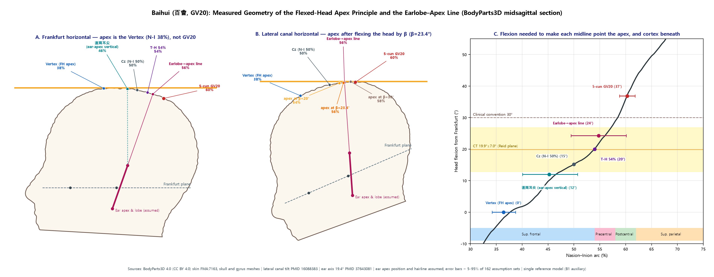
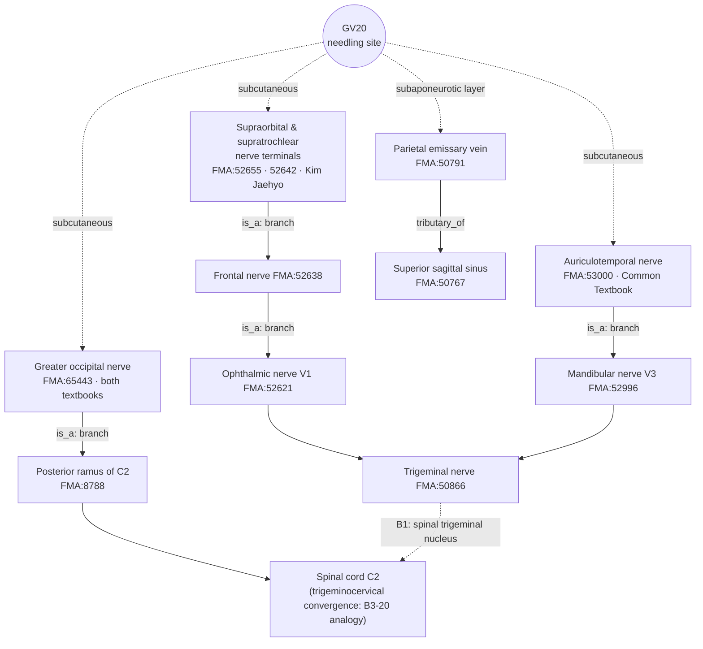

# [Acupoint Anatomical & Physiological Substrate Monograph] Baihui (百會, GV20)

> **Framework**: v2.7 (revised 2026-10-04; 2.7.7 applied) · **Tri-Target**: Target 1≡3 scored as a single Target; Target 2 (palpated depression '旋毛中，陷可容指') cannot be set — anatomical space and Δ not specifiable (Section 7) · **ARI**: ARI v3.0 | ARI-Core 71.2 ± 2.5 (B) | SI 75 | provisional weights 0.40/0.35/0.25 | sensitivity (equal weights): 68.8 (C, grade changes → weight-sensitive) · **Dual scoring**: completed by two independent raters

> **Source materials**: four primary classics (refined editions: *Zhongguo Zhenjiu Xuewei Tongjian* (《中國針灸穴位通鑑》), *Zhongguo Zhenjiu Zhengzhi Tongjian* (《中國針灸證治通鑑》), *Zhenjiu Shuxue Tongkao* (《針灸腧穴通考》), *Zhongguo Zhenjiu Jingluo Tongjian* (《中國針灸經絡通鑑》)) · alias DB Acupoint Nomenclature & Alias Comparative Database · needling-depth DB Classical Needling Depth Database · textbook datasets Common Textbook Anatomical Structure Dataset, Kim Jaehyo Anatomical Structure Dataset · Layer A Integrated Biomedical Master DB v3.0 · Layer B Layer B Reference Registry
> **First written**: 2026-07-31 (v2.6) · **Revised**: 2026-10-04 (v2.7; the earlier edition is kept in the internal archive) · **FMA supplement**: 2026-10-23 (the pre-supplement edition is kept in the internal archive) · **Measured check of head-posture localization principles**: 2026-10-29 (apex under lateral-canal-horizontal flexion and the earlobe–apex line, tested on the midsagittal section of the BodyParts3D reference model; Section 7.2)
> **Anatomical Ontology**: local index of the FMA (Foundational Model of Anatomy) 5.1.0 — textbook structures are pinned to `FMA:ID`s and their nerve trunks, spinal segments and venous drainage chains are cross-checked (B1 supplementary, not yet in the registry). Structures used to test the localization principles (Vertex FMA:46484, Sagittal suture FMA:52929, Nasion FMA:264779, Inion FMA:76624, Lateral semicircular canal FMA:60193, Apex of pinna FMA:61178, Lobule of pinna FMA:60984, Precentral gyrus FMA:72661·72662, Postcentral gyrus FMA:72665·72666) are listed in Section 4.4.2. 3D shape: BodyParts3D 4.0 (CC BY 4.0, a single reference model — normative shape reference, B1 supplementary). Mapping table: FMA Acupoint Anatomical Ontology Mapping Registry; details in Appendix A.
> **Note on script**: Classical quotations and TCM terms are given in Traditional Chinese (繁體字). The cited refined editions are in simplified script; PDF page ranges and line numbers refer to those editions.

---

## 0. Summary Conclusion

- **Verdict: probable (grade B); the substrate is not established.** ARI-Core is 71.2 ± 2.5, and the interval (68.8–73.8) straddles the B/C boundary (70). Recomputed with equal weights it is 68.8 (C), so the report carries a **weight-sensitive** flag.
- **Anatomical substrate (probable)**: the scalp over the sagittal suture on the parietal midline. Skin and dense subcutaneous connective tissue (terminals of the greater occipital nerve and of the trigeminal nerve V1; anastomosis of the occipital artery with the parietal branch of the superficial temporal artery) → epicranial aponeurosis (galea) → subaponeurotic loose connective tissue (traversed by the parietal emissary vein) → pericranium. The two textbooks agree on the core structures, but there is no Layer A paper with direct cadaveric or imaging measurement at the GV20 site.
- **Location (Tri-Target)**: the classical text position (Target 1, *Huangdi Mingtang Jing* (《黃帝明堂經》) '前頂後一寸五分' = 5 cun above the anterior hairline) and the WHO standard location (Target 3, 5 cun) share the same bone-proportional definition and merge (Target 1≡3). The depression at the vertex indicated by the palpation phrase '旋毛中，陷可容指' (Target 2) cannot be set, because neither its anatomical space nor its coordinates can be specified (papers.id 1961 reports that the whorl and the vertex depression differ from the bone-proportional position, but the abstract gives no figures).
- **Head-posture localization principles (apex when the lateral semicircular canal is horizontal; the earlobe–apex line) — right in direction, different in numbers (Section 7.2; measured on one reference model).** ① GV20 is not the highest point (Vertex) of the head in the Frankfurt horizontal. The Vertex lies at about 36% of the Nasion–Inion (N-I) arc, and the 5-cun GV20 (about 60%) is about 9 cm further back along the arc. The Vertex is also not the N-I 50% point (Cz); it lies about 5 cm in front of it. ② Flexing the head until the lateral canal is horizontal moves the apex backwards. With the CT-measured tilt (about 20–23°) the apex falls at N-I 52–55%, and with the clinical convention of 30° at about 58%. These are 21–29 mm and about 10 mm in front of the 5-cun GV20, respectively. Making the 5-cun GV20 itself the apex needs about 37–39° of flexion (assumption range 28–47°). ③ The line from each earlobe through the ear apex (a 4-point plane) removes the fore–aft rotational ambiguity of the 2-point ear-apex line. Its midline intersection, however, falls at about N-I 55% (assumption range 49–60%), about 2 cm in front of the 5-cun point, and moves by about ±1 cm with individual ear inclination (±4.8°) and ear-apex position. ④ No classical text locates GV20 with the earlobe. The only ear-based classical phrase is '直兩耳尖' (directly above both ear apices), which first appears in the Yuan-dynasty *Shisi Jing Fahui* (《十四經發揮》). *Zhenjiu Juying* (《針灸聚英》) and *Xunjing Kaoxue Bian* (《循經考穴編》) correct it with '略退些子' (move back a little). Under the canonical Target-exclusion rule (individual proposal / later variant) these principles are recorded as reference variants and do not branch as Targets; the ARI does not change.
- **Reflex mechanism: hypothesis.** B-Check 6/12, i.e. **not concordant**. Layer A consists mainly of animal electroacupuncture studies (mostly combined with other points); human studies are non-RCT and small.
- **Safety (SI 75)**: the needling-depth DB has no 'Contraindicated for needling (禁鍼)' ('0') record. The classical depth of 2–3 fen (分) (4.6–6.9 mm) is about the full thickness of the scalp (about 5–7 mm), so perpendicular insertion may touch the pericranium (periosteum). The skull, however, shields the superior sagittal sinus and the brain. The classics also allow perpendicular insertion, '刺入三分' (*Huangdi Mingtang Jing* (《黃帝明堂經》)), so "perpendicular insertion absolutely forbidden" is inconsistent with the classics. Caution is nonetheless required when an infant's fontanelle (囟門) has not closed and in hydrocephalus (Shanghai 《針灸學》, as cited in the *Tongkao* (《通考》)).

---

## Basic Information

| Item | Content | Basis |
|:---|:---|:---|
| Point code | GV20 (Governor Vessel (督脈)) | — |
| Name | Baihui 百會 / 百会, Bǎihuì | — |
| Earliest source | *Huangdi Mingtang Jing* (《黃帝明堂經》) | 《針灸腧穴通考》(下) PDF pp. 401–480 L2387 "出《黃帝明堂經》" |
| Meridian qi convergence (脈氣所發) | **督脈、足太陽之會** (crossing point of the Governor Vessel (督脈) and the foot Taiyang (足太陽)) (《黃帝明堂經》). The "crossing point of the hand and foot Shaoyang (手足少陽) and the foot Jueyin (足厥陰)" is a statement of later texts such as *Zhenjiu Juying* (《針灸聚英》). *Jingluo Tongjian*: the identification of '巔' in the foot Taiyang '上額交巔' and the foot Jueyin '與督脈會于巔' (《靈樞·經脈》) with Baihui is made only by commentaries from the Song onward (the 《銅人》 commentary, Ming–Qing commentators); the original text names no point | 《針灸腧穴通考》(下) PDF pp. 401–480 【類屬】; `《穴位通鑑》(上卷) PDF pp. 241–320` 五.歸經與穴性, item 2; [Jingluo Tongjian 24] L86·122·178·228, [Jingluo Tongjian 29] L65·113·152 |
| Classical location | "在前頂後一寸五分，頂中央旋毛中，陷可容指" | 《針灸腧穴通考》(下) PDF pp. 401–480 L2433 |
| Modern standard location | On the head, 5 cun directly above the midpoint of the anterior hairline (or the midpoint of the line joining the apices of the two auricles) | B1-05; Tongkao 【定位】 location and point-finding |
| Classical needling | 刺入三分 (《黃帝明堂經》) / 針入二分 (*Tongren* (《銅人》)) / Dou's (竇氏) '沿皮向前·向後一寸' | 《針灸腧穴通考》(下) PDF pp. 401–480 L2592–2600 |
| Modern needling | 平刺 0.5–0.8 寸 (4th–7th editions of 《針灸學》); Korean textbooks: transverse insertion 5–8 fen | Tongkao 【操作】, item 7; needling-depth DB sheet 1, row 46 |

---

## 1. Classical Literature Screening Table (Collation of the Four Primary Classics)

| Classic | File & line | Original text | English collation |
|:---|:---|:---|:---|
| *Zhongguo Zhenjiu Xuewei Tongjian* (《中國針灸穴位通鑑》) | 《中國針灸穴位通鑑》(上卷) PDF pp. 241–320 L1374 | "百會，一名三陽五會，在前頂後一寸五分。頂中央旋毛中陷可容指。督脈足太陽之會。"（《針灸甲乙經》3：39） | Baihui is also called Sanyang Wuhui (三陽五會). 1 cun 5 fen behind Qianding (前頂), in the hair whorl (旋毛) at the centre of the vertex, in a depression that admits a finger. Crossing point of the Governor Vessel (督脈) and the foot Taiyang (足太陽) |
| *Zhongguo Zhenjiu Xuewei Tongjian* (《中國針灸穴位通鑑》) | same, L1589 | "刺入三分，灸三壯。"（《針灸甲乙經》3：39） | Insert 3 fen; moxibustion 3 cones |
| *Zhongguo Zhenjiu Xuewei Tongjian* (《中國針灸穴位通鑑》) | same, L1654 | "[別名]有十 … 至於涅丸宮（出《中華針灸學》）泥丸宮、維會（出《針灸學》）均不見於古代針灸文獻，不可從。" | 涅丸宮, 泥丸宮 and 維會 do not appear in ancient acupuncture literature and should not be followed |
| *Zhongguo Zhenjiu Xuewei Tongjian* (《中國針灸穴位通鑑》) | [Xuewei Tongjian, ch. 05 Governor Vessel (2)] L2124 | "在前頂後一寸五分，頂中央旋毛中，直兩耳尖可容豆。"（《十四經發揮》中：70 — inherited by 13 works including 《針灸聚英》, 《針灸大成》 and 《類經圖翼》） | The ear-based phrase 'directly above both ear apices (直兩耳尖)' first appears in a Yuan-dynasty text and is copied unchanged by 13 Ming–Qing works |
| *Zhenjiu Shuxue Tongkao* (《針灸腧穴通考》) | 《針灸腧穴通考》 vol. 2, Governor Vessel points-2 L759 | "直兩耳尖，性理北溪陳氏曰：略退些子猶天之極星居北。"（《針灸聚英》 vol. 1） | From directly above both ear apices, 'move back a little', likened to the pole star, which sits towards the north rather than at the centre of the sky |
| *Zhongguo Zhenjiu Xuewei Tongjian* (《中國針灸穴位通鑑》) | [Xuewei Tongjian, ch. 05 Governor Vessel (2)] L2136 | "……廣注：直兩耳尖略退些子量上折中取之，猶天之極星居北也。再以草度前髮際至後髮際作十二寸，前五寸，後七寸，穴居其中。"（《循經考穴編》：313） | Move back a little from the ear-apex vertical, measure upwards and take the middle, then confirm at 5 cun of the 12-cun hairline span |
| *Zhongguo Zhenjiu Zhengzhi Tongjian* (《中國針灸證治通鑑》) | 《中國針灸證治通鑑》 ch. 22 L1288 | "其穴直取前後髮際折中，橫取兩耳尖折中，在頭之中心端正旋毛處是也。如有雙旋及旋毛不正者，非所……"（《醫方類聚·驚癇鍼灸》 vol. 260） | (Korean translation) Lengthwise take the midpoint of the front and back hairlines, crosswise the midpoint of the two ear apices; the point is where a single hair whorl sits squarely in the centre of the head. With a double whorl or an off-centre whorl that is not the place — [Zhengzhi Tongjian ch. 22 Korean translation] L1989 |
| Four classics, full search | '耳垂' + '百會', '耳垂' + '頂' | **0** passages locate GV20 with the earlobe (耳垂); hits concern the location or needling direction of other points (聽敏, 風池) | Earlobe–apex localization is a modern proposal without classical basis (Section 7.2) |
| *Zhenjiu Shuxue Tongkao* (《針灸腧穴通考》) | 《針灸腧穴通考》(下) PDF pp. 401–480 L2397 | "【名實考】一名三陽五會（《黃帝明堂經》）；一名天滿（《針灸資生經》）。… 宋以前針灸方中'頂上回毛'、'頂上旋毛'、'頂上回髮'等，均指本穴，今人不識，以為別是一穴，歸入奇穴類。" | The aliases are 三陽五會 (*Mingtang Jing*) and 天滿 (*Zisheng Jing*). The pre-Song '頂上回毛' and '頂上旋毛' also denote this point, but are now mistaken for a separate (extra) point |
| *Zhenjiu Shuxue Tongkao* (《針灸腧穴通考》) | same, L2414 | "《竇太師針經》'維會'者 … 乃'臍中'穴別名，吳崐注極是。現存甲抄本兩見於'神闕'與本穴下，誤也 …《針灸聚英》所說'巔上'乃本穴之部位" | '維會' is an alias of Qizhong (臍中, Shenque (神闕)). Its additional entry under Baihui in the Jia manuscript (甲抄本) is an error. '巔上' is a location term for this point |
| *Zhenjiu Shuxue Tongkao* (《針灸腧穴通考》) | same, L2462 | "今實際觀察發現：頭頂旋毛處確有明顯的凹陷（也有個體不明顯）… 應當優先採用體表標誌定位 … 如果被檢者有兩個旋毛和凹陷者，以靠近中線者為準。" | A depression actually exists at the hair whorl (with individual variation). Surface landmarks take precedence over bone-proportional measurement. With two whorls, use the one closer to the midline |
| *Zhenjiu Shuxue Tongkao* (《針灸腧穴通考》) | same, L2476–2479 | "主痎瘧。癲疾。耳鳴。痙。頂上痛，風頭重，目如脫，不可左右顧。熱病汗出而善嘔。小兒驚癇。（《黃帝明堂經》）… 百會、玉枕主卒起僵仆 … **按**：此乃《黃帝明堂經》'囟會'穴主治，孫思邈誤錄於此。" | Original indications in the *Mingtang Jing*. The 《千金》 indication 'sudden collapse on rising (卒起僵仆)' is a mistaken transfer of an indication of Xinhui (囟會) |
| *Zhenjiu Shuxue Tongkao* (《針灸腧穴通考》) | same, L2501 | "不能因為本穴有治療'脫肛'作用，就類推出：凡是臟器下垂的病症皆可治療。因此 7 版教材中'胃下垂、腎下垂'二症暫不收錄。" | The effect on prolapse of the rectum (脫肛) must not be extrapolated to all visceral ptosis; gastroptosis (胃下垂) and nephroptosis (腎下垂) of the 7th edition are removed |
| *Zhenjiu Shuxue Tongkao* (《針灸腧穴通考》) | same, L2592–2612 | "【操作】斜刺或平刺。1. 刺入三分，灸五壯。（《黃帝明堂經》）… 4. 針入二分，得氣即瀉 …（《銅人》）… 8. 可向前後或左右橫刺 0.5~1.5 寸 … 注意：針刺時如小兒囟門未合，以及腦積水思考[sic]，均宜謹慎。（上海《針灸學》）" | Oblique or transverse insertion. *Mingtang Jing* 3 fen, *Tongren* 2 fen. Shanghai 《針灸學》: caution with an unclosed infant fontanelle and in patients with hydrocephalus (the source's '思考' is read as a misprint for '患者', patients; the quotation is left as printed) |
| *Zhongguo Zhenjiu Zhengzhi Tongjian* (《中國針灸證治通鑑》) | 《中國針灸證治通鑑》 PDF pp. 321–400 L1543 | "小兒脫肛瀉血，每廁臟腑撮痛不可忍者，灸百會一穴三壯，在頭中心陷者是也，炷如小麥大。"（《太平聖惠方·明堂》卷一百） | (per the Korean translation) When a child has rectal prolapse with bloody discharge (脫肛瀉血) and, at every stool, cramping pain of the viscera too severe to bear, burn 3 cones at Baihui alone; the site is the depression at the centre of the head — [Zhengzhi Tongjian 21, Korean] L1320 |
| *Zhongguo Zhenjiu Zhengzhi Tongjian* (《中國針灸證治通鑑》) | same, L1559 | "治脫肛刺督脈百會一穴，在頂中央旋毛中可容豆，針入二分，可灸七壯，至七七壯，即止。"（《針經摘英集》） | (per the Korean translation) To treat rectal prolapse, needle Baihui of the Governor Vessel alone; it lies at the centre of the vertex in the hair whorl, where a bean would fit; insert 2 fen, and burn from 7 up to 7×7 cones — [Zhengzhi Tongjian 21, Korean] L1348 |
| *Zhongguo Zhenjiu Zhengzhi Tongjian* (《中國針灸證治通鑑》) | 《中國針灸證治通鑑》 PDF pp. 161–240 L3126 | "治風頭痛方……又方：灸百會三、二七即瘥。" | (per the Korean translation) Prescription for wind headache (風頭痛) …… another prescription: burn three or twice-seven cones at Baihui and it heals — [Zhengzhi Tongjian 16, Korean] L931 |
| *Zhongguo Zhenjiu Zhengzhi Tongjian* (《中國針灸證治通鑑》) | same, L1106 | "尸厥暴死不省人事：百會、人中、啞門、臑會、合谷、中衝。" | (per the Korean translation) Corpse-like reversal (尸厥) with sudden death-like collapse and loss of consciousness: Baihui, Renzhong (人中), Yamen (啞門), Naohui (臑會), Hegu (合谷), Zhongchong (中衝) — [Zhengzhi Tongjian 15, Korean] L188. Multi-point prescription (derived from combination) |
| *Zhongguo Zhenjiu Jingluo Tongjian* (《中國針灸經絡通鑑》) | [Jingluo Tongjian 11] L878 | "百會，一名三陽五會，在前頂後一寸五分，頂中央旋毛中陷可容指，督脈、足太陽之會。刺入三分，灸三壯。" (cited among key points (要穴)) | Location, alias, crossing and depth agree with the *Xuewei Tongjian* and *Tongkao* citations |
| *Zhongguo Zhenjiu Jingluo Tongjian* (《中國針灸經絡通鑑》) | [Jingluo Tongjian 24] L86·122 | 《靈樞·經脈》 "膀胱足太陽之脈，起于目內眥，上額，交巔" / 《銅人》 commentary "巔，頂也。頂中央有旋毛可容豆，乃三陽五會也。" | The foot Taiyang crosses at the vertex (巔). The 《銅人》 commentary glosses the site as the depression in the hair whorl 'where a bean fits' = 三陽五會. Variant reading of 《明堂》 '可容指' (fits a finger) vs '可容豆' (fits a bean) |
| *Zhongguo Zhenjiu Jingluo Tongjian* (《中國針灸經絡通鑑》) | [Jingluo Tongjian 29] L65·113·152 | 《靈樞·經脈》 foot Jueyin "……與督脈會于巔" / commentary "與督脈相會于巔頂之百會也" | Ming–Qing commentators identify with Baihui the vertex where, per the original, the foot Jueyin meets the Governor Vessel — the meridian basis of the later 'foot Jueyin crossing' (the point name appears only in commentaries) |
| *Zhongguo Zhenjiu Jingluo Tongjian* (《中國針灸經絡通鑑》) | [Jingluo Tongjian 30] L218·415·689 | 《素問·骨空論》 Governor Vessel "上額交巔上，入絡腦" / 【按】 five accounts of the Governor Vessel course / 【按】 "《脈經》又載'大人癲，小兒癇'證，治取頂上（百會穴），《明堂》主治同……督脈當以主脊、腦病為主" | Collates the differing accounts of the Governor Vessel course; confirms that the 癲 · 癇 indication in 《脈經》 '頂上' and 《明堂》 is the same |
| *Zhongguo Zhenjiu Jingluo Tongjian* (《中國針灸經絡通鑑》) | [Jingluo Tongjian 12] L260·266·270 | 《靈樞·海論》 "腦為髓之海，其輸上在于其蓋，下在風府" / commentaries "其氣上輸腦蓋百會之穴" · "其輸穴在于其蓋，即督脈經之百會" | The original says only '其蓋' (the skull cap); Baihui is the commentators' identification |
| *Zhongguo Zhenjiu Jingluo Tongjian* (《中國針灸經絡通鑑》) | [Jingluo Tongjian 07] L300–306 | 《肘後方》 尸厥 "針百會，當鼻中入髮際五寸許，針入三分，補之……" / 【按】 "以十二經脈、十五絡脈循行皆不可解" | Source of the separate locating method '鼻中入髮際五寸'. Criticism that this corpse-like-reversal prescription cannot be explained by the courses of the meridians and collaterals (caution against meridian-theoretical over-extension) |

> The *Tongkao* 'anatomical description' quotation in Sections 2.4 and 7.1 of the earlier edition ("帽狀腱膜 … 上矢狀竇 … convergence of 枕大神經 and 眶上神經") **was a fabricated quotation not found in the original text and has been deleted**. The *Tongkao* entry on GV20 (L2387–2612) contains no description of anatomical structures.

---

## 2. Primary Source vs. Secondary Quotation Table

| Stratum | Period | Classical source | Textual description | Primary / secondary | Evidence pointer |
|:---|:---|:---|:---|:---|:---|
| Primary | Han | *Huangdi Mingtang Jing* (《黃帝明堂經》) | Location ("前頂後一寸五分，頂中央旋毛中，陷可容指"), depth ("刺入三分，灸五壯"), "督脈、足太陽之會", indications (痎瘧 · 癲疾 · 耳鳴 · 痙 · 頂上痛 · 小兒驚癇, etc.) | **Primary (highest priority)** | Tongkao L2397, L2433, L2476, L2594 |
| Secondary | Jin | *Zhenjiu Jiayi Jing* (《針灸甲乙經》) | Inherits the *Mingtang Jing* wording; "一名三陽五會"; "刺入三分，灸三壯" | Secondary (variant number of moxa cones) | Xuewei Tongjian L1374, L1589 |
| Independent location | Jin & Tang | *Zhouhou Beiji Fang* (《肘後備急方》) · *Waitai Miyao* (《外臺秘要》) | "當鼻中，入髮際五寸"; Waitai, for 尸厥, "針入三分補之" | Independent wording (same site) | Tongkao 【定位】, item 2; Xuewei Tongjian L1518 |
| Independent location | Tang | *Qianjin Yaofang* (《千金要方》) | "穴在當頂上正中央是"; vol. 30, "卒起僵仆" (→ indication of 囟會 mistakenly transferred) | Secondary + transcription error | Tongkao 【定位】, item 3, L2479 |
| Later | Song | *Taiping Shenghui Fang* (《太平聖惠方》) · *Tongren* (《銅人》) | "在頭中心陷者中"; "針入二分，得氣即瀉"; moxibustion at this point alone for 脫肛 | Secondary + new indication | Tongkao 【操作】, items 2 and 4; Zhengzhi Tongjian L1543 |
| Later | Song | *Zhenjiu Zisheng Jing* (《針灸資生經》) | "一名天滿" | New alias | Tongkao L2402 |
| Later | Yuan & Ming | Dou Taishi's acupuncture (竇太師針灸) · *Zhenfang Liuji* (《針方六集》) | "針入二分，前病者沿皮向前一寸，後病者沿皮向後一寸"; "維會" mistakenly recorded | New needling technique + transcription error | Tongkao L2404, L2600 |
| Later | Yuan | *Shisi Jing Fahui* (《十四經發揮》) | first occurrence of "直兩耳尖" (an auxiliary ear landmark) | New auxiliary landmark | [Xuewei Tongjian, ch. 05 Governor Vessel (2)] L2124 |
| Later | Ming | *Zhenjiu Juying* (《針灸聚英》) · *Zhenjiu Dacheng* (《針灸大成》) · *Xunjing Kaoxue Bian* (《循經考穴編》) | "一名巔上" (location term), "直兩耳尖" inherited and corrected with '略退些子' (move back a little), "手足三陽督脈之會", "百病皆治" | Secondary + correction + over-extension | Tongkao 【定位】, item 9 (L759); Xuewei Tongjian L1542, [Xuewei Tongjian, ch. 05 Governor Vessel (2)] L2136 |
| Later | Joseon | *Uibang Yuchwi* (《醫方類聚·驚癇鍼灸》) | "直取前後髮際折中，橫取兩耳尖折中……端正旋毛處" | Independent expression (midpoint of the hairlines = 6 cun from the front, 1 cun from the 5-cun point) | Zhengzhi Tongjian ch. 22 L1288 |
| Modern | 1957– | Nanjing 《針灸學》 · 4th–7th edition textbooks | Aliases of Japanese-textbook origin (嶺上 · 三陽 · 五會, etc.), 平刺 0.5–0.8 寸, 陰挺 · 不寐 · 胃下垂 | Modern interpretation | Tongkao L2408, L2498, 【操作】, item 7 |

> The *Zhenjiu Dacheng* (《針灸大成》) "橫刺 0.5~1.0寸" (earlier edition, 2.2.1) cannot be confirmed in the four primary classics (including the 2026-10-25 *Jingluo Tongjian* re-check). The *Zhenjiu Dacheng* is attested only as inheriting the location wording (Tongkao 【定位】, item 1) and the aliases "三陽 · 五會" (Xuewei Tongjian L1654), so that row has been deleted.

---

## 3. Alias Verification Table (KJH DB Collation)

GV20 aliases in the KJH DB (Acupoint Nomenclature & Alias Comparative Database, sheet `경혈 종합 목록`, row 47): 三陽五會, 天山, 天滿, 巓上, 泥丸宮, 涅丸宮, 維會, 鬼門 (天滿 and 巓上 entered twice).

| Alias | Earliest source (verified in the classics) | Adjudication | Risk of confusion & action |
|:---|:---|:---|:---|
| 三陽五會 | *Huangdi Mingtang Jing* (《黃帝明堂經》) (Tongkao L2397); inherited by 《甲乙》 and 《外臺》 (Xuewei Tongjian L1654) | **Confirmed alias** | Low. Splitting it into "三陽" and "五會" (《徐氏針灸大全》 · 《針灸大成》) is an error (Tongkao L2414) |
| 天滿 | *Zhenjiu Zisheng Jing* (《針灸資生經》), vol. 1 (Tongkao L2402) | **Confirmed alias (Song dynasty)** | Low. 《普濟方》 '天蒲' is a scribal error (Xuewei Tongjian L1654) |
| 巓上 | *Zhenjiu Juying* (《針灸聚英》), vol. 1 (Tongkao L2407) | **Location term** (name of the site of this point) | Low. '嶺上' is a scribal error for '巓上' (Tongkao L2414) |
| 頂上回毛 · 頂上旋毛 · 頂上回髮 | Pre-Song acupuncture prescriptions (《千金》 vol. 5, etc.) | **Denote this point** (Tongkao L2397) | Do not mistake for a separate (extra) point |
| 泥丸宮 / 泥丸 | *Puji Benshi Fang* (《普濟本事方》), vol. 2 (Tongkao L2403) — Daoist term | Daoist term, not an acupuncture alias | Excluded from anatomical analysis |
| 涅丸宮 | 《中華針灸學》 (modern; Xuewei Tongjian L1396) | Alias from modern literature; "不可從" (Xuewei Tongjian L1426) | Excluded from anatomical analysis |
| **維會** | Jia manuscript (甲抄本) of 《竇太師針經》 | **Mistaken entry** — originally an alias of **Qizhong (臍中, Shenque (神闕), CV8)** (Tongkao L2404–2414, Wu Kun's (吳崐) commentary) | **High.** The KJH DB also lists it as an alias of CV08 Shenque (row 11). The 尸厥 case of "越人針維會" in 《標幽賦》 must not be attributed to Baihui |
| **鬼門** | Not confirmed as a GV20 alias in the classics. "囟上主之。一名鬼門" in *Qianjin Yaofang* (《千金要方》) vol. 14 refers to **Xinhui (囟會, GV22)** | **Suspected intrusion of another point's (GV22) alias** | **High.** The KJH DB also lists 鬼門 as an alias of GV22 Xinhui (row 49). Do not mix GV22 indications ('邪病鬼癲') into GV20 |
| **天山** | Not found in a search of the four primary classics (0 hits in the *Jingluo Tongjian* re-check) | **Source unverified** | On hold. To be kept separate (not used) |

---

## 4. 3D Spatial Coordinates & Layer 1–5 Structure Diagram

### 4.1 Coordinates (X and Z shared by the Tri-Target positions; Y in Section 7)

| Axis | Value | Basis |
|:---:|:---|:---|
| X (medial–lateral) | 0 (midline, over the sagittal suture) | Tongkao 【定位】; B1-05 |
| Y (proximal–distal) | 5 cun directly above the midpoint of the anterior hairline (7 cun above the posterior hairline). Classical landmark: the depression at the hair whorl (旋毛). Reference (converted on one reference model): taking Naohu (GV17) as the inion and transferring the bone proportions gives about **60%** of the soft-tissue Nasion–Inion arc (assumption range 59–62%), about 38 mm behind N-I 50% (Cz) — a converted value, not a measurement (Section 7.2) | Tongkao 【定位】, items 1 and 8; B1-05; BodyParts3D reference model (B1 supplementary) |
| Z (depth) | Skin surface → pericranium about 5–7 mm (full thickness of the parietal scalp; approximate, not measured) | B1-01, B1-03 (normative anatomy); no GV20-specific measurement |

> The earlier edition's absolute distance of "about 135 mm from the nasion" had no basis and has been deleted.
>
> **Insertion reference point**: the palpation phrases '陷可容指' (《明堂》), '可容豆' (《銅人》 commentary, 《針經摘英集》) and '頭中心陷者' (《聖惠》) point to a depression at the vertex, but it is not a 分肉 · 兩筋間 · 緣 type muscle or tendon gap, and the bony structure forming the depression is not specified in the four classics or Layer A → **gap unclear; no insertion reference point is marked** (Target 2 in Section 7).

### 4.2 Layers 1–5 (aligned with the canonical Layer definitions; depths are approximate cumulative values from the skin surface)

| Canonical Layer | Scalp layer | Cumulative depth (approx.) | GV20 structures (two textbook datasets) | Relevance to needling |
|:---:|:---|:---:|:---|:---|
| Layer 1 (skin & subcutis) | Skin + dense subcutaneous connective tissue | 0 to about 4 mm | Greater occipital nerve (C2), terminals of trigeminal V1 (supraorbital and supratrochlear nerves) and of the auriculotemporal nerve (V3); occipital artery and vein, parietal branches of the superficial temporal artery and vein | Main layer traversed by the transverse-insertion path |
| Layer 2 (superficial fascia) | Epicranial aponeurosis (galea / epicranial aponeurosis) | about 4 to 5 mm | Aponeurosis joining the frontal and occipital bellies | In transverse insertion the needle runs above or below the galea |
| Layer 3 (aponeurotic space) | Subaponeurotic loose connective tissue | about 5 to 6.5 mm | Traversed by the parietal emissary vein | Gliding layer |
| Layer 4 (neurovascular bundle) | Not applicable | — | No major nerve trunk or palpable arterial pulse at the GV20 site (scalp vessels and nerves are distributed in Layer 1) | — |
| Layer 5 (periosteum) | Pericranium → parietal bone (sagittal suture) | from about 5.5 to 7 mm | Below it the skull (about 5–7 mm at the vertex, B1-01) → dura mater → superior sagittal sinus | Perpendicular insertion of 3 fen (6.9 mm) may touch the periosteum. The skull blocks deeper penetration |

> The earlier edition's figures (galea aponeurotica 1–6 mm, periosteum 8–12 mm, outer table 12–18 mm, superior sagittal sinus 17 mm) did not fit a full scalp thickness of about 5–7 mm and had no source, so they were discarded. The depths above are also approximate values estimated from normative anatomy texts; no ultrasound or MRI measurement paper at the GV20 site (B2-10 type) was found in Layer A.

### 4.3 Cross-sectional Schematic

```
 Skin surface ───── depression at 旋毛 (X=0, 5 cun above anterior hairline) ─────
  Layer 1  Skin + dense subcutaneous CT      ~0–4mm
           [greater occipital N (C2) · V1 (supraorbital/supratrochlear N) · auriculotemporal N (V3) terminals]
           [anastomosis of occipital A·V + parietal br. of superficial temporal A·V]
           ←── transverse (平刺)/沿皮刺 path: Dou's '沿皮向前/向後一寸' ──→
  Layer 2  Epicranial aponeurosis (galea)    ~4–5mm
  Layer 3  Subaponeurotic loose CT           ~5–6.5mm   [traversed by parietal emissary v.]
  Layer 5  Pericranium                       ~5.5–7mm   ← reachable by perpendicular 刺入三分 (6.9mm)
  ═══════  Parietal bone (sagittal suture)  about 5–7mm thick ════════════════
           Dura mater · superior sagittal sinus · cerebrum (shielded by the skull)
```


*Figure 4-1. Coronal schematic at the level of Baihui (百會, GV20) (viewed from the front; the five scalp layers are exaggerated; not to scale). Perpendicular insertion of 2–3 fen stops at the pericranium, and the parietal bone shields the dura mater, superior sagittal sinus and brain. Transverse insertion (沿皮刺) runs forward or backward within the skin and dense subcutaneous connective tissue. The parietal emissary vein connects the subaponeurotic layer with the intracranial superior sagittal sinus. Layer thicknesses exaggerate the approximate values of Section 4.2 and are not GV20 measurements.*



*Figure 4-2. Measured geometric check of the head-posture localization principles for Baihui. The midsagittal section of the skin (FMA:7163) of the BodyParts3D 4.0 reference model (a single adult male) is set to the Frankfurt horizontal (porion at the top of the external acoustic meatus – orbitale). The auricle is absent from the skin mesh, so the ear is placed at an assumed position relative to the porion (apex 30 mm above and 15 mm behind; long axis 19.4°). Values, assumptions and limitations are in Section 7.2.*
- **A (Frankfurt horizontal)**: the highest point of the head (Vertex, FMA:46484) lies at about 38% of the N-I arc and is not GV20. The ear-apex vertical (直兩耳尖) is at 46%, Cz at 50%, Taylor-Haughton at 54%, the midline intersection of the earlobe→apex line at 56%, and the 5-cun GV20 at 60%.
- **B (lateral canal horizontal; 23.4° flexion from Frankfurt)**: the apex moves back to about N-I 56% and coincides with the earlobe→apex intersection. With 20° the apex is at 54%, and with 30° at 58%; all three lie in front of the 5-cun GV20 (60%).
- **C (flexion curve)**: the flexion from Frankfurt needed to make each midline point the apex, with the cortical gyrus directly beneath it (brain meshes of the same model). The yellow band is the CT-measured lateral canal tilt (19.9° ± 7.0°, relative to Reid's plane); the dashed line is the clinical convention of 30°; error bars show the 5–95% range of 162 assumption sets. Making the 5-cun GV20 the apex needs about 37°.

### 4.4 FMA Substrate Cross-check (by Layer)

Structure names from the two textbooks; IDs and relations from FMA 5.1.0 (FMA profile query).

| Layer | Structure | FMA | FMA relation | Nerve trunk / vascular chain (FMA) | Spinal segment |
|:---|:---|:---|:---|:---|:---|
| 1 Subcutis | Greater occipital nerve *[both textbooks]* | FMA:65443 | is_a Branch of posterior ramus of second cervical nerve | Posterior ramus of C2 (FMA:8788) → cervical nerve | **C2** (inferred from the nerve path) |
| 1 Subcutis | Supraorbital and supratrochlear nerve terminals *(Kim Jaehyo)* | FMA:52655 · 52642 | is_a Branch of frontal nerve | Frontal n. → ophthalmic n. V1 → trigeminal n. | Not applicable (cranial nerve) |
| 1 Subcutis | Auriculotemporal nerve *(Common Textbook)* | FMA:53000 | is_a Branch of mandibular nerve | Mandibular n. V3 (FMA:52996) → trigeminal n. | Not applicable (cranial nerve) |
| 1 Subcutis | Occipital artery *[both textbooks]* | FMA:49586 | is_a Subdivision of external carotid artery | External carotid a. (FMA:10635) | — |
| 1 Subcutis | Superficial temporal artery *(Common Textbook)* · parietal branch *(Kim Jaehyo)* | FMA:49650 · 49670 | parietal branch is_a Branch of superficial temporal artery | Superficial temporal a. → external carotid a. | — |
| 1 Subcutis | Occipital vein *[both textbooks]* · superficial temporal vein *[both textbooks]* | FMA:50802 · 50932 | superficial temporal vein drains_into Retromandibular vein | Occipital v. → deep cervical v. (FMA:4746) / superficial temporal v. → retromandibular v. → external jugular v. | — |
| 2 Superficial fascia | Epicranial aponeurosis *[both textbooks]* | FMA:46768 | is_a Aponeurosis | — | — |
| 3 Aponeurotic space | Parietal emissary vein *[both textbooks]* | FMA:50791 | is_a Emissary vein | Superior sagittal sinus (FMA:50767) → transverse sinus → sigmoid sinus → internal jugular v. | — |
| 5 Periosteum | Pericranium *(Kim Jaehyo)* · parietal bone · sagittal suture · parietal foramen | FMA:76623 · 9613 · 52929 · 53145 | — | — | — |

- **FMA note 1 — misclassification of the occipital vein**: FMA classifies the occipital vein (FMA:50802) as `is_a Superior superficial cerebral vein` (a superficial cerebral vein). The occipital vein is a scalp vein, so this classification is regarded as an FMA modelling error and is not cited (only the drainage chain `tributary_of Deep cervical vein` is used for reference).
- **FMA note 2 — segments**: the only FMA segment is C2 of the greater occipital nerve (inferred from the nerve trunk). The V1 and V3 terminals are cranial nerves and have no segment. This agrees with the "V1–C2 convergence" judgement of B-Check ② (1 point) in Section 8.3.
- **FMA note 3 — nerve distribution**: FMA does not record the cutaneous territory of nerves (how far they reach). That the supraorbital, supratrochlear and auriculotemporal nerves reach the vertex rests on the textbooks and B1-01; FMA pins only the identity of structures and their trunks.

#### 4.4.2 Craniometric, Head Posture, Auricular & Cerebral Cortical FMA Entities

Structures used in Section 7.2. All FMA IDs and names were confirmed in the FMA 5.1.0 index (entity look-up). 'Model measurement' values come from one BodyParts3D reference model and do not reflect individual variation (B1 supplementary).

| Category | Anatomical Structure | FMA ID | FMA Preferred Term | Role in the check | Model measurement / literature value |
|:---|:---|:---|:---|:---|:---|
| Craniometric | Vertex | FMA:46484 | Vertex (syn: Top of head) | Highest point of the head in the Frankfurt horizontal | About 36% of the soft-tissue N-I arc (34–39%). **Not the same point as N-I 50%** |
| Craniometric | Nasion | FMA:264779 | Nasion | N-I arc 0% | Deepest point of the soft-tissue nasal root |
| Craniometric | Inion | FMA:76624 | Inion | N-I arc 100%; bony landmark of Naohu (GV17) | Occiput–neck turning point (height assumption ±10 mm). Soft-tissue N-I arc about 371 mm (361–384 mm) |
| Craniometric | Sagittal suture | FMA:52929 | Sagittal suture | Midline (X = 0) | — |
| Vestibular | Lateral semicircular canal | FMA:60193 | Lateral semicircular canal | Reference for the 'flexed until horizontal' posture | Plane normal at **19.9° ± 7.0°** to the vertical axis of Reid's plane (CT, 22 subjects, 44 ears; PMID 16088383); about 23° relative to Frankfurt. '30°' is a clinical convention |
| Vestibular | Lateral semicircular duct | FMA:61129 | Lateral semicircular duct | Membranous labyrinth within the canal | — |
| Auricular | Apex of pinna | FMA:61178 | Apex of pinna | Upper end of 直兩耳尖 and of the long-axis line | Auricle absent from the skin mesh → assumed relative to porion (25–35 mm above, 5–25 mm behind) |
| Auricular | Lobule of pinna | FMA:60984 | Lobule of pinna | Lower end of the long-axis line | Ear length 65.5 ± 4.7 mm, long-axis tilt 19.4° ± 4.8° (males; PMID 37643081) |
| Cerebrum | Precentral gyrus | FMA:72661·72662 | Precentral gyrus | Cortex beneath midline points | Dorsomedial end beneath about N-I 53–57% |
| Cerebrum | Postcentral gyrus | FMA:72665·72666 | Postcentral gyrus | same | Beneath about N-I 57–61% (the 5-cun GV20 at 60% lies here) |
| Cerebrum | Central sulcus | FMA:83752 | Central sulcus | Check of Taylor-Haughton 54% | Upper end at about N-I 57% in the model (about 1 cm from the predicted 54%) |
| Cerebrum | Paracentral lobule | FMA:77534 | Paracentral lobule | Medial continuation of the pre- and postcentral gyri | No BodyParts3D mesh — position inferred indirectly from the dorsal ends of the pre- and postcentral gyri |

---

## 5. Needling Depth Calculation Table

Raw values from the needling-depth DB (Classical Needling Depth Database, sheet 1, row 46, N0 = 44). 1 fen = 2.3 mm.

| DB column | Value | Interpretation | Converted depth | Layer reached (assuming perpendicular insertion) |
|:---|:---:|:---|:---:|:---|
| *Huangdi Mingtang Jing*, ed. Huang Longxiang (`황제명당경_황룡상 감수편찬`) | 3 | 3 fen | 6.9 mm | May touch Layer 5 periosteum (skull blocks deeper penetration) |
| *Jiayi Jing* point classification and ordering (`갑을경 경혈 분류 및 배열순서`) | 2 | **Ordering value (not a depth)** | — | — |
| *Zhenjiu Jiayi Jing* (《針灸甲乙經》) | 3 | 3 fen | 6.9 mm | May touch Layer 5 periosteum |
| *Chimgu Gyeongheombang* (《鍼灸經驗方》) | 2 | 2 fen | 4.6 mm | Layer 1–2 |
| *Dongui Bogam* (《東醫寶鑑》, citing 《銅人》) | 2 | 2 fen | 4.6 mm | Layer 1–2 |
| Korean common textbook, *Meridian and Acupoint Studies* (經絡腧穴學), min–max | 5–8 | 5–8 fen, **preferred technique: transverse insertion** | 11.5–18.4 mm (path length) | Transverse insertion, so the vertical depth stays within the scalp thickness |
| Korean common textbook, *Acupuncture and Moxibustion Medicine* (鍼灸醫學), min–max | 5–8 | 5–8 fen | 11.5–18.4 mm (path length) | As above |
| *Zhenjiu Shuxue Tongkao* (《針灸腧穴通考》), min · max | '.' | **blank (not described)** — treated as missing, not as contraindicated | — | — |
| *Zhenjiu Shuxue Tongkao* (《針灸腧穴通考》), preferred technique | Transverse insertion | Tongkao 【操作】 "斜刺或平刺" | — | — |

- **'Contraindicated for needling (禁鍼)' ('0') record: none.**
- Classical perpendicular range: 2–3 fen = 4.6–6.9 mm. The classics give no angle (*Mingtang Jing* "刺入三分", *Tongren* "針入二分"); 沿皮刺 is stated explicitly from Dou (竇氏) onward.
- The modern transverse 5–8 fen is a path length within the scalp and is not converted to vertical depth (the earlier edition's θ = 15°/20° trigonometry and μ 2.6 fen · σ 0.4 fen were arbitrary values without basis and have been deleted).
- Body-type variables: caution with an unclosed infant fontanelle and with hydrocephalus (Shanghai 《針灸學》, Tongkao L2612).

---

## 6. Anatomical Structure Textbook Comparison Table

| Category | Common Textbook of Acupoint Studies (Common Textbook dataset, sheet `해부구조_개별항목_상세` rows 216–221; *Acupoint Studies* vol. 2, p. 761) | Kim Jaehyo textbook (dataset, sheet `해부구조_개별항목_상세` rows 321–330) | FMA adjudication | Similarities / differences |
|:---|:---|:---|:---|:---|
| Muscle & fascia | Epicranial aponeurosis (galea aponeurotica) | Epicranial aponeurosis, **pericranium** | Shared FMA:46768 (the two English terms denote the same entity) / Kim Jaehyo only FMA:76623 | Shared: galea. Only Kim Jaehyo lists the periosteum (Layer 5 entry) |
| Nerves | Greater occipital nerve, **auriculotemporal nerve** | Greater occipital nerve, **supratrochlear and supraorbital nerves** (entered twice in the 2026 lecture materials as supratrochlear and supraorbital nerves, CN5) | Shared FMA:65443 / Common Textbook only FMA:53000 (V3) / Kim Jaehyo only FMA:52642 · 52655 (V1) — different trunks | Shared: greater occipital nerve (C2). Difference: the Common Textbook gives V3 (auriculotemporal), Kim Jaehyo gives V1 (supraorbital, supratrochlear) |
| Vessels | Occipital artery and vein, superficial temporal artery and vein, parietal emissary vein | Occipital artery and vein, parietal branches of the superficial temporal artery and vein, parietal emissary vein | Shared FMA:49586 · 50802 · 50932 · 50791 / Common Textbook only FMA:49650 (trunk) / Kim Jaehyo only FMA:49670 (parietal branch) | Agree (Kim Jaehyo specifies the parietal branch) |

> The skin of the vertex is where the V1, V3 and C2 territories converge (B1-01, B1-03), so the difference in nerves between the two textbooks is regarded as complementary rather than conflicting. The earlier edition's table entries "Common Textbook: frontal belly · supratrochlear nerve" and "Kim Jaehyo: occipitofrontalis" did not match the datasets and have been corrected.

**What FMA shows about the textbook differences**: the FMA profile comparison of the two textbooks gives 6 shared · 2 Common Textbook only · 4 Kim Jaehyo only. The vascular difference (superficial temporal artery FMA:49650 vs its parietal branch FMA:49670) is, in FMA, **a trunk and its branch** in the same system. The nerve difference, by contrast, involves different trunks — the Common Textbook's auriculotemporal nerve belongs to the **mandibular nerve (V3)**, and Kim Jaehyo's supraorbital and supratrochlear nerves to the **frontal nerve → ophthalmic nerve (V1)** system. The nerve entries are therefore not "the same nerve recorded at different levels" but **each records one of the different nerve territories reaching the vertex**, and FMA supports the complementary verdict above. The $S_{clarity}$ level is unchanged.

---

## 7. Spatial Displacement Branching Inference (Tri-Target)

| Target | Location | X | Y | Basis |
|:---|:---|:---:|:---|:---|
| **Target 1** Classical text position | *Huangdi Mingtang Jing* (《黃帝明堂經》) "在前頂後一寸五分" (bone-proportional component) — Qianding (前頂, 3.5 cun above the anterior hairline) + 1.5 cun | 0 | 5 cun directly above the midpoint of the anterior hairline | Tongkao L2433; [Jingluo Tongjian 11] L878 |
| **Target 2** Palpation-based anatomical locus | "頂中央旋毛中，陷可容指" (《明堂》), "可容豆" (《銅人》 commentary, 《針經摘英集》), "在頭中心陷者" (《聖惠》) — the depression at the vertex palpated under the hair whorl. The *Tongkao* gives surface landmarks precedence (L2462) | 0 | **Not specifiable** — palpated individually; no figure for its distance from the 5-cun bone-proportional point | Tongkao L2462; [Jingluo Tongjian 24] L122; [Zhengzhi Tongjian 21, Korean] L1320·1348; papers.id 1961 |
| **Target 3** WHO standard location | 5 cun directly above the midpoint of the anterior hairline / midpoint of the line joining the auricular apices | 0 | 5 cun directly above the midpoint of the anterior hairline | B1-05 |

**Pairwise displacement table**

| Pair | Δ | Basis | Verdict (threshold Δ > 10 mm) |
|:---|:---:|:---|:---|
| Target 1 – Target 3 | **0 mm (identical by definition)** | Both specify 5 cun above the anterior hairline (same bone-proportional definition; not an estimate). However, 1961 reports that the WHO alternative landmark, the midpoint of the auricular-apex line, does not coincide with the 5-cun point (figures not published) | ≤ 10 mm → **merged (Target 1≡3)** |
| Target 1 – Target 2 | **Not estimated** | papers.id 1961 (abstract): the projected distance of the hair whorl on the anterior–posterior hairline line is larger than the theoretical bone-proportional distance → whorl ≠ 5-cun point. No distance figure in the abstract | Cannot be decided |
| Target 2 – Target 3 | **Not estimated** | 1961 (abstract): the parietal fossa–whorl distance and the auricular-apex-midpoint–whorl distance are not zero, the former being smaller. No figures | Cannot be decided |

- **Target 2 cannot be set (reason)**: a palpation phrase exists, but (1) the anatomical substrate of the depression (its bony structure) is not specified in the four classics, the textbooks or Layer A, and (2) there is no figure on which to estimate its distance from the bone-proportional position (only the abstract of 1961 was checked). Following canonical Rank 5, **Target 1 is compared with Target 3**; the two merge with Δ 0 and do not branch.
- Verdict: scored as a **single Target (Target 1≡3)**. The whorl/depression and the bone-proportional position lie in the same scalp layers on the parietal midline, so the layer composition does not change. However, if the full text of 1961 shows that Δ to Target 2 exceeds 10 mm, Target 2 must be split off and scored separately (unresolved issue; lowering the split threshold from 15 mm to 10 mm makes a split more likely).

> **Mapping from the earlier labels**: former single Target (T1, 'classical location ≈ WHO 5 cun') → **Target 1≡3** (position unchanged → earlier dual scores carried over). The 'Target 2 (WHO bone-proportional position)' named as a separate scoring candidate in the earlier Section 10.5 is Target 3 in the new scheme and merges with Target 1. The remaining branching candidate is the new Target 2 (palpated depression at '旋毛中，陷可容指').

### 7.2 Check of the Head-Posture Localization Principles — Apex with the Lateral Semicircular Canal Horizontal, and the Earlobe–Apex Line (Reference Variants)

**Claims tested.** Lecture material on Baihui from the Department of Meridian & Acupoint, Wonkwang University College of Korean Medicine (2026; citing *Experimental Acupuncture Surface Anatomy* and the Taylor-Haughton craniometric lines) states three claims.

- (a) GV20 is not the highest point of the head (Vertex) in the anatomical position.
- (b) The lateral (horizontal) semicircular canal is tilted about 30° anterior-up relative to the head reference plane. When the head is flexed 30° to bring this canal to horizontal, the highest point of the head becomes GV20 (the classical '頂中央').
- (c) A line from each earlobe through the ear apex, extended upwards, meets the skull midline at GV20. That point lies about 20 mm behind N-I 50% (the 'vertex' of the lecture material), i.e. at N-I 54% by Taylor-Haughton, the upper end of the central sulcus.

This section tests the three claims numerically on a 3D reference model. The draft of 2026-10-29 (Sections 4.1, 4.3 and 7.2) described them as "proven" and "fixed without error". Its only basis was the lecture figure, and the draft figure was a synthetic outline whose curvature had been chosen to fit the claims (vertex radius of curvature about 55 mm; about 120 mm in the real model). The draft was therefore replaced by the measurements below.

**Methods.**

- **Shape**: the skin (FMA:7163) mesh of the BodyParts3D 4.0 reference model (a single adult male, CC BY 4.0) was cut at the midsagittal plane (X = 0) to give the head outline. The porion (top of the external acoustic meatus) and orbitale (lowest point of the infra-orbital margin) were found from ray-cast depth maps of the skull mesh, and the outline was set to the Frankfurt horizontal. The model itself is flexed 4.6–8.4° relative to Frankfurt.
- **Apex**: found from the tangent angle of the outline smoothed over about 8 mm. When the head is flexed by θ, the apex is the point that touches the horizontal tangent. Because the skin mesh has ±1 mm ripples, the simple highest vertex was not used. The same calculation was repeated on the outer surface of the skull (frontal, parietal and occipital meshes) as a cross-check.
- **5-cun GV20**: the span from the anterior hairline (assumed 50–70 mm of arc from the nasion) to Naohu (GV17, 枕外隆凸上緣 ≈ inion) was divided into 9.5 cun, and GV20 was placed at 5 cun (anterior hairline → GV20 5 cun; GV20 → GV17 4.5 cun). This is a converted bone-proportional position, not a measured one.
- **Auricle**: the skin mesh has no auricle. The ear apex was therefore placed 25–35 mm above and 5–25 mm behind the porion, with a long-axis tilt of 14.6–24.2° (male mean 19.4° ± 1 SD, PMID 37643081). If the two ears are symmetric, the four points (both apices and both lobules) lie in one plane. Its intersection with the midsagittal plane coincides, in lateral view, with the 'earlobe→apex line', so the problem was solved in 2D.
- **Sensitivity**: porion height 2 × inion height 3 × ear-apex position 3 × ear tilt 3 × anterior hairline 3 = 162 combinations; medians and 5–95% ranges are reported.
- **Cortex**: from the gyrus meshes of the same model (superior frontal, precentral, postcentral and superior parietal), the cortex nearest to each midline point was identified. Scalp-to-cortex distance is 12–18 mm.

**Table 7-2. Candidate points (soft-tissue Nasion–Inion arc about 371 mm [360–384 mm]; median [5–95%])**

| Candidate | Definition | N-I arc % | vs. Cz (mm) | vs. 5-cun GV20 (mm) | Flexion from Frankfurt that makes it the apex | Cortex beneath |
|:---|:---|:---:|:---:|:---:|:---:|:---|
| Vertex (FMA:46484) | Apex in the Frankfurt horizontal | 36.4 [34.2, 38.7] | −51 [−61, −41] | −89 [−104, −74] | 0° | Superior frontal gyrus |
| 直兩耳尖 | Frankfurt vertical through the ear apex × midline | 45.2 [40.1, 50.7] | −18 [−38, +3] | −56 [−75, −36] | 12° [7, 16] | Superior frontal gyrus |
| Cz | N-I 50% (the lecture's 'vertex') | 50.0 | 0 | −38 [−43, −33] | 17° [14, 21] | Superior frontal gyrus |
| Taylor-Haughton 54% | Cz + about 2 cm; estimated top of the central sulcus | 54.0 | +15 [14, 15] | −23 [−28, −18] | 23° [17, 28] | Precentral gyrus |
| Earlobe→apex line | 4-point plane × midline | 54.8 [49.5, 60.1] | +18 [−2, +37] | −21 [−42, −1] | 24° [17, 36] | Precentral gyrus |
| Lateral canal horizontal, β = 20° | CT mean (Reid's plane) | 52.4 [49.5, 55.6] | +9 [−2, +20] | −29 [−45, −13] | 20° | Superior frontal – precentral |
| Lateral canal horizontal, β = 23.4° | CT mean converted to Frankfurt | 54.6 [52.1, 57.2] | +17 [8, 26] | −21 [−35, −7] | 23.4° | Precentral gyrus |
| Lateral canal horizontal, β = 30° | Clinical convention | 57.7 [55.1, 60.2] | +29 [20, 37] | −10 [−23, +3] | 30° | Pre-/postcentral boundary |
| **5-cun GV20** | Converted position of Target 1≡3 | **60.3 [58.8, 61.8]** | **+38 [33, 43]** | 0 | **39° [28, 50]** | Postcentral gyrus |

- On the outer surface of the skull, a 30° flexion from Frankfurt moves the apex 56 mm back along the arc; on the skin it moves 77 mm. The difference arises because the skin outline is flatter at the top; the direction and order are the same.
- Basis for β (lateral canal tilt): Della Santina et al. (2005) found in CT of 22 subjects (44 ears) that the normal of the horizontal-canal plane lies at 19.9° ± 7.0° to the vertical axis of Reid's plane (PMID 16088383; not merged into the DB — an anatomical reference value, B1 supplementary). Reid's plane passes through the centre of the external acoustic meatus and the Frankfurt plane through its top, which adds about 3° relative to Frankfurt (3–8° measured in the model). '30°' is a clinical convention used, for example, in caloric-test positioning, and is larger than the measured mean.

**Verdict on each claim.**

1. **(a) True — and the gap is larger than the lecture states.** The apex in the Frankfurt horizontal (Vertex, about 36%) and the 5-cun GV20 (about 60%) are about 9 cm apart along the arc. The lecture and draft equated 'Vertex = N-I 50%', but in this model the Vertex lies about 5 cm in front of Cz. The FMA Vertex (Top of head) is a posture-defined highest point, whereas N-I 50% is a craniometric proportional point, so they are not the same point. The '20 mm' is thus the distance between Cz and Taylor-Haughton 54%, not between the Vertex and GV20.
2. **(b) Right in direction; '30° → 54%' does not hold.** Flexing the head until the lateral canal is horizontal moves the apex 6–8 cm (on the skin) back from the Vertex, towards GV20. However, the apex at 30° flexion lies at about N-I 58%, and the flexion that makes 54% the apex is about 20–23° (the CT-measured value). At 30° the apex is about 10 mm (range −23 to +3 mm) from the 5-cun GV20, on the branching threshold (10 mm); with the CT value it is 21–29 mm in front. The flexion that makes the 5-cun GV20 itself the apex is about 39° (28–50°). "The apex with the lateral canal horizontal = GV20" is thus an approximate rule that shifts by 1–3 cm depending on the value taken for β. The classics contain no instruction to flex the head when locating GV20; only modern textbooks give '正坐' (sit upright) (《中國針灸學》, [Xuewei Tongjian, ch. 05 Governor Vessel (2)] L2170). "The classics presupposed a 30° flexion" is therefore an interpretation, not a proof.
3. **(c) Removing the rotational ambiguity is correct; the intersection lies about 2 cm in front of the 5-cun point.** With only the two ear apices joined, the tape plane can rotate fore–aft about that line, and adding the lobules (a 4-point plane) removes this freedom. The tilt of the plane, however, depends on individual ear inclination (±4.8°) and ear-apex position, so the intersection moves over N-I 49–60% ("fixed without error" does not hold). Its median of 54.8% almost equals Taylor-Haughton 54% and the β ≈ 23° apex. In this model the earlobe→apex line therefore points to "the apex when the head is flexed by the CT-measured tilt". The lecture's three figures (N-I 54%, Cz + 2 cm, intersection of the ear line) agree with each other, but all three lie about 2 cm in front of the 5-cun GV20.
4. **Classical collation.** The only ear-based classical phrase is '直兩耳尖' (directly above both ear apices), from the Yuan *Shisi Jing Fahui* (《十四經發揮》) onwards; the earlobe never appears (Section 1). Read literally, the ear-apex vertical lies at about N-I 45% in this model, about 56 mm in front of the 5-cun GV20. 《針灸聚英》 ("略退些子猶天之極星居北") and 《循經考穴編》 ("直兩耳尖略退些子量上折中取之…前五寸，後七寸") prescribe exactly this: 'move back a little' and confirm by the 5-cun proportion. The classics thus already recognised and corrected the forward bias of the ear-apex reference, in the same direction as the measurement. The '前後髮際折中' (midpoint of the front and back hairlines) of 《醫方類聚·驚癇鍼灸》 is at 6 cun from the front, 1 cun behind the 5-cun GV20, which is the same offset as modern locating method ① ("1 cun anterior to the midpoint").
5. **Cortical correspondence (correction of draft 7.2.4).** In this model the upper end of the central sulcus lies at about N-I 57%, about 1 cm from the Taylor-Haughton prediction (54%). The 5-cun GV20 (60%) lies over the dorsal end of the postcentral gyrus, and the earlobe→apex intersection (55%) over the dorsal end of the precentral gyrus. Both gyri continue on the medial surface into the paracentral lobule (FMA:77534), so the positional relation "the paracentral region lies beneath GV20" is broadly correct. It is an indirect estimate, however, because there is no paracentral-lobule mesh. Scalp needling also does not stimulate the cortex directly: the cortex is 12–18 mm deep, beneath the skull, dura and superior sagittal sinus. This positional relation is therefore **not mechanistic evidence** for the rectal-prolapse or stroke indications, and the draft's "perfectly proves" has been deleted. In Section 9.2, stroke (中風) is 'single-point + combination mixed' and P_single comprises several indications (headache, 癲疾, etc.), so the draft phrase "sole single-point indication" also conflicts with Section 9.2. The B-Check (6/12) is unchanged.

**Tri-Target handling.** The 'apex with the lateral canal horizontal' and the 'earlobe→apex line' are modern individual proposals. '直兩耳尖' is a post-Yuan auxiliary landmark, not the first description (《黃帝明堂經》), and the classics themselves subordinate it to the 5-cun proportion with '略退些子'. None of the three is a first classical description, a palpation expression or the WHO standard, so under the canonical Rank 5 **Target-exclusion rule** they do not branch or receive scores as Targets and are recorded only as reference variants in this section. Of these, only the β = 30° apex (−10 mm) lies within about 10 mm of the 5-cun GV20; the rest exceed 10 mm.

**Limitations.** This is one reference model (individual, age, sex and head-shape variation not reflected). The auricle, hairlines and inion were entered as assumption ranges. The 5-cun position is a proportional conversion, not a measured point location. The lateral canal tilt is a literature value and was not measured in the same model. Confirmation requires a study that measures the canal plane, ear landmarks and the bone-proportionally located GV20 in the same subjects' head CT or MRI (no Layer A study yet).

---

## 8. Biomedical Reflex Pathway Diagram & External Search Log

### 8.1 Layer A Papers (master DB `papers.id`)

**GV20 location study**

| papers.id | Year | Journal | Title | PMID / DOI | Design |
|:---:|:---:|:---|:---|:---|:---|
| 1961 | 2026 | Zhongguo Zhen Jiu | Identification and investigation of acupoint localization based on the surface morphological characteristics of governor vessel on the head: taking Baihui (GV20) as an example | 42343518 / 10.13703/j.0255-2930.20250402-k0003 | Surface morphometry (location; not counted among mechanism papers) |

**Human studies (including GV20)**

| papers.id | Year | Journal | Title | PMID / DOI | Design |
|:---:|:---:|:---|:---|:---|:---|
| 1977 | 2009 | J Acupunct Meridian Stud | Acute Effects of Acupuncture Treatment with Baihui (GV20) on Human Arterial Stiffness and Wave Reflection | — / 10.1016/s2005-2901(09)60045-5 | Human physiological experiment (presumed) |
| 1978 | 2010 | J Acupunct Tuina Sci | Clinical observation on suspended moxibustion at Baihui (GV 20) for insomnia | — / 10.1007/s11726-010-0042-7 | Human observational (non-RCT) |
| 1974 | 2026 | Front Neurosci | Immediate large-scale cortical network changes following acupuncture in patients with disorders of consciousness: a resting-state fNIRS study | — / 10.3389/fnins.2026.1917107 | Human (non-RCT) |
| 1976 | 2026 | Front Neurol | Clinical and neurophysiological effects of manual acupuncture for upper-limb motor dysfunction after ischemic stroke | 42712438 / 10.3389/fneur.2026.1886740 | Human RCT (unclear whether GV20 alone) |
| 1972 | 2026 | Preprints.org | Modulation of Implicit Sequence Learning and Neural Oscillations by Acupuncture at Baihui (GV20) and Sishencong (EX-HN1) … 256-Channel EEG | — / 10.20944/preprints202609.2422.v1 | Human EEG, non-peer-reviewed preprint, combined with other points |

**Animal studies (mostly electroacupuncture combined with GV26, GV24, etc.)**

| papers.id | Year | Journal | Title (summary) | PMID / DOI | Design |
|:---:|:---:|:---|:---|:---|:---|
| 1946 | 2024 | CNS Neurosci Ther | EA ameliorates neuroinflammation by inhibiting TRPV4 channel in ischemic stroke | 38334061 / 10.1111/cns.14618 | Animal |
| 1948 | 2025 | Biomolecules | Multi-omics integration: EA ameliorates cognitive impairment in AD | 41301403 / 10.3390/biom15111486 (journal–DOI mismatch, to be checked) | Animal |
| 1949 | 2022 | CNS Neurosci Ther | EA ameliorates postoperative cognitive dysfunction via NLRP3 | 34951130 / 10.1111/cns.13784 | Animal |
| 1950 | 2025 | Transl Psychiatry | 5-HT necessary for EA-mediated improvement of post-stroke depression | 41053079 / 10.1038/s41398-025-03621-y | Animal |
| 1951 | 2022 | J Surg Res | EA relieves hippocampal injury by HO-1 | 35016152 / 10.1016/j.jss.2021.12.013 | Animal |
| 1952 | 2025 | CNS Neurosci Ther | EA prevents AD-like phenotypes in APP/PS1 mice | 41367129 / 10.1002/cns.70696 | Animal |
| 1953 | 2022 | Zhen Ci Yan Jiu | EA on complement C1q and microglia phagocytosis in hippocampus of SAMP8 mice | 35764513 / 10.13702/j.1000-0607.20210573 | Animal |
| 1954 | 2026 | Zhen Ci Yan Jiu | EA at different time points on cuproptosis-related proteins | 42779400 / 10.13702/j.1000-0607.20260490 | Animal |
| 1849 | 2026 | Zhen Ci Yan Jiu | EA improves glycolysis in AD model mice via HIF-1α/PFKFB3 | 42779398 / 10.13702/j.1000-0607.20251094 | Animal |
| 1955 | 2026 | Zhen Ci Yan Jiu | EA improving central sensitization in NERD rats | 42621713 / 10.13702/j.1000-0607.20260161 | Animal |
| 1956 | 2026 | Zhen Ci Yan Jiu | "Tiaoshen Tongluo" EA improves learning-memory via microglial polarization | 42621712 / 10.13702/j.1000-0607.20251014 | Animal |
| 1957 | 2026 | Zhen Ci Yan Jiu | EA improves synaptic plasticity via Glu/GABA balance in mPFC | 42621709 / 10.13702/j.1000-0607.20250806 | Animal |
| 1958 | 2026 | Zhen Ci Yan Jiu | EA on motor function and PGC-1α/FNDC5/BDNF in SAMP8 mice | 42482583 / 10.13702/j.1000-0607.20250437 | Animal |
| 1966 | 2026 | Zhen Ci Yan Jiu | EA on hippocampal myelin and Rac1/PAK1/LIMK1/cofilin in AD | 42185061 / 10.13702/j.1000-0607.20250434 | Animal |
| 1967 | 2026 | Zhen Ci Yan Jiu | EA brain-gut co-treatment in cerebral ischemia (TMAO-HMGB1/NLRP3) | 42015634 / 10.13702/j.1000-0607.20250084 | Animal |
| 1968 | 2026 | Zhen Ci Yan Jiu | Scalp-acupoint cluster puncture and hippocampal synaptic plasticity | 42015638 / 10.13702/j.1000-0607.20250733 | Animal |
| 1969 | 2026 | Zhen Ci Yan Jiu | EA alleviating learning and memory impairment in post-stroke cognitive impairment | 42015633 / 10.13702/j.1000-0607.20250123 | Animal |
| 1971 | 2026 | Front Aging Neurosci | EA inhibits pyroptosis to improve motor function in MPTP mouse PD model | — / 10.3389/fnagi.2026.1968826 | Animal |

> Reviews and data-mining papers (1947, 1970, 1973, 478) were not counted among mechanism papers. There is no GV20-specific cadaveric, ultrasound or MRI depth-measurement paper (506 is an imaging analysis of scalp-acupuncture targets, not a depth measurement at GV20).

### 8.2 Layer B Neural Circuit Mapping (Hypothesis)

Because the B-Check is not concordant (6/12), all pathways below are **hypotheses**.

| Classical indication (P_single) | Hypothesised pathway | Layer B reference | Layer A |
|:---|:---|:---|:---|
| Vertex pain (頂上痛) · headache (頭痛) | V1 and C2 afferents from the skin of the vertex → convergence in the trigeminocervical complex (by analogy) | B1-01, B1-02, B3-20 | No direct evidence |
| Stroke (中風) · clouded consciousness (神昏) · epilepsy/madness (癲疾) | Scalp afferent stimulation → central neuroinflammation and changes in synaptic plasticity (animal; relay pathway not identified) | B3-11, B3-14 | 1946, 1949, 1952, 1956, 1967, 1969; human 1974 |
| Infantile convulsions (小兒驚癇) · mental state (神志) | Changes in 5-HT and mPFC Glu/GABA in animals (animal only) | B3-10, B3-11 | 1950, 1957 |
| Insomnia (不寐) (modern indication) | Insufficient evidence — observational studies only | B4-04, B4-05 | 1978 |

> The earlier edition's Chapter 6 claims of "RAS arousal", "vestibulo-cortical pathway", "serotonin/melatonin secretion", "direct vibratory stimulation of the parietal cortex (paradoxical inhibition)" and "modulation of DMN activity" had no Layer A or B basis and have been deleted.

**Pinning the peripheral afferent pathway with FMA**: the first segment of the hypothesised circuit (needling site → entry into the spinal cord and brainstem) is pinned by FMA relations as shown below. Solid lines are relations recorded in FMA, "is_a" marks trunks linked through class names, and dashed lines lie outside FMA (B1 and B3 analogy). This segment is an anatomical pinning only and does not change the not-concordant (6/12) B-Check verdict.



*Figure 8-1. Peripheral pathway of GV20 drawn from FMA 5.1.0 relations. The afferent nerves belong to two systems, C2 and the trigeminal nerve (V1 · V3); that the two converge in the trigeminocervical complex is a B3-20 analogy (outside FMA). The parietal emissary vein → superior sagittal sinus chain is shown only as an anatomical connection (a route of infection spread, B1-01), not as a reflex pathway.*

### 8.3 B-Check Scoring Table

| Item | Rater A | Rater B | Final | Reference IDs | papers.id | Rationale |
|:---|:---:|:---:|:---:|:---|:---|:---|
| ① Peripheral nerve/vessel substrate at needling depth | 2 | 1 | **1** | B1-01, B1-03, B2-09 (+FMA) | 1961 | The two textbooks and normative anatomy texts list the galea, greater occipital nerve, V1 terminals, occipital/superficial temporal arteries and parietal emissary vein. All 12 textbook structures map to FMA (FMA:46768 · 65443 · 50791, etc., Section 4.4; only the superficial temporal vein row maps from parietal branch to the parent trunk). But there is no GV20-specific cadaveric or imaging depth measurement (1961 is surface morphometry) |
| ② Spinal segmental concordance | 1 | 1 | **1** | B1-01, B1-02, B3-20 (+FMA) | — | For headache and neck stiffness, segmental correspondence can be inferred from V1–C2 dermatomal convergence (FMA: greater occipital nerve → posterior ramus of C2; union of segments C2). Mental state, stroke and prolapse of the rectum are not explained by segmental concordance |
| ③ Afferent fibre type & receptors | 1 | 1 | **1** | B3-06, B3-10, B3-11 | 1946 | No measurement of GV20-specific afferent fibres. 1946 (TRPV4) targets brain tissue. Inferred from the general acupuncture afferent system |
| ④ Central relay & pathway | 1 | 1 | **1** | B1-02, B3-11 | 1949, 1950, 1955, 1957, 1969 | Changes in hippocampus, mPFC and dorsal raphe 5-HT in animals (multi-point combinations). Peripheral → central relay pathway not identified |
| ⑤ Efferent pathway & direction of effect | 1 | 1 | **1** | B3-14 | 1946, 1949, 1950, 1952, 1956, 1967 | Suppression of neuroinflammation and improved cognition point in the same direction as the stroke and mental-state indications, but animal and combination studies only |
| ⑥ Human translation | 1 | 1 | **1** | B4-03, B4-04, B4-05 | 1972, 1974, 1976, 1977, 1978 | Human studies of cortical networks, arterial stiffness and EEG exist, but they are non-RCT, preprint or combination studies. Counter-evidence on point specificity (B4-04, B4-05) unresolved |
| **Total** | 7 | 6 | **6 / 12** | | | |
| **Verdict & flags** | | | **Not concordant** | | | ① and ② score 1 each, but the total is < 8. Because ⑥ = 1, no "(animal only)" flag. No conflicting evidence (1961 concerns location, not a mechanistic conflict, so the "hypothesis" grade restriction is not applied; see the adjudication record). Description of the reflex mechanism is limited to hypothesis |

### 8.4 External Search Log (sync_log; Rank 6 runs of 2026-10-04 and 2026-10-23; 2026-10-29 dry-run re-check)

| Timestamp | Source | HTTP | Fetched | Duplicates removed | New | Query |
|---|---|---|---|---|---|---|
| 2026-10-04T09:52:10 | pubmed | 200 | 16 | — | — | ("GV20" OR "Baihui" OR "百會") AND (acupuncture OR electroacupuncture) AND (nerve OR reflex OR autonomic OR mechanism OR anatomy) \| ("GV20" OR "Baihui" OR "百會") A |
| 2026-10-04T09:52:10 | openalex | 200 | 24 | — | — | doi_starts_with:10.13703,title_and_abstract.search:"Baihui" OR "GV20" \| doi_starts_with:10.13702,title_and_abstract.search:"Baihui" OR "GV20" \| has_doi:true,tit |
| 2026-10-04T09:52:10 | crossref | 200 | 2 | — | — | Baihui acupuncture nerve reflex |
| 2026-10-04T09:52:10 | all | — | 42 | 9 | 33 |  |
| 2026-10-23T21:43:54 | pubmed | 200 | 16 | — | — | ("GV20" OR "Baihui" OR "百会") AND (acupuncture OR electroacupuncture) AND (nerve OR reflex OR autonomic OR mechanism OR anatomy) |
| 2026-10-23T21:43:54 | openalex | 200 | 24 | — | — | doi_starts_with:10.13703 / 10.13702 · title_and_abstract.search:"Baihui" OR "GV20" … |
| 2026-10-23T21:43:54 | crossref | 200 | 2 | — | — | Baihui acupuncture nerve reflex |
| 2026-10-23T21:43:54 | all | — | 42 | 32 | 10 | 29 already merged · 3 duplicates within the batch |
| 2026-10-29 (dry-run) | pubmed | 200 | 16 | — | — | same query as 2026-10-23 |
| 2026-10-29 (dry-run) | openalex | 200 | 24 | — | — | same |
| 2026-10-29 (dry-run) | crossref | 200 | 2 | — | — | same |
| 2026-10-29 (dry-run) | all | — | 42 | 36 | 6 (not merged into the DB) | 33 already merged · 3 duplicates within the batch · 0 excluded for no acupoint mention |

- **10 new papers from the 2026-10-23 re-run** (papers.id 2256–2265): electroacupuncture in cerebral ischaemia and microglia (2256 PMID 40831324, 2259 PMID 39834103 — animal studies combining GV14, GV20, etc.), plasma IL-17/IL-10 in acute ischaemic stroke (2257 PMID 35938325), a review of electroacupuncture pretreatment (2258 PMID 39361504), an RCT of the 調神針法 (spirit-regulating needling) for shift-work sleep disorder (2260 PMID 42864286, multi-point prescription), an overview of reviews on vascular dementia (2261), GV24 · GV20 in MCAO/R rats (2262, preprint), hypertensive cardiac hypertrophy (2263), data mining of acupoints in Korean medicine clinical practice guidelines (2264), and a facial palsy case report (2265). All are **multi-point, animal or review** studies, and none measures a GV20-only afferent pathway, so they do not change the B-Check (6/12, not concordant) or the ARI verdict. 2260 is a human RCT but uses a multi-point prescription, so ⑥ = 1 is kept.
- **2026-10-29 re-check (dry-run on the mirror PC — not merged into the integrated DB)**: 6 new candidates — electroacupuncture in cerebral ischaemia and mitochondrial apoptosis (PMID 33709239, animal), chronic cerebral ischaemia CKLF1/HIF-1α (PMID 40019048, animal), pre-electroacupuncture in ischaemia–reperfusion and microglia (PMID 39167346, animal), hypoxic–ischaemic encephalopathy in newborn rats (PMID 26033318, animal), adjunctive electroacupuncture during resuscitation for in-hospital cardiogenic arrest (DOI 10.1177/03601293261496555, human, probably multi-point), and mitophagy in an STZ Alzheimer rat model (DOI 10.1016/j.jrras.2026.102776, animal). None measures GV20 location or depth or a GV20-only afferent pathway, so the B-Check and ARI decisions stand. Merging is done on the editor PC. All 42 collected records are kept with the analysis data.
- **Literature used for the localization geometry (not Layer A; not merged into the DB)**: CT orientation of the semicircular canals (PMID 16088383, doi:10.1007/s10162-005-0003-x) and auricular length and inclination anthropometry (PMID 37643081, doi:10.1097/SCS.0000000000009708). Used only as B1-supplementary input to Section 7.2, not counted for S_reflex or the B-Check.

---

## 9. Indication Separation Table (P_single vs. Derived from Combinations)

### 9.1 Noise Filtering

| Item | Source | Handling |
|:---|:---|:---|
| 泥丸宮 · 泥丸 | *Puji Benshi Fang* (《普濟本事方》), vol. 2 — Daoist term (Tongkao L2414) | Excluded from anatomical analysis |
| "百病皆治" (treats all diseases) | *Zhenjiu Juying* (《針灸聚英》) 1:122, *Gujin Yitong Daquan* (《古今醫統大全》) (around Xuewei Tongjian L1542) | Over-extension. Excluded from P_single |
| "百脈之所會" (interpretation of the point name) | 穴名釋義 (Xuewei Tongjian L1404 · L1414) | Meridian-theoretical interpretation of the name. Excluded |
| Sudden collapse on rising (卒起僵仆) | *Qianjin Yaofang* (《千金要方》) vol. 30 → indication of 囟會 mistakenly transferred (Tongkao L2479) | **Deleted from GV20 indications** |
| 維會 尸厥 case records (《標幽賦》 · 《通玄指要賦》) | Mistaken entry of an alias of 臍中 (神闕) (Tongkao L2414) | **Deleted from GV20 evidence** |
| Gastroptosis (胃下垂) · nephroptosis (腎下垂) | 7th edition 《針灸學》 | The Tongkao says "暫不收錄" (L2501). Excluded |
| (earlier edition) "通百脈", "督脈統諸陽", "nature of a fire point (火穴)" | Not found in a search of the four primary classics (0 hits in the 2026-10-25 *Jingluo Tongjian* re-check) | Source unverified — deleted |

### 9.2 Single-point (P_single) vs. Combination

The English descriptions of *Zhengzhi Tongjian* (《證治通鑑》) entries follow the Korean translation of the same sections (Korean translations of sections 15, 16 and 21), and quotations are from the Chinese original (reference text). As with the meridian-theoretical extensions in 9.1 ("百脈之所會", "百病皆治"), the *Jingluo Tongjian* holds that the 《肘後》 corpse-like-reversal prescription cannot be explained by meridian courses ([Jingluo Tongjian 07] L306).

| Indication | Single-point record in the classics | Combination record | Adjudication |
|:---|:---|:---|:---|
| Vertex pain (頂上痛) · heavy head from wind (風頭重) · headache (頭痛) | Original *Huangdi Mingtang Jing* (《黃帝明堂經》) indication (Tongkao L2476); "治風頭痛方……灸百會" (Zhengzhi Tongjian `_161-240` L3126) | 《針灸集要》 百會 + 合谷 · 攢竹, etc. | **P_single** |
| Epilepsy/madness (癲疾) · infantile convulsions (小兒驚癇) | Original *Huangdi Mingtang Jing* indication; Canggong's method (倉公法) "狂癇不識人 … 灸百會九壯" (《千金》 vol. 14) | Multi-point (多穴) moxibustion prescriptions (《千金》 vol. 5) | **P_single** |
| Malaria (痎瘧) · tinnitus (耳鳴) · convulsive spasm (痙) · eyes as if bulging out (目如脫) · febrile disease with sweating and frequent vomiting (熱病汗出善嘔) | Original *Huangdi Mingtang Jing* indications | — | **P_single (classical)** — mostly omitted from modern textbooks |
| Dizziness (眩暈) (頭目眩痛) | *Taiping Shenghui Fang · Mingtang* (《太平聖惠方·明堂》) "主頭目眩痛" (Tongkao 【適應症】, item 4) | 風池 + 百會, etc. | P_single (added in the Song) |
| Stroke (中風) · clouded consciousness (神昏) · corpse-like reversal (尸厥) | 《針經摘英集》 "治中風，手足不遂，針百會 … 針入二分"; 《外臺》 尸厥 "針百會 … 針入三分補之" | Multi-point moxibustion prescriptions in 《千金》 vol. 8; 6-point 尸厥 prescription in Zhengzhi Tongjian `_161-240` L1106 | Mixed single-point and combination |
| **Prolapse of the rectum (脫肛)** | ***Qianjin Yaofang* (《千金要方》) vol. 5 "小兒脫肛方：灸頂上旋毛中三壯"; 《太平聖惠方·明堂》 "灸百會一穴三壯"; 《針經摘英集》 "刺督脈百會一穴"** (Tongkao L2575; Zhengzhi Tongjian `_321-400` L1543 · L1559) | 百會 + 長強 · 鳩尾, etc. (《席弘賦》, modern papers) | **P_single** (the earlier edition's "derived from combination" was an error) |
| Uterine prolapse (陰挺, 子宮脫垂) | No single-point record found in the classics | — | Indication of modern textbooks (2nd edition onward). Classical basis on hold |
| Insomnia (不寐, 失眠) | No single-point record in the classics (the *Taiping Shenghui Fang* (《太平聖惠方》) instead gives "多睡", somnolence) | Modern moxibustion 百會 + 湧泉, etc. | Indication of modern textbooks (5th edition onward). No classical basis for P_single |
| Forgetfulness (健忘) | 《太平聖惠方·針經》 "忘前失後", 《銅人》 "健忘" | — | P_single (added in the Song) |

---

## 10. ARI v3.0 Profile Evaluation & Final Conclusion

**Target 1≡3** (formerly T1): classical text position (*Huangdi Mingtang Jing* (《黃帝明堂經》) "在前頂後一寸五分") = WHO 5 cun directly above the midpoint of the anterior hairline (Δ 0, same bone-proportional definition). Single Target (no branching). Target 2 (palpated depression at '旋毛中，陷可容指') cannot be set (Section 7).

### 10.1 Sub-scores

| Index | Rater A | Rater B | Mean | Rubric-level rationale | Evidence pointers |
|:---|:---:|:---:|:---:|:---|:---|
| S_orig (0.40, provisional) | 75.0 | 87.5 | **81.25** | The earliest description specifies location and depth, and agreement in later texts is ≥ 80%. Alias confusion and transcription errors can be resolved from the classics, but the earlier report did not apply this (A 50/50, B 75/75) | Tongkao L2397–2414, L2433, L2479, L2594 |
| S_clarity (0.35, provisional) | 75 | 75 | **75** | The two textbooks agree on the galea, greater occipital nerve, occipital/superficial temporal vessels and parietal emissary vein, confirmed as standard entities by B1 and FMA (the nerve difference is complementary V1/V3 from different trunks, Section 6). No GV20-specific measurement paper → 100 not possible | Textbook datasets rows 216–221 / rows 321–330; B1-01, B1-03; papers.id 1961; FMA:46768 · 65443 · 50791 |
| S_reflex (0.25, provisional) | 50 | 50 | **50** | Many animal studies + human non-RCT. B-Check 6–7 → level 50 | papers.id 1946–1978 (Section 8.1); B-Check 6/12 |
| S_safety → SI | 75 | 75 | **75** | No contraindication. Perpendicular 6.9 mm may touch the periosteum, but the skull shields the deep structures. The classics specify oblique, transverse and 沿皮刺 insertion, so contact is avoidable. The ≥ 10 mm margin condition (100) is not met | Needling-depth DB row 46; Tongkao 【操作】, L2612 |

### 10.2 S_orig Sub-items

| Sub-item | Rater A | Rater B | Rationale |
|:---|:---:|:---:|:---|
| ① Clarity of earliest description | 100 | 100 | The *Huangdi Mingtang Jing* (《黃帝明堂經》) specifies both location and depth ("刺入三分") |
| ② Agreement in later texts | 100 | 100 | In the *Tongkao* (《通考》) 【定位】, item 1, 14 texts inherit the same wording. 肘後 · 外臺 · 千金 · 聚英 · 金鑑 also give the same site → ≥ 80% |
| ③ Resolution of alias confusion | 50 | 75 | The classics resolve 維會 (mistaken entry for 神闕), 巔上 (location term), 嶺上 (scribal error) and 泥丸宮 (Daoist term). The earlier report classified 維會 as a confirmed alias, misattributed the sources of 天滿 and 巔上, and omitted KJH's 天山, 涅丸宮 and 鬼門 (corrected in Section 3 in this revision) |
| ④ Correction of transcription errors by collation with the *Tongkao* (《通考》) and *Jingluo Tongjian* (《經絡通鑑》) | 50 | 75 | The *Tongkao* corrects 《千金》 '卒起僵仆' (mistaken transfer from 囟會), the duplicate entry of 維會, and the 7th-edition 胃下垂 · 腎下垂. The earlier edition's *Tongkao* quotations were fabricated (deleted and corrected in this revision). *Jingluo Tongjian* re-check (2026-10-25): the variant '可容指'/'可容豆' ([Jingluo Tongjian 24] L122), the later crossing extension in which commentators identify the foot Jueyin '會于巔' with Baihui ([Jingluo Tongjian 29] L113), and 《肘後》 '入髮際五寸' ([Jingluo Tongjian 07] L304) confirmed — none is new evidence for correcting a transcription error, so the levels of A and B are **unchanged** |
| Mean | 75.0 | 87.5 | |

### 10.3 Gates Applied

| Gate | Condition | Result |
|:---|:---|:---|
| Gate 1 | S_orig < 50 or S_clarity < 50 → maximum C | Not triggered (81.25, 75) |
| Gate 2 | 0 Layer A papers → S_reflex ≤ 25, (H) | Not triggered (23 Layer A papers, 17 related to the point) |
| Gate 3 | SI ≤ 25 → ⚠ | Not triggered (SI 75) |

### 10.4 ARI-Core, Grade, SI and Sensitivity

| Item | Value |
|:---|:---|
| ARI-Core, Rater A | 0.40×75 + 0.35×75 + 0.25×50 = **68.75** |
| ARI-Core, Rater B | 0.40×87.5 + 0.35×75 + 0.25×50 = **73.75** |
| **ARI-Core (mean ± half-range)** | **71.2 ± 2.5** |
| Grade & flags | **B (Probable)**, no flags. The lower bound of the ± interval (68.75) falls in the C range |
| SI | **75** (no grade assigned) |
| Equal-weight sensitivity | (81.25 + 75 + 50) / 3 = **68.8 (C)** → grade changes → **weight-sensitive** |
| Formula | ARI v3.0, provisional weights 0.40/0.35/0.25 (unvalidated) |

### 10.5 Branch Decision

There is one independent Target (Target 1≡3), so the Tri-Target ΔARI-Core decision does not apply. Target 2 (palpated depression at '旋毛中，陷可容指') cannot be set at present; if the figures in the full text of 1961 confirm Δ > 10 mm between Target 2 and Target 1≡3, Target 2 must be split off and scored with the 4.2 rubric (with a 'preliminary' flag if single-scored). No score changed in the 2026-10-25 Framework 2.7.7 re-check.

Full re-check of 2026-10-29 (Rank 0: no drift; Rank 6 dry-run: 6 new candidates; Section 7.2 check of the head-posture localization principles): the 'apex with the lateral canal horizontal', the 'earlobe→apex line' and '直兩耳尖' do not branch as Targets under the Target-exclusion rule, and the evidence for each rubric step is unchanged — S_orig: '直兩耳尖' is a post-Yuan auxiliary landmark that the classics themselves correct with '略退', so it is not a new transcription error, and earlobe localization is absent from the classics; S_clarity: one reference model gives B1-supplementary geometry, not a GV20-specific measurement; S_reflex: all new candidates are animal or multi-point studies. **ARI-Core 71.2 ± 2.5 (B) and SI 75 are therefore kept** (earlier dual scoring carried over; both raters reconfirmed unchanged steps).

### 10.6 Adjudication Record

| Index | A–B difference | ≥ 15 points | Adjudication |
|:---|:---:|:---:|:---|
| S_orig | 12.5 | No | Mean used |
| S_clarity | 0 | No | — |
| S_reflex | 0 | No | — |
| S_safety | 0 | No | — |
| Adjudication note | needs_adjudication: none | | Rater B's conflict record (papers.id 1961, 旋毛 position ≠ bone-proportional position) is a location issue, not a conflict over the reflex mechanism, so 'hypothesis' is not applied to the B-Check verdict. The issue is stated in the location and branching section of the main text (Section 7). No item differed by 15 points or more. |

### 10.7 Final Conclusion

1. The anatomical substrate of GV20 is at the **probable (B)** level. In the scalp over the sagittal suture on the parietal midline, the core consists of the skin and dense subcutaneous layer (greater occipital nerve C2 + trigeminal V1/V3 terminals; anastomosis of the occipital artery with the parietal branch of the superficial temporal artery) and the epicranial aponeurosis (galea), beneath which lie the subaponeurotic loose connective tissue (parietal emissary vein) and the pericranium. There is no point-specific measurement, so it is not "established".
2. The classical text gives both a bone-proportional expression (前頂後一寸五分 = 5 cun, Target 1) and a palpation expression (旋毛中，陷可容指, Target 2). Target 1 coincides with the WHO location (Target 3) and merges with it (Target 1≡3), and the *Tongkao* (《通考》) advises giving the surface landmark (Target 2) precedence over bone-proportional measurement. papers.id 1961 suggests a difference between the whorl/vertex depression and the 5-cun bone-proportional position, but without figures Target 2 is left as 'cannot be set'; if Δ > 10 mm is confirmed, it must be split off.
3. The reflex mechanism is a **hypothesis** (B-Check 6/12, not concordant). Animal electroacupuncture studies point in the same direction as the stroke, cognitive and mental-state indications, but many combine other points, and evidence of human translation is at the non-RCT level.
4. Safety: SI 75. The classical depth (2–3 fen, 4.6–6.9 mm) permits perpendicular insertion, and the skull shields the deep structures. Transverse insertion and 沿皮刺 are options that avoid contact with the periosteum. Caution is required with an unclosed infant fontanelle and with hydrocephalus.
5. The original classical indications are headache (頭痛) · vertex pain (頂上痛), epilepsy/madness (癲疾) · infantile convulsions (小兒驚癇), and malaria (痎瘧) · tinnitus (耳鳴) · convulsive spasm (痙); prolapse of the rectum (脫肛) also has single-point treatment records. Insomnia (不寐), uterine prolapse (陰挺) and gastroptosis (胃下垂) are indications added by modern textbooks.
6. The head-posture localization principles (Section 7.2) lead to three conclusions. That GV20 is not the apex of the head in the Frankfurt posture (the Vertex) is confirmed on the reference model (Vertex about 36%, 5-cun GV20 about 60%). The direction is also right: flexing the head until the lateral canal is horizontal moves the apex towards GV20. The apex position, however, depends on the tilt value: with the CT-measured tilt (about 20–23°) it lies 2–3 cm in front of the 5-cun GV20, and even with the conventional 30° about 1 cm in front. The earlobe→apex line points in between (about 2 cm in front). These principles can therefore serve as posture and landmark aids for finding GV20 (reference variants) but do not replace its definition; the 5-cun bone proportion (《黃帝明堂經》) and palpation of the whorl and depression (《通考》) take precedence. The forward bias of the ear-apex reference agrees in direction with the '略退些子' correction in 《針灸聚英》 and 《循經考穴編》.

---

## Appendix A. FMA Anatomical Substrate Profile (FMA 5.1.0)

Generated by FMA 5.1.0 acupoint profile query (GV20; 2026-10-23).

| Category | Textbook term | FMA substrate | Match | Source | Parent trunk / drainage chain | Segment |
|:---|:---|:---|:---|:---|:---|:---|
| Fascia | Epicranial aponeurosis (galea aponeurotica / epicranial aponeurosis) | FMA:46768 Aponeurosis of epicranius | exact | Common Textbook · Kim Jaehyo | — | — |
| Fascia | Pericranium | FMA:76623 Pericranium | exact | Kim Jaehyo | — | — |
| Nerve | Auriculotemporal nerve | FMA:53000 Auriculotemporal nerve | exact | Common Textbook | FMA:52996 Mandibular nerve → FMA:50866 Trigeminal nerve | — |
| Nerve | Greater occipital nerve | FMA:65443 Greater occipital nerve | exact | Common Textbook · Kim Jaehyo | FMA:8788 Posterior ramus of second cervical nerve | C2 (inferred) |
| Nerve | Supraorbital nerve | FMA:52655 Supra-orbital nerve | exact | Kim Jaehyo | FMA:52638 → 52621 Ophthalmic nerve → 50866 | — |
| Nerve | Supratrochlear nerve | FMA:52642 Supratrochlear nerve | exact | Kim Jaehyo | FMA:52638 → 52621 → 50866 | — |
| Vessel | Occipital artery | FMA:49586 Occipital artery | exact | Common Textbook · Kim Jaehyo | FMA:10635 External carotid artery | — |
| Vessel | Occipital vein | FMA:50802 Occipital vein | exact | Common Textbook · Kim Jaehyo | FMA:4746 Deep cervical vein (is_a misclassification, Section 4.4 note 1) | — |
| Vessel | Parietal branch of superficial temporal artery | FMA:49670 Parietal branch of superficial temporal artery | exact | Kim Jaehyo | FMA:49650 → 10635 | — |
| Vessel | Superficial temporal artery | FMA:49650 Superficial temporal artery | exact | Common Textbook | FMA:10635 → FMA:3939 Common carotid artery | — |
| Vessel | Superficial temporal vein (including parietal branch) | FMA:50932 Superficial temporal vein | exact / parent(branch_of) | Common Textbook · Kim Jaehyo | FMA:50928 Retromandibular vein → FMA:13110 External jugular vein | — |
| Vessel | Parietal emissary vein | FMA:50791 Parietal emissary vein | exact | Common Textbook · Kim Jaehyo | FMA:50767 Superior sagittal sinus → transverse and sigmoid sinuses → internal jugular vein | — |

- Union of segments (input to B-Check ②): **C2** (greater occipital nerve). V1 and V3 are cranial nerves and have no segment.
- Comparison of the two textbooks: 6 shared · 2 Common Textbook only (FMA:53000 · 49650) · 4 Kim Jaehyo only (FMA:76623 · 52655 · 52642 · 49670).
- Match level: Kim Jaehyo's "parietal branch of the superficial temporal vein" has no venous parietal-branch entity in FMA, so it is linked to the superficial temporal vein (FMA:50932) as a **parent-structure match** (parent).
- Limits of citation: FMA is a normative anatomical ontology and is not evidence of point-specific depth, cutaneous territory or reflex function. The is_a error for the occipital vein is not cited.

---

## v2.7 FMA Supplement History (2026-10-23)

| Location | Original content | Change | Basis |
|:---|:---|:---|:---|
| Header | — | Added FMA 5.1.0 anatomical ontology line and FMA supplement date | FMA Acupoint Anatomical Ontology Mapping Registry |
| Section 4.3 | Text cross-section only | Added Figure 4-1 coronal anatomical schematic (PNG) | figure-generation script (internal) |
| Section 4.4 (new) | — | FMA cross-check table by layer; 3 FMA notes (is_a misclassification of the occipital vein, C2 as the only segment, cutaneous territory not recorded) | FMA profile query, `entity 50802` |
| Section 6 | 4-column textbook comparison | FMA adjudication column; nerve difference interpreted as V1/V3 different trunks (complementary), vascular difference as trunk/branch | FMA is_a chains |
| Section 8.2 | Hypothesised circuit table | Added Figure 8-1 FMA peripheral pathway (Mermaid) — verdict (not concordant, 6/12) unchanged | FMA:65443→8788; 52655→52638→52621; 53000→52996; 50791→50767 |
| Section 8.3 | B-Check ①, ② rationale | Added FMA IDs and segment (C2) pointers (scores unchanged: ① = 1, ② = 1) | Section 4.4 |
| Section 8.4 | 2026-10-04 log | Added rows for the 2026-10-23 Rank 6 re-run (10 new papers, papers.id 2256–2265, all multi-point, animal or review → verdict unchanged) | `_metadata.sync_log` 2026-10-23T21:43:54 |
| Section 10.1 | $S_{clarity}$ rationale | Noted FMA confirmation (score unchanged at 75) | Section 6, Appendix A |
| Appendix A (new) | — | FMA profile table | FMA profile query |
| ARI | ARI-Core 71.2 ± 2.5 (B, weight-sensitive), SI 75 | **No change** | Skill section 5-1 |
| Canonical consistency check | — | Confirmed absence of earlier-edition wording relative to v2.7, non-rubric scores and 'established' verdict wording ('confirmed alias' is an alias-adjudication term unrelated to the B-Check verdict) | Canonical Rank 7, 4.2 |
| Archive | — | Pre-supplement md, html and xlsx kept in the internal archive | — |

---

## v2.7 Revision History (2026-10-04)

| Location (earlier edition) | Original content | Change | Basis |
|:---|:---|:---|:---|
| Header | Framework v2.6, 22 Master ASIA, Principle n · Line n | v2.7 notation block; references to the earlier framework deleted | Acupoint Substrate Identification Logic Framework (canonical) |
| Header link | Needling-depth DB link pointed to the logic-principles xlsx | Correct file name Classical Needling Depth Database | File list of Master Datasets Registry |
| 1. Point properties | Crossing point of 足太陽 · 手少陽 · 足少陽 · 足厥陰 | The classics give "督脈、足太陽之會". 手足少陽 · 厥陰 are later | Tongkao 【類屬】; Xuewei Tongjian 五.歸經 |
| 1. Classical location | 《甲乙經》 "…旋毛中" | 《黃帝明堂經》 "…旋毛中，陷可容指" | Tongkao L2433 |
| 1. Classical needling | Oblique insertion 2–3 fen | The classics give no angle: 刺入三分 / 針入二分; Dou's (竇氏) 沿皮刺 | Tongkao L2594–2600 |
| 2.1 Aliases | Source of 三陽五會 given as 《甲乙》 · 《千金》 | 《黃帝明堂經》 (inherited by 《甲乙》 · 《外臺》) | Tongkao L2397; Xuewei Tongjian L1654 |
| 2.1 Aliases | Source of 天滿 given as a note in 《甲乙經》 | 《針灸資生經》 vol. 1 | Tongkao L2402; Xuewei Tongjian L1382 |
| 2.1 Aliases | Source of 巔上 given as 《千金要方》, confirmed alias | 《針灸聚英》 vol. 1, location term | Tongkao L2407, L2414 |
| 2.1 Aliases | 維會 = confirmed alias from 《外臺秘要》, low risk | Mistaken entry of an alias of 臍中 (神闕), high risk | Tongkao L2404–2414; KJH row 11 |
| 2.1 Aliases | 天山 · 涅丸宮 · 鬼門 omitted | Added (鬼門 = suspected intrusion of a 囟會 alias; source of 天山 unverified) | KJH rows 47 · 49; Tongkao L2703 |
| 2.1 Aliases | Source of 泥丸宮 given as "Daoist inner-alchemy literature" | 《普濟本事方》 vol. 2 (Daoist term) | Tongkao L2403, L2414 |
| 2.2.1 | 《針灸大成》 "橫刺0.5~1.0寸" | Deleted (cannot be confirmed in the classics) | Tongkao 【操作】; Xuewei Tongjian L1589–1704 |
| 2.2.2 | 'Jiayi Jing point classification order' 2 = 2 fen (4.6 mm) | Ordering value (not a depth) | Needling-depth DB sheet 1, row 2 column headers, row 46 |
| 2.2.3 | μ 2.6 fen, σ 0.4 fen | Deleted (statistics without basis) | Needling-depth DB row 46 |
| 2.3 | No original text from the Zhengzhi Tongjian | 4 original passages included | Zhengzhi Tongjian `_321-400` L1543 · L1559, `_161-240` L1106 · L3126 |
| 2.4 | *Tongkao* quotation "帽狀腱膜…上矢狀竇…枕大神經…眶上神經" | **Fabricated quotation deleted**; replaced with actual 名實考 · 定位 · 適應症 · 操作 passages | Tongkao L2387–2612 (no anatomical description) |
| 3.1 | "通百脈" filtered | Not found in the classics. Replaced with the actual 穴名釋義 "百脈之所會" | Xuewei Tongjian L1404 · L1414 |
| 3.2 | 脫肛 = derived from combination (長強 · 承山 required) | P_single (single-point moxibustion and needling records) | Tongkao L2575; Zhengzhi Tongjian `_321-400` L1543 · L1559 |
| 3.2 | 失眠 = effective as a single point | No classical basis; modern textbook indication | Tongkao L2498 (5th edition onward) |
| 3.2 | 子宮脫垂 = derived from combination (氣海 · 足三里) | Modern textbook indication; classical basis on hold (source of the combination unverified) | Tongkao 【適應症】, item 9 |
| 2.3 | Point selection for 胃下垂 | 7th-edition textbook indication; the *Tongkao* recommends deletion | Tongkao L2501 |
| 3.2 / new | 《千金》 卒起僵仆 not reflected | Deleted as an indication of 囟會 mistakenly transferred | Tongkao L2479 |
| 3.3 | "督脈統諸陽", "火穴" filtered | Deleted (not found in the classics) | Grep of the three classics' chunks: 0 hits |
| 4.1 | 135 mm from the nasion | Deleted (no basis) | — |
| 4.2 | Δ 0.5–1.0 cm, no split needed | Δ not measured; location issue of 1961 stated | papers.id 1961 |
| 5.2 | θ = 15°/20° trigonometric vertical depth | Deleted (arbitrary angle) | Needling-depth DB row 46 |
| 5.2 | "Outer table 5–7 mm thick; perpendicular 3 fen = reaches the outer table" | Perpendicular 3 fen = may touch the periosteum; skull blocks deeper penetration | B1-01, B1-03 |
| 5.3 · 8.1 | Layer 2 galea 1–6 mm, periosteum 8–12 mm, outer table 12–18 mm, 上矢狀竇 17 mm | Rewritten as approximate values based on a full scalp thickness of about 5–7 mm, aligned with the canonical Layer definitions (periosteum = Layer 5) | B1-01, B1-03; framework Rank 5 |
| 6.1 | RAS arousal · vestibulo-cortical · serotonin/melatonin · paradoxical inhibition · DMN | Deleted; replaced with a hypothesis table based on Layer B IDs and papers.id | B-Check 6/12; Section 8.1 |
| 6.2 | 枕小神經 etc. in the nerve table | Reconstructed from the textbook datasets | Textbook datasets |
| 7.1 | *Tongkao* cross-validation of 5 items, "complete agreement" | **Fabricated comparison deleted** | Tongkao L2387–2612 |
| 7.2 | Earlier 5-factor ARI 94.9 | ARI v3.0 profile 71.2 ± 2.5 (B), SI 75 | dual-scoring record |
| 8.2 | Consistency audit (all items agree) | Deleted (comparing identical outputs is no ground for reliability) | framework Rank 7 |
| Rank 5 comparison table | Common Textbook "frontal belly · supratrochlear nerve", Kim Jaehyo "occipitofrontalis" | Dataset values (Common Textbook: greater occipital nerve · auriculotemporal nerve; Kim Jaehyo: pericranium · supraorbital · supratrochlear nerves) | Common Textbook dataset rows 216–221; Kim Jaehyo rows 321–330 |
| 9. Conclusion | "Final established anatomical substrate", "perpendicular insertion absolutely forbidden" | Probable (B); perpendicular insertion allowed by the classics, skull blocks deeper penetration; caution in children | Tongkao L2594, L2612 |
| New | — | Section 8 (Layer A · B-Check · search log), Section 10 (ARI v3.0); Sections 1, 2, 3, 5, 6, 9 restructured | WRITER_BRIEF |
| Earlier-edition score | — | Earlier v2.6 score 94.9 (not comparable) | the internal archive |

---

## English Edition Revision History (2026-10-24)

| Location | Original content | Change | Basis |
|:---|:---|:---|:---|
| Whole document | Automatically generated "English" edition: Korean body text with only headings and some terms replaced | Fully translated into English from the Korean edition (same content, scores and evidence pointers); Traditional Chinese (繁體字) given for point, meridian and classic names, TCM concepts, indications and classical quotations | Korean edition |
| Title | "GV20 (百會, Baihui (百會, GV20))" duplicated annotation | Title in the standard monograph form | — |
| Classical quotations | Simplified characters (e.g. 百会, 针灸, 脱肛) | Converted to Traditional characters; file names and line pointers unchanged | Routing rule on Traditional Chinese collation |

## Refinement History (2026-10-24)

| Location | Original wording | Revised wording | Basis |
| :--- | :--- | :--- | :--- |
| Section 1, 《針灸腧穴通考》 needling row | "以及腦積水思考" (no misprint marker) | Quotation kept + `[sic]`; the interpretation column reads '思考' as a misprint for '患者' | 《針灸腧穴通考》 下 督脈穴-2 L1035 — the printed edition itself reads "思考", so the quotation is not altered. From context (listed alongside an unclosed infant fontanelle) the intended word is '患者' |
| Textbook title | *Meridian and Acupoint Studies* (經絡經穴學) | (經絡腧穴學) | The Korean edition names the textbook *Gyeongnak Suhyeolhak* (經絡腧穴學; suhyeol = 腧穴); 經絡經穴學 was a mistranslation carried over from the earlier ST36 English edition |

---

## 2026-10-25 Framework 2.7.7 Revision History

| Location | Original content | Change | Basis |
| :--- | :--- | :--- | :--- |
| Header and Section 0 | Three primary classics; single Target (T1) | Four primary classics (*Zhongguo Zhenjiu Jingluo Tongjian* (《中國針灸經絡通鑑》) added); Tri-Target summary (Target 1≡3 single-scored, Target 2 cannot be set) | Canon Section 1, Rank 5 (2.7.7) |
| Basic information, qi convergence | Only the later crossing statements | *Jingluo Tongjian*: the identification of '巔' in the foot Taiyang '交巔' and foot Jueyin '會于巔' with Baihui is made at the commentary stage | [Jingluo Tongjian 24] L86·122·178·228; [Jingluo Tongjian 29] L65·113·152 |
| Section 1 | Three-classics table | Title changed to four classics. Six *Jingluo Tongjian* rows added (key-point citation L878, foot Taiyang 交巔 and the 《銅人》 commentary '可容豆', foot Jueyin 會于巔, Governor Vessel course and 【按】 癲癇 = 頂上, sea of marrow '其蓋', 《肘後》 '入髮際五寸' and the criticism that it cannot be explained by meridian courses) | [Jingluo Tongjian 11] L878; 24 L86·122; 29 L65·113·152; 30 L218·415·689; 12 L260·266·270; 07 L300–306 |
| Section 1, *Zhengzhi Tongjian* | English collation in the report's own wording | Described from the Korean translation of the same sections (Chinese original kept as reference text). No discrepancy between original and translation | [Zhengzhi Tongjian 21, Korean] L1320·1348; 16 L931; 15 L188 |
| Sections 2, 3 and 9.1 | "Not found in the three primary classics" (橫刺, 天山, 通百脈 etc.) | Four-classics re-check (0 hits in the *Jingluo Tongjian*) applied; [Jingluo Tongjian 07] L304 pointer added to the 《肘後》 row | Full search of the *Jingluo Tongjian* |
| Section 4.1 | — | Insertion reference point: the palpated depression is not a 分肉 · 兩筋間 · 緣 type gap and its bony structure is unspecified → gap unclear, not marked | Canon Rank 5, insertion reference point |
| Section 7 | Classical vs WHO, Δ not measured, "whether Δ exceeds 15 mm" unverified | Tri-Target table and pairwise table: T1–T3 0 mm (identical by definition, merged), T1–T2 and T2–T3 not estimated → Target 2 cannot be set (reason), single Target 1≡3. 10 mm threshold applied. Mapping: former T1 → Target 1≡3; former 'Target 2 (WHO bone-proportional)' candidate → Target 3 | Canon Rank 5 Tri-Target (Δ > 10 mm); papers.id 1961 abstract (checked in PubMed; no figures) |
| Section 10 | Target T1; ④ 'collation of transcription errors in the *Tongkao*'; 10.5 'Δ > 15 mm' | Target 1≡3; ④ re-checked as 'collation with the *Tongkao* and *Jingluo Tongjian*' — A 50 and B 75 unchanged; 10.5 restated under Tri-Target and the 10 mm threshold | Canon Rank 7 |
| ARI | ARI-Core 71.2 ± 2.5 (B, weight-sensitive), SI 75 | **Scores unchanged** | Position unchanged → earlier dual scores carried over |
| Unverifiable | — | Figures in the full text of papers.id 1961 for the whorl/vertex-depression distance from the bone-proportional position (Δ for Target 2) | — |

---

## 2026-10-29 Check of the Head-Posture Localization Principles and Full Re-check

A draft entered earlier the same day (header and Sections 0, 4.1, 4.3, 4.4.2 and 7.2) had recorded the lecture claims as "proven" without measurement. It was replaced by a measured check on the reference model.

| Location | Original (2026-10-29 draft) | Revised | Basis |
| :--- | :--- | :--- | :--- |
| Header | 'Head Posture & Localization Supplement' (30° flexion, 4-point plane) | 'Measured check of head-posture localization principles'; FMA structures used and BodyParts3D stated | Section 7.2 |
| Section 0 | Vertex = N-I 50%, GV20 = 54% (Δ ≈ 20 mm), GV20 becomes the apex at 30° flexion, the 4-point plane 'rigidly fixes' GV20, the paracentral lobule 'exactly matches' the neural targets of 脫肛 and 中風 | Original Tri-Target summary restored + summary of the check (Vertex about 36%, 5-cun GV20 about 60%, lateral-canal-horizontal apex 52–58%, earlobe→apex intersection about 55%; reference variants; ARI unchanged) | Table 7-2 |
| Sections 1 and 2 | '直兩耳尖' listed only under 《聚英》 and 《大成》 | Rows added: first occurrence in 《十四經發揮》 (Yuan), '略退些子' correction in 《聚英》 and 《循經考穴編》, '前後髮際折中·兩耳尖折中' in 《醫方類聚》, 0 passages locating GV20 by the earlobe | [Xuewei Tongjian, ch. 05 Governor Vessel (2)] L2124 and L2136; Tongkao Governor Vessel points-2 L759; Zhengzhi Tongjian ch. 22 L1288 |
| Section 4.1, Y | N-I 54%, 20 mm behind the Vertex, 4-point plane intersection, apex at 30° flexion | 5 cun (original definition) restored + converted N-I about 60% (59–62%) on the reference model, marked as a converted value | Section 7.2 methods |
| Section 4.3, Figure 4-2 | 3-panel figure on a synthetic outline whose curvature was chosen to fit the claims (vertex radius about 55 mm) | Regenerated from the measured midsagittal skin outline of BodyParts3D, set to Frankfurt, with apices at β = 20, 23.4 and 30°, the flexion curve, cortical bands and sensitivity error bars | Figure script rewritten |
| Section 4.4.2 | Unsupported remarks: Vertex 50%, Bregma about 38%, Lambda 75% (Qiangjian GV18), lateral canal '+30°', paracentral lobule directly beneath | All FMA IDs confirmed (names match); remarks replaced with model measurements and literature values (lateral canal 19.9° ± 7.0°, ear axis 19.4° ± 4.8°, N-I positions of the pre- and postcentral gyri); unsupported Bregma and Lambda percentage rows removed | PMID 16088383, 37643081; FMA 5.1.0 |
| Section 7.2 | 7.2.1–7.2.4 written as 'proven' and 'perfectly proves' | Rewritten as claims tested, methods, Table 7-2, verdict per claim, classical collation, Tri-Target handling (Target-exclusion rule) and limitations; cortical position stated not to be mechanistic evidence; 'sole single-point indication', which conflicts with Section 9.2, deleted | Section 7.2 |
| Section 8.4 | Log up to 2026-10-23 | 2026-10-29 dry-run rows added (PubMed 16, OpenAlex 24, Crossref 2; 6 new candidates not merged into the DB) and 2 references for the localization geometry | Rank 6 dry-run |
| Sections 10.5 and 10.7 | (draft history claimed a 10.7 supplement, but the text was unchanged) | Full re-check decision added to 10.5 (ARI unchanged); conclusion item 6 added to 10.7 | Section 7.2 |
| ARI | ARI-Core 71.2 ± 2.5 (B), SI 75 | **Score unchanged** | Evidence for rubric steps unchanged |
| Not verifiable | — | A study measuring the lateral canal plane, ear landmarks and bone-proportional GV20 in the same subjects (no Layer A study) | — |
