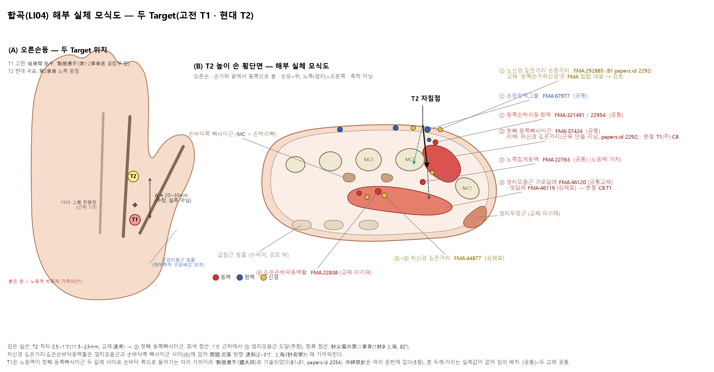
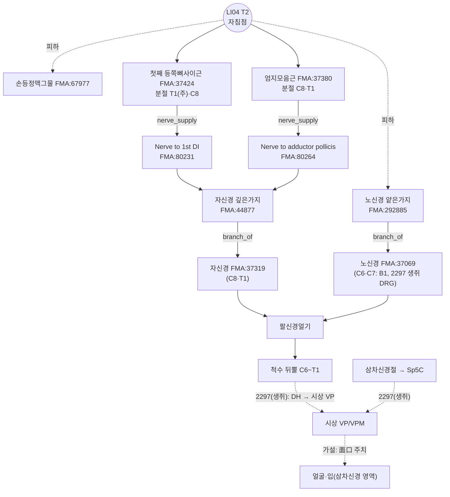

# [경혈 해부생리학 실체 판명 학술 모노그래프] 합곡(合谷, LI04)

> **프레임워크**: v2.7 · **ARI**: 두 Target 병기(분기 우위 없음, ΔARI-Core 7.5 < 10)
> - **T1 고전**(第1·2掌骨底 결합부 앞 오목, '動脈應手'): `ARI v3.0 | ARI-Core 61.25 ± 1.25 (C) | SI 50 | 잠정 가중치 0.40/0.35/0.25 | 민감도(등가중치): 59.4 (C, 등급 불변)`
> - **T2 현대 국표**(第2掌骨 노쪽 중점): `ARI v3.0 | ARI-Core 68.75 ± 1.25 (C) | SI 75 | 잠정 가중치 0.40/0.35/0.25 | 민감도(등가중치): 69.8 (C, 등급 불변)`
> - **이중 채점**: 독립 2회(채점 A·B), 15점 이상 불일치 3건 조정 완료 · **⚠ 임부 금침 문헌 다수**(SI와 별도 표지, 5절)

> **핵심 3대 원전**: 《中国针灸穴位通鉴》 · 《中国针灸证治通鉴》 · 《针灸腧穴通考》
> **Layer A 실증 DB**: 통합 생의학 마스터 DB v3.0 (LI4 역색인 118편 중 **LI4 자극·관찰을 본문·초록으로 확인한 19편**만 판정에 사용 — 8절 ①)
> **Layer B 참조 등록부**: `01_Framework/layer_b_reference_registry.md` (B-Check 6항목, 부합 기준 ≥ 8/12)
> **해부 온톨로지**: FMA 5.1.0 로컬 색인 — 교재 구조를 `FMA:ID`로 고정(B1 보조, 등록부 미등재). 상세는 부록 A
> **도량형 환산**: 한대 기준 1푼(分) = 2.3mm ($z = \text{푼} \times 2.3\text{mm}$)

**원전 파일 약칭** (모두 `01_도서_번역_및_원전/` 아래)
- [通考] `침구수혈통고(针灸腧穴通考)/针灸腧穴通考_04_上_手阳明大肠经穴-1.md` — 合谷 L657~1005
- [通鉴] `중국침구혈위통감(中国针灸穴位通鉴)/中国针灸穴位通鉴_11_手阳明大肠经(1).md` — 合谷 L962~1400
- [证治04] `중국침구증치통감(中国针灸证治通鉴)/中国针灸证治通鉴_04_第壹编_第七篇_手太阴肺经_手阳明大肠经_足阳明胃经.md` — 合谷 L312~342

---

## 1. 문헌 스크리닝 표 (3대 원전 원문 발췌)

| 문헌 | 원문 발췌 (출처·행) | 한국어 요지 | 비고 |
| :--- | :--- | :--- | :--- |
| 《针灸腧穴通考》 | "大肠上合手阳明……过于合谷，合谷，在大指岐骨之间，为原。"(《灵枢·本输》) — [通考] L681 | 엄지·검지 두 뼈가 갈라지는 사이, 원혈 | 위치의 최초 기술(범위형) |
| 《针灸腧穴通考》 | "过于合谷，一名虎口。在手大指岐骨间，手阳明脉之所过也，为原。"(《黄帝明堂经》) / "刺入三分，留六呼，灸三壮。"(《黄帝明堂经》) — [通考] L683·975 | 별명 虎口, 3푼 자입 | 심도의 최초 기술(한대) |
| 《针灸腧穴通考》 | "宋以前文献所载之古穴名'手阳明'，亦多指此穴……因为本穴（古代定位）及阳溪穴处皆可触及脉动，古代并可用作诊脉处" / "现代针灸教材本穴定于第2掌骨桡侧的中点处，位置较古代文献描述偏远端和尺侧" — [通考] L677 | 고대 합곡은 맥동 촉지처(手阳明 맥구), 현대 위치는 그보다 먼쪽·자쪽으로 옮겨짐 | **분기의 근거**(7절) |
| 《针灸腧穴通考》 | "本穴位置应靠近第1、2掌骨底交叉的骨缝中。此处也正是桡动脉的手背触诊点……从1964年2版《针灸学讲义》此穴的定位开始向远端桡侧偏移……此处已不能触及动脉搏动" — [通考] L775 | 고전 위치 = 第1·2掌骨底 결합부(노동맥 손등 촉지점); 1964년부터 먼쪽으로 이동 | T1 정위 |
| 《针灸腧穴通考》 | "在手大指次指两岐骨间动脉"(《窦太师针经》) / "两指岐骨，两指合缝悬五分，动脉应手"(《医经会元》) / "手大指、次指间后一寸五分陷者中"(《太平圣惠方·明堂》) — [通考] L743·747·757 | 동맥 박동, 갈래 사이 뒤 1.5촌 | T1 표지 |
| 《针灸腧穴通考》 | 1959 上海第一医学院: "第二掌骨桡侧缘近侧1/3与远侧2/3交界处。进针方向：针尖偏向第二掌骨方向，与掌背侧面成80度角……其疗效胜于旧法" — [通考] L701 | 근위 1/3 지점, 둘째 손허리뼈 쪽 80° | 중간형 취혈 |
| 《针灸腧穴通考》 | "今附若妇人妊娠不可刺之，损胎气。"(《铜人》) / "孕娠禁针此穴。一云：可泻不可补，补即下胎。"(《针方六集》) / "直刺0.5~1寸，针刺时手呈半握拳状。孕妇不宜针。"(7版《针灸学》) — [通考] L979·987·1001 | 임부 금침(보하면 낙태) | 5절 안전 |
| 《针灸腧穴通考》 | "治手指拘挛……透向劳宫或后溪，进针2~3寸" (上海《针灸学》) — [通考] L1005 | 손바닥 쪽 투자(透刺) 2~3촌 | 깊은층 위험(5절) |
| 《中国针灸穴位通鉴》 | "在大指歧骨之间"(《灵枢》) / "在手大指次指歧骨间陷中"(《铜人》 등) / "在手大指次指歧骨缝中，动脉应手"(《玉龙经》) / "在第一、第二掌骨接合部之上端"(《中国针灸学》) / "在第一与第二掌骨之间正中点"(《新编针灸学》) — [通鉴] L1000·1012·1022·1060·1058 | 송~명 '岐骨間 陷中'과 '동맥', 근대에 '접합부 위끝'과 '중점'이 병존 | 7절 계통 정리 |
| 《中国针灸穴位通鉴》 | "针一寸至一寸五分……勿伤及指背静脉。全身反应很大，防止发生休克……孕妇绝对禁针。"(《新编针灸学》) — [通鉴] L1310 | 손등 정맥 손상 주의, 강한 전신 반응(훈침), 임부 금침 | SI 근거 |
| 《中国针灸穴位通鉴》 | 局部解剖 "在第一掌骨和第二掌骨之骨间，第二掌骨之桡侧，第一背侧骨间肌中，有来自桡动脉的指背动脉，分布着桡神经浅枝" / "皮肤，皮下组织，第一骨间背侧肌……桡神经浅支，正中神经肌支，掌背动脉" — [通鉴] L1322·1326 | 첫째 등쪽뼈사이근, 노신경 얕은가지, 손등손허리동맥 | 4·6절 대조 |
| 《中国针灸证治通鉴》 | 《明堂经》 "主鼻鼽衄，热病汗不出，瞶目，目痛瞑，头痛，龋齿痛。痎疟。寒热。痱，痿，臂腕不用，唇吻不收。狂易。喑不能言，口噤不开，聋，耳中不通。喉痹。面肿。" — [证治04] L318 | 비뉵·무한 열병·눈·두통·치통·구금·후비·면종 | $P_{single}$ 근거(9절) |
| 《中国针灸证治通鉴》 | 《千金翼方》 "产后脉绝，胎上抢心。喉痹，心烦。烦热头痛。" / 《圣济总录》 "风，失音不语。" — [证治04] L334·342 | 산후·실음 | 9절 |

---

## 2. 원천/재인용 구분 표

| 층차 | 문헌 | 기술 내용 | 원천/재인용 |
| :--- | :--- | :--- | :--- |
| 선진·한대 | 《灵枢·本输》·《根结》 | 大指岐骨之间, 为原; 手阳明 "溜于合谷" | 원천(위치·혈성) — [通考] L681·787 |
| 한대 | 《黄帝明堂经》 | 一名虎口, 手大指岐骨间; 刺入三分 留六呼 灸三壮; 주치 목록 | 원천(이명·심도·주치) — [通考] L683·975·793 |
| 한대 | 《素问·三部九候论》 王冰注 | "中部地，手阳明也……在手大指次指岐骨间，合谷之分，动应于手也" | 맥구(진맥 부위)로서의 합곡 — [通考] L775 |
| 위진·당 | 《甲乙经》·《千金》·《外台》 | "在手大指次指间"; "虎口两骨间陷中"; 虎口 灸 紧唇 | 《明堂》 재인용; 虎口 기록 — [通考] L721·735·691 |
| 송 | 《太平圣惠方》·《铜人》 | "手阳明二穴，在手大指虎口曲纹头"; "妊娠不可刺之，损胎气" | 古穴名 '手阳明' 병존, **임부 금침 최초 명시** — [通考] L737·979 |
| 원·명 | 《窦太师针经》·《玉龙经》 | "两岐骨间动脉", "动脉应手"; 孕妇 切不可针灸 | 동맥 표지 강조 — [通考] L743~747·985 |
| 조선 | 허임 《针灸经验方》(1644) | "俗……妄从食指偏取陷中，不察岐骨间陷中" | 당시 먼쪽 오취혈 비판 — [通考] L697 |
| 근대 | 承淡安 《中国针灸学》(1955)·1957 南京《针灸学》·1판 강의 | 第一、第二掌骨接合部之上端 / 岐骨前凹陷 | 고전 정위 계승(T1) — [通鉴] L1060·1062 |
| 현대 | 2판 강의(1964)~7판·국표 1990/2006 | 第2掌骨桡侧的中点 | **정위 이동(T2)**, 국표 2006 '第1、2掌骨间' 삭제 — [通考] L667·767·773 |

---

## 3. 이명·별칭 검증 표 (KJH DB 대조)

| 이명 | 출처 | KJH DB | 판정 |
| :--- | :--- | :--- | :--- |
| 虎口 | 《黄帝明堂经》 "一名虎口"; 《千金》 "紧唇，灸虎口" | 등재 | 동일 혈위. 후대가 이 기록을 경외기혈 '虎口'로 잘못 옮김 — [通考] L683·693 |
| 合骨 | 《琼瑶神书》·《经络汇编》 | 등재 | '谷'·'骨' 혼용(가차) — [通考] L677, [通鉴] L974 |
| 含口 | 1957 南京《针灸学》 | 등재 | 따르는 문헌 적음 — [通鉴] L976·1014 |
| 手阳明(古穴名) | 《太平圣惠方》 卷五十五 | — | 송 이전 '手阳明'은 대개 합곡(맥구). 경맥명과 구분 — [通考] L677 |
| 上合谷(鼻痛点) | 《针灸经外奇穴图谱(续集)》 | — | 古합곡(T1)과 같은 자리, 별혈로 오인 — [通考] L705·709 |
| 虎边 | 같은 책 | — | 현대 합곡(T2) 자리, 자법만 다름 — [通考] L707·709 |
| 中魁·河口 | KJH DB 이명 열 | 등재 | **혼용 주의**: 中魁는 가운데손가락 경외기혈과 이름이 같다. 河口의 원전 출처는 이번 대조에서 확인하지 못함(확인 불가) |

KJH DB(경혈명·이명 대조 표준 데이터베이스 '경혈 종합 목록' 행 70: 67, LI04, 합곡, 合谷, "合骨, 含口, 虎口, 中魁, 河口").

---

## 4. 3D 공간 좌표 및 Layer 1~5 층차 구조도

두 Target을 따로 기술한다(7절 분기).

- **T1 고전**: X — 첫째·둘째 손허리뼈 사이, 둘째 손허리뼈 쪽. Y — 두 손허리뼈 바닥이 만나는 결합부 바로 먼쪽 오목, 노동맥 박동처("动脉应手", [通考] L775). Z — 3푼(6.9mm, 《明堂》).
- **T2 현대**: X — 둘째 손허리뼈 노쪽 가장자리. Y — 둘째 손허리뼈 중점(국표 2006). Z — 교재 5~10푼(11.5~23mm).
- **mm 경계는 적지 않는다**: LI4 사체 연구(papers.id 2292)는 구조의 면적 분포를 보고했을 뿐 깊이를 재지 않았고, 초음파 깊이 연구는 확인하지 못했다.

```
T2 (현대, 第2掌骨 노쪽 중점)
[Layer 1 피부·피하]  손등정맥그물 · 등쪽손허리동정맥(공통), 노신경 얕은가지 손등가지(교재 '등쪽손가락신경')
        │
[Layer 2 근육]       첫째 등쪽뼈사이근(공통) — 그 안을 자신경 깊은가지 분지가 지남(papers.id 2292)
        │
[Layer 3 깊은 근육]  엄지모음근(가로갈래: 공통교재 / 빗갈래: 김재효) · 노쪽집게동맥(공통)
        │            ★ 1寸(23mm) 직자 상한 근처 (추정)
[Layer 4 손바닥 깊은층] 자신경 깊은가지(김재효) · 깊은손바닥동맥활(교재 미기재) — 透刺 2~3寸 때 근접
        │
[Layer 5]           손바닥 피하·피부 (심부 장기 없음)

T1 (고전, 第1·2掌骨底 결합부 앞)
[Layer 1] 손등정맥그물, 노신경 얕은가지
[Layer 2] 첫째 등쪽뼈사이근 몸쪽 부분 — ★ 노동맥이 두 갈래 사이를 지나 손바닥 쪽으로 들어감(B1-01, papers.id 2054)
[Layer 3~4] 엄지모음근 빗갈래 · 깊은손바닥동맥활 시작부
```



*그림 4-1. (A) 오른손등에서 본 T1(고전)·T2(현대) 위치와 1959 上海 취혈점. (B) T2 높이 손 횡단면(손가락 끝에서 몸쪽으로 봄, 축척 아님). 직자는 첫째 등쪽뼈사이근을 지나 엄지모음근에 이르고, 자신경 깊은가지·깊은손바닥동맥활은 그보다 손바닥 쪽에 있다. 층 두께·거리는 실측값이 없어 임의로 배치했다.*

**FMA 실체 대조(Layer별, T2)** — 구조명은 2대 교재, ID·관계는 FMA 5.1.0

| Layer | 구조 | FMA | FMA 구획·관계 | 지배신경 / 줄기 (FMA) | 척수 분절 (FMA) |
| :--- | :--- | :--- | :--- | :--- | :--- |
| 1 피하 | 손등정맥그물 | FMA:67977 | — | — | — |
| 1 피하 | 등쪽손허리동맥 · 정맥 | FMA:321491 · 22954 | branch_of Radial artery / Cephalic vein 줄기 | — | — |
| 1 피하 | 노신경 얕은가지(교재 '등쪽손가락신경') | FMA:292885 | branch_of Radial nerve(FMA:37069) | — | FMA 미기재 |
| 2 근육 | 첫째 등쪽뼈사이근 | FMA:37424 | — | Nerve to first dorsal interosseous(FMA:80231) ← **자신경 깊은가지** | **T1(주)**·C8 |
| 3 깊은 근육 | 엄지모음근 가로갈래 *(공통교재)* · 빗갈래 *(김재효)* | FMA:46120 · 46119 (전체 FMA:37380) | 엄지두덩 칸(FMA:58534) | Nerve to adductor pollicis(FMA:80264) | C8·T1 |
| 3 깊은 근육 | 노쪽집게동맥 | FMA:22763 | branch_of Radial artery(FMA:22730) | — | — |
| 4 손바닥 깊은층 | 자신경 깊은가지 *(김재효)* | FMA:44877 | branch_of Peripheral segment of ulnar nerve | 자신경(FMA:37319) | FMA 미기재 |
| 4 손바닥 깊은층 | 깊은손바닥동맥활 *(교재 미기재)* | FMA:22838 | — | — | — |

- 교재의 '등쪽손가락신경(dorsal digital nerve)'은 FMA에서 *Set of dorsal digital branches of radial nerve*(FMA:75490)라는 **집합 실체**로만 대응한다. 대응 수준이 `set(검토)`이므로 확정 근거로 쓰지 않고, 해당 높이의 실제 구조인 노신경 얕은가지(FMA:292885, papers.id 2292 확인)로 기술했다.
- 김재효 교재는 한글 "엄지모음근의 **가로**갈래"와 영문 "**oblique** head"(빗갈래)가 서로 다르다. 공통교재는 가로갈래다. 6절에서 다룬다.
- FMA에 신경 자체의 분절 기재는 없다. 노신경 얕은가지의 분절(C6~C7)은 B1-01과 동물 추적 결과(papers.id 2297: LI4 주입 추적자가 C6·C7 뒤뿌리신경절에서 확인, 생쥐)로 보완한다.

---

## 5. 자침 깊이 계산표

출처: 역대 침구문헌 자침심도 데이터베이스 시트1 행 69(N0=67), 보조로 [通考] 【操作】·[通鉴] 七.

| 문헌 | 푼(分) | 환산 심도 (×2.3mm) | 도달 Layer(T2 추정) | 비고 |
| :--- | :---: | :---: | :--- | :--- |
| 황제명당경(황룡상 감수) | 3 | 6.9mm | 1~2 | "刺入三分，留六呼"([通考] L975) |
| 침구갑을경 | 3 | 6.9mm | 1~2 | |
| 침구경험방 | 3 | 6.9mm | 1~2 | |
| 동의보감(인용: 동인) | 3 | 6.9mm | 1~2 | |
| 경락수혈학 공통교재 | 5~10 | 11.5~23.0mm | 2~3 | |
| 침구의학 공통교재 | 5~10 | 11.5~23.0mm | 2~3 | |
| 《针灸腧穴通考》 | 5~10 | 11.5~23.0mm | 2~3 | "直刺0.5~1.0寸"([通考] L973) |
| (참고) 《千金翼方》 | 4 | 9.2mm | 2 | [通考] L977 |
| (참고) 《窦太师针经》·《针方六集》 | 5 | 11.5mm | 2 | "孕娠禁针此穴"([通考] L985·987) |
| (참고) 《循经考穴编》 | 10 | 23.0mm | 3 | "直针一寸……妊妇不可针"([通考] L989) |
| (참고) 《新编针灸学》 | 10~15 | 23.0~34.5mm | 3~4 | "勿伤及指背静脉……防止发生休克"([通鉴] L1310) |
| (참고) 上海《针灸学》 透刺 | 20~30 | 46~69mm(사선 길이) | 3~5 | 劳宫·后溪 방향([通考] L1005) |

- 자침깊이 DB에 금침(`'0'`)·미기술(`'blank'`)은 없다. 그러나 **임부 금침**은 《铜人》(송)부터 《针灸大成》·국내외 현대 교재까지 일관되게 실려 있다([通考] L979~1003, [通鉴] L1264~1314). 이는 해부 손상이 아니라 '보하면 낙태(补即堕胎)'라는 기능 금기이므로 SI 루브릭(심도·구조 기준) 단계와 별도로 **⚠ 임부 금침 표지**를 붙인다.
- **T2 안전**: 표준 5~10푼은 첫째 등쪽뼈사이근(Layer 2)~엄지모음근(Layer 3)에 머문다. 첫째 등쪽뼈사이근 안을 자신경 깊은가지 분지가 지나므로(papers.id 2292) 직자 시 신경 접촉 가능성이 있다. 1959 上海 "针尖偏向第二掌骨方向……成80度角"([通考] L701), 7판 "手呈半握拳状"처럼 **각도·자세 제한이 문헌에 있다**. 透刺 2~3寸은 손바닥 깊은층(Layer 4: 깊은손바닥동맥활·자신경 깊은가지)에 이른다.
- **T1 안전**: 고전 정위점이 노동맥 박동처 자체이다("动脉应手"). 노동맥은 이 높이에서 첫째 등쪽뼈사이근 두 갈래 사이를 지나 손바닥 쪽으로 들어간다(B1-01). 3푼(6.9mm)이라도 동맥과 같은 층이므로 박동을 밀어 피해야 한다.
- 훈침: 《新编针灸学》은 "全身反应很大，防止发生休克……最好卧位"라 적는다([通鉴] L1310). 혈관미주신경 반응 주의.

---

## 6. 해부학 구조 교재 비교표

| 구분 | 경혈학 공통교재 (공통교재 데이터셋 종합 시트 행 68) | 김재효 교재 (종합 시트 행 68) | FMA 판별 | 평가 |
| :--- | :--- | :--- | :--- | :--- |
| 근육 | 첫째 등쪽뼈사이근, (깊은층) 엄지모음근 가로갈래 | 첫째 등쪽뼈사이근, 엄지모음근 가로갈래(영문 oblique head) | 공통 FMA:37424 / 가로갈래 46120(공통교재) / 빗갈래 46119(김재효 영문) | 첫째 등쪽뼈사이근 일치. 엄지모음근 갈래는 **김재효 교재 안에서 한·영 불일치** |
| 신경 | 등쪽손가락신경 | 등쪽손가락신경(노신경에서), 자신경 깊은가지 | 등쪽손가락신경 → FMA 집합 75490(검토) / 자신경 깊은가지 44877(김재효 단독) | 김재효가 깊은층 운동신경(자신경)을 추가 |
| 혈관 | 노쪽집게동맥, 등쪽손허리동·정맥, 손등정맥그물 | 같음 | FMA:22763·321491·22954·67977 | 일치 |

**판정**: 표층(손등정맥그물·노신경 얕은가지 손등가지)과 첫째 등쪽뼈사이근·노쪽집게동맥은 두 교재가 일치하고, 모두 FMA 표준 실체로 확인된다. 차이는 깊은층에 있다.
1. **자신경 깊은가지**: 김재효 교재만 싣는다. 사체 연구(papers.id 2292, 25손)는 이 신경이 첫째 등쪽뼈사이근 근복 안에 있다고 확인해 김재효 기재를 뒷받침한다.
2. **엄지모음근 갈래**: 김재효 교재의 한글(가로갈래)과 영문(빗갈래)이 다르다. 둘째 손허리뼈 중점(T2) 높이에서는 가로갈래가 손허리뼈 바닥 쪽(셋째 손허리뼈 몸통 기시)을, 빗갈래는 더 몸쪽(손목뼈 쪽)을 차지하므로(B1-01) T2에는 가로갈래, T1에는 빗갈래가 더 가깝다는 해석이 가능하다(실측 아님).

두 차이 모두 상충이 아니라 **기재 범위·높이 차이**다. T2의 $S_{clarity}$ 75(조정)의 근거다. T1(고전 위치)은 두 교재 모두 기재 대상으로 삼지 않았다.

---

## 7. 공간 변위 분기 추론도

| 계통 | 근거 | 위치 |
| :--- | :--- | :--- |
| ① 고전 (T1) | 《灵枢》 "大指岐骨之间"; 송~명 "岐骨间陷中", 窦太师 "动脉应手", 《圣惠》 "后一寸五分"; 承淡安(1955)·1957 南京·1판 강의 | 第1·2掌骨底 결합부 바로 먼쪽 오목(노동맥 손등 촉지점) — [通考] L775 |
| ② 중간형 | 1959 上海第一医学院 | 둘째 손허리뼈 노쪽 가장자리 근위 1/3 — [通考] L701 |
| ③ 현대 (T2) | 2판 강의(1964)~7판, 국표 1990/2006 | 둘째 손허리뼈 노쪽 중점 — [通考] L667·773 |

《通考》는 ③이 ①보다 "偏远端和尺侧"이며 "此处已不能触及动脉搏动"이라 지적하고, 1964년 이전 정위가 고전과 더 맞는다고 판단한다([通考] L677·775). 허임의 《针灸经验方》도 먼쪽으로 치우친 취혈을 비판했다([通考] L697).

**Δ 추정**: ①은 손허리뼈 바닥 결합부 가까이, ③은 둘째 손허리뼈 중점이므로 두 점의 거리는 둘째 손허리뼈 길이의 절반 가까이로, **약 20~30mm로 추정**한다(성인 둘째 손허리뼈 길이를 약 6~7cm로 본 일반 해부치 B1-01 가정, **실측 아님**). ②는 그 사이(③에서 약 1cm 몸쪽, 추정)다.
→ **$\Delta_{discrepancy} > 15\text{mm}$ (추정) → Target 분기: T1(고전) vs T2(현대)**. 10절에서 각각 이중 채점한다.

---

## 8. 생의학적 반사 기전도 및 외부 검색 로그

**기전 요약 (T2 기준)**: 합곡은 침 기전 연구에서 가장 많이 쓰인 혈위 중 하나다. 확인된 근거는 세 갈래다.
1. **사람 중추 반응**: LI4 단독 자극에서 변연계·피질하 구조의 fMRI 신호 감소(papers.id 48, B4-01), 시상하부 활성(PET, 19), 기본 모드 네트워크 연결 변화(1674, B4-02).
2. **자율신경**: 사람에서 근육 교감신경 활동 일시 증가(LI4+LI11, 60), 교감·부교감 모두 증가(LI4 단독, 25), 부교감 우세·심박 감소(LI4+LU6, 17). 마취 쥐에서는 교감 흥분·위 미주신경 억제(24). **방향이 연구마다 다르다** → 자율신경 효과는 가설로 제한한다.
3. **안면 연결**: 생쥐에서 LI4 주입 추적자가 C6·C7 뒤뿌리신경절로 가고, 척수 뒤뿔→시상 VP와 삼차신경절→Sp5C→VP 경로가 시상에서 만나며, LI4 전침이 삼차신경통 행동을 개선했다(2297). 사람에서는 손바닥-턱 반사(palmomental reflex)로 손-얼굴 연결을 관찰한 연구가 있다(2295). 고전 "面口合谷收"의 신경 경로 **가설**을 시상 수렴 수준에서 지지한다(동물).

B-Check 9/12로 부합 기준(≥ 8/12)을 충족한다(T2). 다만 자율신경 방향 상충은 '가설', 안면 경로는 '동물 한정'으로 둔다.

**말초 구심 경로의 FMA 고정 (T2)**



*그림 8-1. FMA 5.1.0 관계로 그린 LI04(T2) 말초 구심 경로. 실선은 FMA 기재 관계, 점선은 FMA에 없는 연결이나 동물 실험(papers.id 2297)·해석이다.*

### ① Layer A 논문 표 (LI4 자극·관찰 확인분)

역색인 118편 중 **본문 또는 초록에서 LI4(合谷/Hegu/Hoku/Li 4) 사용을 확인한 논문**만 싣는다. 위치를 명시한 연구는 모두 현대 정위(T2, 첫째 등쪽뼈사이근 공간)를 썼다.

| papers.id | 연도 | 저널 | 내용 | PMID / DOI | 설계 |
| :---: | :---: | :--- | :--- | :--- | :--- |
| 2292 | 2021 | Anat Rec | 사체 25손, LI4 주변 1,256mm² 해부: 첫째 등쪽뼈사이근 52.4%, 손등정맥그물 22.3%, 노신경 얕은가지 18.9%, 동맥가지 10.2%, 자신경 깊은가지 4.0%; 노신경 얕은가지 1가지가 LI4를 관통, 자신경 깊은가지는 첫째 등쪽뼈사이근 안 | 34021732 / 10.1002/ar.24681 | **사람 사체(B2형)** |
| 48 | 2000 | Hum Brain Mapp | LI4 단독 침: 측좌핵·편도·해마·시상하부·전대상 등 신호 감소, 체감각피질 증가(득기 시) | 10643726 / 10.1002/(sici)1097-0193(2000)9:1<13::aid-hbm2>3.0.co;2-f | 인체 fMRI(B4-01) |
| 19 | 2001 | Neurosci Lett | LI4 침에서만 시상하부 활성(근처 비경혈 대조), PET | 11427311 / 10.1016/s0304-3940(01)01952-8 | 인체 PET, 대조점 |
| 1674 | 2008 | Pain | 진침 후 기본 모드·감각운동 네트워크 연결 변화, HRV(등록부 B4-02: LI4) | 18337009 / 10.1016/j.pain.2008.01.011 | 인체 fMRI, 가침 대조 |
| 60 | 1998 | Pain | LI4+LI11 전침 2Hz: 치아 통증 역치↑, 근육 교감신경 활동 일시↑ | 9539670 / 10.1016/S0304-3959(97)00197-8 | 인체 생리, 가침 대조 |
| 25 | 2000 | J Auton Nerv Syst | LI4(첫째 등쪽뼈사이근 중앙) 침: 교감·부교감 모두↑, 심박↓ | 10683506 / 10.1016/s0165-1838(99)00090-9 | 인체 생리, 12명 |
| 17 | 2002 | Neurosci Lett | LI4+LU6 전침: 백혈구 분포 정상화, 부교감 자극·심박↓ | 11849754 / 10.1016/s0304-3940(02)00012-5 | 인체 생리 |
| 2294 | 2012 | J Altern Complement Med | 한쪽 합곡 침 → 반대쪽 합곡 피부 혈류↑(140명, 레이저 관류) | 22794802 / 10.1089/acm.2011.0440 | 인체 생리 |
| 2295 | 2014 | Zhongguo Zhen Jiu | 손바닥-턱 반사 출현율(763명) — '合谷 调面口' 신경 반사 근거 탐색 | 25543447 / — | 인체 관찰 |
| 510 | 2024 | YMER | 제왕절개 후 LI4+SP6 전침 → 옥시토신↑(72명) | — / — (원문 확인) | 인체 RCT, 다혈위 |
| 24 | 2002 | Neurosci Res | 마취 쥐 Hoku 전침: 교감 흥분·위 미주신경 활동↓·위압↓, 2Hz와 20Hz 반응 양상 다름 | 11814605 / 10.1016/s0168-0102(01)00299-1 | 동물(쥐) |
| 2297 | 2026 | Zhen Ci Yan Jiu | 생쥐 삼차신경통: LI4 전침이 기계 역치·불안·우울 개선; LI4 추적자 → C6·C7 DRG, DH·Sp5C·TG → VP 연결 | 42908446 / 10.13702/j.1000-0607.20260550 | 동물(생쥐), **LI4 단독** |
| 2305 | 2026 | Zhen Ci Yan Jiu | 아토피 피부염 생쥐: LI4+LI11 전침 → 피부 염증·가려움·Parthanatos↓ | 42482575 / 10.13702/j.1000-0607.20250715 | 동물(생쥐) |
| 2296 | 2026 | Zhen Ci Yan Jiu | 만성 구속 스트레스 생쥐: LI4+LR3 전침 → 우울 행동·PVN CRH 활성 조절 | 42908448 / 10.13702/j.1000-0607.20260563 | 동물(생쥐), 四关 |
| 2299 | 2026 | Zhen Ci Yan Jiu | 경추신경근병증 쥐: LI4+LR3 전침 → 통증↓, Piezo1/NO-cGMP-PKG | 42779401 / 10.13702/j.1000-0607.20251085 | 동물(쥐), 四关 |
| 1013 | 2009 | 경락경혈학회지 | 카라기난 관절염 쥐: LI4 고주파 온침 → 부종·체중부하·척수 NO·nNOS↓ | — / — | 동물(쥐) |
| 972 | 2007 | 대한경락경혈학회지 | TNBS 대장염 쥐: 합곡 구진약침 항염 | — / — | 동물(쥐), 약침 |
| 978 | 2007 | 대한경락경혈학회지 | TNBS 대장염 쥐: 합곡 애엽약침 | — / — | 동물(쥐), 약침 |
| 2054 | 2022 | Front Cardiovasc Med | 먼쪽 노동맥 초음파 접근 종설: 먼쪽 노동맥은 긴엄지폄근 힘줄을 경계로 해부학적 코담배갑과 '합곡혈' 구간으로 나뉨 | — / 10.3389/fcvm.2022.1019053 | 종설(T1 해부 근거) |

- 제외: 1341(GB21·ST36 초음파 깊이 연구 — LI4 아님), 46·54(LI4를 대조 언급만 하거나 다른 혈위 사용), 국내 피부온도 연구 713·957·1025(제목상 LI4이나 결과 원문 미추출 → 확인 불가), 문헌·처방 분석 논문(341, 373, 382, 1845, 2300, 2307 등)과 사례 보고(1899, 2265, 2286, 2287)는 기전 판정에 쓰지 않았다.
- 모든 인용 레코드 status = active. duplicate·missing·superseded 없음.

### ② B-Check 채점표

**T2 (현대 정위)**

| 항목 | 내용 | 채점자 A | 채점자 B | 최종 | 참조 ID | papers.id | 근거 요지 |
| :---: | :--- | :---: | :---: | :---: | :--- | :--- | :--- |
| ① | 자침 심도의 말초신경·혈관 실체 | 2 | 2 | **2** | B1-01, B2-09 (+FMA) | 2292 | 2대 교재 공통 구조 모두 FMA 정확 대응, 사람 사체 25손이 첫째 등쪽뼈사이근·노신경 얕은가지·자신경 깊은가지 위치를 확인 |
| ② | 척수 분절 정합 | 1 | 1 | **1** | B1-02, B3-05 (+FMA) | 2297 | LI04 C6~T1(FMA·생쥐 DRG) vs 대표 주치 얼굴·치아(삼차신경, 척수 분절 아님): 분절 불일치. 시상 VP 수렴(생쥐)으로 간접 → 1 |
| ③ | 구심 섬유형·수용체 | 1 | 1 | **1** | B3-06, B3-10 | 2297 | LI4 특이 섬유형 연구 없음. 추적자로 C6·C7 DRG 연결만 확인(생쥐) |
| ④ | 중추 중계·경로 | 2 | 2 | **2** | B4-01, B4-02, B3-11 | 48, 19, 1674, 2297 | 사람: 변연계·시상하부(LI4 단독, 대조점 비교 포함). 생쥐: DH·Sp5C → VP |
| ⑤ | 원심 경로·표적 효과($P_{single}$ 일치) | 2 | 1 | **1** | B3-04, B3-10 | 60, 2297, 24 | 치통 역치↑(사람, LI4+LI11)·삼차신경통 개선(생쥐)은 '齿痛·面口' 주치와 같은 방향. 자율신경 효과 방향은 연구 간 상충(24 vs 25 vs 17) → B 1, 최종 1 |
| ⑥ | 인체 전환 근거 | 2 | 1 | **2** (조정) | B4-01, B4-02, B4-04, B4-05 | 48, 19, 1674, 25, 2294 | LI4 **단독** 인체 생리실험이 4편 이상(fMRI·PET·HRV·혈류). B는 혈위 특이성 반증(B4-04·05)을 들어 1. 조정: 19가 근처 비경혈 대조에서 시상하부 차이를 보였으므로 2 |
| **합계** | | 10 | 8 | **9 / 12** | | | **판정: 부합(≥ 8/12, ①·② ≥ 1)** · 표지: 자율신경 효과는 **가설**(방향 상충), 안면 경로는 **동물 한정** |

**T1 (고전 정위)**: ①1(교재 기재 없음, B1·2054로 노동맥 위치만 확인) ②1 ③1 ④1(위치를 T1로 특정한 연구 없음 — LI4 연구를 유추 적용) ⑤1 ⑥1 → **6/12 미부합**(A·B 일치). T1의 반사 기전은 기술하지 않는다.

### ③ 외부 검색 로그 (sync_log, 2026-10-23 Rank 6 실행 — 경혈 언급 판정이 들어간 개정 스크립트)

| 일시 | 소스 | HTTP | 수집 | 중복제거 | 신규 | 쿼리 |
|---|---|---|---|---|---|---|
| 2026-10-23T23:57:04 | pubmed | 200 | 16 | — | — | ("LI4"[tiab] OR "Hegu"[tiab] OR "合谷"[tiab]) AND (acupuncture OR electroacupuncture) AND (nerve OR reflex OR autonomic OR mechanism OR anatomy) \| 같은 용어 AND ("Zhongguo Zhen Jiu"[Journal] OR "Zhen Ci Yan Jiu"[Journal]) |
| 2026-10-23T23:57:04 | openalex | 200 | 24 | — | — | doi_starts_with:10.13703 / 10.13702, title_and_abstract.search:"Hegu" OR "LI4" / has_doi:true … AND (acupuncture OR electroacupuncture) |
| 2026-10-23T23:57:04 | crossref | 200 | 4 | — | — | Hegu acupuncture nerve reflex |
| 2026-10-23T23:57:04 | all | — | 44 | 20 | 24 | merged_into_existing=12, batch_dups=8, **rejected_not_mentioned=0** |

- 개정 스크립트는 제목·초록에 경혈이 경혈로서 나와야만 연결한다. Hegu는 지명과 겹치지 않아 제외 0건이었다.

---

## 9. 주치증 분리 표

| 구분 | 주치 | 원문 근거 |
| :--- | :--- | :--- |
| $P_{single}$ (단독) | 열병 무한(無汗)·한열·학질 | 《明堂经》 "热病汗不出……痎疟。寒热"([证治04] L318) |
| $P_{single}$ | 비뉵·눈 질환·두통·치통 | 《明堂经》 "鼻鼽衄……瞶目，目痛瞑，头痛，龋齿痛"([证治04] L318); "眼痛则合谷以推之"(《通玄指要赋》, [通考] L859) |
| $P_{single}$ | 구금·순문불수·실음 | 《明堂经》 "唇吻不收……喑不能言，口噤不开"([证治04] L318); "风，失音不语"(《圣济总录》, [证治04] L342) |
| $P_{single}$ | 이롱·후비·면종 | 《明堂经》 "聋，耳中不通。喉痹。面肿"([证治04] L318); "聋而痛者，取手阳明"(《灵枢·杂病》, [通考] L837) |
| $P_{single}$ | 비위(痱痿)·팔목 불용 | 《明堂经》 "痱，痿，臂腕不用"([证治04] L318) |
| $P_{single}$ | 광역(狂易) | 《明堂经》 "狂易"([证治04] L318) |
| $P_{single}$ | 산후 맥절·태상창심 | 《千金翼方》 "产后脉绝……针合谷入三分，急补之"([通考] L899, [证治04] L334) |
| $P_{single}$ (현대) | 체표 수술 침마취(발치·갑상선) | [通考] L671 |
| $P_{comb}$ (배오) | 낙태·체산(滯産) | 徐文伯 "泻足三阴交，补手阳明合谷，应针而落"(《铜人》, [通考] L903); 难产 补合谷·泻三阴交([通考] L923) — **임부 금침의 근거** |
| $P_{comb}$ | 발한·지한 | "伤寒无汗，补合谷，泻复溜即汗；汗多，补复溜，泻合谷即止"(《循经考穴编》, [通考] L805·947) |
| $P_{comb}$ | 두면 질환 | "曲池与合谷，头面病可彻"(《千金十一穴歌》); "四总穴" 面口合谷收([通考] L863·819) |
| $P_{comb}$ | 사관(四关) | 合谷+太冲 — 진정·개규([通鉴] L988); 동물 2296·2299 |
| $P_{comb}$ | 인후 | 少商·合谷·委中·行间(《针灸集要》, [通考] L891) |
| $P_{comb}$ | 견비통 | "手连肩脊痛难忍，合谷针时要太冲"(《席弘赋》, [通考] L963) |

---

## 10. ARI v3.0 프로파일 평가표 및 최종 결론

**분기**: T1 = 고전 "大指岐骨之间……动脉应手"(第1·2掌骨底 결합부 앞), T2 = 현대 국표 2006 "第2掌骨桡侧的中点". Δ 약 20~30mm(추정).

### 하위 점수 — T1 (고전)

| 지표 | 채점자 A | 채점자 B | 최종 | 루브릭 단계 근거 요지 | 근거 포인터 |
| :--- | :---: | :---: | :---: | :--- | :--- |
| $S_{orig}$ (0.40) | 81.25 | 75 | **78.1 ± 3.1** | 아래 하위 4항목 평균(②에서 A 100·B 75; 평균 차 6.25 < 15 → 조정 불요) | [通考] L657~1005 |
| $S_{clarity}$ (0.35) | 50 | 25 | **50** (조정) | A: B1-01·papers.id 2054로 노동맥·첫째 등쪽뼈사이근 위치는 확인 가능하나 교재 기재 없음(50). B: 교재·실측 모두 결여, 추론만(25). 조정: 표준 해부서(B1)와 영상 종설(2054)이 T1의 핵심 표지(노동맥)를 확인하므로 추론만은 아님 → 50 | 4·6절, 2054 |
| $S_{reflex}$ (0.25) | 50 | 50 | **50** | T1 위치를 특정한 Layer A 없음. LI4 연구 일반을 유추하면 B-Check 6 → "동물 연구만/B-Check 6~7" 단계 | 8절 T1 |
| SI ($S_{safety}$) | 50 | 50 | **50** | 정위점이 노동맥 박동처 — 직접 접촉 가능, 심도 상한(3푼) 명시 필요 | 5절, B1-01 |

### 하위 점수 — T2 (현대)

| 지표 | 채점자 A | 채점자 B | 최종 | 루브릭 단계 근거 요지 | 근거 포인터 |
| :--- | :---: | :---: | :---: | :--- | :--- |
| $S_{orig}$ (0.40) | 62.5 | 56.25 | **59.4 ± 3.1** | 하위 4항목 평균(②에서 A 50·B 25) | [通考] L667·767~775 |
| $S_{clarity}$ (0.35) | 100 | 75 | **75** (조정) | A: 사체 연구(2292)가 구조 확인 + 2대 교재 일치 → 100. B: 2292는 면적 분포만, 깊이 미측정이고 교재 깊은층 차이 존재 → 75. 조정: 루브릭 100은 "구조와 **심도**" 확인을 요구하므로 75 | 6절, 2292, 교재 행 68 |
| $S_{reflex}$ (0.25) | 75 | 75 | **75** | 인체 생리실험 다수(LI4 단독 4편+) + B-Check 9(< 10) → 100 미달, "인체 연구 + B-Check ≥ 8" 단계 | 8절 ①② |
| SI ($S_{safety}$) | 75 | 50 | **75** (조정) | A: Layer 3까지, 각도 제한 문헌 명시(80°, 반주먹) → 75. B: 자신경 깊은가지가 첫째 등쪽뼈사이근 안에 있어 직자 시 접촉 → 50. 조정: 접촉 대상이 운동신경 가지로 중대 손상 보고가 없고, 문헌이 각도·자세 제한을 명시 → 75. 금침 `'0'` 없음 | 5절, 2292, [通考] L701·1001 |

### $S_{orig}$ 하위 4항목

| 하위 항목 | T1 A | T1 B | T2 A | T2 B | 근거 |
| :--- | :---: | :---: | :---: | :---: | :--- |
| ① 최초 기술 명확성 | 75 | 75 | 50 | 50 | 《灵枢》 "大指岐骨之间"과 《明堂》 3푼은 한대 기술이나 범위형. T2 위치는 한대 기술이 직접 지정하지 않음(1964년 이후 정위) |
| ② 후대 문헌 일치율 | 100 | 75 | 50 | 25 | 송~청·근대(1955~1964) 문헌 대부분이 '岐骨间 陷中/动脉'(T1). T2는 2판 강의 이후 교재·국표에 한정. A·B 차는 '一寸五分'·'正中点' 등 이문의 비중 판단 차이 |
| ③ 이명 혼용 해소 | 75 | 75 | 75 | 75 | 虎口(경외기혈 오분류)·合骨·含口·手阳明(古穴名)·上合谷·虎边 정리. 中魁·河口(KJH)는 미해소 이름 겹침이 남음 |
| ④ 《通考》 교감 | 75 | 75 | 75 | 75 | 虎口 오분류 교정, 上合谷=古합곡 판정, 국표 2006 '第1、2掌骨间' 삭제 비판 |
| **평균** | **81.25** | **75** | **62.5** | **56.25** | |

### 게이트·등급·민감도

- **게이트**: T1·T2 모두 게이트 1($S_{orig}$·$S_{clarity}$ ≥ 50) 미적용, 게이트 2(LI4 확인 Layer A 19편) 미적용, 게이트 3(SI 50·75 > 25) 미적용. 임부 금침은 SI와 별도로 ⚠ 표지.
- **T1 ARI-Core**: A = 0.40×81.25 + 0.35×50 + 0.25×50 = 62.5, B = 0.40×75 + 0.35×50 + 0.25×50 = 60.0 → **61.25 ± 1.25 → C(가능·가설)**. 민감도(등가중치): A 60.4, B 58.3 → 59.4(C, 등급 불변).
- **T2 ARI-Core**: A = 0.40×62.5 + 0.35×75 + 0.25×75 = 70.0, B = 0.40×56.25 + 0.35×75 + 0.25×75 = 67.5 → **68.75 ± 1.25 → C(가능·가설)**. 상한 70.0이 B 경계에 닿는다. 민감도(등가중치): A 70.8, B 68.75 → 69.8(C, 평균 기준 등급 불변 — A 단독으로는 B이므로 "경계 근접"으로 기록).
- **분기 판정**: ΔARI-Core = 68.75 − 61.25 = **7.5 < 10** → 우위 Target 선언 불가, **두 Target 병기**. T1은 원전 정합성($S_{orig}$)이 높고, T2는 해부 실체·반사 근거($S_{clarity}$·$S_{reflex}$)가 높다.
- **조정 기록**: 15점 이상 불일치 3건 — T1 $S_{clarity}$(50 vs 25), T2 $S_{clarity}$(100 vs 75), T2 SI(75 vs 50). 위 표의 근거로 조정했다. $S_{orig}$ 평균 차(6.25)는 15점 미만이라 평균 ± 반범위로 표기했다. B-Check T2 ⑤(A 2·B 1)는 최종 1, ⑥(A 2·B 1)은 조정 2.
- **구판 점수**: `_구판_v2.3_20260903/`의 'ARI Score 95.15'(v2.3, 4요인 가중 합산)는 비교하지 않는다.

**표준 표기**
- T1: `ARI v3.0 | ARI-Core 61.25 ± 1.25 (C) | SI 50 | 잠정 가중치 0.40/0.35/0.25 | 민감도(등가중치): 59.4 (C, 등급 불변)`
- T2: `ARI v3.0 | ARI-Core 68.75 ± 1.25 (C) | SI 75 | 잠정 가중치 0.40/0.35/0.25 | 민감도(등가중치): 69.8 (C, 등급 불변)` · ⚠ 임부 금침 문헌

### 최종 결론

합곡(LI04)은 **두 자리**로 존재한다. 고전(T1)은 첫째·둘째 손허리뼈 바닥이 만나는 결합부 앞, 노동맥 박동이 만져지는 맥구였다. 현대(T2)는 1964년 교재부터 둘째 손허리뼈 노쪽 중점으로 옮겨졌다. 두 점은 약 2~3cm(추정) 떨어져 있고, 어느 쪽도 다른 쪽보다 우위라 판정할 수 없다(ΔARI-Core 7.5).

- **T2의 해부 실체**는 첫째 등쪽뼈사이근과 그 위의 노신경 얕은가지·손등정맥그물, 깊은층의 엄지모음근이다. 두 교재가 표층에서 일치하고, 모두 FMA 표준 실체로 확인되며, 사람 사체 연구(2292)가 배치를 확인했다. 등급을 C에 머물게 한 것은 **원전 정합성**이다. 현대 위치는 한대~근대 문헌 대부분이 가리키는 자리가 아니다.
- **T2의 반사 기전**은 B-Check 9/12로 부합한다. 사람에서 LI4 단독 자극이 변연계·시상하부 반응을 일으키는 것은 여러 영상 연구가 일치한다. 그러나 자율신경 효과의 방향은 연구마다 달라 **가설**로 남는다. '面口合谷收'를 설명하는 손-얼굴 경로(시상 VP 수렴)는 **생쥐에서만** 보였다.
- **T1**은 원전 근거가 가장 강하지만, 교재가 기재하지 않고 이 위치를 특정한 기전 연구가 없다.

**안전**:
1. **⚠ 임부 금침**: 《铜人》 이래 일관되게 실려 있다. 보법(補法) 시 낙태 기록은 三阴交와의 배오에서 나온다(9절). 현대 RCT(510)에서도 LI4+SP6 전침이 옥시토신을 높였다.
2. **T1**: 노동맥 박동처이므로 박동을 밀어 피하고 얕게(3푼) 찌른다.
3. **T2**: 둘째 손허리뼈 쪽으로 기울여(약 80°) 반주먹 자세로 찌른다. 劳宫·后溪 방향 透刺는 손바닥 깊은층의 깊은손바닥동맥활·자신경 깊은가지에 가까워진다.
4. **훈침**: 강한 자극에서 전신 반응(훈침)이 보고되므로 첫 시술은 누운 자세가 안전하다(《新编针灸学》).

---

## 부록 A. FMA 해부 실체 프로파일 (FMA 5.1.0)

생성: `python .claude/skills/acupoint-anatomy/scripts/fma/fma_query.py profile LI04 --md` (2026-10-24) + `entity` 보완.

| 구분 | 교재 용어 | FMA 실체 | 대응 | 출처 | 신경 지배 / 상위 줄기 | 척수 분절 |
| :--- | :--- | :--- | :--- | :--- | :--- | :--- |
| 근육 | 첫째 등쪽뼈사이근 | FMA:37424 First dorsal interosseous of hand | exact+region | 공통교재·김재효 | Nerve to first dorsal interosseous(FMA:80231) → Deep branch of ulnar nerve → Peripheral segment of ulnar nerve | T1(주), C8 |
| 근육 | 엄지모음근 빗갈래(김재효 영문) | FMA:46119 Oblique head of adductor pollicis | exact | 김재효 | (전체 근육 FMA:37380: Nerve to adductor pollicis FMA:80264) | (전체) C8·T1 |
| 근육 | 엄지모음근 가로갈래 | FMA:46120 Transverse head of adductor pollicis | exact | 공통교재 | 위와 같음 | (전체) C8·T1 |
| 신경 | 자신경의 깊은가지 | FMA:44877 Deep branch of ulnar nerve | exact | 김재효 | Peripheral segment of ulnar nerve → Ulnar nerve(FMA:37319) | — |
| 신경 | 등쪽손가락신경 | FMA:75490 Set of dorsal digital branches of radial nerve | exact(set) / set(검토) | 공통교재·김재효 | 집합 실체 — 확정 근거로 쓰지 않음 | — |
| 신경 | (교재 미기재, 실제 구조) 노신경 얕은가지 | FMA:292885 Superficial branch of radial nerve | — | papers.id 2292 | Radial nerve(FMA:37069) | — |
| 혈관 | 노쪽집게동맥 | FMA:22763 Arteria radialis indicis | exact | 공통교재·김재효 | Radial artery(FMA:22730) → Subclavian artery(FMA 모델링) | — |
| 혈관 | 등쪽손허리동맥 | FMA:321491 Dorsal metacarpal artery | exact | 공통교재·김재효 | Radial artery → Subclavian artery | — |
| 혈관 | 등쪽손허리정맥 | FMA:22954 Dorsal metacarpal vein | exact | 공통교재·김재효 | Cephalic → Subclavian → Brachiocephalic vein | — |
| 혈관 | 손등정맥그물 | FMA:67977 Dorsal venous network of hand | exact | 공통교재·김재효 | — | — |
| 혈관 | (교재 미기재) 깊은손바닥동맥활 | FMA:22838 Deep palmar arterial arch | — | B1-01 | — | — |

- 분절 합집합(B-Check ② 입력): **C8, T1**(FMA 근육 segmental_supply). 노신경 얕은가지의 C6·C7은 B1-01·papers.id 2297(생쥐 DRG 추적)로 보완 → 전체 **C6~T1**.
- 두 교재 비교: 공통 FMA 실체 6 · 공통교재 단독 1(FMA:46120) · 김재효 단독 2(FMA:46119·44877).
- FMA 모델링 한계: 노동맥 가지를 빗장밑동맥 가지로 기록(겨드랑·위팔동맥을 연속 구간으로 둔 모델링). 엄지모음근 갈래 실체에는 nerve_supply가 없고 전체 근육에만 있다.
- 인용 한계: FMA는 정상 성인 규범 해부 온톨로지로, 혈위 특이 심도·변이 빈도·반사 기능의 근거가 아니다.

---

## 개정 이력 (2026-10-24, Tier 3 신규 작성)

| 위치 | 원래 내용 | 바꾼 내용 | 근거 |
| :--- | :--- | :--- | :--- |
| 전체 | v2.3 구판 초안(2026-09-03, 2.5KB, 'ARI Score 95.15') — `_구판_v2.3_20260903/` | Tier 3 v2.7 신규 작성: 10대 구성 요소, 두 Target 분기, 이중 채점, FMA 대조, 그림 4-1·8-1 | 정본 Rank 0~7 |
| 1~3절 | — | 《灵枢》·《明堂》·《通考》 名实考·定位·操作, 《通鉴》 部位·针法·局部解剖, 《证治通鉴》 주치의 원문과 행 | [通考] L657~1005; [通鉴] L962~1400; [证治04] L312~342 |
| 4·6절 | — | 두 Target 층차, Layer별 FMA 대조, 교재 '등쪽손가락신경' FMA 집합 대응 검토 표시, 김재효 교재 한·영 불일치 | 교재 행 68; FMA 5.1.0; papers.id 2292 |
| 5절 | — | DB 행 69 푼수→mm, 임부 금침 ⚠ 별도 표지, 각도·透刺 위험 | 자침깊이 DB; [通考] L973~1005; [通鉴] L1310 |
| 7절 | — | 3계통 정리, Δ 약 20~30mm(추정) → T1·T2 분기 | [通考] L677·701·775 |
| 8절 | — | LI4 확인 19편(PMID/DOI 대조), B-Check T2 9/12 부합(자율신경 가설·안면 경로 동물 한정), T1 6/12, 외부 검색 로그 | Rank 6 sync 2026-10-23T23:57:04; PubMed efetch 초록 대조 |
| 10절 | — | T1 61.25 ± 1.25 (C) / T2 68.75 ± 1.25 (C), ΔARI 7.5 < 10 병기, 조정 3건 | 위 각 절 |
| 확인 불가 | — | KJH 이명 '河口' 원전 출처, 국내 피부온도 연구 3편 결과, papers.id 510 PMID·DOI | — |
