# [Acupoint Anatomical & Physiological Substrate Monograph] Hegu (合谷, LI04)

> **Framework**: v2.7 · **ARI**: two Targets reported side by side (neither prevails, ΔARI-Core 7.5 < 10)
> - **T1 Classical** (depression just distal to the junction of the bases of the 1st and 2nd metacarpals (第1·2掌骨底), '動脈應手'): `ARI v3.0 | ARI-Core 61.25 ± 1.25 (C) | SI 50 | provisional weights 0.40/0.35/0.25 | sensitivity (equal weights): 59.4 (C, grade unchanged)`
> - **T2 Modern national standard** (midpoint of the radial side of the 2nd metacarpal (第2掌骨)): `ARI v3.0 | ARI-Core 68.75 ± 1.25 (C) | SI 75 | provisional weights 0.40/0.35/0.25 | sensitivity (equal weights): 69.8 (C, grade unchanged)`
> - **Dual scoring**: two independent rounds (raters A and B); 3 discrepancies of 15 points or more reconciled · **⚠ Many texts contraindicate needling in pregnancy** (flag kept separate from the SI, Section 5)

> **Three Primary Classics**: *Zhongguo Zhenjiu Xuewei Tongjian* (《中國針灸穴位通鑑》) · *Zhongguo Zhenjiu Zhengzhi Tongjian* (《中國針灸證治通鑑》) · *Zhenjiu Shuxue Tongkao* (《針灸腧穴通考》)
> **Layer A Empirical Database**: `02_Master_Datasets/경혈_생의학_신경반사_마스터DB.json` (of the 118 papers in the LI4 inverted index, only the **19 papers in which LI4 stimulation or observation was confirmed from the full text or abstract** are used for the verdict — Section 8 ①)
> **Layer B Reference Registry**: `01_Framework/layer_b_reference_registry.md` (6-item B-Check, concordance threshold ≥ 8/12)
> **Anatomical Ontology**: local index of FMA 5.1.0 — textbook structures are pinned to `FMA:ID`s (B1 supplementary, not yet in the registry). Details in Appendix A
> **Metrological Standard**: Han-dynasty standard, 1 fen (分) = 2.3 mm ($z = \text{fen} \times 2.3\,\text{mm}$)
> **Note on script**: Classical quotations and TCM terms are given in Traditional Chinese (繁體字). The cited source files are simplified-script editions, so the file names and line numbers in `code` refer to those files as they are named on disk.

**Source file abbreviations** (all under `01_도서_번역_및_원전/`)
- [通考] `침구수혈통고(针灸腧穴通考)/针灸腧穴通考_04_上_手阳明大肠经穴-1.md` — 合谷 L657–1005
- [通鑑] `중국침구혈위통감(中国针灸穴位通鉴)/中国针灸穴位通鉴_11_手阳明大肠经(1).md` — 合谷 L962–1400
- [證治04] `중국침구증치통감(中国针灸证治通鉴)/中国针灸证治通鉴_04_第壹编_第七篇_手太阴肺经_手阳明大肠经_足阳明胃经.md` — 合谷 L312–342

---

## 1. Classical Literature Screening Table (Three Primary Classics Excerpts)

| Classic | Original excerpt (source & line) | English summary | Remarks |
| :--- | :--- | :--- | :--- |
| *Zhenjiu Shuxue Tongkao* (《針灸腧穴通考》) | "大腸上合手陽明……過于合谷，合谷，在大指岐骨之間，為原。"(《靈樞·本輸》) — [通考] L681 | Between the diverging bones of the thumb and index finger; Yuan-Source point (原穴) | Earliest statement of the location (range type) |
| *Zhenjiu Shuxue Tongkao* (《針灸腧穴通考》) | "過于合谷，一名虎口。在手大指岐骨間，手陽明脈之所過也，為原。"(《黃帝明堂經》) / "刺入三分，留六呼，灸三壯。"(《黃帝明堂經》) — [通考] L683·975 | Alias Hukou (虎口); needle insertion 3 fen | Earliest statement of depth (Han) |
| *Zhenjiu Shuxue Tongkao* (《針灸腧穴通考》) | "宋以前文獻所載之古穴名'手陽明'，亦多指此穴……因為本穴（古代定位）及陽溪穴處皆可觸及脈動，古代並可用作診脈處" / "現代針灸教材本穴定於第2掌骨橈側的中點處，位置較古代文獻描述偏遠端和尺側" — [通考] L677 | The ancient Hegu was a palpable pulse site (the pulse-taking site of 手陽明); the modern location has moved distally and ulnarward from it | **Basis for the split** (Section 7) |
| *Zhenjiu Shuxue Tongkao* (《針灸腧穴通考》) | "本穴位置應靠近第1、2掌骨底交叉的骨縫中。此處也正是橈動脈的手背觸診點……從1964年2版《針灸學講義》此穴的定位開始向遠端橈側偏移……此處已不能觸及動脈搏動" — [通考] L775 | Classical location = junction of the bases of the 1st and 2nd metacarpals (dorsal palpation point of the radial artery); moved distally from 1964 | T1 location |
| *Zhenjiu Shuxue Tongkao* (《針灸腧穴通考》) | "在手大指次指兩岐骨間動脈"(《竇太師針經》) / "兩指岐骨，兩指合縫懸五分，動脈應手"(《醫經會元》) / "手大指、次指間後一寸五分陷者中"(《太平聖惠方·明堂》) — [通考] L743·747·757 | Arterial pulsation; 1.5 cun proximal, between the forked bones | T1 markers |
| *Zhenjiu Shuxue Tongkao* (《針灸腧穴通考》) | 1959 Shanghai First Medical College (上海第一醫學院): "第二掌骨橈側緣近側1/3與遠側2/3交界處。進針方向：針尖偏向第二掌骨方向，與掌背側面成80度角……其療效勝於舊法" — [通考] L701 | Point at the junction of the proximal third; needle at 80° toward the 2nd metacarpal | Intermediate locating method |
| *Zhenjiu Shuxue Tongkao* (《針灸腧穴通考》) | "今附若婦人妊娠不可刺之，損胎氣。"(《銅人》) / "孕娠禁針此穴。一云：可瀉不可補，補即下胎。"(《針方六集》) / "直刺0.5~1寸，針刺時手呈半握拳狀。孕婦不宜針。"(7th ed. 《針灸學》) — [通考] L979·987·1001 | Needling contraindicated in pregnancy (reinforcing causes miscarriage) | Section 5, safety |
| *Zhenjiu Shuxue Tongkao* (《針灸腧穴通考》) | "治手指拘攣……透向勞宮或後溪，進針2~3寸" (Shanghai 《針灸學》) — [通考] L1005 | Through-needling (透刺) toward the palm, 2–3 cun | Deep-layer risk (Section 5) |
| *Zhongguo Zhenjiu Xuewei Tongjian* (《中國針灸穴位通鑑》) | "在大指歧骨之間"(《靈樞》) / "在手大指次指歧骨間陷中"(《銅人》 etc.) / "在手大指次指歧骨縫中，動脈應手"(《玉龍經》) / "在第一、第二掌骨接合部之上端"(《中國針灸學》) / "在第一與第二掌骨之間正中點"(《新編針灸學》) — [通鑑] L1000·1012·1022·1060·1058 | Song–Ming texts give '岐骨間陷中' and 'artery'; in the modern period 'upper end of the junction' and 'midpoint' coexist | Lineages organised in Section 7 |
| *Zhongguo Zhenjiu Xuewei Tongjian* (《中國針灸穴位通鑑》) | "針一寸至一寸五分……勿傷及指背靜脈。全身反應很大，防止發生休克……孕婦絕對禁針。"(《新編針灸學》) — [通鑑] L1310 | Avoid injuring the dorsal hand veins; strong systemic reaction (needle syncope, 暈針); absolutely contraindicated in pregnancy | Basis for SI |
| *Zhongguo Zhenjiu Xuewei Tongjian* (《中國針灸穴位通鑑》) | Local anatomy "在第一掌骨和第二掌骨之骨間，第二掌骨之橈側，第一背側骨間肌中，有來自橈動脈的指背動脈，分佈著橈神經淺枝" / "皮膚，皮下組織，第一骨間背側肌……橈神經淺支，正中神經肌支，掌背動脈" — [通鑑] L1322·1326 | First dorsal interosseous, superficial branch of radial nerve, dorsal metacarpal artery | Cross-checked in Sections 4 and 6 |
| *Zhongguo Zhenjiu Zhengzhi Tongjian* (《中國針灸證治通鑑》) | 《明堂經》 "主鼻鼽衄，熱病汗不出，瞶目，目痛瞑，頭痛，齲齒痛。痎瘧。寒熱。痱，痿，臂腕不用，唇吻不收。狂易。喑不能言，口噤不開，聾，耳中不通。喉痹。面腫。" — [證治04] L318 | Nasal congestion and epistaxis (鼻鼽衄), febrile disease without sweating, eye disorders, headache, toothache, lockjaw (口噤), throat obstruction (喉痹), facial swelling (面腫) | Basis for $P_{single}$ (Section 9) |
| *Zhongguo Zhenjiu Zhengzhi Tongjian* (《中國針灸證治通鑑》) | 《千金翼方》 "產後脈絕，胎上搶心。喉痹，心煩。煩熱頭痛。" / 《聖濟總錄》 "風，失音不語。" — [證治04] L334·342 | Postpartum disorders, loss of voice | Section 9 |

---

## 2. Primary Source vs. Secondary Quotation: Historical Stratification Table

| Era / stratum | Classical source | Textual description | Primary / secondary |
| :--- | :--- | :--- | :--- |
| Pre-Qin & Han | 《靈樞·本輸》 · 《根結》 | 大指岐骨之間, 為原; 手陽明 "溜于合谷" | Primary (location, point category) — [通考] L681·787 |
| Han | *Huangdi Mingtang Jing* (《黃帝明堂經》) | 一名虎口, 手大指岐骨間; 刺入三分 留六呼 灸三壯; list of indications | Primary (alias, depth, indications) — [通考] L683·975·793 |
| Han | Wang Bing's (王冰) commentary on 《素問·三部九候論》 | "中部地，手陽明也……在手大指次指岐骨間，合谷之分，動應于手也" | Hegu as a pulse-taking site (脈口) — [通考] L775 |
| Wei–Jin & Tang | 《甲乙經》 · 《千金》 · 《外臺》 | "在手大指次指間"; "虎口兩骨間陷中"; moxibustion at 虎口 for 緊唇 | Quotes 《明堂》; record of 虎口 — [通考] L721·735·691 |
| Song | *Taiping Shenghui Fang* (《太平聖惠方》) · 《銅人》 | "手陽明二穴，在手大指虎口曲紋頭"; "妊娠不可刺之，損胎氣" | The ancient point name '手陽明' coexists; **first explicit contraindication in pregnancy** — [通考] L737·979 |
| Yuan & Ming | 《竇太師針經》 · 《玉龍經》 | "兩岐骨間動脈", "動脈應手"; 孕婦 切不可針灸 | Emphasis on the arterial marker — [通考] L743–747·985 |
| Joseon | Heo Im (許任), *Chimgu Gyeongheombang* (《鍼灸經驗方》, 1644) | "俗……妄從食指偏取陷中，不察岐骨間陷中" | Criticism of the distal mislocation current at the time — [通考] L697 |
| Modern (pre-1964) | Cheng Dan'an (承淡安), 《中國針灸學》 (1955) · 1957 Nanjing 《針灸學》 · 1st-edition lecture notes | 第一、第二掌骨接合部之上端 / 岐骨前凹陷 | Continues the classical location (T1) — [通鑑] L1060·1062 |
| Contemporary | 2nd-edition lecture notes (1964) to 7th edition · national standards 1990/2006 | 第2掌骨橈側的中點 | **Location shifted (T2)**; national standard 2006 deleted '第1、2掌骨間' — [通考] L667·767·773 |

---

## 3. Alias Verification Table (cross-checked against the KJH DB)

| Alias | Source | KJH DB | Verdict |
| :--- | :--- | :--- | :--- |
| 虎口 | 《黃帝明堂經》 "一名虎口"; 《千金》 "緊唇，灸虎口" | Listed | Same point. Later texts wrongly transferred this record to the extra point '虎口' — [通考] L683·693 |
| 合骨 | 《瓊瑤神書》 · 《經絡匯編》 | Listed | '谷' and '骨' used interchangeably (phonetic loan, 假借) — [通考] L677, [通鑑] L974 |
| 含口 | 1957 Nanjing 《針灸學》 | Listed | Followed by few texts — [通鑑] L976·1014 |
| 手陽明 (ancient point name) | 《太平聖惠方》 vol. 55 | — | Before the Song, '手陽明' mostly meant Hegu (the pulse site). To be distinguished from the meridian name — [通考] L677 |
| 上合谷 (鼻痛點) | 《針灸經外奇穴圖譜(續集)》 | — | Same site as the ancient Hegu (T1), mistaken for a separate point — [通考] L705·709 |
| 虎邊 | Same book | — | Site of the modern Hegu (T2); only the needling method differs — [通考] L707·709 |
| 中魁 · 河口 | Alias column of the KJH DB | Listed | **Risk of confusion**: 中魁 shares its name with an extra point on the middle finger. The classical source of 河口 could not be found in this cross-check (unverifiable) |

KJH DB (`경혈명_비교_정리_KJH.xlsx`, sheet `경혈 종합 목록` (comprehensive acupoint list), row 70: 67, LI04, `합곡` (Hapgok), 合谷, "合骨, 含口, 虎口, 中魁, 河口").

---

## 4. 3D Spatial Coordinates & Layer 1–5 Stratification Diagram

The two Targets are described separately (split in Section 7).

- **T1 Classical**: X — between the 1st and 2nd metacarpals, on the side of the 2nd metacarpal. Y — the depression just distal to the junction where the bases of the two metacarpals meet, at the radial artery pulsation ("動脈應手", [通考] L775). Z — 3 fen (6.9 mm, 《明堂》).
- **T2 Modern**: X — radial border of the 2nd metacarpal. Y — midpoint of the 2nd metacarpal (national standard 2006). Z — textbook 5–10 fen (11.5–23 mm).
- **No millimetre boundaries are given**: the LI4 cadaveric study (papers.id 2292) reported the areal distribution of structures but did not measure depth, and no ultrasound depth study was found.

```
T2 (modern, midpoint of radial side of 2nd metacarpal)
[Layer 1 Skin/subcutis]   Dorsal venous network of hand · dorsal metacarpal a./v. (shared),
                          dorsal branches of superficial radial n. (textbook 'dorsal digital nerve')
        │
[Layer 2 Muscle]          First dorsal interosseous (shared) — branches of the deep ulnar n. run within it (papers.id 2292)
        │
[Layer 3 Deep muscle]     Adductor pollicis (transverse head: Common Textbook / oblique head: Kim Jaehyo) · radialis indicis a. (shared)
        │                 ★ near the upper limit of 1 cun (23 mm) perpendicular insertion (estimated)
[Layer 4 Deep palmar]     Deep branch of ulnar n. (Kim Jaehyo) · deep palmar arch (not in textbooks) — approached by 2–3 cun through-needling (透刺)
        │
[Layer 5]                 Palmar subcutis and skin (no deep organs)

T1 (classical, just distal to the junction of the bases of the 1st and 2nd metacarpals)
[Layer 1]   Dorsal venous network of hand, superficial branch of radial n.
[Layer 2]   Proximal part of first dorsal interosseous — ★ the radial artery passes between its two heads into the palm (B1-01, papers.id 2054)
[Layer 3-4] Oblique head of adductor pollicis · origin of the deep palmar arch
```


*Figure 4-1. (A) Positions of T1 (classical) and T2 (modern) and the 1959 Shanghai (上海) point, seen on the dorsum of the right hand. (B) Transverse section of the hand at the level of T2 (viewed from the fingertips proximally, not to scale). A perpendicular needle passes through the first dorsal interosseous to reach adductor pollicis; the deep branch of the ulnar nerve and the deep palmar arch lie further palmar. Layer thicknesses and distances are arbitrary because no measured values exist.*

**FMA substrate cross-check by layer (T2)** — structure names from the two textbooks; IDs and relations from FMA 5.1.0

| Layer | Structure | FMA | FMA compartment / relation | Innervation / trunk (FMA) | Spinal segment (FMA) |
| :--- | :--- | :--- | :--- | :--- | :--- |
| 1 Subcutis | Dorsal venous network of hand | FMA:67977 | — | — | — |
| 1 Subcutis | Dorsal metacarpal artery · vein | FMA:321491 · 22954 | branch_of Radial artery / Cephalic vein trunk | — | — |
| 1 Subcutis | Superficial branch of radial nerve (textbook 'dorsal digital nerve') | FMA:292885 | branch_of Radial nerve (FMA:37069) | — | Not recorded in FMA |
| 2 Muscle | First dorsal interosseous | FMA:37424 | — | Nerve to first dorsal interosseous (FMA:80231) ← **deep branch of ulnar nerve** | **T1 (primary)**, C8 |
| 3 Deep muscle | Adductor pollicis, transverse head *(Common Textbook)* · oblique head *(Kim Jaehyo)* | FMA:46120 · 46119 (whole muscle FMA:37380) | Thenar compartment (FMA:58534) | Nerve to adductor pollicis (FMA:80264) | C8, T1 |
| 3 Deep muscle | Radialis indicis artery | FMA:22763 | branch_of Radial artery (FMA:22730) | — | — |
| 4 Deep palmar | Deep branch of ulnar nerve *(Kim Jaehyo)* | FMA:44877 | branch_of Peripheral segment of ulnar nerve | Ulnar nerve (FMA:37319) | Not recorded in FMA |
| 4 Deep palmar | Deep palmar arch *(not in textbooks)* | FMA:22838 | — | — | — |

- The textbooks' 'dorsal digital nerve' corresponds in FMA only to a **set entity**, *Set of dorsal digital branches of radial nerve* (FMA:75490). Because the match level is `set` (under review), it is not used as definitive evidence; the structure actually present at this level, the superficial branch of the radial nerve (FMA:292885, confirmed by papers.id 2292), is described instead.
- The Kim Jaehyo textbook is internally inconsistent: the Korean text says the "**transverse** head of adductor pollicis" while the English says "**oblique** head". The Common Textbook gives the transverse head. Discussed in Section 6.
- FMA records no segments for the nerves themselves. The segments of the superficial branch of the radial nerve (C6–C7) are supplemented from B1-01 and an animal tracing result (papers.id 2297: tracer injected at LI4 detected in the C6 and C7 dorsal root ganglia, mouse).

---

## 5. Classical Needling Depth Calculation Table

Source: `침구문헌별 자침깊이 정리_AI 분석용.xlsx`, sheet 1, row 69 (N0 = 67), supplemented by [通考] 【操作】 and [通鑑] section 7 (七).

| Text | Fen (分) | Depth (× 2.3 mm) | Layer reached (T2, estimated) | Remarks |
| :--- | :---: | :---: | :--- | :--- |
| *Huangdi Mingtang Jing* (《黃帝明堂經》, ed. Huang Longxiang) | 3 | 6.9 mm | 1–2 | "刺入三分，留六呼" ([通考] L975) |
| *Zhenjiu Jiayi Jing* (《針灸甲乙經》) | 3 | 6.9 mm | 1–2 | |
| *Chimgu Gyeongheombang* (《鍼灸經驗方》) | 3 | 6.9 mm | 1–2 | |
| *Dongui Bogam* (《東醫寶鑑》, citing 《銅人》) | 3 | 6.9 mm | 1–2 | |
| Korean common textbook, *Meridian and Acupoint Studies* (經絡腧穴學) | 5–10 | 11.5–23.0 mm | 2–3 | |
| Korean common textbook, *Acupuncture and Moxibustion Medicine* (鍼灸醫學) | 5–10 | 11.5–23.0 mm | 2–3 | |
| *Zhenjiu Shuxue Tongkao* (《針灸腧穴通考》) | 5–10 | 11.5–23.0 mm | 2–3 | "直刺0.5~1.0寸" ([通考] L973) |
| (Reference) *Qianjin Yifang* (《千金翼方》) | 4 | 9.2 mm | 2 | [通考] L977 |
| (Reference) 《竇太師針經》 · 《針方六集》 | 5 | 11.5 mm | 2 | "孕娠禁針此穴" ([通考] L985·987) |
| (Reference) 《循經考穴編》 | 10 | 23.0 mm | 3 | "直針一寸……妊婦不可針" ([通考] L989) |
| (Reference) 《新編針灸學》 | 10–15 | 23.0–34.5 mm | 3–4 | "勿傷及指背靜脈……防止發生休克" ([通鑑] L1310) |
| (Reference) Shanghai 《針灸學》, through-needling (透刺) | 20–30 | 46–69 mm (oblique length) | 3–5 | Toward 勞宮 or 後溪 ([通考] L1005) |

- The needling-depth DB contains no 'Contraindicated for needling (禁鍼)' (`'0'`) and no 'not described' (`'blank'`) entry. However, the **contraindication in pregnancy** appears consistently from 《銅人》 (Song) through 《針灸大成》 to modern Chinese and Korean textbooks ([通考] L979–1003, [通鑑] L1264–1314). It is a functional contraindication — 'reinforcing causes miscarriage' (補即墮胎) — rather than anatomical injury, so a **⚠ pregnancy-contraindication flag** is attached separately from the SI rubric levels (which are based on depth and structures).
- **T2 safety**: the standard 5–10 fen stays within the first dorsal interosseous (Layer 2) to adductor pollicis (Layer 3). Branches of the deep ulnar nerve run inside the first dorsal interosseous (papers.id 2292), so perpendicular insertion may contact the nerve. **The texts specify angle and posture restrictions**, such as the 1959 Shanghai "針尖偏向第二掌骨方向……成80度角" ([通考] L701) and the 7th edition's "手呈半握拳狀". Through-needling of 2–3 cun reaches the deep palmar layer (Layer 4: deep palmar arch, deep branch of ulnar nerve).
- **T1 safety**: the classical point is the radial artery pulsation itself ("動脈應手"). At this level the radial artery passes between the two heads of the first dorsal interosseous into the palm (B1-01). Even at 3 fen (6.9 mm) the needle is in the same layer as the artery, so the pulse must be pushed aside.
- Needle syncope (暈針): 《新編針灸學》 states "全身反應很大，防止發生休克……最好臥位" ([通鑑] L1310). Watch for vasovagal reactions.

---

## 6. Textbook Comparison Table

| Category | Korean common textbook of acupoint studies (refine.xlsx summary sheet, row 68) | Kim Jaehyo textbook (summary sheet, row 68) | FMA adjudication | Assessment |
| :--- | :--- | :--- | :--- | :--- |
| Muscle | First dorsal interosseous, (deep layer) transverse head of adductor pollicis | First dorsal interosseous, transverse head of adductor pollicis (English: oblique head) | Shared FMA:37424 / transverse head 46120 (Common Textbook) / oblique head 46119 (Kim Jaehyo, English) | First dorsal interosseous agrees. For the head of adductor pollicis there is a **Korean–English mismatch within the Kim Jaehyo textbook** |
| Nerve | Dorsal digital nerve | Dorsal digital nerve (from the radial nerve), deep branch of ulnar nerve | Dorsal digital nerve → FMA set 75490 (under review) / deep branch of ulnar nerve 44877 (Kim Jaehyo only) | Kim Jaehyo adds the deep-layer motor nerve (ulnar) |
| Vessel | Radialis indicis artery, dorsal metacarpal artery and vein, dorsal venous network of hand | Same | FMA:22763 · 321491 · 22954 · 67977 | Agree |

**Verdict**: the two textbooks agree on the superficial layer (dorsal venous network of hand, dorsal branches of the superficial radial nerve), the first dorsal interosseous and the radialis indicis artery, and all of these are confirmed as standard FMA entities. The differences lie in the deep layer.
1. **Deep branch of ulnar nerve**: listed only in the Kim Jaehyo textbook. A cadaveric study (papers.id 2292, 25 hands) confirmed that this nerve lies within the belly of the first dorsal interosseous, supporting Kim Jaehyo's entry.
2. **Head of adductor pollicis**: the Korean (transverse head) and English (oblique head) of the Kim Jaehyo textbook differ. At the level of the midpoint of the 2nd metacarpal (T2), the transverse head occupies the metacarpal-base side (arising from the shaft of the 3rd metacarpal) and the oblique head lies further proximally (toward the carpal bones) (B1-01), so one may interpret the transverse head as closer to T2 and the oblique head as closer to T1 (not measured).

Neither difference is a conflict; both are **differences in the scope and level of description**. This is the basis for the T2 $S_{clarity}$ of 75 (reconciled). Neither textbook describes T1 (the classical location).

---

## 7. Spatial Displacement Divergence Inference

| Lineage | Evidence | Location |
| :--- | :--- | :--- |
| ① Classical (T1) | 《靈樞》 "大指岐骨之間"; Song–Ming "岐骨間陷中", 竇太師 "動脈應手", 《聖惠》 "後一寸五分"; Cheng Dan'an (承淡安, 1955) · 1957 Nanjing · 1st-edition lecture notes | Depression just distal to the junction of the bases of the 1st and 2nd metacarpals (dorsal palpation point of the radial artery) — [通考] L775 |
| ② Intermediate | 1959 Shanghai First Medical College (上海第一醫學院) | Proximal third of the radial border of the 2nd metacarpal — [通考] L701 |
| ③ Modern (T2) | 2nd-edition lecture notes (1964) to 7th edition, national standards 1990/2006 | Midpoint of the radial side of the 2nd metacarpal — [通考] L667·773 |

The *Tongkao* (《通考》) points out that ③ lies "偏遠端和尺側" relative to ① and that "此處已不能觸及動脈搏動", and judges the pre-1964 location to fit the classics better ([通考] L677·775). Heo Im's (許任) *Chimgu Gyeongheombang* (《鍼灸經驗方》) also criticised point location shifted distally ([通考] L697).

**Δ estimate**: ① lies near the junction of the metacarpal bases and ③ at the midpoint of the 2nd metacarpal, so the distance between them is close to half the length of the 2nd metacarpal, **estimated at about 20–30 mm** (assuming an adult 2nd metacarpal length of about 6–7 cm, a general anatomical value from B1-01; **not measured**). ② lies in between (about 1 cm proximal to ③, estimated).
→ **$\Delta_{discrepancy} > 15\text{mm}$ (estimated) → Target split: T1 (classical) vs T2 (modern)**. Each is dual-scored in Section 10.

---

## 8. Biomedical Reflex Mechanism Diagram & External Search Log

**Mechanism summary (T2)**: Hegu is one of the points most used in research on acupuncture mechanisms. The confirmed evidence runs along three lines.
1. **Human central responses**: LI4 stimulation alone decreased fMRI signals in limbic and subcortical structures (papers.id 48, B4-01), activated the hypothalamus (PET, 19) and changed default mode network connectivity (1674, B4-02).
2. **Autonomic**: in humans, a transient increase in muscle sympathetic nerve activity (LI4 + LI11, 60), an increase in both sympathetic and parasympathetic activity (LI4 alone, 25), and parasympathetic predominance with reduced heart rate (LI4 + LU6, 17). In anaesthetised rats, sympathetic excitation and inhibition of gastric vagal activity (24). **The direction differs between studies** → the autonomic effect is restricted to a hypothesis.
3. **Facial connection**: in mice, tracer injected at LI4 travels to the C6 and C7 dorsal root ganglia, the spinal dorsal horn → thalamic VP and trigeminal ganglion → Sp5C → VP pathways converge in the thalamus, and LI4 electroacupuncture improved trigeminal neuralgia behaviour (2297). In humans, one study observed a hand–face connection via the palmomental reflex (2295). This supports, at the level of thalamic convergence, the **hypothesis** of a neural pathway for the classical saying "面口合谷收" (face and mouth are governed by Hegu) (animal).

B-Check 9/12 meets the concordance threshold (≥ 8/12) (T2). The conflicting autonomic directions are, however, kept as 'hypothesis' and the facial pathway as 'animal only'.

**FMA pinning of the peripheral afferent pathway (T2)**

```mermaid
flowchart TB
  P(("LI04 T2<br/>needling site")) -.subcutaneous.-> SRN["Superficial branch of radial nerve<br/>FMA:292885"]
  P -.subcutaneous.-> DVN["Dorsal venous network of hand FMA:67977"]
  P --> FDI["First dorsal interosseous FMA:37424<br/>segments T1 (primary), C8"]
  P --> ADP["Adductor pollicis FMA:37380<br/>segments C8, T1"]
  FDI -- nerve_supply --> N1["Nerve to 1st DI<br/>FMA:80231"] --> DUN["Deep branch of ulnar nerve<br/>FMA:44877"]
  ADP -- nerve_supply --> N2["Nerve to adductor pollicis<br/>FMA:80264"] --> DUN
  DUN -- branch_of --> UN["Ulnar nerve FMA:37319<br/>(C8, T1)"]
  SRN -- branch_of --> RN["Radial nerve FMA:37069<br/>(C6, C7: B1, 2297 mouse DRG)"]
  UN --> BP["Brachial plexus"]
  RN --> BP
  BP --> DH["Spinal dorsal horn C6–T1"]
  DH -. "2297 (mouse): DH → thalamic VP" .-> VP["Thalamic VP/VPM"]
  TG["Trigeminal ganglion → Sp5C"] -. "2297 (mouse)" .-> VP
  VP -. "hypothesis: 面口 indications" .-> FACE["Face & mouth (trigeminal territory)"]
```



*Figure 8-1. Peripheral afferent pathway of LI04 (T2) drawn from FMA 5.1.0 relations. Solid lines are relations recorded in FMA; dashed lines are links absent from FMA, taken from animal experiments (papers.id 2297) or interpretation.*

### ① Layer A Papers (confirmed LI4 stimulation or observation)

Of the 118 papers in the inverted index, only **papers in which use of LI4 (合谷/Hegu/Hoku/Li 4) was confirmed from the full text or abstract** are listed. All studies that specified the location used the modern location (T2, first dorsal interosseous space).

| papers.id | Year | Journal | Content | PMID / DOI | Design |
| :---: | :---: | :--- | :--- | :--- | :--- |
| 2292 | 2021 | Anat Rec | 25 cadaveric hands, dissection of 1,256 mm² around LI4: first dorsal interosseous 52.4%, dorsal venous network of hand 22.3%, superficial branch of radial nerve 18.9%, arterial branches 10.2%, deep branch of ulnar nerve 4.0%; one branch of the superficial radial nerve passes through LI4, and the deep branch of the ulnar nerve lies within the first dorsal interosseous | 34021732 / 10.1002/ar.24681 | **Human cadaveric (B2 type)** |
| 48 | 2000 | Hum Brain Mapp | LI4 needling alone: signal decreases in nucleus accumbens, amygdala, hippocampus, hypothalamus, anterior cingulate etc., increase in somatosensory cortex (with deqi, 得氣) | 10643726 / 10.1002/(sici)1097-0193(2000)9:1<13::aid-hbm2>3.0.co;2-f | Human fMRI (B4-01) |
| 19 | 2001 | Neurosci Lett | Hypothalamic activation only with needling at LI4 (control: nearby non-acupoint), PET | 11427311 / 10.1016/s0304-3940(01)01952-8 | Human PET, control point |
| 1674 | 2008 | Pain | Changes in default mode and sensorimotor network connectivity after verum acupuncture, HRV (registry B4-02: LI4) | 18337009 / 10.1016/j.pain.2008.01.011 | Human fMRI, sham control |
| 60 | 1998 | Pain | LI4 + LI11 electroacupuncture 2 Hz: dental pain threshold ↑, transient muscle sympathetic nerve activity ↑ | 9539670 / 10.1016/S0304-3959(97)00197-8 | Human physiology, sham control |
| 25 | 2000 | J Auton Nerv Syst | Needling at LI4 (centre of first dorsal interosseous): both sympathetic and parasympathetic ↑, heart rate ↓ | 10683506 / 10.1016/s0165-1838(99)00090-9 | Human physiology, 12 participants |
| 17 | 2002 | Neurosci Lett | LI4 + LU6 electroacupuncture: normalisation of leukocyte distribution, parasympathetic stimulation, heart rate ↓ | 11849754 / 10.1016/s0304-3940(02)00012-5 | Human physiology |
| 2294 | 2012 | J Altern Complement Med | Needling at unilateral Hegu → contralateral Hegu skin blood flow ↑ (140 participants, laser perfusion) | 22794802 / 10.1089/acm.2011.0440 | Human physiology |
| 2295 | 2014 | Zhongguo Zhen Jiu | Prevalence of the palmomental reflex (763 participants) — exploring neural-reflex evidence for '合谷調面口' | 25543447 / — | Human observational |
| 510 | 2024 | YMER | LI4 + SP6 electroacupuncture after caesarean section → oxytocin ↑ (72 participants) | — / — (original to be checked) | Human RCT, multiple points |
| 24 | 2002 | Neurosci Res | Hoku electroacupuncture in anaesthetised rats: sympathetic excitation, gastric vagal activity ↓, gastric pressure ↓; response patterns differ between 2 Hz and 20 Hz | 11814605 / 10.1016/s0168-0102(01)00299-1 | Animal (rat) |
| 2297 | 2026 | Zhen Ci Yan Jiu | Mouse trigeminal neuralgia: LI4 electroacupuncture improved mechanical threshold, anxiety and depression; LI4 tracer → C6, C7 DRG; DH, Sp5C, TG → VP connections | 42908446 / 10.13702/j.1000-0607.20260550 | Animal (mouse), **LI4 alone** |
| 2305 | 2026 | Zhen Ci Yan Jiu | Atopic dermatitis mice: LI4 + LI11 electroacupuncture → skin inflammation, itch and parthanatos ↓ | 42482575 / 10.13702/j.1000-0607.20250715 | Animal (mouse) |
| 2296 | 2026 | Zhen Ci Yan Jiu | Chronic restraint stress mice: LI4 + LR3 electroacupuncture → modulation of depressive behaviour and PVN CRH activity | 42908448 / 10.13702/j.1000-0607.20260563 | Animal (mouse), Four Gates (四關) |
| 2299 | 2026 | Zhen Ci Yan Jiu | Cervical radiculopathy rats: LI4 + LR3 electroacupuncture → pain ↓, Piezo1/NO-cGMP-PKG | 42779401 / 10.13702/j.1000-0607.20251085 | Animal (rat), Four Gates (四關) |
| 1013 | 2009 | Korean Journal of Meridian & Acupoint | Carrageenan arthritis rats: high-frequency warm needling at LI4 → oedema, weight bearing, spinal NO and nNOS ↓ | — / — | Animal (rat) |
| 972 | 2007 | Journal of the Korean Society of Meridian & Acupoint | TNBS colitis rats: anti-inflammatory effect of Gujin pharmacopuncture at Hegu | — / — | Animal (rat), pharmacopuncture |
| 978 | 2007 | Journal of the Korean Society of Meridian & Acupoint | TNBS colitis rats: Artemisiae Argyi Folium (艾葉) pharmacopuncture at Hegu | — / — | Animal (rat), pharmacopuncture |
| 2054 | 2022 | Front Cardiovasc Med | Review of ultrasound access to the distal radial artery: the distal radial artery is divided by the extensor pollicis longus tendon into the anatomical snuffbox segment and the 'Hegu point' segment | — / 10.3389/fcvm.2022.1019053 | Review (anatomical basis for T1) |

- Excluded: 1341 (ultrasound depth study of GB21 and ST36 — not LI4), 46 and 54 (mention LI4 only as a control or use other points), Korean skin-temperature studies 713, 957 and 1025 (LI4 according to the title, but results not extracted from the original → unverifiable). Literature and prescription analyses (341, 373, 382, 1845, 2300, 2307 etc.) and case reports (1899, 2265, 2286, 2287) were not used for the mechanism verdict.
- All cited records have status = active. No duplicate, missing or superseded records.

### ② B-Check Scoring Table

**T2 (modern location)**

| Item | Content | Rater A | Rater B | Final | Reference ID | papers.id | Rationale |
| :---: | :--- | :---: | :---: | :---: | :--- | :--- | :--- |
| ① | Peripheral nerve / vessel substrate at needling depth | 2 | 2 | **2** | B1-01, B2-09 (+FMA) | 2292 | All structures shared by the two textbooks match FMA exactly; 25 human cadaveric hands confirmed the positions of the first dorsal interosseous, superficial branch of radial nerve and deep branch of ulnar nerve |
| ② | Spinal segmental concordance | 1 | 1 | **1** | B1-02, B3-05 (+FMA) | 2297 | LI04 C6–T1 (FMA, mouse DRG) vs main indications face and teeth (trigeminal, not spinal segments): segmental mismatch. Indirect through thalamic VP convergence (mouse) → 1 |
| ③ | Afferent fibre type / receptors | 1 | 1 | **1** | B3-06, B3-10 | 2297 | No LI4-specific fibre-type study. Only the tracer connection to the C6 and C7 DRG confirmed (mouse) |
| ④ | Central relay / pathway | 2 | 2 | **2** | B4-01, B4-02, B3-11 | 48, 19, 1674, 2297 | Human: limbic system and hypothalamus (LI4 alone, including comparison with a control point). Mouse: DH and Sp5C → VP |
| ⑤ | Efferent pathway / target effect (match to $P_{single}$) | 2 | 1 | **1** | B3-04, B3-10 | 60, 2297, 24 | Raised dental pain threshold (human, LI4 + LI11) and improved trigeminal neuralgia (mouse) point in the same direction as the '齒痛 · 面口' indications. Direction of the autonomic effect conflicts between studies (24 vs 25 vs 17) → B 1, final 1 |
| ⑥ | Evidence of human translation | 2 | 1 | **2** (reconciled) | B4-01, B4-02, B4-04, B4-05 | 48, 19, 1674, 25, 2294 | Four or more human physiological studies of LI4 **alone** (fMRI, PET, HRV, blood flow). B gave 1, citing counter-evidence on point specificity (B4-04, 05). Reconciled: study 19 showed a hypothalamic difference against a nearby non-acupoint control, so 2 |
| **Total** | | 10 | 8 | **9 / 12** | | | **Verdict: concordant (≥ 8/12, ① and ② ≥ 1)** · Flags: autonomic effect is a **hypothesis** (conflicting directions); facial pathway is **animal only** |

**T1 (classical location)**: ① 1 (not in textbooks; B1 and 2054 confirm only the position of the radial artery) ② 1 ③ 1 ④ 1 (no study specifying T1 as the location — LI4 studies applied by analogy) ⑤ 1 ⑥ 1 → **6/12, not concordant** (A and B agree). No reflex mechanism is described for T1.

### ③ External Search Log (sync_log, Rank 6 run on 2026-10-23 — revised script with acupoint-mention check)

| Timestamp | Source | HTTP | Retrieved | Deduplicated | New | Query |
|---|---|---|---|---|---|---|
| 2026-10-23T23:57:04 | pubmed | 200 | 16 | — | — | ("LI4"[tiab] OR "Hegu"[tiab] OR "合谷"[tiab]) AND (acupuncture OR electroacupuncture) AND (nerve OR reflex OR autonomic OR mechanism OR anatomy) \| same terms AND ("Zhongguo Zhen Jiu"[Journal] OR "Zhen Ci Yan Jiu"[Journal]) |
| 2026-10-23T23:57:04 | openalex | 200 | 24 | — | — | doi_starts_with:10.13703 / 10.13702, title_and_abstract.search:"Hegu" OR "LI4" / has_doi:true … AND (acupuncture OR electroacupuncture) |
| 2026-10-23T23:57:04 | crossref | 200 | 4 | — | — | Hegu acupuncture nerve reflex |
| 2026-10-23T23:57:04 | all | — | 44 | 20 | 24 | merged_into_existing=12, batch_dups=8, **rejected_not_mentioned=0** |

- The revised script links a paper only if the acupoint appears as an acupoint in its title or abstract. "Hegu" does not coincide with a place name, so 0 papers were rejected.

---

## 9. Indication Separation Table

| Category | Indication | Textual basis |
| :--- | :--- | :--- |
| $P_{single}$ (single point) | Febrile disease without sweating (熱病無汗), chills and fever (寒熱), malaria (瘧) | 《明堂經》 "熱病汗不出……痎瘧。寒熱" ([證治04] L318) |
| $P_{single}$ | Epistaxis (鼻衄), eye disorders, headache, toothache | 《明堂經》 "鼻鼽衄……瞶目，目痛瞑，頭痛，齲齒痛" ([證治04] L318); "眼痛則合谷以推之" (《通玄指要賦》, [通考] L859) |
| $P_{single}$ | Lockjaw (口噤), inability to close the lips (唇吻不收), loss of voice (失音) | 《明堂經》 "唇吻不收……喑不能言，口噤不開" ([證治04] L318); "風，失音不語" (《聖濟總錄》, [證治04] L342) |
| $P_{single}$ | Deafness (耳聾), throat obstruction (喉痹), facial swelling (面腫) | 《明堂經》 "聾，耳中不通。喉痹。面腫" ([證治04] L318); "聾而痛者，取手陽明" (《靈樞·雜病》, [通考] L837) |
| $P_{single}$ | Paralysis and atrophy (痱痿), loss of use of arm and wrist | 《明堂經》 "痱，痿，臂腕不用" ([證治04] L318) |
| $P_{single}$ | Mania (狂易) | 《明堂經》 "狂易" ([證治04] L318) |
| $P_{single}$ | Postpartum absence of pulse (產後脈絕), fetus rushing up against the heart (胎上搶心) | 《千金翼方》 "產後脈絕……針合谷入三分，急補之" ([通考] L899, [證治04] L334) |
| $P_{single}$ (modern) | Acupuncture anaesthesia for surface surgery (tooth extraction, thyroid) | [通考] L671 |
| $P_{comb}$ (combination) | Abortion, prolonged labour (滯產) | Xu Wenbo (徐文伯) "瀉足三陰交，補手陽明合谷，應針而落" (《銅人》, [通考] L903); for difficult labour (難產), reinforce 合谷 and reduce 三陰交 ([通考] L923) — **basis for the contraindication in pregnancy** |
| $P_{comb}$ | Inducing and stopping sweating | "傷寒無汗，補合谷，瀉復溜即汗；汗多，補復溜，瀉合谷即止" (《循經考穴編》, [通考] L805·947) |
| $P_{comb}$ | Disorders of the head and face | "曲池與合谷，頭面病可徹" (《千金十一穴歌》); "Four Command Points (四總穴)" 面口合谷收 ([通考] L863·819) |
| $P_{comb}$ | Four Gates (四關) | 合谷 + 太衝 — calming and opening the orifices (開竅) ([通鑑] L988); animal studies 2296, 2299 |
| $P_{comb}$ | Throat | 少商 · 合谷 · 委中 · 行間 (《針灸集要》, [通考] L891) |
| $P_{comb}$ | Shoulder and arm pain | "手連肩脊痛難忍，合谷針時要太衝" (《席弘賦》, [通考] L963) |

---

## 10. ARI v3.0 Profile Evaluation & Final Conclusion

**Split**: T1 = classical "大指岐骨之間……動脈應手" (just distal to the junction of the bases of the 1st and 2nd metacarpals), T2 = modern national standard 2006 "第2掌骨橈側的中點". Δ about 20–30 mm (estimated).

### Sub-scores — T1 (classical)

| Index | Rater A | Rater B | Final | Rubric-level rationale | Evidence pointer |
| :--- | :---: | :---: | :---: | :--- | :--- |
| $S_{orig}$ (0.40) | 81.25 | 75 | **78.1 ± 3.1** | Mean of the 4 sub-items below (A 100 and B 75 for ②; mean difference 6.25 < 15 → no reconciliation needed) | [通考] L657–1005 |
| $S_{clarity}$ (0.35) | 50 | 25 | **50** (reconciled) | A: B1-01 and papers.id 2054 confirm the positions of the radial artery and first dorsal interosseous, but the textbooks do not describe the site (50). B: neither textbook nor measurement, inference only (25). Reconciled: a standard anatomy text (B1) and an imaging review (2054) confirm the key T1 marker (radial artery), so it is not inference only → 50 | Sections 4 and 6, 2054 |
| $S_{reflex}$ (0.25) | 50 | 50 | **50** | No Layer A study specifies the T1 location. Applying LI4 studies in general by analogy gives B-Check 6 → level "animal studies only / B-Check 6–7" | Section 8, T1 |
| SI ($S_{safety}$) | 50 | 50 | **50** | The point is the radial artery pulsation — direct contact possible; an explicit depth limit (3 fen) is required | Section 5, B1-01 |

### Sub-scores — T2 (modern)

| Index | Rater A | Rater B | Final | Rubric-level rationale | Evidence pointer |
| :--- | :---: | :---: | :---: | :--- | :--- |
| $S_{orig}$ (0.40) | 62.5 | 56.25 | **59.4 ± 3.1** | Mean of the 4 sub-items (A 50 and B 25 for ②) | [通考] L667·767–775 |
| $S_{clarity}$ (0.35) | 100 | 75 | **75** (reconciled) | A: cadaveric study (2292) confirms the structures + the two textbooks agree → 100. B: 2292 reports only areal distribution, depth not measured, and the textbooks differ in the deep layer → 75. Reconciled: rubric level 100 requires confirmation of "structures and **depth**", so 75 | Section 6, 2292, textbook row 68 |
| $S_{reflex}$ (0.25) | 75 | 75 | **75** | Many human physiological studies (4+ with LI4 alone) + B-Check 9 (< 10) → below 100; level "human studies + B-Check ≥ 8" | Section 8 ①② |
| SI ($S_{safety}$) | 75 | 50 | **75** (reconciled) | A: reaches up to Layer 3, angle restrictions stated in the texts (80°, half-clenched fist) → 75. B: the deep branch of the ulnar nerve lies within the first dorsal interosseous, so perpendicular insertion contacts it → 50. Reconciled: the structure at risk is a motor nerve branch with no reports of serious injury, and the texts specify angle and posture restrictions → 75. No `'0'` (contraindicated) entry | Section 5, 2292, [通考] L701·1001 |

### $S_{orig}$ Sub-items

| Sub-item | T1 A | T1 B | T2 A | T2 B | Rationale |
| :--- | :---: | :---: | :---: | :---: | :--- |
| ① Clarity of the earliest description | 75 | 75 | 50 | 50 | 《靈樞》 "大指岐骨之間" and the 3 fen of 《明堂》 are Han-dynasty descriptions but of the range type. The T2 location is not directly specified by any Han description (located from 1964 onward) |
| ② Agreement of later texts | 100 | 75 | 50 | 25 | Most texts from the Song to the Qing and the modern period (1955–1964) give '岐骨間 陷中/動脈' (T1). T2 is confined to textbooks and national standards from the 2nd-edition lecture notes onward. The A–B difference reflects differing weight given to variants such as '一寸五分' and '正中點' |
| ③ Resolution of alias confusion | 75 | 75 | 75 | 75 | 虎口 (misclassified as an extra point), 合骨, 含口, 手陽明 (ancient point name), 上合谷 and 虎邊 sorted out. Unresolved name overlap remains for 中魁 and 河口 (KJH) |
| ④ Collation by the *Tongkao* (《通考》) | 75 | 75 | 75 | 75 | Corrected the 虎口 misclassification, judged 上合谷 = the ancient Hegu, criticised the 2006 national standard's deletion of '第1、2掌骨間' |
| **Mean** | **81.25** | **75** | **62.5** | **56.25** | |

### Gates, Grade & Sensitivity

- **Gates**: for both T1 and T2, Gate 1 ($S_{orig}$ and $S_{clarity}$ ≥ 50) not triggered, Gate 2 (19 Layer A papers with confirmed LI4) not triggered, Gate 3 (SI 50 and 75 > 25) not triggered. The contraindication in pregnancy is flagged ⚠ separately from the SI.
- **T1 ARI-Core**: A = 0.40×81.25 + 0.35×50 + 0.25×50 = 62.5, B = 0.40×75 + 0.35×50 + 0.25×50 = 60.0 → **61.25 ± 1.25 → C (possible / hypothesis)**. Sensitivity (equal weights): A 60.4, B 58.3 → 59.4 (C, grade unchanged).
- **T2 ARI-Core**: A = 0.40×62.5 + 0.35×75 + 0.25×75 = 70.0, B = 0.40×56.25 + 0.35×75 + 0.25×75 = 67.5 → **68.75 ± 1.25 → C (possible / hypothesis)**. The upper bound of 70.0 touches the B boundary. Sensitivity (equal weights): A 70.8, B 68.75 → 69.8 (C; grade unchanged on the mean — A alone would be B, so recorded as "near the boundary").
- **Split verdict**: ΔARI-Core = 68.75 − 61.25 = **7.5 < 10** → no prevailing Target can be declared; **both Targets are reported side by side**. T1 scores higher on classical concordance ($S_{orig}$), T2 on anatomical substrate and reflex evidence ($S_{clarity}$, $S_{reflex}$).
- **Reconciliation record**: 3 discrepancies of 15 points or more — T1 $S_{clarity}$ (50 vs 25), T2 $S_{clarity}$ (100 vs 75), T2 SI (75 vs 50). Reconciled on the grounds given in the tables above. The $S_{orig}$ mean difference (6.25) was below 15 points and is reported as mean ± half-range. B-Check T2 ⑤ (A 2, B 1) final 1; ⑥ (A 2, B 1) reconciled to 2.
- **Earlier-edition score**: the 'ARI Score 95.15' in `_구판_v2.3_20260903/` (v2.3, four-factor weighted sum) is not compared.

**Standard notation**
- T1: `ARI v3.0 | ARI-Core 61.25 ± 1.25 (C) | SI 50 | provisional weights 0.40/0.35/0.25 | sensitivity (equal weights): 59.4 (C, grade unchanged)`
- T2: `ARI v3.0 | ARI-Core 68.75 ± 1.25 (C) | SI 75 | provisional weights 0.40/0.35/0.25 | sensitivity (equal weights): 69.8 (C, grade unchanged)` · ⚠ texts contraindicating needling in pregnancy

### Final Conclusion

Hegu (合谷, LI04) exists at **two sites**. The classical point (T1) was a pulse-taking site just distal to the junction where the bases of the 1st and 2nd metacarpals meet, where the radial artery pulsation can be felt. The modern point (T2) was moved, from the 1964 textbook onward, to the midpoint of the radial side of the 2nd metacarpal. The two sites are about 2–3 cm apart (estimated), and neither can be judged superior to the other (ΔARI-Core 7.5).

- **The anatomical substrate of T2** is the first dorsal interosseous with the overlying superficial branch of the radial nerve and dorsal venous network of hand, and adductor pollicis in the deep layer. The two textbooks agree on the superficial layer, all structures are confirmed as standard FMA entities, and a human cadaveric study (2292) confirmed their arrangement. What keeps the grade at C is **classical concordance**: the modern site is not where most texts from the Han to the modern period point.
- **The reflex mechanism of T2** is concordant with B-Check 9/12. Several imaging studies agree that LI4 stimulation alone elicits limbic and hypothalamic responses in humans. The direction of the autonomic effect, however, differs between studies and remains a **hypothesis**. The hand–face pathway (thalamic VP convergence) explaining '面口合谷收' has been shown **only in mice**.
- **T1** has the strongest classical support, but the textbooks do not describe it and no mechanism study has specified this location.

**Safety**:
1. **⚠ Contraindicated in pregnancy**: recorded consistently since 《銅人》. The record of miscarriage with the reinforcing method (補法) comes from combination with Sanyinjiao (三陰交, SP6) (Section 9). In a modern RCT (510), LI4 + SP6 electroacupuncture also raised oxytocin.
2. **T1**: this is the radial artery pulsation, so push the pulse aside and needle shallowly (3 fen).
3. **T2**: angle the needle toward the 2nd metacarpal (about 80°) with the hand in a half-clenched fist. Through-needling toward 勞宮 or 後溪 approaches the deep palmar arch and the deep branch of the ulnar nerve in the deep palmar layer.
4. **Needle syncope (暈針)**: systemic reactions (needle syncope) are reported with strong stimulation, so the first treatment is safer in the supine position (《新編針灸學》).

---

## Appendix A. FMA Anatomical Substrate Profile (FMA 5.1.0)

Generated by `python .claude/skills/acupoint-anatomy/scripts/fma/fma_query.py profile LI04 --md` (2026-10-24), supplemented with `entity`.

| Category | Textbook term | FMA substrate | Match | Source | Innervation / parent trunk | Spinal segment |
| :--- | :--- | :--- | :--- | :--- | :--- | :--- |
| Muscle | First dorsal interosseous | FMA:37424 First dorsal interosseous of hand | exact+region | Common Textbook · Kim Jaehyo | Nerve to first dorsal interosseous (FMA:80231) → Deep branch of ulnar nerve → Peripheral segment of ulnar nerve | T1 (primary), C8 |
| Muscle | Oblique head of adductor pollicis (Kim Jaehyo, English) | FMA:46119 Oblique head of adductor pollicis | exact | Kim Jaehyo | (whole muscle FMA:37380: Nerve to adductor pollicis FMA:80264) | (whole) C8, T1 |
| Muscle | Transverse head of adductor pollicis | FMA:46120 Transverse head of adductor pollicis | exact | Common Textbook | As above | (whole) C8, T1 |
| Nerve | Deep branch of ulnar nerve | FMA:44877 Deep branch of ulnar nerve | exact | Kim Jaehyo | Peripheral segment of ulnar nerve → Ulnar nerve (FMA:37319) | — |
| Nerve | Dorsal digital nerve | FMA:75490 Set of dorsal digital branches of radial nerve | exact (set) / set (under review) | Common Textbook · Kim Jaehyo | Set entity — not used as definitive evidence | — |
| Nerve | (not in textbooks; actual structure) Superficial branch of radial nerve | FMA:292885 Superficial branch of radial nerve | — | papers.id 2292 | Radial nerve (FMA:37069) | — |
| Vessel | Radialis indicis artery | FMA:22763 Arteria radialis indicis | exact | Common Textbook · Kim Jaehyo | Radial artery (FMA:22730) → Subclavian artery (FMA modelling) | — |
| Vessel | Dorsal metacarpal artery | FMA:321491 Dorsal metacarpal artery | exact | Common Textbook · Kim Jaehyo | Radial artery → Subclavian artery | — |
| Vessel | Dorsal metacarpal vein | FMA:22954 Dorsal metacarpal vein | exact | Common Textbook · Kim Jaehyo | Cephalic → Subclavian → Brachiocephalic vein | — |
| Vessel | Dorsal venous network of hand | FMA:67977 Dorsal venous network of hand | exact | Common Textbook · Kim Jaehyo | — | — |
| Vessel | (not in textbooks) Deep palmar arch | FMA:22838 Deep palmar arterial arch | — | B1-01 | — | — |

- Union of segments (input to B-Check ②): **C8, T1** (FMA muscle segmental_supply). C6 and C7 for the superficial branch of the radial nerve supplemented from B1-01 and papers.id 2297 (mouse DRG tracing) → overall **C6–T1**.
- Comparison of the two textbooks: 6 shared FMA entities · 1 Common Textbook only (FMA:46120) · 2 Kim Jaehyo only (FMA:46119, 44877).
- Limits of FMA modelling: branches of the radial artery are recorded as branches of the subclavian artery (the axillary and brachial arteries are modelled as continuation segments). The head entities of adductor pollicis have no nerve_supply; only the whole muscle does.
- Limits of citation: FMA is a normative ontology of adult anatomy and is not evidence of point-specific depth, variant frequency or reflex function.

---

## Revision History (2026-10-24, new Tier 3 report)

| Location | Original content | Change | Basis |
| :--- | :--- | :--- | :--- |
| Whole document | v2.3 earlier draft (2026-09-03, 2.5 KB, 'ARI Score 95.15') — `_구판_v2.3_20260903/` | New Tier 3 v2.7 report: 10 required components, two-Target split, dual scoring, FMA cross-check, Figures 4-1 and 8-1 | Canon Rank 0–7 |
| Sections 1–3 | — | Original text and line numbers from 《靈樞》, 《明堂》, the *Tongkao* (《通考》) sections 名實考 · 定位 · 操作, the *Tongjian* (《通鑑》) sections 部位 · 針法 · 局部解剖, and the indications in the *Zhengzhi Tongjian* (《證治通鑑》) | [通考] L657–1005; [通鑑] L962–1400; [證治04] L312–342 |
| Sections 4 and 6 | — | Layers for both Targets, FMA cross-check by layer, textbook 'dorsal digital nerve' flagged as an FMA set match under review, Korean–English mismatch in the Kim Jaehyo textbook | Textbook row 68; FMA 5.1.0; papers.id 2292 |
| Section 5 | — | Fen → mm from DB row 69, separate ⚠ pregnancy flag, angle and through-needling (透刺) risks | Needling-depth DB; [通考] L973–1005; [通鑑] L1310 |
| Section 7 | — | Three lineages; Δ about 20–30 mm (estimated) → T1/T2 split | [通考] L677·701·775 |
| Section 8 | — | 19 confirmed LI4 papers (PMID/DOI checked), B-Check T2 9/12 concordant (autonomic hypothesis, facial pathway animal only), T1 6/12, external search log | Rank 6 sync 2026-10-23T23:57:04; PubMed efetch abstract check |
| Section 10 | — | T1 61.25 ± 1.25 (C) / T2 68.75 ± 1.25 (C), ΔARI 7.5 < 10 reported side by side, 3 reconciliations | Sections above |
| Unverifiable | — | Classical source of the KJH alias '河口', results of 3 Korean skin-temperature studies, PMID and DOI of papers.id 510 | — |

---

## English Edition Revision History (2026-10-24)

| Location | Original content | Change | Basis |
| :--- | :--- | :--- | :--- |
| Whole document | Automatically generated "English" edition: Korean body text with only headings and some terms replaced | Fully translated into English from the Korean edition (same content, scores and evidence pointers); Traditional Chinese (繁體字) given for point, meridian and classic names, TCM concepts, indications and classical quotations | Korean edition `LI04_합곡_해부생리_실체판명_보고서.md` |
| Title | "Hegu (合谷, LI04)(合谷, LI04)" duplicated annotation | Duplicate removed | — |
| Figure 4-1 | Image path corrupted by term replacement (`LI04_Hegu (合谷, LI04)_횡단면_해부모식도.png`), so the image was missing from the HTML | Restored to the actual file name | Files in the report folder |
| Classical quotations | Simplified characters (e.g. 针, 阳, 脉, 灵枢) | Converted to Traditional characters; file names and line pointers unchanged | Routing rule on Traditional Chinese collation |

## Refinement History (2026-10-24)

| Location | Original wording | Revised wording | Basis |
| :--- | :--- | :--- | :--- |
| Textbook title | *Meridian and Acupoint Studies* (經絡經穴學) | (經絡腧穴學) | The Korean edition names the textbook *Gyeongnak Suhyeolhak* (經絡腧穴學; suhyeol = 腧穴); 經絡經穴學 was a mistranslation carried over from the earlier ST36 English edition |
