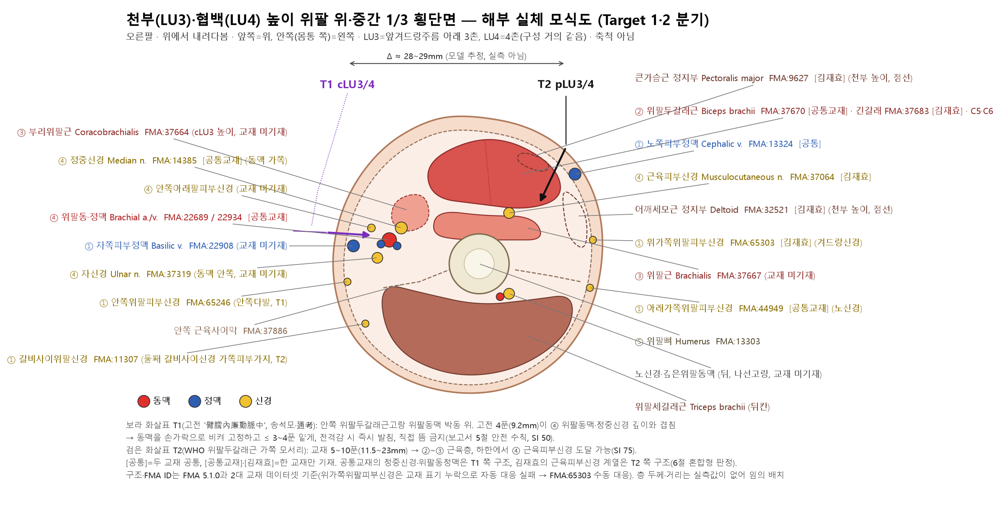
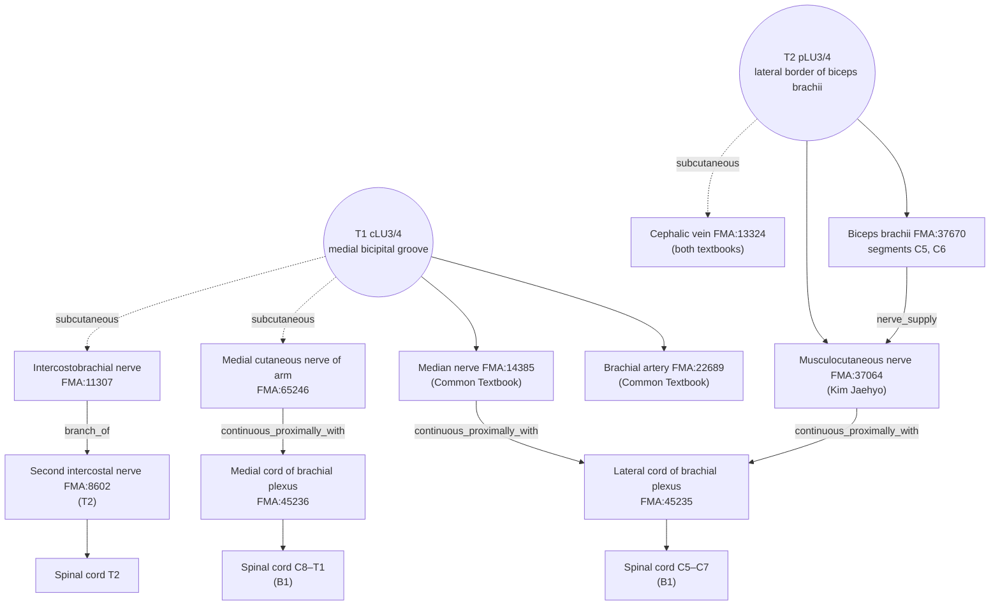

# [Acupoint Anatomical & Physiological Substrate Monograph] Tianfu (天府, LU3) and Xiabai (俠白, LU4): Integrated Report

> **Framework**: v2.7 (revised 2026-10-04) · **ARI**: given per Target below · **Dual scoring**: completed by two independent raters, adjudicated
> - cLU3: `ARI v3.0 | ARI-Core 56.2 ± 2.5 (C·H) | SI 50 | provisional weights 0.40/0.35/0.25 | sensitivity (equal weights): 52.1 (D, grade changes → weight-sensitive)`
> - cLU4: `ARI v3.0 | ARI-Core 62.5 ± 1.2 (C·H) | SI 50 | provisional weights 0.40/0.35/0.25 | sensitivity (equal weights): 57.3 (C, grade unchanged)`
> - pLU3: `ARI v3.0 | ARI-Core 41.2 ± 0 (D·H) | SI 75 | provisional weights 0.40/0.35/0.25 | sensitivity (equal weights): 39.6 (D, grade unchanged)`
> - pLU4: `ARI v3.0 | ARI-Core 43.8 ± 2.5 (D·H) | SI 75 | provisional weights 0.40/0.35/0.25 | sensitivity (equal weights): 41.7 (D, grade unchanged)`

> **Date of integration**: 2026-10-03 (v2.7 revision 2026-10-04, FMA supplement 2026-10-23; see the revision histories at the end)
> **Anatomical Ontology**: local index of the FMA (Foundational Model of Anatomy) 5.1.0 — textbook structures are pinned to `FMA:ID`s and their innervation, spinal segments and nerve trunks are cross-checked (B1 supplementary, not yet in the registry). Mapping table: `02_Master_Datasets/FMA/acupoint_fma_mapping.json`; details in Appendix A.
> **Reports integrated (originals kept in `_원본_보관/`, pre-revision edition kept in `_구판_v2.6/`)**:
> - `LU03_천부/LU03_천부_해부생리_실체판명_보고서.md·.html·.xlsx`
> - `LU04_협백/LU04_협백_해부생리_실체판명_보고서.md·.html·.xlsx`
> - `_원본_보관/LU_비교분석_구판/LU3_LU4_Comparative_Analysis_Report.md·.html`
> **Principle of integration**: because content overlap among the three reports exceeded 50%, they were merged into a single authoritative edition built around the comparative-analysis report. During integration the text was re-checked against the Three Primary Classics, the master datasets and the original papers, and contradictions and factual errors among the earlier reports were corrected (§11, correction audit table).
> **Note on script**: Classical quotations and TCM terms are given in Traditional Chinese (繁體字). The cited source files are simplified-script editions, so the file names and line numbers in `code` refer to those files as they are named on disk. In evidence pointers, "Xuewei Tongjian" = 《中國針灸穴位通鑑》, "Zhengzhi Tongjian" = 《中國針灸證治通鑑》 and "Tongkao" = 《針灸腧穴通考》, followed by the chunk-file range and line number.

---

## 0. Executive Summary

1. **The classical Tianfu (天府) and Xiabai (俠白) are most plausibly the pulsation points of the brachial artery on the medial side of the arm (ARI-Core C·H, possible/hypothetical level).** *Zhenjiu Jiayi Jing* (《針灸甲乙經》) and *Huangdi Neijing Mingtang* (《黃帝內經明堂》) describe Tianfu (天府) as "腋下三寸，臂臑內廉動脈中" and Xiabai (俠白) as "在天府下，去肘五寸動脈中". Song Seok-mo (2022) and Huang Longxiang (黃龍祥, *Zhenjiu Shuxue Tongkao* 《針灸腧穴通考》) both identify this "動脈" (artery) as the **brachial artery**, which runs in the medial bicipital groove. However, there are no point-specific measurements (cadaveric or ultrasound) and no point-specific Layer A studies, so the verdict is **possible/hypothetical (C·H)**, not "substrate established".
2. **The modern WHO location is on the lateral border of biceps brachii, a different place from the classical location.** The spatial discrepancy between the two sites is estimated anatomically at about 25–35 mm (model value ≈ 29 mm), which exceeds the Δ > 15 mm criterion, so **the analysis is split into Target 1 (classical arterial points, cLU3/cLU4) and Target 2 (WHO points, pLU3/pLU4)**. The earlier Tianfu report's verdict of "Δ ≈ 3 mm, single target" is withdrawn.
3. **The two researchers agree on the diagnosis but differ on the remedy.**
   - Song Seok-mo: the WHO location is an error, so **Tianfu (天府) and Xiabai (俠白) should be returned to their position over the brachial artery.**
   - Huang Longxiang (黃龍祥): already at the stage of 《靈樞·經脈》 the course of the Hand-Taiyin (手太陰) channel had shifted to the radial side of the arm, and the modern location reflects that change belatedly. The problem lies not in the location but in the **"separation of name and substance" (名實分離): the location has changed, yet the indications, layer anatomy and needling methods were inherited unchanged from the classical arterial point.** "今之天府已非古之天府"
4. **Verdict of this report (dual-target coexistence model)**:
   - The classical indications (鼻衄·喘咳 / 心痛·煩滿) are assigned to **Target 1 (cLU3, cLU4)**.
   - The main indication of Target 2 (pLU3, pLU4) is **local pain of the upper arm**; transferring the classical indications to it unchanged is cautioned against.
   - Branch decision (§10.5): ΔARI-Core is 15.0 for cLU3 vs pLU3 and 18.7 for cLU4 vs pLU4, both ≥ 10 with non-overlapping ± intervals, so **for both pairs Target 1 (the classical arterial point) is declared superior in substrate-identification reliability**. The SI, however, is higher for Target 2 (75 vs 50).
5. **Level of biomedical evidence**: after the 2026-10-04 sync the master DB contains human studies in which the WHO Tianfu (天府) and Xiabai (俠白) were needled together with other points (papers.id 1819, 1822, 1832, 1833; uncontrolled before–after comparisons) and a randomised comparative study of periarthritis of the shoulder that includes LU4 (1836). All of them, however, use prescriptions of 7–11 combined points, so **point-specific Layer A = 0 papers**, and Gate 2 (S_reflex ≤ 25, H) applies. B-Check scores are cLU3 5/12, cLU4 7/12 and pLU3 and pLU4 6/12, all below 8/12, so the reflex mechanisms below are **hypotheses**.
6. **ARI v3.0 (dual scoring, adjudicated)**:

   | Target | ARI-Core (mean ± half-range) | Grade·flag | SI | Equal-weight sensitivity |
   | :--- | :---: | :---: | :---: | :--- |
   | cLU3 | 56.2 ± 2.5 | C·H | 50 | 52.1 (D, weight-sensitive) |
   | cLU4 | 62.5 ± 1.2 | C·H | 50 | 57.3 (C, unchanged) |
   | pLU3 | 41.2 ± 0 | D·H | 75 | 39.6 (D, unchanged) |
   | pLU4 | 43.8 ± 2.5 | D·H | 75 | 41.7 (D, unchanged) |

   Scores of the earlier v2.6 edition are not comparable with v3.0 (see revision history).

---

## 1. Classical Literature Screening Table (Rank 1·2: Direct Collation of the Three Primary Classics)

| Classic | Location searched | Tianfu (天府, LU3) | Xiabai (俠白, LU4) |
| :--- | :--- | :--- | :--- |
| ***Zhongguo Zhenjiu Xuewei Tongjian* (《中國針灸穴位通鑑》)** | `中国针灸穴位通鉴/chunks_refined/中国针灸穴位通鉴(上卷)_321-400.md` | **Source**: "腋內動脈，手太陰也，名曰天府" (《靈樞·本輸》, vessel name), "天府二穴" (Wang Bing's (王冰) commentary on 《素問·氣穴論》 15:108, point name) (L144, L146). **Location**: "在腋下三寸，臂內廉動脈中，手太陰脈氣所發" (《甲乙》 3:50). **Aliases**: 無 (none). **Needling**: "禁不可灸，灸之令人逆氣。刺入四分，留三呼" (《甲乙》, L282). **Concluding note on location**: "歷代文獻記載基本一致" (L332). However, the needling summary in the concluding note (L388) gives the 《甲乙》 as "刺入四分、留五呼", differing from the entry itself (L282 "留三呼") (an internal variant within the Tongjian) | **Location**: "在天府下去肘五寸動脈中" (《甲乙》 3:50). **Aliases**: 無 (none). **Channel attribution**: "手太陰之別". **Needling**: "刺入四分，留三呼，灸七壯" (《甲乙》, L482), "刺入三分" (《銅人》). **Concluding note on location**: "歷代文獻記載基本一致" (L510) |
| ***Zhongguo Zhenjiu Zhengzhi Tongjian* (《中國針灸證治通鑑》)** | `中国针灸证治通鉴/chunks_refined/中国针灸证治通鉴_401-480.md` | **Epistaxis (鼻衄)**: "暴癉內逆，肝肺相搏，血溢鼻口，取天府"; 《外臺》 "灸兩膊上大脈…以鼻嗅臂", with the editorial note (按語) "此方所取穴即天府穴"; 《百證賦》 "天府合谷，鼻中衄血宜追". **Goitre (癭)**: "癭惡氣，灸天府五十壯", etc. | **Skin (皮膚)**: 《古今醫統》 "治赤白汗斑，灸夾白穴即愈" (editorial note "夾白即肺經俠白穴"); modern vitiligo (白癜風) "俠白(點刺出血再行拔火罐)" |
| ***Zhenjiu Shuxue Tongkao* (《針灸腧穴通考》)** | `针灸腧穴通考/chunks_refined/针灸腧穴通考(上)_81-160.md` (L1653–2025) | **Study of name and substance (名實考)**: "今之天府已非古之天府". Ancient "臂臑內廉動脈中", modern "肱二頭肌橈側緣". Because the brachial artery descends along the medial bicipital groove, "此處已相當於今之手少陰經穴分布區域". The first to use the anatomical term for the lateral border were Japanese acupuncture books. Chinese textbooks kept "臑內廉動脈中" through the 1957 Nanjing (南京) 《針灸學》 and the 1st–2nd editions of the 《講義》 (*Lecture Notes*), and changed it to "肱二頭肌外緣" from the 4th edition | **Study of name and substance (名實考)**: "本穴定位，古今不同". On the statement "重按有動脈應手" in the 1st edition of the 《講義》: "按如今之定位，無論如何重按，也不會觸及動脈搏動". "俠白部位在動脈中，故該穴仍可能由手太陰標脈'天府脈'演變而來". The indication "心痛" = the chest bi heart pain (胸痹心痛) group |

- **Variant note**: the location wording for Tianfu (天府) is "臂內廉" in the Xuewei Tongjian (《穴位通鑑》, quoting 《甲乙》 3:50, L172) and "臂臑內廉" in the Tongkao (《通考》) and the collated *Mingtang* (《明堂》). The meaning (medial border of the upper arm) is the same, so this does not affect the location verdict.

**Supplementary source (checked against the original paper)**: Song Seok-mo, "A Study on the Course of the Lung Meridian of Hand-Taiyin (手太陰肺經): Focusing on Tianfu (天府) and Xiabai (俠白)", *Korean Journal of Acupuncture* 39(4):172-183, 2022. https://doi.org/10.14406/acu.2022.024 (papers.id 440; local PDF: `학습자료/실험 및 연구 논문/2022_Korean Journal of Acupuncture_송석모_…pdf`)
- Of the 36 texts collected in the Xuewei Tongjian (《穴位通鑑》), 18 place Tianfu (天府) on the medial side of the humerus and 28 place it over the artery
- Zhang Shouyi (張壽頤) "臑內前廉動脈中", Yun Tieqiao (惲鐵樵) "臑內廉動脈中": recorded as the medial artery up to the early 20th century

---

## 2. Primary Source vs. Secondary Quotation & Commentary Table (Rank 3)

| Period | Text | Description | Classification | Assessment |
| :--- | :--- | :--- | :---: | :--- |
| Pre-Qin | 《足臂十一脈灸經》 / 《陰陽十一脈灸經》 | Arm-Taiyin vessel (臂太陰脈) "以奏臑內" / Arm-Juyin vessel (臂鉅陰脈) "出臂內陰" | Primary | Course on the medial side of the upper arm; terminates at the Heart (心) |
| Pre-Qin & Han | 《靈樞·本輸》 · 《寒熱病》 | "腋內動脈，手太陰也，名曰天府" / "腋下動脈，臂太陰也，名曰天府…暴癉內逆，肝肺相搏，血溢鼻口，取天府" | Primary | **天府 was originally a vessel name (標脈, marker pulse)**, and the diagnostic pulse-taking site (脈候) was converted into an indication (Huang Longxiang 黃龍祥) |
| Pre-Qin & Han | Wang Bing's (王冰) commentary on 《素問·氣穴論》 | "天府二穴" | Primary (point name) | The Xuewei Tongjian (《穴位通鑑》) cites this entry together as the source of the point name. No description of location or depth |
| Pre-Qin & Han | 《靈樞·經脈》 | "下循臑內，行少陰心主之前" | Primary | Interpretations diverge. Song Seok-mo reads "內" as medial; Huang Longxiang (黃龍祥) sees it as a stage shifted radially relative to the silk manuscripts (帛書) |
| Jin (晉) | *Zhenjiu Jiayi Jing* (《針灸甲乙經》) (= *Huangdi Mingtang Jing* 《黃帝明堂經》 lineage) | 天府 "腋下三寸，臂臑內廉動脈中…禁不可灸，刺入四分" / 俠白 "在天府下，去肘五寸動脈中，手太陰之別，刺入四分，灸五壯 (or 七壯)" | **Primary (source of location)** | Contains all three elements that fix a location (direction, distance, and the narrowing qualifier "動脈中") |
| Tang | 《深師方》 quoted in *Waitai Miyao* (《外臺秘要》) | "灸兩臂中脈…以鼻嗅臂，點其鼻所著處是穴" | Primary (moxibustion prescription) | Original source of the simplified locating method (以鼻取之, locating with the nose). The original text says "臂脈" and does not name Tianfu (天府) |
| Song | 《銅人腧穴針灸圖經》 | 天府 "在腋下三寸動脈中，以鼻取之…今附刺鼻衄血不止" / 俠白 "針入三分" | Secondary | Records both the simplified locating method and "動脈中". Needling of 3 fen appears |
| Ming | Zhengtong replica of the Song bronze figure (正統仿宋銅人) | Marks 天府, 俠白 and 尺澤 on the **radial side of the flexor surface of the arm** | Secondary (illustration) | Text (動脈中) and illustration (radial side) diverge. The bronze-figure charts of 史素, 丘濬 and the Imperial Medical Academy (太醫院) mark the ulnar side |
| Ming | *Zhenjiu Dacheng* (《針灸大成》) | "腋下三寸，肘腕上五寸動脈中，用鼻尖點墨，到處是穴" | Secondary | Arterial description retained |
| Modern | Chinese unified textbooks (統編教材), 4th edition onward / WHO 2008 (B1-05) | "肱二頭肌外緣/橈側緣", "lateral border of the biceps brachii" | Modern revision | Arterial description dropped; only the location is fixed on the radial side |

---

## 3. Nomenclature & Alias Collation Table (Rank 3)

| Code | Standard name | KJH DB (`경혈명_비교_정리_KJH.xlsx`) | Xuewei Tongjian (《穴位通鑑》) | Verdict |
| :---: | :---: | :---: | :---: | :--- |
| LU03 | Tianfu (天府) | 天會 (row 57) | 別名無 (no alias) | **天會 is not an alias of Tianfu (天府) but of Tianchi (天池, PC1).** 《甲乙》 3:46 天池 "一名天會" (Xuewei Tongjian (上卷)_401-480 L822, L994; Tongkao (下)_81-160 L549, L567 "天池，一名天會。在乳後一寸，腋下三寸"). No classic giving 天會 as an alias of Tianfu (天府) was found → **removed from the alias list of Tianfu (天府)** |
| LU04 | Xiabai (俠白) | – (row 58) | 別名無 (no alias) | No alias. Only the spelling variants "夾白·挾白" (Song onward). The alias "白雄" in the earlier LU4 report is **unsupported → deleted** |

**How 天會 came to be misattributed (dataset collation)**
- The current KJH file (row 57 LU03, row 274 PC01) and the Common Textbook and Kim Jaehyo datasets (`경혈_기본정보_마스터` row 55 LU03, row 272 PC01) all record the same '天會' for both LU03 and PC01.
- `경혈명_비교_정리_KJH_backup.xlsx`, first extracted from the lecture slides, gives the LU03 alias as '–' (`01_수태음폐경_각론` slide 31) and the PC01 alias as '天會' (`03_수궐음심포경` slide 33). The '天會' for LU03 is therefore **presumed to be a PC01 value copied in error during dataset compilation**, not something on the original slide.
- Background to the contamination (presumed): Tianchi (天池) and Tianfu (天府) are both described as "腋下三寸" and appear together in the list of '天'-character points in 《靈樞·本輸》 (Tongkao (下)_81-160 L557). Their names and location wording overlap, making them easy to confuse.
- Action: the alias '天會' of Tianfu (天府) has been deleted from the report. The original datasets (KJH and the two textbook xlsx files) were not modified in this revision and need to be checked by the dataset maintainer.

Confusion with neighbouring points:
- 《竇太師針經》's description of Tianfu (天府) as "肘腕上五寸" is a conflation with the location of Xiabai (俠白) (《通考》).
- In Japan from the Edo (江戶) period onward, the theory of a 1-chi (尺) bone-proportional length for the upper arm produced the variant "天府下二寸" (Bao Tianbai 包天白 1933, Zhao Erkang 趙爾康 1947, 《中華針灸學》 "天府下二寸").
- It must be distinguished from the extra point **Xiaxiabai (下俠白)** (2 cun below Xiabai (俠白), radial side of biceps brachii).

---

## 4. 3D Spatial Coordinates & Layer 1–5 Layer Structure (Rank 5)

### 4.1 Coordinate System and Dual-Target Split

The origin of the coordinates is the anterior midline of the upper arm at the relevant level.
- X: medial −, lateral +
- Y: distal direction from the anterior axillary fold (mm)
- Z: depth from the skin surface

| Indicator | Target 1: classical arterial point (cLU3 / cLU4) | Target 2: WHO location (pLU3 / pLU4) |
| :--- | :--- | :--- |
| Surface location | Medial surface of the arm, in the medial groove at the **medial border** of biceps brachii, over the pulsation of the brachial artery. cLU3 = 3 cun below the anterior axillary fold; cLU4 = 1 cun below that (5 cun above the elbow) | Anterolateral surface of the arm, **lateral border** of biceps brachii. pLU3 = 3 cun below the anterior axillary fold; pLU4 = 4 cun |
| Locating landmark | "動脈應手" (pulsation felt under the finger). The pulse is palpated in the medial groove with the palm facing forward | Lateral border of the long head of biceps brachii; course of the cephalic vein |
| Model coordinates (values of the earlier comparative report retained) | cLU3 (X −14.5, Y 69, Z 18.2) / cLU4 (X −13.2, Y 92, Z 17.5) | pLU3 (X +13.8, Y 69, Z 12.0) / pLU4 (X +14.5, Y 92, Z 11.5) |
| Spatial discrepancy Δ | **cLU3–pLU3: √(28.3² + 6.2²) ≈ 29.0 mm**, **cLU4–pLU4: √(27.7² + 6.0²) ≈ 28.3 mm** | Reference point |
| Branch decision | **Δ > 15 mm → dual split** (based on model values) | — |

> The coordinates are not measurements but **model estimates** based on the width of the adult biceps brachii (about 25–40 mm). Y was converted with 1 cun ≈ 23 mm (based on 9 cun from the anterior axillary fold to the cubital crease). The Y values of the earlier comparative report (220/195 mm) did not state a reference point and have been changed to the anterior axillary fold reference. Z is a model value denoting the **central depth of each Target's target structure** (cLU = centre of the neurovascular bundle, pLU = centre of the lateral belly of biceps brachii), and differs from the depth at which the arterial pulse is first palpable (about 5–10 mm in lean individuals). It must be confirmed by measurement (ultrasound).

### 4.2 Layers 1–5 (Structure-Based Definition of Framework Rank 5)

The Framework defines Layers by **structure type**, not by mm ranges (L1 skin/subcutis / L2 superficial muscle and fascia / L3 deep muscle and nerve plane / L4 neurovascular bundle / L5 periosteum and deep organs). At the medial arterial point the neurovascular bundle (L4) lies just beneath the deep fascia and can be shallower than the deep muscle (L3), so the layer numbers should be read as a structural classification, not a depth order.

| Layer (structure) | Target 1: cLU3 / cLU4 (medial arterial point) | Target 2: pLU3 / pLU4 (lateral border) |
| :--- | :--- | :--- |
| **L1** Skin/subcutis | Territory of the medial cutaneous nerve of arm (T1) and intercostobrachial nerve (T2). Subcutaneous fat. The basilic vein pierces the deep fascia at about mid-arm (near the level of cLU4) | Superior lateral cutaneous nerve of arm (axillary nerve, C5; level of pLU3), inferior lateral cutaneous nerve of arm (radial nerve, C5-6; level of pLU4). **Cephalic vein**, lateral bicipital groove |
| **L2** Superficial muscle/fascia | Deep fascia (brachial fascia), medial border of biceps brachii | Lateral belly and fascia of the long head of biceps brachii; motor point |
| **L3** Deep muscle/nerve plane | Coracobrachialis (cLU3), medial part of brachialis (cLU4), medial intermuscular septum | Brachialis |
| **L4** Neurovascular bundle | **Brachial artery and venae comitantes, median nerve** (lateral to the artery in the upper arm, crossing anteriorly at mid-arm), ulnar nerve (medial to the artery proximally), medial cutaneous nerve of forearm, periarterial sympathetic plexus. Lies just beneath the deep fascia; in lean individuals the pulse is palpable at about 5–10 mm | **Musculocutaneous nerve** (between biceps brachii and brachialis). The brachial artery and median nerve lie about 25 mm or more medially |
| **L5** Periosteum/deep organs | Periosteum of the medial surface of the humerus | Periosteum of the anterolateral surface of the humerus. No deep organs |

> Depth values are estimates based on general anatomical knowledge (B1-01, B1-03, B1-06) and vary greatly with subcutaneous fat thickness. There are no point-specific measurement papers.



*Figure 4-1. Schematic transverse section of the upper/middle third of the arm at the level of Tianfu (天府) and Xiabai (俠白) (right arm, viewed from above, not to scale). The purple arrow T1 (cLU3/4) runs from the medial surface to the brachial artery–median nerve bundle in the medial bicipital groove; the black arrow T2 (pLU3/4) is the path entering the muscle layer at the lateral border of biceps brachii. LU3 and LU4 are 1 cun apart and their sectional composition is almost identical, so they are drawn in a single figure; structures that vary with level (coracobrachialis, deltoid and the insertion of pectoralis major) are dashed. Layer thicknesses and Δ are model estimates.*

### 4.3 FMA Substrate Collation (by Target and Layer) — structure names from the two textbooks and normative anatomy; IDs and relations from FMA 5.1.0

| Target·Layer | Structure | FMA | FMA relation | Trunk / segment (FMA) | Textbook |
| :--- | :--- | :--- | :--- | :--- | :--- |
| T1 L1 | Medial cutaneous nerve of arm | FMA:65246 | continuous_proximally_with Medial cord of brachial plexus (FMA:45236) | Medial cord (T1, B1-03) | Not in textbooks |
| T1 L1 | Intercostobrachial nerve | FMA:11307 (Lateral cutaneous branch of second intercostal nerve) | branch_of Intercostal nerve → Thoracic nerve | **Second intercostal nerve (T2)** | Not in textbooks |
| T1 L1 | Basilic vein | FMA:22908 | — | — | Not in textbooks |
| T1 L3 | Coracobrachialis (level of cLU3) | FMA:37664 | contained_in anterior compartment space | Branch of musculocutaneous nerve to coracobrachialis · C5, C6 | Not in textbooks |
| T1 L4 | Brachial artery · brachial vein | FMA:22689 · FMA:22934 | Artery is_a Segment of subclavian artery (FMA modelling, see note below) / vein → Axillary vein | — | Common Textbook |
| T1 L4 | Median nerve | FMA:14385 | continuous_proximally_with Lateral cord of brachial plexus (FMA:45235) | No FMA segment (B1: C6–T1) | Common Textbook |
| T1 L4 | Ulnar nerve | FMA:37319 | — | No FMA segment (B1: C8–T1) | Not in textbooks |
| T1 L4 | Medial intermuscular septum | FMA:37886 | — | — | — |
| T2 L1 | Cephalic vein | FMA:13324 | → Subclavian vein | — | **Both textbooks** |
| T2 L1 | Superior lateral cutaneous nerve of arm (level of LU3) | FMA:65303 (manual mapping) | Axillary nerve system | B1: C5 | Kim Jaehyo |
| T2 L1 | Inferior lateral cutaneous nerve of arm (level of LU4) | FMA:44949 | → Peripheral segment of radial nerve | B1: C5–C6 | Common Textbook |
| T2 L2 | Biceps brachii (long head) | FMA:37670 (long head FMA:37683) | contained_in Space of anterior compartment of arm (FMA:85160) | Branch of musculocutaneous nerve · **C5, C6** | Common Textbook (whole muscle) · Kim Jaehyo (long head) |
| T2 L3 | Brachialis | FMA:37667 | — | — | Not in textbooks |
| T2 L4 | Musculocutaneous nerve | FMA:37064 | continuous_proximally_with Lateral cord of brachial plexus (FMA:45235) | No FMA segment (B1: C5–C7) | Kim Jaehyo |
| (level of LU3) | Deltoid · insertion of pectoralis major | FMA:32521 · FMA:9627 | Deltoid ← branch of axillary nerve · C5 (primary), C6 | — | Kim Jaehyo |
| L5 | Humerus | FMA:13303 | — | — | — |

- FMA classifies the brachial artery (FMA:22689) as a *Segment of subclavian artery* (modelling the subclavian–axillary–brachial arteries as segments of one continuous trunk). This does not contradict "continuation of the axillary artery" in normative anatomy, but it is not cited as a systemic name.
- Among the Kim Jaehyo textbook terms, "superior lateral cutaneous nerve" lacks "of arm", so automatic mapping failed; it is mapped manually to FMA:65303 *Superior lateral cutaneous nerve of arm*. "dorsal antebrachial cutaneous n., C5-6" is regarded as a duplicate designation of the same structure as the textbook's posterior cutaneous nerve of forearm (FMA:39145 *Posterior cutaneous nerve of forearm*) (automatic mapping: none).
- FMA segments exist only in the muscles' `segmental_supply` (biceps brachii and coracobrachialis C5, C6; deltoid C5 primary, C6), not in the nerves themselves. Nerve segments are described from B1-01 and B1-03. The T1 and T2 cutaneous nerves in T1 L1 above are not in the textbook datasets and have been supplemented from FMA and normative anatomy (segmental basis of H1 in 8.2).

---

## 5. Needling Depth Calculation Table (Rank 5: 1 fen = 2.3 mm)

`침구문헌별 자침깊이 정리_AI 분석용.xlsx` Sheet 1, rows 56 (LU03) and 57 (LU04) (identical values for the two points), collated with the classics:

| Text | Tianfu (天府) | Xiabai (俠白) | Han-dynasty conversion z | Layer reached |
| :--- | :---: | :---: | :---: | :--- |
| *Huangdi Mingtang Jing* (《黃帝明堂經》) (collated by Huang Longxiang 黃龍祥) | 4 fen, 禁灸 (no moxibustion) | 4 fen, 灸五壯 | 9.2 mm | cLU: **L4 brachial artery and median nerve** (contact in lean individuals) |
| *Zhenjiu Jiayi Jing* (《針灸甲乙經》) | 4 fen, 留三呼, 禁灸 | 4 fen, 留三呼, 灸七壯 | 9.2 mm | Same |
| *Donguibogam* (《東醫寶鑑》) (quoting the *Tongren* 《銅人》) | 3 fen | 3 fen | 6.9 mm | cLU: L1–L2 (close to L4 depending on build) |
| *Taiping Shenghui Fang* (《太平聖惠方》) | 4 fen, 留七呼, 灸二七壯–百壯 | — | 9.2 mm | — |
| Common textbooks of Meridian & Acupoint Studies / Acupuncture Medicine / 《通考》 | 5–10 fen | 5–10 fen | 11.5–23 mm | pLU: L2–L3 biceps brachii and brachialis; at the lower limit may reach the L4 musculocutaneous nerve |
| *Chimgu Gyeongheombang* (《鍼灸經驗方》) | blank (not described, missing) | blank (missing) | — | — |

- Neither point has the needling-prohibition value `'0'`.

**Interpretation**
- The classical 4 fen (≈ 9.2 mm) **overlaps the depth of the L4 neurovascular bundle at the medial arterial point.** The shallow classical needling rule and the moxibustion prohibition (禁灸) at Tianfu (天府) derive from its character as "a point over a great vessel (大脈)". The 《通考》 states: "古代文獻所言'禁灸'是針對位於大脈中的'天府'而言，現代的定位已不在脈中".
- The modern perpendicular insertion of 0.5–1 cun presupposes the lateral muscular point (pLU). **Applying this depth unchanged to the medial arterial point (cLU) risks injury to the brachial artery and median nerve.**
- **Needling safety rules for cLU (proposed)**:
  1. Palpate the pulse, then displace and hold the artery aside with a finger.
  2. Insert shallowly beside the artery (≤ 3–4 fen, about 7–9 mm).
  3. Withdraw the needle immediately if an electric-shock sensation (median-nerve stimulation) occurs.
  4. Do not apply direct moxibustion.
- The earlier comparative report's recommendation of "oblique needling as if grazing the arterial wall" is **withdrawn for safety reasons.**

---

## 6. Textbook Comparison Table of Anatomical Structures (Common Textbook vs. Kim Jaehyo)

| Category | *Common Textbook of Acupoint Studies* dataset (vol. 1, pp. 40, 44) | Prof. Kim Jaehyo dataset | Similarities and differences |
| :--- | :--- | :--- | :--- |
| **Muscles** | Biceps brachii for both Tianfu (天府) and Xiabai (俠白) | Tianfu (天府): deltoid, pectoralis major, long head of biceps brachii / Xiabai (俠白): long head of biceps brachii | Both presuppose the lateral location (pLU). The Kim Jaehyo dataset also includes the insertions of deltoid and pectoralis major at the level of Tianfu (天府) |
| **Nerves** | **Median nerve**, lateral cutaneous nerve of forearm, inferior lateral cutaneous nerve of arm | Superior lateral cutaneous nerve of arm, **musculocutaneous nerve**, posterior cutaneous nerve of forearm, dorsal antebrachial cutaneous nerve (C5-6) | **Key difference.** The median nerve in the Common Textbook is a structure of the medial arterial point (cLU). The Kim Jaehyo dataset is consistently musculocutaneous-related, matching the lateral location |
| **Vessels** | **Brachial artery and vein**, cephalic vein | Cephalic vein | The brachial artery and vein in the Common Textbook are likewise structures of the medial arterial point. The cephalic vein is common to both textbooks |
| **Verdict** | **Mixed type**: structures of the classical arterial point (median nerve, brachial artery) mixed onto the lateral location | **Consistently lateral type** | The two textbooks agree only on the muscle and the cephalic vein, and **disagree** on nerves and vessels. The Common Textbook's mixture reproduces at textbook level the separation of name and substance (名實分離) pointed out by Huang Longxiang (黃龍祥): "**the location changed, but the layer anatomy follows the classics**". Presumed to inherit the description "循上膊動脈…分布正中神經" of the 1930s–40s 《高等針灸學講義》 and 《中華針灸學》 quoted in the Xuewei Tongjian (《穴位通鑑》) |

Sources: `경혈학공통교재 경혈_해부구조_데이터셋_refine.xlsx` `해부구조_개별항목_상세` rows 273–284, `김재효 수업_경혈_해부구조_데이터셋.xlsx` `해부구조_개별항목_상세` rows 399–412 (registry B2-09).

**FMA adjudication** (Appendix A): LU03 has 1 shared FMA entity (cephalic vein FMA:13324) · 6 Common Textbook only · 5 Kim Jaehyo only; LU04 has 1 shared · 6 Common Textbook only · 3 Kim Jaehyo only. For biceps brachii the Common Textbook records the whole muscle (FMA:37670) and Kim Jaehyo the long head (FMA:37683, a part of the whole); only the IDs differ and it is the same muscle, so the structures actually shared are two: **biceps brachii + cephalic vein**.

- **Meaning of the difference seen through FMA**: the Common Textbook's median nerve (FMA:14385) and brachial artery/vein (FMA:22689, 22934) form the neurovascular bundle of the medial bicipital groove (FMA:74569 Medial bicipital groove), i.e. **T1-side structures**. Kim Jaehyo's musculocutaneous nerve (FMA:37064), superior lateral cutaneous nerve of arm (FMA:65303) and posterior cutaneous nerve of forearm (FMA:39145) are **T2-side structures** between biceps brachii and brachialis and in the lateral skin. In FMA both the musculocutaneous and median nerves continue from the lateral cord of the brachial plexus (FMA:45235), but their positions in the arm differ, so the verdict above — "mixed type (Common Textbook) vs consistently lateral type (Kim Jaehyo)" — is confirmed at the ID level. This adjudication does not change the $S_{clarity}$ level.

**Diagram**

```
        [Schematic transverse section at mid-arm level — viewed from the front, left = medial]

 Medial                                                              Lateral
   │ Basilic v.                                             Cephalic v.  │
   │ ● Brachial a. + median n.  ┌──── Biceps brachii ────┐  ◇ pLU3/4     │
   │ ▲ cLU3/4 (classical·Song)  └─ Brachialis / MC n. ───┘  (WHO·texts)  │
   │  Medial intermuscular septum   [ Humerus ]  Lat. interm. septum    │
   └─────────────────────── Δ ≈ 28–29 mm (model) ────────────────────────┘
   Common Textbook nerve/vessel list = ▲-side structures   Kim Jaehyo nerve/vessel list = ◇-side structures
```

---

## 7. Spatial Displacement Bifurcation Reasoning (Dual-Target Bifurcation)

| Issue | Song Seok-mo (2022) | Huang Longxiang (黃龍祥), *Zhenjiu Shuxue Tongkao* (《針灸腧穴通考》) | Verdict of this report |
| :--- | :--- | :--- | :--- |
| Substrate of the classical Tianfu (天府) and Xiabai (俠白) | Pulsation point of the brachial artery (medial) | Pulsation point of the brachial artery (medial); corresponds to today's Hand-Shaoyin Meridian (手少陰經) region | **The two sources agree. Probable (not confirmed by measurement)** |
| 《靈樞·經脈》 "下循臑內" | Medial side of the arm = course of the brachial artery | A stage shifted radially relative to the silk manuscripts (帛書) ("已較…移向上臂橈側"). The point location followed this belatedly | **Interpretations diverge.** Huang Longxiang's (黃龍祥) view that "行少陰心主之前" implies a radial shift cannot be excluded |
| How the location moved laterally | From the mid-20th century; a **conjecture** that it was misread because the arterial description was dropped and the simplified locating method (where the nose tip touches the raised arm) was ambiguous | The Ming Zhengtong bronze figure (明正統銅人) already marks the radial side of the flexor surface. The first to use the anatomical term "lateral border" were Japanese acupuncture books. Chinese textbooks from the 4th edition | **Multiple pathways.** The earlier comparative report's single-cause theory of "misreading of the nose-to-arm posture in the 1950s" has been **revised, because neither source asserts it** |
| Remedy | **Treat the WHO location as an error and restore the medial arterial point** | **Accept the modern location and revise the indications, needling methods and layer anatomy to fit the new location** (天府 mainly for local arm and upper-arm problems, with lung symptoms secondary) | **Dual-target coexistence**: classical indications assigned to cLU, local indications to pLU. Whether to revise the standard is left to the academic community |
| ΔARI-Core verdict (§10.5) | — | — | cLU3 > pLU3 (Δ 15.0, non-overlapping), cLU4 > pLU4 (Δ 18.7, non-overlapping) → **Target 1 declared superior** |

---

## 8. Biomedical Reflex Pathway Diagram & External Search Log (Rank 6)

### 8.1 Layer A Papers (`경혈_생의학_신경반사_마스터DB.json`, after the 2026-10-04 sync)

**Point-specific studies (mechanistic or clinical studies of cLU or pLU stimulation alone): 0 papers.** Below are studies whose prescriptions include LU3 or LU4, and literature studies.

| papers.id | Year | Journal | Title | PMID / DOI | Design | Relevant Target·assessment |
| :---: | :---: | :--- | :--- | :--- | :--- | :--- |
| 1819 | 2020 | Evid Based Complement Alternat Med | Effect of Acupuncture on Muscle Endurance in the Female Shoulder Joint: A Pilot Study | PMID 32952592 | Human, simultaneous needling of multiple points (7–11), uncontrolled before–after comparison | Includes pLU3 and pLU4. Not point-specific |
| 1822 | 2020 | Evid Based Complement Alternat Med | Effects of Acupuncture on Explosive Force Production by the Healthy Female Shoulder Joint | PMID 33343681 | Same | Same |
| 1832 | 2021 | Int J Environ Res Public Health | Effect of Acupuncture on Timeliness of Male Shoulder Joint Endurance | PMID 34070380 / 10.3390/ijerph18115638 | Same | Same |
| 1833 | 2021 | Evid Based Complement Alternat Med | Effect of Acupuncture on the Timeliness of Explosive Forces Generated by the Male Shoulder Joint | PMID 33815552 / 10.1155/2021/5585605 | Same | Same |
| 1836 | 2013 | Zhongguo Zhen Jiu | Efficacy comparison of different stimulation therapies for periarthritis of shoulder | PMID 23620934 | Human, randomised comparison in periarthritis of the shoulder (EA, TENS and acupressure compared within the same multi-point prescription) | May include pLU4. Not point-specific |
| 1827 | 2026 | Zhongguo Zhen Jiu | Thoughts on the descriptions of acupoint indications in contemporary teaching materials: can Tianfu (LU3) treat shoulder-arm pain? | PMID 42618253 / 10.13703/j.0255-2930.20250624-k0001 | Literature commentary (non-experimental) | Commentary on the description of LU3 indications. Not counted among mechanistic papers |
| 1829, 1837 | 2020 | Zhongguo Zhen Jiu | Clinical observations of multi-point prescriptions for functional dyspepsia and chronic diarrhoea | PMID 33788483 / 32100510 | Human (non-RCT), multiple points | Low relevance to LU4 |
| 1838 | 2021 | Korean J Acupunct | Review of fire-needle and warm-needle studies in De Quervain's disease | 10.14406/acu.2021.031 | Review | Not counted among mechanistic papers |
| 440 | 2022 | Korean J Acupunct | A study on the course of the Lung Meridian of Hand-Taiyin (手太陰肺經): focusing on Tianfu (天府) and Xiabai (俠白) (Song Seok-mo) | 10.14406/acu.2022.024 | Literature study | Location collation (§1, §7) |

- **Excluded from citation (superseded)**: papers.id **1676** (PMID 8937575, "Sympathetic control of nasal mucosal vasculature…", Am J Rhinol 1996) was marked **superseded as an unverifiable citation** in the master DB (2026-10-04), because the PMID actually points to a different paper (Chen YT, Nelson WJ. *Anal Biochem* 1996) and the recorded DOI does not exist. papers.id **1677** (a manual entry for the Travell & Simons chapter on biceps brachii) is likewise superseded for the same reason; that book is cited only as Layer B registry entry **B2-06**.
- **Other automatically detected papers** (1810, 1820, 1821, 1823–1826, 1828 [an HT1 study], 1830, 1831, 1834, 1835) were excluded because on checking their titles they are unrelated to LU3 and LU4 or study other points. The locally held studies of textual history (373, 938, 1458, 1461, 1485, 1489, 1506, 1511, 1512, 1514, 1519, 554) are materials for classical collation, not mechanistic evidence.
- **DB note**: the DOIs recorded in the DB for 1819 and 1822 (10.3727/…, 10.1152/jappl.…) appear to belong to other papers, so these are cited by PMID only (to be checked). The master DB's LU3 innervation and reflex-circuit entries (musculocutaneous nerve C5-C7, stellate ganglion → Kiesselbach's plexus) do not fit this report's dual-split conclusion, and the LU4 entry is empty. The DB needs correcting.
- **Verdict**: multi-point human studies exist, but point-specific Layer A = 0 papers → Gate 2 applies (S_reflex ≤ 25, H). B-Check is below 8/12 for all four Targets, so the mechanisms below are **hypotheses**.

### 8.2 Layer B Neural Circuit Mapping (registry reference IDs)

| Hypothesis | Supporting structures (reference IDs) | Assessment of consistency |
| :--- | :--- | :--- |
| **H1. cLU4 – heart pain (心痛) (segmental convergence)** | Cardiac afferent fibres enter the spinal cord at T1–T4 (T5) (B3-03). The skin of the medial arm (medial cutaneous nerve of arm T1, intercostobrachial nerve T2; B1-03) is a typical area to which anginal referred pain spreads (Head zone, B3-01; viscero-somatic convergence, B3-02, B3-03) | **Segmental concordance is explicit (B-Check ② = 2).** However, the evidence for a somatic stimulus → cardiac reflex is an **inference** from somato-autonomic reflexes in anaesthetised animals (B3-04, B3-05) and cardiovascular reflexes at another point (PC5-6, over the median nerve) (B3-12, B3-13); there is no evidence for cLU4 itself → **hypothesis** |
| **H2. pLU4 – heart pain (心痛)** | The lateral skin belongs to segments C5–C6 (B1-03) | **Segmental mismatch.** The basis for assigning the heart pain (心痛) indication unchanged to the WHO point is weak. This physiologically supports Huang Longxiang's (黃龍祥) point about the separation of name and substance |
| **H3. cLU3 – epistaxis (鼻衄)** | Sympathetic preganglionic fibres to the head and nasal mucosa run from T1–T3 → superior cervical ganglion → vasoconstriction of the nasal mucosa (B1-01, B3-05). The skin and periarterial structures of cLU3 overlap segments T1–T2 | **Partially consistent, hypothesis level.** No registry reference supports the direction of the efferent effect (⑤) (⑤ = 0). Huang Longxiang (黃龍祥) holds that Tianfu's (天府) epistaxis and lung indications derive from its use in **diagnosing (pulse-taking, 脈候)** the "天府脈". In other words, they may be signs of disease at a diagnostic site rather than evidence of a stimulation effect (conflict → fixed as hypothesis) |
| **H4. pLU3/pLU4 – local upper-arm pain** | Myofascial trigger points of biceps brachii and the motor point of the musculocutaneous nerve (B2-06; trigger point–acupoint correspondence debate B2-03, B2-04), muscle afferents and connective-tissue planes (B2-02, B3-06), gate control and segmental analgesia (B3-07, B3-11) | **Consistent as a local effect.** However, the Layer A studies (1819, 1822, 1832, 1833, 1836) report outcomes of multi-point prescriptions for muscle strength and pain, so they cannot be attributed to pLU alone → hypothesis |

**Pinning the peripheral afferent pathway with FMA**: the first segment of H1–H4 (needling site → spinal cord) is pinned by FMA relations as shown below. T1 (cLU) starts from the medial cord and intercostal nerve (T1–T2) and the median nerve of the lateral cord, while T2 (pLU) starts from the musculocutaneous nerve (C5–C6) of the lateral cord, so **they enter different spinal segments** — this is the anatomical front end of H1 (cLU4 segmental concordance) and H2 (pLU4 segmental mismatch). This structural chain does not change the B-Check scores.



*Figure 8-1. Peripheral afferent pathways of Tianfu (天府) and Xiabai (俠白) drawn from FMA 5.1.0 relations. Solid lines are FMA relations (`nerve_supply`, `continuous_proximally_with`, `branch_of`); dashed lines are subcutaneous paths. Spinal segments of the nerve cords are not in FMA and are shown from B1-03.*

### 8.3 B-Check 6-Item Scoring Tables (adjudicated)

Items: ① peripheral nerve/vessel substrate at needling depth ② spinal segmental concordance ③ afferent fibre type & receptors ④ central relay & pathway ⑤ efferent pathway & effect direction matching P_single ⑥ human translation.

**cLU3 (classical Tianfu 天府; target indications: epistaxis 鼻衄 · dyspnoea and cough 喘咳)**

| Item | Rater A | Rater B | Final | Reference IDs | papers.id | Rationale |
| :---: | :---: | :---: | :---: | :--- | :--- | :--- |
| ① | 2 | 2 | **2** | B1-01, B1-03, B1-06 (+FMA) | — | The '動脈中' palpation landmark = brachial artery (FMA:22689), median nerve (FMA:14385) and medial cutaneous nerve of arm (FMA:65246) in the medial bicipital groove (FMA:74569) (explicit in normative anatomy texts) |
| ② | 1 | 1 | **1** | B1-03, B3-01, B3-05 (+FMA) | — | Medial arm skin T1–T2 (FMA: medial cutaneous nerve of arm ← medial cord; intercostobrachial nerve = lateral cutaneous branch of the second intercostal nerve FMA:11307) partly overlaps the segments of the sympathetic preganglionic supply to the nasal mucosa (T1–T3) and the lung (T2–T5). Median nerve C6–T1 mixed in; indirect |
| ③ | 1 | 1 | **1** | B3-04, B3-05, B3-06 | — | Periarterial and cutaneous afferent fibres inferred only from anaesthetised-animal evidence (outside scope) |
| ④ | 1 | 1 | **1** | B3-02, B3-04, B3-05 | — | Spinal segmental convergence and the stellate-ganglion pathway are theoretical inferences |
| ⑤ | 1 | 0 | **0** | B3-05 | — | No registry reference supports a haemostatic direction for epistaxis (鼻衄). The epistaxis indication may originate in pulse diagnosis (脈候) (conflict). 1676 not used (superseded) |
| ⑥ | 0 | 0 | **0** | B4-05 | — | No evidence of human translation for cLU |
| **Total** | 6 | 5 | **5/12** | | | **Verdict: hypothesis** (below 8, conflict at ⑤) |

**cLU4 (classical Xiabai 俠白; target indications: heart pain 心痛 · vexation and fullness 煩滿)**

| Item | Rater A | Rater B | Final | Reference IDs | papers.id | Rationale |
| :---: | :---: | :---: | :---: | :--- | :--- | :--- |
| ① | 2 | 2 | **2** | B1-01, B1-03, B1-06 (+FMA) | — | The brachial artery–median nerve bundle in the medial groove at mid-arm (FMA:22689, 14385 exact) is explicit in normative anatomy |
| ② | 2 | 2 | **2** | B1-03, B3-01, B3-03 (+FMA) | — | The T1–T2 dermatome of the medial arm (FMA: medial cutaneous nerve of arm FMA:65246 ← medial cord; intercostobrachial nerve FMA:11307 = branch of the second intercostal nerve) explicitly matches cardiac afferents T1–T4 and the area of anginal referred pain |
| ③ | 1 | 1 | **1** | B3-04, B3-05, B3-06, B3-12 | — | Inferred from anaesthetised-animal studies verified at PC5-6 over the median nerve (outside scope) |
| ④ | 1 | 1 | **1** | B3-03, B3-12 | — | Inference of dorsal-horn convergence and the rVLM pathway |
| ⑤ | 1 | 1 | **1** | B3-12, B3-13 | — | The direction of inhibiting sympathoexcitatory cardiovascular responses is conceptually consistent with the heart pain (心痛) indication, but the evidence comes from other points and animals |
| ⑥ | 0 | 0 | **0** | B4-05 | — | No evidence of human translation for cLU4 |
| **Total** | 7 | 7 | **7/12** | | | **Verdict: not concordant** (below 8) → mechanism described as a hypothesis |

**pLU3 (WHO Tianfu 天府; target: local upper-arm pain / conflict if the classical indications are assigned)**

| Item | Rater A | Rater B | Final | Reference IDs | papers.id | Rationale |
| :---: | :---: | :---: | :---: | :--- | :--- | :--- |
| ① | 1 | 2 | **1** | B1-01, B1-05, B2-09 (+FMA) | — | The muscle and musculocutaneous-nerve substrate (FMA:37670, 37064 exact) is supported by normative anatomy, but the nerve lists of the two textbooks disagree and there is no point-specific measurement |
| ② | 1 | 1 | **1** | B1-03 (+FMA) | — | The C5–C6 dermatome and myotome (union of FMA segments C5, C6) match the local upper arm but not the classical targets (lung, nose) |
| ③ | 1 | 1 | **1** | B2-02, B3-06, B3-18 | — | Inference from muscle afferents, connective-tissue planes and local adenosine (outside scope) |
| ④ | 1 | 1 | **1** | B3-07, B3-11 | — | General mechanisms of gate control and segmental analgesia |
| ⑤ | 1 | 1 | **1** | B2-03, B2-04, B2-06 | 1819, 1822 | Only the direction of a local myofascial effect is consistent. The Layer A outcomes are muscle-strength measures and do not directly match the pain indication |
| ⑥ | 1 | 1 | **1** | B4-04, B4-05 | 1819, 1822, 1832, 1833 | Indirect evidence from multi-point, uncontrolled before–after human studies |
| **Total** | 6 | 7 | **6/12** | | | **Verdict: hypothesis** (below 8; segmental conflict if the classical indications are assigned) |

**pLU4 (WHO Xiabai 俠白; target: local upper-arm pain / conflict if the classical indications are assigned)**

| Item | Rater A | Rater B | Final | Reference IDs | papers.id | Rationale |
| :---: | :---: | :---: | :---: | :--- | :--- | :--- |
| ① | 1 | 2 | **1** | B1-01, B1-05, B2-09 (+FMA) | — | The muscle and nerve substrate at the lateral border (FMA:37670, 37064 exact) is confirmed, but the textbook nerve lists disagree and there is no measurement |
| ② | 1 | 1 | **1** | B1-03 (+FMA) | — | Local segments C5–C6 (union of FMA segments C5, C6) match; mismatch with the classical heart pain (心痛) (T1–T4) (H2) |
| ③ | 1 | 1 | **1** | B2-02, B3-06 | — | General inference from muscle afferents |
| ④ | 1 | 1 | **1** | B3-07, B3-11 | — | General mechanism of segmental analgesia |
| ⑤ | 1 | 1 | **1** | B2-03, B2-04, B2-06 | 1836 | The direction of improvement in shoulder–arm pain matches the local indication, but the prescription is multi-point |
| ⑥ | 1 | 1 | **1** | B4-04, B4-05 | 1819, 1822, 1832, 1833, 1836 | Indirect evidence from human studies of combined multi-point prescriptions; no point specificity |
| **Total** | 6 | 7 | **6/12** | | | **Verdict: hypothesis** |

### 8.4 External Search Log (`sync_log`, Rank 6 runs of 2026-10-04 and 2026-10-23)

**LU3 Tianfu (天府)**

| Timestamp | Source | HTTP | Fetched | Duplicates removed | New | Query |
|---|---|---|---|---|---|---|
| 2026-10-04T09:51:18 | pubmed | 200 | 13 | — | — | ("LU3" OR "Tianfu" OR "天府") AND (acupuncture OR electroacupuncture) AND (nerve OR reflex OR autonomic OR mechanism OR anatomy) \| ("LU3" OR "Tianfu" OR "天府") AND |
| 2026-10-04T09:51:18 | openalex | 200 | 11 | — | — | doi_starts_with:10.13703,title_and_abstract.search:"Tianfu" OR "LU3" \| doi_starts_with:10.13702,title_and_abstract.search:"Tianfu" OR "LU3" \| has_doi:true,title |
| 2026-10-04T09:51:18 | crossref | 200 | 0 | — | — | Tianfu acupuncture nerve reflex |
| 2026-10-04T09:51:18 | all | — | 24 | 7 | 17 |  |
| 2026-10-23T21:44:08 | pubmed | 200 | 13 | — | — | Same query + ("Zhongguo Zhen Jiu"[Journal] OR "Zhen Ci Yan Jiu"[Journal]) |
| 2026-10-23T21:44:08 | openalex | 200 | 11 | — | — | doi_starts_with:10.13703 / 10.13702 / has_doi:true, "Tianfu" OR "LU3" |
| 2026-10-23T21:44:08 | crossref | 200 | 0 | — | — | Tianfu acupuncture nerve reflex |
| 2026-10-23T21:44:08 | all | — | 24 | 24 | 0 | merged_into_existing=18, batch_dups=6 |

**LU4 Xiabai (俠白)**

| Timestamp | Source | HTTP | Fetched | Duplicates removed | New | Query |
|---|---|---|---|---|---|---|
| 2026-10-04T09:51:24 | pubmed | 200 | 5 | — | — | ("LU4" OR "Xiabai" OR "俠白") AND (acupuncture OR electroacupuncture) AND (nerve OR reflex OR autonomic OR mechanism OR anatomy) \| ("LU4" OR "Xiabai" OR "俠白") AND |
| 2026-10-04T09:51:24 | openalex | 200 | 9 | — | — | doi_starts_with:10.13703,title_and_abstract.search:"Xiabai" OR "LU4" \| doi_starts_with:10.13702,title_and_abstract.search:"Xiabai" OR "LU4" \| has_doi:true,title |
| 2026-10-04T09:51:24 | crossref | 200 | 0 | — | — | Xiabai acupuncture nerve reflex |
| 2026-10-04T09:51:24 | all | — | 14 | 11 | 3 |  |
| 2026-10-23T21:44:22 | pubmed | 200 | 5 | — | — | Same query + ("Zhongguo Zhen Jiu"[Journal] OR "Zhen Ci Yan Jiu"[Journal]) |
| 2026-10-23T21:44:22 | openalex | 200 | 9 | — | — | doi_starts_with:10.13703 / 10.13702 / has_doi:true, "Xiabai" OR "LU4" |
| 2026-10-23T21:44:22 | crossref | 200 | 0 | — | — | Xiabai acupuncture nerve reflex |
| 2026-10-23T21:44:22 | all | — | 14 | 14 | 0 | merged_into_existing=11, batch_dups=3 |

- PubMed, OpenAlex and Crossref all succeeded with HTTP 200, so there are no "external search incomplete" or "supplementary search incomplete" flags. The 2026-10-23 re-run returned 0 new papers for both points, so the Layer A table in 8.1 and the verdict are unchanged.

---

## 9. Classical Indications Stratification Table (P_single vs. Combinations)

| Point | Indication | Source | Category | Assigned Target |
| :---: | :--- | :--- | :---: | :---: |
| Tianfu (天府) | Epistaxis (鼻衄) · blood spilling from nose and mouth (血溢鼻口) | 《靈樞·寒熱病》 "取天府" (single point), 《外臺》 moxibustion of the 臂脈 (single point), 《銅人》 "今附刺鼻衄" | **P_single** | cLU3 |
| Tianfu (天府) | Cough (咳) · ascending Qi (上氣) · dyspnoea with inability to catch the breath (喘不得息) · counterflow breathing preventing lying down (逆息不得臥) | 《甲乙》 "天府主之" | **P_single** | cLU3 |
| Tianfu (天府) | Abstraction and forgetfulness (恍惚善忘) · somnolence (嗜臥), weeping and ghost talk (悲泣鬼語), sudden attack by noxious influence (卒中惡) | 《明堂》, moxibustion prescription of an anonymous *Mingtang* (佚名明堂) in 《千金》 | P_single (moxibustion) | cLU3 |
| Tianfu (天府) | Epistaxis (鼻衄) | 《百證賦》 "天府合谷" | Combination | — |
| Tianfu (天府) | Goitre (癭) | 《千金翼》 "灸天府五十壯，又灸胸堂百壯"; 《聚英》 etc. transmit the 《資生經》 | Combination / transmitted record | — |
| Tianfu (天府) | Eye disorders (目疾) · scrofula (瘰癧) · purple and white patch wind (紫白癜風) | 《聖惠》 and Doutaishi (竇太師) lineage, prescriptions in 《針灸集成》 | Later addition / combination | Location unclear (《通考》: medial or lateral cannot be determined) |
| Tianfu (天府) | Upper-arm pain (上臂痛) · arm pain (臑痛) | 《循經考穴編》, modern textbooks (commentary on the modern textbook description: papers.id 1827) | P_single (local) | **pLU3** |
| Xiabai (俠白) | Heart pain (心痛) | 《甲乙》 "心痛，俠白主之" | **P_single** | cLU4 |
| Xiabai (俠白) | Cough (咳) · dry retching (乾嘔) · vexation and fullness (煩滿) | 《甲乙》 "俠白主之" | **P_single** | cLU4 |
| Xiabai (俠白) | Heart pain with shortness of breath (心痛短氣) | 《千金》 "期門、長強、天突、俠白、中衝主心痛短氣" | **Combination** (《通考》: not original text for 俠白) | — |
| Xiabai (俠白) | Purple and white patch wind (紫白癜風) · red and white sweat patches (赤白汗斑) | 《循經考穴編》, 《古今醫統》 moxibustion of 夾白 | Later addition (single-point moxibustion) | Unclear |
| Xiabai (俠白) | Upper-arm pain (上臂痛) | Modern textbooks | P_single (local) | **pLU4** |

---

## 10. ARI v3.0 Profile Evaluation & Final Conclusion

- Formula: **ARI v3.0** — ARI-Core = S_orig × 0.40 + S_clarity × 0.35 + S_reflex × 0.25 (**provisional weights, not validated**). SI = S_safety (not summed).
- Sub-scores use the 5-level rubric 0/25/50/75/100 (Framework section 4.2). S_orig is the mean of 4 sub-items.
- Scored by two independent raters (A, B); items differing by 15 points or more were adjudicated (§10.6). ARI-Core = mean of the two scores, ± = half-range.

### 10.1 cLU3 — Classical Tianfu (天府) (《甲乙》·《明堂》 '腋下三寸, 臂臑內廉動脈中')

| Index | Rater A | Rater B | Mean | Rubric-level rationale | Evidence pointers |
| :--- | :---: | :---: | :---: | :--- | :--- |
| S_orig | 87.5 | 75.0 | **81.25** | The Han-dynasty 《明堂》 specifies both location and depth; arterial description retained in 60–79% of later texts; alias 天會 contamination not identified (at time of scoring); collated in the 《通考》 | Xuewei Tongjian (上卷)_321-400 L144, L164, L282; Tongkao (上)_81-160 L1665, L1688–1690; Song Seok-mo (papers.id 440) |
| S_clarity | 50 | 50 | **50** | The arterial pulse landmark is confirmed by B1, but the two textbooks are based on the WHO lateral location and disagree with each other → inferential adjustment. No measurement; coordinates are model values | B1-01, B1-03, B1-06, B2-09; textbook xlsx rows 273–278 / 399–406 |
| S_reflex | 25 | 25 | **25** | 0 cLU3 studies on the classical indications (鼻衄·喘咳). Only Layer B inference | B-Check 5/12; Gate 2 |
| S_safety (SI) | 50 | 50 | **50** | Perpendicular insertion of the classical 4 fen (9.2 mm) can directly contact the L4 brachial artery and median nerve; applying modern depths risks penetration. Only an upper depth limit, no angle restriction. No needling-prohibition '0' | Needling-depth xlsx row 56 |

| S_orig sub-item | A | B | Mean |
| :--- | :---: | :---: | :---: |
| ① Clarity of earliest description | 100 | 100 | 100 |
| ② Agreement in later texts | 75 | 75 | 75 |
| ③ Resolution of alias confusion | 75 | 50 | 62.5 |
| ④ Correction of transcription errors by collation in the 《通考》 | 100 | 75 | 87.5 |

- Gates: **Gate 2** (0 point-specific Layer A papers → S_reflex ≤ 25, H). Gates 1 and 3 not applicable.
- **ARI-Core 56.2 ± 2.5 → C·H (possible/hypothetical)**, SI 50.
- Equal-weight sensitivity: 52.1 → D. **Grade changes → "weight-sensitive"**.
- Note: Rater B's 50 for ③ reflects the unidentified 天會 alias contamination. This revision corrected 天會 to an alias of PC1 (§3), but the score retains the adjudicated result.

### 10.2 cLU4 — Classical Xiabai (俠白) (《甲乙》·《明堂》 '在天府下, 去肘五寸動脈中')

| Index | Rater A | Rater B | Mean | Rubric-level rationale | Evidence pointers |
| :--- | :---: | :---: | :---: | :--- | :--- |
| S_orig | 93.75 | 100 | **96.875** | The Han-dynasty 《明堂》 specifies location and depth; successive texts '基本一致'; no alias, 白雄 deleted, 下俠白 distinguished; the 《通考》 corrects '天府下二寸' and the 《千金》 combination | Xuewei Tongjian (上卷)_321-400 L394, L416, L510, L546; Tongkao (上)_81-160 L1964, L1970 |
| S_clarity | 50 | 50 | **50** | Same as cLU3. The level depends on the Tianfu (天府) reference and '去肘五寸' | B1-01, B1-03, B2-09; textbook xlsx rows 279–284 / 407–412 |
| S_reflex | 25 | 25 | **25** | 0 Layer A papers for cLU4 itself. Segmental convergence (H1) is explicit, but the mechanism is inferred from animals | B-Check 7/12; Gate 2 |
| S_safety (SI) | 50 | 50 | **50** | At mid-arm the median nerve crosses in front of the artery; perpendicular insertion can directly contact L4. Only an upper depth limit stated | Needling-depth xlsx row 57 |

| S_orig sub-item | A | B | Mean |
| :--- | :---: | :---: | :---: |
| ① Clarity of earliest description | 100 | 100 | 100 |
| ② Agreement in later texts | 75 | 100 | 87.5 |
| ③ Resolution of alias confusion | 100 | 100 | 100 |
| ④ Correction of transcription errors by collation in the 《通考》 | 100 | 100 | 100 |

- Gates: **Gate 2** applied (H).
- **ARI-Core 62.5 ± 1.2 → C·H (possible/hypothetical)**, SI 50.
- Equal-weight sensitivity: 57.3 → C, grade unchanged.

### 10.3 pLU3 — WHO Tianfu (天府) (3 cun below the anterior axillary fold, lateral border of biceps brachii)

| Index | Rater A | Rater B | Mean | Rubric-level rationale | Evidence pointers |
| :--- | :---: | :---: | :---: | :--- | :--- |
| S_orig | 43.75 | 43.75 | **43.75** | No classical textual basis for the lateral location (only from the Ming bronze-figure (明銅人) illustration, Japanese books and the 4th-edition textbook onward); lateral agreement < 40%; the 《通考》 explains the change | Tongkao (上)_81-160 L1699, L1740, L1756 |
| S_clarity | 50 | 50 | **50** | The muscle landmark is clear, but **the two textbooks agree only on the muscle and the cephalic vein and disagree on nerves and vessels** (§6) → inferential adjustment. No measurement | B1-01, B1-05, B2-09 |
| S_reflex | 25 | 25 (50 before adjudication) | **25** | The 4 human studies including LU3 (1819, 1822, 1832, 1833) use 7–11 combined points without controls and are not point-specific evidence → Gate 2 | B-Check 6/12 |
| S_safety (SI) | 75 | 75 | **75** | Perpendicular insertion of 5–10 fen (11.5–23 mm) may reach the L4 musculocutaneous nerve at the lower limit, but this is avoided by adjusting angle and depth. Brachial artery ≥ 10 mm away, no deep organs, no needling prohibition | Needling-depth xlsx row 56 |

| S_orig sub-item | A | B | Mean |
| :--- | :---: | :---: | :---: |
| ① Clarity of earliest description | 25 | 25 | 25 |
| ② Agreement in later texts | 25 | 25 | 25 |
| ③ Resolution of alias confusion | 75 | 50 | 62.5 |
| ④ Correction of transcription errors by collation in the 《通考》 | 50 | 75 | 62.5 |

- Gates: **Gate 1** (S_orig 43.75 < 50 → C at most), **Gate 2** (H).
- **ARI-Core 41.2 ± 0 → D·H (undetermined)**, SI 75.
- Equal-weight sensitivity: 39.6 → D, grade unchanged.

### 10.4 pLU4 — WHO Xiabai (俠白) (4 cun below the anterior axillary fold, lateral border of biceps brachii)

| Index | Rater A | Rater B | Mean | Rubric-level rationale | Evidence pointers |
| :--- | :---: | :---: | :---: | :--- | :--- |
| S_orig | 43.75 | 56.25 | **50.0** | The lateral location appears only in modern texts such as 《新針灸學》 '肱二頭肌外側溝' and the Ming bronze-figure (明銅人) illustration; agreement < 40%; no alias; 《通考》 "按如今之定位…也不會觸及動脈搏動" | Xuewei Tongjian (上卷)_321-400 L434, L438; Tongkao (上)_81-160 L1942, L1952 |
| S_clarity | 50 | 50 | **50** | Same as pLU3 (textbooks disagree, no measurement) | B1-01, B1-05, B2-09 |
| S_reflex | 25 | 25 (50 before adjudication) | **25** | 1819, 1822, 1832, 1833 and 1836 all use combined multi-point prescriptions; 0 point-specific papers → Gate 2 | B-Check 6/12 |
| S_safety (SI) | 75 | 75 | **75** | Same as pLU3 | Needling-depth xlsx row 57 |

| S_orig sub-item | A | B | Mean |
| :--- | :---: | :---: | :---: |
| ① Clarity of earliest description | 25 | 25 | 25 |
| ② Agreement in later texts | 25 | 25 | 25 |
| ③ Resolution of alias confusion | 75 | 100 | 87.5 |
| ④ Correction of transcription errors by collation in the 《通考》 | 50 | 75 | 62.5 |

- Gates: **Gate 2** (H). Mean S_orig is 50.0, so Gate 1 does not apply.
- **ARI-Core 43.8 ± 2.5 → D·H (undetermined)**, SI 75.
- Equal-weight sensitivity: 41.7 → D, grade unchanged.

### 10.5 Branch Decision (ΔARI-Core ≥ 10 and non-overlapping ± intervals)

| Comparison | Target 1 (interval) | Target 2 (interval) | ΔARI-Core | Interval overlap | Verdict |
| :--- | :--- | :--- | :---: | :---: | :--- |
| cLU3 vs pLU3 | 56.2 ± 2.5 (53.7–58.7) | 41.2 ± 0 (41.2) | **15.0** | None | **cLU3 declared superior** |
| cLU4 vs pLU4 | 62.5 ± 1.2 (61.3–63.7) | 43.8 ± 2.5 (41.3–46.3) | **18.7** | None | **cLU4 declared superior** |

- The superiority is in **substrate-identification reliability (ARI-Core)**. Needling safety (SI) is, conversely, higher for Target 2 (75 vs 50). Both Targets are C or lower with an H flag, so this is not "substrate established".
- cLU3 is a weight-sensitive Target that drops to D under equal weights (52.1 vs pLU3 39.6; Δ 12.5 even under equal weights).

### 10.6 Adjudication Record (discrepancies of 15 points or more)

| Target | Index | A | B | Adjudication | Reason |
| :--- | :--- | :---: | :---: | :---: | :--- |
| cLU3 | — | — | — | None | No discrepancy of 15 points or more (S_orig difference 12.5). Conflict: the interpretation in the 《通考》 and by Huang Longxiang (黃龍祥) of signs of disease at the diagnostic 天府脈 is in tension with the reflex-mechanism hypothesis → B-Check 'hypothesis' retained. The alias 天會 is an alias of Tianchi (天池, PC1) according to 《甲乙》 3:46 (confirmed by Rater B) |
| cLU4 | — | — | — | None | No discrepancy of 15 points or more (S_orig difference 6.25) |
| pLU3 | S_reflex | 25 | 50 | **B → 25** | The Layer A studies (1819, 1822, 1832, 1833) use 7–11 combined points without controls; Rater B himself recorded that they are not point-specific evidence. Gate 2 of canonical Rank 7 applied. Conflict (classical 鼻衄·喘咳 indications vs C5–6 segments) retained → 'hypothesis' |
| pLU4 | S_reflex | 25 | 50 | **B → 25** | The Layer A studies (1819, 1822, 1832, 1833; periarthritis of the shoulder 1836) use combined multi-point prescriptions and are not point-specific evidence → Gate 2. Conflict (classical heart pain 心痛 indication vs C5–6 segments) retained → 'hypothesis' |

### Final Conclusion on Substrate Identification

1. **Anatomical substrate of the classical Tianfu (天府) and Xiabai (俠白) (cLU3 C·H, cLU4 C·H — possible/hypothetical)**: on both classical and anatomical grounds it is most plausibly the **pulsation site of the brachial artery and its neurovascular bundle** in the medial bicipital groove (L4: median nerve, periarterial sympathetic plexus). It was originally **a Hand-Taiyin marker pulse (手太陰標脈, a diagnostic pulsation site) converted into an acupoint**. Because there are no point-specific measurements and no point-specific Layer A, it is not established. The reflex mechanisms (H1, H3) are **hypotheses**.
2. **Anatomical substrate of the modern WHO Tianfu (天府) and Xiabai (俠白) (pLU3 D·H, pLU4 D·H — undetermined)**: a **muscular/fascial point** at the lateral border of the long head of biceps brachii (cephalic vein, musculocutaneous-nerve territory, C5–6), at **a different place** from the classical points. Classical textual support is weak, so the substrate-identification grade is undetermined, and the local-effect mechanism (H4) is also a hypothesis.
3. **Branch decision**: for both pairs ΔARI-Core ≥ 10 with non-overlapping ± intervals → **Target 1 (classical arterial point) superior**.
4. **Clinical application**:
   - When using epistaxis and dyspnoea/cough (鼻衄·喘咳, Tianfu 天府) or heart pain and vexation/fullness (心痛·煩滿, Xiabai 俠白) on classical grounds, locate cLU by palpation, but since SI is 50 (direct contact with L4 possible), observe the safety rules in §5 and the upper depth limit (≤ 4 fen).
   - For local upper-arm pain, use pLU (SI 75).
   - It is proposed that textbooks record the layer anatomy (median nerve, brachial artery) separately according to location.
5. **Remaining tasks**:
   - Ultrasound measurement of the actual depths of cLU and pLU and of Δ
   - Obtain human studies of cLU stimulation alone (Layer A)
   - Correct the LU3 and LU4 entries (innervation, reflex circuits) of the master DB and the LU03 alias '天會' in the KJH and two-textbook datasets
   - Further review of the views of Song Seok-mo and Huang Longxiang (黃龍祥) on the interpretation of 《靈樞·經脈》 "行少陰心主之前"

---

## 11. Correction Audit Table (items corrected during integration on 2026-10-03)

| # | Original report | Earlier statement | Result of collation with classics and data | Action |
| :-: | :--- | :--- | :--- | :--- |
| 1 | LU03 | Δ ≈ 3 mm, single target | 《通考》 "今之天府已非古之天府". The medial arterial point and the lateral border are Δ ≈ 29 mm apart (model value) | Corrected to a dual split |
| 2 | LU03 | Needling "鍼三分 (甲乙經, 千金方)" | 《甲乙》 and 《明堂》 give "刺入四分，留三呼". 3 fen is from 《銅人》 and 《醫學入門》 | Corrected |
| 3 | LU03 | No alias | KJH DB gives '天會'. Xuewei Tongjian (《穴位通鑑》): 無 (none) | (Re-corrected 2026-10-04) 天會 is an alias of Tianchi (天池, PC1) → removed from Tianfu's (天府) aliases (§3) |
| 4 | LU03 | Substrate = musculocutaneous nerve in the lateral groove (common to classical and modern) | The classical substrate is the brachial artery. The lateral position applies only to the modern point | Corrected |
| 5 | LU03 xlsx | PMID 8937575 = Lacroix/Lundberg 1996 | Actually Chen & Nelson, *Anal Biochem* 1996 (unrelated) | Citation deleted. Master DB papers.id 1676 marked superseded on 2026-10-04 |
| 6 | LU03 xlsx | Parsed raw-text dump (table-of-contents fragments) mixed into the literature-screening cell | — | Replaced with refined original text |
| 7 | LU04 | Alias "白雄" | KJH '–', Xuewei Tongjian (《穴位通鑑》) 別名無 (no alias) | Deleted |
| 8 | LU04 | 《甲乙》 "刺入三分，留五呼" | 《甲乙》 "刺入四分，留三呼，灸七壯". 3 fen is from 《銅人》 | Corrected |
| 9 | LU04 | 《通考》 original text "在天府下一寸, 臂二頭肌動脈處" | No such sentence in the 《通考》 | Deleted (replaced with the actual sentence) |
| 10 | LU04 | 《靈樞·本輸》 "天府下一寸" (Xiabai 俠白) | 《本輸》 has only 天府 (vessel name). The original source for Xiabai (俠白) is 《明堂》/《甲乙》 | Corrected |
| 11 | LU04 | "22-stage Master ASIA Algorithm"; basis for Δ > 1.5 cm not stated | Current Framework Rank 0–7 | Unified to Framework terminology |
| 12 | Comparative analysis | Song Seok-mo DOI 10.14406/acu.2022.028, pp.173-183 | Original paper: **10.14406/acu.2022.024, pp.172-183** | Corrected |
| 13 | Comparative analysis | Cause asserted to be "confusion of the nose-to-arm locating posture" in the 1950s | Song Seok-mo presents the ambiguity of the simplified locating method as a **conjecture**. Huang Longxiang (黃龍祥) gives multiple pathways: Ming bronze figure (明銅人), Japanese books, 4th-edition textbook | Corrected |
| 14 | Comparative analysis | Song Seok-mo's paper "completely agrees with Huang Longxiang's positivism" (stated as a percentage) | They agree on diagnosis but differ on remedy (restoration vs revision of indications) | Corrected |
| 15 | Comparative analysis | Textual, spatial-validity and biomedical consistency stated as percentages | With 0 point-specific Layer A measurements there is no basis for quantitative percentages | Replaced with qualitative verdicts |
| 16 | Comparative analysis | cLU needling: "oblique needling as if grazing the arterial wall" | Risk of injury to the brachial artery and median nerve | Withdrawn, replaced with safety rules |
| 17 | Comparative analysis | Broken formulas (`\t`, `\a` escapes: "28.5	ext{mm}", "pprox") | — | Restored. Δ 28.5 → 29.0 mm recalculated |
| 18 | All | ARI inconsistent among the three reports | — | Unified in §10 (rescored with ARI v3.0 on 2026-10-04) |

---

## Appendix A. FMA Anatomical Substrate Profile (FMA 5.1.0)

Generated by: `python .claude/skills/acupoint-anatomy/scripts/fma/fma_query.py profile LU03 --md` / `profile LU04 --md` (2026-10-23). Mapping level `exact` means that the textbook's English term matched an FMA label, synonym or Latin name exactly after normalisation. LU04 has the same composition as LU03 minus deltoid and pectoralis major (Kim Jaehyo, at the level of Tianfu 天府).

| Category | Textbook term | FMA entity | Mapping | Source (LU03 / LU04) | Innervation / parent trunk | Spinal segments |
| :--- | :--- | :--- | :--- | :--- | :--- | :--- |
| Muscle | Biceps brachii | FMA:37670 Biceps brachii | exact | Common Textbook / Common Textbook | (no nerve_supply for the whole muscle; branch to the long head → musculocutaneous nerve) | C5, C6 |
| Muscle | Long head of biceps brachii | FMA:37683 Long head of biceps brachii | exact | Kim Jaehyo / Kim Jaehyo | FMA:81239 Branch of musculocutaneous nerve to long head → Musculocutaneous nerve | — |
| Muscle | Deltoid | FMA:32521 Deltoid | exact | Kim Jaehyo / — | Deltoid branches of the anterior and posterior branches of the axillary nerve → Axillary nerve | C5 (primary), C6 (secondary) |
| Muscle | Pectoralis major | FMA:9627 Pectoralis major | exact | Kim Jaehyo / — | Branch of medial pectoral nerve → Medial pectoral nerve | — |
| Nerve | Inferior lateral cutaneous nerve of arm | FMA:44949 Inferior lateral cutaneous nerve of arm | exact | Common Textbook / Common Textbook | FMA:288541 Peripheral segment of radial nerve | — |
| Nerve | Lateral cutaneous nerve of forearm | FMA:39080 Lateral cutaneous nerve of forearm | exact | Common Textbook / Common Textbook | FMA:288511 Peripheral segment of musculocutaneous nerve | — |
| Nerve | Median nerve | FMA:14385 Median nerve | exact | Common Textbook / Common Textbook | (continuous_proximally_with Lateral cord FMA:45235) | — |
| Nerve | Musculocutaneous nerve | FMA:37064 Musculocutaneous nerve | exact | Kim Jaehyo / Kim Jaehyo | (continuous_proximally_with Lateral cord FMA:45235) | — |
| Nerve | Posterior cutaneous nerve of forearm | FMA:39145 Posterior cutaneous nerve of forearm | exact | Kim Jaehyo / Kim Jaehyo | FMA:288541 Peripheral segment of radial nerve | — |
| Nerve | Superior lateral cutaneous nerve of arm (superior lateral cutaneous nerve) | FMA:65303 Superior lateral cutaneous nerve of arm | **manual** (automatic: none) | Kim Jaehyo / Kim Jaehyo | Axillary nerve system (B1) | — |
| Nerve | Dorsal antebrachial cutaneous nerve (dorsal antebrachial cutaneous n., C5-6) | (judged to be the same structure as FMA:39145) | none | Kim Jaehyo / Kim Jaehyo | — | — |
| Vessel | Brachial artery | FMA:22689 Brachial artery | exact | Common Textbook / Common Textbook | (is_a Segment of subclavian artery — note in 4.3) | — |
| Vessel | Brachial vein | FMA:22934 Brachial vein | exact | Common Textbook / Common Textbook | FMA:13329 Axillary vein → FMA:4725 Subclavian vein → FMA:4723 Brachiocephalic vein | — |
| Vessel | Cephalic vein | FMA:13324 Cephalic vein | exact | Both / Both | FMA:4725 Subclavian vein → FMA:4723 Brachiocephalic vein | — |

- Union of segments (input to B-Check ②): **C5, C6** (based on the structures of the two textbooks, T2 side). The T1 and T2 segments on the T1 side come from structures outside the textbook datasets (medial cutaneous nerve of arm, intercostobrachial nerve; 4.3).
- Comparison of the two textbooks: LU03 1 shared · 6 Common Textbook only · 5 Kim Jaehyo only / LU04 1 shared · 6 Common Textbook only · 3 Kim Jaehyo only (2 shared if the whole biceps brachii and its long head are counted as the same muscle).
- Limits of citation: FMA is an ontology of normative adult anatomy and is not evidence for point-specific depth, frequency of variation or reflex function. The "動脈中" palpation landmark itself is outside the scope of FMA (an issue of location).

---

## v2.7 FMA Supplement History (2026-10-23)

| Location | Original content | Change | Basis |
| :--- | :--- | :--- | :--- |
| Header block | — | Line on the FMA 5.1.0 anatomical ontology added; FMA supplement date added to the date-of-integration line | `02_Master_Datasets/FMA/acupoint_fma_mapping.json` |
| Section 4 | Coordinate and Layer tables | Figure 4-1 cross-sectional schematic (T1 and T2 shown together), 4.3 FMA collation table by Target and Layer, 3 FMA notes (classification of the brachial artery, manual/duplicate judgement on 2 Kim Jaehyo terms, scope of segment records) | `fma_query.py profile LU03/LU04`, `entity`, `path`; figure script `.claude/skills/acupoint-anatomy/scripts/fma/figures/LU03-LU04_cross_section.py` |
| Section 6 | Textbook comparison and verdict | FMA adjudication paragraph (1 shared; whole biceps brachii / long head the same muscle); the mixed vs consistent verdict confirmed by FMA position and cord | FMA:14385, 22689, 37064, 45235, 74569 |
| 8.2 | H1–H4 table | Figure 8-1 FMA peripheral afferent pathway (Mermaid) | FMA continuous_proximally_with, branch_of |
| 8.3 | B-Check ① and ② rationale | FMA ID and segment pointers added for all four Targets (**scores unchanged**: cLU3 5/12, cLU4 7/12, pLU3 6/12, pLU4 6/12) | FMA:65246, 11307, etc. |
| 8.4 | 2026-10-04 log | Rows for the 2026-10-23 Rank 6 re-run added (LU3 13·11·0, LU4 5·9·0, 0 new) | `_metadata.sync_log` LU3 21:44:08, LU4 21:44:22 |
| Appendix A | — | FMA profile table (LU03 and LU04 combined) | `fma_query.py profile` |
| ARI | cLU3 56.2 ± 2.5 / cLU4 62.5 ± 1.2 / pLU3 41.2 ± 0 / pLU4 43.8 ± 2.5 | **No change** — FMA is B1 supplementary evidence and does not change rubric levels | Skill section 5-1 |
| Earlier-edition archive | — | Pre-supplement md, html and xlsx archived in `_구판_v2.7_20261023/` (`_원본_보관/` untouched) | — |

---

## v2.7 Revision History (2026-10-04)

| Location | Original content | Change | Basis |
| :--- | :--- | :--- | :--- |
| Header block | "Version 2.6 (Rank 0~7, Tier 3)" | v2.7 notation + 4 lines of ARI v3.0 notation per Target + dual scoring adjudicated | `final_LU0304.json` notation |
| §0-1, Conclusion 1 | Classical substrate presented as "established" | Softened to "probable/possible/hypothetical" in line with grade C·H; absence of measurement stated | final cLU3/cLU4 grade C·H |
| §0-5, §8.1 | "0 measured physiological or clinical papers (LU3 13 papers, LU4 1 paper, all textual history)"; failed the old Refinement criterion | After the 2026-10-04 sync, existence of multi-point human studies 1819, 1822, 1832, 1833 and the LU4 randomised shoulder study 1836 stated. 0 point-specific papers → Gate 2 retained. Verdict by B-Check score | Master DB papers 1819, 1822, 1832, 1833, 1836; pack_LU3.md, pack_LU4.md |
| §0-6, §10 | v2.6 four-factor ARI (0.35/0.30/0.20/0.15) with arbitrary intermediate-value score tables and checks | ARI v3.0 profile (ARI-Core ± half-range, grade, flag, SI, sensitivity, gates, 4 S_orig sub-items, adjudication record) | `final_LU0304.json`, Framework Rank 7 and section 4 |
| Earlier-edition scores | cLU3 82.75 / cLU4 81.10 / pLU3 66.05 / pLU4 66.05 | **Earlier v2.6 scores cLU3 82.75 · cLU4 81.10 · pLU3 66.05 · pLU4 66.05 (not comparable)** | Copy in `_구판_v2.6/` |
| §1 | Only the vessel name from 《靈樞·本輸》 given as the source of Tianfu (天府) | Added Wang Bing's (王冰) commentary on 《素問·氣穴論》 "天府二穴" (point name), the variant between '留五呼' in the Tongjian concluding note and '留三呼' in the entry, and a note on the '臂內廉'/'臂臑內廉' variant | Xuewei Tongjian (上卷)_321-400 L144, L146, L172, L282, L388 |
| §3 | Alias '天會' = "source unconfirmed, on hold" | 天會 is an alias of Tianchi (天池, PC1) in 《甲乙》 3:46 → removed from Tianfu's (天府) aliases. Misattribution in the dataset explained by collation with the KJH backup (LU03 '–') | Xuewei Tongjian (上卷)_401-480 L822, L994; Tongkao (下)_81-160 L549, L557, L567; KJH rows 57, 274, KJH_backup rows 57, 274; textbook xlsx `경혈_기본정보_마스터` rows 55, 272 |
| §4.2 | mm ranges of the "Framework v2.6 standard intervals" (L1 0–3 mm … L3 8–16 mm), with the neurovascular bundle placed in L3 | Replaced by the structure-based definition of Framework Rank 5: brachial artery, median nerve and musculocutaneous nerve = **L4 neurovascular bundle**. Explanation of the relation between model Z and the depth at which the pulse is palpable added | Framework Rank 5 "Layer 1–5 layer safety assessment" |
| §5 | Layer reached: "upper L3 = level of brachial artery and median nerve" | Corrected to "L4 brachial artery and median nerve"; row numbers, absence of needling-prohibition '0' and blank = missing stated | Needling-depth xlsx Sheet 1 rows 56, 57 |
| §6 verdict | — | "The two textbooks agree only on the muscle and the cephalic vein, and disagree on nerves and vessels" stated | Textbook xlsx rows 273–284 / 399–412 |
| §10 pLU rationale | "Muscle landmark clear, the two textbooks consistent" | Corrected to "inferential adjustment for the disagreement of the two textbooks on nerves and vessels", in line with §6 | §6, final rationale S_clarity |
| §8.1 | "Citation of PMID 8937575 deleted" | Stated that master DB papers.id 1676 was marked superseded as an unverifiable citation (the PMID is an Anal Biochem paper; the DOI does not exist). papers.id 1677 (manual entry for Travell & Simons) is also superseded; the book is cited as B2-06 | Master DB papers 1676, 1677 `status`, `superseded_reason` |
| §8.2 | Model expressions named after researchers (somato-autonomic reflex), "Head zone", citation of the Travell & Simons title | Replaced with registry IDs (B3-04, B3-05, B3-01, B3-03, B2-06, etc.). Out-of-scope application marked "inference" | `layer_b_reference_registry.md` |
| §0-5, §8.1, §10 | Wording of the earlier percentage-based Refinement criterion | Replaced by the B-Check 6-item score (≥ 8/12 criterion) | Framework 6-5 |
| §8.3 and §8.4 added | No B-Check scoring tables or external search log | B-Check tables for the 4 Targets (A/B/final, reference IDs, papers.id) and LU3 and LU4 sync_log tables added | final bcheck; pack sync_log |
| §10.5 added | No ΔARI decision | cLU3 vs pLU3 Δ 15.0, cLU4 vs pLU4 Δ 18.7, non-overlapping → Target 1 superior | final ari_core, half_range |
| §11 #14, #15 | Earlier percentage-agreement wording quoted | Described without percentage strings | Principle of removing earlier-edition wording |
| Unchanged | Classical quotations | Rater B confirmed their accuracy by collation with the original texts → retained | score_LU0304_B.json |
| Unresolved | Master DB LU3 innervation and reflex circuit (musculocutaneous nerve, stellate ganglion → Kiesselbach's plexus), LU4 entry blank; suspected DB DOI mismatch for 1819 and 1822 | Only a note left in the report (DB not modified) | pack_LU3.md, pack_LU4.md |

---

## English Edition Revision History (2026-10-24)

| Location | Original content | Change | Basis |
| :--- | :--- | :--- | :--- |
| Whole document | Automatically generated "English" edition: Korean body text with only some terms replaced | Fully translated into English from the Korean edition (same content, scores and evidence pointers); Traditional Chinese (繁體字) given for point, meridian and classic names, TCM concepts, indications and classical quotations | Korean edition `LU03-LU04_천부-협백_해부생리_실체판명_통합보고서.md` |
| Classical quotations | Simplified characters (e.g. 针, 灵枢, 动脉, 侠白) | Converted to Traditional characters; file names and line pointers unchanged | Routing rule on Traditional Chinese collation |

*Evidence files*: `01_도서_번역_및_원전/{中国针灸穴位通鉴, 中国针灸证治通鉴, 针灸腧穴通考}/chunks_refined/`, `02_Master_Datasets/` (KJH, needling depth, Common Textbook, Kim Jaehyo, biomedical master DB, 361 CSV), `01_Framework/layer_b_reference_registry.md`, original PDF of Song Seok-mo (2022).
*Data book*: `LU03-LU04_천부-협백_해부생리_통합분석데이터.xlsx` / *Web report*: `LU03-LU04_천부-협백_해부생리_실체판명_통합보고서.html`
