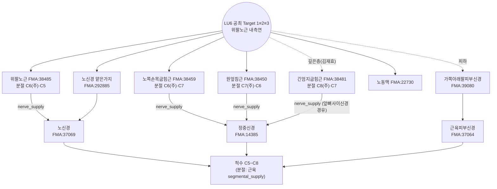

# 🔬 [경혈 해부생리학 실체 판명 학술 모노그래프] 공최(孔最, LU06)

> **프레임워크**: v2.7.7 (2026-10-25 반영: 4대 원전·Tri-Target) · **ARI**: 표준 공최 Target 1≡2≡3 `ARI v3.0 | ARI-Core 71.2 ± 0 (B) | SI 75 | 잠정 가중치 0.40/0.35/0.25 | 민감도(등가중치): 68.8 (C, 등급 변동 → 가중치 민감)` · **이중 채점**: 독립 채점자 2인, 조정 완료 · **단일 Target**(분기 없음)

> **핵심 4대 원전**: 《中国针灸穴位通鉴》 · 《中国针灸证治通鉴》(중국어 원문 기준, 기술은 같은 편 한글 번역본) · 《针灸腧穴通考》(黄龙祥) · 《中国针灸经络通鉴》(黄龙祥)
> **Layer A 실증 DB**: 통합 생의학 마스터 DB v3.0 — LU6 근거 묶음: 랜드마크 32편(외부 28편 포함)·로컬 매핑 20편 중 **LU6 특이 기전·영상 연구 4편**(papers.id 1682·1683·1684·1806) + 인체 임상관찰 1편(1726) + **치질 주치 근거 및 골도분촌 고증 연구 1편**(papers.id 461: 조은별·김재효 등 2021, *Korean Journal of Acupuncture*)
> **Layer B 참조 등록부**: 4계층 참조 등록부(B1~B4) (B-Check 6항목, 부합 기준 ≥ 8/12)
> **해부 온톨로지**: FMA(Foundational Model of Anatomy) 5.1.0 로컬 색인 — 교재 구조를 `FMA:ID`로 고정하고 지배신경·척수 분절·신경 줄기를 대조(B1 보조, 등록부 미등재). 대응표 FMA 경혈 해부 온톨로지 매핑 레지스트리, 상세는 부록 A
> **도량형 환산**: 한대(漢代) 기준 1푼(分) = 2.3mm ($z = \text{푼} \times 2.3\text{mm}$), 1촌 = 10푼 = 23mm
> **분석 Target (Tri-Target, 분기 기준 Δ > 10mm)**: **Target 1≡2≡3** 표준 공최 — Target 1 고전 문헌 위치(《明堂》 "去腕七寸", 12.5寸 골도) ≡ Target 2 촉진 실체화 위치(송 이후 "宛宛中"·"骨间陷中" → 위팔노근 내측연 자입 기준점) ≡ Target 3 WHO 위치(腕上七寸, 12寸 골도), 쌍별 Δ ≤ 10mm(추정) → 단일 Target. **泽田 공최**(尺泽下 3횡지 / 약 2~3寸, 《针灸真髓》 1941; 항문 울혈 진단점·반응점)는 고전 문헌·촉진 표현·WHO 어디에도 해당하지 않는 근현대 신설 혈이므로 Rank 5 **Target 제외 규칙**에 따라 Target으로 세우지 않고 분기·채점하지 않는다(4절 정위 주석, 7-2 참고 이설)
> **구판 표기 대응**: 구 T1(표준 공최) → Target 1≡2≡3(기존 이중 채점 승계) · 구 T2(泽田 공최) → 참고 이설(Target 제외, 2026-10-25). 구 T2의 2026-10-04 채점(35 ± 0 D·H)은 판정에서 철회하고 10-2에 기록만 남긴다.

---

## 🏛️ 1. 문헌 스크리닝 표 (4대 원전 및 한·중·일 역대 문헌 전수 대조)

| 문헌 (출처 파일·행) | 원문 발췌 (정위·심도) | 주치 | 교감 및 비고 |
| :--- | :--- | :--- | :--- |
| **《针灸腧穴通考》** 孔最 조 (《针灸腧穴通考》(上) PDF 81–160쪽 L2300–2467, 인쇄 p.123–126) | "孔冣……手太阴郄，在腕上七寸。"(《黄帝内经明堂》杨上善注, L2320) / "刺入三分，灸五壮。"(《黄帝明堂经》, 【操作】) / 泽田氏: "尺泽穴下二寸。"(《针灸真髓》, L2324) | "可以出汗。头痛，振寒，臂厥，热，汗不出。"(《黄帝内经明堂》) / "吐血失喑，肿痛恶血。"(《太平圣惠方·针经》) / "治热病汗不出……咳逆，臂厥痛。"(《铜人》) | ① 명대 《针灸集书》 "上骨以近骨边"·《针灸大成》 "侧取"는 列缺 취혈과 혼동 → "仍以《黄帝明堂经》、《铜人腧穴针灸图经》为准". ② 전완 골도 10·12·12.5寸 차이로 "文同而实不同". ③ 高武가 "肿痛"을 "咽肿痛"으로 오독. ④ **附: 孔最治痔溯源** — 교재의 "痔疾" 주치는 泽田 동명이위혈의 讹传 |
| **《中国针灸穴位通鉴》** 孔最 조 (《中国针灸穴位通鉴》(上卷) PDF 321–400쪽 L880–1060) | 출처 "孔最，手太阳之。"(《针灸甲乙经》3:49 — OCR 그대로, "太阴之郄"의 오식·결자로 봄; 《通考》 "手太阴郄") / 부위 "去腕七寸。"(《甲乙》·《千金》·《外台》·《圣惠》·《铜人》 등) / "刺入三分，留三呼，灸五壮。"(《甲乙》) | "热病汗不出，上□及孔最主之。"(OCR 결자) "厥头痛，孔最主之。"(《甲乙》 7·9권) / "头痛，振寒，臂厥，热，汗不出。"(《明堂类成》) | 별명 "无". 근대 문헌 위치 분산: 《针灸集成》(1883) "尺泽下三寸半"(12.5寸 골도 내 尺泽下 최초 명시), 《中华针灸学》 "尺泽下三寸", 《新针灸学》 "离尺泽穴五寸". 국소해부: "上层是肱桡肌之内缘，下层为屈拇长肌之外缘，深部有桡动脉和神经通过"(《新针灸学》) |
| **《中国针灸证治通鉴》** (구판 PDF 분책 161–240쪽 L1738·1782; 241–320쪽 L704·854·856·1626–1638 → 편별 정제본 [证治15] L752·L796, [证治17] L1263·L1413, [证治18] L540·L542·L552; 같은 편 한글 번역본 대조) | (정위 기술 없음 — 처방집) | "伤寒热病身无汗，细详孔最患无妨。"(《针灸玉龙经·玉龙歌》) — "상한(傷寒)·열병에 몸에 땀이 없으면, 공최를 자세히 살펴 쓰면 병이 걱정 없다"([证治15 번역] L1217) / "热病烦心，汗不出：中冲、劳宫……孔最三壮至五壮，即汗。"(《针灸捷径》) — "열병으로 가슴이 번거롭고 땀이 나지 않을 때: 중충·노궁…·곡택·공최에 3장에서 5장까지 뜨면 곧 땀이 난다"([证治15 번역] L1291) / 咯血 "孔最配尺泽。强刺激为主。"(辽宁中医杂志 1980) — "공최에 척택을 배합한다. 강자극을 위주로 한다"([证治17 번역] L2260) / 哮喘 "孔最、鱼际。"(中医杂志 1989) — "공최·어제"([证治17 번역] L2048) | 고전 배오는 모두 **발한(汗不出)** 계열, 현대 배오는 **咯血·哮喘** 계열. 치질 처방은 4대 원전 중 《通考》 부록(讹传 고증)에서만 다룸. 번역본 대조 메모: [证治15 번역] L1289의 원문 인용은 "劳官"으로 적혀 원문 "劳宫"([证治15] L796)과 다르나 번역문은 "노궁"으로 맞음(전사 오자) |
| **《中国针灸经络通鉴》** ([经络通鉴 11편] L683; [经络通鉴 18편] L896~904; [经络通鉴 17편] L241·L281·L390·L400·L415·L669) | 《甲乙》 "孔最，手太阴之郄，去腕七寸，专（此处缺文）金二七，水之父母，刺入三分，留三呼，灸五壮" / 경맥 순행 "循臂内上骨下廉"(《医学纲目》 주 "臂有二骨，今太阴脉循臂上骨之下廉也") / 《经络汇编》 "循臂内上骨之下廉，历孔最、列缺" | 《灵枢·寒热病》 "病始手臂者，先取手阳明、太阴而汗出" — 《太素》 杨注 "手太阴郄孔最，在腕上七寸也", 【按】 "《明堂》谓孔最穴可以出汗" | 去腕七寸·3분 확인, "专…金二七，水之父母"는 결문(缺文) 표시된 전사 손상(미교정). 汗 주치가 杨注를 거쳐 《灵枢》 取穴과 연결됨. **孔最 치질(痔)과 泽田 공최는 직접 언급 없음** — 다만 《甲乙经》 편명 "足太阳脉动发下部痔脱肛"을 인용해 痔를 足太阳 脉动 병후로 기술([经络通鉴 17편] L669) |
| **한·중·일 역대 고전문헌 전수 조사**(조은별·김재효 등 2021, *KJA* 38(4):235-249) | 1900년 이전 고전 13종(《甲乙》·《千金》·《外台》·《医心方》·《圣惠》·《资生》·《针经指南》·《乡药集成方》·《发挥》·《聚英》·《大成》·《东医宝鉴》·《金鉴》) 전수: 腕上 7寸(12.5寸 골도) 일치 | 두통, 열병한불출, 해역, 토혈, 실음, 주비통 등 호흡기계·외감·국소통증 일관 | **1900년 이전 동북아 고전문헌에서 치질(痔疾)에 공최를 선혈한 기록은 0건(전무)**. 《金针梅花诗钞》(1862~1915 친필고, 1982 간행)에 "痔疾, 如痔痛, 痔出血等"이 중국 유일 기록이나 1982년 발간으로 근현대 교재 기재의 원천이 될 수 없음 |

---

## 📜 2. 원천/재인용 구분 표 (시대별 문헌 층차 정렬)

| 층차 | 문헌 | 정위 | 심도 | 주치 | 판정 |
| :--- | :--- | :--- | :--- | :--- | :--- |
| 원천 | 《黄帝明堂经》(杨上善 《黄帝内经明堂》 주) | 在腕上七寸 (12.5寸 골도) | 刺入三分, 灸五壮 | 头痛, 振寒, 臂厥, 热, 汗不出 | **원천(Target 1)** |
| 재록 | 《针灸甲乙经》 3:49 | 去腕七寸 | 刺入三分, 留三呼, 灸五壮 | 热病汗不出; 厥头痛 | 원천 재록 |
| 송대 재인용·증보 | 《太平圣惠方》 针经·明堂, 《铜人》, 《资生经》 | 在腕上七寸(陷者宛宛中) | 针入三分 / 灸三壮 | 吐血失喑, 肿痛恶血(针经); 肘臂厥痛(明堂); 咳逆(铜人) | 주치 증보(내상·국소) |
| 명대 변형 | 《针灸集书》, 《针灸大成》, 《循经考穴编》 | 上骨以近骨边 / 侧取 | 三分 | 咽肿痛(《聚英》 高武) | **列缺 혼동·오독**(《通考》 교정) |
| 청말 독립 기록 | 《金针梅花诗钞》(周树冬 1862~1915 친필고, 1982 간행) | 腕上七寸 (12.5寸 골도) | 기재 없음 | 肺喉肘臂等處之病, **痔疾(痔痛·痔出血)** | **중국 유일 치질 기록**(1982년 발간으로 현대 교재의 원천 아님) |
| 근대 일본 창안 | 《针灸真髓》(泽田健 구술, 代田文志 편, 1941; 중문판 1958) | **尺泽下三横指** (중역: 尺泽下二寸处之陷中; 10寸 골도 전제) | 手指 압통 촉진 | **痔, 痔疾·痔痛** ("痔瘡在孔最有觸覺", 魄門 진단점) | **독립 신혈·진단 반응점(참고 이설, Target 제외)**, "泽田先生的独创穴", "肺-大肠 表里" 설명 최초 출현 |
| 대만 전파 | 《实用中国针灸经穴学》(郭家樑 1963) → 《针灸经穴学》(杨维杰 1979) | 10寸 골도 腕上7寸 / 12寸 골도 腕上7寸 | 直刺 5分~1寸 | 임상응용: 치질 치료 및 폐-대장 표리관계·극혈 설명 | 《침구진수》 인용, '응용'으로 소개 |
| 한국 도입 (국내 최초) | 《경혈학》(이수호 1971, 경희대) | 10寸 골도 腕上 7寸 | — | 참고자료: 곽가량·사와다 겐 인용 치질 치료 소개 | **국내 문헌 최초 등장**(본문 주치가 아닌 '참고' 수록) |
| 한국 정규 주치화 | 《정해침구학》(최용태·이수호 1974) → 《한국침구학》(이병국 1976) → 《침구치료학》(임종국 1983) → 《침구학》(1994, 2008) → 《침구의학》(2016) → 《경혈학》(2020) | 10寸 골도(1971~2016) / 12寸 골도(1979, 2020) 혼재 | 直刺 0.5~1.2寸 | **정규 주치: 痔, 痔瘡出血, 痔疾, 脫肛** | **泽田 공최 주치가 표준 공최(Target 1≡2≡3) 위치로 이식 정착**(골도분촌 혼재 및 표리·극혈 이론 고착화) |
| 근대 중국 전파·비판 | 承淡安 《침구진수》 번역(1958) → 1판 《침구학강의》(1958) → 《침구학》(2002) → 현대 중의교재 30편 중 63% | 12寸 골도 腕上 7寸 | 直刺 0.5~1寸 | 2002년 교재에 '痔疮' 등장, 최근 교재(2012, 2017)는 폐계질환 위주 | 黄龙祥(2011) "讹传" 비판; 주혈 배제 및 便后出血의 배혈(보조혈)로만 한정 |
| 별도 중국 경험 | 张效林(新中医 1991) | 尺泽下 3寸 / 太渊上 3寸 | — | 痔疮 반응점 | 또 다른 신혈, 孔最 귀속 "欠妥" |

> **고증 요약 (조은별·김재효 등 2021)**: 고대 동북아 의학사에서 공최의 치질 치료는 전무하였으며, 1941년 사와다 겐의 《침구진수》에서 척택하 3횡지 부위의 독창적 진단·치료 반응점으로 창안된 내용이 대만(곽가량 1963)을 거쳐 한국(이수호 1971)에 유입된 후, 1974년 《정해침구학》부터 정규 주치로 굳어졌다. 이 과정에서 본래의 취혈 위치(척택하 3횡지)와 진단점으로서의 성격이 탈락한 채, 12촌 표준 공최(완상 7촌)에 '폐-대장 표리관계' 및 '극혈'이라는 사후 이론과 함께 접목되는 전형적인 주치 전이(讹传) 현상이 발생하였다.

**《通考》·《经络通鉴》 교감 (Rank 4 필사 오류·경락론적 확장 감별)**
- **정위 문구**: 《经络通鉴》이 수록한 《甲乙》 조문 "孔最，手太阴之郄，去腕七寸……刺入三分，留三呼，灸五壮"([经络通鉴 11편] L683)은 《穴位通鉴》·《通考》의 "去腕七寸"·3분과 같다. 정위·심도 문구에 필사 이문은 없다.
- **전사 손상**: 같은 조문의 "专（此处缺文）金二七，水之父母"는 《经络通鉴》이 결문으로 표시한 손상 구절이다(《穴位通鉴》 归经·穴性 항도 같은 구절). 정위와 무관한 혈성(穴性) 기술이라 정위 판정에는 쓰지 않으며, 교정되지 않은 채로 둔다.
- **汗 주치의 원천성**: 《灵枢·寒热病》 "病始手臂者，先取手阳明、太阴而汗出"에 杨上善이 "手太阴郄孔最，在腕上七寸也"로 주석하고, 《经络通鉴》이 "《明堂》谓孔最穴可以出汗"으로 안어를 달았다([经络通鉴 18편] L896~904). 공최의 발한 주치가 《明堂》 이전 《灵枢》 取穴과 이어진다는 근거다. 다만 《灵枢》 본문은 경맥명(手太阴)만 들고 혈명은 杨注에서 나오므로 원천이 아니라 보조 근거로 둔다(Rank 3).
- **痔 주치 전이**: 《经络通鉴》은 孔最 치질과 泽田 공최를 다루지 않는다. 다만 《甲乙经》 편명 "足太阳脉动发下部痔脱肛"을 인용해 痔를 足太阳 脉动 병후로 기술한다([经络通鉴 17편] L669). 고전 치질 선혈이 방광경 위주라는 조은별·김재효 등(2021)의 결과, "肺-大肠 表里"가 사후 설명이라는 《通考》 비판과 방향이 같다. 직접 교감 자료는 아니므로 판정 근거는 《通考》·조은별 등(2021)으로 유지한다.

---

## 🔍 3. 이명·별칭 검증 표 (KJH DB 대조를 통한 혼용 차단)

| 항목 | 값 | 출처 | 처리 |
| :--- | :--- | :--- | :--- |
| 표준 코드·혈명 | LU06 공최 孔最 (수태음폐경) | KJH 경혈명·이명 대조 표준 데이터베이스 61행 | — |
| KJH 이명 | **"-"** (기재 없음) | KJH 61행 E열 | 공통교재·김재효 교재 이명 칸도 공란 |
| 이체자 | **孔冣** ("最"의 이체자) | 《通考》 L2306·2316 (《黄帝内经明堂》·《太素》·《圣惠方·明堂》) | 동일 혈위의 표기 차이 — 혼용 없음 |
| 《穴位通鉴》 별명 | "无" | 《穴位通鉴》 L884 | — |
| 동명이위혈 | 泽田氏 孔最 (尺泽下二寸) | 《通考》 L2324·2418–2422 | **참고 이설로 분리(Target 제외 규칙)**, 표준 공최(Target 1≡2≡3) 주치에서 痔疾 제외 |
| 동명이위 파생 | 松元四郎平 "尺泽下三寸"(1척 골도), 张效林 "痔疮阿是 1·2" | 《通考》 L2422·2434·각주 [1] | 泽田 계열 이설로만 기록 |
| 인접 혈 혼동 | 列缺(LU7) — 명대 "上骨以近骨边", "侧取" | 《通考》 文献分析 | 《明堂》·《铜人》 정위로 교정 |

---

## 📐 4. 3D 공간 좌표·자입 기준점 및 Layer 1~5 층차 구조도

**좌표 기준**: 해부학적 자세(전완 회외, 손바닥 앞). X = 정중선→외측(요측), Y = 근위→원위, Z = 피부면에서의 깊이. 아래 mm 값은 **전완(尺泽–太渊) 길이 250mm 가정 추정치**이며 실측값이 아니다.

| Target | X (내외측) | Y (근위원위) | Z (자침 범위) | 근거 문헌 및 골도 기준 |
| :--- | :--- | :--- | :--- | :--- |
| **Target 1** 고전 문헌 위치 (漢~淸 1900년 이전) | 경맥 순행 "循臂内上骨下廉"(노뼈 자쪽 가장자리, [经络通鉴 17편] L241) — 위팔노근 내측연과 일치 | 腕横纹 위 7寸 ≈ 140mm (전완 12.5寸 중 척택 아래 5.5寸) | 고전 3푼 (6.9mm) | 《明堂》·《甲乙经》 "去腕七寸"([经络通鉴 11편] L683), 《灵枢·骨度》, 《东医宝鉴》 |
| **Target 2** 촉진 실체화 위치 = 자입 기준점 | **위팔노근 내측연 간극**(아래 자입 기준점) | Target 1과 같은 높이(촉진 표현이 "腕上七寸"을 전제) ≈ 140mm | 고전 6.9mm / 현대 11.5~23mm | 元 《玉龙经》 "腕上七寸宛宛中", 清 《医宗金鉴》 "上骨下，骨间陷中", 근대 국소해부 "上层是肱桡肌之内缘，下层为屈拇长肌之外缘" |
| **Target 3** WHO 위치 (WHO 2008, 현행 교재) | 전완 앞면 요측, 尺泽–太渊 연선, 위팔노근 내측연 | 腕横纹 위 7寸 ≈ 146mm (전완 12寸 중 척택 아래 5寸) | 고전 6.9mm / 현대 11.5~23mm | WHO(2008), 《경혈학》(2020) |
| 참고 변이 — 청말 과도기 (《针灸集成》 1883) | 동일 | 腕横纹 위 7寸 & 척택 아래 3.5寸 | 3푼 | 《针灸集成》(척택하 거리 최초 명시) |
| 참고 변이 — 근현대 과도기 (10寸 골도) | 동일 | 腕横纹 위 7寸 ≈ 175mm (전완 10寸 중 척택 아래 3寸, Target 3보다 ≈ 29mm 근위) | 현대 11.5~23mm | 《침구공혈유취》(1926), 한국 《경혈학》(1971)~《침구학》(2008), 《침구의학》(2016) |
| 정위 주석 — **泽田 공최** (근현대 신설 혈, 치질 반응점; **Target 제외**: Rank 5 Target 제외 규칙) | 전완 앞면 요측, "与手三里隔肌相对" | **척택 아래 3횡지** (약 2~3寸 ≈ 42~60mm; 腕横纹 위 ≈ 190~208mm) | 手指 압통 촉진 (깊이 미기술) | 《针灸真髓》(1941, 泽田健); 조은별·김재효 등(2021) |

**자입 기준점 (Target 2)**: 송 이후의 촉진 표현 "宛宛中"(《玉龙经》)·"上骨下，骨间陷中"(《医宗金鉴》)은 위팔노근 내측연을 따라 노뼈 자쪽 가장자리로 내려가는 근간 간극(緣 유형)을 가리키며, 간극 특징이 명확하다(《穴位通鉴》 孔最 部位 2·7·8항, 《新针灸学》 局部解剖).
- X: 위팔노근(FMA:38485) 내측연과 노쪽손목굽힘근(FMA:38459)·원엎침근 정지부(FMA:38450) 사이 간극. 바닥은 긴엄지굽힘근(FMA:38481) 외측연, 그 아래 노뼈 앞면.
- Y: 腕横纹 위 7寸(Target 1·3과 같은 높이 기준).
- 경계 구조물: 가쪽 = 위팔노근, 안쪽 = 노쪽손목굽힘근·원엎침근 정지부, 깊은 쪽 = 긴엄지굽힘근. 위팔노근 아래로 노동맥(FMA:22730)·노신경 얕은가지(FMA:292885)가 지난다.
- 명대 《针灸集书》 "上骨以近骨边宛宛中"·《针灸大成》 "侧取"는 《通考》가 列缺 취혈과 혼동한 것으로 교정했으므로 Target 2 근거에서 뺀다.

#### 표 4-1. 전완 골도분촌의 시대별·국가별 변천과 공최 위치 편차 (조은별·김재효 등 2021 Table 1 종합)

| 시대 및 국가 | 대표 문헌 | 전완 골도 | 공최 정위 (손목 / 척택 기준) | 현대 환산 Y좌표 (완횡문 기준) | 비고 |
| :--- | :--- | :---: | :--- | :---: | :--- |
| **고대 중국·한국·일본** | 《灵枢·骨度》, 《甲乙经》, 《千金要方》, 《医心方》, 《资生经》, 《发挥》, 《大成》, 《东医宝鉴》, 《金鉴》 | **12.5寸** | 손목 위 7寸 (척택 아래 5.5寸) | ≈ 140 mm | 1900년 이전 고전 일관. 치질 주치 전무 |
| **청말 중국** | 《针灸集成》(1883) | 12.5寸 | 손목 위 7寸 & 척택 아래 3.5寸 | 과도기적 표기 | 척택하 거리 명시 최초 출현 |
| **청말~민국 중국** | 《金针梅花诗钞》(周树冬 1862~1915, 1982) | 12.5寸 | 손목 위 7寸 | ≈ 140 mm | 중국 유일 치질 기록(1982년 발간) |
| **근대 일본** | 《침구공혈유취》(1926) | **10寸** | 척택 아래 3寸 (손목 위 7寸) | ≈ 175 mm | 척택~대릉 1척(10寸) 최초 도입 |
| **근대 일본** | 《침구진수》(1941, 사와다 겐) | 10寸 전제 | **대체로 척택 아래 3횡지** (약 2~3寸) | ≈ 190~208 mm | **사와다 독창혈 (참고 이설, Target 제외)**, 치질 진단·치료 반응점 |
| **근현대 일본** | 《침구실용경혈학》(1972) / 《동양의학 경혈편》(1985) | 10·12.5寸 / **9寸** | 손목 위 7寸 / 손목 위 5寸 | 175·140 mm / 139 mm | 골도분촌 혼재 (출처별 분열) |
| **근현대 대만** | 《실용중국침구경혈학》(1963, 곽가량) | 10寸 | 손목 위 7寸 | ≈ 175 mm | 《침구진수》 인용(치질 임상응용) |
| **근현대 한국** | 《경혈학》(1971), 《정해침구학》(1974) ~ 《침구학》(2008), 《침구의학》(2016) | **10寸** | 손목 위 7寸 (척택 아래 3寸) | ≈ 175 mm | 대만·일본 10촌 골도 계승, 치질 정규 주치화 |
| **국제 표준 (현행)** | WHO 서태평양지역 표준(2008), 《경혈학》(2020) | **12寸** | 손목 위 7寸 (척택 아래 5寸) | ≈ 146 mm | 국제표준 통일 합의점 (**Target 3**, Target 1·2와 병합) |

**Target 1≡2≡3 층차 (2대 교재 + 《穴位通鉴》 국소해부 + B1-01·B1-03 규범 해부 대조, 심도 경계는 개체차가 커서 mm를 고정하지 않음)**

```
[Layer 1 피부·피하]  가쪽아래팔피부신경(C5–C6), 노쪽피부정맥·덧노쪽피부정맥
        │            ← 고전 3푼(6.9mm)은 대체로 피하~근막 표층
[Layer 2 근막·표층근] 위팔노근 내측연, 노쪽손목굽힘근 (원엎침근 정지부 인접)
        │
[Layer 3 심층근]     긴엄지굽힘근 외측연(김재효 교재·《新针灸学》), 얕은손가락굽힘근
        │
[Layer 4 신경혈관속]  위팔노근 아래 노동·정맥 + 노신경 얕은가지  ← 현대 1寸(23mm) 직자 시 도달 가능
        │
[Layer 5 골막]       노뼈 앞면 골막
```

- **정위 주석 — 泽田 공최(Target 제외)**: 이 부위(尺泽 아래 3횡지 / 약 2~3寸)는 고전 문헌·촉진 표현·WHO 표준 어디에도 해당하지 않는 1941년 신설 반응점이어서 Target으로 세우지 않는다(Rank 5 Target 제외 규칙). 해부 정보는 참고로만 적는다. 이 부위는 전완 상부 근위부로, 위팔노근(brachioradialis)과 원엎침근(pronator teres) 근위부 사이의 경계 함요처이다. 피하에는 가쪽아래팔피부신경이 지나며, 심층에는 노신경 줄기(radial nerve trunk)가 얕은가지(superficial branch)와 깊은가지(deep branch)로 갈라지는 분기점 및 노쪽되돌이동맥(radial recurrent artery)이 주행한다(B1-01·B1-03 유추). 사와다 겐 및 일본 전통 침구에서는 골도분촌의 절대적 기하학적 수치보다 이 부위에서 손으로 촉진(palpation)되는 피하 압통(tenderness), 경결, 함하팽륭(陷下膨隆) 등 병리적 반응점(진단점)을 포착하여 취혈한다(조은별·김재효 등 2021).


*그림 4-1. 공최(Target 1≡2≡3, 腕上七寸) 높이 아래팔 중간 횡단면 모식도(오른팔 해부학적 자세, 위에서 내려다봄, 축척 아님). 위팔노근 내측연 직자에서 고전 3푼(청록 띠)은 표층에 머물고, 1寸 직자는 위팔노근 밑 노동·정맥·노신경 얕은가지(Layer 4)에 이를 수 있다. 泽田 공최(尺泽下二寸)는 다른 높이라 이 단면에 없다. 그림 안의 구 표기 T1·T2는 각각 Target 1≡2≡3·泽田 공최를 뜻한다. 층 두께·거리는 실측값이 아니다.*

**FMA 실체 대조 (Target 1≡2≡3, Layer별)** — 구조명은 2대 교재, ID·관계는 FMA 5.1.0

| Layer | 구조 | FMA | 지배신경 / 줄기 (FMA) | 척수 분절 (FMA) | 교재 |
| :--- | :--- | :--- | :--- | :--- | :--- |
| 1 피하 | 가쪽아래팔피부신경 | FMA:39080 | → Peripheral segment of musculocutaneous nerve | FMA 미기재(B1: C5~C6) | 공통 |
| 1 피하 | 노쪽피부정맥 · 덧노쪽피부정맥 | FMA:13324 · FMA:22970 | 덧노쪽피부정맥 → 노쪽피부정맥 → Subclavian vein | — | 공통 |
| 2 표층근 | 위팔노근 | FMA:38485 | Nerve to brachioradialis (FMA:65334) ← **노신경** | **C6(주)**·C5 | 공통 |
| 2 표층근 | 노쪽손목굽힘근 | FMA:38459 | Nerve to FCR (FMA:44824) ← **정중신경** | **C6(주)**·C7 | 공통 |
| 2 표층근 | 원엎침근 | FMA:38450 | Nerve to pronator teres (FMA:44823) ← 정중신경 | **C7(주)**·C6 | 공통 |
| 2 표층근 | 긴손바닥근 *(공통교재)* | FMA:38462 | Nerve to palmaris longus (FMA:44825) ← 정중신경 | C7·C8 | 공통교재 |
| 2 표층근 | 자쪽손목굽힘근 *(공통교재)* | FMA:38465 | Nerve to FCU (FMA:81220) ← **자신경** | **C8(주)**·C7·T1 | 공통교재 |
| 3 중간·심층근 | 얕은손가락굽힘근 *(김재효)* | FMA:38469 | Nerve to FDS (FMA:44826) ← 정중신경 | **C8(주)**·T1 | 김재효 |
| 3 심층근 | 긴엄지굽힘근 *(김재효, 교재 표기 '깊은엄지굽힘근')* | FMA:38481 | Nerve to FPL (FMA:44830) ← 앞뼈사이신경 ← 정중신경 | **C8(주)**·C7 | 김재효 |
| 4 신경혈관속 | 노동맥 · 노정맥 | FMA:22730 · FMA:22947 | 동맥 → Subclavian artery(FMA 모델링: 위팔동맥을 빗장밑동맥 구간으로 둠) / 정맥 → Brachial vein | — | 공통 |
| 4 신경혈관속 | 노신경 얕은가지 | FMA:292885 | → Radial nerve(FMA:37069) | FMA 미기재(B1: C6~C8) | 공통 |
| 5 골막 | 노뼈 앞면 | — | — | — | — |

- FMA 분절은 근육의 `segmental_supply`에만 있다. 분절 합집합 C5~T1 가운데 **C8·T1은 공통교재 단독(자쪽손목굽힘근)·김재효 단독(얕은손가락굽힘근·긴엄지굽힘근) 구조에서만** 오고, 두 교재 공통 구조(위팔노근·노쪽손목굽힘근·원엎침근)는 **C5~C7**이다.
- 김재효 교재 데이터셋의 "깊은엄지굽힘근 (flexor pollicis longus)"은 영문·FMA(FMA:38481 *Flexor pollicis longus*) 기준 **긴엄지굽힘근**의 오기다. 본문 표기를 바로잡고 교재 원표기를 병기한다.


---

## 📏 5. 자침 깊이 계산표 (한대 2.3mm 환산 및 Layer 도달 범위)

출처: 역대 침구문헌 자침심도 데이터베이스 시트1 60행(LU06). '0'(금침) 값 없음.

| 문헌 | 푼수 | 환산 깊이 | 도달 Layer (Target 1≡2≡3) |
| :--- | :---: | :---: | :--- |
| 《黄帝明堂经》(黄龙祥 집교) | 3 | 6.9mm | Layer 1~2 |
| 《针灸甲乙经》(배열순서 24) | 3 | 6.9mm | Layer 1~2 |
| 《针灸经验方》 | 3 | 6.9mm | Layer 1~2 |
| 《东医宝鉴》(인용: 동인) | 3 | 6.9mm | Layer 1~2 |
| 경락수혈학 공통교재 | 5~10 | 11.5~23.0mm | Layer 2~4 |
| 침구의학 공통교재 | 5~10 | 11.5~23.0mm | Layer 2~4 |
| 《针灸腧穴通考》 | 5~10 | 11.5~23.0mm | Layer 2~4 |
| (참고) 1957 南京 《针灸学》·1판 讲义 "针三至七分" | 3~7 | 6.9~16.1mm | Layer 1~3 (《通考》 【操作】) |
| (참고) 6판 《针灸学》 "直刺 0.5~1.2寸" | 5~12 | 11.5~27.6mm | Layer 2~4(5) (《通考》 【操作】) |
| (참고, Target 제외) 泽田 공최 (《针灸真髓》) | blank | 미기술(결측) | — |

- 고전 심도는 일관되게 3푼(6.9mm)으로 표층에 머문다. 근현대 상한 1寸(23mm) 직자는 위팔노근 아래 노동맥·노신경 얕은가지(Layer 4)에 닿을 수 있으므로, 박동을 확인하고 위팔노근 내측연에서 깊이를 조절하거나 사자한다(SI 75 근거).

---

## 📚 6. 해부학 구조 교재 비교표 (공통교재 vs 김재효 교재)

출처: 경혈학 공통교재 해부구조 데이터셋 경혈별_해부구조_종합 59행(경혈학 상 p.54) · 김재효 교수 경혈 해부구조 데이터셋 경혈별_해부구조_종합 59행.

| 구분 | 경혈학 공통교재 | 김재효 교재 | 일치 여부 | FMA 판별 |
| :--- | :--- | :--- | :--- | :--- |
| 근육 | 위팔노근, 원엎침근, 노쪽손목굽힘근, **긴손바닥근, 자쪽손목굽힘근** | 위팔노근, 원엎침근, 노쪽손목굽힘근, **얕은손가락굽힘근, 긴엄지굽힘근**(교재 표기 '깊은엄지굽힘근') | 5개 중 3개 일치, 부차 근육 2개 상이 | 공통 FMA:38485·38450·38459 / 공통교재 단독 38462·38465 / 김재효 단독 38469·38481 |
| 신경 | 노신경의 얕은가지, 가쪽아래팔피부신경 | 가쪽아래팔피부신경, 노신경의 얕은가지 | 일치 | FMA:292885·39080 (영문 정관사 유무 표기 차이는 같은 ID) |
| 혈관 | 노동·정맥, 노쪽피부정맥, 덧노쪽피부정맥 | 노쪽피부정맥, 덧노쪽피부정맥, 노동·정맥 | 일치 | FMA:22730·22947·13324·22970 |

- **차이 분석**: 공통교재의 자쪽손목굽힘근·긴손바닥근은 전완 자측~중앙 구조로, 요측 위팔노근 내측연에 있는 LU6 자침로와 맞지 않는다(검토 필요). 김재효 교재의 긴엄지굽힘근은 《新针灸学》 "下层为屈拇长肌之外缘"(《穴位通鉴》 局部解剖)과 일치한다.
- **FMA로 본 차이의 의미**: 두 교재 공통 근육은 노신경(위팔노근)·정중신경(노쪽손목굽힘근·원엎침근) 지배, 분절 C5~C7이다. 공통교재 단독 자쪽손목굽힘근은 **자신경**(C8 주) 지배의 자쪽 구조여서 LU6 노쪽 자침로와 신경 계통도 다르다. 김재효 단독 두 근육은 정중신경·앞뼈사이신경 계통의 **중간·깊은층**(C8 주)으로, 같은 자침로의 더 깊은 층을 적은 것이다. 즉 공통교재의 차이는 자침로 밖(자쪽) 구조의 혼입, 김재효의 차이는 자침로 아래 깊이의 확장으로 성격이 다르다. 이 판별은 $S_{clarity}$ 75 단계를 바꾸지 않는다.
- **판정**: 주 신경·혈관 구조와 주 근육(위팔노근·원엎침근·노쪽손목굽힘근)은 일치하므로 S_clarity 75(2대 교재 주 구조 일치 + B1 확인) 단계. 혈위 특이 실측(1806)이 PMID 없이 DOI만 있어 100 조건은 충족하지 않는다.

---

## 🔀 7. 공간 변위 분기 추론도 (Tri-Target + 참고 이설)

### 7-1. 표준 공최의 Tri-Target

| Target | 정의 | 근거 | X·Y 위치 (전완 250mm 가정 추정) |
| :--- | :--- | :--- | :--- |
| **Target 1** (고전 문헌 위치) | 최초 기술 | 《明堂》·《甲乙》 "去腕七寸"([经络通鉴 11편] L683; 《通考》 L2320), 경맥 "循臂内上骨下廉"([经络通鉴 17편] L241) | Y ≈ 140mm(12.5寸 골도), X = 노뼈 자쪽 가장자리 위 |
| **Target 2** (촉진 표현의 해부 실체화 위치) | "宛宛中"·"上骨下，骨间陷中" → 위팔노근 내측연 간극 = 자입 기준점(4절) | 《玉龙经》, 《医宗金鉴》, 《新针灸学》 국소해부 | Y ≈ 140mm(촉진 표현이 "腕上七寸"을 전제), X = 위팔노근(FMA:38485) 내측연–노쪽손목굽힘근(FMA:38459)·원엎침근 정지부(FMA:38450) 사이 |
| **Target 3** (현대 WHO 위치) | WHO(2008) 尺泽–太渊 연선 腕上七寸 | WHO(2008), 《경혈학》(2020) | Y ≈ 146mm(12寸 골도), X = 尺泽–太渊 연선(위팔노근 내측연) |

**쌍별 편차 (모두 추정, 실측 아님)**

| 쌍 | Δ (추정) | 근거 | 판정 (10mm 기준) |
| :--- | :---: | :--- | :--- |
| Target 1–Target 2 | ≈ 0~5mm | 같은 "腕上七寸" 높이. 경맥 순행의 "上骨下廉"과 위팔노근 내측연 간극이 겹친다(X 차이만, 수 mm) | 병합 |
| Target 1–Target 3 | ≈ 6mm | 7寸 × 250mm ÷ 12.5寸 = 140mm vs 7寸 × 250mm ÷ 12寸 ≈ 146mm (골도 차이만) | 병합 |
| Target 2–Target 3 | ≈ 6mm | 위와 같은 골도 차이, X는 같은 위팔노근 내측연 | 병합 |

→ **Target 1≡2≡3, Tri-Target 안에서는 분기 없음(단일 표준 공최)**. 구 T1의 위치·채점을 그대로 잇는다.

- **참고 변이(Tri-Target 밖)**: 근현대 10寸 골도의 "腕上七寸"(≈ 175mm)은 Target 3과 ≈ 29mm, Target 1과 ≈ 35mm 떨어져 10mm를 넘지만, 최초 기술·촉진 표현·WHO 어느 것도 아닌 골도 환산 과도기 위치(표 4-1)이므로 Rank 5 Target 제외 규칙(환산 척도 이문)에 따라 Target으로 세우지 않는다. 《针灸集成》(1883) "尺泽下三寸半"도 같은 이유로 참고 변이로 둔다.

### 7-2. 참고 이설 — 泽田 공최 (Target 제외)

泽田 공최는 같은 이름을 쓰지만 본래 위치·성격이 다른 동명이위혈(3절)이며, 고전 문헌(최초 기술)·촉진 표현·WHO 표준 어디에도 해당하지 않는 근현대 신설 혈이다. 촉진(압통·함하팽륭)으로 잡는 반응점이지만 고전 원전의 촉진 표현이 아니라 1941년 독자 창안이므로 Target 2도 아니다. 표준 공최(Target 1≡2≡3)와의 거리는 약 2~3寸(≈ 42~62mm, 추정)으로 10mm를 넘지만, **Rank 5 Target 제외 규칙**에 따라 Target으로 세우지 않고 분기·채점하지 않는다. 아래는 위치·역사·임상 분석을 참고 이설로 남긴 것이다.

```
尺泽(LU5)  ●─── 2寸(≈42mm) ────●─── 3寸(≈62mm) ───●──── 7寸(≈146mm) ────● 太渊(LU9)
                               [泽田 孔最]        [T1≡2≡3 표준 孔最]
                               尺泽下二寸         腕上七寸
                               《针灸真髓》1941   《黄帝明堂经》
                               주치: 痔疾(경험)   주치: 汗不出·头痛·咳逆·吐血
                               └─ Δ ≈ 3寸 ≈ 62mm ─┘ (> 10mm, Target 제외)
```

- **거리 편차와 제외 사유**: 표준 공최 Target 1≡2≡3(완상 7寸 / 척택하 5寸)과 泽田 공최(척택하 3횡지 / 약 2~3寸) 사이의 거리는 약 2~3寸(약 42~62mm, 추정)으로 10mm를 크게 넘지만($\Delta_{discrepancy} \gg 10\text{mm}$), 근현대 신설 혈이므로 Target 제외 규칙에 따라 분기하지 않는다.
- **사와다 겐의 취혈 본질 및 고증 (조은별·김재효 등 2021)**:
  1. 사와다 공최의 출현은 단순한 근대 일본 10寸 골도 도입에 따른 계산 오차가 아니다. 사와다 겐 본인은 척택부터 태연까지를 12寸으로 하고 공최를 손목 위 7寸으로 정한 기존 고전의 보통 위치를 명확히 인지하고 있었으나, **"보통의 위치(척택하 5寸)는 치질에 잘 듣지 않는다(如依普通取法则不见效)"**고 명시하며, 치질에는 반드시 기존 공최보다 훨씬 척택에 가까운 **"척택 아래 세 손가락(3횡지, 대략 2~3寸)"** 부위를 잡아야 한다고 선언하였다(독창적 취혈법).
  2. 더욱 결정적인 것은 泽田 공최가 단순한 자침점이 아니라 **"치질(항문질환)의 진단 반응점(백문 진단점)"**이라는 점이다:
     - 《침구진수》(1941): *"치질이 있을 때 공최에서 압통 반응과 같은 촉감이 느껴진다(痔瘡在孔最有觸覺)."*
     - 《경혈해설》(2007): *"공최 압통의 좌우 차가 강하다면 '반드시 엉덩이에 문제가 있다'고 예측할 수 있다. 폐와 대장의 표리관계에서 폐경에 엉덩이의 상태가 드러나며, 공최는 엉덩이의 울혈 상태에 이상이 있는 경우 확실히 경혈의 반응이 드러나며 울혈 치료를 위해 활용한다."*
     - 《침구실용경혈학》(1972): *"본혈은 폐의 극혈(郄穴)로서 압통 혹은 함하팽륭(陷下膨隆) 등 폐경에 변동과 반응이 심한 부위... 극혈이란 혈기가 깊이 모이는 곳이므로 치질의 울혈·출혈에 효과를 본다."*
  3. 따라서 泽田 공최의 본질은 기하학적 분촌점이 아니라 **"척택 아래 3횡지 부위에서 손으로 짚어보아 압통(tenderness), 피하 경결, 함하팽륭 등 촉각적 병리 반응을 포착하여 자침하는 아시혈(阿是穴)적 반응점"**이다.
- **판정**: 泽田 공최는 Target이 아니므로 ΔARI-Core 분기 판정을 하지 않는다(2026-10-04 판의 ΔARI 36.2 비교는 2026-10-25 Target 제외 규칙에 따라 철회). 공최의 해부생리학적 정규 실체 판명은 단일 Target 1≡2≡3(완상 7寸)으로 하고, "공최치치(孔最治痔)"는 泽田 공최(척택하 3횡지 반응점)라는 별개 근대 경험혈의 내용으로 분리하여 9절 주치 이식 분석에서 다룬다.

---

## 🧬 8. 생의학적 반사 기전도 및 외부 검색 로그

### ① Layer A 논문 표 (LU6 자체 연구 우선)

| papers.id | 연도 | 저널 | 제목 | PMID / DOI | 설계 | Target·용도 |
| :---: | :---: | :--- | :--- | :--- | :--- | :--- |
| 1682 | 2024 | Zhongguo Zhen Jiu | Effect and mechanism of acupuncture on airway smooth muscle relaxation during acute asthma attack in rats | 38467504 / 10.13703/j.0255-2930.20230426-k0004 | 동물(쥐), LU6+LU10 vs BL13+定喘 | T1≡2≡3 기전(β2-AR, ET-1) |
| 1683 | 2023 | Zhongguo Zhen Jiu | Effects of acupuncture on pulmonary function and airway smooth muscle spasm in asthma rats | 37577892 / 10.13703/j.0255-2930.20220618-k0002 | 동물(쥐), LU6+LU10 | T1≡2≡3 기전(ET-1, MT-2) |
| 1684 | 2023 | Zhongguo Zhen Jiu | Effect mechanism of acupuncture for anti-asthmatic airway remodeling based on TGF-β1/Smad3 signaling pathway | 37313563 / 10.13703/j.0255-2930.20220412-k0013 | 동물(쥐), LU6+LU10 vs BL13+定喘 | T1≡2≡3 기전(기도 재형성) |
| 1806 | 2025 | Korean Journal of Acupuncture | Ultrasonographic Study on Forearm Acupuncture Points (LU6 and LI7) and Myotendinous Junction Relationships | — / 10.14406/acu.2025.024 | 해부·영상(초음파) | T1≡2≡3 해부 실체 |
| 1726 | 2012 | 中国中医急症 | 针刺孔最穴鱼际穴治疗哮喘急性发作临床观察 | — / — | 인체 임상관찰(67례, LU6+LU10, 비RCT) | T1≡2≡3 인체 전환(약) |
| 1679 | 2009 | J Altern Complement Med | Characteristics of electrical skin resistance at acupuncture points in healthy humans | 19422323 / 10.1089/acm.2008.0331 | 인체(비RCT), 6개 혈위 피부저항 | T1≡2≡3 보조 |
| 1807 | 2025 | Annals of Medicine | Effect of press needle stimulation on postoperative pulmonary complications in VATS patients: a RCT | 40953233 / 10.1080/07853890.2025.2560684 | 인체 RCT(다혈, LU6 단독 효과 분리 불가) | T1≡2≡3 보조 |

**반증·泽田 공최 관련 문헌 (기전 편수 불산입)**

| papers.id | 연도 | 저널 | 제목 | PMID / DOI | 성격 |
| :---: | :---: | :--- | :--- | :--- | :--- |
| 1561 | 2011 | 中医文献杂志 | "孔最治痔"讹传及其对当代针灸学的影响 (黄幼民·黄龙祥) | — / — | 문헌 고증, **泽田 공최 주치 讹传 반론** |
| 1563 | 2011 | 针刺研究 | "孔最治痔"的讹传及其对当代针灸学的影响 (黄幼民·黄龙祥) | — / — | 문헌 고증, 반론 |
| 1723 | 2011 | 针刺研究 | 孔最治痔的讹传及其对当代针灸学的影响 (黄幼民) | — / — | 1563과 같은 논문의 별도 소장본 |
| 1564 | 2012 | 科学通报 | 从三个著名案例看针灸临床研究的复杂性 (黄龙祥·黄幼民) | — / 10.1360/972011-743 | 방법론 고찰, 강자극·배혈 비특이 효과 해석(B4-05 계열 반증) |
| 461 | 2021 | Korean Journal of Acupuncture | 공최(LU6)를 활용한 치질치료의 근거에 대한 문헌고찰 (A Literature Review on the Evidence that Hemorrhoids Were Included in the Efficacy of LU6) (조은별·김청수·남연경·권오상·양승범·김재효) | — / 10.14406/acu.2021.024 | 문헌 고찰(泽田 공최): 한·중·일 역대 고전 및 근현대 문헌 전수 조사, 골도분촌 12.5·10·12寸 변천, 澤田 독창혈 유래 및 전파 계보, 반응점 해부생리 고증 |
| 1742 | 2018 | World J Acupunct-Moxibustion | Acupuncture at Kongzui (LU6) for 76 cases of hemorrhoids | — / — | 증례군(대조군 없음, 취혈 위치 기준 불명) |
| 1808 | 2021 | J Agromedicine Med Sci | The Effectiveness of Acupuncture Therapy in Patient with Hemorrhoid: A Case Report | — / 10.19184/ams.v7i3.23937 | 증례 보고 |

> **제외한 구판 인용**: 17(Mori 2002, 다혈 전침 — LU6 특이성 미확인, B-Check ⑥ 참고로만 표기), 795(종설), 1458·1461(《明堂》 문헌학), 1002·1678(같은 처방집 중복, 논문 아님).

### ② B-Check 채점표

**표준 공최 Target 1≡2≡3 (腕上七寸)**

| 항목 | 내용 | 채점자 A | 채점자 B | 최종 | Layer B 참조 ID | papers.id | 근거 요지 |
| :---: | :--- | :---: | :---: | :---: | :--- | :--- | :--- |
| ① | 자침 심도의 말초신경·혈관 실체 | 2 | 2 | **2** | B1-01, B1-03, B2-02, B2-09, B2-10 (+FMA) | 1806 | 2대 교재 신경·혈관 일치(FMA:292885·39080·22730·22947 exact) + LU6 특이 초음파 실측 |
| ② | 척수 분절 정합 | 1 | 1 | **1** | B1-02, B1-03, B3-01, B3-20 (+FMA) | — | 피절 C5–C7(FMA: 공통 근육 segmental_supply C5~C7, 단독 구조 포함 시 C8·T1) vs 폐 내장절 T1–T5·미주 — 직접 정합 아님, 유추 |
| ③ | 구심 섬유형·수용체 | 1 | 1 | **1** | B3-05, B3-06 | 1682 | LU6 특이 구심 섬유 연구 없음, 일반 체계 유추 |
| ④ | 중추 중계·경로 | 1 | 1 | **1** | B3-04, B3-05 | — | NTS·미주 경로 LU6 특이 근거 없음, 유추 |
| ⑤ | 원심 경로·표적 효과 | 1 | 1 | **1** | B3-05 | 1682, 1683, 1684 | 쥐 기도평활근 이완 — 咳逆 방향 일치하나 동물·LU10 배합 한정, 《明堂》 원주치 "汗不出" 기전 없음 |
| ⑥ | 인체 전환 근거 | 1 | 1 | **1** | B4-03, B4-04, B4-05 | 17, 1679, 1726, 1807 | 비RCT·다혈 연구뿐, 혈위 특이성 반증(B4-05) 병기 |
| **합계** | | 7 | 7 | **7 / 12** | | | **미부합 → 반사 기전은 가설**(동물 한정) |

**참고 이설 — 泽田 공최 (Target 제외, 채점하지 않음)**

泽田 공최는 Target이 아니므로 B-Check를 채점하지 않는다. 근거 검토만 서술로 남긴다. 위치(尺泽下 3횡지)에 특이한 교재·실측 해부 근거가 없고, 피절 C5~C7과 항문직장(S2~S4, 교감 T10~L2) 사이에 분절 정합이 없으며 연결 논리는 "肺络于大肠" 경락 설명뿐이다. 치핵 혈류·괄약근으로 가는 원심 경로 근거도 없고, 인체 자료는 대조군 없는 증례·증례군(papers.id 1742·1808)뿐이며 《通考》·비특이 효과 반론(1561·1563·1564·1723)이 함께 있다. (2026-10-04 판의 채점 4/12 '가설'은 판정에서 철회했다 — 10-2 기록.)

### ③ 치질 침구치료의 고전 선혈 체계와 현대 근거 피라미드(Evidence Pyramid) 고찰 (조은별·김재효 등 2021 논문 근거)

1. **역대 고전문헌(1900년 이전) 치질 침구치료 선혈 분석**:
   - 중국, 한국, 일본의 주요 고전문헌 13종(《甲乙经》, 《千金要方》, 《外台秘要》, 《医心方》, 《扁鹊心书》, 《针灸资生经》, 《针经指南》, 《乡药集成方》, 《治肿指南》, 《针灸大成》, 《东医宝鉴》, 《针灸经验方》, 《医宗金鉴》) 전수 조사 결과:
     * 치질 치료 경혈은 **항문 국소부위(회음 CV1, 장강 GV1, 회양 BL35, 치핵 주위 아시혈)** 및 **하지 원위부의 족태양방광경(승산 BL57, 승근 BL56, 위중 BL40, 비양 BL58, 승부 BL36), 족소음신경(부류 KI7), 족태음비경(상구 SP5)**이 전체 처방의 90% 이상을 차지한다. 이는 방광경의 소생병(所生病)에 "痔", 독맥의 병후에 "痔疾"이 배속된 경맥병후 체계와 긴밀히 부합한다.
     * 상지 원위부 경혈이 선택된 경우는 《비급천금요방》·《침구자생경》의 수궐음심포경 노궁(PC8)과 수태양소장경 양곡(SI5), 《침경지남》의 수태음폐경 열결(LU7), 《침구대성》의 경외기혈 이백(EX-UE2) 등 극소수에 불과하다.
     * 고전문헌 중 수태음폐경 혈위가 치질에 등장한 것은 1295년 《침경지남》의 열결(LU7)-조해(KI6) 배오 1건뿐인데, 이는 '폐-대장 표리관계'가 아니라 두한경(竇漢卿)의 '팔맥교회혈(교경팔혈)'로서 임맥과 통하는 기경팔맥적 고유 특성에서 유래한 것이다.
     * **1900년 이전 동북아 고전문헌에서 치질에 공최(LU6)를 선혈한 기록은 0건으로 완전 부재하다.**
2. **근현대 치질 침구처방과 공최 수록 실태**:
   - **중국**: 2000년 이전 근현대 문헌의 치질 침구치료는 고전과 유사하게 방광경 및 국소혈 위주이며 상지는 이백(EX-UE2)을 선혈하였다. 공최가 치질 선혈에 처음 등장한 서적은 2002년 《침구학》(서항택)이다. 현대 중국 침구교재 30편 분석 시 약 63%에서 공최가 수록되었으나, 주혈(승산, 질변, 승근 각 100%, 회양, 이백 각 93%, 요수 77%, 척중, 비양 각 70%, 회음 67%)에는 들지 못하고 '변후출혈(便後出血)' 시 가감하는 배혈(보조혈)로만 한정되며, 최근 교재(2012, 2017)에서도 수록 여부가 분열되어 있다.
   - **한국**: 1974년 《진료요감》에는 공최가 없으나, 1983년 《침구치료학》, 1994년 《침구학》부터 치질 처방에 공최가 수록되었다. 2017년 《KCD 한방내과 가이드》에서는 자침이 아닌 뜸법(灸法) 처방에만 공최가 등장한다.
3. **현대 근거 피라미드(Evidence Pyramid) 및 서지 분석**:
   - 근대 《침구진수》(1941)의 기록은 의안(Case reports)에 해당하여 근거 피라미드 최하위 단계에 속한다.
   - 현대 국내외 임상연구: 국내 치질 증례보고 3편 중 2편에서 공최 선혈(2018, 2019), 중국 76례 임상보고(2018, 비대조군, 취혈법 설명 결여 및 자침 사진의 혈위 불명확) 등 소규모 사례군 보고에 불과하며, 최근 항문질환 환자군 연구(2020)에서는 공최를 배제하였다.
   - 중국 60년간(1956~2016) 치질 침치료 문헌고찰(74편 분석)에서 상지 다용 경혈은 이백(EX-UE2), 치창혈, 합곡(LI4), 곡지(LI11), 극문(PC4)이며, 공최(LU6)는 배제되었다.
   - 주요 의학서지 DB(Research Registry, OSF, PubMed) 전수 조사: "Gongchoe"/"Kongzui"/"LU6" 관련 PubMed 49편 중 치질 논문은 오직 황룡상의 "와전 비판" 논문 1편뿐이다. 무작위 대조 임상시험(RCT)이나 전향적 대조 연구는 전무하다.
   - **결론**: 교재의 "공최 치질 주치"는 고전 문헌적 근거가 부재할 뿐 아니라, 현대 근거 피라미드에서도 최하위 증례보고 수준에 그치고 있어 생의학적 반사 기전을 확정할 수 없는 가설(Hypothesis) 단계에 머물러 있다.

### ④ 외부 검색 로그 (sync_log, 2026-10-04·2026-10-23 Rank 6 실행)

| 일시 | 소스 | HTTP | 수집 | 중복제거 | 신규 | 쿼리 |
|---|---|---|---|---|---|---|
| 2026-10-04T09:51:32 | pubmed | 200 | 9 | — | — | ("LU6" OR "Kongzui" OR "孔最") AND (acupuncture OR electroacupuncture) AND (nerve OR reflex OR autonomic OR mechanism OR anatomy) |
| 2026-10-04T09:51:32 | openalex | 200 | 16 | — | — | doi_starts_with:10.13703,title_and_abstract.search:"Kongzui" OR "LU6" \| doi_starts_with:10.13702,… \| has_doi:true,… |
| 2026-10-04T09:51:32 | crossref | 200 | 0 | — | — | Kongzui acupuncture nerve reflex |
| 2026-10-04T09:51:32 | all | — | 25 | 25 | 0 | |
| 2026-10-23T21:44:38 | pubmed | 200 | 9 | — | — | 같은 쿼리 + ("Zhongguo Zhen Jiu"[Journal] OR "Zhen Ci Yan Jiu"[Journal]) |
| 2026-10-23T21:44:38 | openalex | 200 | 16 | — | — | doi_starts_with:10.13703 / 10.13702 / has_doi:true, "Kongzui" OR "LU6" |
| 2026-10-23T21:44:38 | crossref | 200 | 0 | — | — | Kongzui acupuncture nerve reflex |
| 2026-10-23T21:44:38 | all | — | 25 | 25 | 0 | merged_into_existing=16, batch_dups=9 — 신규 0, 판정 불변 |

### ⑤ 반사 기전 가설도 (Target 1≡2≡3, B-Check 미부합 → 가설)

```
LU6 자침 (위팔노근 내측연, Layer 1~4)
  → 구심: 가쪽아래팔피부신경(C5–C6)·노신경 얕은가지 (B3-06 유추)
  → 척수 C5–C7 / 상척수 자율 중추 (B3-04·B3-05 유추, LU6 특이 근거 없음)
  → 원심: 기도평활근 이완(β2-AR↑, ET-1↓) — 쥐, LU6+LU10 배합 (papers.id 1682·1683·1684)
  → 인체: 천식 급성발작 임상관찰(1726, 비RCT) — 혈위 특이성 미분리
```

### ⑥ 말초 구심 경로의 FMA 고정 (Target 1≡2≡3)

위 가설도의 첫 구간(자침점 → 척수)은 FMA 관계로 아래와 같이 고정된다. LU6 자침로의 공통 구조는 **노신경(위팔노근·얕은가지)**, **정중신경(노쪽손목굽힘근·원엎침근)**, **근육피부신경(가쪽아래팔피부신경)** 세 계통으로 들어간다. 이 구조 사슬은 가설도의 해부 앞단일 뿐 B-Check 점수를 바꾸지 않는다.



*그림 8-1. FMA 5.1.0 관계로 그린 LU6(Target 1≡2≡3) 말초 구심 경로. 실선은 FMA에 기재된 관계(`nerve_supply`, 줄기 사슬), 점선은 피하·깊은층 경로다.*

---

## ⚖️ 9. 주치증 분리 표 (단독 자침 $P_{single}$ vs 복합 배오 처방)

| 구분 | 주치 | 출처 | Target | 판정 |
| :--- | :--- | :--- | :---: | :--- |
| $P_{single}$ (원천) | 头痛, 振寒, 臂厥, 热, **汗不出**("可以出汗") | 《黄帝内经明堂》(《通考》 L2376); 《灵枢·寒热病》 杨注 "手太阴郄孔最"·안어 "《明堂》谓孔最穴可以出汗"([经络通鉴 18편] L896~904) | T1≡2≡3 | 고유 주치 |
| $P_{single}$ | 热病汗不出; 厥头痛 | 《甲乙》 7·9권(《穴位通鉴》) | T1≡2≡3 | 고유 주치 |
| $P_{single}$ (송대 증보) | 吐血失喑, 肿痛恶血 / 肘臂厥痛, 屈伸难 / 咳逆 | 《圣惠方》 针经·明堂, 《铜人》 | T1≡2≡3 | 후대 증보(내상·국소) |
| 변형 | 咽肿痛 | 《针灸聚英》 高武 | T1≡2≡3 | "肿痛" 오독(《通考》 文献分析) |
| $P_{comb}$ | 热病烦心 汗不出 (中冲·劳宫·少冲·关冲·大陵·阳溪·曲泽·孔最) | 《针灸捷径》(《证治通鉴》 [证治15] L796) — "열병으로 가슴이 번거롭고 땀이 나지 않을 때: 중충·노궁·소충·관충·대릉·양계·곡택·공최에 3장에서 5장까지 뜨면 곧 땀이 난다"([证治15 번역] L1291) | T1≡2≡3 | 배오 — 단독 효과 분리 불가 |
| $P_{comb}$ | 咯血 (孔最配尺泽, 강자극) / 哮喘 (孔最·鱼际) | 《证治通鉴》 현대 문헌([证治17] L1413·L1263) — "공최에 척택을 배합한다. 강자극을 위주로 한다" / "공최·어제"([证治17 번역] L2260·L2048); papers.id 1726·1682–1684 | T1≡2≡3 | 배오·동물 — 咳逆 방향과 일치 |
| 이식 주치 | **痔疾·痔痛·痔出血** | 1941 《针灸真髓》 → 1963 《实用中国针灸经穴学》 → 1971 《경혈학》(참고) → 1974 《정해침구학》(주치) → 현행 교재(《침구의학》, 《경혈학》) | 泽田(참고 이설)→T1≡2≡3 | **讹传 및 주치 전이**(조은별·김재효 등 2021; 《通考》 附: 孔最治痔溯源; papers.id 1561·1563·1723) — 표준 공최(Target 1≡2≡3) 고유 주치에서 제외 |
| 泽田 공최 경험·진단점 | 痔疾 요혈 및 **魄門 진단 반응점** (尺泽下 3横指, 手指 압통 촉진) | 《针灸真髓》(1941), 《针灸实用经穴学》(1972), 《经穴解说》(2007) | 참고 이설(Target 제외) | 근대 사와다 겐(泽田健)의 독창적 임상 경험혈 및 진단 반응점. "폐-대장 표리관계" 및 "극혈" 이론은 사와다의 경험을 사후 정당화하기 위해 최초 차용된 설명임. 고전 근거 부재, 대조군 임상 연구 전무(근거 피라미드 최하위 증례 수준) |

> **주치증 분리 결론**: 공최(LU6)의 원천 고유 주치($P_{single}$)는 《黄帝明堂经》에 근거한 **외감성 발한 장애(热病汗不出), 두통, 해역(기침·천식), 토혈 등 호흡기계 및 혈증(血症)**에 국한된다. 현행 한국 교재에 수록된 "치질(痔, 痔瘡出血)"은 1941년 사와다 겐의 독창혈(척택하 3횡지 반응점)이 대만을 거쳐 한국에 도입되는 과정에서 취혈 위치와 진단점의 성격이 탈락된 채, "폐-대장 표리관계"라는 사후 이론과 함께 WHO 표준 공최(완상 7촌)로 잘못 옮겨붙은 전형적인 주치 전이(讹传)이다(조은별·김재효 등 2021).

---

## 📊 10. ARI v3.0 프로파일 평가표 및 최종 결론

$$\text{ARI-Core} = 0.40\,S_{orig} + 0.35\,S_{clarity} + 0.25\,S_{reflex} \quad (\text{잠정 가중치, 미검증})$$
$$\text{SI} = S_{safety} \quad (\text{합산하지 않음})$$

### 10-1. 표준 공최 Target 1≡2≡3 (腕上七寸)

| 지표 | 채점자 A | 채점자 B | 평균 | 루브릭 단계 근거 요지 | 근거 포인터 |
| :--- | :---: | :---: | :---: | :--- | :--- |
| $S_{orig}$ | 81.25 | 81.25 | **81.25** | 하위 4항목 평균(아래 표) | 《通考》 L2300–2467 |
| $S_{clarity}$ | 75 (조정 전 50) | 75 | **75** | 2대 교재 주 신경·혈관·주 근육 일치 + B1 확인; 1806은 PMID 없음 → 100 미충족 | 교재 xlsx 59행, papers.id 1806 |
| $S_{reflex}$ | 50 | 50 | **50** | LU6 동물 연구 3편(배합혈), 인체 기전 실험 없음, B-Check 7/12 | papers.id 1682·1683·1684·1726 |
| $S_{safety}$ → SI | 75 | 75 | **75** | 23mm 직자 시 Layer 4 도달 가능하나 고전 3푼·현대 상한 명시, 사자·깊이 조절로 회피; 금침 없음 | 자침깊이 DB 60행 |

| $S_{orig}$ 하위 항목 | A | B | 평균 | 근거 |
| :--- | :---: | :---: | :---: | :--- |
| ① 최초 기술 명확성 | 100 | 75 | 87.5 | 《明堂》 "在腕上七寸" + "刺入三分" (B: 골도 차이로 위치 확정성 감점) |
| ② 후대 문헌 일치율 | 75 | 75 | 75 | 약 15종 "腕上七寸" 일치, 명대 列缺 혼동·골도 차이로 "文同而实不同" |
| ③ 이명 혼용 해소 | 75 | 75 | 75 | KJH "-", 孔冣 이체자, 泽田 동명이위혈 연대순 분리 |
| ④ 《通考》·《经络通鉴》 교감 | 75 | 100 | 87.5 | 列缺 혼동·高武 오독·痔疾 讹传 교정 (A: 골도 차이는 미교정으로 남음). **2026-10-25 재확인**: 《经络通鉴》은 "去腕七寸"·3분 조문을 이문 없이 확인하고([经络通鉴 11편] L683) 汗 주치를 《灵枢》 杨注와 잇지만([经络通鉴 18편] L896~904), 골도 차이와 痔疾 讹传을 직접 다루지 않고 "专…金二七" 결문도 교정하지 않는다 → A·B 모두 단계 **불변** |
| **평균** | 81.25 | 81.25 | **81.25** | |

- **게이트**: 해당 없음 (S_orig·S_clarity ≥ 50, 경혈 특이 Layer A 3편, SI > 25).
- **ARI-Core** = 0.40×81.25 + 0.35×75 + 0.25×50 = **71.2 ± 0 → B (개연)**, 표지 없음.
- **SI** = **75**.
- **등가중치 민감도**: (81.25 + 75 + 50) / 3 = **68.8 → C**, 등급 변동 → **가중치 민감**.

### 10-2. 참고 이설 — 泽田 공최 (Target 제외, 채점 기록만)

泽田 공최(尺泽下二寸)는 Rank 5 Target 제외 규칙에 따라 Target이 아니므로 채점하지 않는다. 아래는 이력 보존용 기록이다.

> **2026-10-04 채점 기록 — 2026-10-25 Target 제외 규칙에 따라 판정에서 철회, 이중 채점 대상 아님**: 당시 구 T2로 S_orig 50 / S_clarity 25 / S_reflex 25, ARI-Core 35 ± 0 (D·H), SI 50, B-Check 4/12(가설)로 채점했었다. 이 값은 어떤 판정에도 쓰지 않는다.

### 10-3. 단일 Target 판정

| Target | ARI-Core (± 반범위) | 구간 | 등급·표지 | SI |
| :--- | :---: | :---: | :---: | :---: |
| 표준 공최 Target 1≡2≡3 (腕上七寸) | 71.2 ± 0 | [71.2, 71.2] | B | 75 |

Tri-Target 세 위치(고전 문헌·촉진 실체화·WHO)는 쌍별 10mm 이내(추정)로 하나로 묶였고, 10mm를 넘는 다른 위치(10寸 골도 과도기, 泽田 공최)는 Target 제외 규칙에 해당하므로 **분기도 우위 판정도 없다**. 공최의 판정 Target은 표준 공최 Target 1≡2≡3 하나다.

### 10-4. 조정 기록

| Target | 항목 | 불일치 | 조정 내용 |
| :---: | :--- | :--- | :--- |
| T1≡2≡3 | $S_{clarity}$ | A 50 / B 75 (25점 차, ≥ 15) | 두 교재의 주 신경·혈관 구조는 일치하고 부차 근육만 다르므로 정본 4.2의 75("2대 교재 일치 + 표준 해부학서 확인")가 더 부합 → A를 75로 조정 |
| T1≡2≡3 | $S_{orig}$ 하위 ①·④ | A 100/75, B 75/100 | 평균값이 같아(81.25) 조정 불요, 하위 항목 평균으로 병기 |

### 10-5. 최종 결론

- **표준 공최 Target 1≡2≡3(腕上七寸)** — **개연(B, 가중치 민감)**. 고전 문헌 위치(《明堂》 去腕七寸), 촉진 표현이 가리키는 위팔노근 내측연 간극(자입 기준점), WHO 위치는 쌍별 10mm 이내(추정)로 하나의 Target이다. 해부학적 실체는 위팔노근 내측연의 피하·근막층(가쪽아래팔피부신경, 노쪽피부정맥)이며, 깊이 23mm 직자 시 노동맥·노신경 얕은가지(Layer 4)에 이른다. 위치는 《黄帝明堂经》 "在腕上七寸"에 근거하지만, 시대별 전완 골도분촌(12.5寸 고전 vs 10寸 근현대 과도기 vs 12寸 WHO 국제표준) 차이에 따라 완횡문 기준 Y좌표가 약 140~175mm 사이로 흩어지며, 현대 표준은 12寸 골도 기준 완횡문 상 7寸(척택하 5寸, 약 146mm)으로 확정된다. 반사 기전(기도평활근 이완)은 쥐 배합혈 연구에 한정되고 B-Check 7/12로 미부합이므로 **가설**로 기술한다. 등가중치에서는 C(68.8)로 내려가므로 B 등급 판정은 잠정 가중치에 의존한다.
- **참고 이설 — 泽田 공최(尺泽下 3横指, 약 2~3寸, Target 제외)**: 근대 일본 사와다 겐(1941)의 독창적 임상 경험혈이자 백문 진단점이다. 고전 문헌·촉진 표현·WHO 어디에도 해당하지 않아 Rank 5 Target 제외 규칙에 따라 등급을 매기지 않는다. 교재에 실린 "공최 치질 주치"는 이 위치의 주치가 척택하 3횡지라는 위치 정보와 진단점으로서의 성격이 탈락된 채 7寸 표준 공최로 잘못 옮겨붙은 주치 전이(讹传)이다(조은별·김재효 등 2021; 《通考》 附: 孔最治痔溯源; papers.id 1561·1563·1723). 분절 정합이 전무하며(C5~C7 vs S2~S4), 현대 임상 근거 피라미드에서도 최하위 증례보고 수준에 그쳐 독립적 기전을 인정할 수 없다.
- **판정**: 분기 없이 **단일 Target(표준 공최 Target 1≡2≡3)**으로 판정한다. 공최의 원천 고유 주치는 발한(汗不出)·두통·해역·토혈 계열이며, 치질(痔疾)은 표준 공최(Target 1≡2≡3) 정규 주치에서 제외한다.

### 10-6. 임상적 취혈 가이드라인 및 교과서 주석화 제언 (조은별·김재효 등 2021 논문 반영)

1. **임상적 취혈 원칙 (Differentiated Palpation & Location Principle)**:
   - 치질 치료 및 항문 울혈 완화를 목적으로 공최를 임상에 응용할 때는, WHO 표준 공최(완상 7寸 / 척택하 5寸)를 기계적으로 자침하는 것으로는 유의한 치료 효과를 기대하기 어렵다(사와다 겐의 "보통의 취혈법은 치질에 효과가 없다"는 임상적 지적과 일치).
   - 사와다 겐의 본래 취혈법과 일본 전통 침구 임상에 근거하여, **표준 공최 위치보다 척택(LU5)에 훨씬 가까운 부위(대체로 척택 아래 3횡지, 약 2~3寸)에서 손으로 짚어보아 압통(tenderness), 피하 경결, 함하팽륭(陷下膨隆) 등 병리 반응점을 촉진(palpation)하여 취혈**해야 한다.
2. **진단 반응점(백문 진단점)으로서의 복합 활용**:
   - 공최는 단순한 침치료점일 뿐만 아니라, 좌우 공최 부위의 압통 강약을 비교하여 항문 및 골반강 내 울혈 상태를 진단·예측하는 **"진단 반응점(백문 진단점)"**으로 먼저 활용되어야 한다(《경혈해설》 2007).
3. **한의과대학 교재 편찬위원회에 대한 제언**:
   - 현재 한국의 《경혈학》 및 《침구의학》 교재에 공최의 주치로 "치질(痔, 痔瘡出血)"이 기술되어 있으나, 이는 한의 고전문헌에 근거가 없으며, 현대 근거 피라미드에서도 최하위 수준의 증례보고에 그치고 있어 근거가 대단히 빈약하다.
   - 따라서 향후 한의대 교재 개정 시 다음 사항을 **주석(Annotation)**으로 첨부하여 학생과 임상의에게 학술적·임상적 사실을 정확히 전달해야 한다:
     > *"① 공최의 치질 치료 주치는 한의 고전문헌에는 전무하며, 1941년 일본 사와다 겐(澤田健)의 《침구진수》에 수록된 근대 임상경험에서 유래한 것이다. ② 치질 치료를 위해 공최를 응용할 때는 WHO 표준 위치(완상 7寸)보다는 척택(LU5)에 가까운 부위(척택 하 3횡지)에서 압통 등 병리 반응점을 촉진하여 선혈해야 하며, 이는 치료점뿐 아니라 진단점(백문 진단점)의 의미를 지닌다. ③ 폐-대장의 표리관계 및 극혈 이론은 사와다 겐의 경험적 치료점을 설명하기 위해 사후적으로 차용된 논리이며, 향후 대규모 무작위 대조 임상시험(RCT) 등을 통한 엄밀한 임상 근거 축적이 요구된다."*

---

## 부록 A. FMA 해부 실체 프로파일 (FMA 5.1.0)

생성: FMA 5.1.0 경혈 프로파일 조회(LU06, 2026-10-23). 대응 수준 `exact`는 교재 영문 용어가 FMA 라벨·동의어·라틴명과 정규화 후 정확히 일치한 것이다.

| 구분 | 교재 용어 | FMA 실체 | 대응 | 출처 | 신경 지배 / 상위 줄기 | 척수 분절 |
| :--- | :--- | :--- | :--- | :--- | :--- | :--- |
| 근육 | 위팔노근 (brachioradialis) | FMA:38485 Brachioradialis | exact | 공통교재·김재효 | FMA:65334 Nerve to brachioradialis → Peripheral segment of radial nerve | C6(주), C5(부) |
| 근육 | 노쪽손목굽힘근 (flexor carpi radialis) | FMA:38459 Flexor carpi radialis | exact | 공통교재·김재효 | FMA:44824 Nerve to FCR → Peripheral segment of median nerve | C6(주), C7(부) |
| 근육 | 원엎침근 (pronator teres) | FMA:38450 Pronator teres | exact | 공통교재·김재효 | FMA:44823 Nerve to pronator teres → Peripheral segment of median nerve | C7(주), C6(부) |
| 근육 | 긴손바닥근 (palmaris longus) | FMA:38462 Palmaris longus | exact | 공통교재 | FMA:44825 Nerve to palmaris longus → Peripheral segment of median nerve | C7, C8 |
| 근육 | 자쪽손목굽힘근 (flexor carpi ulnaris) | FMA:38465 Flexor carpi ulnaris | exact | 공통교재 | FMA:81220 Nerve to FCU → Peripheral segment of ulnar nerve | C8(주), C7·T1(부) |
| 근육 | 얕은손가락굽힘근 (flexor digitorum superficialis) | FMA:38469 Flexor digitorum superficialis | exact | 김재효 | FMA:44826 Nerve to FDS → Peripheral segment of median nerve | C8(주), T1(부) |
| 근육 | 긴엄지굽힘근 (flexor pollicis longus; 교재 표기 '깊은엄지굽힘근') | FMA:38481 Flexor pollicis longus | exact | 김재효 | FMA:44830 Nerve to FPL → Anterior interosseous nerve → Peripheral segment of median nerve | C8(주), C7(부) |
| 신경 | 가쪽아래팔피부신경 | FMA:39080 Lateral cutaneous nerve of forearm | exact | 공통교재·김재효 | FMA:288511 Peripheral segment of musculocutaneous nerve → FMA:37064 Musculocutaneous nerve | — |
| 신경 | 노신경의 얕은가지 | FMA:292885 Superficial branch of radial nerve | exact | 공통교재·김재효 | FMA:37069 Radial nerve | — |
| 혈관 | 덧노쪽피부정맥 | FMA:22970 Accessory cephalic vein | exact | 공통교재·김재효 | FMA:13324 Cephalic vein → FMA:4725 Subclavian vein | — |
| 혈관 | 노쪽피부정맥 | FMA:13324 Cephalic vein | exact | 공통교재·김재효 | FMA:4725 Subclavian vein → FMA:4723 Brachiocephalic vein | — |
| 혈관 | 노동맥 | FMA:22730 Radial artery | exact | 공통교재·김재효 | FMA:3951 Subclavian artery (FMA 모델링, 4절 주석) | — |
| 혈관 | 노정맥 | FMA:22947 Radial vein | exact | 공통교재·김재효 | FMA:22934 Brachial vein → FMA:13329 Axillary vein → … | — |

- 분절 합집합(B-Check ② 입력): **C5, C6, C7, C8, T1** (공통 구조만: C5~C7)
- 두 교재 비교: 공통 FMA 실체 9 · 공통교재 단독 2 · 김재효 단독 2
- 인용 한계: FMA는 정상 성인 규범 해부 온톨로지로, 혈위 특이 심도·변이 빈도·반사 기능의 근거가 아니다. 골도 차이(10/12/12.5寸)에 따른 표준 공최 위치 변이와 泽田 공최 위치는 FMA 대상이 아니다(정위 쟁점).

---

## v2.7 FMA 보강 이력 (2026-10-23)

| 위치 | 원래 내용 | 바꾼 내용 | 근거 |
| :--- | :--- | :--- | :--- |
| 머리말 | — | FMA 5.1.0 해부 온톨로지 줄 추가 | FMA 경혈 해부 온톨로지 매핑 레지스트리 |
| 4절 층차도·6절 | "깊은엄지굽힘근"(김재효 교재 표기 그대로) | **긴엄지굽힘근**으로 정정, 교재 원표기 병기 | 영문 flexor pollicis longus = FMA:38481; 교재 데이터셋 오기 |
| 4절 | 문자 층차도만 | 그림 4-1 횡단면 모식도(T1 높이), Layer별 FMA 대조표, FMA 주석 2건(분절 출처, 용어 오기) | FMA 프로파일 조회; 그림 생성 스크립트(내부) |
| 6절 | 교재 비교 4열 | FMA 판별 열, 차이의 성격(공통교재 = 자쪽 자신경 구조 혼입 / 김재효 = 깊은층 확장) 해석 | FMA nerve_supply·segmental_supply |
| 8절 ② | B-Check ①·② 근거 | T1 FMA ID·분절 포인터 추가(**점수 불변**: T1 7/12, T2 4/12) | FMA segmental_supply |
| 8절 ③ | 2026-10-04 로그 | 2026-10-23 Rank 6 재실행 행 추가(PubMed 9·OpenAlex 16·Crossref 0, 신규 0) | `_metadata.sync_log` LU6 2026-10-23T21:44:38 |
| 8절 ⑤ | — | 그림 8-1 FMA 말초 구심 경로(Mermaid) | FMA:38485·38459·38450·292885·39080 줄기 |
| 부록 A | — | FMA 프로파일 표 | FMA 프로파일 조회 |
| ARI | T1 71.2 ± 0 (B) / T2 35 ± 0 (D·H) | **변경 없음** — FMA는 B1 보조 근거로 루브릭 단계를 바꾸지 않음 | 스킬 5-1절 |
| 구판 표현 점검 | 자동 점검에서 "전수 역색인" 1건 검출 | 아래 v2.7 개정 이력의 '원래 내용' 열에 남긴 **삭제된 구판 문구의 인용**이므로 수정하지 않음(이력 보존). 본문에는 구판 표현 없음 | 본 보고서 v2.7 개정 이력 머리말 행 |
| 구판 보관 | — | 보강 전 md·html·xlsx를 구판 보관본(내부)에 보관 | — |

---

## v2.7 개정 이력 (2026-10-04)

| 위치 | 원래 내용 | 바꾼 내용 | 근거 |
| :--- | :--- | :--- | :--- |
| 머리말 | "실측 논문 48편 전수 역색인" | 근거 묶음 수치(랜드마크 32·로컬 20, LU6 특이 4편+임상 1편)로 교체 | 근거 묶음 |
| 1절 | 《穴位通鉴》 목차 OCR(GV25–28 등), 《证治通鉴》 八关大刺 조각, 《通考》 목차 쪽번호 | 孔最 본문 원문 발췌(정위·심도·주치·교감) | 《通考》(上) PDF 81–160쪽 L2300–2467; 《穴位通鉴》(上卷) PDF 321–400쪽 L880–1060; 《证治通鉴》 PDF 161–240쪽 L1738·1782,  PDF 241–320쪽 L704·854·856 |
| 2절 | 일반 문구 자리표시자 | 원천→재록→증보→명대 변형→泽田→讹传 경로 표 | 《通考》 L2316–2438 |
| 3절 | 이명 "-"만, "완전 차단" 문구 | 이체자 孔冣, 泽田 동명이위혈, 列缺 혼동 처리 표 | KJH 61행; 《通考》 L2306·2316·2324 |
| 4절 | 모든 혈위 공통 Layer mm(0~2.5/…/22mm 이상), "관절낭" | Target별 X·Y·Z 추정 좌표, LU6 구조별 층차(교재·《穴位通鉴》 국소해부) | 교재 xlsx 59행; 《穴位通鉴》 局部解剖 |
| 5절 | 환산 공식만 | 문헌별 푼수·mm 환산표 | 자침깊이 xlsx 시트1 60행 |
| 6절 | 구조명 없는 상투 문구 | 실제 근육·신경·혈관 비교, 부차 근육 2개 불일치 명시 | 공통교재·김재효 xlsx 각 59행 |
| 7절 | 일반 규칙 문장 | T1/T2 분기(Δ≈3寸) 수행, T1 우위 판정 | 이중 채점 기록 |
| 8절 B-Check | ①2·②2·⑤2, 합계 9/12 "확정", papers.id 없음 | T1 최종 2·1·1·1·1·1 = 7/12 미부합, T2 4/12 가설, 참조 ID·papers.id 병기 | B-Check 채점 기록 |
| 8절 Layer A | 17·795·1458·1461·1002·1678 등을 실증 근거로 나열, PMID 공란 | LU6 특이 1682·1683·1684·1806·1726 중심으로 재구성, 讹传 논문 1561·1563·1564·1723을 반증으로 분리, 부적합 항목 제외 | 근거 묶음; 마스터DB papers |
| 8절 | 외부 검색 로그 없음 | sync_log 표 추가 | 근거 묶음 |
| 9절 | 자리표시자 | P_single / P_comb / 이식 주치(痔疾 讹传) 분리 | 《通考》 【适应症】·附; 《证治通鉴》 |
| 10절 | 단일 Target, S_orig 85(루브릭 밖 값), S_reflex 75, ARI-Core 79.0 B, "엄격하게 검증됨" | T1 71.2 ± 0 (B, 가중치 민감) / T2 35 ± 0 (D·H), 하위 항목·게이트·조정 기록·분기 판정 | 이중 채점 기록 |
| 10절 | — | 구판 v2.6 점수 79.0(비교 불가) | 구판 보고서 구판 보관본(내부) |
| xlsx | B-Check 시트 "B3-11 (Longhurst)", "B3-16 (Torres-Rosas)", "papers.id #1 / PMID 확인" | 구판 시트 4의 라벨을 등록부 기준(B3-11 = 진통 기전 종설 2008, B3-16 = NPY 교감 경로 실험 2020)으로 정정하고 "papers.id #1" 포인터를 1806으로 교체; 신규 B-Check 시트 추가. 두 참조 모두 v2.7 최종 채점에는 쓰이지 않음 | Layer B 참조 등록부 L64·69 |

## 2026-10-24 정제 이력

| 위치 | 원래 표현 | 바꾼 표현 | 근거 |
| :--- | :--- | :--- | :--- |
| 머리말 링크 | 로컬 절대 경로 링크(다른 PC에서 열리지 않음) | 프로젝트 기준 상대 링크 | 스킬 경로 표기 규칙(드라이브 문자 절대경로 금지) |

---

## 2026-10-25 조은별·김재효 등(2021) 논문 기반 심층 고증 및 정제 이력

| 위치 | 원래 내용 | 바꾼 내용 | 근거 |
| :--- | :--- | :--- | :--- |
| 머리말 | LU6 특이 논문 요약만 제시 | 조은별·김재효 등(2021) 문헌고찰 논문(papers.id 461) 명시 추가 | 조은별 등, *KJA* 38(4):235-249 (2021) |
| 1절·2절 | 《通考》 부록 위주 요약 | 한·중·일 1900년 이전 고전 13종 전수 대조 결과(치질 선혈 0건) 및 《금침매화시초》·《침구진수》→대만→한국 전파 계보 전면 정밀화 | 조은별 등(2021) Table 1·2·3 |
| 4절 | Target별 개략적 골도 편차만 표기 | 표 4-1 추가: 전완 골도분촌 12.5寸·10寸·12寸·9寸 시대별·국가별 정밀 비교표 및 해부 층차(T1 중간부 vs T2 근위부) 상술 | 조은별 등(2021) Table 1; 《灵枢·骨度》; WHO(2008) |
| 7절 | 기하학적 3寸 편차만 표기 | 사와다 겐의 "보통 위치는 치질 치료 무효" 선언 및 T2의 본질이 '항문 울혈 진단 반응점(백문 진단점)' 촉진임을 규명 | 사와다 겐(1941); 《경혈해설》(2007); 조은별 등(2021) |
| 8절 | 반증 표에 papers.id 461 제목만 수록 | 논문 상세 정보(저자·DOI) 보강 및 8절 ③ 항문질환 고전 선혈 체계와 현대 근거 피라미드(Evidence Pyramid) 고찰 절 신설 | 조은별 등(2021) 본문 및 Table 3 |
| 9절 | T2 경험 주치 약술 | "폐-대장 표리관계" 및 "극혈" 이론이 사와다의 경험을 정당화하기 위한 사후 차용임을 밝히고 주치 전이(讹传) 메커니즘 상술 | 조은별 등(2021) 고찰 |
| 10-6절 | 없음 | 임상적 취혈 가이드라인(척택하 3횡지 반응점 촉진) 및 한의대 교재 주석화 권고안 신설 | 조은별 등(2021) 결론 및 제언 |

---

## 2026-10-25 Framework 2.7.7 반영 이력

| 위치 | 원래 내용 | 바꾼 내용 | 근거 |
| :--- | :--- | :--- | :--- |
| 머리말 | 프레임워크 v2.7, "핵심 3대 원전", 분석 Target T1(표준)/T2(泽田) | v2.7.7, "핵심 4대 원전"(《中国针灸经络通鉴》 추가, 《证治通鉴》 원문 기준·한글 번역본 기술), Tri-Target 표기(표준 공최 Target 1≡2≡3 / 泽田 공최 동명이위혈 분기)와 구판 표기 대응(구 T1 → Target 1≡2≡3, 구 T2 → 泽田 분기) | 프레임워크 2.7.7 Rank 1·2·5·7 |
| 1절 | 3대 원전 표, 《证治通鉴》 행은 구판 PDF 분책 행 번호·원문만 | 4대 원전 표, 《经络通鉴》 행 추가(《甲乙》 조문 去腕七寸·3분, "专…金二七" 결문, 《灵枢·寒热病》 杨注 汗 주치, 순행 "上骨下廉", 痔=足太阳 脉动 병후, 孔最 痔·泽田 직접 언급 없음). 《证治通鉴》 행에 편별 정제본 행과 한글 번역문 병기, 번역본 인용 오자("劳官") 메모 | [经络通鉴 11편] L683, 18편 L896~904, 17편 L241·L281·L390·L400·L415·L669; [证治15] L752·L796, [证治15 번역] L1217·L1289·L1291, [证治17 번역] L2048·L2260 |
| 2절 | 원천(T1), 독립 신혈(T2), "T2 주치가 T1 위치로 이식" | Target 1 / 泽田 분기 / "泽田 분기 주치가 표준 공최(Target 1≡2≡3)로 이식" 표기, 《通考》·《经络通鉴》 교감(Rank 4) 문단 추가 | 프레임워크 2.7.7 Rank 4 |
| 3절 | "T2로 분리", "T2 계열" | "泽田 분기로 분리", "泽田 계열" | 표기 대응 |
| 4절 | Target 표: T1 표준 / T1 고전 원형 / T1 청말·근현대 과도기 / T2 사와다 | Target 1(고전 문헌, ≈140mm) / Target 2(촉진 실체화, 위팔노근 내측연 자입 기준점) / Target 3(WHO, ≈146mm) / 참고 변이(청말·10寸 과도기) / 泽田 공최. 자입 기준점: 위팔노근(FMA:38485) 내측연–노쪽손목굽힘근(FMA:38459)·원엎침근 정지부(FMA:38450) 간극, 바닥 긴엄지굽힘근(FMA:38481). 층차도·그림 4-1·FMA 표 표제를 Target 1≡2≡3으로 고침(그림 PNG 안의 구 표기 T1·T2는 그대로이며 캡션에 대응을 적음) | 프레임워크 2.7.7 Rank 5 |
| 5절 | 도달 Layer (T1), T2 (《针灸真髓》) | Target 1≡2≡3, 泽田 공최 | 표기 대응 |
| 7절 | Dual-Target 도식 [T2 泽田]·[T1 표준], "Δ ≈ 3寸 > 15mm → 분기", T1 우위 | 7-1 Tri-Target 표와 쌍별 Δ 표(모두 추정: T1–T2 ≈ 0~5mm, T1–T3 ≈ 6mm, T2–T3 ≈ 6mm → **10mm 기준** Target 1≡2≡3), 10寸 과도기(≈ 29~35mm)는 Tri-Target 밖 참고 변이; 7-2 泽田 공최 동명이위혈 분기(≈ 42~62mm > 10mm). 도식 표지 [泽田 孔最]·[T1≡2≡3 표준 孔最], "> 10mm → 분기"(열 정렬 유지) | 프레임워크 2.7.7 Rank 5·7; 분기 기준 Δ > 10mm(2026-10-25 개정) |
| 8절 | Target·용도 열 T1/T2, B-Check 표제 T1/T2, 가설도·Mermaid "T1" | T1≡2≡3 / 泽田 공최로 표기 변경(점수 불변: 7/12, 4/12) | 표기 대응 |
| 9절 | Target 열 T1/T2, 《证治通鉴》 원문만 | T1≡2≡3 / 泽田, 《证治通鉴》 배오 행에 한글 번역문 병기, 汗 주치 행에 《经络通鉴》 杨注 근거 추가 | [证治15 번역] L1291; [证治17 번역] L2048·L2260; [经络通鉴 18편] L896~904 |
| 10절 | 10-1 T1 / 10-2 T2, ④ "《通考》 교감", 분기 판정 "T1 우위" | 10-1 표준 공최 Target 1≡2≡3 / 10-2 泽田 공최(동명이위혈 분기), ④ "《通考》·《经络通鉴》 교감" 재확인(**표준 87.5·泽田 75 불변**), 분기 판정을 Tri-Target 규칙으로 다시 서술(10mm 기준 재확인, 결과 동일) | 프레임워크 2.7.7 Rank 7 |
| ARI | 표준 71.2 ± 0 (B), 泽田 35 ± 0 (D·H) | **변경 없음** — ④ 단계 불변, 두 위치 모두 그대로라 이중 채점 승계. 새 독립 Target 없음 → 단일 채점(예비) 대상 없음 | 10절 |

---

## 2026-10-25 Target 제외 규칙 반영 이력

| 위치 | 원래 | 바꾼 | 근거 |
| :--- | :--- | :--- | :--- |
| 머리말 | 泽田 공최(동명이위혈 분기) ARI 표기 `ARI-Core 35 ± 0 (D·H) | SI 50 …`, 분석 Target에 "泽田 공최 동명이위혈 분기" | 泽田 표기 줄 삭제, 표준 공최 단일 Target 명시, 泽田 공최는 Target 제외 사유와 함께 참고 이설로 기술; 구 T2 → 참고 이설 대응 | 프레임워크 Rank 5 Target 제외 규칙(2026-10-25) |
| 2·3절 | "泽田 분기" 표기 | 참고 이설(Target 제외) 표기 | 같음 |
| 4절 | Target 표의 "泽田 공최 (동명이위혈 분기)" 행, 표 4-1 "(泽田 분기)" | "정위 주석 — 泽田 공최(Target 제외)" 행·문단으로 바꾸고 제외 사유 명시 | 같음 |
| 5절 | 泽田 공최 심도 행 | "(참고, Target 제외)" 표지 | 같음 |
| 7절 | 7-2 "동명이위혈 분기 — 泽田 공최", 도식 "(> 10mm → 분기)", 분기 판정 ΔARI 36.2 | 7-2 "참고 이설 — 泽田 공최 (Target 제외)"(사와다 창안·10寸 골도·치질 반응점·거리 ≈ 42~62mm 분석 유지), 도식 "(> 10mm, Target 제외)"(열 정렬 유지), ΔARI 판정 철회. 10寸 과도기 변이도 제외 규칙(환산 척도 이문)을 사유로 명시 | 같음 |
| 8절 ② | 泽田 공최 B-Check 채점표 4/12 | 채점하지 않는 서술형 근거 검토로 대체 | 같음 |
| 9절 | Target 열 "泽田" | "참고 이설(Target 제외)" | 같음(주치 이식 분석 내용은 유지) |
| 10-2 | 泽田 공최 이중 채점표(S_orig 50·S_clarity 25·S_reflex 25·SI 50, ARI-Core 35 ± 0 D·H, 등가중치 33.3) | "2026-10-04 채점 기록 — 2026-10-25 Target 제외 규칙에 따라 판정에서 철회, 이중 채점 대상 아님" 기록만 남김 | 같음 |
| 10-3 | 분기 판정 표(표준 71.2 vs 泽田 35, ΔARI 36.2 우위) | 단일 Target 판정(표준 공최 Target 1≡2≡3, 71.2 ± 0 B, SI 75), 분기·우위 판정 없음 | 같음 |
| 10-4 | 泽田 조정 기록 행 | 삭제(채점 대상 아님) | 같음 |
| 10-5 | 泽田 공최 "미판정·가설(D·H)", 분기 판정 "표준 공최 우위 선언" | 泽田 공최는 참고 이설로 등급 없음, 판정은 단일 Target | 같음 |
| ARI | 표준 공최 71.2 ± 0 (B), SI 75 | **변경 없음** | — |
