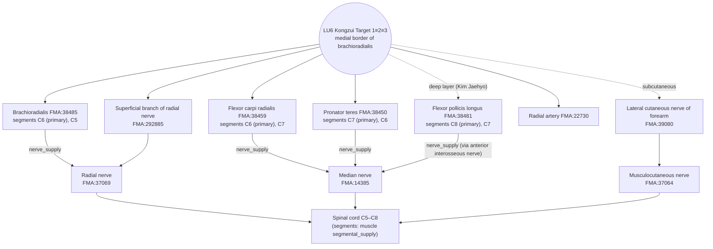

# [Acupoint Anatomical & Physiological Substrate Monograph] Kongzui (孔最, LU06)

> **Framework**: v2.7.7 (2026-10-25 update: four primary classics, Tri-Target) · **ARI**: standard Kongzui Target 1≡2≡3 `ARI v3.0 | ARI-Core 71.2 ± 0 (B) | SI 75 | provisional weights 0.40/0.35/0.25 | sensitivity (equal weights): 68.8 (C, grade changes → weight-sensitive)` · **Dual scoring**: completed by two independent raters · **Single Target** (no split)

> **Four Primary Classics**: *Zhongguo Zhenjiu Xuewei Tongjian* (《中國針灸穴位通鑑》) · *Zhongguo Zhenjiu Zhengzhi Tongjian* (《中國針灸證治通鑑》; the Chinese original is the reference text, descriptions follow the Korean translation of the same section) · *Zhenjiu Shuxue Tongkao* (《針灸腧穴通考》, Huang Longxiang 黃龍祥) · *Zhongguo Zhenjiu Jingluo Tongjian* (《中國針灸經絡通鑑》, Huang Longxiang)
> **Layer A Empirical Database**: Integrated Biomedical Master DB v3.0 — LU6 evidence pack: of 32 landmark papers (including 28 external) and 20 locally mapped papers, **4 LU6-specific mechanism/imaging studies** (papers.id 1682, 1683, 1684, 1806) + 1 human clinical observation (1726) + **1 literature review on haemorrhoid efficacy and bone-proportional measurement** (papers.id 461: Cho Eunbyul, Kim Jae-Hyo et al. 2021, *Korean Journal of Acupuncture*)
> **Layer B Reference Registry**: four-tier reference registry (B1–B4) (6-item B-Check, concordance threshold ≥ 8/12)
> **Anatomical Ontology**: local index of the FMA (Foundational Model of Anatomy) 5.1.0 — textbook structures are pinned to `FMA:ID`s and their innervation, spinal segments and nerve trunks are cross-checked (B1 supplementary, not yet in the registry). Mapping table: FMA Acupoint Anatomical Ontology Mapping Registry; details in Appendix A.
> **Metrological Standard**: Han-dynasty (漢代) standard, 1 fen (分) = 2.3 mm ($z = \text{fen} \times 2.3\,\text{mm}$), 1 cun (寸) = 10 fen = 23 mm
> **Analysis Targets (Tri-Target, split threshold Δ > 10 mm)**: **Target 1≡2≡3** standard Kongzui — Target 1 (classical text position: 《明堂》 "去腕七寸", 12.5-cun scale) ≡ Target 2 (palpation-based anatomical locus: post-Song "宛宛中" and "骨間陷中" → insertion reference at the medial border of brachioradialis) ≡ Target 3 (WHO standard location: 腕上七寸 on the line joining Chize (尺澤, LU05) and Taiyuan (太淵, LU09), 12-cun scale), pairwise Δ ≤ 10 mm (estimated) → single Target. **Sawada Kongzui** (尺澤下 3 finger-breadths / approx. 2–3 cun, 《針灸真髓》 1941; anal congestion diagnostic/reaction point) corresponds to none of the classical text, a palpation phrase or the WHO standard; as a modern newly created point it is not set as a Target and is neither branched nor scored under the Rank 5 **Target exclusion rule** (location note in Section 4, reference alternative view in 7-2)
> **Mapping from earlier labels**: former T1 (standard Kongzui) → Target 1≡2≡3 · former T2 (Sawada Kongzui) → reference alternative view (excluded from Targets, 2026-10-25). The dual scoring of the standard Kongzui is carried over; the 2026-10-04 scoring of the former T2 (35 ± 0, D·H) is withdrawn from the verdict and kept only as a record in 10-2.
> **Note on script**: Classical quotations and TCM terms are given in Traditional Chinese (繁體字). The cited refined editions are in simplified script; PDF page ranges and line numbers refer to those editions.

---

## 1. Classical Literature Screening Table (Four Primary Classics & Pan-East Asian Historical Texts)

| Classic (source file & line) | Original excerpt (location & depth) | Indications | Collation & remarks |
| :--- | :--- | :--- | :--- |
| ***Zhenjiu Shuxue Tongkao* (《針灸腧穴通考》)**, entry 孔最 (《針灸腧穴通考》(上) PDF pp. 81–160 L2300–2467, printed pp. 123–126) | "孔冣……手太陰郄，在腕上七寸。"(《黃帝內經明堂》, Yang Shangshan's (楊上善) commentary, L2320) / "刺入三分，灸五壯。"(《黃帝明堂經》, 【操作】) / Sawada (澤田氏): "尺澤穴下二寸。"(《針灸真髓》, L2324) | "可以出汗。頭痛，振寒，臂厥，熱，汗不出。"(《黃帝內經明堂》) / "吐血失喑，腫痛惡血。"(《太平聖惠方·針經》) / "治熱病汗不出……咳逆，臂厥痛。"(《銅人》) | ① The Ming-dynasty 《針灸集書》 "上骨以近骨邊" and 《針灸大成》 "側取" confuse the point with the location of Lieque (列缺, LU07) → "仍以《黃帝明堂經》、《銅人腧穴針灸圖經》為準". ② Forearm bone-proportional lengths of 10, 12 and 12.5 cun mean the texts are "identical in wording but different in fact" (文同而實不同). ③ Gao Wu (高武) misread "腫痛" as "咽腫痛". ④ **Appendix: tracing 'Kongzui treats haemorrhoids' (附: 孔最治痔溯源)** — the textbook indication "haemorrhoids (痔疾)" is a mistransmission (訛傳) from Sawada's homonymous point at a different location |
| ***Zhongguo Zhenjiu Xuewei Tongjian* (《中國針灸穴位通鑑》)**, entry 孔最 (《中國針灸穴位通鑑》(上卷) PDF pp. 321–400 L880–1060) | Source: "孔最，手太陽之。"(《針灸甲乙經》 3:49 — as given by the OCR; taken to be a misprint/lacuna for "太陰之郄"; the Tongkao has "手太陰郄") / Location: "去腕七寸。"(《甲乙》, 《千金》, 《外臺》, 《聖惠》, 《銅人》 etc.) / "刺入三分，留三呼，灸五壯。"(《甲乙》) | "熱病汗不出，上□及孔最主之。"(OCR lacuna) "厥頭痛，孔最主之。"(《甲乙》 vols. 7 and 9) / "頭痛，振寒，臂厥，熱，汗不出。"(《明堂類成》) | Alias: "無" (none). Locations scattered in early-modern texts: 《針灸集成》(1883) "尺澤下三寸半" (first mention of distance below Chize in 12.5-cun scale), 《中華針灸學》 "尺澤下三寸", 《新針灸學》 "離尺澤穴五寸". Local anatomy: "上層是肱橈肌之內緣，下層為屈拇長肌之外緣，深部有橈動脈和神經通過"(《新針灸學》) |
| ***Zhongguo Zhenjiu Zhengzhi Tongjian* (《中國針灸證治通鑑》)** (earlier PDF-chunk edition pp. 161–240 L1738, 1782; pp. 241–320 L704, 854, 856, 1626–1638 → section-based refined edition [證治15] L752·L796, [證治17] L1263·L1413, [證治18] L540·L542·L552; checked against the Korean translation of the same sections) | (no location given — a prescription compendium) | "傷寒熱病身無汗，細詳孔最患無妨。"(《針灸玉龍經·玉龍歌》) — "in cold damage and febrile disease without sweating, look carefully to Kongzui and the illness is nothing to fear" ([證治15 trans.] L1217) / "熱病煩心，汗不出：中衝、勞宮……孔最三壯至五壯，即汗。"(《針灸捷徑》) — "febrile disease with vexation and no sweating: moxibustion of 3 to 5 cones at Zhongchong, Laogong … Quze and Kongzui brings sweating at once" ([證治15 trans.] L1291) / haemoptysis (咯血) "孔最配尺澤。強刺激為主。"(遼寧中醫雜誌 1980) — "Kongzui combined with Chize, mainly strong stimulation" ([證治17 trans.] L2260) / asthma (哮喘) "孔最、魚際。"(中醫雜誌 1989) — "Kongzui and Yuji" ([證治17 trans.] L2048) | Classical combinations all belong to the **diaphoresis (汗不出)** group; modern combinations to the **haemoptysis (咯血) and asthma (哮喘)** group. Among the four classics, haemorrhoid prescriptions are dealt with only in the Tongkao appendix (collation of the mistransmission). Note on the translation: the quoted original in [證治15 trans.] L1289 reads "勞官", differing from the original "勞宮" ([證治15] L796), while the translated sentence correctly reads Laogong (a transcription typo) |
| ***Zhongguo Zhenjiu Jingluo Tongjian* (《中國針灸經絡通鑑》)** ([經絡通鑑 11篇] L683; [經絡通鑑 18篇] L896–904; [經絡通鑑 17篇] L241·L281·L390·L400·L415·L669) | 《甲乙》 "孔最，手太陰之郄，去腕七寸，專（此處缺文）金二七，水之父母，刺入三分，留三呼，灸五壯" / meridian course "循臂內上骨下廉" (commentary in 《醫學綱目》 "臂有二骨，今太陰脈循臂上骨之下廉也") / 《經絡彙編》 "循臂內上骨之下廉，歷孔最、列缺" | 《靈樞·寒熱病》 "病始手臂者，先取手陽明、太陰而汗出" — Yang Shangshan's commentary in 《太素》 "手太陰郄孔最，在腕上七寸也"; editorial note (按) "《明堂》謂孔最穴可以出汗" | Confirms 去腕七寸 and 3 fen; "專…金二七，水之父母" is a damaged passage marked as a lacuna (缺文), uncorrected. The sweating indication is linked to the 《靈樞》 point selection through Yang's commentary. **No direct mention of Kongzui for haemorrhoids (痔) or of Sawada's Kongzui** — but it cites the 《甲乙經》 chapter title "足太陽脈動發下部痔脫肛", describing 痔 as a disorder of Foot-Taiyang pulsation ([經絡通鑑 17篇] L669) |
| **Comprehensive Pan-East Asian Classical Literature Survey** (Cho Eunbyul, Kim Jae-Hyo et al. 2021, *KJA* 38(4):235–249) | 13 pre-1900 classical texts across China, Korea, and Japan (《甲乙》, 《千金》, 《外臺》, 《醫心方》, 《聖惠》, 《資生》, 《針經指南》, 《鄕藥集成方》, 《發揮》, 《聚英》, 《大成》, 《東醫寶鑑》, 《金鑑》): consistently 腕上 7寸 on a 12.5-cun forearm scale | Headache, fever without sweating, cough/dyspnoea, haemoptysis, aphonia, elbow/arm pain (respiratory, exterior syndrome, local pain) | **0 occurrences (completely absent) of Kongzui selected for haemorrhoids (痔疾) in pre-1900 East Asian classical medical literature**. 《金針梅花詩鈔》 (manuscript 1862–1915, pub. 1982) is the sole Chinese text listing "痔疾, 如痔痛, 痔出血", but published in 1982, it cannot be the source of modern textbook entries |

---

## 2. Primary Source vs. Secondary Quotation: Historical Stratification Table

| Stratum | Text | Location | Depth | Indications | Verdict |
| :--- | :--- | :--- | :--- | :--- | :--- |
| Primary | *Huangdi Mingtang Jing* (《黃帝明堂經》) (commentary in Yang Shangshan's 《黃帝內經明堂》) | 在腕上七寸 (12.5-cun scale) | 刺入三分, 灸五壯 | 頭痛, 振寒, 臂厥, 熱, 汗不出 | **Primary (Target 1)** |
| Re-recorded | *Zhenjiu Jiayi Jing* (《針灸甲乙經》) 3:49 | 去腕七寸 | 刺入三分, 留三呼, 灸五壯 | 熱病汗不出; 厥頭痛 | Re-recording of the primary source |
| Song secondary quotation & supplementation | 《太平聖惠方》 針經 and 明堂 sections, 《銅人》, 《資生經》 | 在腕上七寸(陷者宛宛中) | 針入三分 / 灸三壯 | 吐血失喑, 腫痛惡血 (針經); 肘臂厥痛 (明堂); 咳逆 (銅人) | Supplemented indications (internal damage, local) |
| Ming variants | 《針灸集書》, 《針灸大成》, 《循經考穴編》 | 上骨以近骨邊 / 側取 | 三分 | 咽腫痛 (《聚英》, Gao Wu 高武) | **Confusion with 列缺 and misreading** (corrected by the Tongkao) |
| Late Qing independent record | 《金針梅花詩鈔》 (Zhou Shudong 周樹冬, 1862–1915 manuscript, pub. 1982) | 腕上七寸 (12.5-cun scale) | Not recorded | 肺喉肘臂等處之病, **痔疾(痔痛·痔出血)** | **Sole Chinese haemorrhoid record** (published 1982, not the source of modern textbooks) |
| Early-modern Japan (creation) | 《針灸真髓》 (dictated by Sawada Ken 澤田健, edited by Shirota Bunshi 代田文志, 1941; Chinese trans. 1958) | **尺澤下三橫指** (Chinese translation: 尺澤下二寸處之陷中; 10-cun forearm scale assumed) | Finger palpation for tenderness | **痔, 痔疾·痔痛** ("痔瘡在孔最有觸覺", anal/Po-Gate diagnostic point) | **Independent new point & diagnostic reaction point (reference alternative view, excluded from Targets)**, "澤田先生的獨創穴"; first post-hoc theoretical justification via "Lung communicates with Large Intestine (肺絡於大腸)" |
| Taiwan transmission | 《實用中國針灸經穴學》 (Guo Jialiang 郭家樑 1963) → 《針灸經穴學》 (Yang Weijie 楊維傑 1979) | 10-cun scale 腕上7寸 / 12-cun scale 腕上7寸 | 直刺 5分~1寸 | Clinical application: haemorrhoids, explained via Lung-Large Intestine interior-exterior relation and Xi-cleft point theory | Citing 《針灸真髓》, introduced under 'application' |
| Korean introduction (first mention) | 《經穴學》 (Lee Suho 李秀浩 1971, Kyung Hee University) | 10-cun scale 腕上 7寸 | — | Reference notes: citing Guo Jialiang and Sawada Ken for haemorrhoids | **First appearance in Korean literature** (in reference notes, not in primary indication body) |
| Korean textbook codification | 《精解針灸學》 (Choi Yongtae & Lee Suho 1974) → 《韓國針灸學》 (Lee Byung-guk 1976) → 《針灸治療學》 (Im Jong-guk 1983) → 《針灸學》 (1994, 2008) → 《針灸醫學》 (2016) → 《經穴學》 (2020) | Mixed 10-cun (1971–2016) and 12-cun (1979, 2020) scales | 直刺 0.5~1.2寸 | **Official indication: 痔, 痔瘡出血, 痔疾, 脫肛** | **Sawada Kongzui indication grafted onto the standard Kongzui (Target 1≡2≡3) location** (location info and diagnostic character lost; Biao-Li and Xi-cleft rationales codified) |
| Modern Chinese transfer & critique | Cheng Dan'an (承淡安) trans. 《針灸真髓》 (1958) → 1st-ed. 《針灸學講義》 (1958) → 《針灸學》 (2002) → 63% of 30 modern TCM textbooks | 12-cun scale 腕上 7寸 | 直刺 0.5~1寸 | 2002 textbook lists 痔瘡; recent textbooks (2012, 2017) restrict to respiratory diseases | Huang Longxiang (2011) critiques mistransmission (訛傳); excluded from primary points, restricted to auxiliary point for haematochezia |
| Separate Chinese experience | Zhang Xiaolin (張效林) (新中醫 1991) | 尺澤下 3寸 / 太淵上 3寸 | — | 痔瘡 reaction point | Distinct experiential point; attribution to 孔最 "欠妥" (inappropriate) |

> **Historical Collation Summary (Cho Eunbyul, Kim Jae-Hyo et al. 2021)**: In ancient East Asian medical literature, treating haemorrhoids with Kongzui was completely non-existent. In 1941, Sawada Ken (澤田健) created a unique diagnostic and therapeutic reaction point 3 finger-breadths below Chize (LU5) in *Shinkyushinzui* (《針灸真髓》). This Japanese clinical experience was transmitted through Taiwan (Guo Jialiang 1963) to Korea (Lee Suho 1971) and became codified as an official textbook indication in *Jeonghae Chimguhak* (1974) and all subsequent standard textbooks. During this transmission, the specific location (3 finger-breadths below Chize) and its primary role as a tactile diagnostic point were omitted, and the indication was grafted onto the 12-cun standard Kongzui (7 cun above the wrist) alongside post-hoc rationales of "Lung-Large Intestine interior-exterior relation" and "Xi-cleft point theory." This constitutes a classic textual mistransmission (訛傳).

**Collation by the *Tongkao* (《通考》) and the *Jingluo Tongjian* (《經絡通鑑》) (Rank 4: discrimination of transcription errors and meridian-theory over-extension)**
- **Location wording**: the 《甲乙》 entry recorded in the *Jingluo Tongjian*, "孔最，手太陰之郄，去腕七寸……刺入三分，留三呼，灸五壯" ([經絡通鑑 11篇] L683), agrees with "去腕七寸" and 3 fen in the *Xuewei Tongjian* and the *Tongkao*. There is no scribal variant in the location or depth wording.
- **Textual damage**: "專（此處缺文）金二七，水之父母" in the same entry is a damaged passage that the *Jingluo Tongjian* marks as a lacuna (the *Xuewei Tongjian* has the same phrase under meridian attribution and point character). It describes the point character, not the location, so it is not used for the location verdict and remains uncorrected.
- **Primacy of the sweating indication**: on 《靈樞·寒熱病》 "病始手臂者，先取手陽明、太陰而汗出", Yang Shangshan comments "手太陰郄孔最，在腕上七寸也", and the *Jingluo Tongjian* adds the note "《明堂》謂孔最穴可以出汗" ([經絡通鑑 18篇] L896–904). This links Kongzui's diaphoretic indication to point selection in the 《靈樞》, earlier than the 《明堂》. Because the 《靈樞》 text names only the meridian (手太陰) and the point name comes from Yang's commentary, it is treated as supporting rather than primary evidence (Rank 3).
- **Transfer of the haemorrhoid indication**: the *Jingluo Tongjian* does not discuss Kongzui for haemorrhoids or Sawada's Kongzui. It does, however, cite the 《甲乙經》 chapter title "足太陽脈動發下部痔脫肛", describing 痔 as a disorder of Foot-Taiyang pulsation ([經絡通鑑 17篇] L669). This points in the same direction as Cho et al. (2021) (classical haemorrhoid point selection centred on the Bladder Meridian) and the *Tongkao*'s criticism that "肺-大腸 表裏" is a post-hoc explanation. As it is not direct collation material, the verdict continues to rest on the *Tongkao* and Cho et al. (2021).

---

## 3. Nomenclature & Alias Collation Table (KJH DB Verification to Prevent Conflation)

| Item | Value | Source | Handling |
| :--- | :--- | :--- | :--- |
| Standard code & point name | LU06 Gongchoe / Kongzui (孔最) (Lung Meridian of Hand-Taiyin, 手太陰肺經) | KJH Acupoint Nomenclature & Alias Comparative Database, row 61 | — |
| KJH alias | **"-"** (none recorded) | KJH row 61, column E | The alias columns of the Common Textbook and the Kim Jaehyo textbook are also blank |
| Variant character | **孔冣** (冣 is a variant form of 最) | Tongkao L2306, 2316 (《黃帝內經明堂》, 《太素》, 《聖惠方·明堂》) | A difference of spelling for the same point — no conflation |
| Alias in the *Xuewei Tongjian* (《穴位通鑑》) | "無" (none) | *Xuewei Tongjian* L884 | — |
| Homonymous point at a different location | Sawada's 孔最 (尺澤下二寸) | Tongkao L2324, 2418–2422 | **Separated as a reference alternative view (Target exclusion rule)**; 痔疾 excluded from the indications of the standard Kongzui (Target 1≡2≡3) |
| Derivatives of the homonymous point | Matsumoto Shirōhei (松元四郎平) "尺澤下三寸" (1-chi bone-proportional scale), Zhang Xiaolin (張效林) "痔瘡阿是 1·2" | Tongkao L2422, 2434, footnote [1] | Recorded only as variant opinions within the Sawada lineage |
| Confusion with an adjacent point | Lieque (列缺, LU7) — Ming-dynasty "上骨以近骨邊", "側取" | Tongkao, textual analysis (文獻分析) | Corrected to the location in 《明堂》 and 《銅人》 |

---

## 4. 3D Spatial Coordinates, Insertion Reference & Layer 1–5 Anatomical Substrate Diagram

**Coordinate reference**: anatomical position (forearm supinated, palm facing forward). X = midline → lateral (radial), Y = proximal → distal, Z = depth from the skin surface. The mm values below are **estimates assuming a forearm length (尺澤–太淵) of 250 mm**, not measurements.

| Target | X (medial–lateral) | Y (proximal–distal) | Z (needling range) | Literature & Bone-Proportional Basis |
| :--- | :--- | :--- | :--- | :--- |
| **Target 1** classical text position (漢~淸 pre-1900) | Meridian course "循臂內上骨下廉" (ulnar border of the radius, [經絡通鑑 17篇] L241) — coincides with the medial border of brachioradialis | 7 cun above wrist crease ≈ 140 mm (5.5 cun below Chize out of 12.5 cun) | Classical 3 fen (6.9 mm) | 《明堂》 and 《甲乙經》 "去腕七寸" ([經絡通鑑 11篇] L683), *Lingshu Gudu* (《靈樞·骨度》), *Donguibogam* |
| **Target 2** palpation-based anatomical locus = insertion reference | **Gap at the medial border of brachioradialis** (insertion reference below) | Same level as Target 1 (the palpation phrases presuppose "腕上七寸") ≈ 140 mm | Classical 6.9 mm / modern 11.5–23 mm | Yuan 《玉龍經》 "腕上七寸宛宛中", Qing 《醫宗金鑑》 "上骨下，骨間陷中", early-modern local anatomy "上層是肱橈肌之內緣，下層為屈拇長肌之外緣" |
| **Target 3** WHO standard location (WHO 2008, current textbooks) | Radial side of anterior forearm, on the line joining Chize and Taiyuan, medial border of brachioradialis | 7 cun above wrist crease (腕橫紋) ≈ 146 mm (5 cun below Chize out of 12 cun) | Classical 6.9 mm / modern 11.5–23 mm | WHO (2008), *Gyeonghyeolhak* (2020) |
| Reference variant — late Qing transitional (*Zhenjiu Jicheng* 1883) | Same | 7 cun above wrist & 3.5 cun below Chize | 3 fen | 《針灸集成》(first explicit distance below Chize) |
| Reference variant — early-modern transitional (10-cun scale) | Same | 7 cun above wrist crease ≈ 175 mm (3 cun below Chize out of 10 cun, ≈ 29 mm proximal to Target 3) | Modern 11.5–23 mm | *Shinkyū Kōketsu Ruijū* (1926), Korean textbooks (1971–2008, 2016) |
| Location note — **Sawada Kongzui** (modern newly created point, haemorrhoid reaction point; **excluded from Targets** under the Rank 5 Target exclusion rule) | Radial side of anterior forearm, opposite Shousanli (手三里, LI10) | **3 finger-breadths below Chize** (approx. 2–3 cun ≈ 42–60 mm; ≈ 190–208 mm above wrist) | Manual palpation for tenderness (depth unrecorded) | *Shinkyūshinzui* (1941, Sawada Ken 澤田健); Cho et al. (2021) |

**Insertion reference (Target 2)**: the post-Song palpation phrases "宛宛中" (《玉龍經》) and "上骨下，骨間陷中" (《醫宗金鑑》) indicate the intermuscular gap (緣 type) running down the medial border of brachioradialis to the ulnar border of the radius; the gap has clear features (*Xuewei Tongjian* entry 孔最, location items 2, 7 and 8; local anatomy in 《新針灸學》).
- X: gap between the medial border of brachioradialis (FMA:38485) and flexor carpi radialis (FMA:38459) / the insertion of pronator teres (FMA:38450). Its floor is the lateral border of flexor pollicis longus (FMA:38481), and below that the anterior surface of the radius.
- Y: 7 cun above the wrist crease (same level reference as Targets 1 and 3).
- Bounding structures: lateral = brachioradialis; medial = flexor carpi radialis and the insertion of pronator teres; deep = flexor pollicis longus. The radial artery (FMA:22730) and the superficial branch of the radial nerve (FMA:292885) run beneath brachioradialis.
- The Ming 《針灸集書》 "上骨以近骨邊宛宛中" and 《針灸大成》 "側取" were corrected by the *Tongkao* as confusion with the location of Lieque, so they are excluded from the evidence for Target 2.

#### Table 4-1. Historical Evolution of Forearm Bone-Proportional Measurement and Discrepancies in Kongzui Location (compiled from Cho et al. 2021 Table 1)

| Era & Country | Representative Literature | Forearm Scale | Kongzui Location (wrist / elbow reference) | Converted Y-coord. (from wrist crease) | Remarks |
| :--- | :--- | :---: | :--- | :---: | :--- |
| **Ancient China, Korea, Japan** | *Lingshu Gudu*, *Jiayi Jing*, *Qianjin Yaofang*, *Yixinfang*, *Zisheng Jing*, *Shisijing Fahui*, *Dacheng*, *Donguibogam*, *Yizong Jinjian* | **12.5 cun** | 7 cun above wrist (5.5 cun below Chize) | ≈ 140 mm | Consistently across pre-1900 classics; 0 haemorrhoid indications |
| **Late Qing China** | *Zhenjiu Jicheng* (《針灸集成》 1883) | 12.5 cun | 7 cun above wrist & 3.5 cun below Chize | Transitional | First explicit note of distance below Chize |
| **Late Qing–Republic China** | *Jinzhen Meihua Shichao* (《金針梅花詩鈔》 1862–1915, 1982) | 12.5 cun | 7 cun above wrist | ≈ 140 mm | Sole Chinese haemorrhoid record (pub. 1982) |
| **Early-modern Japan** | *Shinkyū Kōketsu Ruijū* (《針灸孔穴類聚》 1926) | **10 cun** | 3 cun below Chize (7 cun above wrist) | ≈ 175 mm | First introduction of 1 chi (10 cun) for Chize–Daling |
| **Early-modern Japan** | *Shinkyūshinzui* (《針灸眞髓》 1941, Sawada Ken) | 10 cun assumed | **Approx. 3 finger-breadths below Chize** (2–3 cun) | ≈ 190–208 mm | **Sawada unique point (reference alternative view, excluded from Targets)**; diagnostic reaction point |
| **Modern Japan** | *Shinkyū Jitsuyō Keiraku* (1972) / *Toyo Igaku Keiketsu-hen* (1985) | 10 & 12.5 cun / **9 cun** | 7 cun above wrist / 5 cun above wrist | 175 & 140 mm / 139 mm | Coexistence of conflicting scales in literature |
| **Modern Taiwan** | *Shiyong Zhongguo Zhenjiu Jingxuexue* (1963, Guo Jialiang) | 10 cun | 7 cun above wrist | ≈ 175 mm | Cited *Shinkyūshinzui* for haemorrhoid application |
| **Modern Korea** | *Gyeonghyeolhak* (1971), *Jeonghae Chimguhak* (1974) ~ *Chimguhak* (2008), *Chimgu Uihak* (2016) | **10 cun** | 7 cun above wrist (3 cun below Chize) | ≈ 175 mm | Inherited 10-cun scale; haemorrhoid codified as official indication |
| **International Standard** | WHO Western Pacific Region Standard (2008), *Gyeonghyeolhak* (2020) | **12 cun** | 7 cun above wrist (5 cun below Chize) | ≈ 146 mm | Unified international consensus standard (**Target 3**, merged with Targets 1 and 2) |

**Target 1≡2≡3 layers (two textbooks + local anatomy in the *Xuewei Tongjian* + cross-check against B1-01 and B1-03 normative anatomy; depth boundaries are not fixed in mm because of large inter-individual variation)**

```
[Layer 1 Skin/subcutis]       Lateral cutaneous n. of forearm (C5–C6), cephalic v. & accessory cephalic v.
        │                     ← the classical 3 fen (6.9 mm) generally stays between the subcutis and the superficial fascia
[Layer 2 Fascia/superf. muscle] Medial border of brachioradialis, flexor carpi radialis (near the insertion of pronator teres)
        │
[Layer 3 Deep muscle]         Lateral border of flexor pollicis longus (Kim Jaehyo textbook, 《新針灸學》), flexor digitorum superficialis
        │
[Layer 4 Neurovascular bundle] Radial a./vv. beneath brachioradialis + superficial branch of radial n.  ← reachable by a modern 1-cun (23 mm) perpendicular insertion
        │
[Layer 5 Periosteum]          Periosteum of the anterior surface of the radius
```

- **Location note — Sawada Kongzui (excluded from Targets)**: this site (approx. 3 finger-breadths / 2–3 cun below Chize 尺澤) is a reaction point created in 1941 that corresponds to none of the classical text, a palpation phrase or the WHO standard, so it is not set as a Target (Rank 5 Target exclusion rule); its anatomy is recorded for reference only. It lies over the proximal junction between brachioradialis and pronator teres. In the subcutaneous layer passes the lateral cutaneous nerve of the forearm, and deep to it run the bifurcation of the radial nerve trunk into superficial and deep branches and the radial recurrent artery (inferred from B1-01 and B1-03). In Sawada's tradition and Japanese classical acupuncture, rather than relying on an abstract geometric measurement, acupuncturists locate this point by manually palpating for tactile pathological reaction points (tenderness, induration, and subcutaneous depression/fullness) (Cho et al. 2021).


*Figure 4-1. Schematic cross-section of the mid-forearm at the level of Kongzui (Target 1≡2≡3, 腕上七寸) (right arm in anatomical position, viewed from above, not to scale). With perpendicular insertion at the medial border of brachioradialis, the classical 3 fen (teal band) remains superficial, while a 1-cun insertion can reach the radial artery and veins and the superficial branch of the radial nerve beneath brachioradialis (Layer 4). Sawada Kongzui (尺澤下二寸) lies at a different level and is not in this section. The earlier labels T1 and T2 inside the figure correspond to Target 1≡2≡3 and Sawada Kongzui respectively. Layer thicknesses and distances are not measured values.*

**FMA substrate cross-check (Target 1≡2≡3, by layer)** — structure names from the two textbooks; IDs and relations from FMA 5.1.0

| Layer | Structure | FMA | Innervation / trunk (FMA) | Spinal segment (FMA) | Textbook |
| :--- | :--- | :--- | :--- | :--- | :--- |
| 1 Subcutis | Lateral cutaneous nerve of forearm | FMA:39080 | → Peripheral segment of musculocutaneous nerve | Not in FMA (B1: C5–C6) | Both |
| 1 Subcutis | Cephalic vein · accessory cephalic vein | FMA:13324 · FMA:22970 | Accessory cephalic vein → cephalic vein → Subclavian vein | — | Both |
| 2 Superficial muscle | Brachioradialis | FMA:38485 | Nerve to brachioradialis (FMA:65334) ← **radial nerve** | **C6 (primary)**, C5 | Both |
| 2 Superficial muscle | Flexor carpi radialis | FMA:38459 | Nerve to FCR (FMA:44824) ← **median nerve** | **C6 (primary)**, C7 | Both |
| 2 Superficial muscle | Pronator teres | FMA:38450 | Nerve to pronator teres (FMA:44823) ← median nerve | **C7 (primary)**, C6 | Both |
| 2 Superficial muscle | Palmaris longus *(Common Textbook)* | FMA:38462 | Nerve to palmaris longus (FMA:44825) ← median nerve | C7, C8 | Common Textbook |
| 2 Superficial muscle | Flexor carpi ulnaris *(Common Textbook)* | FMA:38465 | Nerve to FCU (FMA:81220) ← **ulnar nerve** | **C8 (primary)**, C7, T1 | Common Textbook |
| 3 Intermediate/deep muscle | Flexor digitorum superficialis *(Kim Jaehyo)* | FMA:38469 | Nerve to FDS (FMA:44826) ← median nerve | **C8 (primary)**, T1 | Kim Jaehyo |
| 3 Deep muscle | Flexor pollicis longus *(Kim Jaehyo; the textbook's label literally reads 'deep thumb flexor')* | FMA:38481 | Nerve to FPL (FMA:44830) ← anterior interosseous nerve ← median nerve | **C8 (primary)**, C7 | Kim Jaehyo |
| 4 Neurovascular bundle | Radial artery · radial vein | FMA:22730 · FMA:22947 | Artery → Subclavian artery (FMA modelling: the brachial artery is treated as a segment of the subclavian artery) / vein → Brachial vein | — | Both |
| 4 Neurovascular bundle | Superficial branch of radial nerve | FMA:292885 | → Radial nerve (FMA:37069) | Not in FMA (B1: C6–C8) | Both |
| 5 Periosteum | Anterior surface of the radius | — | — | — | — |

- FMA records segments only in the `segmental_supply` of muscles. Of the segment union C5–T1, **C8 and T1 come only from structures listed by one textbook — Common Textbook only (flexor carpi ulnaris) or Kim Jaehyo only (flexor digitorum superficialis, flexor pollicis longus)** — whereas the structures shared by both textbooks (brachioradialis, flexor carpi radialis, pronator teres) are **C5–C7**.
- The Kim Jaehyo textbook dataset's "deep thumb flexor (flexor pollicis longus)" is, on the basis of the English term and FMA (FMA:38481 *Flexor pollicis longus*), a slip for **flexor pollicis longus** (literally 'long thumb flexor'). The body text corrects the label and gives the textbook's original label alongside it.


---

## 5. Classical Needling Depth Calculation Table (Han Dynasty 2.3 mm Conversion & Layers Reached)

Source: Classical Needling Depth Database, sheet 1, row 60 (LU06). No '0' ('Contraindicated for needling (禁針)') value.

| Text | Fen | Converted depth | Layer reached (Target 1≡2≡3) |
| :--- | :---: | :---: | :--- |
| *Huangdi Mingtang Jing* (《黃帝明堂經》, ed. Huang Longxiang) | 3 | 6.9 mm | Layer 1–2 |
| *Zhenjiu Jiayi Jing* (《針灸甲乙經》) (sequence no. 24) | 3 | 6.9 mm | Layer 1–2 |
| *Chimgu Gyeongheombang* (《針灸經驗方》) | 3 | 6.9 mm | Layer 1–2 |
| *Dongui Bogam* (《東醫寶鑑》, citing 《銅人》) | 3 | 6.9 mm | Layer 1–2 |
| Korean common textbook, *Meridian and Acupoint Studies* (經絡腧穴學) | 5–10 | 11.5–23.0 mm | Layer 2–4 |
| Korean common textbook, *Acupuncture and Moxibustion Medicine* (針灸醫學) | 5–10 | 11.5–23.0 mm | Layer 2–4 |
| *Zhenjiu Shuxue Tongkao* (《針灸腧穴通考》) | 5–10 | 11.5–23.0 mm | Layer 2–4 |
| (Reference) 1957 Nanjing 《針灸學》 and 1st-edition 講義 "針三至七分" | 3–7 | 6.9–16.1 mm | Layer 1–3 (Tongkao 【操作】) |
| (Reference) 6th-edition 《針灸學》 "直刺 0.5~1.2寸" | 5–12 | 11.5–27.6 mm | Layer 2–4(5) (Tongkao 【操作】) |
| (Reference, excluded from Targets) Sawada Kongzui (《針灸真髓》) | blank | Not described (missing) | — |

- The classical depth is consistently 3 fen (6.9 mm) and stays superficial. A perpendicular insertion at the early-modern/modern upper limit of 1 cun (23 mm) can reach the radial artery and the superficial branch of the radial nerve beneath brachioradialis (Layer 4), so the pulse should be checked and the depth controlled at the medial border of brachioradialis, or the needle inserted obliquely (basis for SI 75).

---

## 6. Textbook Comparison Table (Common Textbook vs. Kim Jaehyo Textbook)

Source: Common Textbook Anatomical Structure Dataset, sheet `경혈별_해부구조_종합`, row 59 (*Acupoint Studies* vol. 1, p. 54) · Kim Jaehyo Anatomical Structure Dataset, sheet `경혈별_해부구조_종합`, row 59.

| Category | Common Textbook of Acupoint Studies | Kim Jaehyo textbook | Agreement | FMA adjudication |
| :--- | :--- | :--- | :--- | :--- |
| Muscles | Brachioradialis, pronator teres, flexor carpi radialis, **palmaris longus, flexor carpi ulnaris** | Brachioradialis, pronator teres, flexor carpi radialis, **flexor digitorum superficialis, flexor pollicis longus** (textbook label 'deep thumb flexor') | 3 of 5 agree; 2 secondary muscles differ | Shared FMA:38485, 38450, 38459 / Common Textbook only 38462, 38465 / Kim Jaehyo only 38469, 38481 |
| Nerves | Superficial branch of radial nerve, lateral cutaneous nerve of forearm | Lateral cutaneous nerve of forearm, superficial branch of radial nerve | Agree | FMA:292885, 39080 (presence or absence of the definite article in the English term is a spelling difference with the same ID) |
| Vessels | Radial artery and veins, cephalic vein, accessory cephalic vein | Cephalic vein, accessory cephalic vein, radial artery and veins | Agree | FMA:22730, 22947, 13324, 22970 |

- **Analysis of the difference**: flexor carpi ulnaris and palmaris longus in the Common Textbook are structures of the ulnar-to-central forearm and do not fit the LU6 needling path at the medial border of brachioradialis on the radial side (review needed). Flexor pollicis longus in the Kim Jaehyo textbook agrees with 《新針灸學》 "下層為屈拇長肌之外緣" (*Xuewei Tongjian*, local anatomy 局部解剖).
- **What FMA shows about the difference**: the muscles shared by both textbooks are supplied by the radial nerve (brachioradialis) and median nerve (flexor carpi radialis, pronator teres), segments C5–C7. Flexor carpi ulnaris, listed only in the Common Textbook, is an ulnar-side structure supplied by the **ulnar nerve** (primarily C8), so it also belongs to a different nerve system from the radial-side LU6 needling path. The two muscles listed only by Kim Jaehyo belong to the **intermediate and deep layers** of the median/anterior interosseous nerve system (primarily C8), i.e. they record deeper layers along the same needling path. The two differences are therefore of different kinds: in the Common Textbook, structures outside the needling path (ulnar side) have crept in; in the Kim Jaehyo textbook, the listing extends deeper beneath the needling path. This adjudication does not change the $S_{clarity}$ level of 75.
- **Verdict**: the main nerve and vessel structures and the main muscles (brachioradialis, pronator teres, flexor carpi radialis) agree, so S_clarity is at the 75 level (main structures agree between the two textbooks + B1 confirmation). The point-specific measurement (1806) has a DOI but no PMID, so the condition for 100 is not met.

---

## 7. Spatial Discrepancy Branch Inference Diagram (Tri-Target + Reference Alternative View)

### 7-1. Tri-Target of the Standard Kongzui

| Target | Definition | Evidence | X·Y position (estimate, forearm 250 mm assumed) |
| :--- | :--- | :--- | :--- |
| **Target 1** (classical text position) | Earliest description | 《明堂》 and 《甲乙》 "去腕七寸" ([經絡通鑑 11篇] L683; Tongkao L2320), meridian course "循臂內上骨下廉" ([經絡通鑑 17篇] L241) | Y ≈ 140 mm (12.5-cun scale), X = over the ulnar border of the radius |
| **Target 2** (palpation-based anatomical locus) | "宛宛中" and "上骨下，骨間陷中" → gap at the medial border of brachioradialis = insertion reference (Section 4) | 《玉龍經》, 《醫宗金鑑》, local anatomy in 《新針灸學》 | Y ≈ 140 mm (the palpation phrases presuppose "腕上七寸"), X = between the medial border of brachioradialis (FMA:38485) and flexor carpi radialis (FMA:38459) / insertion of pronator teres (FMA:38450) |
| **Target 3** (WHO standard location) | WHO (2008): 7 cun above the wrist on the line joining Chize and Taiyuan | WHO (2008), *Gyeonghyeolhak* (2020) | Y ≈ 146 mm (12-cun scale), X = on the Chize–Taiyuan line (medial border of brachioradialis) |

**Pairwise displacement (all estimated, not measured)**

| Pair | Δ (estimated) | Basis | Verdict (10 mm threshold) |
| :--- | :---: | :--- | :--- |
| Target 1–Target 2 | ≈ 0–5 mm | Same "腕上七寸" level; the "上骨下廉" of the meridian course overlaps the gap at the medial border of brachioradialis (X difference only, a few mm) | Merged |
| Target 1–Target 3 | ≈ 6 mm | 7 cun × 250 mm ÷ 12.5 cun = 140 mm vs 7 cun × 250 mm ÷ 12 cun ≈ 146 mm (difference in bone-proportional scale only) | Merged |
| Target 2–Target 3 | ≈ 6 mm | Same scale difference; X is the same medial border of brachioradialis | Merged |

→ **Target 1≡2≡3; no split within the Tri-Target (single standard Kongzui)**. The position and scoring of the former T1 are carried over.

- **Reference variants (outside the Tri-Target)**: "腕上七寸" on the early-modern 10-cun scale (≈ 175 mm) lies ≈ 29 mm from Target 3 and ≈ 35 mm from Target 1, beyond 10 mm, but it is a transitional position arising from bone-proportional conversion (Table 4-1) and is neither the earliest description, nor a palpation phrase, nor the WHO location, so it is not set as a Target under the Rank 5 Target exclusion rule (scale-conversion variant). 《針灸集成》 (1883) "尺澤下三寸半" is kept as a reference variant for the same reason.

### 7-2. Reference Alternative View — Sawada Kongzui (Excluded from Targets)

Sawada Kongzui uses the same name but is a homonymous point with a different original location and character (Section 3), and it is a modern newly created point corresponding to none of the classical text (earliest description), a palpation phrase or the WHO standard. It is a reaction point found by palpation (tenderness, depression/fullness), but it is an independent creation of 1941 rather than a palpation phrase of the classics, so it is not Target 2 either. Its distance from the standard Kongzui (Target 1≡2≡3) is about 2–3 cun (≈ 42–62 mm, estimated), beyond 10 mm, but under the **Rank 5 Target exclusion rule** it is not set as a Target and is neither branched nor scored. The location, historical and clinical analysis below is kept as a reference alternative view.

```
尺澤(LU5)  ●─── 2寸(≈42mm) ────●─── 3寸(≈62mm) ───●──── 7寸(≈146mm) ────● 太淵(LU9)
                               [Sawada 孔最]      [T1≡2≡3 standard 孔最]
                               尺澤下二寸         腕上七寸
                               《針灸真髓》1941   《黃帝明堂經》
                               Ind.: 痔疾(empir.) Ind.: 汗不出·頭痛·咳逆·吐血
                               └─ Δ ≈ 3寸 ≈ 62mm ─┘ (> 10mm, not a Target)
```

- **Spatial discrepancy and reason for exclusion**: The distance between the standard Kongzui Target 1≡2≡3 (7 cun above the wrist / 5 cun below Chize) and Sawada Kongzui (approx. 3 finger-breadths / 2–3 cun below Chize) is about 2–3 cun (approx. 42–62 mm, estimated), markedly exceeding 10 mm ($\Delta_{discrepancy} \gg 10\text{ mm}$), but as a modern newly created point it is not branched under the Target exclusion rule.
- **The essence of Sawada Ken's point location (Cho Eunbyul, Kim Jae-Hyo et al. 2021)**:
  1. The emergence of Sawada's Kongzui was not merely a computational artifact of the early-modern Japanese 10-cun forearm scale. Sawada Ken explicitly recognized the classical standard location (12-cun scale, 7 cun above wrist / 5 cun below Chize), but asserted that **"locating it at the ordinary location (5 cun below Chize) is ineffective for haemorrhoids (如依普通取法則不見效)."** He argued that one must locate it significantly closer to Chize, at **"approximately three finger-breadths below Chize (大抵尺澤の下三橫指位の処, approx. 2–3 cun)"** (his unique point).
  2. Crucially, in Sawada's practice and Japanese classical acupuncture, Sawada Kongzui functioned not merely as a treatment point, but primarily as a **"diagnostic reaction point for haemorrhoids and anal disorders (魄門 診斷點)"**:
     - *Shinkyūshinzui* (1941): *"When haemorrhoids are present, a distinct tactile sensation or tenderness is felt at Kongzui (痔瘡在孔最有觸覺)."*
     - *Gyeonghyeolhaeseol* (2007): *"If there is a marked left-right difference in tenderness at Kongzui, one can predict that there is definitely a problem in the anal/buttock region. Through the interior-exterior relationship of Lung and Large Intestine, buttock congestion manifests along the Lung meridian, and Kongzui is used to treat this congestion."*
     - *Shinkyū Jitsuyō Keiraku* (1972): *"As the Xi-cleft point of the Lung, this site exhibits marked meridian fluctuations such as tenderness or subcutaneous depression/fullness (陷下膨隆)... Because Xi-cleft points gather deep qi and blood, it relieves haemorrhoid congestion and bleeding."*
  3. Thus, Sawada Kongzui is not an abstract geometric point, but an **"A-shi (阿是) reactive locus palpated for tenderness, induration, and tissue depression/fullness approx. 3 finger-breadths below Chize."**
- **Verdict**: Sawada Kongzui is not a Target, so no ΔARI-Core branch verdict is made (the ΔARI 36.2 comparison of the 2026-10-04 edition is withdrawn under the 2026-10-25 Target exclusion rule). The canonical anatomical substrate of Kongzui is established at the single Target 1≡2≡3 (7 cun above the wrist), while "Kongzui treats haemorrhoids" is separated as the content of a distinct early-modern empirical point, Sawada Kongzui (the 3-finger-breadth reaction point), and dealt with in the indication-transfer analysis of Section 9.

---

## 8. Biomedical Reflex Pathway Diagram & External Search Log

### ① Layer A Papers (LU6-specific studies first)

| papers.id | Year | Journal | Title | PMID / DOI | Design | Target & use |
| :---: | :---: | :--- | :--- | :--- | :--- | :--- |
| 1682 | 2024 | Zhongguo Zhen Jiu | Effect and mechanism of acupuncture on airway smooth muscle relaxation during acute asthma attack in rats | 38467504 / 10.13703/j.0255-2930.20230426-k0004 | Animal (rat), LU6+LU10 vs BL13+Dingchuan (定喘) | T1≡2≡3 mechanism (β2-AR, ET-1) |
| 1683 | 2023 | Zhongguo Zhen Jiu | Effects of acupuncture on pulmonary function and airway smooth muscle spasm in asthma rats | 37577892 / 10.13703/j.0255-2930.20220618-k0002 | Animal (rat), LU6+LU10 | T1≡2≡3 mechanism (ET-1, MT-2) |
| 1684 | 2023 | Zhongguo Zhen Jiu | Effect mechanism of acupuncture for anti-asthmatic airway remodeling based on TGF-β1/Smad3 signaling pathway | 37313563 / 10.13703/j.0255-2930.20220412-k0013 | Animal (rat), LU6+LU10 vs BL13+Dingchuan (定喘) | T1≡2≡3 mechanism (airway remodelling) |
| 1806 | 2025 | Korean Journal of Acupuncture | Ultrasonographic Study on Forearm Acupuncture Points (LU6 and LI7) and Myotendinous Junction Relationships | — / 10.14406/acu.2025.024 | Anatomy/imaging (ultrasound) | T1≡2≡3 anatomical substrate |
| 1726 | 2012 | 中國中醫急症 | 針刺孔最穴魚際穴治療哮喘急性發作臨床觀察 | — / — | Human clinical observation (67 cases, LU6+LU10, non-RCT) | T1≡2≡3 human translation (weak) |
| 1679 | 2009 | J Altern Complement Med | Characteristics of electrical skin resistance at acupuncture points in healthy humans | 19422323 / 10.1089/acm.2008.0331 | Human (non-RCT), skin resistance at 6 points | T1≡2≡3 supplementary |
| 1807 | 2025 | Annals of Medicine | Effect of press needle stimulation on postoperative pulmonary complications in VATS patients: a RCT | 40953233 / 10.1080/07853890.2025.2560684 | Human RCT (multiple points; the effect of LU6 alone cannot be isolated) | T1≡2≡3 supplementary |

**Counter-evidence and Sawada-Kongzui-related literature (not counted toward mechanism papers)**

| papers.id | Year | Journal | Title | PMID / DOI | Nature |
| :---: | :---: | :--- | :--- | :--- | :--- |
| 1561 | 2011 | 中醫文獻雜誌 | "孔最治痔"訛傳及其對當代針灸學的影響 (Huang Youmin 黃幼民 & Huang Longxiang 黃龍祥) | — / — | Textual study, **rebuttal of the Sawada-Kongzui indication as a mistransmission (訛傳)** |
| 1563 | 2011 | 針刺研究 | "孔最治痔"的訛傳及其對當代針灸學的影響 (Huang Youmin & Huang Longxiang) | — / — | Textual study, rebuttal |
| 1723 | 2011 | 針刺研究 | 孔最治痔的訛傳及其對當代針灸學的影響 (Huang Youmin) | — / — | Separately held copy of the same paper as 1563 |
| 1564 | 2012 | 科學通報 | 從三個著名案例看針灸臨床研究的複雜性 (Huang Longxiang & Huang Youmin) | — / 10.1360/972011-743 | Methodological discussion; interpretation of strong stimulation and point combinations as non-specific effects (counter-evidence of the B4-05 type) |
| 461 | 2021 | Korean Journal of Acupuncture | A Literature Review on the Evidence that Hemorrhoids Were Included in the Efficacy of LU6 (Cho Eunbyul, Kim Cheoung Su, Nam Yeonkyeong, Kwon O Sang, Yang Seung Bum, Kim Jae-Hyo) | — / 10.14406/acu.2021.024 | Literature review (Sawada Kongzui): Pan-East Asian historical texts, 12.5/10/12-cun bone-proportional evolution, Sawada unique point genealogy, and reactive substrate analysis |
| 1742 | 2018 | World J Acupunct-Moxibustion | Acupuncture at Kongzui (LU6) for 76 cases of hemorrhoids | — / — | Case series (no control group, criteria for point location unclear) |
| 1808 | 2021 | J Agromedicine Med Sci | The Effectiveness of Acupuncture Therapy in Patient with Hemorrhoid: A Case Report | — / 10.19184/ams.v7i3.23937 | Case report |

> **Citations from the earlier edition excluded**: 17 (Mori 2002, multi-point electroacupuncture — LU6 specificity not confirmed; noted only as a reference under B-Check ⑥), 795 (review), 1458 and 1461 (philology of 《明堂》), 1002 and 1678 (duplicates of the same prescription compendium, not papers).

### ② B-Check Scoring Table

**Standard Kongzui Target 1≡2≡3 (腕上七寸)**

| Item | Content | Rater A | Rater B | Final | Layer B reference IDs | papers.id | Rationale |
| :---: | :--- | :---: | :---: | :---: | :--- | :--- | :--- |
| ① | Peripheral nerve/vessel substrate at needling depth | 2 | 2 | **2** | B1-01, B1-03, B2-02, B2-09, B2-10 (+FMA) | 1806 | Nerves and vessels agree between the two textbooks (FMA:292885, 39080, 22730, 22947 exact) + LU6-specific ultrasound measurement |
| ② | Spinal segmental concordance | 1 | 1 | **1** | B1-02, B1-03, B3-01, B3-20 (+FMA) | — | Dermatomes C5–C7 (FMA: segmental_supply of the shared muscles C5–C7; C8, T1 if single-textbook structures are included) vs lung viscerotome T1–T5 and vagus — not directly concordant; inference |
| ③ | Afferent fibre type & receptors | 1 | 1 | **1** | B3-05, B3-06 | 1682 | No LU6-specific study of afferent fibres; inference from the general framework |
| ④ | Central relay & pathway | 1 | 1 | **1** | B3-04, B3-05 | — | No LU6-specific evidence for an NTS/vagal pathway; inference |
| ⑤ | Efferent pathway & target effect | 1 | 1 | **1** | B3-05 | 1682, 1683, 1684 | Airway smooth muscle relaxation in rats — consistent in direction with 咳逆 (cough with counterflow), but limited to animals and to combination with LU10; no mechanism for the original 《明堂》 indication "汗不出" |
| ⑥ | Human translation | 1 | 1 | **1** | B4-03, B4-04, B4-05 | 17, 1679, 1726, 1807 | Only non-RCT and multi-point studies; counter-evidence on point specificity (B4-05) noted alongside |
| **Total** | | 7 | 7 | **7 / 12** | | | **Not concordant → the reflex mechanism is a hypothesis** (animal only) |

**Reference alternative view — Sawada Kongzui (excluded from Targets, not scored)**

Sawada Kongzui is not a Target, so its B-Check is not scored; only the evidence review is kept as narrative. There is no textbook or measured anatomical evidence specific to its location (尺澤下 3 finger-breadths); there is no segmental concordance between dermatomes C5–C7 and the anorectum (S2–S4, sympathetic T10–L2), the only link being the meridian logic of "肺絡於大腸"; there is no evidence of an efferent pathway to haemorrhoidal blood flow or the sphincter; and the human data are only uncontrolled case reports and case series (papers.id 1742, 1808), alongside the Tongkao and non-specificity rebuttals (1561, 1563, 1564, 1723). (The 4/12 'hypothesis' scoring of the 2026-10-04 edition is withdrawn from the verdict — see the record in 10-2.)

### ③ Classical Acupoint Selection for Haemorrhoids & Evidence Pyramid Evaluation (Basis: Cho et al. 2021)

1. **Analysis of Classical Literature (pre-1900) for Haemorrhoids (Table 3)**:
   - A complete survey of 13 major classical treatises across China, Korea, and Japan (*Jiayi Jing*, *Qianjin Yaofang*, *Waitai Miyao*, *Yixinfang*, *Bianque Xinshu*, *Zhenjiu Zisheng Jing*, *Zhenjing Zhinan*, *Hyangyak Jipseongbang*, *Chijong Jinam*, *Zhenjiu Dacheng*, *Donguibogam*, *Chimgu Gyeongheombang*, *Yizong Jinjian*):
     * More than 90% of all acupoints selected for haemorrhoids belong to **local perineal/perianal points (Huiyin CV1, Changqiang GV1, Huiyang BL35, local A-shi collateral bloodletting)** and **distal lower-limb points of the Bladder Meridian (Chengshan BL57, Chengjin BL56, Weizhong BL40, Feiyang BL58, Chengfu BL36), Kidney Meridian (Fuliu KI7), and Spleen Meridian (Shangqiu SP5)**. This perfectly aligns with classical meridian symptomatology (*suoshengbing* of the Bladder meridian includes "痔", and pathology of the Governor Vessel includes "痔疾").
     * Upper extremity points were exceptionally rare: Laogong (PC8) and Yanggu (SI5) in *Qianjin* and *Zisheng Jing*, Lieque (LU7) in *Zhenjing Zhinan*, and Erbai (EX-UE2) in *Zhenjiu Dacheng*.
     * The only Lung Meridian point appearing in pre-1900 classics was Lieque (LU7) paired with Zhaohai (KI6) in *Zhenjing Zhinan* (1295), which was chosen strictly as one of Dou Hanqing's (竇漢卿) Eight Confluent Points (交經八穴) connecting to the Conception Vessel (任脈), having no connection to Lung-Large Intestine interior-exterior relation.
     * **Kongzui (LU6) was completely absent (0 occurrences) from all classical acupuncture formulas for haemorrhoids published before 1900.**
2. **Modern Textbooks and Kongzui Inclusion**:
   - **China**: Pre-2000 modern texts relied on classical Bladder/local points and Erbai (EX-UE2). Kongzui first appeared as a haemorrhoid selection in Xu's *Acupuncture and Moxibustion* (2002). A survey of 30 modern Chinese textbooks revealed that while 63% include Kongzui, it is strictly relegated to a secondary/modifying point for haematochezia (便後出血), never as a primary point (primary points being BL57, BL54, BL56, BL35, EX-UE2, GV2, GV6, BL58, CV1 at 67–100%), and recent textbooks (2012, 2017) diverge on its inclusion.
   - **Korea**: Absent in *Jinryo Yogam* (1974), Kongzui was introduced in *Chimgu Chiryohak* (1983) and *Chimguhak* (1994). The 2017 KCD Clinical Guide lists Kongzui only for moxibustion (灸法), not manual acupuncture.
3. **Evidence Pyramid & Bibliographic Analysis**:
   - *Shinkyūshinzui* (1941) represents case reports/anecdotal clinical records, the lowest tier of the evidence hierarchy.
   - Modern research: Limited to small case series (2 out of 3 Korean case studies; 76 cases in China 2018 with ambiguous point photos and no control group). A recent 2020 anal disease clinical study excluded Kongzui entirely.
   - A 60-year review (1956–2016) of Chinese acupuncture studies on haemorrhoids (74 studies) found frequent upper limb points were Erbai, Chichangxue, Hegu (LI4), Quchi (LI11), and Ximen (PC4), while Kongzui (LU6) was completely excluded.
   - Comprehensive searches in PubMed, OSF, and Research Registry revealed 0 clinical trials or RCTs for LU6 on haemorrhoids; the only relevant paper in PubMed out of 49 LU6 citations was Huang Longxiang's paper refuting the mistransmission.
   - **Conclusion**: The textbook indication of Kongzui for haemorrhoids lacks classical textual grounding and remains at the bottom of the modern evidence pyramid (uncontrolled case reports), representing an unsubstantiated reflex hypothesis.

### ④ External Search Log (sync_log; Rank 6 runs of 2026-10-04 and 2026-10-23)

| Timestamp | Source | HTTP | Fetched | Duplicates removed | New | Query |
|---|---|---|---|---|---|---|
| 2026-10-04T09:51:32 | pubmed | 200 | 9 | — | — | ("LU6" OR "Kongzui" OR "孔最") AND (acupuncture OR electroacupuncture) AND (nerve OR reflex OR autonomic OR mechanism OR anatomy) |
| 2026-10-04T09:51:32 | openalex | 200 | 16 | — | — | doi_starts_with:10.13703,title_and_abstract.search:"Kongzui" OR "LU6" \| doi_starts_with:10.13702,… \| has_doi:true,… |
| 2026-10-04T09:51:32 | crossref | 200 | 0 | — | — | Kongzui acupuncture nerve reflex |
| 2026-10-04T09:51:32 | all | — | 25 | 25 | 0 | |
| 2026-10-23T21:44:38 | pubmed | 200 | 9 | — | — | Same query + ("Zhongguo Zhen Jiu"[Journal] OR "Zhen Ci Yan Jiu"[Journal]) |
| 2026-10-23T21:44:38 | openalex | 200 | 16 | — | — | doi_starts_with:10.13703 / 10.13702 / has_doi:true, "Kongzui" OR "LU6" |
| 2026-10-23T21:44:38 | crossref | 200 | 0 | — | — | Kongzui acupuncture nerve reflex |
| 2026-10-23T21:44:38 | all | — | 25 | 25 | 0 | merged_into_existing=16, batch_dups=9 — 0 new, verdict unchanged |

### ⑤ Reflex Mechanism Hypothesis Diagram (Target 1≡2≡3; B-Check not concordant → hypothesis)

```
LU6 needling (medial border of brachioradialis, Layer 1–4)
  → Afferent: lateral cutaneous n. of forearm (C5–C6), superficial branch of radial n. (inferred from B3-06)
  → Spinal cord C5–C7 / supraspinal autonomic centres (inferred from B3-04, B3-05; no LU6-specific evidence)
  → Efferent: airway smooth muscle relaxation (β2-AR↑, ET-1↓) — rat, LU6+LU10 combination (papers.id 1682, 1683, 1684)
  → Human: clinical observation of acute asthma attacks (1726, non-RCT) — point specificity not isolated
```

### ⑥ Anchoring the Peripheral Afferent Pathway in FMA (Target 1≡2≡3)

The first segment of the hypothesis diagram above (needling site → spinal cord) is anchored by FMA relations as follows. The structures shared on the LU6 needling path enter three systems: the **radial nerve (brachioradialis, superficial branch)**, the **median nerve (flexor carpi radialis, pronator teres)** and the **musculocutaneous nerve (lateral cutaneous nerve of forearm)**. This structural chain is only the anatomical front end of the hypothesis diagram and does not change the B-Check score.



*Figure 8-1. Peripheral afferent pathway of LU6 (Target 1≡2≡3) drawn from FMA 5.1.0 relations. Solid lines are relations recorded in FMA (`nerve_supply`, trunk chains); dashed lines are subcutaneous and deep-layer routes.*

---

## 9. Classical Indications Stratification Table (Single-Point $P_{single}$ vs. Combination Prescriptions)

| Type | Indication | Source | Target | Verdict |
| :--- | :--- | :--- | :---: | :--- |
| $P_{single}$ (primary) | Headache (頭痛), shivering with cold (振寒), reversal in the arm (臂厥), fever (熱), **absence of sweating (汗不出)** ("可以出汗") | 《黃帝內經明堂》 (Tongkao L2376); Yang Shangshan's commentary on 《靈樞·寒熱病》 "手太陰郄孔最" and note "《明堂》謂孔最穴可以出汗" ([經絡通鑑 18篇] L896–904) | T1≡2≡3 | Intrinsic indication |
| $P_{single}$ | Febrile disease without sweating (熱病汗不出); reversal headache (厥頭痛) | 《甲乙》 vols. 7 and 9 (*Xuewei Tongjian*) | T1≡2≡3 | Intrinsic indication |
| $P_{single}$ (Song supplementation) | 吐血失喑, 腫痛惡血 / 肘臂厥痛, 屈伸難 / 咳逆 | 《聖惠方》 針經 and 明堂 sections, 《銅人》 | T1≡2≡3 | Later supplementation (internal damage, local) |
| Variant | Sore swollen throat (咽腫痛) | 《針灸聚英》, Gao Wu (高武) | T1≡2≡3 | Misreading of "腫痛" (Tongkao, textual analysis) |
| $P_{comb}$ | Febrile disease with vexation of the heart and absence of sweating (熱病煩心 汗不出) (中衝, 勞宮, 少衝, 關衝, 大陵, 陽溪, 曲澤, 孔最) | 《針灸捷徑》 (Zhengzhi Tongjian [證治15] L796) — "febrile disease with vexation and no sweating: moxibustion of 3 to 5 cones at Zhongchong, Laogong, Shaochong, Guanchong, Daling, Yangxi, Quze and Kongzui brings sweating at once" ([證治15 trans.] L1291) | T1≡2≡3 | Combination — the effect of the single point cannot be isolated |
| $P_{comb}$ | Haemoptysis (咯血) (孔最 combined with 尺澤, strong stimulation) / asthma (哮喘) (孔最, 魚際) | Modern literature in the Zhengzhi Tongjian ([證治17] L1413·L1263) — "Kongzui combined with Chize, mainly strong stimulation" / "Kongzui and Yuji" ([證治17 trans.] L2260·L2048); papers.id 1726, 1682–1684 | T1≡2≡3 | Combination/animal — consistent in direction with 咳逆 |
| Grafted indication | **Haemorrhoids, haemorrhoidal pain, haemorrhoidal bleeding (痔疾·痔痛·痔出血)** | 1941 《針灸真髓》 → 1963 《實用中國針灸經穴學》 → 1971 《經穴學》(reference) → 1974 《精解針灸學》(indication) → Modern textbooks (*Acupuncture Medicine*, *Gyeonghyeolhak*) | Sawada (reference view)→T1≡2≡3 | **Mistransmission & Indication Displacement (訛傳)** (Cho et al. 2021; Tongkao, 附: 孔最治痔溯源; papers.id 1561, 1563, 1723) — excluded from the canonical indications of the standard Kongzui (Target 1≡2≡3) |
| Sawada Kongzui experience & diagnostic point | Haemorrhoids and **Po-Gate (魄門, anal) diagnostic reaction point** (尺澤下 3 finger-breadths, finger palpation) | 《針灸真髓》(1941), 《針灸實用經穴學》(1972), 《經穴解說》(2007) | Reference view (excluded from Targets) | Sawada Ken's unique empirical point & diagnostic locus. The theoretical justifications of "Lung-Large Intestine interior-exterior relation" and "Xi-cleft point" were adopted post-hoc to rationalize Sawada's empirical finding. Classical grounding is absent, and controlled clinical trials are lacking (bottom tier of evidence pyramid) |

> **Conclusion on Indications Separation**: The primary, canonical indication ($P_{single}$) of Kongzui (LU06) is grounded in the Han-dynasty *Huangdi Mingtang Jing* (《黃帝明堂經》) and strictly limited to **exterior febrile disease with absence of sweating (熱病汗不出), headache (厥頭痛), cough/dyspnoea (咳逆), and haemoptysis (吐血/咯血)**. The haemorrhoid indication (痔, 痔瘡出血) found in contemporary textbooks is a historical mistransmission: Sawada Ken's 1941 unique clinical reaction point (located 3 finger-breadths below Chize) was transmitted through Taiwan to Korea, where the critical location and diagnostic palpation context were dropped, and the indication was grafted onto the standard 12-cun Kongzui (7 cun above the wrist) under the post-hoc theoretical guise of "Lung-Large Intestine interior-exterior relation" (Cho et al. 2021).

---

## 10. ARI v3.0 Quantitative Profile Evaluation & Final Conclusion

$$\text{ARI-Core} = 0.40\,S_{orig} + 0.35\,S_{clarity} + 0.25\,S_{reflex} \quad (\text{provisional weights, unvalidated})$$
$$\text{SI} = S_{safety} \quad (\text{not summed})$$

### 10-1. Standard Kongzui Target 1≡2≡3 (腕上七寸)

| Index | Rater A | Rater B | Mean | Rubric-level rationale | Evidence pointers |
| :--- | :---: | :---: | :---: | :--- | :--- |
| $S_{orig}$ | 81.25 | 81.25 | **81.25** | Mean of the 4 sub-items (table below) | Tongkao L2300–2467 |
| $S_{clarity}$ | 75 (50 before adjudication) | 75 | **75** | Main nerves, vessels and main muscles agree between the two textbooks + B1 confirmation; 1806 has no PMID → 100 not met | Textbook xlsx row 59, papers.id 1806 |
| $S_{reflex}$ | 50 | 50 | **50** | 3 LU6 animal studies (point combinations), no human mechanism experiment, B-Check 7/12 | papers.id 1682, 1683, 1684, 1726 |
| $S_{safety}$ → SI | 75 | 75 | **75** | Layer 4 can be reached by 23 mm perpendicular insertion, but the classical 3 fen and the modern upper limit are stated, and the risk is avoided by oblique insertion and depth control; no 'Contraindicated for needling (禁針)' record | Needling-depth DB row 60 |

| $S_{orig}$ sub-item | A | B | Mean | Rationale |
| :--- | :---: | :---: | :---: | :--- |
| ① Clarity of earliest description | 100 | 75 | 87.5 | 《明堂》 "在腕上七寸" + "刺入三分" (B: points deducted for the certainty of location because of differing bone-proportional scales) |
| ② Agreement in later texts | 75 | 75 | 75 | About 15 texts agree on "腕上七寸"; the Ming confusion with 列缺 and differing bone-proportional scales make them "文同而實不同" |
| ③ Resolution of alias confusion | 75 | 75 | 75 | KJH "-", variant character 孔冣, Sawada's homonymous point separated chronologically |
| ④ Collation in the *Tongkao* (《通考》) and the *Jingluo Tongjian* (《經絡通鑑》) | 75 | 100 | 87.5 | Confusion with 列缺, Gao Wu's misreading and the haemorrhoid (痔疾) mistransmission corrected (A: the difference in bone-proportional scales remains uncorrected). **Re-checked 2026-10-25**: the *Jingluo Tongjian* confirms the "去腕七寸" and 3-fen entry without variants ([經絡通鑑 11篇] L683) and links the sweating indication to Yang's commentary on the 《靈樞》 ([經絡通鑑 18篇] L896–904), but does not deal directly with the bone-proportional difference or the haemorrhoid mistransmission and does not correct the "專…金二七" lacuna → levels **unchanged** for both A and B |
| **Mean** | 81.25 | 81.25 | **81.25** | |

- **Gates**: none applicable (S_orig and S_clarity ≥ 50, 3 point-specific Layer A papers, SI > 25).
- **ARI-Core** = 0.40×81.25 + 0.35×75 + 0.25×50 = **71.2 ± 0 → B (probable)**, no flags.
- **SI** = **75**.
- **Equal-weight sensitivity**: (81.25 + 75 + 50) / 3 = **68.8 → C**, grade changes → **weight-sensitive**.

### 10-2. Reference Alternative View — Sawada Kongzui (Excluded from Targets; Scoring Record Only)

Sawada Kongzui (尺澤下二寸) is not a Target under the Rank 5 Target exclusion rule and is not scored. The following is kept for the record only.

> **2026-10-04 scoring record — withdrawn from the verdict under the 2026-10-25 Target exclusion rule; not subject to dual scoring**: as the former T2 it was scored S_orig 50 / S_clarity 25 / S_reflex 25, ARI-Core 35 ± 0 (D·H), SI 50, B-Check 4/12 (hypothesis). These values are not used in any verdict.

### 10-3. Single-Target Verdict

| Target | ARI-Core (± half-range) | Interval | Grade & flag | SI |
| :--- | :---: | :---: | :---: | :---: |
| Standard Kongzui Target 1≡2≡3 (腕上七寸) | 71.2 ± 0 | [71.2, 71.2] | B | 75 |

The three Tri-Target positions (classical text, palpation-based locus, WHO) merge pairwise within 10 mm (estimated), and the other positions beyond 10 mm (10-cun transitional position, Sawada Kongzui) fall under the Target exclusion rule, so **there is neither a split nor a superiority verdict**. The single verdict Target for Kongzui is the standard Kongzui Target 1≡2≡3.

### 10-4. Adjudication Record

| Target | Item | Disagreement | Adjudication |
| :---: | :--- | :--- | :--- |
| T1≡2≡3 | $S_{clarity}$ | A 50 / B 75 (25-point difference, ≥ 15) | The main nerve and vessel structures agree between the two textbooks and only secondary muscles differ, so level 75 of canon 4.2 ("the two textbooks agree + confirmed by a standard anatomy text") fits better → A adjusted to 75 |
| T1≡2≡3 | $S_{orig}$ sub-items ① and ④ | A 100/75, B 75/100 | The means are equal (81.25), so no adjudication was needed; reported as the mean of the sub-items |

### 10-5. Final Conclusion

- **Standard Kongzui Target 1≡2≡3 (腕上七寸)** — **Probable (B, weight-sensitive)**. The classical text position (《明堂》 去腕七寸), the gap at the medial border of brachioradialis indicated by the palpation phrases (insertion reference) and the WHO location are a single Target, pairwise within 10 mm (estimated). The anatomical substrate is the subcutaneous and fascial layer at the medial border of brachioradialis (lateral cutaneous nerve of forearm, cephalic vein), and a perpendicular insertion of 23 mm reaches the radial artery and veins and the superficial branch of the radial nerve (Layer 4). The location rests on *Huangdi Mingtang Jing* (《黃帝明堂經》) "在腕上七寸", but because forearm bone-proportional scales differed between periods (12.5 cun in ancient classics vs 10 cun in early-modern transition vs 12 cun in WHO standard), the actual location relative to the wrist crease varies between 140 and 175 mm, with the contemporary international consensus established at 7 cun above the wrist crease on a 12-cun scale (approx. 146 mm). The reflex mechanism (airway smooth muscle relaxation) is limited to rat studies with point combinations and is not concordant on the B-Check (7/12), so it is described as a **hypothesis**. With equal weights it falls to C (68.8), so grade B depends on the provisional weights.
- **Reference alternative view — Sawada Kongzui (尺澤下 3橫指, approx. 2–3 cun, excluded from Targets)**: an early-modern Japanese empirical point and diagnostic reaction locus created by Sawada Ken (1941). It corresponds to none of the classical text, a palpation phrase or the WHO standard, so under the Rank 5 Target exclusion rule it is given no grade. The "Kongzui treats haemorrhoids" entry in modern textbooks is a historical mistransmission (訛傳) in which the indication was grafted onto the 7-cun standard point while stripping away its true location (3 finger-breadths below Chize) and diagnostic palpation role (Cho et al. 2021; Tongkao, 附: 孔最治痔溯源; papers.id 1561, 1563, 1723). Spinal segmental concordance is completely lacking (C5–C7 vs S2–S4), and modern evidence remains at the bottom tier of the evidence pyramid (uncontrolled case reports).
- **Verdict**: no split; the verdict is made on the **single Target (standard Kongzui Target 1≡2≡3)**. The intrinsic indications of Kongzui belong to diaphoresis (熱病汗不出), headache (厥頭痛), cough with counterflow (咳逆), and haemoptysis (吐血/咯血); haemorrhoids (痔疾) are excluded from the canonical indications of the standard Kongzui (Target 1≡2≡3).

### 10-6. Clinical Location Guidelines & Recommendations for Textbook Annotation (Cho et al. 2021)

1. **Clinical Location & Palpation Principle (Differentiated Palpation & Location Principle)**:
   - When utilizing Kongzui in clinical practice to treat haemorrhoids and relieve perianal congestion, mechanical needling at the WHO standard point (7 cun above the wrist / 5 cun below Chize) is unlikely to yield significant efficacy (concurring with Sawada Ken's clinical observation that "ordinary point location is ineffective for haemorrhoids").
   - Following Sawada Ken's original methodology and Japanese classical acupuncture practice, clinicians should locate the point **significantly closer to Chize (LU5), approximately three finger-breadths below the cubital crease (approx. 2–3 cun), by carefully palpating for tactile pathological reaction points (tenderness, induration, and subcutaneous depression/fullness)**.
2. **Dual Role as an Anal Diagnostic Reaction Point (Po-Gate Diagnostic Point 魄門 診斷點)**:
   - Kongzui should be utilized not merely as a treatment point, but primarily as a **diagnostic reaction point**, comparing bilateral tenderness to evaluate and predict the degree of pelvic/haemorrhoidal venous congestion (*Gyeonghyeolhaeseol* 2007).
3. **Recommendation for Korean Medicine Textbook Committees**:
   - Contemporary Korean textbooks (*Gyeonghyeolhak* and *Acupuncture Medicine*) list haemorrhoids (痔, 痔瘡出血) as an official primary indication of Kongzui, yet this has zero classical grounding and extremely fragile modern empirical evidence (uncontrolled case series).
   - Therefore, future textbook revisions should append an explicit **Annotation (註)** to provide accurate academic and clinical information:
     > *"① The indication of Kongzui for haemorrhoids does not exist in any ancient Chinese, Korean, or Japanese medical classics, but originated from the early-modern Japanese clinical experience of Sawada Ken (澤田健) published in Shinkyūshinzui (1941). ② When applying Kongzui for haemorrhoidal disorders, clinicians should not needle the standard WHO location (7 cun above the wrist), but must palpate for tenderness and tissue reactions closer to Chize (approx. 3 finger-breadths below Chize), which also functions as an anal diagnostic point. ③ The theoretical justifications of Lung-Large Intestine interior-exterior relation and Xi-cleft point were adopted post-hoc to rationalize Sawada's empirical finding, and rigorous evidence from randomized controlled trials (RCTs) is still required."*

---

## Appendix A. FMA Anatomical Substrate Profile (FMA 5.1.0)

Generated by: FMA 5.1.0 acupoint profile query (LU06; 2026-10-23). Match level `exact` means that the textbook's English term matched an FMA label, synonym or Latin name exactly after normalisation.

| Category | Textbook term | FMA substrate | Match | Source | Innervation / parent trunk | Spinal segment |
| :--- | :--- | :--- | :--- | :--- | :--- | :--- |
| Muscle | Brachioradialis | FMA:38485 Brachioradialis | exact | Common Textbook · Kim Jaehyo | FMA:65334 Nerve to brachioradialis → Peripheral segment of radial nerve | C6 (primary), C5 (secondary) |
| Muscle | Flexor carpi radialis | FMA:38459 Flexor carpi radialis | exact | Common Textbook · Kim Jaehyo | FMA:44824 Nerve to FCR → Peripheral segment of median nerve | C6 (primary), C7 (secondary) |
| Muscle | Pronator teres | FMA:38450 Pronator teres | exact | Common Textbook · Kim Jaehyo | FMA:44823 Nerve to pronator teres → Peripheral segment of median nerve | C7 (primary), C6 (secondary) |
| Muscle | Palmaris longus | FMA:38462 Palmaris longus | exact | Common Textbook | FMA:44825 Nerve to palmaris longus → Peripheral segment of median nerve | C7, C8 |
| Muscle | Flexor carpi ulnaris | FMA:38465 Flexor carpi ulnaris | exact | Common Textbook | FMA:81220 Nerve to FCU → Peripheral segment of ulnar nerve | C8 (primary), C7, T1 (secondary) |
| Muscle | Flexor digitorum superficialis | FMA:38469 Flexor digitorum superficialis | exact | Kim Jaehyo | FMA:44826 Nerve to FDS → Peripheral segment of median nerve | C8 (primary), T1 (secondary) |
| Muscle | Flexor pollicis longus (textbook label 'deep thumb flexor') | FMA:38481 Flexor pollicis longus | exact | Kim Jaehyo | FMA:44830 Nerve to FPL → Anterior interosseous nerve → Peripheral segment of median nerve | C8 (primary), C7 (secondary) |
| Nerve | Lateral cutaneous nerve of forearm | FMA:39080 Lateral cutaneous nerve of forearm | exact | Common Textbook · Kim Jaehyo | FMA:288511 Peripheral segment of musculocutaneous nerve → FMA:37064 Musculocutaneous nerve | — |
| Nerve | Superficial branch of the radial nerve | FMA:292885 Superficial branch of radial nerve | exact | Common Textbook · Kim Jaehyo | FMA:37069 Radial nerve | — |
| Vessel | Accessory cephalic vein | FMA:22970 Accessory cephalic vein | exact | Common Textbook · Kim Jaehyo | FMA:13324 Cephalic vein → FMA:4725 Subclavian vein | — |
| Vessel | Cephalic vein | FMA:13324 Cephalic vein | exact | Common Textbook · Kim Jaehyo | FMA:4725 Subclavian vein → FMA:4723 Brachiocephalic vein | — |
| Vessel | Radial artery | FMA:22730 Radial artery | exact | Common Textbook · Kim Jaehyo | FMA:3951 Subclavian artery (FMA modelling; see note in Section 4) | — |
| Vessel | Radial vein | FMA:22947 Radial vein | exact | Common Textbook · Kim Jaehyo | FMA:22934 Brachial vein → FMA:13329 Axillary vein → … | — |

- Union of segments (input to B-Check ②): **C5, C6, C7, C8, T1** (shared structures only: C5–C7)
- Comparison of the two textbooks: 9 shared FMA entities · 2 Common Textbook only · 2 Kim Jaehyo only
- Limits of citation: FMA is a normative ontology of adult anatomy and is not evidence of point-specific depth, variant frequency or reflex function. The variation in the standard Kongzui location due to differing bone-proportional scales (10/12/12.5 cun) and the Sawada Kongzui location are outside the scope of FMA (questions of point location).

---

## v2.7 FMA Supplement History (2026-10-23)

| Location | Original content | Change | Basis |
| :--- | :--- | :--- | :--- |
| Header | — | Added FMA 5.1.0 anatomical ontology line | FMA Acupoint Anatomical Ontology Mapping Registry |
| Section 4 layer diagram, Section 6 | "Deep thumb flexor" (Kim Jaehyo textbook label as given) | Corrected to **flexor pollicis longus**, with the textbook's original label given alongside | English flexor pollicis longus = FMA:38481; slip in the textbook dataset |
| Section 4 | Text layer diagram only | Figure 4-1 cross-section schematic (T1 level), FMA cross-check table by layer, 2 FMA notes (source of segments, label error) | FMA profile query; figure-generation script (internal) |
| Section 6 | 4-column textbook comparison | FMA adjudication column; interpretation of the nature of the differences (Common Textbook = admixture of ulnar-side, ulnar-nerve structures / Kim Jaehyo = extension to deeper layers) | FMA nerve_supply, segmental_supply |
| Section 8 ② | B-Check ①, ② rationale | Added T1 FMA IDs and segment pointers (**scores unchanged**: T1 7/12, T2 4/12) | FMA segmental_supply |
| Section 8 ③ | 2026-10-04 log | Added rows for the 2026-10-23 Rank 6 re-run (PubMed 9, OpenAlex 16, Crossref 0, 0 new) | `_metadata.sync_log` LU6 2026-10-23T21:44:38 |
| Section 8 ⑤ | — | Figure 8-1 FMA peripheral afferent pathway (Mermaid) | FMA:38485, 38459, 38450, 292885, 39080 trunks |
| Appendix A | — | FMA profile table | FMA profile query |
| ARI | T1 71.2 ± 0 (B) / T2 35 ± 0 (D·H) | **No change** — FMA is B1-supplementary evidence and does not change rubric levels | Skill section 5-1 |
| Check of earlier-edition wording | The automated check flagged 1 instance of "full inverted index" | This is a **quotation of deleted earlier-edition wording** kept in the 'Original content' column of the v2.7 revision history below, so it was not changed (history preserved). No earlier-edition wording in the body text | Header row of the v2.7 revision history of this report |
| Archive | — | Pre-supplement md, html and xlsx kept in the internal archive | — |

---

## v2.7 Revision History (2026-10-04)

| Location | Original content | Change | Basis |
| :--- | :--- | :--- | :--- |
| Header | "full inverted index of 48 measured papers" | Replaced by evidence-pack counts (32 landmark, 20 local; 4 LU6-specific papers + 1 clinical) | evidence pack |
| Section 1 | OCR of the *Xuewei Tongjian* table of contents (GV25–28 etc.), a fragment on 八關大刺 from the *Zhengzhi Tongjian*, page numbers from the Tongkao table of contents | Original-text excerpts from the 孔最 entries (location, depth, indications, collation) | Tongkao (上) PDF pp. 81–160 L2300–2467; *Xuewei Tongjian* (上卷) PDF pp. 321–400 L880–1060; *Zhengzhi Tongjian* PDF pp. 161–240 L1738, 1782, PDF pp. 241–320 L704, 854, 856 |
| Section 2 | Generic placeholder text | Table of the path primary → re-recorded → supplemented → Ming variants → Sawada → mistransmission | Tongkao L2316–2438 |
| Section 3 | Alias "-" only, wording "completely blocked" | Table handling the variant character 孔冣, Sawada's homonymous point and confusion with 列缺 | KJH row 61; Tongkao L2306, 2316, 2324 |
| Section 4 | Layer mm values common to all points (0–2.5/…/over 22 mm), "joint capsule" | Estimated X, Y, Z coordinates by Target; LU6 layers by structure (textbooks, local anatomy in the *Xuewei Tongjian*) | Textbook xlsx row 59; *Xuewei Tongjian* local anatomy (局部解剖) |
| Section 5 | Conversion formula only | Table of fen and mm by text | Needling-depth xlsx sheet 1, row 60 |
| Section 6 | Boilerplate without structure names | Actual comparison of muscles, nerves and vessels; disagreement in 2 secondary muscles stated | Common Textbook and Kim Jaehyo xlsx, row 59 each |
| Section 7 | Generic rule sentence | T1/T2 split (Δ ≈ 3 cun) carried out, T1 declared superior | dual-scoring record |
| Section 8 B-Check | ① 2, ② 2, ⑤ 2, total 9/12 "confirmed", no papers.id | T1 final 2·1·1·1·1·1 = 7/12 not concordant, T2 4/12 hypothesis, reference IDs and papers.id given | B-Check scoring record |
| Section 8 Layer A | 17, 795, 1458, 1461, 1002, 1678 etc. listed as empirical evidence, PMIDs blank | Rebuilt around the LU6-specific 1682, 1683, 1684, 1806, 1726; mistransmission papers 1561, 1563, 1564, 1723 separated as counter-evidence; unsuitable items excluded | evidence pack; master DB papers |
| Section 8 | No external search log | sync_log table added | evidence pack |
| Section 9 | Placeholder | Separation of P_single / P_comb / grafted indication (haemorrhoid 痔疾 mistransmission) | Tongkao 【適應症】 and 附; *Zhengzhi Tongjian* |
| Section 10 | Single Target, S_orig 85 (value outside the rubric), S_reflex 75, ARI-Core 79.0 B, "rigorously verified" | T1 71.2 ± 0 (B, weight-sensitive) / T2 35 ± 0 (D·H); sub-items, gates, adjudication record and branch decision | dual-scoring record |
| Section 10 | — | Earlier-edition v2.6 score 79.0 (not comparable) | Earlier-edition report the internal archive |
| xlsx | B-Check sheet "B3-11 (Longhurst)", "B3-16 (Torres-Rosas)", "papers.id #1 / PMID to be checked" | Labels in sheet 4 of the earlier edition corrected to the registry (B3-11 = 2008 review of analgesic mechanisms, B3-16 = 2020 experiment on the NPY sympathetic pathway) and the "papers.id #1" pointer replaced by 1806; new B-Check sheet added. Neither reference is used in the final v2.7 scoring | Layer B Reference Registry L64, 69 |

---

## English Edition Revision History (2026-10-24)

| Location | Original content | Change | Basis |
| :--- | :--- | :--- | :--- |
| Whole document | Automatically generated "English" edition: Korean body text with only headings and some terms replaced | Fully translated into English from the Korean edition (same content, scores and evidence pointers); Traditional Chinese (繁體字) given for point, meridian and classic names, TCM concepts, indications and classical quotations | Korean edition |
| Title and body | "Kongzui (孔最, LU06)(孔最, LU06)" and similar duplicated annotations | Duplicates removed | — |
| Figure 4-1 | Image path corrupted by term replacement (`LU06_Kongzui (孔最, LU06)_…png`), so the image was missing from the HTML | Restored to the actual file name | Files in the report folder |
| Classical quotations | Simplified characters (e.g. 针, 泽, 渊, 鉴) | Converted to Traditional characters; file names and line pointers unchanged | Routing rule on Traditional Chinese collation |

## Refinement History (2026-10-24)

| Location | Original wording | Revised wording | Basis |
| :--- | :--- | :--- | :--- |
| Header links | Local absolute-path links (do not open on other PCs) | Project-relative links | Skill path rule (no drive-letter absolute paths) |

---

## 2026-10-25 Refinement & In-Depth Textual Analysis (Basis: Cho Eunbyul, Kim Jae-Hyo et al. 2021)

| Location | Original content | Revised content | Basis |
| :--- | :--- | :--- | :--- |
| Header | LU6-specific papers summary only | Explicit addition of literature review by Cho Eunbyul, Kim Jae-Hyo et al. (2021) (*KJA*, papers.id 461) | Cho et al., *KJA* 38(4):235–249 (2021) |
| Sec. 1 & 2 | Summary centered on Tongkao appendix | Comprehensive 13 pre-1900 classical texts survey (0 haemorrhoid selections) and exact transmission flow: *Jinzhen Meihua Shichao* / *Shinkyūshinzui* → Taiwan → Korea | Cho et al. (2021) Tables 1, 2, 3 |
| Sec. 4 | Approximate bone-proportional estimates only | Table 4-1 added: detailed comparison of 12.5, 10, 12, and 9 cun scales across eras/countries and substrate differences (T1 mid-forearm vs T2 proximal junction) | Cho et al. (2021) Table 1; *Lingshu Gudu*; WHO (2008) |
| Sec. 7 | Geometric 3-cun discrepancy only | Sawada's declaration of conventional location ineffectiveness and definition of T2 as a tactile diagnostic reaction point (Po-Gate point 魄門 診斷點) | Sawada (1941); *Gyeonghyeolhaeseol* (2007); Cho et al. (2021) |
| Sec. 8 | Title only in counter-evidence table | Full bibliographic details added and new Subsection 3 established analyzing classical haemorrhoid acupoint selection and modern evidence pyramid | Cho et al. (2021) text and Table 3 |
| Sec. 9 | Brief mention of T2 empirical indication | Exposition of post-hoc adoption of "Lung-Large Intestine Biao-Li" and Xi-cleft rationales, and the mechanism of indication displacement (訛傳) | Cho et al. (2021) discussion |
| Sec. 10-6 | None | New section establishing clinical palpation guidelines (3 finger-breadths below Chize) and recommendations for textbook annotation | Cho et al. (2021) conclusions |
| Textbook title | *Meridian and Acupoint Studies* (經絡經穴學) | (經絡腧穴學) | The Korean edition names the textbook *Gyeongnak Suhyeolhak* (經絡腧穴學; suhyeol = 腧穴); 經絡經穴學 was a mistranslation carried over from the earlier ST36 English edition |

---

## 2026-10-25 Framework 2.7.7 Revision History

| Location | Original content | Change | Basis |
| :--- | :--- | :--- | :--- |
| Header | Framework v2.7, "Three Primary Classics", analysis Targets T1 (standard) / T2 (Sawada) | v2.7.7; "Four Primary Classics" (*Zhongguo Zhenjiu Jingluo Tongjian* (《中國針灸經絡通鑑》) added; *Zhengzhi Tongjian*: Chinese original as reference text, Korean translation for description); Tri-Target labels (standard Kongzui Target 1≡2≡3 / Sawada Kongzui homonymous-point branch) and mapping from earlier labels (former T1 → Target 1≡2≡3, former T2 → Sawada branch) | Framework 2.7.7 Ranks 1, 2, 5 and 7 |
| Section 1 | Table of three classics; *Zhengzhi Tongjian* row with line numbers of the earlier PDF-chunk edition and originals only | Table of four classics; *Jingluo Tongjian* row added (《甲乙》 entry 去腕七寸 and 3 fen, "專…金二七" lacuna, Yang's commentary on 《靈樞·寒熱病》 for the sweating indication, course "上骨下廉", 痔 as a Foot-Taiyang pulsation disorder, no direct mention of Kongzui for haemorrhoids or of Sawada). *Zhengzhi Tongjian* row given section-based line numbers and Korean-translation wording; typo in the translation's quoted original ("勞官") noted | [經絡通鑑 11篇] L683, 18篇 L896–904, 17篇 L241·L281·L390·L400·L415·L669; [證治15] L752·L796, [證治15 trans.] L1217·L1289·L1291, [證治17 trans.] L2048·L2260 |
| Section 2 | Primary (T1), independent new point (T2), "T2 indication grafted onto T1 location" | Target 1 / Sawada branch / "Sawada-branch indication grafted onto the standard Kongzui (Target 1≡2≡3)"; Rank 4 collation paragraph by the *Tongkao* and the *Jingluo Tongjian* added | Framework 2.7.7 Rank 4 |
| Section 3 | "Separated as T2", "T2 lineage" | "Separated as the Sawada branch", "Sawada lineage" | Label mapping |
| Section 4 | Target table: T1 standard / T1 classical archetype / T1 late-Qing and early-modern transitional / T2 Sawada | Target 1 (classical text, ≈ 140 mm) / Target 2 (palpation-based locus, insertion reference at the medial border of brachioradialis) / Target 3 (WHO, ≈ 146 mm) / reference variants (late-Qing and 10-cun transitional) / Sawada Kongzui. Insertion reference: gap between brachioradialis (FMA:38485) medial border and flexor carpi radialis (FMA:38459) / pronator teres insertion (FMA:38450), floor flexor pollicis longus (FMA:38481). Layer diagram, Figure 4-1 and FMA table headings changed to Target 1≡2≡3 (the earlier labels T1 and T2 inside the PNG are unchanged and mapped in the caption) | Framework 2.7.7 Rank 5 |
| Section 5 | Layer reached (T1), T2 (《針灸真髓》) | Target 1≡2≡3, Sawada Kongzui | Label mapping |
| Section 7 | Dual-Target diagram [T2 Sawada] · [T1 standard], "Δ ≈ 3寸 > 15 mm → split", T1 superior | 7-1 Tri-Target table and pairwise Δ table (all estimated: T1–T2 ≈ 0–5 mm, T1–T3 ≈ 6 mm, T2–T3 ≈ 6 mm → **10 mm threshold** Target 1≡2≡3); 10-cun transitional position (≈ 29–35 mm) kept as a reference variant outside the Tri-Target; 7-2 Sawada Kongzui homonymous-point branch (≈ 42–62 mm > 10 mm). Diagram labels [Sawada 孔最] · [T1≡2≡3 standard 孔最], "> 10mm → split" (column alignment kept; a pre-existing 1-column offset on the indication line corrected) | Framework 2.7.7 Ranks 5 and 7; split threshold Δ > 10 mm (revised 2026-10-25) |
| Section 8 | Target/use column T1/T2, B-Check headings T1/T2, hypothesis diagram and Mermaid "T1" | Relabelled T1≡2≡3 / Sawada Kongzui (scores unchanged: 7/12, 4/12) | Label mapping |
| Section 9 | Target column T1/T2, *Zhengzhi Tongjian* originals only | T1≡2≡3 / Sawada; Korean-translation wording added to the *Zhengzhi Tongjian* combination rows; *Jingluo Tongjian* (Yang's commentary) evidence added to the sweating row | [證治15 trans.] L1291; [證治17 trans.] L2048·L2260; [經絡通鑑 18篇] L896–904 |
| Section 10 | 10-1 T1 / 10-2 T2, ④ "collation in the *Tongkao*", branch verdict "T1 superior" | 10-1 standard Kongzui Target 1≡2≡3 / 10-2 Sawada Kongzui (homonymous-point branch), ④ "collation in the *Tongkao* and the *Jingluo Tongjian*" re-checked (**standard 87.5 and Sawada 75 unchanged**), branch verdict restated under the Tri-Target rule (re-checked at 10 mm, same result) | Framework 2.7.7 Rank 7 |
| ARI | Standard 71.2 ± 0 (B), Sawada 35 ± 0 (D·H) | **No change** — ④ levels unchanged and both positions unchanged, so the dual scoring is carried over. No new independent Target → no single-scoring (preliminary) target | Section 10 |

---

## 2026-10-25 Target exclusion rule record

| Location | Original | Change | Basis |
| :--- | :--- | :--- | :--- |
| Header | Sawada Kongzui (homonymous-point branch) ARI notation `ARI-Core 35 ± 0 (D·H) | SI 50 …`; "Sawada Kongzui homonymous-point branch" among the analysis Targets | Sawada notation line removed; standard Kongzui stated as the single Target; Sawada Kongzui described as a reference alternative view with the exclusion reason; former T2 → reference alternative view | Framework Rank 5 Target exclusion rule (2026-10-25) |
| Sections 2 and 3 | "Sawada branch" labels | Reference alternative view (excluded from Targets) | Same |
| Section 4 | Target-table row "Sawada Kongzui (homonymous-point branch)", Table 4-1 "(Sawada branch)" | Changed to a "Location note — Sawada Kongzui (excluded from Targets)" row and paragraph with the exclusion reason | Same |
| Section 5 | Sawada Kongzui depth row | Marked "(Reference, excluded from Targets)" | Same |
| Section 7 | 7-2 "Homonymous-Point Branch — Sawada Kongzui", diagram "(> 10mm → split)", branch verdict ΔARI 36.2 | 7-2 "Reference Alternative View — Sawada Kongzui (Excluded from Targets)" (analysis of Sawada's creation, the 10-cun scale, the haemorrhoid reaction point and the ≈ 42–62 mm distance kept), diagram "(> 10mm, not a Target)" (column alignment kept), ΔARI verdict withdrawn. The exclusion rule (scale-conversion variant) is also cited for the 10-cun transitional position | Same |
| Section 8 ② | Sawada Kongzui B-Check table 4/12 | Replaced by an unscored narrative evidence review | Same |
| Section 9 | Target column "Sawada" | "Reference view (excluded from Targets)" | Same (indication-transfer analysis kept) |
| 10-2 | Sawada Kongzui dual-scoring tables (S_orig 50, S_clarity 25, S_reflex 25, SI 50, ARI-Core 35 ± 0 D·H, equal weights 33.3) | Only the record "2026-10-04 scoring record — withdrawn from the verdict under the 2026-10-25 Target exclusion rule; not subject to dual scoring" kept | Same |
| 10-3 | Branch-decision table (standard 71.2 vs Sawada 35, ΔARI 36.2 superiority) | Single-Target verdict (standard Kongzui Target 1≡2≡3, 71.2 ± 0 B, SI 75); no split or superiority verdict | Same |
| 10-4 | Sawada adjudication row | Removed (not scored) | Same |
| 10-5 | Sawada Kongzui "undetermined, hypothesis (D·H)", branch verdict "standard Kongzui superior" | Sawada Kongzui ungraded as a reference alternative view; verdict on the single Target | Same |
| ARI | Standard Kongzui 71.2 ± 0 (B), SI 75 | **No change** | — |
