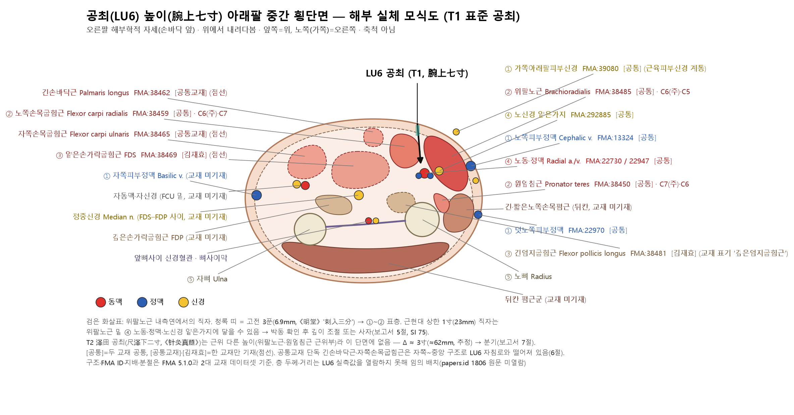

# [Acupoint Anatomical & Physiological Substrate Monograph] Kongzui (孔最, LU06)

> **Framework**: v2.7 (revised 2026-10-04) · **ARI**: T1 `ARI v3.0 | ARI-Core 71.2 ± 0 (B) | SI 75 | provisional weights 0.40/0.35/0.25 | sensitivity (equal weights): 68.8 (C, grade changes → weight-sensitive)`
> T2 `ARI v3.0 | ARI-Core 35 ± 0 (D·H) | SI 50 | provisional weights 0.40/0.35/0.25 | sensitivity (equal weights): 33.3 (D, grade unchanged)` · **Dual scoring**: completed by two independent raters

> **Three Primary Classics**: *Zhongguo Zhenjiu Xuewei Tongjian* (《中國針灸穴位通鑑》) · *Zhongguo Zhenjiu Zhengzhi Tongjian* (《中國針灸證治通鑑》) · *Zhenjiu Shuxue Tongkao* (《針灸腧穴通考》, Huang Longxiang 黃龍祥)
> **Layer A Empirical Database**: Integrated Biomedical Master DB v3.0 — LU6 evidence pack: of 32 landmark papers (including 28 external) and 20 locally mapped papers, **4 LU6-specific mechanism/imaging studies** (papers.id 1682, 1683, 1684, 1806) + 1 human clinical observation (1726)
> **Layer B Reference Registry**: four-tier reference registry (B1–B4) (6-item B-Check, concordance threshold ≥ 8/12)
> **Anatomical Ontology**: local index of the FMA (Foundational Model of Anatomy) 5.1.0 — textbook structures are pinned to `FMA:ID`s and their innervation, spinal segments and nerve trunks are cross-checked (B1 supplementary, not yet in the registry). Mapping table: FMA Acupoint Anatomical Ontology Mapping Registry; details in Appendix A.
> **Metrological Standard**: Han-dynasty (漢代) standard, 1 fen (分) = 2.3 mm ($z = \text{fen} \times 2.3\,\text{mm}$), 1 cun (寸) = 10 fen = 23 mm
> **Analysis Targets**: **T1** WHO/textbook standard Kongzui (腕上七寸, on the line joining Chize (尺澤, LU05) and Taiyuan (太淵, LU09)) / **T2** Sawada-style (澤田) Kongzui haemorrhoid reaction point (尺澤下二寸, 《針灸真髓》 1941)
> **Note on script**: Classical quotations and TCM terms are given in Traditional Chinese (繁體字). The cited refined editions are in simplified script; PDF page ranges and line numbers refer to those editions.

---

## 1. Classical Literature Screening Table (Three Primary Classics Excerpts & Chinese–Korean Collation)

| Classic (source file & line) | Original excerpt (location & depth) | Indications | Collation & remarks |
| :--- | :--- | :--- | :--- |
| ***Zhenjiu Shuxue Tongkao* (《針灸腧穴通考》)**, entry 孔最 (《針灸腧穴通考》(上) PDF pp. 81–160 L2300–2467, printed pp. 123–126) | "孔冣……手太陰郄，在腕上七寸。"(《黃帝內經明堂》, Yang Shangshan's (楊上善) commentary, L2320) / "刺入三分，灸五壯。"(《黃帝明堂經》, 【操作】) / Sawada (澤田氏): "尺澤穴下二寸。"(《針灸真髓》, L2324) | "可以出汗。頭痛，振寒，臂厥，熱，汗不出。"(《黃帝內經明堂》) / "吐血失喑，腫痛惡血。"(《太平聖惠方·針經》) / "治熱病汗不出……咳逆，臂厥痛。"(《銅人》) | ① The Ming-dynasty 《針灸集書》 "上骨以近骨邊" and 《針灸大成》 "側取" confuse the point with the location of Lieque (列缺, LU07) → "仍以《黃帝明堂經》、《銅人腧穴針灸圖經》為準". ② Forearm bone-proportional lengths of 10, 12 and 12.5 cun mean the texts are "identical in wording but different in fact" (文同而實不同). ③ Gao Wu (高武) misread "腫痛" as "咽腫痛". ④ **Appendix: tracing 'Kongzui treats haemorrhoids' (附: 孔最治痔溯源)** — the textbook indication "haemorrhoids (痔疾)" is a mistransmission (訛傳) from Sawada's homonymous point at a different location |
| ***Zhongguo Zhenjiu Xuewei Tongjian* (《中國針灸穴位通鑑》)**, entry 孔最 (《中國針灸穴位通鑑》(上卷) PDF pp. 321–400 L880–1060) | Source: "孔最，手太陽之。"(《針灸甲乙經》 3:49 — as given by the OCR; taken to be a misprint/lacuna for "太陰之郄"; the Tongkao has "手太陰郄") / Location: "去腕七寸。"(《甲乙》, 《千金》, 《外臺》, 《聖惠》, 《銅人》 etc.) / "刺入三分，留三呼，灸五壯。"(《甲乙》) | "熱病汗不出，上□及孔最主之。"(OCR lacuna) "厥頭痛，孔最主之。"(《甲乙》 vols. 7 and 9) / "頭痛，振寒，臂厥，熱，汗不出。"(《明堂類成》) | Alias: "無" (none). Locations scattered in early-modern texts: 《針灸集成》 "尺澤下三寸半", 《中華針灸學》 "尺澤下三寸", 《新針灸學》 "離尺澤穴五寸". Local anatomy: "上層是肱橈肌之內緣，下層為屈拇長肌之外緣，深部有橈動脈和神經通過"(《新針灸學》) |
| ***Zhongguo Zhenjiu Zhengzhi Tongjian* (《中國針灸證治通鑑》)** (《中國針灸證治通鑑》 PDF pp. 161–240 L1738, 1782; PDF pp. 241–320 L704, 854, 856, 1626–1638) | (no location given — a prescription compendium) | "傷寒熱病身無汗，細詳孔最患無妨。"(《針灸玉龍經·玉龍歌》) / "熱病煩心，汗不出：中衝、勞宮……孔最三壯至五壯，即汗。"(《針灸捷徑》) / haemoptysis (咯血) "孔最配尺澤。強刺激為主。"(遼寧中醫雜誌 1980) / asthma (哮喘) "孔最、魚際。"(中醫雜誌 1989) | Classical combinations all belong to the **diaphoresis (汗不出)** group; modern combinations to the **haemoptysis (咯血) and asthma (哮喘)** group. Among the three classics, haemorrhoid prescriptions are dealt with only in the Tongkao appendix (collation of the mistransmission) |

---

## 2. Primary Source vs. Secondary Quotation: Historical Stratification Table

| Stratum | Text | Location | Depth | Indications | Verdict |
| :--- | :--- | :--- | :--- | :--- | :--- |
| Primary | *Huangdi Mingtang Jing* (《黃帝明堂經》) (commentary in Yang Shangshan's 《黃帝內經明堂》) | 在腕上七寸 | 刺入三分, 灸五壯 | 頭痛, 振寒, 臂厥, 熱, 汗不出 | **Primary (T1)** |
| Re-recorded | *Zhenjiu Jiayi Jing* (《針灸甲乙經》) 3:49 | 去腕七寸 | 刺入三分, 留三呼, 灸五壯 | 熱病汗不出; 厥頭痛 | Re-recording of the primary source |
| Song secondary quotation & supplementation | 《太平聖惠方》 針經 and 明堂 sections, 《銅人》, 《資生經》 | 在腕上七寸(陷者宛宛中) | 針入三分 / 灸三壯 | 吐血失喑, 腫痛惡血 (針經); 肘臂厥痛 (明堂); 咳逆 (銅人) | Supplemented indications (internal damage, local) |
| Ming variants | 《針灸集書》, 《針灸大成》, 《循經考穴編》 | 上骨以近骨邊 / 側取 | 三分 | 咽腫痛 (《聚英》, Gao Wu 高武) | **Confusion with 列缺 and misreading** (corrected by the Tongkao) |
| Early-modern Japan | 《針灸真髓》 (dictated by Sawada Ken 澤田健, edited by Shirota Bunshi 代田文志, 1941; Chinese edition 1958) | **尺澤下同身寸二寸** | Not recorded | 痔疾, 痔痛 | **Independent new point (T2)**, "澤田先生的獨創穴" |
| Early-modern transfer | Honma Shohaku (本間祥白), 《經絡治療講話》 (1950; Chinese edition 1957) → 1958 《針灸學講義》 (Beijing School of Chinese Medicine 北京中醫學校) | Location not annotated | — | 咯血, 痔出血 | Location information lost → **origin of the mistransmission** |
| Modern textbooks | 1st-edition 《針灸學講義》, 4th/5th/6th-edition 《針灸學》 | 腕橫紋上 7寸 | 直刺 0.5~1寸 | "痔疾" added | T2 indication grafted onto the T1 location (Tongkao L2432) |
| Separate Chinese experience | Zhang Xiaolin (張效林) (新中醫 1991) | 尺澤下 3寸 / 太淵上 3寸 | — | Haemorrhoid (痔瘡) reaction point | Yet another new point; attribution to 孔最 "欠妥" (inappropriate) |

> The single 孔最 haemorrhoid (痔疾) entry in 《金針梅花詩鈔》 (Zhou Shudong 周樹冬, published 1982) is the only record in ancient Chinese literature, but since it was published after 1958 it cannot be the source of the textbook entry (Tongkao L2412–2416).

---

## 3. Nomenclature & Alias Collation Table (KJH DB Verification to Prevent Conflation)

| Item | Value | Source | Handling |
| :--- | :--- | :--- | :--- |
| Standard code & point name | LU06 Gongchoe / Kongzui (孔最) (Lung Meridian of Hand-Taiyin, 手太陰肺經) | KJH Acupoint Nomenclature & Alias Comparative Database, row 61 | — |
| KJH alias | **"-"** (none recorded) | KJH row 61, column E | The alias columns of the Common Textbook and the Kim Jaehyo textbook are also blank |
| Variant character | **孔冣** (冣 is a variant form of 最) | Tongkao L2306, 2316 (《黃帝內經明堂》, 《太素》, 《聖惠方·明堂》) | A difference of spelling for the same point — no conflation |
| Alias in the *Xuewei Tongjian* (《穴位通鑑》) | "無" (none) | *Xuewei Tongjian* L884 | — |
| Homonymous point at a different location | Sawada's 孔最 (尺澤下二寸) | Tongkao L2324, 2418–2422 | **Separated as T2**; 痔疾 excluded from the T1 indications |
| Derivatives of the homonymous point | Matsumoto Shirōhei (松元四郎平) "尺澤下三寸" (1-chi bone-proportional scale), Zhang Xiaolin (張效林) "痔瘡阿是 1·2" | Tongkao L2422, 2434, footnote [1] | Recorded only as variant opinions within the T2 lineage |
| Confusion with an adjacent point | Lieque (列缺, LU7) — Ming-dynasty "上骨以近骨邊", "側取" | Tongkao, textual analysis (文獻分析) | Corrected to the location in 《明堂》 and 《銅人》 |

---

## 4. 3D Spatial Coordinates & Layer 1–5 Anatomical Substrate Diagram

**Coordinate reference**: anatomical position (forearm supinated, palm facing forward). X = midline → lateral (radial), Y = proximal → distal, Z = depth from the skin surface. The mm values below are **estimates assuming a forearm length (尺澤–太淵) of 250 mm**, not measurements.

| Target | X (medial–lateral) | Y (proximal–distal) | Z (needling range) | Basis |
| :--- | :--- | :--- | :--- | :--- |
| **T1** (12-cun bone-proportional scale; current textbooks & WHO) | Radial side of the anterior forearm, medial border of brachioradialis | 7 cun above the wrist crease (腕橫紋) ≈ 146 mm (5 cun below 尺澤 ≈ 104 mm) | Classical 6.9 mm / modern 11.5–23 mm | Tongkao 【定位】, textbooks |
| T1 variant (10-cun scale: 《古今醫統》, Cheng Dan'an 承淡安) | Same | ≈ 175 mm above the wrist crease (≈ 29 mm more proximal than on the 12-cun scale) | — | Tongkao, textual analysis |
| T1 variant (12.5 cun: 1957 Nanjing 《針灸學》 "尺澤下五寸五分") | Same | ≈ 140 mm above the wrist crease (≈ 6 mm more distal) | — | Tongkao L2352, 2368 |
| **T2** (Sawada 澤田) | Radial side of the anterior forearm, "與手三里隔肌相對" (opposite Shousanli (手三里, LI10) across the muscles) | 2 cun below 尺澤 ≈ 42 mm (≈ 208 mm above the wrist crease) | Not recorded in the literature | 《針灸真髓》 (Tongkao L2418) |

**T1 layers (two textbooks + local anatomy in the *Xuewei Tongjian* + cross-check against B1-01 and B1-03 normative anatomy; depth boundaries are not fixed in mm because of large inter-individual variation)**

```
[Layer 1 Skin/subcutis]       Lateral cutaneous n. of forearm (C5–C6), cephalic v. & accessory cephalic v.
        │                     ← the classical 3 fen (6.9 mm) generally stays between the subcutis and the superficial fascia
[Layer 2 Fascia/superf. muscle] Medial border of brachioradialis, flexor carpi radialis (near the insertion of pronator teres)
        │
[Layer 3 Deep muscle]         Lateral border of flexor pollicis longus (Kim Jaehyo textbook, 《新針灸學》), flexor digitorum superficialis
        │
[Layer 4 Neurovascular bundle] Radial a./vv. beneath brachioradialis + superficial branch of radial n.  ← reachable by a modern 1-cun (23 mm) perpendicular insertion
        │
[Layer 5 Periosteum]          Periosteum of the anterior surface of the radius
```

- Point-specific measurement: papers.id 1806 (ultrasound; relation of LU6 and LI7 to the myotendinous junction; comparison of 10/12/12.5-cun bone-proportional scales; DOI 10.14406/acu.2025.024, no PMID). The original figures were not consulted for this report and were not used to fix mm boundaries for the layers.
- The T2 site (2 cun below 尺澤) lies over the proximal parts of brachioradialis and pronator teres; deep to it are the region where the radial nerve trunk divides into its superficial and deep branches, and the radial recurrent artery (inferred from B1-01 and B1-03; no textbook entry or measurement).



*Figure 4-1. Schematic cross-section of the mid-forearm at the level of Kongzui (T1, 腕上七寸) (right arm in anatomical position, viewed from above, not to scale). With perpendicular insertion at the medial border of brachioradialis, the classical 3 fen (teal band) remains superficial, while a 1-cun insertion can reach the radial artery and veins and the superficial branch of the radial nerve beneath brachioradialis (Layer 4). T2 (尺澤下二寸) lies at a different level and is not in this section. Layer thicknesses and distances are not measured values.*

**FMA substrate cross-check (T1, by layer)** — structure names from the two textbooks; IDs and relations from FMA 5.1.0

| Layer | Structure | FMA | Innervation / trunk (FMA) | Spinal segment (FMA) | Textbook |
| :--- | :--- | :--- | :--- | :--- | :--- |
| 1 Subcutis | Lateral cutaneous nerve of forearm | FMA:39080 | → Peripheral segment of musculocutaneous nerve | Not in FMA (B1: C5–C6) | Both |
| 1 Subcutis | Cephalic vein · accessory cephalic vein | FMA:13324 · FMA:22970 | Accessory cephalic vein → cephalic vein → Subclavian vein | — | Both |
| 2 Superficial muscle | Brachioradialis | FMA:38485 | Nerve to brachioradialis (FMA:65334) ← **radial nerve** | **C6 (primary)**, C5 | Both |
| 2 Superficial muscle | Flexor carpi radialis | FMA:38459 | Nerve to FCR (FMA:44824) ← **median nerve** | **C6 (primary)**, C7 | Both |
| 2 Superficial muscle | Pronator teres | FMA:38450 | Nerve to pronator teres (FMA:44823) ← median nerve | **C7 (primary)**, C6 | Both |
| 2 Superficial muscle | Palmaris longus *(Common Textbook)* | FMA:38462 | Nerve to palmaris longus (FMA:44825) ← median nerve | C7, C8 | Common Textbook |
| 2 Superficial muscle | Flexor carpi ulnaris *(Common Textbook)* | FMA:38465 | Nerve to FCU (FMA:81220) ← **ulnar nerve** | **C8 (primary)**, C7, T1 | Common Textbook |
| 3 Intermediate/deep muscle | Flexor digitorum superficialis *(Kim Jaehyo)* | FMA:38469 | Nerve to FDS (FMA:44826) ← median nerve | **C8 (primary)**, T1 | Kim Jaehyo |
| 3 Deep muscle | Flexor pollicis longus *(Kim Jaehyo; the textbook's label literally reads 'deep thumb flexor')* | FMA:38481 | Nerve to FPL (FMA:44830) ← anterior interosseous nerve ← median nerve | **C8 (primary)**, C7 | Kim Jaehyo |
| 4 Neurovascular bundle | Radial artery · radial vein | FMA:22730 · FMA:22947 | Artery → Subclavian artery (FMA modelling: the brachial artery is treated as a segment of the subclavian artery) / vein → Brachial vein | — | Both |
| 4 Neurovascular bundle | Superficial branch of radial nerve | FMA:292885 | → Radial nerve (FMA:37069) | Not in FMA (B1: C6–C8) | Both |
| 5 Periosteum | Anterior surface of the radius | — | — | — | — |

- FMA records segments only in the `segmental_supply` of muscles. Of the segment union C5–T1, **C8 and T1 come only from structures listed by one textbook — Common Textbook only (flexor carpi ulnaris) or Kim Jaehyo only (flexor digitorum superficialis, flexor pollicis longus)** — whereas the structures shared by both textbooks (brachioradialis, flexor carpi radialis, pronator teres) are **C5–C7**.
- The Kim Jaehyo textbook dataset's "deep thumb flexor (flexor pollicis longus)" is, on the basis of the English term and FMA (FMA:38481 *Flexor pollicis longus*), a slip for **flexor pollicis longus** (literally 'long thumb flexor'). The body text corrects the label and gives the textbook's original label alongside it.


---

## 5. Classical Needling Depth Calculation Table (Han Dynasty 2.3 mm Conversion & Layers Reached)

Source: Classical Needling Depth Database, sheet 1, row 60 (LU06). No '0' ('Contraindicated for needling (禁針)') value.

| Text | Fen | Converted depth | Layer reached (T1) |
| :--- | :---: | :---: | :--- |
| *Huangdi Mingtang Jing* (《黃帝明堂經》, ed. Huang Longxiang) | 3 | 6.9 mm | Layer 1–2 |
| *Zhenjiu Jiayi Jing* (《針灸甲乙經》) (sequence no. 24) | 3 | 6.9 mm | Layer 1–2 |
| *Chimgu Gyeongheombang* (《針灸經驗方》) | 3 | 6.9 mm | Layer 1–2 |
| *Dongui Bogam* (《東醫寶鑑》, citing 《銅人》) | 3 | 6.9 mm | Layer 1–2 |
| Korean common textbook, *Meridian and Acupoint Studies* (經絡腧穴學) | 5–10 | 11.5–23.0 mm | Layer 2–4 |
| Korean common textbook, *Acupuncture and Moxibustion Medicine* (針灸醫學) | 5–10 | 11.5–23.0 mm | Layer 2–4 |
| *Zhenjiu Shuxue Tongkao* (《針灸腧穴通考》) | 5–10 | 11.5–23.0 mm | Layer 2–4 |
| (Reference) 1957 Nanjing 《針灸學》 and 1st-edition 講義 "針三至七分" | 3–7 | 6.9–16.1 mm | Layer 1–3 (Tongkao 【操作】) |
| (Reference) 6th-edition 《針灸學》 "直刺 0.5~1.2寸" | 5–12 | 11.5–27.6 mm | Layer 2–4(5) (Tongkao 【操作】) |
| T2 (《針灸真髓》) | blank | Not described (missing) | — |

- The classical depth is consistently 3 fen (6.9 mm) and stays superficial. A perpendicular insertion at the early-modern/modern upper limit of 1 cun (23 mm) can reach the radial artery and the superficial branch of the radial nerve beneath brachioradialis (Layer 4), so the pulse should be checked and the depth controlled at the medial border of brachioradialis, or the needle inserted obliquely (basis for SI 75).

---

## 6. Textbook Comparison Table (Common Textbook vs. Kim Jaehyo Textbook)

Source: Common Textbook Anatomical Structure Dataset, sheet `경혈별_해부구조_종합`, row 59 (*Acupoint Studies* vol. 1, p. 54) · Kim Jaehyo Anatomical Structure Dataset, sheet `경혈별_해부구조_종합`, row 59.

| Category | Common Textbook of Acupoint Studies | Kim Jaehyo textbook | Agreement | FMA adjudication |
| :--- | :--- | :--- | :--- | :--- |
| Muscles | Brachioradialis, pronator teres, flexor carpi radialis, **palmaris longus, flexor carpi ulnaris** | Brachioradialis, pronator teres, flexor carpi radialis, **flexor digitorum superficialis, flexor pollicis longus** (textbook label 'deep thumb flexor') | 3 of 5 agree; 2 secondary muscles differ | Shared FMA:38485, 38450, 38459 / Common Textbook only 38462, 38465 / Kim Jaehyo only 38469, 38481 |
| Nerves | Superficial branch of radial nerve, lateral cutaneous nerve of forearm | Lateral cutaneous nerve of forearm, superficial branch of radial nerve | Agree | FMA:292885, 39080 (presence or absence of the definite article in the English term is a spelling difference with the same ID) |
| Vessels | Radial artery and veins, cephalic vein, accessory cephalic vein | Cephalic vein, accessory cephalic vein, radial artery and veins | Agree | FMA:22730, 22947, 13324, 22970 |

- **Analysis of the difference**: flexor carpi ulnaris and palmaris longus in the Common Textbook are structures of the ulnar-to-central forearm and do not fit the LU6 needling path at the medial border of brachioradialis on the radial side (review needed). Flexor pollicis longus in the Kim Jaehyo textbook agrees with 《新針灸學》 "下層為屈拇長肌之外緣" (*Xuewei Tongjian*, local anatomy 局部解剖).
- **What FMA shows about the difference**: the muscles shared by both textbooks are supplied by the radial nerve (brachioradialis) and median nerve (flexor carpi radialis, pronator teres), segments C5–C7. Flexor carpi ulnaris, listed only in the Common Textbook, is an ulnar-side structure supplied by the **ulnar nerve** (primarily C8), so it also belongs to a different nerve system from the radial-side LU6 needling path. The two muscles listed only by Kim Jaehyo belong to the **intermediate and deep layers** of the median/anterior interosseous nerve system (primarily C8), i.e. they record deeper layers along the same needling path. The two differences are therefore of different kinds: in the Common Textbook, structures outside the needling path (ulnar side) have crept in; in the Kim Jaehyo textbook, the listing extends deeper beneath the needling path. This adjudication does not change the $S_{clarity}$ level of 75.
- **Verdict**: the main nerve and vessel structures and the main muscles (brachioradialis, pronator teres, flexor carpi radialis) agree, so S_clarity is at the 75 level (main structures agree between the two textbooks + B1 confirmation). The point-specific measurement (1806) has a DOI but no PMID, so the condition for 100 is not met.

---

## 7. Spatial Discrepancy Branch Inference Diagram

```
尺澤(LU5)  ●─── 2寸(≈42mm) ────●─── 3寸(≈62mm) ───●──── 7寸(≈146mm) ────● 太淵(LU9)
                               [T2 Sawada 孔最]   [T1 standard 孔最]
                               尺澤下二寸         腕上七寸
                               《針灸真髓》1941   《黃帝明堂經》
                               Ind.: 痔疾 (empir.) Ind.: 汗不出·頭痛·咳逆·吐血
                               └─ Δ ≈ 3寸 ≈ 62mm ─┘ (> 15mm → split)
```

- **Reason for the split**: the distance between T1 and T2 ≈ 3 cun (about 62 mm, estimated), far above the 15 mm threshold. Sawada himself distinguished the effects of the two locations, saying "如依普通取法則不見效" (Tongkao L2420).
- **Branch decision**: ΔARI-Core = 71.2 − 35 = **36.2 (≥ 10)**, and the intervals [71.2, 71.2] and [35, 35] do not overlap → **T1 declared superior**. That is, the anatomical substrate of Kongzui is determined on the basis of T1 (腕上七寸), and "孔最治痔" (Kongzui treats haemorrhoids) is separated as an empirical claim about the T2 location.

---

## 8. Biomedical Reflex Pathway Diagram & External Search Log

### ① Layer A Papers (LU6-specific studies first)

| papers.id | Year | Journal | Title | PMID / DOI | Design | Target & use |
| :---: | :---: | :--- | :--- | :--- | :--- | :--- |
| 1682 | 2024 | Zhongguo Zhen Jiu | Effect and mechanism of acupuncture on airway smooth muscle relaxation during acute asthma attack in rats | 38467504 / 10.13703/j.0255-2930.20230426-k0004 | Animal (rat), LU6+LU10 vs BL13+Dingchuan (定喘) | T1 mechanism (β2-AR, ET-1) |
| 1683 | 2023 | Zhongguo Zhen Jiu | Effects of acupuncture on pulmonary function and airway smooth muscle spasm in asthma rats | 37577892 / 10.13703/j.0255-2930.20220618-k0002 | Animal (rat), LU6+LU10 | T1 mechanism (ET-1, MT-2) |
| 1684 | 2023 | Zhongguo Zhen Jiu | Effect mechanism of acupuncture for anti-asthmatic airway remodeling based on TGF-β1/Smad3 signaling pathway | 37313563 / 10.13703/j.0255-2930.20220412-k0013 | Animal (rat), LU6+LU10 vs BL13+Dingchuan (定喘) | T1 mechanism (airway remodelling) |
| 1806 | 2025 | Korean Journal of Acupuncture | Ultrasonographic Study on Forearm Acupuncture Points (LU6 and LI7) and Myotendinous Junction Relationships | — / 10.14406/acu.2025.024 | Anatomy/imaging (ultrasound) | T1 anatomical substrate |
| 1726 | 2012 | 中國中醫急症 | 針刺孔最穴魚際穴治療哮喘急性發作臨床觀察 | — / — | Human clinical observation (67 cases, LU6+LU10, non-RCT) | T1 human translation (weak) |
| 1679 | 2009 | J Altern Complement Med | Characteristics of electrical skin resistance at acupuncture points in healthy humans | 19422323 / 10.1089/acm.2008.0331 | Human (non-RCT), skin resistance at 6 points | T1 supplementary |
| 1807 | 2025 | Annals of Medicine | Effect of press needle stimulation on postoperative pulmonary complications in VATS patients: a RCT | 40953233 / 10.1080/07853890.2025.2560684 | Human RCT (multiple points; the effect of LU6 alone cannot be isolated) | T1 supplementary |

**Counter-evidence and T2-related literature (not counted toward mechanism papers)**

| papers.id | Year | Journal | Title | PMID / DOI | Nature |
| :---: | :---: | :--- | :--- | :--- | :--- |
| 1561 | 2011 | 中醫文獻雜誌 | "孔最治痔"訛傳及其對當代針灸學的影響 (Huang Youmin 黃幼民 & Huang Longxiang 黃龍祥) | — / — | Textual study, **rebuttal of the T2 indication as a mistransmission (訛傳)** |
| 1563 | 2011 | 針刺研究 | "孔最治痔"的訛傳及其對當代針灸學的影響 (Huang Youmin & Huang Longxiang) | — / — | Textual study, rebuttal |
| 1723 | 2011 | 針刺研究 | 孔最治痔的訛傳及其對當代針灸學的影響 (Huang Youmin) | — / — | Separately held copy of the same paper as 1563 |
| 1564 | 2012 | 科學通報 | 從三個著名案例看針灸臨床研究的複雜性 (Huang Longxiang & Huang Youmin) | — / 10.1360/972011-743 | Methodological discussion; interpretation of strong stimulation and point combinations as non-specific effects (counter-evidence of the B4-05 type) |
| 461 | 2021 | Korean Journal of Acupuncture | A Literature Review on the Evidence that Hemorrhoids Were Included in the Efficacy of LU6 | — / 10.14406/acu.2021.024 | Literature review (T2) |
| 1742 | 2018 | World J Acupunct-Moxibustion | Acupuncture at Kongzui (LU6) for 76 cases of hemorrhoids | — / — | Case series (no control group, criteria for point location unclear) |
| 1808 | 2021 | J Agromedicine Med Sci | The Effectiveness of Acupuncture Therapy in Patient with Hemorrhoid: A Case Report | — / 10.19184/ams.v7i3.23937 | Case report |

> **Citations from the earlier edition excluded**: 17 (Mori 2002, multi-point electroacupuncture — LU6 specificity not confirmed; noted only as a reference under B-Check ⑥), 795 (review), 1458 and 1461 (philology of 《明堂》), 1002 and 1678 (duplicates of the same prescription compendium, not papers).

### ② B-Check Scoring Table

**T1 standard Kongzui (腕上七寸)**

| Item | Content | Rater A | Rater B | Final | Layer B reference IDs | papers.id | Rationale |
| :---: | :--- | :---: | :---: | :---: | :--- | :--- | :--- |
| ① | Peripheral nerve/vessel substrate at needling depth | 2 | 2 | **2** | B1-01, B1-03, B2-02, B2-09, B2-10 (+FMA) | 1806 | Nerves and vessels agree between the two textbooks (FMA:292885, 39080, 22730, 22947 exact) + LU6-specific ultrasound measurement |
| ② | Spinal segmental concordance | 1 | 1 | **1** | B1-02, B1-03, B3-01, B3-20 (+FMA) | — | Dermatomes C5–C7 (FMA: segmental_supply of the shared muscles C5–C7; C8, T1 if single-textbook structures are included) vs lung viscerotome T1–T5 and vagus — not directly concordant; inference |
| ③ | Afferent fibre type & receptors | 1 | 1 | **1** | B3-05, B3-06 | 1682 | No LU6-specific study of afferent fibres; inference from the general framework |
| ④ | Central relay & pathway | 1 | 1 | **1** | B3-04, B3-05 | — | No LU6-specific evidence for an NTS/vagal pathway; inference |
| ⑤ | Efferent pathway & target effect | 1 | 1 | **1** | B3-05 | 1682, 1683, 1684 | Airway smooth muscle relaxation in rats — consistent in direction with 咳逆 (cough with counterflow), but limited to animals and to combination with LU10; no mechanism for the original 《明堂》 indication "汗不出" |
| ⑥ | Human translation | 1 | 1 | **1** | B4-03, B4-04, B4-05 | 17, 1679, 1726, 1807 | Only non-RCT and multi-point studies; counter-evidence on point specificity (B4-05) noted alongside |
| **Total** | | 7 | 7 | **7 / 12** | | | **Not concordant → the reflex mechanism is a hypothesis** (animal only) |

**T2 Sawada Kongzui (尺澤下二寸)**

| Item | Content | Rater A | Rater B | Final | Layer B reference IDs | papers.id | Rationale |
| :---: | :--- | :---: | :---: | :---: | :--- | :--- | :--- |
| ① | Peripheral nerve/vessel substrate at needling depth | 1 | 1 | **1** | B1-01, B1-03 | — | No textbook entry or measurement; inference from normative anatomy |
| ② | Spinal segmental concordance | 0 | 0 | **0** | B1-03, B3-01 | — | C5–C7 vs anorectum S2–S4 (sympathetic T10–L2) — no concordance; only the meridian logic of "肺絡於大腸" (the lung connects with the large intestine) |
| ③ | Afferent fibre type & receptors | 1 | 1 | **1** | B3-06 | — | Inference from general afferent fibres |
| ④ | Central relay & pathway | 1 | 1 | **1** | B3-07, B3-08 | — | Inference from non-specific analgesia by strong stimulation (gate control, DNIC) |
| ⑤ | Efferent pathway & target effect | 0 | 0 | **0** | B3-05, B4-05 | — | No evidence of an efferent pathway to haemorrhoidal blood flow or the sphincter; Tongkao rebuttal citing non-specific effects |
| ⑥ | Human translation | 1 | 1 | **1** | B4-04, B4-05 | 1742, 1808 | Case report and case series, no control group; counter-evidence of non-specificity (1564) coexists |
| **Total** | | 4 | 4 | **4 / 12** | | | **Hypothesis** |

### ③ External Search Log (sync_log; Rank 6 runs of 2026-10-04 and 2026-10-23)

| Timestamp | Source | HTTP | Fetched | Duplicates removed | New | Query |
|---|---|---|---|---|---|---|
| 2026-10-04T09:51:32 | pubmed | 200 | 9 | — | — | ("LU6" OR "Kongzui" OR "孔最") AND (acupuncture OR electroacupuncture) AND (nerve OR reflex OR autonomic OR mechanism OR anatomy) |
| 2026-10-04T09:51:32 | openalex | 200 | 16 | — | — | doi_starts_with:10.13703,title_and_abstract.search:"Kongzui" OR "LU6" \| doi_starts_with:10.13702,… \| has_doi:true,… |
| 2026-10-04T09:51:32 | crossref | 200 | 0 | — | — | Kongzui acupuncture nerve reflex |
| 2026-10-04T09:51:32 | all | — | 25 | 25 | 0 | |
| 2026-10-23T21:44:38 | pubmed | 200 | 9 | — | — | Same query + ("Zhongguo Zhen Jiu"[Journal] OR "Zhen Ci Yan Jiu"[Journal]) |
| 2026-10-23T21:44:38 | openalex | 200 | 16 | — | — | doi_starts_with:10.13703 / 10.13702 / has_doi:true, "Kongzui" OR "LU6" |
| 2026-10-23T21:44:38 | crossref | 200 | 0 | — | — | Kongzui acupuncture nerve reflex |
| 2026-10-23T21:44:38 | all | — | 25 | 25 | 0 | merged_into_existing=16, batch_dups=9 — 0 new, verdict unchanged |

### ④ Reflex Mechanism Hypothesis Diagram (T1; B-Check not concordant → hypothesis)

```
LU6 needling (medial border of brachioradialis, Layer 1–4)
  → Afferent: lateral cutaneous n. of forearm (C5–C6), superficial branch of radial n. (inferred from B3-06)
  → Spinal cord C5–C7 / supraspinal autonomic centres (inferred from B3-04, B3-05; no LU6-specific evidence)
  → Efferent: airway smooth muscle relaxation (β2-AR↑, ET-1↓) — rat, LU6+LU10 combination (papers.id 1682, 1683, 1684)
  → Human: clinical observation of acute asthma attacks (1726, non-RCT) — point specificity not isolated
```

### ⑤ Anchoring the Peripheral Afferent Pathway in FMA (T1)

The first segment of the hypothesis diagram above (needling site → spinal cord) is anchored by FMA relations as follows. The structures shared on the LU6 needling path enter three systems: the **radial nerve (brachioradialis, superficial branch)**, the **median nerve (flexor carpi radialis, pronator teres)** and the **musculocutaneous nerve (lateral cutaneous nerve of forearm)**. This structural chain is only the anatomical front end of the hypothesis diagram and does not change the B-Check score.


*Figure 8-1. Peripheral afferent pathway of LU6 (T1) drawn from FMA 5.1.0 relations. Solid lines are relations recorded in FMA (`nerve_supply`, trunk chains); dashed lines are subcutaneous and deep-layer routes.*

---

## 9. Classical Indications Stratification Table (Single-Point $P_{single}$ vs. Combination Prescriptions)

| Type | Indication | Source | Target | Verdict |
| :--- | :--- | :--- | :---: | :--- |
| $P_{single}$ (primary) | Headache (頭痛), shivering with cold (振寒), reversal in the arm (臂厥), fever (熱), **absence of sweating (汗不出)** ("可以出汗") | 《黃帝內經明堂》 (Tongkao L2376) | T1 | Intrinsic indication |
| $P_{single}$ | Febrile disease without sweating (熱病汗不出); reversal headache (厥頭痛) | 《甲乙》 vols. 7 and 9 (*Xuewei Tongjian*) | T1 | Intrinsic indication |
| $P_{single}$ (Song supplementation) | 吐血失喑, 腫痛惡血 / 肘臂厥痛, 屈伸難 / 咳逆 | 《聖惠方》 針經 and 明堂 sections, 《銅人》 | T1 | Later supplementation (internal damage, local) |
| Variant | Sore swollen throat (咽腫痛) | 《針灸聚英》, Gao Wu (高武) | T1 | Misreading of "腫痛" (Tongkao, textual analysis) |
| $P_{comb}$ | Febrile disease with vexation of the heart and absence of sweating (熱病煩心 汗不出) (中衝, 勞宮, 少衝, 關衝, 大陵, 陽溪, 曲澤, 孔最) | 《針灸捷徑》 (Zhengzhi Tongjian) | T1 | Combination — the effect of the single point cannot be isolated |
| $P_{comb}$ | Haemoptysis (咯血) (孔最 combined with 尺澤, strong stimulation) / asthma (哮喘) (孔最, 魚際) | Modern literature in the Zhengzhi Tongjian; papers.id 1726, 1682–1684 | T1 | Combination/animal — consistent in direction with 咳逆 |
| Grafted indication | **Haemorrhoids, haemorrhoidal pain, haemorrhoidal bleeding (痔疾·痔痛·痔出血)** | 1st-edition 講義, 4th/5th/6th-edition 《針灸學》 | T2→T1 | **Mistransmission (訛傳)** (Tongkao, 附: 孔最治痔溯源; papers.id 1561, 1563, 1723) — excluded from the T1 indications |
| T2 experience | Key point for haemorrhoids (痔疾) (尺澤下二寸) | 《針灸真髓》 | T2 | Early-modern experience, no controlled studies. The effect may be a non-specific effect of point combination and prolonged strong stimulation (Tongkao L2438, papers.id 1564) |

---

## 10. ARI v3.0 Quantitative Profile Evaluation & Final Conclusion

$$\text{ARI-Core} = 0.40\,S_{orig} + 0.35\,S_{clarity} + 0.25\,S_{reflex} \quad (\text{provisional weights, unvalidated})$$
$$\text{SI} = S_{safety} \quad (\text{not summed})$$

### 10-1. T1 Standard Kongzui (腕上七寸)

| Index | Rater A | Rater B | Mean | Rubric-level rationale | Evidence pointers |
| :--- | :---: | :---: | :---: | :--- | :--- |
| $S_{orig}$ | 81.25 | 81.25 | **81.25** | Mean of the 4 sub-items (table below) | Tongkao L2300–2467 |
| $S_{clarity}$ | 75 (50 before adjudication) | 75 | **75** | Main nerves, vessels and main muscles agree between the two textbooks + B1 confirmation; 1806 has no PMID → 100 not met | Textbook xlsx row 59, papers.id 1806 |
| $S_{reflex}$ | 50 | 50 | **50** | 3 LU6 animal studies (point combinations), no human mechanism experiment, B-Check 7/12 | papers.id 1682, 1683, 1684, 1726 |
| $S_{safety}$ → SI | 75 | 75 | **75** | Layer 4 can be reached by 23 mm perpendicular insertion, but the classical 3 fen and the modern upper limit are stated, and the risk is avoided by oblique insertion and depth control; no 'Contraindicated for needling (禁針)' record | Needling-depth DB row 60 |

| $S_{orig}$ sub-item | A | B | Mean | Rationale |
| :--- | :---: | :---: | :---: | :--- |
| ① Clarity of earliest description | 100 | 75 | 87.5 | 《明堂》 "在腕上七寸" + "刺入三分" (B: points deducted for the certainty of location because of differing bone-proportional scales) |
| ② Agreement in later texts | 75 | 75 | 75 | About 15 texts agree on "腕上七寸"; the Ming confusion with 列缺 and differing bone-proportional scales make them "文同而實不同" |
| ③ Resolution of alias confusion | 75 | 75 | 75 | KJH "-", variant character 孔冣, Sawada's homonymous point separated chronologically |
| ④ Collation in the *Tongkao* (《通考》) | 75 | 100 | 87.5 | Confusion with 列缺, Gao Wu's misreading and the haemorrhoid (痔疾) mistransmission corrected (A: the difference in bone-proportional scales remains uncorrected) |
| **Mean** | 81.25 | 81.25 | **81.25** | |

- **Gates**: none applicable (S_orig and S_clarity ≥ 50, 3 point-specific Layer A papers, SI > 25).
- **ARI-Core** = 0.40×81.25 + 0.35×75 + 0.25×50 = **71.2 ± 0 → B (probable)**, no flags.
- **SI** = **75**.
- **Equal-weight sensitivity**: (81.25 + 75 + 50) / 3 = **68.8 → C**, grade changes → **weight-sensitive**.

### 10-2. T2 Sawada Kongzui (尺澤下二寸)

| Index | Rater A | Rater B | Mean | Rubric-level rationale | Evidence pointers |
| :--- | :---: | :---: | :---: | :--- | :--- |
| $S_{orig}$ | 50 | 50 | **50** | Mean of the 4 sub-items (table below) | Tongkao L2410–2467 |
| $S_{clarity}$ | 25 | 25 | **25** | Not in either textbook, no measurement — inference only | Textbook xlsx (no T2 entry) |
| $S_{reflex}$ | 25 | 25 | **25** | 0 location-specific Layer A mechanism papers → Gate 2 | papers.id 1742, 1808 (case reports), 1561, 1563, 1564, 1723 (rebuttals) |
| $S_{safety}$ → SI | 50 | 50 | **50** | No literature on depth (missing); perpendicular insertion of 1 cun may directly contact the radial nerve trunk, its deep branch and the radial recurrent artery | The needling-depth DB refers to T1 — not applicable |

| $S_{orig}$ sub-item | A | B | Mean | Rationale |
| :--- | :---: | :---: | :---: | :--- |
| ① Clarity of earliest description | 25 | 25 | 25 | Only the early-modern 《針灸真髓》 (1941); depth not recorded |
| ② Agreement in later texts | 25 | 25 | 25 | Matsumoto "尺澤下三寸", Zhang Xiaolin "尺澤下3寸·太淵上3寸"; the textbooks transplant only the indication to the 7-cun point |
| ③ Resolution of alias confusion | 75 | 75 | 75 | The Tongkao separates it as "澤田先生獨創穴" and arranges the transfer route chronologically |
| ④ Collation in the *Tongkao* (《通考》) | 75 | 75 | 75 | Citation errors in footnote [1] (title, bone-proportional scale) corrected; based on the Chinese translation |
| **Mean** | 50 | 50 | **50** | |

- **Gates**: Gate 1 (S_clarity 25 < 50 → at most C), Gate 2 (0 point-specific Layer A papers → S_reflex ≤ 25, H flag).
- **ARI-Core** = 0.40×50 + 0.35×25 + 0.25×25 = **35 ± 0 → D·H (undetermined, hypothesis)**.
- **SI** = **50**.
- **Equal-weight sensitivity**: (50 + 25 + 25) / 3 = **33.3 → D**, grade unchanged.

### 10-3. Branch Decision

| Target | ARI-Core (± half-range) | Interval | Grade & flag | SI |
| :--- | :---: | :---: | :---: | :---: |
| T1 standard (腕上七寸) | 71.2 ± 0 | [71.2, 71.2] | B | 75 |
| T2 Sawada (尺澤下二寸) | 35 ± 0 | [35, 35] | D·H | 50 |

ΔARI-Core = **36.2 ≥ 10** and the two intervals do not overlap, so **T1 is superior**.

### 10-4. Adjudication Record

| Target | Item | Disagreement | Adjudication |
| :---: | :--- | :--- | :--- |
| T1 | $S_{clarity}$ | A 50 / B 75 (25-point difference, ≥ 15) | The main nerve and vessel structures agree between the two textbooks and only secondary muscles differ, so level 75 of canon 4.2 ("the two textbooks agree + confirmed by a standard anatomy text") fits better → A adjusted to 75 |
| T1 | $S_{orig}$ sub-items ① and ④ | A 100/75, B 75/100 | The means are equal (81.25), so no adjudication was needed; reported as the mean of the sub-items |
| T2 | — | No disagreement of 15 points or more | B-Check "hypothesis" kept on the basis of the rebuttals in the Tongkao and papers.id 1561, 1563, 1564, 1723; S_reflex 25 (Gate 2) |

### 10-5. Final Conclusion

- **T1 standard Kongzui (腕上七寸)** — **Probable (B, weight-sensitive)**. The anatomical substrate is the subcutaneous and fascial layer at the medial border of brachioradialis (lateral cutaneous nerve of forearm, cephalic vein), and at a depth of about 23 mm it reaches the radial artery and the superficial branch of the radial nerve (Layer 4). The location rests on *Huangdi Mingtang Jing* (《黃帝明堂經》) "在腕上七寸", but because forearm bone-proportional scales differed between periods (10, 12, 12.5 cun), the actual location is scattered by up to about 30 mm. The reflex mechanism (airway smooth muscle relaxation) is limited to rat studies with point combinations and is not concordant on the B-Check (7/12), so it is described as a **hypothesis**. With equal weights it falls to C (68.8), so grade B depends on the provisional weights.
- **T2 Sawada Kongzui (尺澤下二寸)** — **Undetermined, hypothesis (D·H)**. This is an early-modern Japanese empirical point; the "孔最治痔" (Kongzui treats haemorrhoids) recorded in the textbooks is a mistransmission (訛傳) in which the indication of this location was transferred, without its location information, to the 7-cun Kongzui (Tongkao, 附: 孔最治痔溯源, papers.id 1561, 1563, 1723). There is no segmental concordance, and the reported effects may be non-specific effects of point combination and strong stimulation (papers.id 1564).
- **Branch**: ΔARI-Core 36.2, intervals do not overlap → **T1 superior**. The intrinsic indications of Kongzui belong to the group of diaphoresis (汗不出), headache (頭痛), cough with counterflow (咳逆) and haematemesis (吐血); haemorrhoids (痔疾) are excluded from the T1 indications.

---

## Appendix A. FMA Anatomical Substrate Profile (FMA 5.1.0)

Generated by: FMA 5.1.0 acupoint profile query (LU06; 2026-10-23). Match level `exact` means that the textbook's English term matched an FMA label, synonym or Latin name exactly after normalisation.

| Category | Textbook term | FMA substrate | Match | Source | Innervation / parent trunk | Spinal segment |
| :--- | :--- | :--- | :--- | :--- | :--- | :--- |
| Muscle | Brachioradialis | FMA:38485 Brachioradialis | exact | Common Textbook · Kim Jaehyo | FMA:65334 Nerve to brachioradialis → Peripheral segment of radial nerve | C6 (primary), C5 (secondary) |
| Muscle | Flexor carpi radialis | FMA:38459 Flexor carpi radialis | exact | Common Textbook · Kim Jaehyo | FMA:44824 Nerve to FCR → Peripheral segment of median nerve | C6 (primary), C7 (secondary) |
| Muscle | Pronator teres | FMA:38450 Pronator teres | exact | Common Textbook · Kim Jaehyo | FMA:44823 Nerve to pronator teres → Peripheral segment of median nerve | C7 (primary), C6 (secondary) |
| Muscle | Palmaris longus | FMA:38462 Palmaris longus | exact | Common Textbook | FMA:44825 Nerve to palmaris longus → Peripheral segment of median nerve | C7, C8 |
| Muscle | Flexor carpi ulnaris | FMA:38465 Flexor carpi ulnaris | exact | Common Textbook | FMA:81220 Nerve to FCU → Peripheral segment of ulnar nerve | C8 (primary), C7, T1 (secondary) |
| Muscle | Flexor digitorum superficialis | FMA:38469 Flexor digitorum superficialis | exact | Kim Jaehyo | FMA:44826 Nerve to FDS → Peripheral segment of median nerve | C8 (primary), T1 (secondary) |
| Muscle | Flexor pollicis longus (textbook label 'deep thumb flexor') | FMA:38481 Flexor pollicis longus | exact | Kim Jaehyo | FMA:44830 Nerve to FPL → Anterior interosseous nerve → Peripheral segment of median nerve | C8 (primary), C7 (secondary) |
| Nerve | Lateral cutaneous nerve of forearm | FMA:39080 Lateral cutaneous nerve of forearm | exact | Common Textbook · Kim Jaehyo | FMA:288511 Peripheral segment of musculocutaneous nerve → FMA:37064 Musculocutaneous nerve | — |
| Nerve | Superficial branch of the radial nerve | FMA:292885 Superficial branch of radial nerve | exact | Common Textbook · Kim Jaehyo | FMA:37069 Radial nerve | — |
| Vessel | Accessory cephalic vein | FMA:22970 Accessory cephalic vein | exact | Common Textbook · Kim Jaehyo | FMA:13324 Cephalic vein → FMA:4725 Subclavian vein | — |
| Vessel | Cephalic vein | FMA:13324 Cephalic vein | exact | Common Textbook · Kim Jaehyo | FMA:4725 Subclavian vein → FMA:4723 Brachiocephalic vein | — |
| Vessel | Radial artery | FMA:22730 Radial artery | exact | Common Textbook · Kim Jaehyo | FMA:3951 Subclavian artery (FMA modelling; see note in Section 4) | — |
| Vessel | Radial vein | FMA:22947 Radial vein | exact | Common Textbook · Kim Jaehyo | FMA:22934 Brachial vein → FMA:13329 Axillary vein → … | — |

- Union of segments (input to B-Check ②): **C5, C6, C7, C8, T1** (shared structures only: C5–C7)
- Comparison of the two textbooks: 9 shared FMA entities · 2 Common Textbook only · 2 Kim Jaehyo only
- Limits of citation: FMA is a normative ontology of adult anatomy and is not evidence of point-specific depth, variant frequency or reflex function. The variation in the T1 location due to differing bone-proportional scales (10/12/12.5 cun) and the T2 Sawada location are outside the scope of FMA (questions of point location).

---

## v2.7 FMA Supplement History (2026-10-23)

| Location | Original content | Change | Basis |
| :--- | :--- | :--- | :--- |
| Header | — | Added FMA 5.1.0 anatomical ontology line | FMA Acupoint Anatomical Ontology Mapping Registry |
| Section 4 layer diagram, Section 6 | "Deep thumb flexor" (Kim Jaehyo textbook label as given) | Corrected to **flexor pollicis longus**, with the textbook's original label given alongside | English flexor pollicis longus = FMA:38481; slip in the textbook dataset |
| Section 4 | Text layer diagram only | Figure 4-1 cross-section schematic (T1 level), FMA cross-check table by layer, 2 FMA notes (source of segments, label error) | FMA profile query; figure-generation script (internal) |
| Section 6 | 4-column textbook comparison | FMA adjudication column; interpretation of the nature of the differences (Common Textbook = admixture of ulnar-side, ulnar-nerve structures / Kim Jaehyo = extension to deeper layers) | FMA nerve_supply, segmental_supply |
| Section 8 ② | B-Check ①, ② rationale | Added T1 FMA IDs and segment pointers (**scores unchanged**: T1 7/12, T2 4/12) | FMA segmental_supply |
| Section 8 ③ | 2026-10-04 log | Added rows for the 2026-10-23 Rank 6 re-run (PubMed 9, OpenAlex 16, Crossref 0, 0 new) | `_metadata.sync_log` LU6 2026-10-23T21:44:38 |
| Section 8 ⑤ | — | Figure 8-1 FMA peripheral afferent pathway (Mermaid) | FMA:38485, 38459, 38450, 292885, 39080 trunks |
| Appendix A | — | FMA profile table | FMA profile query |
| ARI | T1 71.2 ± 0 (B) / T2 35 ± 0 (D·H) | **No change** — FMA is B1-supplementary evidence and does not change rubric levels | Skill section 5-1 |
| Check of earlier-edition wording | The automated check flagged 1 instance of "full inverted index" | This is a **quotation of deleted earlier-edition wording** kept in the 'Original content' column of the v2.7 revision history below, so it was not changed (history preserved). No earlier-edition wording in the body text | Header row of the v2.7 revision history of this report |
| Archive | — | Pre-supplement md, html and xlsx kept in the internal archive | — |

---

## v2.7 Revision History (2026-10-04)

| Location | Original content | Change | Basis |
| :--- | :--- | :--- | :--- |
| Header | "full inverted index of 48 measured papers" | Replaced by evidence-pack counts (32 landmark, 20 local; 4 LU6-specific papers + 1 clinical) | evidence pack |
| Section 1 | OCR of the *Xuewei Tongjian* table of contents (GV25–28 etc.), a fragment on 八關大刺 from the *Zhengzhi Tongjian*, page numbers from the Tongkao table of contents | Original-text excerpts from the 孔最 entries (location, depth, indications, collation) | Tongkao (上) PDF pp. 81–160 L2300–2467; *Xuewei Tongjian* (上卷) PDF pp. 321–400 L880–1060; *Zhengzhi Tongjian* PDF pp. 161–240 L1738, 1782, PDF pp. 241–320 L704, 854, 856 |
| Section 2 | Generic placeholder text | Table of the path primary → re-recorded → supplemented → Ming variants → Sawada → mistransmission | Tongkao L2316–2438 |
| Section 3 | Alias "-" only, wording "completely blocked" | Table handling the variant character 孔冣, Sawada's homonymous point and confusion with 列缺 | KJH row 61; Tongkao L2306, 2316, 2324 |
| Section 4 | Layer mm values common to all points (0–2.5/…/over 22 mm), "joint capsule" | Estimated X, Y, Z coordinates by Target; LU6 layers by structure (textbooks, local anatomy in the *Xuewei Tongjian*) | Textbook xlsx row 59; *Xuewei Tongjian* local anatomy (局部解剖) |
| Section 5 | Conversion formula only | Table of fen and mm by text | Needling-depth xlsx sheet 1, row 60 |
| Section 6 | Boilerplate without structure names | Actual comparison of muscles, nerves and vessels; disagreement in 2 secondary muscles stated | Common Textbook and Kim Jaehyo xlsx, row 59 each |
| Section 7 | Generic rule sentence | T1/T2 split (Δ ≈ 3 cun) carried out, T1 declared superior | dual-scoring record |
| Section 8 B-Check | ① 2, ② 2, ⑤ 2, total 9/12 "confirmed", no papers.id | T1 final 2·1·1·1·1·1 = 7/12 not concordant, T2 4/12 hypothesis, reference IDs and papers.id given | B-Check scoring record |
| Section 8 Layer A | 17, 795, 1458, 1461, 1002, 1678 etc. listed as empirical evidence, PMIDs blank | Rebuilt around the LU6-specific 1682, 1683, 1684, 1806, 1726; mistransmission papers 1561, 1563, 1564, 1723 separated as counter-evidence; unsuitable items excluded | evidence pack; master DB papers |
| Section 8 | No external search log | sync_log table added | evidence pack |
| Section 9 | Placeholder | Separation of P_single / P_comb / grafted indication (haemorrhoid 痔疾 mistransmission) | Tongkao 【適應症】 and 附; *Zhengzhi Tongjian* |
| Section 10 | Single Target, S_orig 85 (value outside the rubric), S_reflex 75, ARI-Core 79.0 B, "rigorously verified" | T1 71.2 ± 0 (B, weight-sensitive) / T2 35 ± 0 (D·H); sub-items, gates, adjudication record and branch decision | dual-scoring record |
| Section 10 | — | Earlier-edition v2.6 score 79.0 (not comparable) | Earlier-edition report the internal archive |
| xlsx | B-Check sheet "B3-11 (Longhurst)", "B3-16 (Torres-Rosas)", "papers.id #1 / PMID to be checked" | Labels in sheet 4 of the earlier edition corrected to the registry (B3-11 = 2008 review of analgesic mechanisms, B3-16 = 2020 experiment on the NPY sympathetic pathway) and the "papers.id #1" pointer replaced by 1806; new B-Check sheet added. Neither reference is used in the final v2.7 scoring | Layer B Reference Registry L64, 69 |

---

## English Edition Revision History (2026-10-24)

| Location | Original content | Change | Basis |
| :--- | :--- | :--- | :--- |
| Whole document | Automatically generated "English" edition: Korean body text with only headings and some terms replaced | Fully translated into English from the Korean edition (same content, scores and evidence pointers); Traditional Chinese (繁體字) given for point, meridian and classic names, TCM concepts, indications and classical quotations | Korean edition |
| Title and body | "Kongzui (孔最, LU06)(孔最, LU06)" and similar duplicated annotations | Duplicates removed | — |
| Figure 4-1 | Image path corrupted by term replacement (`LU06_Kongzui (孔最, LU06)_…png`), so the image was missing from the HTML | Restored to the actual file name | Files in the report folder |
| Classical quotations | Simplified characters (e.g. 针, 泽, 渊, 鉴) | Converted to Traditional characters; file names and line pointers unchanged | Routing rule on Traditional Chinese collation |

## Refinement History (2026-10-24)

| Location | Original wording | Revised wording | Basis |
| :--- | :--- | :--- | :--- |
| Header links | Local absolute-path links (do not open on other PCs) | Project-relative links | Skill path rule (no drive-letter absolute paths) |
| Textbook title | *Meridian and Acupoint Studies* (經絡經穴學) | (經絡腧穴學) | The Korean edition names the textbook *Gyeongnak Suhyeolhak* (經絡腧穴學; suhyeol = 腧穴); 經絡經穴學 was a mistranslation carried over from the earlier ST36 English edition |
