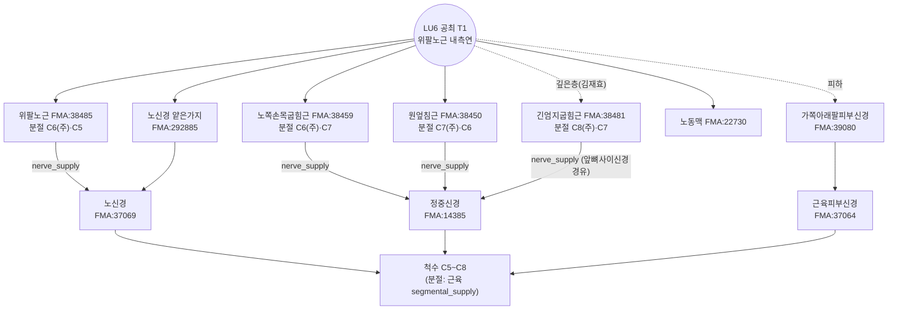

# 🔬 [경혈 해부생리학 실체 판명 학술 모노그래프] Kongzui (孔最, LU06)(孔最, LU06)

> **Framework**: v2.7 (2026-10-04 개정) · **ARI**: T1 `ARI v3.0 | ARI-Core 71.2 ± 0 (B) | SI 75 | 잠정 가중치 0.40/0.35/0.25 | 민감도(등가중치): 68.8 (C, 등급 변동 → 가중치 민감)`
> T2 `ARI v3.0 | ARI-Core 35 ± 0 (D·H) | SI 50 | 잠정 가중치 0.40/0.35/0.25 | 민감도(등가중치): 33.3 (D, 등급 불변)` · **이중 채점**: Independent dual-adjudication completed

> **Three Primary Classics**: *Zhongguo Zhenjiu Xuewei Tongjian* (《中國針灸穴位通鑑》) · *Zhongguo Zhenjiu Zhengzhi Tongjian* (《中國針灸證治通鑑》) · *Zhenjiu Shuxue Tongkao* (《針灸腧穴通考》)(黄龙祥)
> **Layer A Empirical Database**: [`경혈_생의학_신경반사_마스터DB.json`](file:///g:/내%20드라이브/도서%20번역/02_Master_Datasets/%EA%B2%BD%ED%98%88_%EC%83%9D%EC%9D%98%ED%95%99_%EC%8B%A0%EA%B2%BD%EB%B0%98%EC%82%AC_%EB%A7%88%EC%8A%A4%ED%84%B0DB.json) — LU6 근거 묶음: 랜드마크 32편(외부 28편 포함)·로컬 매핑 20편 중 **LU6 특이 기전·영상 연구 4편**(papers.id 1682·1683·1684·1806) + 인체 임상관찰 1편(1726)
> **Layer B Reference Registry**: [`layer_b_reference_registry.md`](file:///g:/내%20드라이브/도서%20번역/01_Framework/layer_b_reference_registry.md) (B-Check 6항목, 부합 기준 ≥ 8/12)
> **Anatomical Ontology**: FMA(Foundational Model of Anatomy) 5.1.0 로컬 색인 — 교재 구조를 `FMA:ID`로 고정하고 지배신경·척수 분절·신경 줄기를 대조(B1 보조, 등록부 미등재). 대응표 `02_Master_Datasets/FMA/acupoint_fma_mapping.json`, 상세는 부록 A
> **Metrological Standard**: 한대(漢代) 기준 1푼(分) = 2.3mm ($z = \text{푼} \times 2.3\text{mm}$), 1촌 = 10푼 = 23mm
> **분석 Target**: **T1** WHO·교재 표준 Kongzui (孔最, LU06)(腕上七寸, 尺泽–太渊 연선) / **T2** 사와다(泽田)식 Kongzui (孔最, LU06) Hemorrhoids (痔疾) 반응점(尺泽下二寸, 《针灸真髓》 1941)

---

## 🏛️ 1. 문헌 스크리닝 표 (3대 원전 원문 발췌 및 한중 대조)

| 문헌 (출처 파일·행) | 원문 발췌 (정위·심도) | 주치 | 교감 및 비고 |
| :--- | :--- | :--- | :--- |
| ***Zhenjiu Shuxue Tongkao* (《針灸腧穴通考》)** 孔最 조 (`针灸腧穴通考(上)_81-160.md` L2300–2467, 인쇄 p.123–126) | "孔冣……手太阴郄，在腕上七寸。"(《黄帝内经明堂》杨上善注, L2320) / "刺入三分，灸五壮。"(*Huangdi Mingtang Jing* (《黃帝明堂經》), 【操作】) / 泽田氏: "尺泽穴下二寸。"(《针灸真髓》, L2324) | "可以出汗。头痛，振寒，臂厥，热，汗不出。"(《黄帝内经明堂》) / "吐血失喑，肿痛恶血。"(《太平圣惠方·针经》) / "治热病汗不出……咳逆，臂厥痛。"(*Tongren* (《銅人》)) | ① 명대 《针灸集书》 "上骨以近骨边"·*Zhenjiu Dacheng* (《針灸大成》) "侧取"는 列缺 취혈과 혼동 → "仍以*Huangdi Mingtang Jing* (《黃帝明堂經》)、《铜人腧穴针灸图经》为准". ② 전완 골도 10·12·12.5寸 차이로 "文同而实不同". ③ 高武가 "肿痛"을 "咽肿痛"으로 오독. ④ **附: 孔最治痔溯源** — 교재의 "痔疾" 주치는 泽田 동명이위혈의 讹传 |
| ***Zhongguo Zhenjiu Xuewei Tongjian* (《中國針灸穴位通鑑》)** 孔最 조 (`中国针灸穴位通鉴(上卷)_321-400.md` L880–1060) | 출처 "孔最，手太阳之。"(*Zhen Jiu Jia Yi Jing* (《針灸甲乙經》)3:49 — OCR 그대로, "太阴之郄"의 오식·결자로 봄; 《通考》 "手太阴郄") / 부위 "去腕七寸。"(《甲乙》·《千金》·《外台》·《圣惠》·*Tongren* (《銅人》) 등) / "刺入三分，留三呼，灸五壮。"(《甲乙》) | "热病汗不出，上□及孔最主之。"(OCR 결자) "厥头痛，孔最主之。"(《甲乙》 7·9권) / "头痛，振寒，臂厥，热，汗不出。"(《明堂类成》) | 별명 "无". 근대 문헌 위치 분산: 《针灸集成》 "尺泽下三寸半", 《中华针灸学》 "尺泽下三寸", 《新针灸学》 "离尺泽穴五寸". 국소해부: "上层是肱桡肌之内缘，下层为屈拇长肌之外缘，深部有桡动脉和神经通过"(《新针灸学》) |
| ***Zhongguo Zhenjiu Zhengzhi Tongjian* (《中國針灸證治通鑑》)** (`中国针灸证治通鉴_161-240.md` L1738·1782; `_241-320.md` L704·854·856·1626–1638) | (정위 기술 없음 — 처방집) | "伤寒热病身无汗，细详孔最患无妨。"(《针灸玉龙经·玉龙歌》) / "热病烦心，汗不出：中冲、劳宫……孔最三壮至五壮，即汗。"(《针灸捷径》) / 咯血 "孔最配尺泽。强刺激为主。"(辽宁中医杂志 1980) / 哮喘 "孔最、鱼际。"(中医杂志 1989) | 고전 배오는 모두 **발한(汗不出)** 계열, 현대 배오는 **咯血·哮喘** 계열. Hemorrhoids (痔疾) 처방은 이 3대 원전 중 《通考》 부록(讹传 고증)에서만 다룸 |

---

## 📜 2. 원천/재인용 구분 표 (시대별 문헌 층차 정렬)

| 층차 | 문헌 | 정위 | 심도 | 주치 | 판정 |
| :--- | :--- | :--- | :--- | :--- | :--- |
| 원천 | *Huangdi Mingtang Jing* (《黃帝明堂經》)(杨上善 《黄帝内经明堂》 주) | 在腕上七寸 | 刺入三分, 灸五壮 | 头痛, 振寒, 臂厥, 热, 汗不出 | **원천(T1)** |
| 재록 | *Zhen Jiu Jia Yi Jing* (《針灸甲乙經》) 3:49 | 去腕七寸 | 刺入三分, 留三呼, 灸五壮 | 热病汗不出; 厥头痛 | 원천 재록 |
| 송대 재인용·증보 | *Taiping Shenghui Fang* (《太平聖惠方》) 针经·明堂, *Tongren* (《銅人》), 《资生经》 | 在腕上七寸(陷者宛宛中) | 针入三分 / 灸三壮 | 吐血失喑, 肿痛恶血(针经); 肘臂厥痛(明堂); 咳逆(铜人) | 주치 증보(내상·국소) |
| 명대 변형 | 《针灸集书》, *Zhenjiu Dacheng* (《針灸大成》), 《循经考穴编》 | 上骨以近骨边 / 侧取 | 三分 | 咽肿痛(《聚英》 高武) | **列缺 혼동·오독**(《通考》 교정) |
| 근대 일본 | 《针灸真髓》(泽田健 구술, 代田文志 정리, 1941; 중문판 1958) | **尺泽下同身寸二寸** | 기재 없음 | 痔疾·痔痛 | **독립 신혈(T2)**, "泽田先生的独创穴" |
| 근대 전이 | 本间祥白 《经络治疗讲话》(1950; 중문판 1957) → 1958 《针灸学讲义》(北京中医学校) | 위치 미주기 | — | 咯血, 痔出血 | 위치 정보 탈락 → **讹传 근원** |
| 현대 교재 | 1판 《针灸学讲义》, 4·5·6판 《针灸学》 | 腕横纹上 7寸 | 直刺 0.5~1寸 | "痔疾" 추가 | T2 주치를 T1 위치에 이식(《通考》 L2432) |
| 별도 중국 경험 | 张效林(新中医 1991) | 尺泽下 3寸 / 太渊上 3寸 | — | 痔疮 반응점 | 또 다른 신혈, 孔最 귀속 "欠妥" |

> 《金针梅花诗钞》(周树冬, 1982 간행)의 孔最 痔疾 1조는 중국 고대 문헌 유일 기록이나, 간행이 1958년 이후이므로 교재 기재의 출처가 될 수 없다(《通考》 L2412–2416).

---

## 🔍 3. 이명·별칭 검증 표 (KJH DB 대조를 통한 혼용 차단)

| 항목 | 값 | 출처 | 처리 |
| :--- | :--- | :--- | :--- |
| 표준 코드·혈명 | LU06 Kongzui (孔最, LU06) 孔最 (Lung Meridian of Hand-Taiyin (手太陰肺經)) | KJH `경혈명_비교_정리_KJH.xlsx` 61행 | — |
| KJH 이명 | **"-"** (기재 없음) | KJH 61행 E열 | 공통교재·김재효 교재 이명 칸도 공란 |
| 이체자 | **孔冣** ("最"의 이체자) | 《通考》 L2306·2316 (《黄帝内经明堂》·《太素》·《圣惠方·明堂》) | 동일 혈위의 표기 차이 — 혼용 없음 |
| 《穴位通鉴》 별명 | "无" | 《穴位通鉴》 L884 | — |
| 동명이위혈 | 泽田氏 孔最 (尺泽下二寸) | 《通考》 L2324·2418–2422 | **T2로 분리**, T1 주치에서 痔疾 제외 |
| 동명이위 파생 | 松元四郎平 "尺泽下三寸"(1척 골도), 张效林 "痔疮阿是 1·2" | 《通考》 L2422·2434·각주 [1] | T2 계열 이설로만 기록 |
| 인접 혈 혼동 | 列缺(LU7) — 명대 "上骨以近骨边", "侧取" | 《通考》 文献分析 | 《明堂》·*Tongren* (《銅人》) 정위로 교정 |

---

## 📐 4. 3D 공간 좌표 및 Layer 1~5 층차 구조도

**좌표 기준**: 해부학적 자세(전완 회외, 손바닥 앞). X = 정중선→외측(요측), Y = 근위→원위, Z = 피부면에서의 깊이. 아래 mm 값은 **전완(尺泽–太渊) 길이 250mm 가정 추정치**이며 실측값이 아니다.

| Target | X (내외측) | Y (근위원위) | Z (자침 범위) | 근거 |
| :--- | :--- | :--- | :--- | :--- |
| **T1** (12寸 골도, 현행 교재·WHO) | 전완 앞면 요측, 위팔노근 내측연 | 腕横纹 위 7寸 ≈ 146mm (尺泽 아래 5寸 ≈ 104mm) | 고전 6.9mm / 현대 11.5~23mm | 《通考》 【定位】, 교재 |
| T1 변이 (10寸 골도: 《古今医统》·承淡安) | 동일 | 腕横纹 위 ≈ 175mm (12寸 기준보다 ≈ 29mm 근위) | — | 《通考》 文献分析 |
| T1 변이 (12.5寸: 1957 南京 《针灸学》 "尺泽下五寸五分") | 동일 | 腕横纹 위 ≈ 140mm (≈ 6mm 원위) | — | 《通考》 L2352·2368 |
| **T2** (泽田) | 전완 앞면 요측, "与手三里隔肌相对" | 尺泽 아래 2寸 ≈ 42mm (腕横纹 위 ≈ 208mm) | 문헌 기재 없음 | 《针灸真髓》(《通考》 L2418) |

**T1 층차 (2대 교재 + 《穴位通鉴》 국소해부 + B1-01·B1-03 규범 해부 대조, 심도 경계는 개체차가 커서 mm를 고정하지 않음)**

```
[Layer 1 피부·피하]  가쪽아래팔피부신경(C5–C6), 노쪽피부정맥·덧노쪽피부정맥
        │            ← 고전 3푼(6.9mm)은 대체로 피하~근막 표층
[Layer 2 근막·표층근] 위팔노근 내측연, 노쪽손목굽힘근 (원엎침근 정지부 인접)
        │
[Layer 3 심층근]     긴엄지굽힘근 외측연(김재효 교재·《新针灸学》), 얕은손가락굽힘근
        │
[Layer 4 신경혈관속]  위팔노근 아래 노동·정맥 + 노신경 얕은가지  ← 현대 1寸(23mm) 직자 시 도달 가능
        │
[Layer 5 골막]       노뼈 앞면 골막
```

- 혈위 특이 실측: papers.id 1806(초음파, LU6·LI7과 근건이행부 관계, 10/12/12.5寸 골도 비교; DOI 10.14406/acu.2025.024, PMID 없음). 원문 수치는 이 보고서에서 미열람 — 층별 mm 확정에는 쓰지 않았다.
- T2 부위(尺泽 아래 2寸)는 위팔노근·원엎침근 근위부로, 깊은 곳에 노신경 줄기가 얕은가지·깊은가지로 갈라지는 부위와 노쪽되돌이동맥이 있다(B1-01·B1-03 유추, 교재·실측 없음).

_횡단면_해부모식도.png)

*그림 4-1. Kongzui (孔最, LU06)(T1, 腕上七寸) 높이 아래팔 중간 횡단면 모식도(오른팔 해부학적 자세, 위에서 내려다봄, 축척 아님). 위팔노근 내측연 직자에서 고전 3푼(청록 띠)은 표층에 머물고, 1寸 직자는 위팔노근 밑 노동·정맥·노신경 얕은가지(Layer 4)에 이를 수 있다. T2(尺泽下二寸)는 다른 높이라 이 단면에 없다. 층 두께·거리는 실측값이 아니다.*

**FMA 실체 대조 (T1, Layer별)** — 구조명은 2대 교재, ID·관계는 FMA 5.1.0

| Layer | 구조 | FMA | 지배신경 / 줄기 (FMA) | 척수 분절 (FMA) | 교재 |
| :--- | :--- | :--- | :--- | :--- | :--- |
| 1 피하 | 가쪽아래팔피부신경 | FMA:39080 | → Peripheral segment of musculocutaneous nerve | FMA 미기재(B1: C5~C6) | 공통 |
| 1 피하 | 노쪽피부정맥 · 덧노쪽피부정맥 | FMA:13324 · FMA:22970 | 덧노쪽피부정맥 → 노쪽피부정맥 → Subclavian vein | — | 공통 |
| 2 표층근 | 위팔노근 | FMA:38485 | Nerve to brachioradialis (FMA:65334) ← **노신경** | **C6(주)**·C5 | 공통 |
| 2 표층근 | 노쪽손목굽힘근 | FMA:38459 | Nerve to FCR (FMA:44824) ← **정중신경** | **C6(주)**·C7 | 공통 |
| 2 표층근 | 원엎침근 | FMA:38450 | Nerve to pronator teres (FMA:44823) ← 정중신경 | **C7(주)**·C6 | 공통 |
| 2 표층근 | 긴손바닥근 *(공통교재)* | FMA:38462 | Nerve to palmaris longus (FMA:44825) ← 정중신경 | C7·C8 | 공통교재 |
| 2 표층근 | 자쪽손목굽힘근 *(공통교재)* | FMA:38465 | Nerve to FCU (FMA:81220) ← **자신경** | **C8(주)**·C7·T1 | 공통교재 |
| 3 중간·심층근 | 얕은손가락굽힘근 *(김재효)* | FMA:38469 | Nerve to FDS (FMA:44826) ← 정중신경 | **C8(주)**·T1 | 김재효 |
| 3 심층근 | 긴엄지굽힘근 *(김재효, 교재 표기 '깊은엄지굽힘근')* | FMA:38481 | Nerve to FPL (FMA:44830) ← 앞뼈사이신경 ← 정중신경 | **C8(주)**·C7 | 김재효 |
| 4 신경혈관속 | 노동맥 · 노정맥 | FMA:22730 · FMA:22947 | 동맥 → Subclavian artery(FMA 모델링: 위팔동맥을 빗장밑동맥 구간으로 둠) / 정맥 → Brachial vein | — | 공통 |
| 4 신경혈관속 | 노신경 얕은가지 | FMA:292885 | → Radial nerve(FMA:37069) | FMA 미기재(B1: C6~C8) | 공통 |
| 5 골막 | 노뼈 앞면 | — | — | — | — |

- FMA 분절은 근육의 `segmental_supply`에만 있다. 분절 합집합 C5~T1 가운데 **C8·T1은 공통교재 단독(자쪽손목굽힘근)·김재효 단독(얕은손가락굽힘근·긴엄지굽힘근) 구조에서만** 오고, 두 교재 공통 구조(위팔노근·노쪽손목굽힘근·원엎침근)는 **C5~C7**이다.
- 김재효 교재 데이터셋의 "깊은엄지굽힘근 (flexor pollicis longus)"은 영문·FMA(FMA:38481 *Flexor pollicis longus*) 기준 **긴엄지굽힘근**의 오기다. 본문 표기를 바로잡고 교재 원표기를 병기한다.


---

## 📏 5. 자침 깊이 계산표 (한대 2.3mm 환산 및 Layer 도달 범위)

출처: `침구문헌별 자침깊이 정리_AI 분석용.xlsx` 시트1 60행(LU06). '0'(Contraindicated for Needling (禁鍼)) 값 없음.

| 문헌 | 푼수 | 환산 깊이 | 도달 Layer (T1) |
| :--- | :---: | :---: | :--- |
| *Huangdi Mingtang Jing* (《黃帝明堂經》)(黄龙祥 집교) | 3 | 6.9mm | Layer 1~2 |
| *Zhen Jiu Jia Yi Jing* (《針灸甲乙經》)(배열순서 24) | 3 | 6.9mm | Layer 1~2 |
| 《针灸经验方》 | 3 | 6.9mm | Layer 1~2 |
| 《东医宝鉴》(인용: 동인) | 3 | 6.9mm | Layer 1~2 |
| 경락수혈학 공통교재 | 5~10 | 11.5~23.0mm | Layer 2~4 |
| 침구의학 공통교재 | 5~10 | 11.5~23.0mm | Layer 2~4 |
| *Zhenjiu Shuxue Tongkao* (《針灸腧穴通考》) | 5~10 | 11.5~23.0mm | Layer 2~4 |
| (참고) 1957 南京 《针灸学》·1판 讲义 "针三至七分" | 3~7 | 6.9~16.1mm | Layer 1~3 (《通考》 【操作】) |
| (참고) 6판 《针灸学》 "直刺 0.5~1.2寸" | 5~12 | 11.5~27.6mm | Layer 2~4(5) (《通考》 【操作】) |
| T2 (《针灸真髓》) | blank | 미기술(결측) | — |

- 고전 심도는 일관되게 3푼(6.9mm)으로 표층에 머문다. 근현대 상한 1寸(23mm) 직자는 위팔노근 아래 노동맥·노신경 얕은가지(Layer 4)에 닿을 수 있으므로, 박동을 확인하고 위팔노근 내측연에서 깊이를 조절하거나 사자한다(SI 75 근거).

---

## 📚 6. 해부학 구조 교재 비교표 (공통교재 vs 김재효 교재)

출처: `경혈학공통교재 경혈_해부구조_데이터셋_refine.xlsx` 경혈별_해부구조_종합 59행(경혈학 상 p.54) · `김재효 수업_경혈_해부구조_데이터셋.xlsx` 경혈별_해부구조_종합 59행.

| 구분 | 경혈학 공통교재 | 김재효 교재 | 일치 여부 | FMA 판별 |
| :--- | :--- | :--- | :--- | :--- |
| 근육 | 위팔노근, 원엎침근, 노쪽손목굽힘근, **긴손바닥근, 자쪽손목굽힘근** | 위팔노근, 원엎침근, 노쪽손목굽힘근, **얕은손가락굽힘근, 긴엄지굽힘근**(교재 표기 '깊은엄지굽힘근') | 5개 중 3개 일치, 부차 근육 2개 상이 | 공통 FMA:38485·38450·38459 / 공통교재 단독 38462·38465 / 김재효 단독 38469·38481 |
| 신경 | 노신경의 얕은가지, 가쪽아래팔피부신경 | 가쪽아래팔피부신경, 노신경의 얕은가지 | 일치 | FMA:292885·39080 (영문 정관사 유무 표기 차이는 같은 ID) |
| 혈관 | 노동·정맥, 노쪽피부정맥, 덧노쪽피부정맥 | 노쪽피부정맥, 덧노쪽피부정맥, 노동·정맥 | 일치 | FMA:22730·22947·13324·22970 |

- **차이 분석**: 공통교재의 자쪽손목굽힘근·긴손바닥근은 전완 자측~중앙 구조로, 요측 위팔노근 내측연에 있는 LU6 자침로와 맞지 않는다(검토 필요). 김재효 교재의 긴엄지굽힘근은 《新针灸学》 "下层为屈拇长肌之外缘"(《穴位通鉴》 局部解剖)과 일치한다.
- **FMA로 본 차이의 의미**: 두 교재 공통 근육은 노신경(위팔노근)·정중신경(노쪽손목굽힘근·원엎침근) 지배, 분절 C5~C7이다. 공통교재 단독 자쪽손목굽힘근은 **자신경**(C8 주) 지배의 자쪽 구조여서 LU6 노쪽 자침로와 신경 계통도 다르다. 김재효 단독 두 근육은 정중신경·앞뼈사이신경 계통의 **중간·깊은층**(C8 주)으로, 같은 자침로의 더 깊은 층을 적은 것이다. 즉 공통교재의 차이는 자침로 밖(자쪽) 구조의 혼입, 김재효의 차이는 자침로 아래 깊이의 확장으로 성격이 다르다. 이 판별은 $S_{clarity}$ 75 단계를 바꾸지 않는다.
- **판정**: 주 신경·혈관 구조와 주 근육(위팔노근·원엎침근·노쪽손목굽힘근)은 일치하므로 S_clarity 75(2대 교재 주 구조 일치 + B1 확인) 단계. 혈위 특이 실측(1806)이 PMID 없이 DOI만 있어 100 조건은 충족하지 않는다.

---

## 🔀 7. 공간 변위 분기 추론도

```
尺泽(LU5)  ●─── 2寸(≈42mm) ────●─── 3寸(≈62mm) ───●──── 7寸(≈146mm) ────● 太渊(LU9)
                               [T2 泽田 孔最]     [T1 표준 孔最]
                               尺泽下二寸         腕上七寸
                               《针灸真髓》1941   《黄帝明堂经》
                               주치: 痔疾(경험)   주치: 汗不出·头痛·咳逆·吐血
                               └─ Δ ≈ 3寸 ≈ 62mm ─┘ (> 15mm → 분기)
```

- **분기 사유**: T1과 T2의 거리 ≈ 3寸(약 62mm, 추정)으로 기준 15mm를 크게 넘는다. 泽田 본인이 "如依普通取法则不见效"라 하여 두 위치의 효과를 구분했다(《通考》 L2420).
- **분기 판정**: ΔARI-Core = 71.2 − 35 = **36.2 (≥ 10)**, 구간 [71.2, 71.2]와 [35, 35]는 비중첩 → **T1 우위 선언**. 즉 Kongzui (孔最, LU06)의 해부학적 실체 판명은 T1(腕上七寸) 기준으로 하고, "孔最治痔"는 T2 위치의 경험 주장으로 분리한다.

---

## 🧬 8. 생의학적 반사 기전도 및 외부 검색 로그

### ① Layer A 논문 표 (LU6 자체 연구 우선)

| papers.id | 연도 | 저널 | 제목 | PMID / DOI | 설계 | Target·용도 |
| :---: | :---: | :--- | :--- | :--- | :--- | :--- |
| 1682 | 2024 | Zhongguo Zhen Jiu | Effect and mechanism of acupuncture on airway smooth muscle relaxation during acute asthma attack in rats | 38467504 / 10.13703/j.0255-2930.20230426-k0004 | 동물(쥐), LU6+LU10 vs BL13+定喘 | T1 기전(β2-AR, ET-1) |
| 1683 | 2023 | Zhongguo Zhen Jiu | Effects of acupuncture on pulmonary function and airway smooth muscle spasm in asthma rats | 37577892 / 10.13703/j.0255-2930.20220618-k0002 | 동물(쥐), LU6+LU10 | T1 기전(ET-1, MT-2) |
| 1684 | 2023 | Zhongguo Zhen Jiu | Effect mechanism of acupuncture for anti-asthmatic airway remodeling based on TGF-β1/Smad3 signaling pathway | 37313563 / 10.13703/j.0255-2930.20220412-k0013 | 동물(쥐), LU6+LU10 vs BL13+定喘 | T1 기전(기도 재형성) |
| 1806 | 2025 | Korean Journal of Acupuncture | Ultrasonographic Study on Forearm Acupuncture Points (LU6 and LI7) and Myotendinous Junction Relationships | — / 10.14406/acu.2025.024 | 해부·영상(초음파) | T1 해부 실체 |
| 1726 | 2012 | 中国中医急症 | 针刺孔最穴鱼际穴治疗哮喘急性发作临床观察 | — / — | 인체 임상관찰(67례, LU6+LU10, 비RCT) | T1 인체 전환(약) |
| 1679 | 2009 | J Altern Complement Med | Characteristics of electrical skin resistance at acupuncture points in healthy humans | 19422323 / 10.1089/acm.2008.0331 | 인체(비RCT), 6개 혈위 피부저항 | T1 보조 |
| 1807 | 2025 | Annals of Medicine | Effect of press needle stimulation on postoperative pulmonary complications in VATS patients: a RCT | 40953233 / 10.1080/07853890.2025.2560684 | 인체 RCT(다혈, LU6 단독 효과 분리 불가) | T1 보조 |

**반증·T2 관련 문헌 (기전 편수 불산입)**

| papers.id | 연도 | 저널 | 제목 | PMID / DOI | 성격 |
| :---: | :---: | :--- | :--- | :--- | :--- |
| 1561 | 2011 | 中医文献杂志 | "孔最治痔"讹传及其对当代针灸学的影响 (黄幼民·黄龙祥) | — / — | 문헌 고증, **T2 주치 讹传 반론** |
| 1563 | 2011 | 针刺研究 | "孔最治痔"的讹传及其对当代针灸学的影响 (黄幼民·黄龙祥) | — / — | 문헌 고증, 반론 |
| 1723 | 2011 | 针刺研究 | 孔最治痔的讹传及其对当代针灸学的影响 (黄幼民) | — / — | 1563과 같은 논문의 별도 소장본 |
| 1564 | 2012 | 科学通报 | 从三个著名案例看针灸临床研究的复杂性 (黄龙祥·黄幼民) | — / 10.1360/972011-743 | 방법론 고찰, 강자극·배혈 비특이 효과 해석(B4-05 계열 반증) |
| 461 | 2021 | Korean Journal of Acupuncture | A Literature Review on the Evidence that Hemorrhoids Were Included in the Efficacy of LU6 | — / 10.14406/acu.2021.024 | 문헌 고찰(T2) |
| 1742 | 2018 | World J Acupunct-Moxibustion | Acupuncture at Kongzui (LU6) for 76 cases of hemorrhoids | — / — | 증례군(대조군 없음, 취혈 위치 기준 불명) |
| 1808 | 2021 | J Agromedicine Med Sci | The Effectiveness of Acupuncture Therapy in Patient with Hemorrhoid: A Case Report | — / 10.19184/ams.v7i3.23937 | 증례 보고 |

> **제외한 구판 인용**: 17(Mori 2002, 다혈 전침 — LU6 특이성 미확인, B-Check ⑥ 참고로만 표기), 795(종설), 1458·1461(《明堂》 문헌학), 1002·1678(같은 처방집 중복, 논문 아님).

### ② B-Check 채점표

**T1 표준 Kongzui (孔最, LU06) (腕上七寸)**

| 항목 | 내용 | 채점자 A | 채점자 B | 최종 | Layer B 참조 ID | papers.id | 근거 요지 |
| :---: | :--- | :---: | :---: | :---: | :--- | :--- | :--- |
| ① | 자침 심도의 말초신경·혈관 실체 | 2 | 2 | **2** | B1-01, B1-03, B2-02, B2-09, B2-10 (+FMA) | 1806 | 2대 교재 신경·혈관 일치(FMA:292885·39080·22730·22947 exact) + LU6 특이 초음파 실측 |
| ② | 척수 분절 정합 | 1 | 1 | **1** | B1-02, B1-03, B3-01, B3-20 (+FMA) | — | 피절 C5–C7(FMA: 공통 근육 segmental_supply C5~C7, 단독 구조 포함 시 C8·T1) vs 폐 내장절 T1–T5·미주 — 직접 정합 아님, 유추 |
| ③ | 구심 섬유형·수용체 | 1 | 1 | **1** | B3-05, B3-06 | 1682 | LU6 특이 구심 섬유 연구 없음, 일반 체계 유추 |
| ④ | 중추 중계·경로 | 1 | 1 | **1** | B3-04, B3-05 | — | NTS·미주 경로 LU6 특이 근거 없음, 유추 |
| ⑤ | 원심 경로·표적 효과 | 1 | 1 | **1** | B3-05 | 1682, 1683, 1684 | 쥐 기도평활근 이완 — 咳逆 방향 일치하나 동물·LU10 배합 한정, 《明堂》 원주치 "汗不出" 기전 없음 |
| ⑥ | 인체 전환 근거 | 1 | 1 | **1** | B4-03, B4-04, B4-05 | 17, 1679, 1726, 1807 | 비RCT·다혈 연구뿐, 혈위 특이성 반증(B4-05) 병기 |
| **합계** | | 7 | 7 | **7 / 12** | | | **미부합 → 반사 기전은 가설**(동물 한정) |

**T2 泽田 Kongzui (孔最, LU06) (尺泽下二寸)**

| 항목 | 내용 | 채점자 A | 채점자 B | 최종 | Layer B 참조 ID | papers.id | 근거 요지 |
| :---: | :--- | :---: | :---: | :---: | :--- | :--- | :--- |
| ① | 자침 심도의 말초신경·혈관 실체 | 1 | 1 | **1** | B1-01, B1-03 | — | 교재·실측 없음, 규범 해부 유추 |
| ② | 척수 분절 정합 | 0 | 0 | **0** | B1-03, B3-01 | — | C5–C7 vs 항문직장 S2–S4(T10–L2 교감) — 정합 없음, "肺络于大肠" 경락 논리뿐 |
| ③ | 구심 섬유형·수용체 | 1 | 1 | **1** | B3-06 | — | 일반 구심 섬유 유추 |
| ④ | 중추 중계·경로 | 1 | 1 | **1** | B3-07, B3-08 | — | 강자극 비특이 진통(관문조절·DNIC) 유추 |
| ⑤ | 원심 경로·표적 효과 | 0 | 0 | **0** | B3-05, B4-05 | — | 치핵 혈류·괄약근 원심 경로 근거 없음, 《通考》 비특이 효과 반론 |
| ⑥ | 인체 전환 근거 | 1 | 1 | **1** | B4-04, B4-05 | 1742, 1808 | 증례·증례군, 대조군 없음, 비특이성 반증(1564) 병존 |
| **합계** | | 4 | 4 | **4 / 12** | | | **가설** |

### ③ 외부 검색 로그 (sync_log, 2026-10-04·2026-10-23 Rank 6 실행)

| 일시 | 소스 | HTTP | 수집 | 중복제거 | 신규 | 쿼리 |
|---|---|---|---|---|---|---|
| 2026-10-04T09:51:32 | pubmed | 200 | 9 | — | — | ("LU6" OR "Kongzui" OR "孔最") AND (acupuncture OR electroacupuncture) AND (nerve OR reflex OR autonomic OR mechanism OR anatomy) |
| 2026-10-04T09:51:32 | openalex | 200 | 16 | — | — | doi_starts_with:10.13703,title_and_abstract.search:"Kongzui" OR "LU6" \| doi_starts_with:10.13702,… \| has_doi:true,… |
| 2026-10-04T09:51:32 | crossref | 200 | 0 | — | — | Kongzui acupuncture nerve reflex |
| 2026-10-04T09:51:32 | all | — | 25 | 25 | 0 | |
| 2026-10-23T21:44:38 | pubmed | 200 | 9 | — | — | 같은 쿼리 + ("Zhongguo Zhen Jiu"[Journal] OR "Zhen Ci Yan Jiu"[Journal]) |
| 2026-10-23T21:44:38 | openalex | 200 | 16 | — | — | doi_starts_with:10.13703 / 10.13702 / has_doi:true, "Kongzui" OR "LU6" |
| 2026-10-23T21:44:38 | crossref | 200 | 0 | — | — | Kongzui acupuncture nerve reflex |
| 2026-10-23T21:44:38 | all | — | 25 | 25 | 0 | merged_into_existing=16, batch_dups=9 — 신규 0, 판정 불변 |

### ④ 반사 기전 가설도 (T1, B-Check 미부합 → 가설)

```
LU6 자침 (위팔노근 내측연, Layer 1~4)
  → 구심: 가쪽아래팔피부신경(C5–C6)·노신경 얕은가지 (B3-06 유추)
  → 척수 C5–C7 / 상척수 자율 중추 (B3-04·B3-05 유추, LU6 특이 근거 없음)
  → 원심: 기도평활근 이완(β2-AR↑, ET-1↓) — 쥐, LU6+LU10 배합 (papers.id 1682·1683·1684)
  → 인체: 천식 급성발작 임상관찰(1726, 비RCT) — 혈위 특이성 미분리
```

### ⑤ 말초 구심 경로의 FMA 고정 (T1)

위 가설도의 첫 구간(자침점 → 척수)은 FMA 관계로 아래와 같이 고정된다. LU6 자침로의 공통 구조는 **노신경(위팔노근·얕은가지)**, **정중신경(노쪽손목굽힘근·원엎침근)**, **근육피부신경(가쪽아래팔피부신경)** 세 계통으로 들어간다. 이 구조 사슬은 가설도의 해부 앞단일 뿐 B-Check 점수를 바꾸지 않는다.



*그림 8-1. FMA 5.1.0 관계로 그린 LU6(T1) 말초 구심 경로. 실선은 FMA에 기재된 관계(`nerve_supply`, 줄기 사슬), 점선은 피하·깊은층 경로다.*

---

## ⚖️ 9. 주치증 분리 표 (단독 자침 $P_{single}$ vs 복합 배오 처방)

| 구분 | 주치 | 출처 | Target | 판정 |
| :--- | :--- | :--- | :---: | :--- |
| $P_{single}$ (원천) | 头痛, 振寒, 臂厥, 热, **汗不出**("可以出汗") | 《黄帝内经明堂》(《通考》 L2376) | T1 | 고유 주치 |
| $P_{single}$ | 热病汗不出; 厥头痛 | 《甲乙》 7·9권(《穴位通鉴》) | T1 | 고유 주치 |
| $P_{single}$ (송대 증보) | 吐血失喑, 肿痛恶血 / 肘臂厥痛, 屈伸难 / 咳逆 | 《圣惠方》 针经·明堂, *Tongren* (《銅人》) | T1 | 후대 증보(내상·국소) |
| 변형 | 咽肿痛 | 《针灸聚英》 高武 | T1 | "肿痛" 오독(《通考》 文献分析) |
| $P_{comb}$ | 热病烦心 汗不出 (中冲·劳宫·少冲·关冲·大陵·阳溪·曲泽·孔最) | 《针灸捷径》(《证治通鉴》) | T1 | 배오 — 단독 효과 분리 불가 |
| $P_{comb}$ | 咯血 (孔最配尺泽, 강자극) / 哮喘 (孔最·鱼际) | 《证治通鉴》 현대 문헌; papers.id 1726·1682–1684 | T1 | 배오·동물 — 咳逆 방향과 일치 |
| 이식 주치 | **痔疾·痔痛·痔出血** | 1판 讲义, 4·5·6판 《针灸学》 | T2→T1 | **讹传**(《通考》 附: 孔最治痔溯源; papers.id 1561·1563·1723) — T1 주치에서 제외 |
| T2 경험 | 痔疾 요혈 (尺泽下二寸) | 《针灸真髓》 | T2 | 근대 경험, 대조 연구 없음. 효과는 배혈·장시간 강자극에 따른 비특이 효과일 수 있음(《通考》 L2438, papers.id 1564) |

---

## 📊 10. ARI v3.0 프로파일 평가표 및 최종 결론

$$\text{ARI-Core} = 0.40\,S_{orig} + 0.35\,S_{clarity} + 0.25\,S_{reflex} \quad (\text{잠정 가중치, 미검증})$$
$$\text{SI} = S_{safety} \quad (\text{합산하지 않음})$$

### 10-1. T1 표준 Kongzui (孔最, LU06) (腕上七寸)

| 지표 | 채점자 A | 채점자 B | 평균 | 루브릭 단계 근거 요지 | 근거 포인터 |
| :--- | :---: | :---: | :---: | :--- | :--- |
| $S_{orig}$ | 81.25 | 81.25 | **81.25** | 하위 4항목 평균(아래 표) | 《通考》 L2300–2467 |
| $S_{clarity}$ | 75 (조정 전 50) | 75 | **75** | 2대 교재 주 신경·혈관·주 근육 일치 + B1 확인; 1806은 PMID 없음 → 100 미충족 | 교재 xlsx 59행, papers.id 1806 |
| $S_{reflex}$ | 50 | 50 | **50** | LU6 동물 연구 3편(배합혈), 인체 기전 실험 없음, B-Check 7/12 | papers.id 1682·1683·1684·1726 |
| $S_{safety}$ → SI | 75 | 75 | **75** | 23mm 직자 시 Layer 4 도달 가능하나 고전 3푼·현대 상한 명시, 사자·깊이 조절로 회피; Contraindicated for Needling (禁鍼) 없음 | 자침깊이 DB 60행 |

| $S_{orig}$ 하위 항목 | A | B | 평균 | 근거 |
| :--- | :---: | :---: | :---: | :--- |
| ① 최초 기술 명확성 | 100 | 75 | 87.5 | 《明堂》 "在腕上七寸" + "刺入三分" (B: 골도 차이로 위치 확정성 감점) |
| ② 후대 문헌 일치율 | 75 | 75 | 75 | 약 15종 "腕上七寸" 일치, 명대 列缺 혼동·골도 차이로 "文同而实不同" |
| ③ 이명 혼용 해소 | 75 | 75 | 75 | KJH "-", 孔冣 이체자, 泽田 동명이위혈 연대순 분리 |
| ④ 《通考》 교감 | 75 | 100 | 87.5 | 列缺 혼동·高武 오독·痔疾 讹传 교정 (A: 골도 차이는 미교정으로 남음) |
| **평균** | 81.25 | 81.25 | **81.25** | |

- **게이트**: 해당 없음 (S_orig·S_clarity ≥ 50, 경혈 특이 Layer A 3편, SI > 25).
- **ARI-Core** = 0.40×81.25 + 0.35×75 + 0.25×50 = **71.2 ± 0 → B (개연)**, 표지 없음.
- **SI** = **75**.
- **등가중치 민감도**: (81.25 + 75 + 50) / 3 = **68.8 → C**, 등급 변동 → **가중치 민감**.

### 10-2. T2 泽田 Kongzui (孔最, LU06) (尺泽下二寸)

| 지표 | 채점자 A | 채점자 B | 평균 | 루브릭 단계 근거 요지 | 근거 포인터 |
| :--- | :---: | :---: | :---: | :--- | :--- |
| $S_{orig}$ | 50 | 50 | **50** | 하위 4항목 평균(아래 표) | 《通考》 L2410–2467 |
| $S_{clarity}$ | 25 | 25 | **25** | 2대 교재 미수록, 실측 없음 — 추론만 | 교재 xlsx(T2 항목 없음) |
| $S_{reflex}$ | 25 | 25 | **25** | 위치 특이 Layer A 기전 0편 → 게이트 2 | papers.id 1742·1808(증례), 1561·1563·1564·1723(반론) |
| $S_{safety}$ → SI | 50 | 50 | **50** | 심도 문헌 없음(결측), 1寸 직자 시 노신경 줄기·깊은가지·노쪽되돌이동맥 직접 접촉 가능 | 자침깊이 DB는 T1 기준 — 적용 불가 |

| $S_{orig}$ 하위 항목 | A | B | 평균 | 근거 |
| :--- | :---: | :---: | :---: | :--- |
| ① 최초 기술 명확성 | 25 | 25 | 25 | 1941 《针灸真髓》 근대 문헌만, 심도 미기재 |
| ② 후대 문헌 일치율 | 25 | 25 | 25 | 松元 "尺泽下三寸", 张效林 "尺泽下3寸·太渊上3寸", 교재는 주치만 7寸에 이식 |
| ③ 이명 혼용 해소 | 75 | 75 | 75 | 《通考》가 "泽田先生独创穴"로 분리, 전이 경로 연대순 정리 |
| ④ 《通考》 교감 | 75 | 75 | 75 | 각주 [1] 인용 오류(서명·골도) 교정, 중문 번역본 기반 |
| **평균** | 50 | 50 | **50** | |

- **게이트**: 게이트 1(S_clarity 25 < 50 → 최고 C), 게이트 2(경혈 특이 Layer A 0편 → S_reflex ≤ 25, H 표지).
- **ARI-Core** = 0.40×50 + 0.35×25 + 0.25×25 = **35 ± 0 → D·H (미판정·가설)**.
- **SI** = **50**.
- **등가중치 민감도**: (50 + 25 + 25) / 3 = **33.3 → D**, 등급 불변.

### 10-3. 분기 판정

| Target | ARI-Core (± 반범위) | 구간 | 등급·표지 | SI |
| :--- | :---: | :---: | :---: | :---: |
| T1 표준 (腕上七寸) | 71.2 ± 0 | [71.2, 71.2] | B | 75 |
| T2 泽田 (尺泽下二寸) | 35 ± 0 | [35, 35] | D·H | 50 |

ΔARI-Core = **36.2 ≥ 10**이고 두 구간이 겹치지 않으므로 **T1이 우위**이다.

### 10-4. 조정 기록

| Target | 항목 | 불일치 | 조정 내용 |
| :---: | :--- | :--- | :--- |
| T1 | $S_{clarity}$ | A 50 / B 75 (25점 차, ≥ 15) | 두 교재의 주 신경·혈관 구조는 일치하고 부차 근육만 다르므로 정본 4.2의 75("2대 교재 일치 + 표준 해부학서 확인")가 더 부합 → A를 75로 조정 |
| T1 | $S_{orig}$ 하위 ①·④ | A 100/75, B 75/100 | 평균값이 같아(81.25) 조정 불요, 하위 항목 평균으로 병기 |
| T2 | — | 15점 이상 불일치 없음 | 《通考》·papers.id 1561·1563·1564·1723 반론으로 B-Check "가설" 유지, S_reflex 25(게이트 2) |

### 10-5. 최종 결론

- **T1 표준 Kongzui (孔最, LU06)(腕上七寸)** — **개연(B, 가중치 민감)**. 해부학적 실체는 위팔노근 내측연의 피하·근막층(가쪽아래팔피부신경, 노쪽피부정맥)이며, 깊이 23mm 부근에서 노동맥·노신경 얕은가지(Layer 4)에 이른다. 위치는 *Huangdi Mingtang Jing* (《黃帝明堂經》) "在腕上七寸"에 근거하지만 시대별 전완 골도(10·12·12.5寸) 차이로 실제 위치가 최대 약 30mm 흩어진다. 반사 기전(기도평활근 이완)은 쥐 배합혈 연구에 한정되고 B-Check 7/12로 미부합이므로 **가설**로 기술한다. 등가중치에서는 C(68.8)로 내려가므로 B 등급은 잠정 가중치에 의존한다.
- **T2 泽田 Kongzui (孔最, LU06)(尺泽下二寸)** — **미판정·가설(D·H)**. 근대 일본 경험혈로, 교재가 실은 "孔最治痔"는 이 위치의 주치가 위치 정보 없이 7寸 Kongzui (孔最, LU06)에 옮겨진 讹传이다(《通考》 附: 孔最治痔溯源, papers.id 1561·1563·1723). 분절 정합이 없고 보고된 효과는 배혈·강자극에 의한 비특이 효과일 수 있다(papers.id 1564).
- **분기**: ΔARI-Core 36.2, 구간 비중첩 → **T1 우위**. Kongzui (孔最, LU06)의 고유 주치는 발한(汗不出)·Headache (頭痛)·해역·토혈 계열이며, 痔疾은 T1 주치에서 제외한다.

---

## 부록 A. FMA 해부 실체 프로파일 (FMA 5.1.0)

생성: `python .claude/skills/acupoint-anatomy/scripts/fma/fma_query.py profile LU06 --md` (2026-10-23). 대응 수준 `exact`는 교재 영문 용어가 FMA 라벨·동의어·라틴명과 정규화 후 정확히 일치한 것이다.

| Category | Textbook Term | FMA Substrate (ID & Label) | Match | Source | Innervation & Nerve Trunk Chain | Spinal Segment |
| :--- | :--- | :--- | :--- | :--- | :--- | :--- |
| 근육 | 위팔노근 (brachioradialis) | FMA:38485 Brachioradialis | exact | 공통교재·김재효 | FMA:65334 Nerve to brachioradialis → Peripheral segment of radial nerve | C6(주), C5(부) |
| 근육 | 노쪽손목굽힘근 (flexor carpi radialis) | FMA:38459 Flexor carpi radialis | exact | 공통교재·김재효 | FMA:44824 Nerve to FCR → Peripheral segment of median nerve | C6(주), C7(부) |
| 근육 | 원엎침근 (pronator teres) | FMA:38450 Pronator teres | exact | 공통교재·김재효 | FMA:44823 Nerve to pronator teres → Peripheral segment of median nerve | C7(주), C6(부) |
| 근육 | 긴손바닥근 (palmaris longus) | FMA:38462 Palmaris longus | exact | 공통교재 | FMA:44825 Nerve to palmaris longus → Peripheral segment of median nerve | C7, C8 |
| 근육 | 자쪽손목굽힘근 (flexor carpi ulnaris) | FMA:38465 Flexor carpi ulnaris | exact | 공통교재 | FMA:81220 Nerve to FCU → Peripheral segment of ulnar nerve | C8(주), C7·T1(부) |
| 근육 | 얕은손가락굽힘근 (flexor digitorum superficialis) | FMA:38469 Flexor digitorum superficialis | exact | 김재효 | FMA:44826 Nerve to FDS → Peripheral segment of median nerve | C8(주), T1(부) |
| 근육 | 긴엄지굽힘근 (flexor pollicis longus; 교재 표기 '깊은엄지굽힘근') | FMA:38481 Flexor pollicis longus | exact | 김재효 | FMA:44830 Nerve to FPL → Anterior interosseous nerve → Peripheral segment of median nerve | C8(주), C7(부) |
| 신경 | 가쪽아래팔피부신경 | FMA:39080 Lateral cutaneous nerve of forearm | exact | 공통교재·김재효 | FMA:288511 Peripheral segment of musculocutaneous nerve → FMA:37064 Musculocutaneous nerve | — |
| 신경 | 노신경의 얕은가지 | FMA:292885 Superficial branch of radial nerve | exact | 공통교재·김재효 | FMA:37069 Radial nerve | — |
| 혈관 | 덧노쪽피부정맥 | FMA:22970 Accessory cephalic vein | exact | 공통교재·김재효 | FMA:13324 Cephalic vein → FMA:4725 Subclavian vein | — |
| 혈관 | 노쪽피부정맥 | FMA:13324 Cephalic vein | exact | 공통교재·김재효 | FMA:4725 Subclavian vein → FMA:4723 Brachiocephalic vein | — |
| 혈관 | 노동맥 | FMA:22730 Radial artery | exact | 공통교재·김재효 | FMA:3951 Subclavian artery (FMA 모델링, 4절 주석) | — |
| 혈관 | 노정맥 | FMA:22947 Radial vein | exact | 공통교재·김재효 | FMA:22934 Brachial vein → FMA:13329 Axillary vein → … | — |

- 분절 합집합(B-Check ② 입력): **C5, C6, C7, C8, T1** (공통 구조만: C5~C7)
- 두 교재 비교: 공통 FMA 실체 9 · 공통교재 단독 2 · 김재효 단독 2
- 인용 한계: FMA는 정상 성인 규범 해부 온톨로지로, 혈위 특이 심도·변이 빈도·반사 기능의 근거가 아니다. 골도 차이(10/12/12.5寸)에 따른 T1 위치 변이와 T2 泽田 위치는 FMA 대상이 아니다(정위 쟁점).

---

## v2.7 FMA 보강 이력 (2026-10-23)

| 위치 | 원래 내용 | 바꾼 내용 | 근거 |
| :--- | :--- | :--- | :--- |
| 머리말 | — | FMA 5.1.0 해부 온톨로지 줄 추가 | `02_Master_Datasets/FMA/acupoint_fma_mapping.json` |
| 4절 층차도·6절 | "깊은엄지굽힘근"(김재효 교재 표기 그대로) | **긴엄지굽힘근**으로 정정, 교재 원표기 병기 | 영문 flexor pollicis longus = FMA:38481; 교재 데이터셋 오기 |
| 4절 | 문자 층차도만 | 그림 4-1 횡단면 모식도(T1 높이), Layer별 FMA 대조표, FMA 주석 2건(분절 출처, 용어 오기) | `fma_query.py profile LU06`; 그림 스크립트 `.claude/skills/acupoint-anatomy/scripts/fma/figures/LU06_cross_section.py` |
| 6절 | 교재 비교 4열 | FMA 판별 열, 차이의 성격(공통교재 = 자쪽 자신경 구조 혼입 / 김재효 = 깊은층 확장) 해석 | FMA nerve_supply·segmental_supply |
| 8절 ② | B-Check ①·② 근거 | T1 FMA ID·분절 포인터 추가(**점수 불변**: T1 7/12, T2 4/12) | FMA segmental_supply |
| 8절 ③ | 2026-10-04 로그 | 2026-10-23 Rank 6 재실행 행 추가(PubMed 9·OpenAlex 16·Crossref 0, 신규 0) | `_metadata.sync_log` LU6 2026-10-23T21:44:38 |
| 8절 ⑤ | — | 그림 8-1 FMA 말초 구심 경로(Mermaid) | FMA:38485·38459·38450·292885·39080 줄기 |
| 부록 A | — | FMA 프로파일 표 | `fma_query.py profile LU06 --md` |
| ARI | T1 71.2 ± 0 (B) / T2 35 ± 0 (D·H) | **변경 없음** — FMA는 B1 보조 근거로 루브릭 단계를 바꾸지 않음 | 스킬 5-1절 |
| 구판 표현 점검 | 자동 점검에서 "전수 역색인" 1건 검출 | 아래 v2.7 개정 이력의 '원래 내용' 열에 남긴 **삭제된 구판 문구의 인용**이므로 수정하지 않음(이력 보존). 본문에는 구판 표현 없음 | 본 보고서 v2.7 개정 이력 머리말 행 |
| 구판 보관 | — | 보강 전 md·html·xlsx를 `_구판_v2.7_20261023/`에 보관 | — |

---

## v2.7 개정 이력 (2026-10-04)

| 위치 | 원래 내용 | 바꾼 내용 | 근거 |
| :--- | :--- | :--- | :--- |
| 머리말 | "실측 논문 48편 전수 역색인" | 근거 묶음 수치(랜드마크 32·로컬 20, LU6 특이 4편+임상 1편)로 교체 | pack_LU6.md |
| 1절 | 《穴位通鉴》 목차 OCR(GV25–28 등), 《证治通鉴》 八关大刺 조각, 《通考》 목차 쪽번호 | 孔最 본문 원문 발췌(정위·심도·주치·교감) | 《通考》(上)_81-160.md L2300–2467; 《穴位通鉴》(上卷)_321-400.md L880–1060; 《证治通鉴》_161-240.md L1738·1782, _241-320.md L704·854·856 |
| 2절 | 일반 문구 자리표시자 | 원천→재록→증보→명대 변형→泽田→讹传 경로 표 | 《通考》 L2316–2438 |
| 3절 | 이명 "-"만, "완전 차단" 문구 | 이체자 孔冣, 泽田 동명이위혈, 列缺 혼동 처리 표 | KJH 61행; 《通考》 L2306·2316·2324 |
| 4절 | 모든 혈위 공통 Layer mm(0~2.5/…/22mm 이상), "관절낭" | Target별 X·Y·Z 추정 좌표, LU6 구조별 층차(교재·《穴位通鉴》 국소해부) | 교재 xlsx 59행; 《穴位通鉴》 局部解剖 |
| 5절 | 환산 공식만 | 문헌별 푼수·mm 환산표 | 자침깊이 xlsx 시트1 60행 |
| 6절 | 구조명 없는 상투 문구 | 실제 근육·신경·혈관 비교, 부차 근육 2개 불일치 명시 | 공통교재·김재효 xlsx 각 59행 |
| 7절 | 일반 규칙 문장 | T1/T2 분기(Δ≈3寸) 수행, T1 우위 판정 | final_LU06.json |
| 8절 B-Check | ①2·②2·⑤2, 합계 9/12 "확정", papers.id 없음 | T1 최종 2·1·1·1·1·1 = 7/12 미부합, T2 4/12 가설, 참조 ID·papers.id 병기 | final_LU06.json bcheck |
| 8절 Layer A | 17·795·1458·1461·1002·1678 등을 실증 근거로 나열, PMID 공란 | LU6 특이 1682·1683·1684·1806·1726 중심으로 재구성, 讹传 논문 1561·1563·1564·1723을 반증으로 분리, 부적합 항목 제외 | pack_LU6.md; 마스터DB papers |
| 8절 | 외부 검색 로그 없음 | sync_log 표 추가 | pack_LU6.md |
| 9절 | 자리표시자 | P_single / P_comb / 이식 주치(痔疾 讹传) 분리 | 《通考》 【适应症】·附; 《证治通鉴》 |
| 10절 | 단일 Target, S_orig 85(루브릭 밖 값), S_reflex 75, ARI-Core 79.0 B, "엄격하게 검증됨" | T1 71.2 ± 0 (B, 가중치 민감) / T2 35 ± 0 (D·H), 하위 항목·게이트·조정 기록·분기 판정 | final_LU06.json |
| 10절 | — | 구판 v2.6 점수 79.0(비교 불가) | 구판 보고서 `_구판_v2.6/` |
| xlsx | B-Check 시트 "B3-11 (Longhurst)", "B3-16 (Torres-Rosas)", "papers.id #1 / PMID 확인" | 구판 시트 4의 라벨을 등록부 기준(B3-11 = 진통 기전 종설 2008, B3-16 = NPY 교감 경로 실험 2020)으로 정정하고 "papers.id #1" 포인터를 1806으로 교체; 신규 B-Check 시트 추가. 두 참조 모두 v2.7 최종 채점에는 쓰이지 않음 | layer_b_reference_registry.md L64·69 |