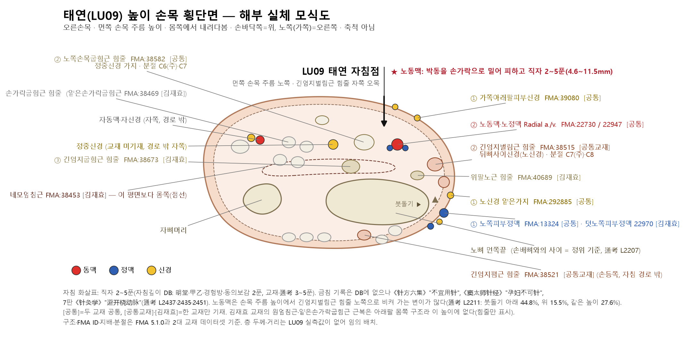
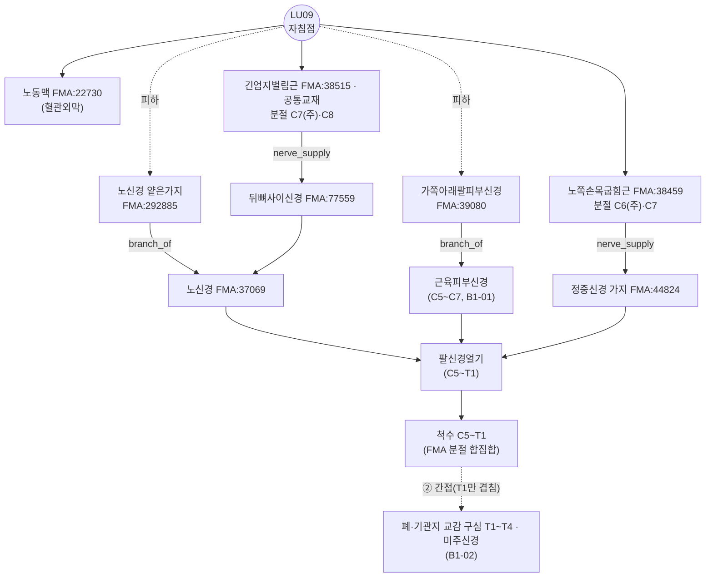

# [경혈 해부생리학 실체 판명 학술 모노그래프] 태연(太淵·太渊, LU09)

> **프레임워크**: v2.7.7 (2026-10-25 반영: 4대 원전·Tri-Target) · **ARI**: ARI v3.0 | ARI-Core 68.75 ± 0 (C) | SI 50 | 잠정 가중치 0.40/0.35/0.25 | 민감도(등가중치): 66.7 (C, 등급 불변) · **이중 채점**: 독립 2회(채점 A·B), 15점 이상 불일치 3건 조정 완료

> **핵심 4대 원전**: 《中国针灸穴位通鉴》 · 《中国针灸证治通鉴》(중국어 원문 기준, 기술은 같은 편 한글 번역본) · 《针灸腧穴通考》 · 《中国针灸经络通鉴》
> **Layer A 실증 DB**: 통합 생의학 마스터 DB v3.0 (LU9 역색인 41편 중 **LU9 자극을 확인한 15편**만 판정에 사용 — 8절 ①)
> **Layer B 참조 등록부**: 4계층 참조 등록부(B1~B4) (B-Check 6항목, 부합 기준 ≥ 8/12)
> **해부 온톨로지**: FMA 5.1.0 로컬 색인 — 교재 구조를 `FMA:ID`로 고정(B1 보조, 등록부 미등재). 상세는 부록 A
> **도량형 환산**: 한대 기준 1푼(分) = 2.3mm ($z = \text{푼} \times 2.3\text{mm}$)

**원전 약칭** (4대 원전 정제본)
- [通考] 《针灸腧穴通考》 上 手太阴肺经穴 — 太渊 L2193~2455
- [通鉴] 《中国针灸穴位通鉴》 手太阴肺经(2) — 太渊 L773~1121
- [证治04] 《中国针灸证治通鉴》 第壹编 第七篇 手太阴肺经 手阳明大肠经 足阳明胃经 — 太渊 L44~66 (같은 편 한글 번역본 태연 조 L55~85)
- [证治17] 《中国针灸证治通鉴》 第叁编 内科病症 二十二脏腑病证至二十四胸胁满痛 (한글 번역본 대조)
- [经络通鉴 NN편] 《中国针灸经络通鉴》 — 01편 第壹编 第一篇("经脉"概念的形成), 02편 第壹编 第二篇(经络学说的演变 一~七), 05편 第壹编 第三篇(经络专篇研究), 07편 第壹编 第五篇(不同来源的经络学说), 11편 第贰编 第三篇(脉度、骨度与要穴), 17편 第叁编 第一篇(手太阴经脉、经别、络脉和经筋), 37편 第伍编 附篇一(脉名索引)

---

## 1. 문헌 스크리닝 표 (4대 원전 원문 발췌)

| 문헌 | 원문 발췌 (출처·행) | 한국어 요지 | 비고 |
| :--- | :--- | :--- | :--- |
| 《针灸腧穴通考》 | "肺……注于太渊，太渊鱼后一寸陷者中也，为腧。"(《灵枢·本输》) — [通考] L2225 | 어제(魚際) 뒤 1촌 오목, 수혈(輸穴) | 위치의 최초 기술 |
| 《针灸腧穴通考》 | "刺入二分，留二呼，灸三壮。"(《黄帝明堂经》) — [通考] L2431 | 2푼 자입 | 심도의 최초 기술(한대) |
| 《针灸腧穴通考》 | "经渠与太渊二穴同出于手太阴脉口，本是一穴，古穴名曰'手太阴'" — [通考] L2203 | 경거·태연은 본래 촌구 맥구(脈口) 한 혈 | 혈위 형성사 |
| 《针灸腧穴通考》 | "在腕前区，桡骨茎突与舟状骨之间，拇长展肌腱尺侧凹陷中。" / 1990 국표 "桡动脉搏动处" → 2006 수정판 삭제 — [通考] L2207·2209 | 붓돌기–손배뼈 사이, 긴엄지벌림근 힘줄 자쪽 오목 | 현대 정위와 '동맥' 표지 논쟁 |
| 《针灸腧穴通考》 | "桡动脉在桡骨茎突尖端以下弯向桡侧的占44.8%，以上……15.5%，……水平处……27.6%" — [通考] L2211 | 손목 주름 높이에서 노동맥은 대개 긴엄지벌림근 힘줄 노쪽으로 비켜 있음 | 인체 측정(원 문헌 PMID 미기재 → 확인 불가) |
| 《针灸腧穴通考》 | "直刺0.3~0.5寸" / "直针入三分……孕妇不可针"(《窦太师针经》) / "灸七壮，不宜用针"(《针方六集》) / "避开桡动脉，直刺0.3~0.5寸"(7版《针灸学》) — [通考] L2429·2435·2437·2451 | 직자 3~5푼, 동맥 회피, 일부 문헌 자침 기피 | SI 근거(5·10절) |
| 《针灸腧穴通考》 | "刺臂太阴脉，出血多立死。"(《素问·刺禁论》, 经渠 按语에서 인용) — [通考] L2147 | 촌구 맥(臂太阴脉) 자침 출혈 경고 | 太渊·经渠 공통 금기 |
| 《中国针灸穴位通鉴》 | "阳中之少阴肺也，其原出于太渊。"(《灵枢·九针十二原》) — [通鉴] L777 | 폐의 원혈 | 출처 |
| 《中国针灸穴位通鉴》 | "在掌后陷者中。"(《甲乙经》 등) / "在手中掌后横纹头陷者中。"(《太平圣惠方》 등) / "在掌后内侧横纹头动脉。"(《神应经》 등) — [通鉴] L813·817·819 | 송대 '횡문두', 명대 '동맥' 표지 추가 | "所述位置相同" [通鉴] L1053 |
| 《中国针灸穴位通鉴》 | "针三分至五分，不灸、勿刺伤桡动脉。"(《新编针灸学》) / 局部解剖 "在桡侧屈腕肌腱的外侧，外展拇长肌腱的内侧，旋前方肌的下缘……有桡动脉" — [通鉴] L1029·1039 | 노쪽손목굽힘근 힘줄과 긴엄지벌림근 힘줄 사이, 노동맥 | 4·6절 해부 대조 |
| 《中国针灸证治通鉴》 | 《明堂经》 "主病温身热，五日以上汗不出，刺太渊……咳逆，烦闷不得卧……唾血……口僻，刺太渊、引而下之。狂言。妬乳。" — [证治04] L50~54 | (한글 번역본) "온병(溫病)을 앓아 몸에 열이 나는데 5일 이상 땀이 나지 않는 것을 주치하니, 태연을 찌르고 침을 한동안 머물렀다가 뽑으며…… 해역(咳逆), 번민하여 눕지 못함…… 피를 뱉음[唾血]…… 구벽(口僻)에는 태연을 찌르고 끌어내린다. 미친 소리. 투유(妬乳)." — [证治04 번역] L63 | $P_{single}$ 근거(9절) |
| 《中国针灸证治通鉴》 | 《灵枢》 "主肺心痛。热病。" / 《千金翼方》 "肺胀气抢胁下热痛。肺热咳嗽。" — [证治04] L60~68 | (한글 번역본) "폐심통(肺心痛)을 주치한다. 열병(熱病)." / "폐창, 기가 치받쳐 옆구리 아래가 뜨겁게 아픔. 폐열 해수(肺熱咳嗽)." — [证治04 번역] L71~85 | 다수는 배오(9절) |
| 《中国针灸经络通鉴》 | "肺出于少商……注于太渊，太渊鱼后一寸陷者中也，为输；行于经渠，经渠寸口中也"(《灵枢·本输》) — [经络通鉴 11편] L423 | 《本输》 위치 문구를 《通考》와 같은 자구로 수록(이문 없음) | Target 1 근거(7절) |
| 《中国针灸经络通鉴》 | 황룡상 해설: "'手太阴'实际上相当于太渊、经渠（还包括早期鱼际）穴之间的整个手太阴脉动处（脉口）" — [经络通鉴 01편] L733 (《脉经》 "手太阴：在鱼际间(即太渊穴也)" L711) | 초기 '手太阴' 경맥혈은 태연~경거(초기에는 어제 포함) 사이의 맥동처 전체(맥구)이며 오늘날의 '혈'과 개념이 다름 | 《通考》 "本是一穴"과 일치. Rank 4 교감(2절 말미) |
| 《中国针灸经络通鉴》 | "例如《素问·刺禁论》所言'臂太阴脉'即指手太阴脉口，相当于'经渠'、'太渊'穴处" — [经络通鉴 02편] L653 각주 | 《刺禁论》 출혈 경고의 '臂太阴脉'은 태연·경거 자리의 맥구 | 太渊·经渠 공통 금기 판단 지지(5·10절) |
| 《中国针灸经络通鉴》 | 《阴阳十一脉》 "出内阴两骨之间" 교주: "出于手太阴脉口'寸口'脉"; "《明堂经》载手太阴脉口处穴太渊穴主治：'臂厥，缺盆中引痛，心痛'" — [经络通鉴 05편] L1138·L1144 | 태연의 臂厥·心痛 주치는 백서 臂巨阴脉 '是动病'(맥구 진단 병후)을 보존한 것 | 心痛 주치의 경락론적 기원(9절) |
| 《中国针灸经络通鉴》 | 《医学纲目》 주: "［入寸口，］掌后陷中动脉，太渊穴也。寸口中动脉，经渠穴也" — [经络通鉴 17편] L241 / 《千金要方》 卷二十九 "注于大泉为输" L365 / 《太素》 杨注 "至本节后太泉穴处" L310 | 명대 주석에서 '陷中'과 '动脉'이 결합 / 大泉·太泉 피휘 표기 확인 | 2·3절 |
| 《中国针灸经络通鉴》 | 맥명 색인 "太渊脉" — [经络通鉴 37편] L385; 《气交变大论》 맥진 부위 "太渊脉——肺" — [经络通鉴 07편] L102 | '太渊'은 혈명이자 맥진 부위명 | 3절 太渊 '맥' 구분 지지 |
| 《中国针灸经络通鉴》 | (치통 주치·'龙渊' 혼입, 1990/2006 국표 '동맥' 표지 논쟁) | **해당 쟁점 직접 언급 없음** — 소속 경맥 순행·맥구 기술만 확인 | ④ 판정 불변 근거(10절) |

---

## 2. 원천/재인용 구분 표

| 층차 | 문헌 | 기술 내용 | 원천/재인용 |
| :--- | :--- | :--- | :--- |
| 선진·한대 | 《灵枢·本输》·《九针十二原》 | 鱼后一寸陷者中, 肺之原 | 원천(위치·혈성) — [通考] L2225·2305 |
| 한대 | 《黄帝明堂经》 | 刺入二分 留二呼 灸三壮; 열병·해역·구벽·투유 주치 | 원천(심도·주치) — [通考] L2431·2325 |
| 한대 | 《难经·四十五难》 | 脉会太渊 | 원천(팔회혈) — [通考] L2229 |
| 위진 | 《针灸甲乙经》 | 在掌后陷者中, 刺入二分 | 《明堂》 재인용 — [通鉴] L813·1013 |
| 당 | 《千金要方》·《千金翼方》 | '大泉/太泉'(唐讳), '鬼心' 入肉半寸, 肺咳 刺手太泉 | 명칭 변형(피휘) — [通考] L2235·2237·2371 |
| 송 | 《太平圣惠方》 | "掌后横纹头陷者中" | 정위 표지 추가(횡문두) — [通鉴] L817 |
| 금원·명 | 《难经本义》·《神应经》·《针灸大成》 | "动脉" 표지 추가 | 太渊 '맥'(촌구 전체)과 '혈'의 혼동 — [通考] L2285~2289 |
| 원·명 | 《窦太师针经》·《针方六集》 | 孕妇不可针 / 不宜用针; 牙痛 주치 | 독자 기술(일부 '龙渊' 혼입 의심) — [通考] L2333·2361·2437 |
| 현대 | 교재 4~7판·국표 1990/2006 | 직자 0.2~1寸, 避开桡动脉; 2006 국표 '动脉' 삭제 | 현대 정위 — [通考] L2209·2441~2453 |

**《通考》·《经络通鉴》 교감 (Rank 4 필사 오류·경락론적 확장 감별)**
- **맥구에서 혈위로**: 《经络通鉴》은 《脉经》의 '手太阴'(在鱼际间, 원주 "即太渊穴也")을 태연~경거(초기에는 어제 포함) 사이 맥동처 전체로 해석한다([经络通鉴 01편] L711·L733). 《通考》의 "经渠与太渊……本是一穴"([通考] L2203)과 같은 결론이다. 금원·명대 '动脉' 표지 추가([通考] L2285~2289)는 정위 문구의 필사 착오가 아니라 맥구(맥)와 혈위(혈)의 개념이 겹친 결과로 감별한다. 명대 《医学纲目》 주 "掌后陷中动脉，太渊穴也。寸口中动脉，经渠穴也"([经络通鉴 17편] L241)가 두 표지가 한 문장에 결합된 사례다.
- **문구 이문**: 《本输》 "太渊鱼后一寸陷者中也"는 《经络通鉴》([经络通鉴 11편] L423)과 《通考》([通考] L2225)가 같은 자구다. 필사 이문은 없다.
- **경락론적 확장**: 《明堂》 태연 주치 "臂厥，缺盆中引痛，心痛"은 백서 《阴阳十一脉》 臂巨阴脉의 '是动病'(맥구의 맥동 이상으로 진단하던 병후)을 보존한 것이라고 《经络通鉴》이 교주한다([经络通鉴 05편] L1144). 태연의 心痛 주치는 자극 효과의 관찰보다 맥구 진단 병후에서 온 것일 수 있으며, 8절 B-Check ⑤(심장 효과 약함)와 9절 판정의 해석 근거로 쓴다.
- **미해결**: 치통 주치의 '龙渊' 혼입([通考] L2361·2399)은 《经络通鉴》에 언급이 없어 교감되지 않는다.

---

## 3. 이명·별칭 검증 표 (KJH DB 대조)

| 이명 | 출처 | KJH DB | 판정 |
| :--- | :--- | :--- | :--- |
| 大泉·太泉 | 《黄帝内经明堂》 杨注, 《千金》 — 唐 高祖 李渊 피휘 | 등재 | 동일 혈위. 피휘에 의한 개칭 — [通考] L2205·2221·2237; 《千金要方》 "注于大泉为输"·《太素》 杨注 "太泉穴" — [经络通鉴 17편] L365·L310 |
| 鬼心 | 《千金要方》 卷十四 "第四针掌后横纹，名鬼心，入肉半寸。即太渊穴也。" | 등재 | 동일 혈위 — [通考] L2235, [通鉴] L804 |
| 大渕 | 《医心方》 ('渕'='渊') | 등재 | 이체자 — [通考] L2221 |
| 天泉(오기) | 大泉을 天泉으로 오독 | — | **혼용 주의**: 心包经 天泉(PC2)과 별개 — [通考] L2205·2221 |
| (鱼际에 잘못 귀속) | 1957 南京《针灸学》→ 한국 교재 | — | 太泉·鬼心을 鱼际(LU10) 별명으로 잘못 실음 — [通考] L2473 |
| 太渊 '맥' | 《素问·气交变大论》 "太渊绝者，死不治" | — | 촌구 맥 전체(진맥 부위)와 혈위 太渊을 구분 — [通考] L2221·2287; 맥명 '太渊脉'(맥진 부위, 肺) — [经络通鉴 37편] L385, [经络通鉴 07편] L102 |

KJH DB(경혈명·이명 대조 표준 데이터베이스 '경혈 종합 목록' 행 64: 61, LU09, 태연, 太淵, "太泉, 鬼心, 大泉, 大渕")와 두 교재 데이터셋 이명 열("太泉, 鬼心")이 일치한다.

---

## 4. 3D 공간 좌표·자입 기준점 및 Layer 1~5 층차 구조도

- **X (노쪽↔자쪽)**: 먼쪽 손목 주름의 노쪽 끝, 노뼈 붓돌기와 손배뼈 사이, **긴엄지벌림근 힘줄 자쪽 오목**([通考] L2207). 노쪽손목굽힘근 힘줄과 긴엄지벌림근 힘줄 사이([通鉴] L1039).
- **Y (몸쪽↔먼쪽)**: 먼쪽 손목 주름("掌后横纹头", 《太平圣惠方》). 《针灸秘法全书》의 "仰掌三纹之后" 해석으로 먼쪽 주름임이 확인된다([通考] L2299).
- **Z (깊이)**: 아래 층차. **LU09 사체·초음파 실측값이 Layer A에 없으므로 mm 경계는 적지 않는다**(구판의 2.5/6.5/16.5/22mm는 범용 템플릿 값이라 삭제).
- **자입 기준점 (Target 2, 촉진 표현 "陷者中"의 해부 실체화)**: 원전의 "陷者中"은 두 힘줄 사이 간극(兩筋間 유형)으로, 간극 특징이 명확하다.
  - X: 노쪽손목굽힘근 힘줄(FMA:38582, 근육 FMA:38459)의 노쪽 가장자리와 긴엄지벌림근 힘줄(FMA:38515)의 자쪽 가장자리 사이 간극의 가운데. 노동맥(FMA:22730)·노정맥(FMA:22947)이 이 간극 안을 지난다.
  - Y: 먼쪽 손목 주름 높이(노뼈 붓돌기–손배뼈 사이).
  - 경계 구조물: 자쪽 = 노쪽손목굽힘근 힘줄, 노쪽 = 긴엄지벌림근 힘줄, 바닥 = 노뼈 먼쪽끝·손배뼈.
  - 명대에 더해진 "动脉" 표현의 실체(주름 높이의 노동맥 박동)는 같은 간극 안이거나, 노동맥이 긴엄지벌림근 힘줄 노쪽으로 비켜 가는 변이([通考] L2211)에서는 힘줄 폭만큼 노쪽에 있다. 최초 표현 "陷者中"을 우선해(Rank 3) 위 간극을 자입 기준점으로 둔다. 각 Target과의 편차는 7절.

```
[Layer 1 피부·피하]  가쪽아래팔피부신경 · 노신경 얕은가지 · 노쪽피부정맥(두 교재 공통), 덧노쪽피부정맥(김재효)
        │
[Layer 2 힘줄 사이]  노쪽손목굽힘근 힘줄(공통) ─ 노동맥·노정맥(공통) ─ 긴엄지벌림근 힘줄(공통교재)·위팔노근 힘줄(김재효)
        │            ★ 노동맥: 고전 2푼(4.6mm)~교재 5푼(11.5mm) 범위 안에서 접촉 가능 → 박동을 밀어 피함
[Layer 3 깊은층]    긴엄지굽힘근 힘줄(김재효), 네모엎침근 아래 모서리(김재효, 이 높이보다 약간 몸쪽)
        │
[Layer 5 바닥]       노뼈 먼쪽끝·손배뼈 (심부 장기 없음)
```



*그림 4-1. 태연 높이 손목 횡단면 모식도(오른손목, 몸쪽에서 내려다봄, 축척 아님). 자침점은 노쪽손목굽힘근 힘줄과 긴엄지벌림근 힘줄 사이 오목이며, 바로 옆에 노동맥이 지난다. 층 두께·거리는 LU09 실측값이 없어 임의로 배치했다.*

**FMA 실체 대조(Layer별)** — 구조명은 2대 교재, ID·관계는 FMA 5.1.0

| Layer | 구조 | FMA | FMA 구획·관계 | 지배신경 / 줄기 (FMA) | 척수 분절 (FMA) |
| :--- | :--- | :--- | :--- | :--- | :--- |
| 1 피하 | 가쪽아래팔피부신경 | FMA:39080 | — | 근육피부신경 말초구간(FMA:288511) | FMA 미기재 |
| 1 피하 | 노신경 얕은가지 | FMA:292885 | — | 노신경(FMA:37069) | FMA 미기재 |
| 1 피하 | 노쪽피부정맥 · 덧노쪽피부정맥 *(김재효)* | FMA:13324 · 22970 | — | 빗장밑정맥 → 팔머리정맥 | — |
| 2 힘줄 사이 | 노동맥 | FMA:22730 | branch_of Subclavian artery(FMA 모델링: 겨드랑·위팔동맥을 빗장밑동맥의 연속 구간으로 둠) | — | — |
| 2 힘줄 사이 | 노정맥 | FMA:22947 | tributary_of Brachial vein | 위팔정맥 → 겨드랑정맥 | — |
| 2 힘줄 사이 | 노쪽손목굽힘근(힘줄 FMA:38582) | FMA:38459 | contained_in *Space of anterior compartment of arm*(FMA 오기 — 실제 아래팔 앞칸) | 정중신경 가지(FMA:44824) | **C6(주)**·C7 |
| 2 힘줄 사이 | 긴엄지벌림근 *(공통교재)* | FMA:38515 | contained_in 아래팔 뒤칸 공간(FMA:85166) | 뒤뼈사이신경 → 노신경 | **C7(주)**·C8 |
| 2 힘줄 사이 | 위팔노근(힘줄 FMA:40689) *(김재효)* | FMA:38485 | 아래팔 뒤칸 | 노신경 말초구간 | **C6(주)**·C5 |
| 3 깊은층 | 긴엄지굽힘근(힘줄 FMA:38673) *(김재효)* | FMA:38481 | (FMA 오기: arm) | 앞뼈사이신경 → 정중신경 | **C8(주)**·C7 |
| 3 깊은층 | 네모엎침근 *(김재효)* | FMA:38453 | (FMA 오기: arm) | 앞뼈사이신경 → 정중신경 | **C8(주)**·C7 |
| 5 바닥 | 노뼈 먼쪽끝 · 손배뼈 | — | — | — | — |

- FMA 5.1.0은 아래팔 굽힘근(노쪽손목굽힘근·긴엄지굽힘근·네모엎침근 등)을 *Space of anterior compartment of **arm***(위팔 앞칸)에 둔다. 규범 해부(B1-01)상 아래팔 앞칸이므로 구획 관계는 인용하지 않는다.
- 김재효 교재의 **원엎침근(FMA:38450)·얕은손가락굽힘근(FMA:38469) 근복**은 아래팔 몸쪽 구조라 먼쪽 손목 주름 높이에 없다(B1-01). 같은 교재의 긴엄지벌림근 미기재, 공통교재의 **긴엄지폄근(FMA:38521)** 은 손등쪽 셋째 칸 힘줄로 자침 경로 밖이다. 6절에서 다룬다.
- 손목굽힘근지지띠(palmar carpal ligament, 김재효)는 FMA에 대응 실체가 없다(none).

---

## 5. 자침 깊이 계산표

출처: 역대 침구문헌 자침심도 데이터베이스 시트1 행 63(N0=61), 보조로 [通考] 【操作】.

| 문헌 | 푼(分) | 환산 심도 (×2.3mm) | 도달 Layer(추정) | 비고 |
| :--- | :---: | :---: | :--- | :--- |
| 황제명당경(황룡상 감수) | 2 | 4.6mm | 1~2 | "刺入二分"([通考] L2431) |
| 침구갑을경 | 2 | 4.6mm | 1~2 | |
| 침구경험방 | 2 | 4.6mm | 1~2 | |
| 동의보감(인용: 동인) | 2 | 4.6mm | 1~2 | |
| 경락수혈학 공통교재 | 3~5 | 6.9~11.5mm | 2 | |
| 침구의학 공통교재 | 3~5 | 6.9~11.5mm | 2 | |
| 《针灸腧穴通考》 | 3~5 | 6.9~11.5mm | 2 | "直刺0.3~0.5寸"([通考] L2429) |
| (참고) 《素问·刺法论》 | 3 | 6.9mm | 2 | 同身寸 3분([通考] L2433) |
| (참고) 《窦太师针经》 | 3 | 6.9mm | 2 | "孕妇不可针"([通考] L2435) |
| (참고) 《循经考穴编》 횡자 | 5 | 11.5mm(사선 길이) | 1~2 | "横针入五分"([通考] L2439) |
| (참고) 4·5·6판 《针灸学》 | 5~10 | 11.5~23.0mm | 2~5 | 최대치. 7판에서 0.3~0.5寸으로 축소([通考] L2447~2451) |
| (참고) 《针方六集》 | — | — | — | "不宜用针"(자침 기피, DB `'0'` 아님) |

- 자침깊이 DB에 금침(`'0'`)·미기술(`'blank'`) 없음. 다만 자침 기피(《针方六集》), 임부 금침(《窦太师针经》), 촌구맥 출혈 경고(《素问·刺禁论》, [通考] L2147)가 있다.
- 안전 범위: 고전 2푼(4.6mm)~교재 5푼(11.5mm) 모두 Layer 2(힘줄 사이)에 머물지만, **그 층에 노동맥이 있다**. 동맥 회피는 깊이가 아니라 **위치(박동을 밀어 비킴)** 로 한다(7판 "避开桡动脉", [通鉴] L1029 "勿刺伤桡动脉"). 4~6판의 1寸(23mm) 직자는 이후 교재에서 축소되었다.

---

## 6. 해부학 구조 교재 비교표

| 구분 | 경혈학 공통교재 (공통교재 데이터셋 종합 시트 행 62) | 김재효 교재 (종합 시트 행 62) | FMA 판별 | 평가 |
| :--- | :--- | :--- | :--- | :--- |
| 근육·힘줄 | 긴엄지벌림근, 노쪽손목굽힘근, 긴엄지폄근 | 노쪽손목굽힘근(힘줄), 위팔노근(힘줄), 긴엄지굽힘근(힘줄), 네모엎침근, 원엎침근, 얕은손가락굽힘근, 손목굽힘근지지띠 | 공통 FMA:38459 / 공통교재 단독 38515·38521 / 김재효 단독 38485·40689·38481·38673·38453·38450·38469·38582 | **불일치**: 공통은 노쪽손목굽힘근뿐 |
| 신경 | 가쪽아래팔피부신경, 노신경 얕은가지 | 같음 | FMA:39080, 292885 | 일치 |
| 혈관 | 노동·정맥, 노쪽피부정맥 | 노동·정맥, 노쪽피부정맥, 덧노쪽피부정맥 | FMA:22730·22947·13324 / 김재효 단독 22970 | 일치(김재효 1항목 추가) |

**판정**: 신경·혈관과 정위 표지(노쪽손목굽힘근 힘줄·노동맥)는 두 교재가 일치한다. 근육은 갈리지만 **상충이 아니라 수록 높이·범위의 차이**다. 공통교재의 긴엄지폄근(손등쪽)과 김재효 교재의 원엎침근·얕은손가락굽힘근 근복(아래팔 몸쪽)은 손목 주름 높이의 자침 경로에 없다. 반면 정위 기준인 **긴엄지벌림근 힘줄**은 공통교재에만 있다([通考] L2207). FMA가 같은 구조를 같은 ID로 묶어 주어 차이를 판별할 수 있었다. 혈위 특이 영상·사체 실측(PMID)은 없다. 이 판정이 $S_{clarity}$ 75(조정)의 근거다.

---

## 7. 공간 변위 분기 추론도 (Tri-Target)

| Target | 정의 | 근거 | X·Y 위치 |
| :--- | :--- | :--- | :--- |
| **Target 1** (고전 문헌 위치) | 최초 기술 문구가 지정하는 위치 | 《灵枢·本输》 "太渊鱼后一寸陷者中也"([通考] L2225; [经络通鉴 11편] L423); 《甲乙》 "掌后陷者中"([通鉴] L813) | 손목 뒤 오목. 종향 기준은 모호("早期文献只言'掌后'，不很明确", [通考] L2299) |
| **Target 2** (촉진 표현의 해부 실체화 위치) | "陷者中"이 가리키는 해부 공간 = 자입 기준점 | 노쪽손목굽힘근 힘줄과 긴엄지벌림근 힘줄 사이 간극([通鉴] L1039, 4절) | 먼쪽 손목 주름 높이, 두 힘줄 사이 |
| **Target 3** (현대 WHO 위치) | WHO 서태평양지역 표준(2008)·중국 국표 2006 | "桡骨茎突与舟状骨之间，拇长展肌腱尺侧凹陷中"([通考] L2207) | 먼쪽 손목 주름 노쪽 끝, 긴엄지벌림근 힘줄 자쪽 오목 |

**쌍별 편차 (모두 추정, 실측 아님)**

| 쌍 | Δ (추정) | 근거 | 판정 (10mm 기준) |
| :--- | :---: | :--- | :--- |
| Target 1–Target 2 | ≈ 0~5mm | 최초 기술이 "陷者中"으로 위치를 정하므로 Target 1은 Target 2의 오목을 가리킨다. "鱼后一寸"을 바로 앞 문구의 어제혈(제1손허리뼈 중간) 기준 1寸으로 읽으면 주름 부근이다 | 병합 |
| Target 2–Target 3 | ≈ 0mm | 국표·WHO가 같은 두 힘줄 사이 오목을 기술한다 | 병합 |
| Target 1–Target 3 | ≈ 0~5mm | 《穴位通鉴》 "所述位置相同"([通鉴] L1053) | 병합 |

→ **Target 1≡2≡3, 분기 없음(단일 Target)**. 세 좌표와 편차는 위 표에 남긴다.

**Tri-Target에 넣지 않은 참고 변이 (Rank 5 Target 제외 규칙 적용)**
- **문자 해석 변이 ("鱼后一寸"을 엄지두덩 몸쪽 가장자리에서 1寸 몸쪽으로 읽는 경우)**: 경거(LU8) 높이, 주름에서 약 20~23mm 몸쪽(1寸 ≈ 20~23mm 가정, 추정)이다. 그러나 그 높이에는 "陷者中"에 해당하는 힘줄 사이 오목이 없고, 같은 《本输》 문장이 그 자리를 경거 "寸口中"으로 따로 기술한다([经络通鉴 11편] L423). 《经络通鉴》은 초기 '手太阴'을 태연~경거 사이 맥동처 전체로 본다([经络通鉴 01편] L733). 따라서 이 변이는 최초 기술이 지정하는 위치(陷者中)가 아니라 후대 해석 이설이므로 Rank 5 Target 제외 규칙에 따라 Target으로 세우지 않고, 맥구 범위의 흔적으로만 기록한다.
- **③ '동맥' 표지 수정안**: 일본 침구 동인 기준 "远端腕横纹上五分"(동맥 박동을 살리려는 안, [通考] L2223·2299). 5분(0.5 同身寸)은 약 10~11.5mm로 추정되어(1寸 ≈ 20~23mm 가정, 실측 아님) **10mm 기준의 경계값**이다. 고전 문헌·촉진 표현·WHO 어디에도 해당하지 않는 현대 단체 제안 정위(일본 침구계 기준안)이므로 Rank 5 Target 제외 규칙에 따라 실측 Δ가 10mm를 넘더라도 Target으로 세우지 않고 분기·채점하지 않는다. 참고 이설로만 기록한다.

> **구판 표기 대응**: 구 단일 Target "T1(현대 국표 정위)" → Target 1≡2≡3. 구 계통 ①(고전) → Target 1, 구 계통 ②(송~현대) → Target 3, 구 계통 ③('동맥' 수정안) → Tri-Target 밖 참고 변이. 구판의 "Δ ≤ 15mm → 분기 불요" 판정은 10mm 기준으로 다시 확인했다. Tri-Target 세 쌍은 모두 10mm 이내로 판정이 같다. 참고 변이 ③은 Δ가 10mm 경계값이지만 Rank 5 Target 제외 규칙에 따라 Target 대상이 아니다.

---

## 8. 생의학적 반사 기전도 및 외부 검색 로그

**기전 요약**: 태연 자극에 대한 기전 연구는 **쥐·생쥐 실험뿐**이다. 전침 태연 단독은 급성 폐손상 쥐의 폐 환기 기능을 개선했다(papers.id 2240). 반면 심근 허혈 모델에서는 태연 효과가 심경 혈위(神门·通里·内关)보다 약하거나 뚜렷하지 않았다(2238, 2241, 2244, 2235). 사람 연구는 태연을 포함한 **다혈위 처방**뿐이다. B-Check 7/12로 부합 기준에 못 미치므로 아래 반사 경로는 **가설(동물 한정)** 로만 기술한다.

**말초 구심 경로의 FMA 고정**



*그림 8-1. FMA 5.1.0 관계로 그린 LU09 말초 구심 경로. 실선은 FMA에 기재된 관계, 점선은 FMA에 없는 연결이나 해석(B1 보완)이다. 혈관외막 자율신경 구심은 FMA 대상이 아니다.*

### ① Layer A 논문 표 (LU9 자극 확인분)

역색인 41편 중 초록에서 LU9(太渊/Taiyuan) 자극을 확인한 논문만 싣는다. 나머지는 '太原(Taiyuan)' 지명 소속 등 문자열 오적중으로 보고 제외했다(예: 2222 JAMA 복압성 요실금 RCT, 2226 경부통 fMRI — LU9 미사용).

| papers.id | 연도 | 저널 | 내용 | PMID / DOI | 설계 |
| :---: | :---: | :--- | :--- | :--- | :--- |
| 2240 | 2022 | Zhen Ci Yan Jiu | 전침·예비전침 太渊 단독 → 급성 폐손상 쥐 폐 환기·호흡역학 개선, 예비전침은 TNF-α·IL-1β↓ | 35880273 / 10.13702/j.1000-0607.20211299 | 동물(쥐), **LU9 단독** |
| 2238 | 2017 | Zhongguo Zhen Jiu | 심근 허혈재관류 쥐: 内关 예비전침 효과, **太渊군은 뚜렷하지 않음** | 29231479 / 10.13703/j.0255-2930.2017.02.013 | 동물(쥐), LU9 대조 |
| 2241 | 2018 | Zhen Ci Yan Jiu | 급성 심근경색 쥐 HCN2: 神门·太渊 모두 개선, 심경 > 폐경(경락 특이성) | 29560633 / 10.13702/j.1000-0607.170121 | 동물(쥐), LU9 대조 |
| 2244 | 2024 | Acupunct Med | 생쥐 심근 허혈: HT5-HT7 전침이 LU9-LU8보다 β1-AR 조절 우세 | 39579035 / 10.1177/09645284241298716 | 동물(생쥐), LU9-LU8 대조 |
| 2235 | 2021 | Zhongguo Zhen Jiu | 심근 허혈재관류 쥐: 폐경군(太渊·列缺)도 ST 변위↓·LHA/FN DA·5-HT↑, 심경군보다 약함 | 34002567 / 10.13703/j.0255-2930.20200509-k0001 | 동물(쥐), LU9+LU7 |
| 2236 | 2020 | Zhongguo Zhen Jiu | 같은 모델 NF-κB 경로: 폐경군(太渊·列缺) 대조 | 33068354 / 10.13703/j.0255-2930.20190811-k0004 | 동물(쥐), LU9+LU7 |
| 2233 | 2022 | Zhongguo Zhen Jiu | 급성 저산소 쥐: 砭贴 太渊·内关·人迎 전처치 | 36397226 / 10.13703/j.0255-2930.20211201-k0004 | 동물(쥐), 다혈위 |
| 2002 | 2019 | Zhen Ci Yan Jiu | 쥐 경혈도 재작성(LU9 포함 위치 대응) | 30773865 / 10.13702/j.1000-0607.180396 | 동물 해부 대응 |
| 1807 | 2025 | Ann Med | 흉강경 폐엽절제 후 피내침(LU9·CV17·LU6·BL13) → 폐합병증↓·진통제 사용↓ | 40953233 / 10.1080/07853890.2025.2560684 | **인체 RCT**, 다혈위 |
| 2237 | 2020 | Zhongguo Zhen Jiu | 邵氏五针法(肺俞·中府·太渊·定喘·膻中 등) 알레르기 비염·천식 다기관 RCT → FEV1·PEF 개선 | 32394654 / 10.13703/j.0255-2930.20190412-0007 | **인체 RCT**, 다혈위 |
| 1805 | 2018 | Zhongguo Zhen Jiu | 五针法 vs 일반 침, 천식 증상별 비교 | 29354929 / 10.13703/j.0255-2930.2018.01.002 | 인체 임상, 다혈위 |
| 2234 | 2022 | Zhongguo Zhen Jiu | 코로나19 회복기 후유증 揿针(关元·足三里·太渊) | 35272405 / 10.13703/j.0255-2930.20210406-0004 | 인체 임상, 다혈위 |
| 2239 | 2024 | Zhen Ci Yan Jiu | 升清降浊 전침(太渊 포함 8혈) | 39433370 / 10.13702/j.1000-0607.20230690 | 인체 임상, 다혈위 |
| 2245 | 2024 | Photobiomodul Photomed Laser Surg | 산후 손목터널증후군 레이저침(LU9 포함 12혈), 정중신경 전도 | 39446663 / 10.1089/photob.2024.0106 | 인체 임상, 다혈위 |
| 1964 | 2026 | Zhongguo Zhen Jiu | 경수손상 후 기립성 저혈압 침 치료(太渊 포함) | 42116771 / 10.13703/j.0255-2930.20250421-k0004 | 증례 |

- 국내 로컬 문헌(341, 420, 461, 737, 766, 767, 795, 969, 1720)은 역색인에 걸려 있으나 초록 미추출로 LU9 기전을 확인할 수 없어 판정에 쓰지 않았다(확인 불가).
- 모든 레코드 status = active. duplicate·missing·superseded 없음.

### ② B-Check 채점표

| 항목 | 내용 | 채점자 A | 채점자 B | 최종 | 참조 ID | papers.id | 근거 요지 |
| :---: | :--- | :---: | :---: | :---: | :--- | :--- | :--- |
| ① | 자침 심도의 말초신경·혈관 실체 | 2 | 2 | **2** | B1-01, B1-03, B1-04, B2-09 (+FMA) | — | 2대 교재가 노동맥·노신경 얕은가지·가쪽아래팔피부신경에서 일치, 모두 FMA 정확 대응(FMA:22730·292885·39080). 노동맥 주행 변이는 B1-04·[通考] L2211 |
| ② | 척수 분절 정합 | 1 | 1 | **1** | B1-02, B3-03, B3-05 (+FMA) | — | LU09 C5~T1(FMA segmental_supply 합집합) vs 폐·심장 교감 구심 T1~T4: T1에서만 겹치고 그것도 김재효 단독·높이 밖 구조(얕은손가락굽힘근)에서 나옴 → 간접 1 |
| ③ | 구심 섬유형·수용체 | 1 | 1 | **1** | B3-06 | — | LU9 특이 구심 섬유 연구 없음. 침 자극 구심 섬유 일반론의 유추(1점 상한) |
| ④ | 중추 중계·경로 | 1 | 1 | **1** | B3-12 | 2235 | 폐경군(太渊·列缺) 전침에서 LHA·FN 도파민·5-HT 변화(쥐). B3-12는 PC5-6(정중신경) 혈위의 rVLM 경로라 LU9에는 유추 |
| ⑤ | 원심 경로·표적 효과($P_{single}$ 일치) | 2 | 1 | **1** | B3-05 | 2240, 2238, 2241, 2244 | 폐 환기 개선(2240)은 고전 해역·천(喘) 주치와 방향 일치. 심장 효과는 심경보다 약하거나 없음(2238)으로 '心痛' 주치와 대응 약함 → A 2·B 1, 최종 1 |
| ⑥ | 인체 전환 근거 | 1 | 1 | **1** | B4-04, B4-05 | 1807, 2237 | 인체 RCT는 다혈위 처방뿐(LU9 단독 아님). 혈위 특이성 반증(B4-04·B4-05) 미해결 |
| **합계** | | 8 | 7 | **7 / 12** | | | **판정: 미부합(< 8/12)** → 반사 기전은 **가설**, ③~⑤ **동물 한정** |

### ③ 외부 검색 로그 (sync_log, 2026-10-23 Rank 6 실행)

| 일시 | 소스 | HTTP | 수집 | 중복제거 | 신규 | 쿼리 |
|---|---|---|---|---|---|---|
| 2026-10-23T21:41:58 | pubmed | 200 | 16 | — | — | ("LU9" OR "Taiyuan" OR "太渊") AND (acupuncture OR electroacupuncture) AND (nerve OR reflex OR autonomic OR mechanism OR anatomy) \| ("LU9" OR "Taiyuan" OR "太渊") AND ("Zhongguo Zhen Jiu"[Journal] OR "Zhen Ci Yan Jiu"[Journal]) |
| 2026-10-23T21:41:58 | openalex | 200 | 20 | — | — | doi_starts_with:10.13703 / 10.13702, title_and_abstract.search:"Taiyuan" OR "LU9" / has_doi:true … AND (acupuncture OR electroacupuncture) |
| 2026-10-23T21:41:58 | crossref | 200 | 0 | — | — | Taiyuan acupuncture nerve reflex |
| 2026-10-23T21:41:58 | all | — | 36 | 12 | 24 | merged_into_existing=8, batch_dups=4 |

- 검색어 "Taiyuan"이 중국 산시성 太原(Taiyuan)과 철자가 같아 지명 소속 논문이 대량 유입된다. 다음 동기화부터는 `"Taiyuan"(LU 9)`·`"Taiyuan" acupoint` 같은 혈위 한정 표현이 필요하다(쿼리 조정은 공용 스크립트 범위라 본 보고서에서 바꾸지 않음).

---

## 9. 주치증 분리 표

| 구분 | 주치 | 원문 근거 |
| :--- | :--- | :--- |
| $P_{single}$ (단독) | 온병(溫病) 신열·5일 이상 무한(無汗) | "病温身热，五日以上汗不出，刺太渊，留针一时取之，未满五日禁不可刺"(《明堂经》, [证治04] L50~54) — "온병을 앓아 몸에 열이 나는데 5일 이상 땀이 나지 않는 것을 주치하니, 태연을 찌르고 침을 한동안 머물렀다가 뽑으며, 5일이 차지 않았으면 찔러서는 안 된다"([证治04 번역] L63) |
| $P_{single}$ | 해역·천·타혈(肺系) | 《明堂经》 "咳逆，烦闷不得卧，胸中满，喘不得息……唾血"([证治04] L54) — "해역(咳逆), 번민하여 눕지 못함, 가슴속 그득함, 숨이 차서 숨을 쉬지 못함…… 피를 뱉음[唾血]"([证治04 번역] L63); "肺咳，刺手太泉"(《千金翼方》, [通考] L2371) |
| $P_{single}$ | 구벽(口僻) | "口僻，刺太渊、引而下之"(《明堂经》, [证治04] L54) — "구벽에는 태연을 찌르고 끌어내린다"([证治04 번역] L63) |
| $P_{single}$ | 투유(妬乳)·유옹 | 《明堂经》 "妬乳"; 《灵光赋》·《席弘赋》 유옹([通考] L2325·2345) |
| $P_{single}$ | 비궐·팔 안쪽 통증(국소) | "臂厥，肩膺胸痛……臂内廉痛"(《明堂经》) |
| $P_{single}$ (현대) | 무맥증, 심장 조기수축 | 5·6·7판 《针灸学》 "无脉症"; "心脏早搏：针刺左太渊穴"(中国针灸 1999, [通考] L2355·2393) |
| 판정 보류 | 치통 | 《窦太师针经》 이후 출현. 치통 전문 경외혈 '龙渊'과 혼동 가능성([通考] L2361·2399) |
| $P_{comb}$ (배오) | 폐심통 | "肺心痛也，取之鱼际与太渊"(《灵枢·厥病》, [通考] L2389) |
| $P_{comb}$ | 열병 발한·지한 | 鱼际·太渊·大都·太白(《灵枢·热病》, [通考] L2407) |
| $P_{comb}$ | 두통 | "头痛先刺列缺，后泻太渊"(《针灸集书》); 《席弘赋》([通考] L2417·2421) |
| $P_{comb}$ | 해수·감기 | "伤寒咳嗽……风门、肺俞、列缺、太渊"([证治17] L1063) — "상한으로 기침하며 맑은 콧물이 흐를 때: 풍문·폐수·열결·태연"([证治17 번역] L1736); 《玉龙歌》 风门+太渊([通考] L2381) |
| $P_{comb}$ | 천식·효천 | 璇玑·华盖·俞府·膻中·肩井·太渊·足三里([证治17] L1181) — "효천: 선기·화개·수부·전중·견정·견중·태연·족삼리"([证治17 번역] L1948); 太渊+定喘(北京中医 1988, [通考] L2385) |
| $P_{comb}$ | 폐옹 | 肾俞·合谷·太渊 灸([证治17] L204) — "폐옹으로 고름을 토함: 신수·합곡·태연"([证治17 번역] L329) |

---

## 10. ARI v3.0 프로파일 평가표 및 최종 결론

**Target 1≡2≡3 (단일, 분기 없음)**: 고전 "掌后陷者中"(Target 1) = 자입 기준점 노쪽손목굽힘근 힘줄–긴엄지벌림근 힘줄 간극(Target 2) = 현대 국표 2006·WHO "桡骨茎突与舟状骨之间，拇长展肌腱尺侧凹陷中"(Target 3). 쌍별 Δ ≤ 10mm(추정, 7절). 구판 단일 Target T1과 위치가 같으므로 이중 채점을 그대로 잇는다.

### 하위 점수

| 지표 | 채점자 A | 채점자 B | 최종 | 루브릭 단계 근거 요지 | 근거 포인터 |
| :--- | :---: | :---: | :---: | :--- | :--- |
| $S_{orig}$ (0.40) | 81.25 | 75 | **75** | 아래 하위 4항목 평균(① 조정 후 A·B 모두 75) | [通考] L2193~2455 |
| $S_{clarity}$ (0.35) | 75 | 50 | **75** (조정) | A: 정위 표지·신경·혈관 2대 교재 일치 + B1·FMA 확인. B: 근육 목록 불일치를 추론으로 조정한 수준(50). 조정: 불일치는 수록 높이·범위 차이로 FMA·B1에서 판별되고 상충이 아님 → 75(GB21과 같은 기준). 혈위 특이 실측 없음 → 100 미달 | 6절, 교재 행 62, FMA:22730·38459 |
| $S_{reflex}$ (0.25) | 50 | 50 | **50** | LU9 단독·대조 동물 연구 다수, 인체는 다혈위 RCT뿐, B-Check 7(< 8) → "동물 연구만, B-Check 6~7" 단계 | 8절 ①②, papers.id 2240·2238·2241·2244·1807·2237 |
| SI ($S_{safety}$) | 50 | 75 | **50** (조정) | A: 표준 심도 전 범위가 노동맥 층(Layer 2) 안 → "직접 접촉, 심도 상한 명시 필수"(50). B: 박동을 밀어 피할 수 있고 문헌이 '避开桡动脉'을 명시(75). 조정: 회피 수단이 각도가 아니라 촉지에 의존하고, 《素问·刺禁论》 출혈 경고·《针方六集》 '不宜用针'이 있으므로 50. 금침 DB `'0'` 없음 → 0 아님 | 5절, 자침깊이 DB 행 63, [通考] L2147·2437·2451 |

### $S_{orig}$ 하위 4항목

| 하위 항목 | A | B | 최종 | 근거 |
| :--- | :---: | :---: | :---: | :--- |
| ① 최초 기술 명확성 | 100 | 75 | **75** (조정) | A: 《本输》 위치 + 《明堂》 심도 모두 한대. B: 《通考》가 "早期文献只言'掌后'，不很明确"이라 평가([通考] L2299). 25점 차 → 조정: 위치의 종향 기준이 모호하므로 75 |
| ② 후대 문헌 일치율 | 75 | 75 | **75** | 위치는 "所述位置相同"([通鉴] L1053)이나 명대 '동맥' 표지 추가와 국표 1990→2006 수정, 심도 1분~1寸 분산 |
| ③ 이명 혼용 해소 | 75 | 75 | **75** | 大泉·太泉(피휘)·鬼心·大渕 정리, 天泉 오독·鱼际 오귀속·太渊 '맥'과의 혼동을 연대순으로 해소 |
| ④ 《通考》·《经络通鉴》 교감 | 75 | 75 | **75** | '동맥' 표지의 해부학적 부당성과 국표 수정, 鱼际 별명 오류를 교정. 치통 주치의 '龙渊' 혼입은 미해결. **2026-10-25 재확인**: 《经络通鉴》의 맥구 범위 해석([经络通鉴 01편] L733)과 '臂太阴脉'=맥구 해석([经络通鉴 02편] L653)은 '동맥' 표지 감별과 출혈 금기 판단을 보강하지만, '龙渊' 혼입은 다루지 않으므로 "경미한 이문 교정"(75) 단계를 바꾸지 않는다 → **불변** |

### 게이트·등급·민감도

- **게이트**: 게이트 1($S_{orig}$ 75·$S_{clarity}$ 75 ≥ 50) 미적용, 게이트 2(LU9 자극 확인 Layer A 15편) 미적용, 게이트 3(SI 50 > 25) 미적용.
- **ARI-Core** = 0.40×75 + 0.35×75 + 0.25×50 = **68.75 ± 0** → **등급 C(가능·가설)**, 표지 없음.
- **SI** = 50 (별도 병기).
- **등가중치 민감도**: (75+75+50)/3 = 66.7 → C, 등급 불변.
- **분기 판정 (Tri-Target)**: 세 Target이 쌍별 10mm 이내로 병합된 단일 Target(Target 1≡2≡3)이므로 우위 판정 해당 없음. 참고 변이 ③('동맥' 수정안, ≈ 10~11.5mm 추정)은 Rank 5 Target 제외 규칙에 따라 Δ와 무관하게 Target이 아니며 7절에 참고 이설로만 기록했다.
- **조정 기록**: 15점 이상 불일치 3건($S_{orig}$①, $S_{clarity}$, SI) 모두 위 표의 근거로 조정했다. 조정 후 하위 점수가 일치하여 반범위는 0이다. B-Check ⑤는 A 2·B 1로 갈려 최종 1이다.
- **구판 점수**: 템플릿 초안의 'ARI-Core 79.0 (B)'는 근거 포인터 없이 기본값(85/75/75/75)으로 산출된 값이라 v3.0 채점과 비교하지 않는다(구판 보관본(내부)).

**표준 표기**: `ARI v3.0 | ARI-Core 68.75 ± 0 (C) | SI 50 | 잠정 가중치 0.40/0.35/0.25 | 민감도(등가중치): 66.7 (C, 등급 불변)`

### 최종 결론

태연(LU09)의 해부학적 실체는 **가능(C)** 수준이다. 위치는 한대 이래 "掌后陷者中"으로 일관되고, 현대에는 노뼈 붓돌기와 손배뼈 사이, 긴엄지벌림근 힘줄 자쪽 오목으로 고정되었다. 고전 문헌 위치(Target 1), "陷者中"이 가리키는 두 힘줄 사이 간극(Target 2, 자입 기준점), WHO 위치(Target 3)는 쌍별 10mm 이내(추정)로 하나의 Target으로 묶인다. 《中国针灸经络通鉴》은 초기 '手太阴'을 태연~경거 사이 맥구 전체로 보아, '동맥' 표지 논쟁이 맥과 혈의 개념 중첩에서 나왔다는 《通考》의 감별을 뒷받침한다. 이 높이에서 두 교재는 노쪽손목굽힘근 힘줄·노동맥·노신경 얕은가지·가쪽아래팔피부신경에서 일치하고, 이 구조들은 모두 FMA 표준 실체로 확인된다. 다만 근육 목록은 교재마다 수록 높이가 달라 갈린다.

등급을 낮춘 요인:
1. **반사 기전 미부합(B-Check 7/12)**: 폐 기능 개선은 쥐 실험(LU9 단독)뿐이다. 심장 효과는 심경 혈위보다 약하거나 없어 고전 '心痛' 주치와의 대응이 약하다.
2. **인체 근거는 다혈위 처방뿐**이며 LU9의 고유 기여를 분리할 수 없다.
3. **분절 정합 간접(②=1)**: LU09(C5~T1)와 폐·심장 교감 구심(T1~T4)은 T1에서만 겹친다.

**안전(SI 50)**: 표준 심도(2~5푼, 4.6~11.5mm) 전체가 노동맥과 같은 층에 있다. 자침 전 박동을 촉지해 밀어 비키고 직자하며, 출혈 시 압박한다. 《素问·刺禁论》 "刺臂太阴脉，出血多立死"와 《针方六集》 "不宜用针"은 이 동맥 위험을 기록한 것이다. 노동맥이 손목 주름 높이에서 긴엄지벌림근 힘줄 노쪽으로 비켜 가는 변이가 많아([通考] L2211), 국표 정위점에서는 박동이 잘 만져지지 않을 수 있다. 박동이 없다고 동맥이 없다고 판단하지 않는다.

---

## 부록 A. FMA 해부 실체 프로파일 (FMA 5.1.0)

생성: FMA 5.1.0 경혈 프로파일 조회(LU09, 2026-10-23).

| 구분 | 교재 용어 | FMA 실체 | 대응 | 출처 | 신경 지배 / 상위 줄기 | 척수 분절 |
| :--- | :--- | :--- | :--- | :--- | :--- | :--- |
| 근육 | 긴엄지벌림근 | FMA:38515 Abductor pollicis longus | exact | 공통교재 | Nerve to APL → Posterior interosseous nerve → Radial nerve | C7(주), C8 |
| 근육 | 위팔노근 | FMA:38485 Brachioradialis | exact | 김재효 | Nerve to brachioradialis → Radial nerve | C6(주), C5 |
| 근육 | 긴엄지폄근 | FMA:38521 Extensor pollicis longus | exact | 공통교재 | Nerve to EPL → Posterior interosseous nerve → Radial nerve | C7(주), C8 |
| 근육 | 노쪽손목굽힘근 | FMA:38459 Flexor carpi radialis | exact | 공통교재·김재효 | Nerve to FCR → Median nerve | C6(주), C7 |
| 근육 | 얕은손가락굽힘근 | FMA:38469 Flexor digitorum superficialis | exact | 김재효 | Nerve to FDS → Median nerve | C8(주), T1 |
| 근육 | 긴엄지굽힘근 | FMA:38481 Flexor pollicis longus | exact | 김재효 | Nerve to FPL → Anterior interosseous nerve → Median nerve | C8(주), C7 |
| 근육 | 네모엎침근 | FMA:38453 Pronator quadratus | exact | 김재효 | Nerve to PQ → Anterior interosseous nerve → Median nerve | C8(주), C7 |
| 근육 | 원엎침근 | FMA:38450 Pronator teres | exact | 김재효 | Nerve to pronator teres → Median nerve | C7(주), C6 |
| 힘줄 | 위팔노근·노쪽손목굽힘근·긴엄지굽힘근 힘줄 | FMA:40689 · 38582 · 38673 | exact | 김재효 | — | — |
| 인대 | 손목굽힘근지지띠 | — | none | 김재효 | FMA 미등재 | — |
| 신경 | 가쪽아래팔피부신경 | FMA:39080 Lateral cutaneous nerve of forearm | exact | 공통교재·김재효 | Musculocutaneous nerve | — |
| 신경 | 노신경의 얕은가지 | FMA:292885 Superficial branch of radial nerve | exact | 공통교재·김재효 | Radial nerve | — |
| 혈관 | 덧노쪽피부정맥 | FMA:22970 Accessory cephalic vein | exact | 김재효 | Cephalic → Subclavian → Brachiocephalic vein | — |
| 혈관 | 노쪽피부정맥 | FMA:13324 Cephalic vein | exact | 공통교재·김재효 | Subclavian → Brachiocephalic vein | — |
| 혈관 | 노동맥 | FMA:22730 Radial artery | exact | 공통교재·김재효 | Subclavian artery(FMA 모델링) | — |
| 혈관 | 노정맥 | FMA:22947 Radial vein | exact | 공통교재·김재효 | Brachial → Axillary → Subclavian vein | — |

- 분절 합집합(B-Check ② 입력): **C5, C6, C7, C8, T1** (T1은 얕은손가락굽힘근 부(副) 분절 하나에서만 나옴)
- 두 교재 비교: 공통 FMA 실체 6 · 공통교재 단독 2(FMA:38515·38521) · 김재효 단독 9
- 인용 한계: FMA는 정상 성인 규범 해부 온톨로지로 혈위 특이 심도·변이 빈도·반사 기능의 근거가 아니다. 아래팔 굽힘근의 구획 오기(arm)는 인용하지 않았다.

---

## 개정 이력 (2026-10-23, Tier 3 전면 재작성)

| 위치 | 원래 내용(템플릿 초안, 2026-10-23 19:02) | 바꾼 내용 | 근거 |
| :--- | :--- | :--- | :--- |
| 머리말 | "실측 논문 9편 전수 역색인" | 역색인 41편 중 LU9 자극 확인 15편, FMA 줄 추가, ARI 표기 | 통합 생의학 마스터 DB LU9; PubMed 초록 대조 |
| 1절 | 원전 파일 첫머리 절단 발췌 | 《灵枢》·《明堂》·국표·【操作】 원문과 파일·행 | [通考] L2193~2455; [通鉴] L773~1121; [证治04] L44~66 |
| 2·3절 | 제목·일반문만 | 시대별 원천/재인용 표, 이명 6항 표(피휘·오독·오귀속·맥/혈 구분) | [通考] L2205·2221·2235·2237·2473; KJH 행 64 |
| 4절 | 범용 Layer 경계 2.5/6.5/16.5/22mm | LU09 구조 순서, 그림 4-1, Layer별 FMA 대조표, FMA 구획 오기·교재 수록 높이 주석, mm 경계 미기재 | 교재 행 62; FMA 5.1.0 |
| 5절 | 공식 설명만 | 문헌별 푼수→mm 표, 노동맥 회피 원칙 | 자침깊이 DB 행 63; [通考] L2429~2453 |
| 6절 | "2대 교재 일치" 일반문 | 실제 구조·FMA ID·불일치 판정 | 교재 행 62 |
| 7절 | 규칙 설명만 | 3계통 표, Δ ≤ 15mm 단일 Target | [通考] L2223·2299; [通鉴] L1053 |
| 8절 | 판정 무관 논문 9편(PMID 공란), B-Check ②=2(B3-01)·"확정" | LU9 확인 15편(PMID/DOI), 지명 오적중 제외, B-Check 이중 채점 7/12 미부합·가설·동물 한정, 그림 8-1, 외부 검색 로그 | Rank 6 sync 2026-10-23T21:41:58; 등록부 |
| 9절 | 정의문만 | $P_{single}$/$P_{comb}$ 실제 분리, 치통 판정 보류 | [证治04] L50~54; [证治17]; [通考] L2361~2421 |
| 10절 | 단일 채점 85/75/75/75, ARI-Core 79.0 (B), "엄격하게 검증됨" | 이중 채점 75/75/50, SI 50, ARI-Core 68.75 ± 0 (C), 조정 3건 기록, 범위 제한 결론 | 위 각 절 |
| 부록 A | — | FMA 프로파일 표 | FMA 프로파일 조회 |
| 확인 불가 | — | 노동맥 주행 변이 비율의 원 문헌(PMID) 미확인 / 국내 로컬 논문 9편 초록 미추출 | [通考] L2211; 마스터DB |
| 구판 보관 | — | 템플릿 초안 md·html·xlsx를 구판 보관본(내부)에 보관 | — |

---

## 2026-10-25 Framework 2.7.7 반영 이력

| 위치 | 원래 내용 | 바꾼 내용 | 근거 |
| :--- | :--- | :--- | :--- |
| 머리말 | 프레임워크 v2.7, "핵심 3대 원전" | v2.7.7 표기, "핵심 4대 원전"(《中国针灸经络通鉴》 추가, 《证治通鉴》은 원문 기준·한글 번역본 기술) | 프레임워크 2.7.7 Rank 1·2 |
| 원전 약칭 | 3대 원전 약칭 4항 | 4대 원전으로 바꾸고 [经络通鉴 NN편] 약칭, 《证治通鉴》 한글 번역본 행 범위 추가 | 프레임워크 2.7.7 |
| 1절 | 3대 원전 원문 발췌 | 《经络通鉴》 6행 추가(本输 자구 확인, 맥구 범위 해석, 刺禁 '臂太阴脉', 是动病 心痛 기원, 《医学纲目》 주·大泉 표기, '太渊脉' 맥명), 해당 쟁점 미언급(치통·국표 동맥 표지) 명시. 《证治通鉴》 행의 한국어 요지를 한글 번역본 문장으로 교체 | [经络通鉴 01편] L711·L733, 02편 L653, 05편 L1138·L1144, 07편 L102, 11편 L423, 17편 L241·L310·L365, 37편 L385; [证治04 번역] L63·L71~85 |
| 2절 말미 | — | 《通考》·《经络通鉴》 교감(Rank 4) 문단: 맥구→혈위 개념 변천, 문구 이문 없음, 心痛 주치의 경락론적 기원, '龙渊' 미해결 | 같은 행 |
| 3절 | 大泉·太泉, 太渊 '맥' 근거 《通考》만 | 《经络通鉴》 포인터 병기 | [经络通鉴 17편] L310·L365, 37편 L385, 07편 L102 |
| 4절 | X·Y·Z 좌표만 | 자입 기준점(Target 2): 노쪽손목굽힘근 힘줄(FMA:38582)–긴엄지벌림근 힘줄(FMA:38515) 간극, 노동맥(FMA:22730) 통과, 먼쪽 손목 주름 높이 | 프레임워크 2.7.7 Rank 5(分肉·兩筋間·緣 자입 기준점) |
| 7절 | 3계통 표, "Δ ≤ 15mm → 단일 Target T1" | Tri-Target 표(Target 1 고전 문헌 / Target 2 촉진 실체화 / Target 3 WHO), 쌍별 Δ 표(모두 추정), **10mm 기준** Target 1≡2≡3 단일, 문자 해석 변이·③ '동맥' 수정안(≈ 10~11.5mm, 경계값)을 Tri-Target 밖 참고 변이로 기록, 구판 표기 대응 | 프레임워크 2.7.7 Rank 5·7; 분기 기준 Δ > 10mm(2026-10-25 개정) |
| 9절 | 《证治通鉴》 인용 원문만, "열병 무한" | 한글 번역본 문장 병기, "온병(溫病) 신열·5일 이상 무한"으로 번역본에 맞춤 | [证治04 번역] L63; [证治17 번역] L329·L1736·L1948 |
| 10절 | "Target T1 (단일)", ④ "《通考》 교감", 분기 판정 "단일 Target이므로 해당 없음" | "Target 1≡2≡3 (단일)", ④ "《通考》·《经络通鉴》 교감" 재확인 기록(**75 불변**), Tri-Target 분기 판정 문장 | 프레임워크 2.7.7 Rank 7 $S_{orig}$ ④ |
| ARI | ARI-Core 68.75 ± 0 (C), SI 50 | **변경 없음** — ④ 단계 불변, Target 위치 불변으로 이중 채점 승계 | 위 10절 |
| 최종 결론 | — | Tri-Target 병합과 《经络通鉴》 맥구 해석 1문단 추가 | 7절 |
| 미해결 | — | 참고 변이 ③의 Δ는 10mm 경계값이라 초음파 실측으로 확인 필요 | 7절 |

---

## 2026-10-25 Target 제외 규칙 반영 이력

| 위치 | 원래 | 바꾼 | 근거 |
| :--- | :--- | :--- | :--- |
| 7절 참고 변이 | 문자 해석 변이 "맥구 범위의 흔적으로 보고 Target으로 세우지 않는다"; ③ '동맥' 수정안 "채택하거나 실측 Δ > 10mm면 단일 채점(예비)으로 따로 평가" | 두 변이 모두 Rank 5 Target 제외 규칙(후대 해석 이설 / 현대 단체 제안 정위)을 제외 사유로 명시, ③은 실측 Δ와 무관하게 분기·채점하지 않음 | 프레임워크 Rank 5 Target 제외 규칙(2026-10-25) |
| 7절 구판 표기 대응 | "참고 변이 ③만 경계값으로 바뀌었다" | ③은 경계값이지만 Target 제외 대상임을 명시 | 같음 |
| 10절 분기 판정 | ③ "경계값으로 7절에 기록" | ③은 Δ와 무관하게 Target이 아니며 참고 이설로만 기록 | 같음 |
| 2026-10-25 Framework 2.7.7 반영 이력 '미해결' 행 | ③ Δ 실측 확인 필요 | 판정에는 영향 없음(Target 제외), 실측은 참고 기록용 | 같음 |
| ARI | 68.75 ± 0 (C), SI 50 | **변경 없음** | — |
