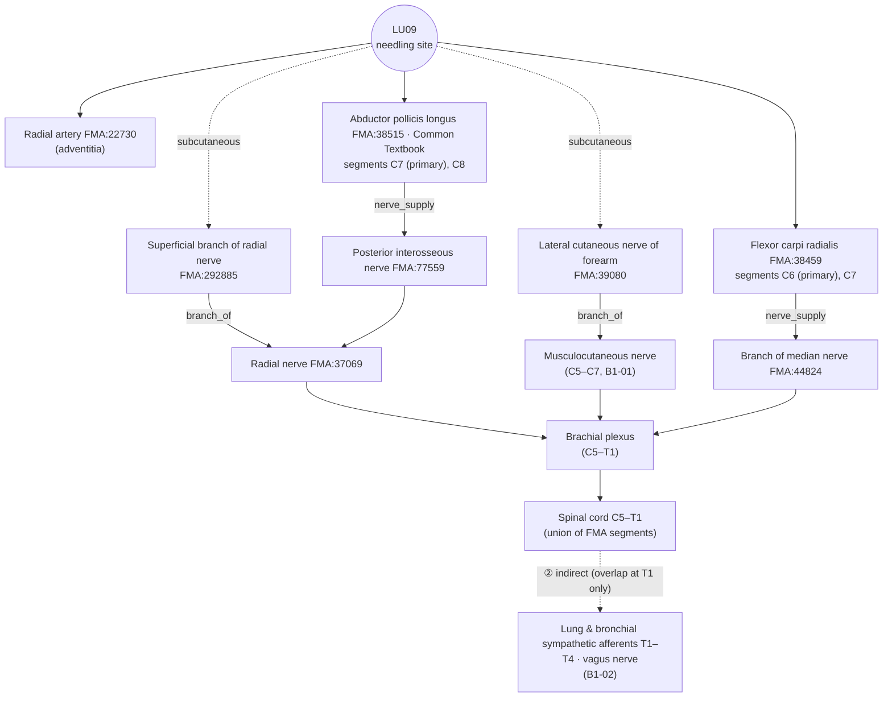

# [Acupoint Anatomical & Physiological Substrate Monograph] Taiyuan (太淵, LU09)

> **Framework**: v2.7 · **ARI**: ARI v3.0 | ARI-Core 68.75 ± 0 (C) | SI 50 | provisional weights 0.40/0.35/0.25 | sensitivity (equal weights): 66.7 (C, grade unchanged) · **Dual scoring**: two independent rounds (raters A and B); 3 discrepancies of 15 points or more reconciled

> **Three Primary Classics**: *Zhongguo Zhenjiu Xuewei Tongjian* (《中國針灸穴位通鑑》) · *Zhongguo Zhenjiu Zhengzhi Tongjian* (《中國針灸證治通鑑》) · *Zhenjiu Shuxue Tongkao* (《針灸腧穴通考》)
> **Layer A Empirical Database**: `02_Master_Datasets/경혈_생의학_신경반사_마스터DB.json` (of the 41 papers in the LU9 inverted index, only the **15 papers with confirmed LU9 stimulation** are used for the verdict — Section 8 ①)
> **Layer B Reference Registry**: `01_Framework/layer_b_reference_registry.md` (6-item B-Check, concordance threshold ≥ 8/12)
> **Anatomical Ontology**: local index of FMA 5.1.0 — textbook structures are pinned to `FMA:ID`s (B1 supplementary, not yet in the registry). Details in Appendix A
> **Metrological Standard**: Han-dynasty standard, 1 fen (分) = 2.3 mm ($z = \text{fen} \times 2.3\,\text{mm}$)
> **Note on script**: Classical quotations and TCM terms are given in Traditional Chinese (繁體字). The cited source files are simplified-script editions, so the file names and line numbers in `code` refer to those files as they are named on disk.

**Source file abbreviations** (all under `01_도서_번역_및_원전/`)
- [通考] `침구수혈통고(针灸腧穴通考)/针灸腧穴通考_03_上_手太阴肺经穴.md` — 太淵 L2193–2455
- [通鑑] `중국침구혈위통감(中国针灸穴位通鉴)/中国针灸穴位通鉴_08_手太阴肺经(2).md` — 太淵 L773–1121
- [證治04] `중국침구증치통감(中国针灸证治通鉴)/中国针灸证治通鉴_04_第壹编_第七篇_手太阴肺经_手阳明大肠经_足阳明胃经.md` — 太淵 L44–66
- [證治17] `중국침구증치통감(中国针灸证治通鉴)/中国针灸证治通鉴_17_第叁编_内科病症_二十二脏腑病证至二十四胸胁满痛.md`

---

## 1. Classical Literature Screening Table (Three Primary Classics Excerpts)

| Classic | Original excerpt (source & line) | English summary | Remarks |
| :--- | :--- | :--- | :--- |
| *Zhenjiu Shuxue Tongkao* (《針灸腧穴通考》) | "肺……注于太淵，太淵魚後一寸陷者中也，為腧。"(《靈樞·本輸》) — [通考] L2225 | Depression 1 cun behind the thenar eminence (魚際); Shu-Stream point (輸穴) | Earliest statement of the location |
| *Zhenjiu Shuxue Tongkao* (《針灸腧穴通考》) | "刺入二分，留二呼，灸三壯。"(《黃帝明堂經》) — [通考] L2431 | Needle insertion 2 fen | Earliest statement of depth (Han) |
| *Zhenjiu Shuxue Tongkao* (《針灸腧穴通考》) | "經渠與太淵二穴同出于手太陰脈口，本是一穴，古穴名曰'手太陰'" — [通考] L2203 | Jingqu (經渠) and Taiyuan were originally a single point at the cun-kou pulse site (脈口) | History of the point's formation |
| *Zhenjiu Shuxue Tongkao* (《針灸腧穴通考》) | "在腕前區，橈骨莖突與舟狀骨之間，拇長展肌腱尺側凹陷中。" / national standard 1990 "橈動脈搏動處" → deleted in the 2006 revision — [通考] L2207·2209 | Between the radial styloid process and the scaphoid, in the depression on the ulnar side of the abductor pollicis longus tendon | Modern location and the debate over the 'artery' marker |
| *Zhenjiu Shuxue Tongkao* (《針灸腧穴通考》) | "橈動脈在橈骨莖突尖端以下彎向橈側的佔44.8%，以上……15.5%，……水平處……27.6%" — [通考] L2211 | At the level of the wrist crease the radial artery usually deviates to the radial side of the abductor pollicis longus tendon | Human measurement (PMID of the original study not given → unverifiable) |
| *Zhenjiu Shuxue Tongkao* (《針灸腧穴通考》) | "直刺0.3~0.5寸" / "直針入三分……孕婦不可針"(《竇太師針經》) / "灸七壯，不宜用針"(《針方六集》) / "避開橈動脈，直刺0.3~0.5寸"(7th ed. 《針灸學》) — [通考] L2429·2435·2437·2451 | Perpendicular insertion 3–5 fen, avoid the artery; some texts discourage needling | Basis for SI (Sections 5 and 10) |
| *Zhenjiu Shuxue Tongkao* (《針灸腧穴通考》) | "刺臂太陰脈，出血多立死。"(《素問·刺禁論》, quoted in the commentary (按語) on 經渠) — [通考] L2147 | Warning of haemorrhage from needling the cun-kou vessel (臂太陰脈) | Contraindication shared by 太淵 and 經渠 |
| *Zhongguo Zhenjiu Xuewei Tongjian* (《中國針灸穴位通鑑》) | "陽中之少陰肺也，其原出于太淵。"(《靈樞·九針十二原》) — [通鑑] L777 | Yuan-Source point (原穴) of the Lung | Source |
| *Zhongguo Zhenjiu Xuewei Tongjian* (《中國針灸穴位通鑑》) | "在掌後陷者中。"(《甲乙經》 etc.) / "在手中掌後橫紋頭陷者中。"(《太平聖惠方》 etc.) / "在掌後內側橫紋頭動脈。"(《神應經》 etc.) — [通鑑] L813·817·819 | 'End of the transverse crease' (橫紋頭) added in the Song, 'artery' marker added in the Ming | "所述位置相同" [通鑑] L1053 |
| *Zhongguo Zhenjiu Xuewei Tongjian* (《中國針灸穴位通鑑》) | "針三分至五分，不灸、勿刺傷橈動脈。"(《新編針灸學》) / local anatomy "在橈側屈腕肌腱的外側，外展拇長肌腱的內側，旋前方肌的下緣……有橈動脈" — [通鑑] L1029·1039 | Between the flexor carpi radialis tendon and the abductor pollicis longus tendon; radial artery | Anatomical cross-check in Sections 4 and 6 |
| *Zhongguo Zhenjiu Zhengzhi Tongjian* (《中國針灸證治通鑑》) | 《明堂經》 "主病溫身熱，五日以上汗不出，刺太淵……咳逆，煩悶不得臥……唾血……口僻，刺太淵、引而下之。狂言。妬乳。" — [證治04] L50–54 | Febrile disease, cough with counterflow (咳逆), spitting of blood (唾血), deviation of the mouth (口僻), breast abscess (妬乳) | Basis for $P_{single}$ (Section 9) |
| *Zhongguo Zhenjiu Zhengzhi Tongjian* (《中國針灸證治通鑑》) | 《靈樞》 "主肺心痛。熱病。" / 《千金翼方》 "肺脹氣搶脅下熱痛。肺熱咳嗽。" — [證治04] L60–68 | Lung-heart pain (肺心痛), febrile disease, lung distension (肺脹) | Mostly combinations (Section 9) |

---

## 2. Primary Source vs. Secondary Quotation: Historical Stratification Table

| Era / stratum | Classical source | Textual description | Primary / secondary |
| :--- | :--- | :--- | :--- |
| Pre-Qin & Han | 《靈樞·本輸》 · 《九針十二原》 | 魚後一寸陷者中, 肺之原 | Primary (location, point category) — [通考] L2225·2305 |
| Han | *Huangdi Mingtang Jing* (《黃帝明堂經》) | 刺入二分 留二呼 灸三壯; indications of febrile disease, cough with counterflow, deviation of the mouth, breast abscess | Primary (depth, indications) — [通考] L2431·2325 |
| Han | 《難經·四十五難》 | 脈會太淵 | Primary (Influential point of the vessels, 八會穴) — [通考] L2229 |
| Wei–Jin | *Zhenjiu Jiayi Jing* (《針灸甲乙經》) | 在掌後陷者中, 刺入二分 | Quotes 《明堂》 — [通鑑] L813·1013 |
| Tang | *Qianjin Yaofang* (《千金要方》) · *Qianjin Yifang* (《千金翼方》) | '大泉/太泉' (Tang taboo, 唐諱), '鬼心' 入肉半寸, 肺咳 刺手太泉 | Name altered (naming taboo, 避諱) — [通考] L2235·2237·2371 |
| Song | *Taiping Shenghui Fang* (《太平聖惠方》) | "掌後橫紋頭陷者中" | Location marker added (end of the transverse crease) — [通鑑] L817 |
| Jin–Yuan & Ming | 《難經本義》 · 《神應經》 · *Zhenjiu Dacheng* (《針灸大成》) | "動脈" marker added | Confusion of 太淵 as the 'vessel' (the whole cun-kou) with the 'point' — [通考] L2285–2289 |
| Yuan & Ming | 《竇太師針經》 · 《針方六集》 | 孕婦不可針 / 不宜用針; toothache (牙痛) indication | Independent descriptions (some suspected contamination from '龍淵') — [通考] L2333·2361·2437 |
| Contemporary | Textbooks, 4th–7th editions · national standards 1990/2006 | Perpendicular 0.2–1 寸, 避開橈動脈; '動脈' deleted from the 2006 national standard | Modern location — [通考] L2209·2441–2453 |

---

## 3. Alias Verification Table (cross-checked against the KJH DB)

| Alias | Source | KJH DB | Verdict |
| :--- | :--- | :--- | :--- |
| 大泉 · 太泉 | Yang Shangshan's commentary (楊注) in 《黃帝內經明堂》, 《千金》 — taboo on the name of Tang Gaozu, Li Yuan (唐高祖 李淵) | Listed | Same point. Renamed because of the naming taboo — [通考] L2205·2221·2237 |
| 鬼心 | 《千金要方》 vol. 14 "第四針掌後橫紋，名鬼心，入肉半寸。即太淵穴也。" | Listed | Same point — [通考] L2235, [通鑑] L804 |
| 大渕 | 《醫心方》 ('渕' = '淵') | Listed | Variant character (異體字) — [通考] L2221 |
| 天泉 (scribal error) | 大泉 misread as 天泉 | — | **Risk of confusion**: distinct from Tianquan (天泉, PC2) of the Pericardium Meridian (心包經) — [通考] L2205·2221 |
| (wrongly assigned to 魚際) | 1957 Nanjing 《針灸學》 → Korean textbooks | — | 太泉 and 鬼心 wrongly listed as aliases of Yuji (魚際, LU10) — [通考] L2473 |
| 太淵 as 'vessel' | 《素問·氣交變大論》 "太淵絕者，死不治" | — | Distinguishes the whole cun-kou vessel (pulse-taking site) from the point 太淵 — [通考] L2221·2287 |

The KJH DB (`경혈명_비교_정리_KJH.xlsx`, sheet `경혈 종합 목록` (comprehensive acupoint list), row 64: 61, LU09, `태연` (Taeyeon), 太淵, "太泉, 鬼心, 大泉, 大渕") agrees with the alias columns of the two textbook datasets ("太泉, 鬼心").

---

## 4. 3D Spatial Coordinates & Layer 1–5 Stratification Diagram

- **X (radial–ulnar)**: radial end of the distal wrist crease, between the radial styloid process and the scaphoid, **in the depression on the ulnar side of the abductor pollicis longus tendon** ([通考] L2207). Between the flexor carpi radialis tendon and the abductor pollicis longus tendon ([通鑑] L1039).
- **Y (proximal–distal)**: distal wrist crease ("掌後橫紋頭", 《太平聖惠方》). The reading of "仰掌三紋之後" in 《針灸秘法全書》 confirms that it is the distal crease ([通考] L2299).
- **Z (depth)**: layers below. **Layer A contains no cadaveric or ultrasound measurement at LU09, so no millimetre boundaries are given** (the 2.5/6.5/16.5/22 mm boundaries of the earlier edition were generic template values and have been removed).

```
[Layer 1 Skin/subcutis]  Lateral cutaneous n. of forearm · superficial branch of radial n. · cephalic v. (shared by both textbooks),
                         accessory cephalic v. (Kim Jaehyo)
        │
[Layer 2 Between tendons] Flexor carpi radialis tendon (shared) ─ radial a./v. (shared) ─ abductor pollicis longus tendon (Common Textbook) · brachioradialis tendon (Kim Jaehyo)
        │                 ★ Radial artery: may be contacted within the range of the classical 2 fen (4.6 mm) to the textbook 5 fen (11.5 mm) → push the pulse aside
[Layer 3 Deep layer]     Flexor pollicis longus tendon (Kim Jaehyo), distal border of pronator quadratus (Kim Jaehyo; slightly proximal to this level)
        │
[Layer 5 Floor]          Distal end of radius · scaphoid (no deep organs)
```


*Figure 4-1. Schematic transverse section of the wrist at the level of Taiyuan (太淵, LU09) (right wrist, viewed from proximal, not to scale). The needling site is the depression between the flexor carpi radialis tendon and the abductor pollicis longus tendon, with the radial artery running immediately beside it. Layer thicknesses and distances are arbitrary because no LU09 measurements exist.*

**FMA substrate cross-check by layer** — structure names from the two textbooks; IDs and relations from FMA 5.1.0

| Layer | Structure | FMA | FMA compartment / relation | Innervation / trunk (FMA) | Spinal segment (FMA) |
| :--- | :--- | :--- | :--- | :--- | :--- |
| 1 Subcutis | Lateral cutaneous nerve of forearm | FMA:39080 | — | Peripheral segment of musculocutaneous nerve (FMA:288511) | Not recorded in FMA |
| 1 Subcutis | Superficial branch of radial nerve | FMA:292885 | — | Radial nerve (FMA:37069) | Not recorded in FMA |
| 1 Subcutis | Cephalic vein · accessory cephalic vein *(Kim Jaehyo)* | FMA:13324 · 22970 | — | Subclavian vein → brachiocephalic vein | — |
| 2 Between tendons | Radial artery | FMA:22730 | branch_of Subclavian artery (FMA modelling: the axillary and brachial arteries are continuation segments of the subclavian artery) | — | — |
| 2 Between tendons | Radial vein | FMA:22947 | tributary_of Brachial vein | Brachial vein → axillary vein | — |
| 2 Between tendons | Flexor carpi radialis (tendon FMA:38582) | FMA:38459 | contained_in *Space of anterior compartment of arm* (FMA error — actually the anterior compartment of the forearm) | Branch of median nerve (FMA:44824) | **C6 (primary)**, C7 |
| 2 Between tendons | Abductor pollicis longus *(Common Textbook)* | FMA:38515 | contained_in space of posterior compartment of forearm (FMA:85166) | Posterior interosseous nerve → radial nerve | **C7 (primary)**, C8 |
| 2 Between tendons | Brachioradialis (tendon FMA:40689) *(Kim Jaehyo)* | FMA:38485 | Posterior compartment of forearm | Peripheral segment of radial nerve | **C6 (primary)**, C5 |
| 3 Deep layer | Flexor pollicis longus (tendon FMA:38673) *(Kim Jaehyo)* | FMA:38481 | (FMA error: arm) | Anterior interosseous nerve → median nerve | **C8 (primary)**, C7 |
| 3 Deep layer | Pronator quadratus *(Kim Jaehyo)* | FMA:38453 | (FMA error: arm) | Anterior interosseous nerve → median nerve | **C8 (primary)**, C7 |
| 5 Floor | Distal end of radius · scaphoid | — | — | — | — |

- FMA 5.1.0 places the forearm flexors (flexor carpi radialis, flexor pollicis longus, pronator quadratus etc.) in the *Space of anterior compartment of **arm*** (anterior compartment of the upper arm). In normative anatomy (B1-01) this is the anterior compartment of the forearm, so the compartment relation is not cited.
- The **bellies of pronator teres (FMA:38450) and flexor digitorum superficialis (FMA:38469)** listed in the Kim Jaehyo textbook are proximal forearm structures and are not present at the level of the distal wrist crease (B1-01). The same textbook omits abductor pollicis longus, and the **extensor pollicis longus (FMA:38521)** listed in the Common Textbook is a tendon of the third dorsal compartment and lies outside the needle path. Discussed in Section 6.
- The palmar carpal ligament (Kim Jaehyo) has no corresponding FMA entity (none).

---

## 5. Classical Needling Depth Calculation Table

Source: `침구문헌별 자침깊이 정리_AI 분석용.xlsx`, sheet 1, row 63 (N0 = 61), supplemented by [通考] 【操作】.

| Text | Fen (分) | Depth (× 2.3 mm) | Layer reached (estimated) | Remarks |
| :--- | :---: | :---: | :--- | :--- |
| *Huangdi Mingtang Jing* (《黃帝明堂經》, ed. Huang Longxiang) | 2 | 4.6 mm | 1–2 | "刺入二分" ([通考] L2431) |
| *Zhenjiu Jiayi Jing* (《針灸甲乙經》) | 2 | 4.6 mm | 1–2 | |
| *Chimgu Gyeongheombang* (《鍼灸經驗方》) | 2 | 4.6 mm | 1–2 | |
| *Dongui Bogam* (《東醫寶鑑》, citing 《銅人》) | 2 | 4.6 mm | 1–2 | |
| Korean common textbook, *Meridian and Acupoint Studies* (經絡腧穴學) | 3–5 | 6.9–11.5 mm | 2 | |
| Korean common textbook, *Acupuncture and Moxibustion Medicine* (鍼灸醫學) | 3–5 | 6.9–11.5 mm | 2 | |
| *Zhenjiu Shuxue Tongkao* (《針灸腧穴通考》) | 3–5 | 6.9–11.5 mm | 2 | "直刺0.3~0.5寸" ([通考] L2429) |
| (Reference) 《素問·刺法論》 | 3 | 6.9 mm | 2 | 3 fen by the proportional body cun (同身寸) ([通考] L2433) |
| (Reference) 《竇太師針經》 | 3 | 6.9 mm | 2 | "孕婦不可針" ([通考] L2435) |
| (Reference) 《循經考穴編》, transverse insertion | 5 | 11.5 mm (oblique length) | 1–2 | "橫針入五分" ([通考] L2439) |
| (Reference) 4th, 5th, 6th eds. 《針灸學》 | 5–10 | 11.5–23.0 mm | 2–5 | Maximum. Reduced to 0.3–0.5 寸 in the 7th edition ([通考] L2447–2451) |
| (Reference) 《針方六集》 | — | — | — | "不宜用針" (needling discouraged; not a DB `'0'` entry) |

- The needling-depth DB contains no 'Contraindicated for needling (禁鍼)' (`'0'`) and no 'not described' (`'blank'`) entry. There are, however, a recommendation to avoid needling (《針方六集》), a contraindication in pregnancy (《竇太師針經》) and a warning of haemorrhage from the cun-kou vessel (《素問·刺禁論》, [通考] L2147).
- Safety range: everything from the classical 2 fen (4.6 mm) to the textbook 5 fen (11.5 mm) stays within Layer 2 (between the tendons), but **the radial artery lies in that layer**. The artery is avoided not by depth but **by position (pushing the pulse aside)** (7th edition "避開橈動脈", [通鑑] L1029 "勿刺傷橈動脈"). The 1 寸 (23 mm) perpendicular insertion of the 4th–6th editions was reduced in later textbooks.

---

## 6. Textbook Comparison Table

| Category | Korean common textbook of acupoint studies (refine.xlsx summary sheet, row 62) | Kim Jaehyo textbook (summary sheet, row 62) | FMA adjudication | Assessment |
| :--- | :--- | :--- | :--- | :--- |
| Muscle / tendon | Abductor pollicis longus, flexor carpi radialis, extensor pollicis longus | Flexor carpi radialis (tendon), brachioradialis (tendon), flexor pollicis longus (tendon), pronator quadratus, pronator teres, flexor digitorum superficialis, palmar carpal ligament | Shared FMA:38459 / Common Textbook only 38515 · 38521 / Kim Jaehyo only 38485 · 40689 · 38481 · 38673 · 38453 · 38450 · 38469 · 38582 | **Disagree**: only flexor carpi radialis is shared |
| Nerve | Lateral cutaneous nerve of forearm, superficial branch of radial nerve | Same | FMA:39080, 292885 | Agree |
| Vessel | Radial artery and vein, cephalic vein | Radial artery and vein, cephalic vein, accessory cephalic vein | FMA:22730 · 22947 · 13324 / Kim Jaehyo only 22970 | Agree (Kim Jaehyo adds 1 item) |

**Verdict**: the two textbooks agree on the nerves, the vessels and the location markers (flexor carpi radialis tendon, radial artery). They differ on the muscles, but **this is a difference in the level and scope of what is listed, not a conflict**. The Common Textbook's extensor pollicis longus (dorsal side) and the Kim Jaehyo textbook's bellies of pronator teres and flexor digitorum superficialis (proximal forearm) are not on the needle path at the level of the wrist crease. Conversely, the **abductor pollicis longus tendon**, the reference for the location, appears only in the Common Textbook ([通考] L2207). FMA grouped identical structures under the same IDs, which made it possible to adjudicate the differences. There is no point-specific imaging or cadaveric measurement (PMID). This verdict is the basis for the $S_{clarity}$ of 75 (reconciled).

---

## 7. Spatial Displacement Divergence Inference

| Lineage | Evidence | Location |
| :--- | :--- | :--- |
| ① Classical | 《靈樞·本輸》 "魚後一寸陷者中"; 《甲乙》 "掌後陷者中" | Depression behind the wrist (longitudinal reference vague) |
| ② Song to present | 《聖惠方》 "掌後橫紋頭陷者中" → national standard 2006 "橈骨莖突與舟狀骨之間，拇長展肌腱尺側凹陷中" | Radial end of the distal wrist crease |
| ③ Revision proposal keeping the 'artery' marker | Japanese standard of the acupuncture community (同人) "遠端腕橫紋上五分" (a proposal to retain the arterial pulsation) | About 5 fen proximal to the crease — [通考] L2223·2299 |

The *Tongjian* (《通鑑》) regards ① and ② as "所述位置相同" ([通鑑] L1053), while the *Tongkao* (《通考》) presents ③ only as an alternative if the 'artery' marker is to be kept. The 5-fen difference between ③ and ② is estimated at about 1 cm by the proportional body cun (not measured), so **$\Delta_{discrepancy} \le 15\text{mm}$ → no split needed; single Target (T1 = modern national-standard location)**.

---

## 8. Biomedical Reflex Mechanism Diagram & External Search Log

**Mechanism summary**: mechanism studies of Taiyuan stimulation are **rat and mouse experiments only**. Electroacupuncture at Taiyuan alone improved pulmonary ventilation in rats with acute lung injury (papers.id 2240). In myocardial ischaemia models, by contrast, the effect of Taiyuan was weaker than, or not as clear as, that of Heart Meridian points (神門 · 通里 · 內關) (2238, 2241, 2244, 2235). Human studies use Taiyuan only within **multi-point prescriptions**. B-Check 7/12 falls short of the concordance threshold, so the reflex pathway below is described only as a **hypothesis (animal only)**.

**FMA pinning of the peripheral afferent pathway**



*Figure 8-1. Peripheral afferent pathway of LU09 drawn from FMA 5.1.0 relations. Solid lines are relations recorded in FMA; dashed lines are links absent from FMA or interpretations (supplemented from B1). Autonomic afferents of the vascular adventitia are outside the scope of FMA.*

### ① Layer A Papers (confirmed LU9 stimulation)

Of the 41 papers in the inverted index, only those whose abstract confirms LU9 (太淵/Taiyuan) stimulation are listed. The rest were judged to be false string matches, such as affiliations with the city of Taiyuan (太原), and excluded (e.g. 2222, a JAMA RCT on stress urinary incontinence; 2226, an fMRI study of neck pain — LU9 not used).

| papers.id | Year | Journal | Content | PMID / DOI | Design |
| :---: | :---: | :--- | :--- | :--- | :--- |
| 2240 | 2022 | Zhen Ci Yan Jiu | Electroacupuncture and pre-electroacupuncture at 太淵 alone → improved pulmonary ventilation and respiratory mechanics in rats with acute lung injury; pre-electroacupuncture TNF-α and IL-1β ↓ | 35880273 / 10.13702/j.1000-0607.20211299 | Animal (rat), **LU9 alone** |
| 2238 | 2017 | Zhongguo Zhen Jiu | Myocardial ischaemia–reperfusion rats: effect of pre-electroacupuncture at 內關; **no clear effect in the 太淵 group** | 29231479 / 10.13703/j.0255-2930.2017.02.013 | Animal (rat), LU9 control |
| 2241 | 2018 | Zhen Ci Yan Jiu | HCN2 in rats with acute myocardial infarction: both 神門 and 太淵 improved it, Heart Meridian > Lung Meridian (meridian specificity) | 29560633 / 10.13702/j.1000-0607.170121 | Animal (rat), LU9 control |
| 2244 | 2024 | Acupunct Med | Mouse myocardial ischaemia: electroacupuncture at HT5–HT7 regulates β1-AR better than LU9–LU8 | 39579035 / 10.1177/09645284241298716 | Animal (mouse), LU9–LU8 control |
| 2235 | 2021 | Zhongguo Zhen Jiu | Myocardial ischaemia–reperfusion rats: the Lung Meridian group (太淵 · 列缺) also reduced ST deviation and raised LHA/FN DA and 5-HT, but less than the Heart Meridian group | 34002567 / 10.13703/j.0255-2930.20200509-k0001 | Animal (rat), LU9 + LU7 |
| 2236 | 2020 | Zhongguo Zhen Jiu | Same model, NF-κB pathway: Lung Meridian group (太淵 · 列缺) as control | 33068354 / 10.13703/j.0255-2930.20190811-k0004 | Animal (rat), LU9 + LU7 |
| 2233 | 2022 | Zhongguo Zhen Jiu | Acute hypoxia rats: pretreatment with stone-needle patches (砭貼) at 太淵 · 內關 · 人迎 | 36397226 / 10.13703/j.0255-2930.20211201-k0004 | Animal (rat), multiple points |
| 2002 | 2019 | Zhen Ci Yan Jiu | Redrawing of the rat acupoint atlas (positional correspondence including LU9) | 30773865 / 10.13702/j.1000-0607.180396 | Animal anatomical correspondence |
| 1807 | 2025 | Ann Med | Intradermal needles (LU9 · CV17 · LU6 · BL13) after thoracoscopic lobectomy → pulmonary complications ↓, analgesic use ↓ | 40953233 / 10.1080/07853890.2025.2560684 | **Human RCT**, multiple points |
| 2237 | 2020 | Zhongguo Zhen Jiu | Shao's five-needle method (邵氏五針法; 肺俞 · 中府 · 太淵 · 定喘 · 膻中 etc.) multicentre RCT in allergic rhinitis and asthma → FEV1 and PEF improved | 32394654 / 10.13703/j.0255-2930.20190412-0007 | **Human RCT**, multiple points |
| 1805 | 2018 | Zhongguo Zhen Jiu | Five-needle method (五針法) vs conventional acupuncture, comparison by asthma symptom | 29354929 / 10.13703/j.0255-2930.2018.01.002 | Human clinical, multiple points |
| 2234 | 2022 | Zhongguo Zhen Jiu | Press needles (揿針) for sequelae in COVID-19 convalescence (關元 · 足三里 · 太淵) | 35272405 / 10.13703/j.0255-2930.20210406-0004 | Human clinical, multiple points |
| 2239 | 2024 | Zhen Ci Yan Jiu | Electroacupuncture for raising the clear and lowering the turbid (升清降濁; 8 points including 太淵) | 39433370 / 10.13702/j.1000-0607.20230690 | Human clinical, multiple points |
| 2245 | 2024 | Photobiomodul Photomed Laser Surg | Laser acupuncture for postpartum carpal tunnel syndrome (12 points including LU9), median nerve conduction | 39446663 / 10.1089/photob.2024.0106 | Human clinical, multiple points |
| 1964 | 2026 | Zhongguo Zhen Jiu | Acupuncture for orthostatic hypotension after cervical spinal cord injury (including 太淵) | 42116771 / 10.13703/j.0255-2930.20250421-k0004 | Case report |

- Korean local papers (341, 420, 461, 737, 766, 767, 795, 969, 1720) appear in the inverted index, but their abstracts were not extracted, so the LU9 mechanism could not be confirmed and they were not used for the verdict (unverifiable).
- All records have status = active. No duplicate, missing or superseded records.

### ② B-Check Scoring Table

| Item | Content | Rater A | Rater B | Final | Reference ID | papers.id | Rationale |
| :---: | :--- | :---: | :---: | :---: | :--- | :--- | :--- |
| ① | Peripheral nerve / vessel substrate at needling depth | 2 | 2 | **2** | B1-01, B1-03, B1-04, B2-09 (+FMA) | — | The two textbooks agree on the radial artery, superficial branch of radial nerve and lateral cutaneous nerve of forearm, all matching FMA exactly (FMA:22730 · 292885 · 39080). Variation in the course of the radial artery: B1-04 and [通考] L2211 |
| ② | Spinal segmental concordance | 1 | 1 | **1** | B1-02, B3-03, B3-05 (+FMA) | — | LU09 C5–T1 (union of FMA segmental_supply) vs lung and cardiac sympathetic afferents T1–T4: overlap only at T1, and that comes from a structure listed only by Kim Jaehyo and lying outside this level (flexor digitorum superficialis) → indirect, 1 |
| ③ | Afferent fibre type / receptors | 1 | 1 | **1** | B3-06 | — | No LU9-specific afferent fibre study. Inferred from general accounts of acupuncture afferent fibres (upper limit 1 point) |
| ④ | Central relay / pathway | 1 | 1 | **1** | B3-12 | 2235 | Changes in LHA and FN dopamine and 5-HT with electroacupuncture in the Lung Meridian group (太淵 · 列缺) (rat). B3-12 concerns the rVLM pathway for PC5–6 (median nerve) points, so applied to LU9 by analogy |
| ⑤ | Efferent pathway / target effect (match to $P_{single}$) | 2 | 1 | **1** | B3-05 | 2240, 2238, 2241, 2244 | Improved pulmonary ventilation (2240) points in the same direction as the classical indications of cough with counterflow and dyspnoea (喘). The cardiac effect is weaker than with Heart Meridian points or absent (2238), so the correspondence with the '心痛' indication is weak → A 2, B 1, final 1 |
| ⑥ | Evidence of human translation | 1 | 1 | **1** | B4-04, B4-05 | 1807, 2237 | Human RCTs use only multi-point prescriptions (not LU9 alone). Counter-evidence on point specificity (B4-04, B4-05) unresolved |
| **Total** | | 8 | 7 | **7 / 12** | | | **Verdict: not concordant (< 8/12)** → reflex mechanism is a **hypothesis**, ③–⑤ **animal only** |

### ③ External Search Log (sync_log, Rank 6 run on 2026-10-23)

| Timestamp | Source | HTTP | Retrieved | Deduplicated | New | Query |
|---|---|---|---|---|---|---|
| 2026-10-23T21:41:58 | pubmed | 200 | 16 | — | — | ("LU9" OR "Taiyuan" OR "太渊") AND (acupuncture OR electroacupuncture) AND (nerve OR reflex OR autonomic OR mechanism OR anatomy) \| ("LU9" OR "Taiyuan" OR "太渊") AND ("Zhongguo Zhen Jiu"[Journal] OR "Zhen Ci Yan Jiu"[Journal]) |
| 2026-10-23T21:41:58 | openalex | 200 | 20 | — | — | doi_starts_with:10.13703 / 10.13702, title_and_abstract.search:"Taiyuan" OR "LU9" / has_doi:true … AND (acupuncture OR electroacupuncture) |
| 2026-10-23T21:41:58 | crossref | 200 | 0 | — | — | Taiyuan acupuncture nerve reflex |
| 2026-10-23T21:41:58 | all | — | 36 | 12 | 24 | merged_into_existing=8, batch_dups=4 |

- The search term "Taiyuan" is spelled the same as Taiyuan (太原) in Shanxi Province, China, so many papers with that affiliation flood in. From the next synchronisation, point-restricted expressions such as `"Taiyuan"(LU 9)` or `"Taiyuan" acupoint` are needed (adjusting the query belongs to the shared script and is not changed in this report).

---

## 9. Indication Separation Table

| Category | Indication | Textual basis |
| :--- | :--- | :--- |
| $P_{single}$ (single point) | Febrile disease without sweating (熱病無汗) | "病溫身熱，五日以上汗不出，刺太淵，留針一時取之，未滿五日禁不可刺" (《明堂經》, [證治04] L50–54) |
| $P_{single}$ | Cough with counterflow (咳逆), dyspnoea (喘), spitting of blood (唾血) (lung system, 肺系) | 《明堂經》 "咳逆，煩悶不得臥，胸中滿，喘不得息……唾血" ([證治04] L54); "肺咳，刺手太泉" (《千金翼方》, [通考] L2371) |
| $P_{single}$ | Deviation of the mouth (口僻) | "口僻，刺太淵、引而下之" (《明堂經》, [證治04] L54) |
| $P_{single}$ | Breast abscess (妬乳), mammary abscess (乳癰) | 《明堂經》 "妬乳"; 《靈光賦》 · 《席弘賦》 mammary abscess ([通考] L2325·2345) |
| $P_{single}$ | Arm reversal (臂厥), pain on the medial side of the arm (local) | "臂厥，肩膺胸痛……臂內廉痛" (《明堂經》) |
| $P_{single}$ (modern) | Pulseless disease, premature cardiac contractions | 5th, 6th, 7th eds. 《針灸學》 "無脈症"; "心臟早搏：針刺左太淵穴" (中國針灸 1999, [通考] L2355·2393) |
| Verdict withheld | Toothache | Appears from 《竇太師針經》 onward. Possible confusion with '龍淵', an extra point specific to toothache ([通考] L2361·2399) |
| $P_{comb}$ (combination) | Lung-heart pain (肺心痛) | "肺心痛也，取之魚際與太淵" (《靈樞·厥病》, [通考] L2389) |
| $P_{comb}$ | Inducing and stopping sweating in febrile disease | 魚際 · 太淵 · 大都 · 太白 (《靈樞·熱病》, [通考] L2407) |
| $P_{comb}$ | Headache | "頭痛先刺列缺，後瀉太淵" (《針灸集書》); 《席弘賦》 ([通考] L2417·2421) |
| $P_{comb}$ | Cough, common cold | "傷寒咳嗽……風門、肺俞、列缺、太淵" ([證治17] L1063); 《玉龍歌》 風門 + 太淵 ([通考] L2381) |
| $P_{comb}$ | Asthma, wheezing (哮喘) | 璇璣 · 華蓋 · 俞府 · 膻中 · 肩井 · 太淵 · 足三里 ([證治17] L1181); 太淵 + 定喘 (北京中醫 1988, [通考] L2385) |
| $P_{comb}$ | Lung abscess (肺癰) | Moxibustion at 腎俞 · 合谷 · 太淵 ([證治17] L204) |

---

## 10. ARI v3.0 Profile Evaluation & Final Conclusion

**Target T1 (single)**: classical "掌後陷者中" = modern national standard 2006 "橈骨莖突與舟狀骨之間，拇長展肌腱尺側凹陷中".

### Sub-scores

| Index | Rater A | Rater B | Final | Rubric-level rationale | Evidence pointer |
| :--- | :---: | :---: | :---: | :--- | :--- |
| $S_{orig}$ (0.40) | 81.25 | 75 | **75** | Mean of the 4 sub-items below (after reconciling ①, both A and B are 75) | [通考] L2193–2455 |
| $S_{clarity}$ (0.35) | 75 | 50 | **75** (reconciled) | A: location markers, nerves and vessels agree in the two textbooks + confirmed by B1 and FMA. B: the muscle-list mismatch was reconciled only by inference (50). Reconciled: the mismatch is a difference in the level and scope of what is listed, adjudicated by FMA and B1, and is not a conflict → 75 (same criterion as GB21). No point-specific measurement → below 100 | Section 6, textbook row 62, FMA:22730 · 38459 |
| $S_{reflex}$ (0.25) | 50 | 50 | **50** | Many animal studies with LU9 alone or as a control, human evidence only from multi-point RCTs, B-Check 7 (< 8) → level "animal studies only, B-Check 6–7" | Section 8 ①②, papers.id 2240 · 2238 · 2241 · 2244 · 1807 · 2237 |
| SI ($S_{safety}$) | 50 | 75 | **50** (reconciled) | A: the whole standard depth range lies within the radial artery layer (Layer 2) → "direct contact; explicit depth limit required" (50). B: the pulse can be pushed aside and the texts state '避開橈動脈' (75). Reconciled: avoidance depends on palpation rather than angle, and there are the haemorrhage warning of 《素問·刺禁論》 and the '不宜用針' of 《針方六集》, so 50. No `'0'` (contraindicated) entry in the DB → not 0 | Section 5, needling-depth DB row 63, [通考] L2147·2437·2451 |

### $S_{orig}$ Sub-items

| Sub-item | A | B | Final | Rationale |
| :--- | :---: | :---: | :---: | :--- |
| ① Clarity of the earliest description | 100 | 75 | **75** (reconciled) | A: both the location in 《本輸》 and the depth in 《明堂》 date from the Han. B: the *Tongkao* (《通考》) judges that "早期文獻只言'掌後'，不很明確" ([通考] L2299). 25-point difference → reconciled: the longitudinal reference of the location is vague, so 75 |
| ② Agreement of later texts | 75 | 75 | **75** | The location is "所述位置相同" ([通鑑] L1053), but the 'artery' marker was added in the Ming, the national standard was revised from 1990 to 2006, and depth ranges from 1 fen to 1 寸 |
| ③ Resolution of alias confusion | 75 | 75 | **75** | 大泉 · 太泉 (naming taboo), 鬼心 and 大渕 sorted out; the misreading 天泉, the wrong assignment to 魚際 and the confusion with 太淵 as 'vessel' resolved in chronological order |
| ④ Collation by the *Tongkao* (《通考》) | 75 | 75 | **75** | Corrected the anatomical untenability of the 'artery' marker, the national-standard revision and the erroneous 魚際 alias. Contamination of the toothache indication from '龍淵' unresolved |

### Gates, Grade & Sensitivity

- **Gates**: Gate 1 ($S_{orig}$ 75 and $S_{clarity}$ 75 ≥ 50) not triggered, Gate 2 (15 Layer A papers with confirmed LU9 stimulation) not triggered, Gate 3 (SI 50 > 25) not triggered.
- **ARI-Core** = 0.40×75 + 0.35×75 + 0.25×50 = **68.75 ± 0** → **grade C (possible / hypothesis)**, no flag.
- **SI** = 50 (reported separately).
- **Equal-weight sensitivity**: (75+75+50)/3 = 66.7 → C, grade unchanged.
- **Split verdict**: not applicable (single Target).
- **Reconciliation record**: all 3 discrepancies of 15 points or more ($S_{orig}$ ①, $S_{clarity}$, SI) were reconciled on the grounds given in the tables above. After reconciliation the sub-scores agree, so the half-range is 0. B-Check ⑤ split A 2 / B 1, final 1.
- **Earlier-edition score**: the template draft's 'ARI-Core 79.0 (B)' was computed from default values (85/75/75/75) without evidence pointers and is not compared with the v3.0 scoring (`_구판_template_20261023/`).

**Standard notation**: `ARI v3.0 | ARI-Core 68.75 ± 0 (C) | SI 50 | provisional weights 0.40/0.35/0.25 | sensitivity (equal weights): 66.7 (C, grade unchanged)`

### Final Conclusion

The anatomical substrate of Taiyuan (太淵, LU09) is at the **possible (C)** level. Its location has been consistently "掌後陷者中" since the Han, and in modern times it has been fixed in the depression between the radial styloid process and the scaphoid, on the ulnar side of the abductor pollicis longus tendon. At this level the two textbooks agree on the flexor carpi radialis tendon, the radial artery, the superficial branch of the radial nerve and the lateral cutaneous nerve of the forearm, and all of these structures are confirmed as standard FMA entities. The muscle lists, however, diverge because each textbook covers a different level.

Factors that lowered the grade:
1. **Reflex mechanism not concordant (B-Check 7/12)**: improvement of lung function has been shown only in rat experiments (LU9 alone). The cardiac effect is weaker than that of Heart Meridian points or absent, so the correspondence with the classical '心痛' indication is weak.
2. **Human evidence comes only from multi-point prescriptions**, so the specific contribution of LU9 cannot be isolated.
3. **Segmental concordance indirect (② = 1)**: LU09 (C5–T1) and the lung and cardiac sympathetic afferents (T1–T4) overlap only at T1.

**Safety (SI 50)**: the whole standard depth range (2–5 fen, 4.6–11.5 mm) lies in the same layer as the radial artery. Palpate and push the pulse aside before needling perpendicularly, and apply pressure if bleeding occurs. 《素問·刺禁論》 "刺臂太陰脈，出血多立死" and 《針方六集》 "不宜用針" record this arterial risk. Because the radial artery often deviates to the radial side of the abductor pollicis longus tendon at the level of the wrist crease ([通考] L2211), the pulse may be hard to feel at the national-standard point. The absence of a pulse should not be taken to mean the absence of the artery.

---

## Appendix A. FMA Anatomical Substrate Profile (FMA 5.1.0)

Generated by `python .claude/skills/acupoint-anatomy/scripts/fma/fma_query.py profile LU09 --md` (2026-10-23).

| Category | Textbook term | FMA substrate | Match | Source | Innervation / parent trunk | Spinal segment |
| :--- | :--- | :--- | :--- | :--- | :--- | :--- |
| Muscle | Abductor pollicis longus | FMA:38515 Abductor pollicis longus | exact | Common Textbook | Nerve to APL → Posterior interosseous nerve → Radial nerve | C7 (primary), C8 |
| Muscle | Brachioradialis | FMA:38485 Brachioradialis | exact | Kim Jaehyo | Nerve to brachioradialis → Radial nerve | C6 (primary), C5 |
| Muscle | Extensor pollicis longus | FMA:38521 Extensor pollicis longus | exact | Common Textbook | Nerve to EPL → Posterior interosseous nerve → Radial nerve | C7 (primary), C8 |
| Muscle | Flexor carpi radialis | FMA:38459 Flexor carpi radialis | exact | Common Textbook · Kim Jaehyo | Nerve to FCR → Median nerve | C6 (primary), C7 |
| Muscle | Flexor digitorum superficialis | FMA:38469 Flexor digitorum superficialis | exact | Kim Jaehyo | Nerve to FDS → Median nerve | C8 (primary), T1 |
| Muscle | Flexor pollicis longus | FMA:38481 Flexor pollicis longus | exact | Kim Jaehyo | Nerve to FPL → Anterior interosseous nerve → Median nerve | C8 (primary), C7 |
| Muscle | Pronator quadratus | FMA:38453 Pronator quadratus | exact | Kim Jaehyo | Nerve to PQ → Anterior interosseous nerve → Median nerve | C8 (primary), C7 |
| Muscle | Pronator teres | FMA:38450 Pronator teres | exact | Kim Jaehyo | Nerve to pronator teres → Median nerve | C7 (primary), C6 |
| Tendon | Tendons of brachioradialis, flexor carpi radialis, flexor pollicis longus | FMA:40689 · 38582 · 38673 | exact | Kim Jaehyo | — | — |
| Ligament | Palmar carpal ligament | — | none | Kim Jaehyo | Not in FMA | — |
| Nerve | Lateral cutaneous nerve of forearm | FMA:39080 Lateral cutaneous nerve of forearm | exact | Common Textbook · Kim Jaehyo | Musculocutaneous nerve | — |
| Nerve | Superficial branch of radial nerve | FMA:292885 Superficial branch of radial nerve | exact | Common Textbook · Kim Jaehyo | Radial nerve | — |
| Vessel | Accessory cephalic vein | FMA:22970 Accessory cephalic vein | exact | Kim Jaehyo | Cephalic → Subclavian → Brachiocephalic vein | — |
| Vessel | Cephalic vein | FMA:13324 Cephalic vein | exact | Common Textbook · Kim Jaehyo | Subclavian → Brachiocephalic vein | — |
| Vessel | Radial artery | FMA:22730 Radial artery | exact | Common Textbook · Kim Jaehyo | Subclavian artery (FMA modelling) | — |
| Vessel | Radial vein | FMA:22947 Radial vein | exact | Common Textbook · Kim Jaehyo | Brachial → Axillary → Subclavian vein | — |

- Union of segments (input to B-Check ②): **C5, C6, C7, C8, T1** (T1 comes only from a single secondary segment of flexor digitorum superficialis)
- Comparison of the two textbooks: 6 shared FMA entities · 2 Common Textbook only (FMA:38515, 38521) · 9 Kim Jaehyo only
- Limits of citation: FMA is a normative ontology of adult anatomy and is not evidence of point-specific depth, variant frequency or reflex function. The compartment error (arm) for the forearm flexors is not cited.

---

## Revision History (2026-10-23, full Tier 3 rewrite)

| Location | Original content (template draft, 2026-10-23 19:02) | Change | Basis |
| :--- | :--- | :--- | :--- |
| Header | "full inverted index of 9 measured papers" | 15 papers with confirmed LU9 stimulation out of 41 in the inverted index, FMA line added, ARI notation | Master DB .json LU9; PubMed abstract check |
| Section 1 | Truncated excerpts from the opening of the source files | Original text of 《靈樞》, 《明堂》, the national standard and 【操作】 with files and line numbers | [通考] L2193–2455; [通鑑] L773–1121; [證治04] L44–66 |
| Sections 2 and 3 | Titles and generic sentences only | Primary/secondary table by era; 6-item alias table (naming taboo, misreading, wrong assignment, vessel/point distinction) | [通考] L2205·2221·2235·2237·2473; KJH row 64 |
| Section 4 | Generic layer boundaries 2.5/6.5/16.5/22 mm | LU09 order of structures, Figure 4-1, FMA cross-check table by layer, notes on FMA compartment errors and textbook levels, mm boundaries omitted | Textbook row 62; FMA 5.1.0 |
| Section 5 | Formula only | Fen → mm table by text, principle of avoiding the radial artery | Needling-depth DB row 63; [通考] L2429–2453 |
| Section 6 | Generic sentence "the two textbooks agree" | Actual structures, FMA IDs, verdict on the mismatch | Textbook row 62 |
| Section 7 | Rule description only | Table of three lineages, Δ ≤ 15 mm, single Target | [通考] L2223·2299; [通鑑] L1053 |
| Section 8 | 9 papers irrelevant to the verdict (PMIDs blank), B-Check ② = 2 (B3-01), "confirmed" | 15 confirmed LU9 papers (PMID/DOI), place-name false matches excluded, dual-scored B-Check 7/12 not concordant, hypothesis, animal only, Figure 8-1, external search log | Rank 6 sync 2026-10-23T21:41:58; registry |
| Section 9 | Definition only | Actual $P_{single}$ / $P_{comb}$ separation, verdict on toothache withheld | [證治04] L50–54; [證治17]; [通考] L2361–2421 |
| Section 10 | Single scoring 85/75/75/75, ARI-Core 79.0 (B), "rigorously verified" | Dual scoring 75/75/50, SI 50, ARI-Core 68.75 ± 0 (C), 3 reconciliations recorded, conclusion with scope limits | Sections above |
| Appendix A | — | FMA profile table | `fma_query.py profile LU09 --md` |
| Unverifiable | — | Original study (PMID) for the radial artery course-variation percentages not confirmed / abstracts of 9 Korean local papers not extracted | [通考] L2211; master DB |
| Earlier-edition archive | — | Template draft md, html and xlsx kept in `_구판_template_20261023/` | — |

---

## English Edition Revision History (2026-10-24)

| Location | Original content | Change | Basis |
| :--- | :--- | :--- | :--- |
| Whole document | Automatically generated "English" edition: Korean body text with only headings and some terms replaced | Fully translated into English from the Korean edition (same content, scores and evidence pointers); Traditional Chinese (繁體字) given for point, meridian and classic names, TCM concepts, indications and classical quotations | Korean edition `LU09_태연_해부생리_실체판명_보고서.md` |
| Title | "Taiyuan (太淵, LU09)(太淵·太渊, LU09)" duplicated annotation | Duplicate removed; Traditional form 太淵 only | — |
| Figure 4-1 | Image path corrupted by term replacement (`LU09_Taiyuan (太淵, LU09)_횡단면_해부모식도.png`), so the image was missing from the HTML | Restored to the actual file name | Files in the report folder |
| Classical quotations | Simplified characters (e.g. 渊, 针, 脉, 灵枢) | Converted to Traditional characters; file names, line pointers and search-log query strings unchanged | Routing rule on Traditional Chinese collation |

## Refinement History (2026-10-24)

| Location | Original wording | Revised wording | Basis |
| :--- | :--- | :--- | :--- |
| Textbook title | *Meridian and Acupoint Studies* (經絡經穴學) | (經絡腧穴學) | The Korean edition names the textbook *Gyeongnak Suhyeolhak* (經絡腧穴學; suhyeol = 腧穴); 經絡經穴學 was a mistranslation carried over from the earlier ST36 English edition |
