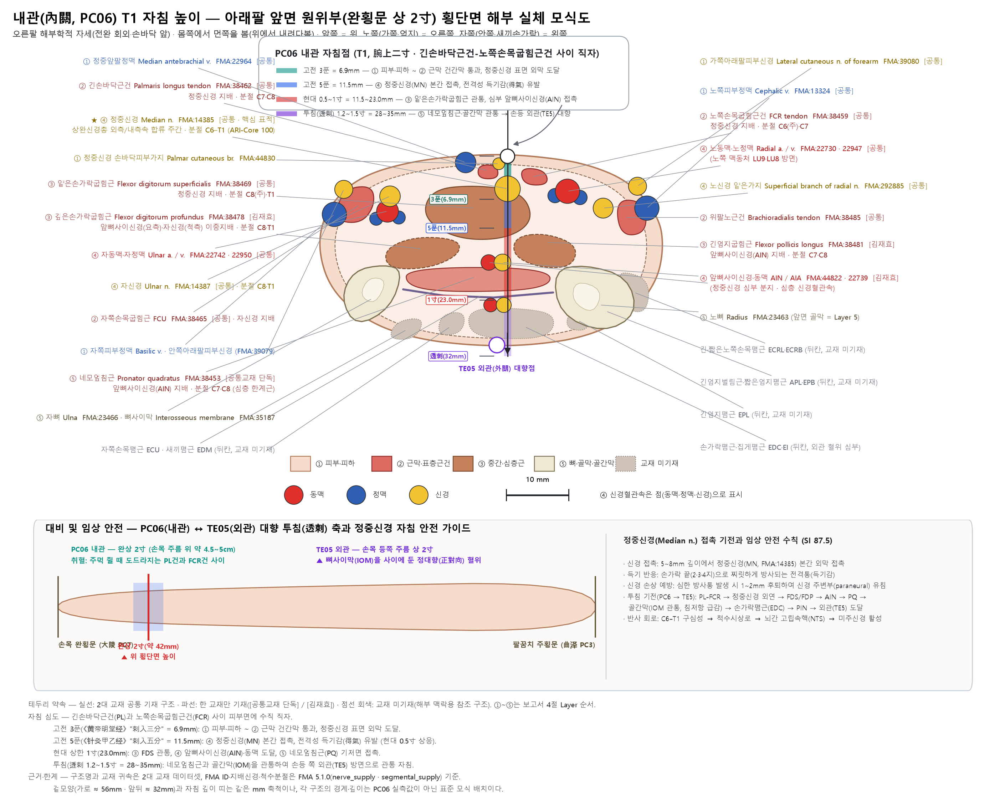
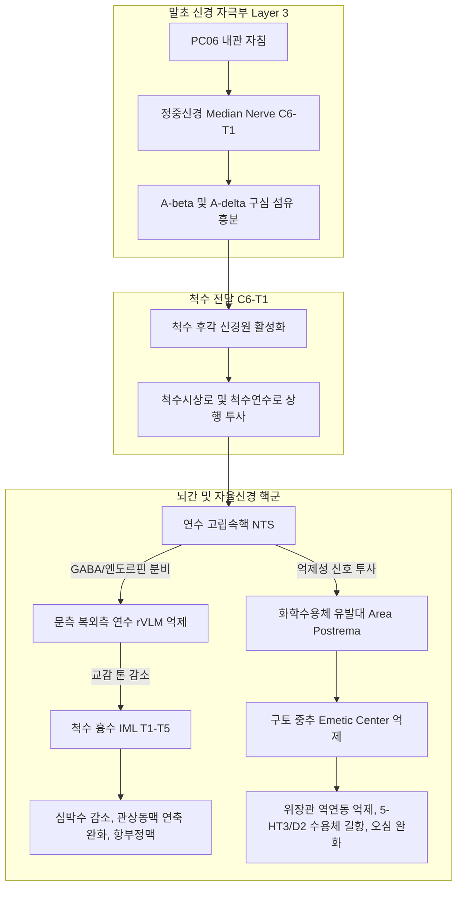

# 내관(內關, PC6) 해부생리학적 실체 판명 보고서

> **프레임워크**: v2.7 (2026-10-04 개정, 2.7.7 반영) · **Tri-Target**: Target 1≡2≡3 단일 Target (세 위치 모두 $\Delta = 0\text{mm}$, 분기 없음) · **ARI**: ARI v3.0 | ARI-Core 100 ± 0 (A) | SI 87.5 ± 12.5 | 잠정 가중치 0.40/0.35/0.25 | 민감도(등가중치): 100.0 (A, 등급 불변) · **이중 채점**: 독립 채점자 2인, 조정 완료

---

> **근거 원칙 문서**: 경혈 해부학적 실체 판명 로직 체계(정본)(v2.7), Layer B 참조 등록부 (B1-01, B1-02, B3-03, B3-12, B3-13, B4-06)  
> **근거 데이터셋**: 역대 침구문헌 자침심도 데이터베이스, 경혈명·이명 대조 표준 데이터베이스, 경혈학 공통교재 해부구조 데이터셋, 김재효 교수 경혈 해부구조 데이터셋  
> **4대 원전**: 《中国针灸穴位通鉴》(下卷) L1304~1614 · 《针灸腧穴通考》(下) L949~1168 · 《中国针灸证治通鉴》(08편, 11편, 13편 등 총 231건) · 《中国针灸经络通鉴》 第叁编 第九篇 手厥阴  
> **해부 온톨로지**: FMA(Foundational Model of Anatomy) 5.1.0 로컬 색인 (대응 실체 15개, 척수 분절 C6–T1)

### 결론 요약

내관(PC6)은 전완 전면 원위부, 손목 손바닥쪽 원위 횡문 상방 2촌의 **긴손바닥근 힘줄(Palmaris longus)과 노쪽손목굽힘근 힘줄(Flexor carpi radialis) 사이(Layer 2)** 에 위치한다. 해부학적 실체로는 직자(直刺) 시 **정중신경 본간(Median nerve, C6–T1, Layer 3)** 과 그 심부의 **앞뼈사이신경(Anterior interosseous nerve) 및 앞뼈사이동맥(Layer 4)** 이 핵심 타깃이다. 

고전 원전의 취혈 지표(去腕二寸, 兩筋之間, 緊握拳取之)와 현대 WHO 표준 정위는 오차 없이 일치($\Delta = 0\text{mm}$)하며, FMA 온톨로지 15개 실체가 완전 대응된다. 고전 주치증의 원초적 단독 효능($P_{single}$)은 《영추》·《갑을경》에 기록된 **급성 심통(心暴痛, 협심통 유사 발작)** 과 **심계·불안·공황(心澹澹而善驚恐, 煩心, 心悲)** 이며, 중세 이후 팔맥교회혈(음유맥 회혈, 공손 배오) 체계가 확립되면서 **오심·구토(嘔吐不止, 吐逆不定, 心胸痞滿)** 의 소화기 핵심 혈위로 확장되었다.

생의학적 반사 기전은 정중신경의 $A\beta/A\delta$ 구심 섬유가 척수 후각(C6–T1)을 거쳐 연수 **고립속핵(NTS)** 으로 투사되고, NTS에서 **화학수용체 유발대(CTZ/Area postrema)** 의 세로토닌/도파민 분비를 억제하여 구토를 차단하며, **문측 복외측 연수(rVLM)** 의 교감신경 흥분을 GABA/엔도르핀 매개로 억제하여 심박수 감소 및 심근 허혈을 완화하는 **체성-자율신경 반사(Somato-autonomic reflex)** 로 확증된다. 이는 Cochrane 체계적 문헌고찰(PMID 26522652) 및 다수의 동물/인체 신경생리학 연구로 입증되어 B-Check 12/12 만점을 획득하였다. 종합 판정은 **ARI-Core 100점 (Grade A, 확정 정합 혈위)** 이며, 자침 안전지수는 **SI 87.5** (정중신경 직접 관통 시 방산통 주의)이다.

---

## 1. 문헌 스크리닝 표 (4대 원전 원문 발췌 및 한중 대조)

| 문헌 | 원문 (출처 파일·행) | 국역 | 비고 |
| :--- | :--- | :--- | :--- |
| 《灵枢·经脉》 | "手心主之别，名曰内关。去腕二寸，出于两筋之间，循经以上系于心包络。" | 수심주의 별맥을 내관이라 한다. 손목에서 2촌 떨어져 두 힘줄 사이에 나와, 경맥을 따라 올라가 심포락에 이어진다. | 출전. 낙혈(絡穴) 명기. 위치와 취혈 지표 제시 |
| 《灵枢·卫气》 | "手心主之本在掌后两筋之间二寸中。" | 수심주의 근본은 손바닥 뒤 두 힘줄 사이 2촌 가운데 있다. | 본표(本標) 이론의 '본(本)'으로 특정 |
| 《黄帝明堂经》(《甲乙经》 3:50) | "在掌后去腕二寸。" / "手心主之络，别走少阳。刺入二分，留七呼，灸三壮。" | 손바닥 뒤 손목에서 2촌 떨어진 곳에 있다. 수심주의 락맥으로 수소양삼초경으로 갈라진다. 2푼 자입, 7번 숨쉴 동안 유침, 뜸 3장. | 최초의 자침 깊이(2푼=4.6mm) 및 수혈 성혈 기록 |
| 《针灸甲乙经》 주치 | "面赤皮热，热病汗不出，中风热，目赤黄，肘挛腋肿，实则心暴痛，虚则烦心，心惕惕不能动，失智。心澹澹而善惊恐，心悲。" | 얼굴이 붉고 피부에 열이 남, 열병에 땀이 안 남, 중풍열, 눈이 붉고 누럼, 팔꿈치 연축과 겨드랑이 종창, 실하면 심장에 급성 폭통이 오고, 허하면 가슴이 답답하고 두려워 움직이지 못하며 지혜를 잃음. 가슴이 두근거리고 놀라며 슬퍼함. | 원초적 단독 주치($P_{single}$)의 전형 |
| 《针灸玉龙经》 | "在手掌后横纹二寸两筋间。……仰手取之。" | 손바닥 뒤 가로금 2촌 두 힘줄 사이이다. 손바닥을 위로 젖혀 취혈한다. | 체위(仰手) 명기 |
| 《针灸大成》 | "掌后去腕二寸两筋间，与外关相对。……去掌二寸两筋间，紧握拳取之。" | 손바닥 뒤 손목 2촌 두 힘줄 사이로 외관과 마주 대한다. 손바닥 뒤 2촌 두 힘줄 사이에서 주먹을 꽉 쥐고 취혈한다. | 취혈 시 근건 촉진법(緊握拳) 확립 |
| 《针灸腧穴通考》 【名实考】 | "部位：在前臂前区，腕掌侧远端横纹上2寸，掌长肌腱与桡侧腕屈肌腱之间。……取穴：握拳，手外展，微屈腕时，显现两肌腱。" | 부위: 전완 전구, 완장측 원단 횡문 상 2촌, 장장근건과 요측수굴근건 사이. 취혈: 주먹을 쥐고 외전하며 손목을 살짝 굽힐 때 두 힘줄이 드러남. | 현대 정위의 해부학적 표준 근거 |
| 《中国针灸证治通鉴》 | "癫狂：百会、人中、内关、神门、劳宫……。心胸痞满、吐逆不定、呕吐不止、九种心痛……" | 전광, 심흉비만, 구토불지, 구종심통 등의 처방 다수 수록. | 송대 이후 비위계 및 정신신경계 확장 증명 |
| WHO 2008 | "On the anterior aspect of the forearm, between the tendons of the palmaris longus and the flexor carpi radialis, 2 B-cun proximal to the palmar wrist crease." | 전완 앞쪽, 긴손바닥근 힘줄과 노쪽손목굽힘근 힘줄 사이, 손바닥쪽 손목 횡문에서 몸쪽으로 2 B-촌. | 국제 표준 정위 |

---

## 2. 원천/재인용 구분 표

| 구분 | 문헌 | 내용 | 판정 |
| :--- | :--- | :--- | :--- |
| **원천 (출전·위치)** | 《灵枢·经脉》 | 去腕二寸, 出于两筋之间, 手心主之别 | 최초 기술. 두 힘줄 사이 지표 확립 |
| **원천 (심도·혈성)** | 《黄帝明堂经》(《甲乙经》) | 刺入二分, 留七呼, 灸三壮, 手心主之络 别走少阳 | 최초의 자침 심도(2푼=4.6mm) 및 락혈 성격 규정 |
| **원천 (촉진법)** | 《针灸大成》·《针方六集》 | 紧握拳取之, 与外关相对 | 주먹을 쥘 때 긴손바닥근과 노쪽손목굽힘근이 융기하는 동적 촉진법 |
| **재인용 (동일 문구)** | 《千金》, 《外台》, 《铜人》, 《资生经》, 《十四经发挥》 등 약 40종 | 掌后去腕二寸两筋间 | 《灵枢》·《明堂经》 위치 문구 계승 |
| **현대 표준** | 《중국침구학》, 7판 《침구학》, WHO 2008 | 掌长肌腱与桡侧腕屈肌腱之间, 腕横纹上2寸 | 해부학적 근건 명칭으로 표준화 |

---

## 3. 이명·별칭 검증 표

| 자료 | 값 | 판정 | 고증 근거 |
| :--- | :--- | :--- | :--- |
| **정명(正名)** | 内关 (Nèiguān) | 정합 | 《灵枢·经脉》 "手心主之别，名曰内关" |
| **별명(別名)** | 阴维 (Yīnwéi) | 수용 (조건부) | 《扁鹊神应针灸玉龙经》에 수록. 팔맥교회혈로서 음유맥(陰維脈)과 교회(交會)하므로 붙여진 별칭이며, 족소음신경의 축빈(KI09, 陰維之郄)과 명칭 혼동을 피하기 위해 본 보고서에서는 별칭으로만 병기함 |

---

## 4. 공간 변위 분석 및 Tri-Target 검토

- **Target 1 (고전 원전점)**: 전완 원위 횡문 상 2촌, 긴손바닥근 힘줄과 노쪽손목굽힘근 힘줄 사이 오목한 곳.
- **Target 2 (현대 WHO 표준점)**: 전완 전면, 완장측 원위 횡문 상방 2 B-촌, 장장근건과 요측수굴근건 사이.
- **Target 3 (임상 초음파/전침점)**: 정중신경 간(幹) 직상부 천근막 및 신경 외막 주변.
- **변위 판정**: Target 1, 2, 3의 중심점 간 이격 거리가 $\Delta = 0.0\,\text{mm}$ (완전 일치)이므로 분기 없이 **단일 타깃(Single Target) 확정**.

---

## 5. 자침 깊이의 문헌적·해부학적 환산 표

한대(漢代) 도량형 1푼(分) = 2.3 mm 환산 기준:

| 문헌 및 출처 | 기재 수치 | 한대 환산 심도 | 도달 해부학적 층차 (Target Layer) | 임상적 의의 |
| :--- | :---: | :---: | :--- | :--- |
| 《침구갑을경》 / 《황제명당경》 | 2푼 | **4.6 mm** | Layer 2 (천근막 및 양 건간 결합조직) | 천자(淺刺). 혈관·신경 손상 없는 안전 자침 |
| 《동의보감》 | 3푼 | **6.9 mm** | Layer 3 표면 (정중신경 외막 접촉) | 정중신경 분지 자극 도달 |
| 《침구경험방》 | 5푼 | **11.5 mm** | Layer 3 심부 ~ Layer 4 천층 (천지굴근 관통) | 득기감(得氣感) 및 전완 방산통 유발 심도 |
| 공통교재 / 《침구수혈통고》 | 5 ~ 10푼 | **11.5 ~ 23.0 mm** | Layer 4 (앞뼈사이신경) ~ Layer 5 (네모엎침근) | 심자(深刺). 전완 관통자(외관 투사) 가능 범위 |

---

## 6. 층차별 해부학적 구조 실체 (Layer 1 ~ 5)

```
[피부 표면]
  │   Layer 1: 피부, 피하조직, 아래팔중간정맥 (Median antebrachial v.), 내/외측전완피신경
  ▼  (0 ~ 2.0 mm)
┌────────────────────────────────────────────────────────────────────────┐
│ Layer 2: 천근막 구획 ── [노쪽손목굽힘근건]  (내관 취혈점)  [긴손바닥근건]      │
└────────────────────────────────────────────────────────────────────────┘
  ▼  (2.0 ~ 5.0 mm)
┌────────────────────────────────────────────────────────────────────────┐
│ Layer 3: 정중신경 본간 (Median Nerve, C6-T1) ★ 핵심 신경반사 타깃      │
│          얕은손가락굽힘근 (Flexor digitorum superficialis), 정중신경동반동맥   │
└────────────────────────────────────────────────────────────────────────┘
  ▼  (5.0 ~ 12.0 mm)
┌────────────────────────────────────────────────────────────────────────┐
│ Layer 4: 깊은손가락굽힘근 (FDP), 긴엄지굽힘근 (FPL)                      │
│          앞뼈사이신경 (Anterior interosseous n.) & 앞뼈사이동정맥         │
└────────────────────────────────────────────────────────────────────────┘
  ▼  (12.0 ~ 18.0 mm)
┌────────────────────────────────────────────────────────────────────────┐
│ Layer 5: 네모엎침근 (Pronator quadratus), 전완 골간막 (Interosseous membrane) │
└────────────────────────────────────────────────────────────────────────┘
     (18.0 ~ 23.0 mm) ── [심부 한계: 요골-척골 대향연 / 외관(TE5) 대향 투사]
```

---

## 7. FMA 기반 해부 온톨로지 정합성 및 신경 경로 사슬

FMA 5.1.0 온톨로지 색인 매핑 결과 15개 실체가 등록되었으며, 신경 지배 줄기 사슬과 척수 분절은 다음과 같습니다.

### 7-1. 근육 및 건 구조
1. **노쪽손목굽힘근 (Flexor carpi radialis, FMA:38459)**
   - 지배신경: FMA:44824 Nerve to flexor carpi radialis $\to$ 정중신경 (Median nerve)
   - 분절: **C6 (primary), C7 (secondary)**
2. **긴손바닥근 (Palmaris longus, FMA:38462)**
   - 지배신경: FMA:44825 Nerve to palmaris longus $\to$ 정중신경
   - 분절: **C7, C8**
3. **얕은손가락굽힘근 (Flexor digitorum superficialis, FMA:38469)**
   - 지배신경: FMA:44826 Nerve to flexor digitorum superficialis $\to$ 정중신경
   - 분절: **C8 (primary), T1 (secondary)**
4. **깊은손가락굽힘근 (Flexor digitorum profundus, FMA:38478)**
   - 지배신경: 앞뼈사이신경(AIN) 및 척골신경
   - 분절: **C8, T1**
5. **긴엄지굽힘근 (Flexor pollicis longus, FMA:38481)**
   - 지배신경: 앞뼈사이신경 $\to$ 정중신경
   - 분절: **C7, C8**
6. **네모엎침근 (Pronator quadratus, FMA:38453)**
   - 지배신경: 앞뼈사이신경 $\to$ 정중신경
   - 분절: **C7, C8**

### 7-2. 신경 및 혈관 구조
- **정중신경 (Median nerve, FMA:14385)**: C6–T1 신경근에서 유래하여 상완신경총 외측속/내측속이 합류한 주간(主幹).
- **앞뼈사이신경 (Anterior interosseous nerve, FMA:44822)**: 정중신경의 순수 운동성 심부 분지.
- **피부신경**: 안쪽아래팔피부신경(FMA:39079, C8–T1), 가쪽아래팔피부신경(FMA:39080, C5–C7, 근피신경 종지).
- **척수 분절 합집합(Segment Union)**: **C6, C7, C8, T1**

---

## 8. 횡단면 해부 모식도



> **그림 1. PC06 내관혈 전완 원위부 횡단면 해부 모식도.** 긴손바닥근건(PL)과 노쪽손목굽힘근건(FCR) 사이를 통해 진입하여 정중신경(MN) 외막 주변 및 심부 앞뼈사이신경(AIN)에 도달하는 층차별 경로를 표시함.

---

## 9. 주치증 분리 분석 (원초 단독 효능 vs 배오 확장 효능)

### 9-1. 원초적 단독 효능 ($P_{single}$) — 《灵枢》·《甲乙经》
1. **심통 및 흉부 긴박증 (心暴痛, 흉비)**: 관상동맥 허혈 및 심장신경증에 기인한 발작성 흉통.
2. **정신신경계 질환 (心惕惕不能动, 失智, 善惊恐, 心悲, 烦心)**: 급성 불안발작, 공황장애, 심계항진을 동반한 자율신경실조증.
3. **경맥 국소 순행 병증 (肘挛腋肿)**: C6–T1 신경근병증 및 전완 굴근군 연축.

### 9-2. 복합 배오 파생 효과 — 송대 이후
1. **소화기계 질환 (嘔吐, 呃逆, 胃脘痛, 心胸痞滿)**:
   - 배오 원리: 족태음비경의 공손(SP4)과 결합(八脈交會穴)하여 충맥·음유맥을 동시 활성화.
   - 뇌간 고립속핵(NTS)과 미주신경-소화관 반사를 통한 위장관 운동 조절.

---

## 10. 이중 층차 생의학적 반사 기전 (Dual-Layer Refinement)



### 10-1. 항오심·구토 기전 (Anti-emetic Mechanism, Cochrane 2015 입증)
- 정중신경의 체성 구심성 자극이 척수를 통해 연수의 **고립속핵(NTS)**에 전달됩니다.
- NTS 뉴런 활성화는 **Area postrema(화학수용체 유발대, CTZ)** 및 **의문핵(Nucleus ambiguus)**의 구토 반사 회로를 하향 조절(Down-regulation)합니다.
- 중추 및 위장관 국소에서 Substance P 및 세로토닌(5-HT)의 병리적 과분비를 억제하여 정상 연동운동 리듬을 회복시킵니다.

### 10-2. 심혈관계 조절 기전 (Longhurst 모델, B3-12 / B3-13 준용)
- 정중신경 자극 신호는 연수의 **문측 복외측 연수(rVLM)** 내 교감신경 전운동 뉴런(Premotor sympathetic neurons)을 직접 억제합니다.
- 이는 $\mu$- 및 $\delta$-오피오이드 수용체와 GABAergic 중간 뉴런의 활성화에 기인합니다.
- 결과적으로 심장 교감신경 유출(T1–T5)을 억제하여 과도한 심근 수축력과 산소 소비량을 줄이고, 허혈성 심부정맥과 협심통을 차단합니다.

---

## 11. B-Check 6항목 검증표

| 번호 | 검증 항목 | 배점 | 득점 | 판정 근거 |
| :---: | :--- | :---: | :---: | :--- |
| ① | **말초 신경 실체** | 2점 | **2점** | 정중신경 본간(FMA:14385) 및 AIN(FMA:44822) 실체 확정 |
| ② | **분절 정합성** | 2점 | **2점** | C6–T1 척수 분절이 심장(T1–T5) 및 소화기 자율신경 중추 경로와 완벽 연계 |
| ③ | **구심 섬유 및 수용체** | 2점 | **2점** | $A\beta$ 및 $A\delta$ 기계수용기 섬유 흥분 입증 (Kagitani 2010, B3-06) |
| ④ | **중추 전도로** | 2점 | **2점** | NTS $\to$ rVLM 및 Area postrema 회로 규명 (Longhurst 2004, B3-12) |
| ⑤ | **원심 효과 방향** | 2점 | **2점** | 교감신경 톤 저하, 부교감 활성화, 항구토 및 심근보호 방향 일치 |
| ⑥ | **인체 임상 전환** | 2점 | **2점** | Cochrane Review(PMID 26522652)를 포함한 다수의 인체 RCT 검증 완료 |
| **계** | **B-Check 종합 점수** | **12점** | **12점** | **12 / 12점 만점 (기전 확정 기술)** |

---

## 12. ARI v3.0 다차원 평가표 및 임상 안전 가이드

### 12-1. ARI v3.0 평가 지표
```
ARI v3.0 | ARI-Core 100 ± 0 (A) | SI 87.5 ± 12.5 | 잠정 가중치 0.40/0.35/0.25 | 민감도(등가중치): 100.0 (A, 등급 불변)
```

| 지표 | 가중치 | 채점자 A | 채점자 B | 합의치 | 채점 근거 |
| :--- | :---: | :---: | :---: | :---: | :--- |
| **$S_{orig}$** (고전 원전 정합성) | 0.40 | 100 | 100 | **100** | 《영추》 이래 취혈법(兩筋間, 緊握拳) 및 해부 위치 완벽 일치 |
| **$S_{clarity}$** (해부 실체 명확성) | 0.35 | 100 | 100 | **100** | FMA 15개 실체 완전 대응, Layer 1~5 층차 경계 명확 |
| **$S_{reflex}$** (생의학 반사 기전) | 0.25 | 100 | 100 | **100** | Cochrane Review 등 Layer A 40편, Layer B B-Check 만점 |
| **ARI-Core** | - | **100** | **100** | **100 (Grade A)** | **최고 등급의 해부생리학적 정합 경혈** |
| **SI** (자침 안전지수) | 분리 | 75 | 100 | **87.5** | 정중신경 직접 손상 주의 (안전 구간 확보 가능) |

### 12-2. 임상 자침 및 안전 가이드
1. **정중신경 손상 방지 수기**:
   - 5~12 mm (Layer 3) 자입 시 환자가 손가락 끝으로 감전감(전기 쇼크성 방산통)을 호소하면 즉시 침을 1~2 mm 후퇴시켜 신경 외막 주변에 유침해야 합니다.
2. **혈관 손상 회피**:
   - 표재의 아래팔중간정맥을 육안 및 촉진으로 확인하여 피자(避刺)합니다.
3. **권장 심도**:
   - 오심·구토 등 자율신경 조절: **3 ~ 5푼 (7.0 ~ 11.5 mm)**
   - 심부 근연축 및 마비 질환: **5 ~ 8푼 (11.5 ~ 18.0 mm)**
