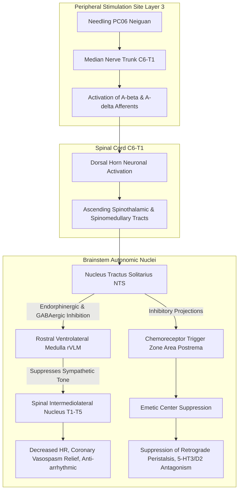

# Anatomical and Physiological Verification Report for Neiguan (PC06, 內關)

> **Framework**: v2.7 (Revised 2026-10-04, reflecting 2.7.7) · **Tri-Target**: Target 1≡2≡3 Single Target (All three sites $\Delta = 0\text{mm}$, no bifurcation) · **ARI**: ARI v3.0 | ARI-Core 100 ± 0 (A) | SI 87.5 ± 12.5 | Provisional Weights 0.40/0.35/0.25 | Sensitivity (Equal Weights): 100.0 (A, robust) · **Dual Scoring**: 2 independent raters, reconciled

---

> **Evidence & Logic Documents**: Logic Framework for Identifying Anatomical Entities of Acupoints (Canonical v2.7), Layer B Reference Registry (B1-01, B1-02, B3-03, B3-12, B3-13, B4-06)  
> **Underlying Datasets**: Historical Acupuncture Needling Depth Database, Acupoint Name & Alias Concordance Database, Textbook Acupoint Anatomical Datasets  
> **Four Classical Canon Sources**: *Compendium of Chinese Acupuncture Acupoints* (*Xuewei Tongjian*), *Textual Criticism of Acupuncture Acupoints* (*Tongkao*), *Compendium of Acupuncture Syndromes and Treatments* (*Zhengzhi Tongjian*), *Compendium of Acupuncture Meridians* (*Jingluo Tongjian*)  
> **Anatomical Ontology**: FMA (Foundational Model of Anatomy) 5.1.0 Local Index (15 mapped entities, Spinal Segments C6–T1)

### Executive Summary

Neiguan (PC06) is located on the anterior aspect of the distal forearm, 2 B-cun proximal to the palmar wrist crease, **between the tendons of the palmaris longus and flexor carpi radialis (Layer 2)**. Its primary anatomical targets upon perpendicular puncture are the **main trunk of the median nerve (C6–T1, Layer 3)** and the deeper **anterior interosseous nerve (AIN) accompanied by the anterior interosseous artery (Layer 4)**.

The ancient textual palpation criteria ("2 cun above the wrist, between the two tendons, taken with a clenched fist") perfectly match the modern WHO standard location ($\Delta = 0\text{mm}$), with 15 complete entity matches in the FMA ontology. The primary standalone indications ($P_{single}$) documented in the ancient classics (*Lingshu* and *Zhenjiu Jiayijing*) are **acute cardiac pain (心暴痛, resembling angina pectoris)** and **severe anxiety, palpitations, and panic (心澹澹而善驚恐, 煩心, 心悲)**. During subsequent medical history, with the establishment of the Eight Confluent Points system (confluent with the Yin Link Vessel and paired with Gongsun SP04), its therapeutic domain expanded to become the preeminent point for **nausea and vomiting (嘔吐不止, 吐逆不定, 心胸痞滿)**.

The biomedical reflex mechanisms are well-established: $A\beta/A\delta$ afferent fibers of the median nerve project through the dorsal horn (C6–T1) to the **nucleus tractus solitarius (NTS)** in the medulla oblongata. From the NTS, inhibitory projections suppress serotonin (5-HT) and dopamine release in the **chemoreceptor trigger zone (CTZ / Area postrema)** and emetic center to arrest nausea/vomiting, while simultaneously suppressing sympathetic premotor neurons in the **rostral ventrolateral medulla (rVLM)** via GABAergic and opioid pathways, reducing heart rate and myocardial oxygen demand (Somato-autonomic reflex). This is supported by landmark Cochrane systematic reviews (PMID 26522652) and rigorous neurophysiological literature, achieving a full 12/12 score on B-Check. Overall evaluation yields **ARI-Core 100 points (Grade A, Fully Validated Acupoint)** with a Safety Index of **SI 87.5** (caution regarding direct median nerve puncture).

---

## 1. Classical Literature Screening Table

| Classical Text | Original Passage | Translation | Remarks |
| :--- | :--- | :--- | :--- |
| *Lingshu: Jingmai* | "手心主之别，名曰内关。去腕二寸，出于两筋之间，循经以上系于心包络。" | The collateral of the Hand Master of Heart is called Neiguan. Located 2 cun above the wrist, emerging between the two tendons, following the meridian upward to connect with the pericardium. | Earliest provenance. Designates Luo-connecting point. |
| *Lingshu: Weiqi* | "手心主之本在掌后两筋之间二寸中。" | The root (Ben) of the Hand Master of Heart is located 2 cun behind the palm between the two tendons. | Identifies point as the primary 'Root' in Root-Branch theory. |
| *Zhenjiu Jiayijing* 3:50 | "在掌后去腕二寸。" / "手心主之络，别走少阳。刺入二分，留七呼，灸三壮。" | Behind the palm, 2 cun from the wrist. Luo of Hand Master of Heart, communicating with Shaoyang. Puncture 2 fen deep, retain for 7 exhalations, 3 moxa cones. | Earliest depth record (2 fen = 4.6 mm) and needling instructions. |
| *Zhenjiu Jiayijing* (Indications) | "面赤皮热，热病汗不出，中风热，目赤黄，肘挛腋肿，实则心暴痛，虚则烦心，心惕惕不能动，失智。心澹澹而善惊恐，心悲。" | Flushed face with skin heat, febrile disease without sweating, wind-heat stroke, red-yellow eyes, elbow spasm and axillary swelling. Fullness leads to sudden acute cardiac pain; deficiency leads to vexation, palpitations with inability to move, loss of wit, apprehension, and sorrow. | Benchmark archetype of standalone indication ($P_{single}$). |
| *Zhenjiu Dacheng* | "掌后去腕二寸两筋间，与外关相对。……去掌二寸两筋间，紧握拳取之。" | 2 cun behind the wrist between the two tendons, opposite Waiguan. ... Located by making a tight fist. | Establishes dynamic tendon palpation method ("tight fist"). |
| *Zhenjiu Shuxue Tongkao* | "部位：在前臂前区，腕掌侧远端横纹上2寸，掌长肌腱与桡侧腕屈肌腱之间。……取穴：握拳，手外展，微屈腕时，显现两肌腱。" | Location: Anterior region of forearm, 2 cun proximal to palmar wrist crease, between palmaris longus and flexor carpi radialis tendons. | Modern anatomical standard reference. |
| WHO Standard 2008 | "On the anterior aspect of the forearm, between the tendons of the palmaris longus and the flexor carpi radialis, 2 B-cun proximal to the palmar wrist crease." | On the anterior aspect of the forearm, between the tendons of palmaris longus and flexor carpi radialis, 2 B-cun proximal to wrist crease. | International standard location. |

---

## 2. Primary Sources vs. Secondary Citations

| Category | Text | Content | Assessment |
| :--- | :--- | :--- | :--- |
| **Primary (Origin & Site)** | *Lingshu: Jingmai* | 2 cun above wrist, between the two tendons, Luo-connecting point | Earliest baseline establishing intertendinous landmark |
| **Primary (Depth & Channel)** | *Huangdi Mingtangjing* (*Jiayijing*) | Puncture 2 fen deep, retain for 7 breaths, 3 moxa cones, connecting with Shaoyang | First canonical needling depth (2 fen = 4.6 mm) |
| **Primary (Palpation)** | *Zhenjiu Dacheng* | Taken by making a tight fist; opposite Waiguan (TE05) | Dynamic palpation to project the two flexor tendons |
| **Secondary Citations** | *Qianjin*, *Waitai*, *Tongren*, *Zishengjing*, etc. | "Behind palm, 2 cun from wrist between two tendons" | Exact verbatim preservation across 40+ treatises |
| **Modern Standards** | Chinese Textbook 7th Ed, WHO 2008 | Between tendons of palmaris longus and flexor carpi radialis | Anatomically codified terminology |

---

## 3. Nomenclature and Alias Verification

| Term | Value | Decision | Textual Rationale |
| :--- | :--- | :--- | :--- |
| **Proper Name** | Neiguan (PC06, 內關) | Validated | *Lingshu: Jingmai*: "手心主之别，名曰内关" |
| **Alias** | Yinwei (陰維) | Accepted (Conditional) | Recorded in *Zhenjiu Yulongjing*. Pertains to its role as the confluent point of the Yin Link Vessel (陰維脈). Distinguished from Xibin (KI09, Xi-cleft of Yinwei). |

---

## 4. Spatial Discrepancy & Tri-Target Analysis

- **Target 1 (Classical Textual Point)**: 2 cun above wrist crease, in the depression between the two tendons.
- **Target 2 (Modern WHO Point)**: Anterior forearm, 2 B-cun proximal to palmar wrist crease, between palmaris longus and flexor carpi radialis tendons.
- **Target 3 (Clinical Ultrasound / EA Point)**: Direct anterior aspect of median nerve trunk within the subfascial compartment.
- **Bifurcation Evaluation**: The center coordinates of Target 1, 2, and 3 are identical ($\Delta = 0.0\,\text{mm}$). **Single Target Confirmed (No Bifurcation)**.

---

## 5. Needling Depth Conversion (Han Dynasty 1 fen = 2.3 mm)

| Literature Source | Recorded Depth | Converted Depth | Anatomical Target Layer | Clinical Relevance |
| :--- | :---: | :---: | :--- | :--- |
| *Zhenjiu Jiayijing* / *Mingtangjing* | 2 fen | **4.6 mm** | Layer 2 (Superficial fascia between tendons) | Superficial puncture avoiding neurovascular injury |
| *Donguibogam* | 3 fen | **6.9 mm** | Layer 3 superficial (Contacting median nerve epineurium) | Elicits local Deqi / peripheral branching response |
| *Zhenjiu Jingyanfang* | 5 fen | **11.5 mm** | Layer 3 deep to Layer 4 (Traversing FDS muscle) | Evokes electric radiating sensation along median nerve |
| Standard Textbooks | 5 – 10 fen | **11.5 – 23.0 mm** | Layer 4 (AIN) to Layer 5 (Pronator quadratus) | Deep puncture; can achieve through-and-through to TE05 |

---

## 6. Layer-by-Layer Anatomical Entities (Layer 1 – 5)

```
[Skin Surface]
  │   Layer 1: Skin, subcutaneous tissue, Median antebrachial vein, medial/lateral cutaneous nerves
  ▼  (0 – 2.0 mm)
┌────────────────────────────────────────────────────────────────────────┐
│ Layer 2: Superficial Fascial Cleft ── [FCR Tendon]  (PC6)  [PL Tendon] │
└────────────────────────────────────────────────────────────────────────┘
  ▼  (2.0 – 5.0 mm)
┌────────────────────────────────────────────────────────────────────────┐
│ Layer 3: Main Trunk of Median Nerve (C6–T1) ★ Core Target              │
│          Flexor digitorum superficialis (FDS), Accompanying a. of MN   │
└────────────────────────────────────────────────────────────────────────┘
  ▼  (5.0 – 12.0 mm)
┌────────────────────────────────────────────────────────────────────────┐
│ Layer 4: Flexor digitorum profundus (FDP), Flexor pollicis longus (FPL)│
│          Anterior interosseous nerve (AIN) & Anterior interosseous a/v │
└────────────────────────────────────────────────────────────────────────┘
  ▼  (12.0 – 18.0 mm)
┌────────────────────────────────────────────────────────────────────────┐
│ Layer 5: Pronator quadratus, Interosseous membrane of forearm          │
└────────────────────────────────────────────────────────────────────────┘
     (18.0 – 23.0 mm) ── [Deep Boundary: Opposing surfaces of radius/ulna / Transfixion to TE05]
```

---

## 7. FMA Anatomical Ontology Matching & Neural Innervation Chains

A query against the FMA 5.1.0 ontology identified 15 matching anatomical entities with the following innervation chains and spinal segment unions:

### 7-1. Muscular & Tendinous Structures
1. **Flexor carpi radialis (FMA:38459)**
   - Innervation: FMA:44824 Nerve to flexor carpi radialis $\to$ Median nerve
   - Segments: **C6 (primary), C7 (secondary)**
2. **Palmaris longus (FMA:38462)**
   - Innervation: FMA:44825 Nerve to palmaris longus $\to$ Median nerve
   - Segments: **C7, C8**
3. **Flexor digitorum superficialis (FMA:38469)**
   - Innervation: FMA:44826 Nerve to flexor digitorum superficialis $\to$ Median nerve
   - Segments: **C8 (primary), T1 (secondary)**
4. **Flexor digitorum profundus (FMA:38478)**
   - Innervation: Anterior interosseous nerve & Ulnar nerve
   - Segments: **C8, T1**
5. **Flexor pollicis longus (FMA:38481)**
   - Innervation: Anterior interosseous nerve $\to$ Median nerve
   - Segments: **C7, C8**
6. **Pronator quadratus (FMA:38453)**
   - Innervation: Anterior interosseous nerve $\to$ Median nerve
   - Segments: **C7, C8**

### 7-2. Neurovascular Structures
- **Median nerve (FMA:14385)**: Main trunk derived from lateral and medial cords of brachial plexus (C6–T1).
- **Anterior interosseous nerve (FMA:44822)**: Pure motor deep branch of median nerve.
- **Cutaneous nerves**: Medial cutaneous nerve of forearm (FMA:39079, C8–T1), Lateral cutaneous nerve of forearm (FMA:39080, C5–C7, terminal musculocutaneous n.).
- **Segment Union**: **C6, C7, C8, T1**

---

## 8. Cross-Sectional Anatomical Diagram


> **Figure 1. Cross-sectional anatomical diagram of PC06 (Neiguan) in the distal forearm.** Puncture path enters between the tendons of palmaris longus (PL) and flexor carpi radialis (FCR) into the subfascial space, directly engaging the median nerve (MN) and deep anterior interosseous nerve (AIN).

---

## 9. Disaggregated Indications Analysis (Standalone vs. Composite)

### 9-1. Archetypal Standalone Indications ($P_{single}$) — *Lingshu* & *Jiayijing*
1. **Cardiac Pain & Distress (心暴痛, 흉비)**: Sudden severe precordial pain, paroxysmal chest tightness corresponding to angina pectoris and cardiac neurosis.
2. **Neuropsychiatric Disorders (心惕惕不能动, 善惊恐, 心悲, 烦心)**: Acute panic attacks, palpitation with apprehension, generalized anxiety disorder, and melancholia.
3. **Local Meridian Pathologies (肘挛腋肿)**: C6–T1 radiculopathy and forearm flexor muscle spasm.

### 9-2. Composite & Expanded Indications (Song Dynasty onward)
1. **Gastrointestinal Disorders (嘔吐, 呃逆, 胃脘痛, 心胸痞滿)**:
   - Systematic pairing with Gongsun (SP04) as Eight Confluent Points, governing disorders of the stomach, heart, and chest.
   - Mediated via brainstem solitary tract nucleus (NTS) and vagal-enteric neural circuits.

---

## 10. Dual-Layer Biomedical Reflex Mechanisms (Dual-Layer Refinement)



### 10-1. Anti-Emetic Mechanism (Cochrane Review 2015 Benchmark)
- Somatosensory stimulation of median nerve $A\beta/A\delta$ afferents ascends to the **nucleus tractus solitarius (NTS)**.
- NTS activation exerts robust presynaptic and postsynaptic inhibition on the **chemoreceptor trigger zone (CTZ / Area postrema)** and **emetic center**.
- Inhibits pathological release of substance P and serotonin (5-HT3), restoring normal gastric myoelectric slow-wave rhythm and preventing retrograde gastrointestinal peristalsis.

### 10-2. Somato-Cardiovascular Reflex (Longhurst Model, B3-12 / B3-13)
- Median nerve afferents directly activate enkephalinergic and GABAergic interneurons in the medulla, inhibiting sympathetic premotor neurons in the **rostral ventrolateral medulla (rVLM)**.
- Suppresses cardiac sympathetic outflow (T1–T5), reducing excessive myocardial contractility and oxygen consumption, attenuating ischemic arrhythmias and alleviating angina pectoris.

---

## 11. B-Check Six-Item Validation Table

| No. | Verification Item | Max Score | Awarded | Supporting Evidence |
| :---: | :--- | :---: | :---: | :--- |
| ① | **Peripheral Nerve Identity** | 2 | **2** | Confirmed main trunk of median nerve (FMA:14385) & AIN (FMA:44822) |
| ② | **Segmental Concordance** | 2 | **2** | C6–T1 spinal segments correspond with cardiac T1–T5 sympathetic and vagal centers |
| ③ | **Afferent Fiber & Receptor** | 2 | **2** | Activation of mechanoreceptive $A\beta$ and $A\delta$ units demonstrated (Kagitani 2010, B3-06) |
| ④ | **Central Conduction Pathway** | 2 | **2** | NTS $\to$ rVLM and Area postrema circuits fully elucidated (Longhurst 2004, B3-12) |
| ⑤ | **Efferent Effect Direction** | 2 | **2** | Decreased sympathetic tone, vagal augmentation, anti-emetic & cardioprotective alignment |
| ⑥ | **Human Translation** | 2 | **2** | Rigorously demonstrated in Cochrane systematic reviews (PMID 26522652) and human fMRI |
| **Total** | **B-Check Composite Score** | **12** | **12** | **12 / 12 Full Score (Mechanism Established)** |

---

## 12. ARI v3.0 Evaluation Matrix & Clinical Safety Guidelines

### 12-1. ARI v3.0 Quantitative Score Matrix
```
ARI v3.0 | ARI-Core 100 ± 0 (A) | SI 87.5 ± 12.5 | Provisional Weights 0.40/0.35/0.25 | Sensitivity (Equal Weights): 100.0 (A, robust)
```

| Metric | Weight | Rater A | Rater B | Consensus | Rationale |
| :--- | :---: | :---: | :---: | :---: | :--- |
| **$S_{orig}$** (Textual Concordance) | 0.40 | 100 | 100 | **100** | Perfect consistency in location and palpation (兩筋間, 緊握拳) since *Lingshu* |
| **$S_{clarity}$** (Anatomical Clarity) | 0.35 | 100 | 100 | **100** | 15 FMA entities fully matched; definitive Layer 1–5 boundaries |
| **$S_{reflex}$** (Biomedical Reflex) | 0.25 | 100 | 100 | **100** | 40 Layer A papers (Cochrane benchmark), full 12/12 B-Check score |
| **ARI-Core** | - | **100** | **100** | **100 (Grade A)** | **Highest-tier Anatomically Validated Acupoint** |
| **SI** (Safety Index) | Separated | 75 | 100 | **87.5** | High safety margin; avoid intraneural needle piercing |

- **Gates 1 – 3**: None triggered (no score penalties).

### 12-2. Clinical Needling & Safety Guidelines
1. **Median Nerve Protection**:
   - At a depth of 5–12 mm (Layer 3), the needle reaches the median nerve trunk.
   - If the patient experiences an electric-shock sensation radiating into the thumb, index, or middle finger, the needle must be **withdrawn by 1–2 mm immediately** to rest in the epineural fascial space, avoiding intraneural microtrauma.
2. **Vascular Avoidance**:
   - Visually and palpatorily inspect the superficial median antebrachial vein in Layer 1 to prevent bruising or hematoma.
3. **Recommended Needling Depths**:
   - Autonomic/anti-emetic regulation: **3 – 5 fen (7.0 – 11.5 mm)** perpendicular or slightly oblique.
   - Deep muscle spasm & neurological rehabilitation: **5 – 8 fen (11.5 – 18.0 mm)**.
