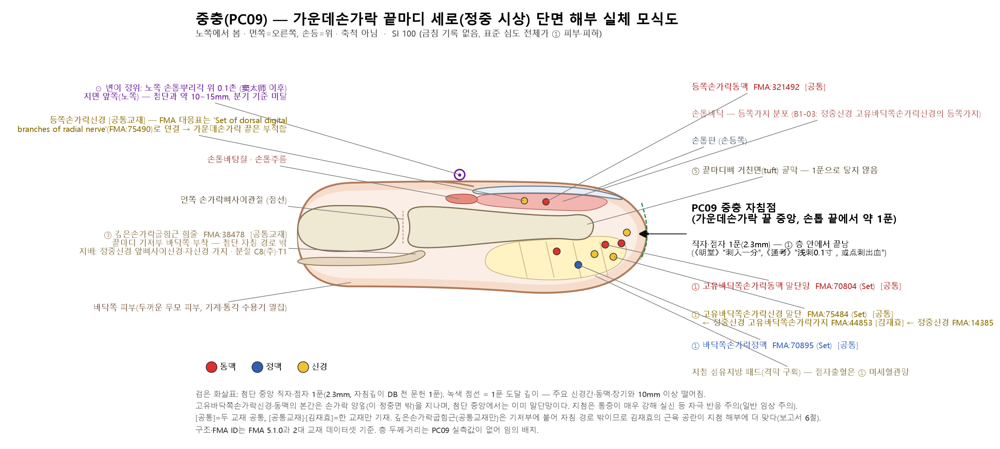
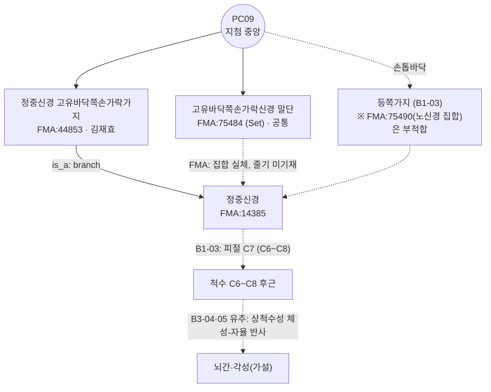

# 중충(中衝, PC9) 해부생리학적 실체 판명 보고서

> **프레임워크**: v2.7 (2026-10-04 개정, 2.7.7 반영) · **Tri-Target**: Target 1≡2≡3 단일 Target(세 위치 모두 Δ ≤ 10mm, 분기 없음) · **ARI**: ARI v3.0 | ARI-Core 70.0 ± 1.2 (B) | SI 100 | 잠정 가중치 0.40/0.35/0.25 | 민감도(등가중치): 67.7 (C, 가중치 민감) · **이중 채점**: 독립 채점자 2인, 조정 완료 (2026-10-25 《经络通鉴》 교감 반영으로 $S_{orig}$ ④ 50 → 75 재채점)

---

> **근거 원칙 문서**: 경혈 해부학적 실체 판명 로직 체계(정본)(v2.7), Layer B 참조 등록부
> **근거 데이터셋**: 역대 침구문헌 자침심도 데이터베이스(시트1 282행), 경혈명·이명 대조 표준 데이터베이스(경혈 종합 목록 283행), 경혈학 공통교재 해부구조 데이터셋(경혈별_해부구조_통합 281행), 김재효 교수 경혈 해부구조 데이터셋(경혈별_해부구조_종합 281행)
> **4대 원전**: 《中国针灸穴位通鉴》(上卷) PDF 401–480쪽 L2922~3175 · 《针灸腧穴通考》(下) PDF 81–160쪽 L1628~1745 · 《中国针灸证治通鉴》 PDF 81–160쪽 L178~,  PDF 161–240쪽 외(한국어 기술은 같은 편 한글번역) · 《中国针灸经络通鉴》 第叁编 第九篇 手厥阴 L84~278·691~699, 第叁编 第五篇 手少阴 L236~295·604~621, 第壹编 第五篇 L300~306, 第叁编 第十篇 手少阳 L635~641, 第叁编 第二篇 手阳明 L792~808
> **해부 온톨로지**: FMA(Foundational Model of Anatomy) 5.1.0 로컬 색인 — 교재 구조를 `FMA:ID`로 고정하고 신경 줄기·척수 분절을 대조(B1 보조, 등록부 미등재). 대응표 FMA 경혈 해부 온톨로지 매핑 레지스트리, 상세는 부록 A

### 결론 요약

중충은 **중지 말절 첨단 중앙의 지문 피부·피하(Layer 1)** 에 위치한다. 해부 실체로는 **정중신경에서 나온 고유바닥쪽손가락신경(감각신경)의 말단 분지와 고유바닥쪽손가락동맥의 말단 동맥망**이 가장 개연성이 높다. 다만 이 판단은 두 교재와 표준 해부학서(B1-01·B1-03)가 서로 일치한다는 수준의 근거이며, PC9 자체를 사체나 초음파로 실측한 연구는 없다. 정혈 사혈의 각성·구급 효과를 설명하는 반사 기전은 B-Check 6/12(미부합)이므로 **가설**로만 기술한다. 종합 판정은 **ARI-Core 70.0 ± 1.2, 등급 B(개연)** 이다. 다만 B 하한 경계(70)에 걸쳐 있고(채점자 A 68.75는 C) 등가중치 민감도는 67.7(C)이므로 **가중치 민감** 표지를 단다. 등급 상승은 《中国针灸经络通鉴》의 전사 오류 교감을 $S_{orig}$ ④에 반영한 결과다(10.2절). 자침 안전지수는 **SI 100**이다(모든 문헌이 1푼=2.3mm이고 금침 문헌 없음).

---

## 1. 문헌 스크리닝 표 (4대 원전 원문 발췌 및 한중 대조)

| 문헌 | 원문 (출처 파일·행) | 국역 | 비고 |
| :--- | :--- | :--- | :--- |
| 《灵枢·本输》 | "心出于中冲，中冲，手中指之端也，为井木……手少阴也。" (通考(下)_81-160 L1642; 通鉴(上卷)_401-480 L2924·L2946) | 심의 맥기는 중충에서 나온다. 중충은 가운뎃손가락 끝이며 정목혈이다 …… 수소음이다. | 위치만 있고 심도 없음. 귀속이 '心/手少阴'임(3절 참조) |
| 《黄帝明堂经》(《甲乙经》 3:50) | "心主出中冲，中冲者，木也。在手中指之端，去爪甲如韭叶陷者中，手心主脉之所出也，为井。" (通考 L1643) / "刺入一分，留三呼，灸一壮。" (通考 L1727; 通鉴 L3084) | 가운뎃손가락 끝, 손톱에서 부추잎 너비만큼 떨어진 오목한 곳이다. 1푼 찌르고 세 번 숨쉴 동안 머문다. 뜸 1장. | 심도의 최초 기술. 귀속을 '心主(심포)'로 바꿈 |
| 《黄帝明堂经》 주치 | "主热病烦心，心闷而汗不出，掌中热，心痛，身热如火，浸淫烦满，舌本痛。" (通考 L1683; 通鉴 L3028) | 열병으로 가슴이 답답하고 땀이 나지 않음, 손바닥 열감, 심통, 몸이 불같이 뜨거움, 혀뿌리 통증 | 단독 조문 |
| 《针灸腧穴通考》 【提要索隐】 | "部位：在手指，中指末端最高点。……针刺操作：浅刺 0.1 寸，或点刺出血。" (通考 L1632~1634) | 중지 끝의 가장 높은 점. 0.1촌 얕게 찌르거나 점자출혈 | 현대 표준 |
| 《针灸腧穴通考》 【名实考】 | "本穴最后定于中指尖桡侧，一方面受劳宫穴定位的影响（劳宫，掌中中指本节之内间也。劳宫在内间，则中冲亦当在中指内侧也)，另一方面经脉循行的影响也是一个重要因素。《灵枢·邪客》曰：'心主之脉，出于中指之端，内屈循中指内廉，以上留于掌中'，既曰'中指内廉'，则知是中指内侧爪甲角。" (通考 L1638) | 이 혈이 결국 중지 끝 요측으로 정해진 데에는 노궁 정위('내간')의 영향과 경맥 순행(《영추·사객》 '中指内廉')의 영향이 있었다. '중지 내렴'이라 했으니 중지 안쪽 손톱각임을 알 수 있다. | 요측 손톱각 변이가 생긴 경위. **《通考》에는 신경·혈관 실체에 관한 기술이 없다** |
| 《中国针灸穴位通鉴》 부위 | 2. "在手中指之端，去爪甲如韭叶陷者中。"(《甲乙经》 외 약 30종) / 4. "中指内端是中冲。"(《徐氏针灸大全》) / 5. "在手中指内廉之端，去爪甲如韭叶。"(《徐氏针灸大全》·杨敬斋) (通鉴 L2948~2956) | 2. 중지 끝, 손톱에서 부추잎만큼 떨어진 오목한 곳 / 4·5. 중지 안쪽 끝 | 간요결어: "历代文献记载位置有二说 …… 近世多依据《灵枢经》《针灸甲乙经》定位" (通鉴 L3124) |
| 《中国针灸穴位通鉴》 局部解剖 | "在中指末节之尖端，有指掌侧固有动脉形成的动脉网，分布着来自正中神经的指掌侧总神经。"(《新针灸学》) / "针刺通过之组织层：皮肤，皮下组织。神经、血管：指掌侧固有神经、指掌侧固有动脉。"(《针灸学简编》) (通鉴 L3108~3114) | 말절 첨단에 고유바닥쪽손가락동맥이 이룬 동맥망이 있고 정중신경 가지가 분포한다. 자침 통과 조직: 피부·피하조직 | 근대 해부 기술. 실측 아님 |
| 《中国针灸证治通鉴》 | 腧穴主治: "《明堂经》主热病烦心……舌本痛。《素问》主耳聋。《圣惠方》小儿夜啼。《素问保命集》哕呕无度。" (证治通鉴_81-160 L178~197) | (한글번역) 명당경 주치 외에 《소문》 '이롱(耳聾)을 주치한다', 《성혜방》 '소아 야제(夜啼)', 《소문보명집》 '딸꾹질과 구토가 끝없는 것(哕呕无度)' — [证治通鉴 08편 한글번역] L664~684 | 처방 발췌는 9절. 구판 요지 '구토'는 '哕'(딸꾹질)를 빠뜨렸으므로 한글번역에 맞춰 고침 |
| WHO 2008 | "On the middle finger, at the centre of the tip of the middle finger." | 중지 끝 중앙 | 구판 보고서 인용. 4대 원전 밖 자료 |
| 《中国针灸经络通鉴》 경맥 | 《灵枢·经脉》 "心主手厥阴心包络之脉……入掌中，循中指出其端" / 注 "［循中指出其端。］中冲穴也" · "中指端，中冲也，手厥阴经止于此" ([经络通鉴 26편] L84·129·154·180) | 심포경은 손바닥 가운데로 들어가 가운뎃손가락 끝으로 나온다. 주가들은 그 끝을 중충으로 풀었다 | 경맥 순행 기술. '中指之端' 정위와 일치. 새 위치 정보 없음 |
| 《中国针灸经络通鉴》 邪客 | 《灵枢·邪客》 "心主之脉，出于中指之端，内屈循中指内廉，以上留于掌中" / 马莳注 "其脉行于中指之端中冲穴，从内少曲，循中指之内廉以上" / 张介宾注 "中指之端，中冲井也" ([经络通鉴 26편] L204·208·219) | 중충은 '중지 끝'이고, '内廉'은 그 뒤 경맥이 꺾여 올라가는 길이다 | 《通考》 名实考가 요측 손톱각 변이의 원인으로 든 '中指内廉'의 원문 맥락: 혈 위치가 아니라 순행로(Rank 4 경락론적 확장) |
| 《中国针灸经络通鉴》 本输 | "心出于中冲，中冲，手中指之端也，为井木" / 张介宾注 "此下五腧，皆属手厥阴之穴，而本经直指为心腧者，正以心与心胞，本同一藏" / 张志聪注 "手少阴，心脉也；中冲，包络之经也" / 马莳注 "前《本输》篇止言心出于中冲云云而不言心经者，岂心经独无治病之输乎" ([经络通鉴 26편] L235·262·266, [经络通鉴 22편] L295) | 《灵枢·本输》이 심포경 혈을 '心'의 이름으로 적은 이유를 주가들이 '심과 심포는 한 장'이라는 논리로 설명 | 3절 심/심포 귀속 혼용의 주석사 — 연대순 정렬 판정 보강 |
| 《中国针灸经络通鉴》 缪刺 | 《甲乙》 尸厥 방 "（《素问》又云后刺手心主者，非也。）" / 新校正 "按《甲乙》不刺手心主" / 【按】 "此方中'手心主'，《太素》与《甲乙经》并无，当删" ([经络通鉴 22편] L604·621, [经络通鉴 07편] L300) | 《素问·缪刺论》 시궐 방의 '후자수심주'(王冰이 중충으로 주석)는 《太素》·《甲乙》에 없으므로 연문(衍文)이다 | Rank 4 필사 오류 감별: 중충의 시궐 주치 중 《素问》 출처는 연문에 기댄 것. 본 보고서 9절 시궐 행은 이 조문을 쓰지 않음 |
| 《中国针灸经络通鉴》 缪刺 | 张志聪注 "当刺中指心包络之中冲，次指手少阳之关冲" / 【按】 "'中指次指'，意即中指之次指，张氏误解为中指及次指，而分别注作'中冲'、'关冲'，欠妥" ([经络通鉴 27편] L639·641) | 수소양 락맥 무자의 '中指次指'(= 넷째손가락)를 张志聪이 중충·관충 두 혈로 잘못 풀었다 | Rank 4: 주석 오독으로 생긴 중충 주치(후비·설권 등)는 배제 |
| 《中国针灸经络通鉴》 缪刺 | 马莳注 "如不已，刺中指爪甲上与肉交者，即中冲穴也，当立闻" ([经络通鉴 18편] L800) | 이롱에 상양 다음 중지 손톱 위를 찌른다는 《素问·缪刺论》 조문을 马莳가 중충으로 특정 | 9절 이롱 행의 주석 근거(혈명은 주석에서 나옴) |
| 《中国针灸经络通鉴》 脉名索引 | ◇手心主·◇手厥阴·◇手心主之筋 등 (쪽 번호 색인) | 색인만 있음 — 혈위 직접 정보 없음 | 검색 범위 기록 |

> v2.6 구판의 《通考》 인용문 "在中指尖端... 實爲固有指神經與固有指動靜脈, 點刺出血"은 《通考》 PC9 조문(L1628~1745)에 **없는 가공 인용**이어서 삭제했다. 《동의보감》 인용문도 원문 쪽수가 없어 확인할 수 없으므로 삭제했다. 《동의보감》은 자침깊이 DB 값(1푼, 인용 문헌 표기 '영추')만 5절에 남겼다.

---

## 2. 원천/재인용 구분 표

| 구분 | 문헌 | 내용 | 판정 |
| :--- | :--- | :--- | :--- |
| 원천(위치) | 《灵枢·本输》 | 手中指之端, 井木, 心(手少阴) 귀속 | 최초 기술. 심도 없음 |
| 원천(위치 세부·심도·주치) | 《黄帝明堂经》 | 去爪甲如韭叶陷者中, 刺入一分 留三呼, 灸一壮, 心主 귀속 | 심도·주치의 최초 기술 |
| 재인용(동일 문구) | 《千金》《外台》《铜人》《圣济总录》《资生经》《十四经发挥》《针灸大成》《类经图翼》《医宗金鉴》 등 약 30종 (通鉴 L2948) | 《明堂经》 위치 문구를 그대로 옮김 | 후대 일치. 독립 근거는 아님 |
| 이문(異文) | 《太平圣惠方·明堂》 "中指甲后一分中" (通考 L1658) | 손톱 뒤 1푼 | 손톱 쪽으로 해석 |
| 이문 | 《铜人》 穴腧都数 "去爪甲角如韭叶" (通考 L1659) | '角' 추가 | 손톱각 쪽으로 기우는 첫 단서 |
| 이문(변이 정위) | 《窦太师针经》 "在手中指端内侧" (通考 L1660), 《徐氏针灸大全》 "中指内廉之端" (通鉴 L2956), 《高等针灸学讲义》 "中指之内侧" | 요측(내렴) 손톱각 | 《通考》 名实考가 노궁 정위와 《灵枢·邪客》의 영향으로 설명 |
| 현대 | 2판 《针灸学讲义》 "在手中指尖端之中央取穴", 4·5·7판 《针灸学》 "中指尖端的中央" (通考 L1664~1666), WHO 2008 | 첨단 중앙 | 원천(《灵枢》·《明堂经》)으로 돌아감 |

---

## 3. 이명·별칭 검증 표

| 자료 | 값 | 판정 |
| :--- | :--- | :--- |
| 경혈명·이명 대조 표준 데이터베이스 경혈 종합 목록 283행 | PC09 중충 中衝, 이명 **'-'** | 이명 없음 |
| 《中国针灸穴位通鉴》 (上卷) L2926·L3122 | "二.别名无。" / "[别名]无。" | 이명 없음 |
| 김재효 데이터셋 경혈_기본정보_마스터 281행 | 이명 칸 공란 | 이명 없음 |
| 구판 보고서 1절 | '手中指端'을 KJH 교차 검증 이명이라고 기재 | **오류**. '手中指之端'은 《灵枢》의 위치 서술이지 이명이 아니고 KJH DB에도 없음 → 삭제 |

**귀속 혼용(심/심포)**: (《经络通鉴》 주석사 보강: 张介宾 '心与心胞，本同一藏', 张志聪 '中冲，包络之经也', 马莳 '不言心经者' — [经络通鉴 26편] L262·266, [经络通鉴 22편] L295) 《灵枢·本输》은 중충을 '心出于中冲 …… 手少阴也'로 적어 심(수소음)의 정혈로 둔다(通考 L1642). 심포(수궐음) 귀속은 《黄帝明堂经》의 '心主出中冲 …… 手心主脉之所出也'부터 나타난다(通考 L1643). 《灵枢·本输》 단계에서는 심포경이 독립된 오수혈 계열을 갖지 않아, 오늘날 심포경 혈들이 심경 이름 아래 배열되었다. 연대순으로 정렬하면 이 혼용은 해소된다. 소충(HT9)·관충(TE1) 등 다른 손가락 정혈과 이름이 섞인 사례는 원전에서 확인되지 않았다.

---

## 4. 3D 공간 좌표 및 Layer 1~5 층차 구조도

**좌표계**: X = 중지 장축 중심선 기준 내외측(요측 −, 척측 +), Y = 지첨 최고점 기준 근위 방향(+), Z = 체표 기준 깊이(mm). 아래 좌표는 일반 말절 크기에서 추정한 값이며 실측이 아니다.

| 위치 | X | Y | Z | 근거 |
| :--- | :--- | :--- | :--- | :--- |
| **Target 1** 고전 문헌 위치: 《灵枢·本输》 "手中指之端" | 0 | 0 (지첨) | 0~2.3 mm | 《灵枢》(通考 L1642); [经络通鉴 26편] L235 |
| **Target 2** 촉진 실체화 위치: 《明堂经》 "去爪甲如韭叶陷者中" | 0 | 약 0~+3 mm (손톱 유리연에서 부추잎 너비 ≈ 1푼 떨어진 지첨, 추정) | 0~2.3 mm | 《明堂经》(通考 L1643); 《针灸学简编》 "去指甲游离缘约一分处" |
| **Target 3** 현대 WHO 위치: 첨단 중앙 | 0 | 0 | 0~2.3 mm | WHO 2008; 4~7판 교재 |
| (Target 아님) 변이 정위(窦太师 이후): 요측 손톱뿌리각 상방 0.1촌 | 약 −5~−7 mm | 약 +10~+13 mm | 0~2.3 mm | 通考 【定位】 "另一种取穴：中指末节桡侧指甲根角侧上方 0.1 寸" (L1654) |

**자입 기준점**: Target 2의 촉진 표현은 '陷者中'(오목)이지만 지첨에는 근육·힘줄이 없어 分肉·兩筋間·緣형 간극이 없다 → **간극 불명확, 자입 기준점 표시 안 함**. 기준 구조는 손톱 유리연(손톱 FMA:54335)이다.

**변이 정위 주석**: 첨단 중앙과 요측 손톱뿌리각 변이 사이 거리를 일반적인 말절 크기로 추정하면 약 10~15 mm이다(경혈 특이 실측 아님). 이 거리는 새 분기 기준(Δ > 10 mm)을 넘을 수 있다. 그러나 변이는 《窦太师针经》(원대) 이후 《灵枢·邪客》 '中指内廉'과 노궁 정위의 영향으로 생긴 후대 이설(《通考》 名实考)이어서 Tri-Target 정의(Target 1 최초 문헌, Target 2 촉진 표현, Target 3 WHO) 어디에도 해당하지 않는다 → 정본 Rank 5 **Target 제외 규칙**에 따라 **Target으로 설정하지 않고 분기·채점하지 않는다**. 중충은 단일 Target으로 채점한다(7절). 두 위치 모두 같은 고유바닥쪽손가락신경·동맥의 말단 분포역 안에 있다.

**층차 구조 (Target 1≡2≡3, 지첨 중앙 직자)**

```
 Z (mm)  층차 (정본 Layer 1~5)        구조물                                        1푼(2.3mm) 도달
 0 ─────┬──────────────────────────────────────────────────────────────────────────────────────
        │ Layer 1 피부·피하            지문 피부(두꺼운 무모 피부), 기계·통각 수용기,          ● 도달
        │                              고유바닥쪽손가락신경(정중신경, 감각) 말단 분지,
        │                              고유바닥쪽손가락동맥 말단 동맥망·바닥쪽손가락정맥
 2.3 ...│............................  (점자출혈은 이 층의 미세혈관망에 국한)
        │                              지첨 섬유지방 패드(격막으로 구획)
        │ Layer 2 표층근육·근막        해당 없음(지첨에는 근육 없음)
        │ Layer 3 심층근육·건막        해당 없음. 깊은손가락굽힘근 힘줄은 말절골 기저부
        │                              바닥쪽에 부착하여 첨단에서 근위로 떨어져 있음
        │ Layer 4 신경혈관속           고유바닥쪽손가락신경·동맥 본간은 손가락 양 측면을
        │                              주행. 첨단 중앙에서는 이미 말단 분지망
        ▼ Layer 5 골막                 말절골 조면(tuft) 골막 — 1푼 심도로는 닿지 않음
```

- 구판의 층 두께 수치(0.8/1.8/2.3 mm, μ 1.8, σ 0.4)는 측정 근거가 없어 삭제했다. 지첨 연부조직 두께를 PC9에서 실측한 연구는 Layer A에 없다(papers.id 1944는 오수혈 초음파 심도 연구이지만 PC9 포함 여부는 확인하지 못함).
- 신경 분절: 중지 피부는 주로 C7 피절에 속한다(B1-03).



*그림 4-1. 중충 높이 가운데손가락 끝마디 정중 시상(세로) 단면 모식도(노쪽에서 봄, 먼쪽=오른쪽, 축척 아님). 첨단 중앙 1푼(2.3mm) 직자·점자는 Layer 1 안에서 끝나고 끝마디뼈 거친면 골막에 닿지 않는다. 고유바닥쪽손가락신경·동맥의 본간은 이 정중면 밖(손가락 양옆)을 지나며 첨단에서는 말단망이다. 층 두께·거리는 PC09 실측값이 없어 임의 배치.*

**FMA 실체 대조 (Layer별)** — 구조명은 2대 교재, ID·관계는 FMA 5.1.0(FMA 프로파일 조회)

| Layer | 구조 | FMA | FMA 관계 | 신경 줄기 / 혈관 사슬 (FMA) | 척수 분절 (FMA) |
| :--- | :--- | :--- | :--- | :--- | :--- |
| 1 피부·피하 | 고유바닥쪽손가락신경 *[공통]* | FMA:75484 | is_a Set of nerves | (집합 실체 — 개별 줄기 미기재) | FMA 미기재 |
| 1 피부·피하 | 정중신경의 고유바닥쪽손가락가지 *(김재효)* | FMA:44853 | is_a Branch of median nerve | 정중신경(FMA:14385) | FMA 미기재 |
| 1 피부·피하 | 등쪽손가락신경 *(공통교재)* | FMA:75490 | Set of dorsal digital branches of **radial** nerve | 노신경 계통 — **가운데손가락 끝마디에는 부적합**(아래 주석 1) | FMA 미기재 |
| 1 피부·피하 | 고유바닥쪽손가락동맥 *[공통]* · 바닥쪽손가락정맥 *[공통]* | FMA:70804 · 70895 | Set of arteries / Set of systemic veins | — | — |
| 1 손톱바닥 | 등쪽손가락동맥 *[공통]* · 등쪽손가락정맥 *(김재효)* | FMA:321492 · 70917 | 동맥 is_a Branch of radial artery | 노동맥(FMA:22730) → 빗장밑동맥 | — |
| 3 (경로 밖) | 깊은손가락굽힘근 힘줄 *(공통교재)* | FMA:38478 | has_insertion 끝마디뼈 기저부(검지~새끼) | 앞뼈사이신경 근육가지(FMA:44831) · 자신경 가지(FMA:65351) | **C8(주)·T1** |
| 5 골막 | 가운데손가락 끝마디뼈 · 손톱 | FMA:23947 · 54335 | — | — | — |

- **FMA 주석 1 — 등쪽손가락신경 대응 오류 가능성**: 대응표는 공통교재의 "dorsal digital nerve"를 FMA 동의어 "Dorsal digital nerves"가 붙은 **노신경의 등쪽손가락가지 집합**(FMA:75490)에 정확 대응시켰다. 그러나 6절에서 정리했듯 가운데손가락 끝마디 등쪽(손톱바닥)은 정중신경 고유바닥쪽손가락신경의 등쪽가지가 지배한다(B1-03). 따라서 FMA:75490은 **용어 일치이지 위치 일치가 아니며** 이 보고서는 이 대응을 근거로 쓰지 않는다.
- **FMA 주석 2 — 깊은손가락굽힘근 구획**: FMA는 깊은손가락굽힘근을 `contained_in Space of anterior compartment of arm`(위팔 앞칸)으로 기록한다. 이 근육은 아래팔 앞칸에 있으므로 FMA 모델링 오류로 보고 인용하지 않는다. 분절 C8·T1은 근육 전체 값이며 가운데손가락 힘살(정중신경 앞뼈사이신경 지배)에 한정한 값이 아니다.
- **FMA 주석 3 — 집합 실체**: 손가락 신경·혈관 다수가 "Set of …"(손 전체 집합) 실체로만 대응된다. 가운데손가락 개별 실체(예: 가운데손가락 노쪽 고유바닥쪽손가락신경)로 좁히지 못하므로, FMA는 구조의 종류만 고정하고 손가락 위치는 교재·B1로 기술한다.

---

## 5. 자침 깊이 계산표

출처: 역대 침구문헌 자침심도 데이터베이스 시트1 282행(PC09). 1푼 = 2.3 mm.

| 문헌 | DB 값(푼) | 환산 깊이 | 도달 층 | 비고 |
| :--- | :---: | :---: | :--- | :--- |
| 황제명당경(황룡상 감수편찬) | 1 | 2.3 mm | Layer 1 | 원문 "刺入一分，留三呼" |
| 침구갑을경 | 1 | 2.3 mm | Layer 1 | 갑을경 배열순서 25 |
| 침구경험방 | 1 | 2.3 mm | Layer 1 | |
| 동의보감 | 1 | 2.3 mm | Layer 1 | 인용 문헌 표기 '영추' |
| 경락수혈학 공통교재 | 1 ~ 1 | 2.3 mm | Layer 1 | 선호 자침법 칸 공란 |
| 침구의학 공통교재 | 1 ~ 1 | 2.3 mm | Layer 1 | |
| 《침구수혈통고》 | 1 ~ 1 | 2.3 mm | Layer 1 | 《通考》 "浅刺 0.1 寸，或点刺出血" |

- **'0'(금침) 문헌: 없음. 'blank'(미기술): 없음.**
- 참고: 《玉龙经》 "无病不用，用则令人闷"(通鉴 L3090)은 사용을 제한하는 문구이지 금침이 아니다. 《循经考穴编》·《针灸指南》의 "禁灸"는 뜸 금지다. 《新编针灸学》 "针二分至三分"(4.6~6.9 mm)은 현대 단일 문헌의 확장값이며 DB에는 없다.
- 안전 판정: 표준 심도 전체가 Layer 1에 머물고, 주요 신경간·동맥·장기와는 10 mm 이상 떨어져 있다. 점자출혈은 말단 미세혈관망에서 일어난다. 지첨은 통증이 매우 강한 부위이므로 미주신경성 실신 같은 자극 반응에는 주의한다(일반 임상 주의이며 문헌상 금기는 아님).

---

## 6. 해부학 구조 교재 비교표 (경혈학 공통교재 vs 김재효 교재)

출처: 공통교재 `경혈별_해부구조_통합` 281행, 김재효 `경혈별_해부구조_종합` 281행 및 `해부구조_개별항목_상세` 2465~2469행.

| 항목 | 경혈학 공통교재 | 김재효 교재 | FMA 판별 | 공통점·차이점 |
| :--- | :--- | :--- | :--- | :--- |
| 근육 | 깊은손가락굽힘근 (flexor digitorum profundus) | **(공란)** | 공통교재 단독 FMA:38478 (has_insertion 끝마디뼈 기저부) | 공통교재에만 있음. FDP 힘줄은 말절골 기저부 바닥쪽에 부착하므로 지첨 1푼 심도의 자침 경로에 있지 않다. 지첨 해부에는 김재효 교재의 공란이 더 맞다 |
| 신경 | 고유바닥쪽손가락신경, 등쪽손가락신경 | 정중신경의 고유바닥쪽손가락가지, 고유바닥쪽손가락신경 | 공통 FMA:75484 / 공통교재 단독 FMA:75490(노신경 집합 — 4절 주석 1) / 김재효 단독 FMA:44853(→ 정중신경) | 고유바닥쪽손가락신경이 공통. 모두 **감각신경**이다. 중지 말절 등쪽(손톱바닥)은 정중신경 고유바닥쪽손가락신경의 등쪽가지가 지배한다(B1-03). 따라서 공통교재의 '등쪽손가락신경'은 이 등쪽가지로 읽는 것이 맞다 |
| 혈관 | 고유바닥쪽손가락동맥, 바닥쪽손가락정맥, 등쪽손가락동맥 | 등쪽손가락동·정맥, 고유바닥쪽손가락동맥, 바닥쪽손가락정맥 | 공통 FMA:70804·70895·321492 / 김재효 단독 FMA:70917(등쪽손가락정맥 집합) | 사실상 일치. 지첨에서는 양측 고유바닥쪽손가락동맥이 문합하여 말단 동맥망을 이룬다 |

**FMA로 본 교재 차이의 의미**: FMA 프로파일의 두 교재 비교는 공통 4 · 공통교재 단독 2 · 김재효 단독 2다. 공통교재 단독 2종 중 깊은손가락굽힘근은 자침 경로 밖(기저부 부착)이고, 등쪽손가락신경은 FMA가 **노신경 집합**으로 받아들여 위치상 맞지 않는다. 김재효 단독 2종(정중신경 고유바닥쪽손가락가지, 등쪽손가락정맥)은 FMA상 정중신경 줄기와 정맥 집합으로 지첨 해부와 맞는다. 따라서 FMA 대조는 위 판정("지첨 해부에는 김재효 교재가 더 맞다", "등쪽손가락신경은 정중신경 등쪽가지로 읽는다")을 뒷받침한다. $S_{clarity}$ 단계는 바꾸지 않는다.

> 구판 표의 김재효 근육 칸 '건막 및 조갑근 부착부'는 데이터셋에 없는 항목이어서 삭제했다. 구판의 "심부 운동신경 분지로 이어지는 층차" 서술도 틀렸다. 지첨의 고유바닥쪽손가락신경은 운동 성분이 없는 감각신경이다.

```
 [손등쪽]  손톱 ─ 손톱바닥: 고유바닥쪽손가락신경 등쪽가지(공통교재 '등쪽손가락신경'), 등쪽손가락동맥(양 교재)
    │
    ● 변이 정위 (요측 손톱뿌리각 상방 0.1촌)
    │
 ── ● Target 1≡2≡3 (첨단 중앙): 고유바닥쪽손가락신경 말단(양 교재), 고유바닥쪽손가락동맥 말단망(양 교재)
    │
 [바닥쪽]  말절골 기저부 ← FDP 힘줄 부착(공통교재만, 자침 경로 밖)
```

---

## 7. 공간 변위 분기 추론도 (Tri-Target)

| 쌍 | Δ (추정) | 추정 근거 | 판정 (기준 Δ > 10 mm) |
| :--- | :---: | :--- | :--- |
| Target 1 – Target 2 | **약 0~3 mm** | 《灵枢》 '手中指之端'과 《明堂经》 '中指之端，去爪甲如韭叶'는 같은 지첨을 가리키고, 차이는 부추잎 너비(약 1푼 = 2.3 mm, 추정)뿐 | ≤ 10 mm → 병합 |
| Target 1 – Target 3 | **약 0 mm** | 둘 다 가운데손가락 끝(중앙) | ≤ 10 mm → 병합 |
| Target 2 – Target 3 | **약 0~3 mm** | 위와 같은 근거. 현대 교재 《针灸学简编》도 "去指甲游离缘约一分处"로 둘을 같은 점으로 기술 | ≤ 10 mm → 병합 |

→ 세 위치가 모두 10 mm 이내이므로 **분기하지 않고 단일 Target(Target 1≡2≡3)**으로 기술·채점한다.

- **변이 정위(Target 제외 — 참고 이설)**: 요측 손톱뿌리각 상방 0.1촌(《窦太师针经》·《徐氏针灸大全》 이후, 通考 L1654)은 첨단 중앙과 약 10~15 mm(추정) 떨어져 새 기준 10 mm를 넘을 수 있으나, 고전 문헌(최초 기술)·촉진 표현·WHO 어디에도 해당하지 않는 후대 이설이므로 정본 Rank 5 Target 제외 규칙에 따라 Target에서 제외한다. 《经络通鉴》이 수록한 《灵枢·邪客》 원문과 马莳·张介宾 주는 '中指之端'을 중충, '内廉'을 그 뒤 경맥 순행로로 구분하므로([经络通鉴 26편] L204·208·219) 이 변이는 순행로 서술을 혈 위치로 옮긴 경락론적 확장으로 본다(Rank 4).
- 참고: 2026-10-04 채점 때 채점자 A만 이 변이를 분리해 예비 점수를 매겼다(S_orig 50 / S_clarity 50 / S_reflex 50 / SI 100 → ARI-Core 0.40×50 + 0.35×50 + 0.25×50 = 50.0, D). 이 변이는 제외 규칙상 채점 대상이 아니므로 이 값은 **과거 기록으로만 남기며 판정·채점에 쓰지 않고 이중 채점도 하지 않는다**.

> **구판 표기 대응**: 구 단일 Target('첨단 중앙, 고전·WHO 공통') → **Target 1≡2≡3**(위치 불변 → 구판 이중 채점 승계). 구판 10.5절의 채점자 A 'T2'(요측 손톱각 변이)는 Tri-Target 정의 밖이므로 Target 번호를 주지 않는다.

---

## 8. 생의학적 반사 기전도 및 외부 검색 로그

### ① Layer A 논문 (근거 묶음 근거 묶음)

| papers.id | 연도 | 저널 | 제목 | PMID / DOI | 설계 | PC9 관련성 |
| :---: | :---: | :--- | :--- | :--- | :--- | :--- |
| 1929 | 2016 | Zhen Ci Yan Jiu | Distribution of Substance P-positive Nerve Fibers in Local Skin Tissues of Five Shu-points of the Pericardium Meridian | 29071923 | 동물 | **PC9 포함(심포경 오수혈)** |
| 1934 | 2012 | J Altern Complement Med | Differential autonomic response to acupuncture at wood and metal of five-shu acupoints | 22916690 / 10.1089/acm.2010.0751 | 인체(비RCT) | **PC9 추정**(심포경 木혈) |
| 1933 | 1989 | Am J Chin Med | Needling sensation receptor of an acupoint supplied by the median nerve | 2633617 / 10.1142/s0192415x89000231 | 인체(비RCT) | 정중신경 지배 혈위. PC9 특이 아님 |
| 1930 | 2019 | Zhongguo Zhen Jiu | Effect of bloodletting acupuncture at twelve jing-well points of hand on microcirculatory disturbance in mice | 31621260 / 10.13703/j.0255-2930.2019.10.012 | 동물 | 수 12정혈 복합 |
| 1936 | 2007 | Zhen Ci Yan Jiu | Effect of electroacupuncture on free radical content and HSP70 expression in the brain tissue in rats with cerebral ischemia | 17650653 | 동물 | 정혈 복합 |
| 1938 | 2021 | Zhen Ci Yan Jiu | Effect of blood-letting puncture of "Well-points" on hippocampal mitophagy-related protein expression in rats | 33931995 / 10.13702/j.1000-0607.200599 | 동물 | 정혈 복합 |
| 1931 | 2017 | Zhongguo Zhen Jiu | Clinical study on post-stroke urinary retention treated with acupuncture at the twelve jing-well points | 29354970 / 10.13703/j.0255-2930.2017.10.004 | 인체(비RCT) | 12정혈 복합 |
| 1935 | 2026 | Zhongguo Zhen Jiu | Multidimensional effect of acupuncture bloodletting technique at hand twelve jing-well points | 41987435 / 10.13703/j.0255-2930.20250924-k0003 | 인체(비RCT) | 12정혈 복합 |
| 1943 | 2015 | J Pharmacopuncture | The Effects of Sa-am Acupuncture Simpo-jeongkyeok Treatment on the Blood Pressure, Pulse Rate, and Body Temperature | 26120486 / 10.3831/kpi.2015.18.013 | 미분류 | 사암 심포정격 복합 |
| 1944 | 2013 | Complement Ther Med | A validation study on the insertion depth ranges of the five phase points by using musculoskeletal ultrasound | 24280473 / 10.1016/j.ctim.2013.08.003 | 해부·영상 | PC9 포함 여부 미확인 |

- 제외: 1937(데이터마이닝, 기전 편수에 넣지 않음), 1883·1932·1939·1940·1941·1942·1945(PC9 기전과 무관하거나 설계 미분류).
- **PC9 자체 연구는 1929(동물)와 1934(인체 비RCT, PC9 추정) 2편뿐이다.** 정혈 사혈 연구는 모두 여러 정혈을 한꺼번에 자극했으므로 PC9 단독 효과로 볼 수 없다.

### 반사 기전도 (가설 — B-Check 미부합)

```
[지첨 점자·직자 1푼]
   │  Layer 1: 지문 피부 기계·통각 수용기, SP 양성 섬유(1929, 동물)
   ▼
고유바닥쪽손가락신경(정중신경, 감각) → C7(C6~C8) 후근 → 척수 후각          [B1-03, B3-06]
   │
   ├─(가설) 분절 경로: C7 ↔ 심장 내장절 T1~T4 — 분절 직접 대응 없음, 유추  [B3-03]
   ├─(가설) 상척수성 체성-자율 반사: 강한 침해 자극 → 교감 활성·승압      [B3-04, B3-05]
   └─(가설) 광범위 침해 억제(DNIC)와 비특이적 각성                          [B3-08]
   ▼
표적 효과: 혼미·궐역 구급(각성), 열병 — 방향은 고전 주치와 맞으나 근거는 동물·복합 정혈 연구
   (1930·1936·1938 동물, 1931·1935 인체 비RCT, 1934 자율신경 지표)
```

**말초 구심 경로의 FMA 고정**: 위 가설 회로의 첫 구간(지첨 → 정중신경)은 FMA 관계로 아래와 같이 고정된다. 실선은 FMA 기재 관계, "is_a"는 클래스명에서 이은 줄기, 점선은 FMA 밖(B1·B3 유추)이다. 판정(미부합 6/12)은 바뀌지 않는다.



*그림 8-1. FMA 5.1.0 관계로 그린 PC09 말초 경로. FMA가 정중신경까지는 고정하지만 신경 분절은 기재하지 않으므로 C7 피절과 그 뒤 경로는 B1·B3 유추다. 깊은손가락굽힘근(C8·T1)은 자침 경로 밖이라 구심 경로에서 뺐다.*

> **비특이성 주의(B4-04·B4-05)**: 정혈 사혈의 각성 효과는 통증 수용기가 밀집한 손끝에 가한 강한 침해 자극이 일으키는 **비특이적 반응**일 가능성이 크다. 진침과 가침의 차이가 작다는 메타분석(B4-04)과 혈위 특이성 논쟁(B4-05)을 함께 고려하면, 같은 효과가 다른 손가락 끝 자극으로도 나타날 수 있다. PC9만의 특이 효과는 입증되지 않았다.
>
> 구판의 'RAS(뇌간망상체) 각성 반사'는 Layer A·B 근거가 없는 서술이어서 위 가설 경로로 바꿨다. 망상체 경로를 직접 확인한 PC9 연구는 없다.

### ② B-Check 채점표

| 항목 | 채점자 A | 채점자 B | 최종 | Layer B 참조 ID | papers.id | 근거 요지 |
| :--- | :---: | :---: | :---: | :--- | :--- | :--- |
| ① 자침 심도의 말초신경·혈관 실체 | 2 | 1 | **1** | B1-01, B1-03, B2-09 (+FMA) | 1929 | 두 교재와 B1이 고유바닥쪽손가락신경·동맥에서 일치(FMA:75484·70804·44853 → 정중신경 FMA:14385). FMA가 손가락 신경·혈관을 집합 실체로만 대응하고, PC9 심도별 실측(B2 경혈 특이)이 없어 1점 |
| ② 척수 분절 정합 | 1 | 1 | **1** | B1-03, B3-03 (+FMA) | — | 중지 C7 피절과 심장 T1~T4 내장절은 직접 대응하지 않음. FMA에는 지첨 신경의 분절이 없고, 유일한 FMA 분절(깊은손가락굽힘근 C8·T1)은 자침 경로 밖이라 쓰지 않음. 상척수 경로로만 유추 |
| ③ 구심 섬유형·수용체 | 1 | 1 | **1** | B2-02, B3-06 | 1929, 1933 | 지첨 Aδ/C 통각 섬유 밀도, SP 양성 섬유(동물), 정중신경 혈위 득기 수용기(PC9 특이 아님). 유추 |
| ④ 중추 중계·경로 | 1 | 1 | **1** | B3-04, B3-05, B3-08 | 1936, 1938 | 상척수성 체성-자율 반사·DNIC로 유추. 망상체 경로의 직접 근거 없음 |
| ⑤ 원심 경로·효과 방향 | 1 | 1 | **1** | B3-05 | 1930, 1936, 1938 | 각성·미세순환 개선 방향은 中风·昏厥 구급 주치와 맞음. 동물·복합 정혈 |
| ⑥ 인체 전환 근거 | 1 | 1 | **1** | B4-04, B4-05 | 1931, 1934, 1935, 1943 | 인체 비RCT·복합 처치뿐. PC9 단독 효과와 혈위 특이성 미입증 |
| **합계** | 7 | 6 | **6 / 12** | | | |

**판정**: 미부합(< 8/12). 항목 ①·②는 각각 1 이상으로 조건을 충족한다. ⑥ = 1이므로 '(동물 한정)' 표지는 붙지 않는다. 상충(0점) 항목은 없다. 미부합이므로 반사 기전은 **가설**로만 기술한다.

### ③ 외부 검색 로그 (sync_log, 2026-10-04·2026-10-23 Rank 6 실행)

| 일시 | 소스 | HTTP | 수집 | 중복제거 | 신규 | 쿼리 |
|---|---|---|---|---|---|---|
| 2026-10-04T09:52:00 | pubmed | 200 | 12 | — | — | ("PC9" OR "Zhongchong" OR "中衝") AND (acupuncture OR electroacupuncture) AND (nerve OR reflex OR autonomic OR mechanism OR anatomy) \| ("PC9" OR "Zhongchong" OR " |
| 2026-10-04T09:52:00 | openalex | 200 | 14 | — | — | doi_starts_with:10.13703,title_and_abstract.search:"Zhongchong" OR "PC9" \| doi_starts_with:10.13702,title_and_abstract.search:"Zhongchong" OR "PC9" \| has_doi:tr |
| 2026-10-04T09:52:00 | crossref | 200 | 0 | — | — | Zhongchong acupuncture nerve reflex |
| 2026-10-04T09:52:00 | all | — | 26 | 9 | 17 |  |
| 2026-10-23T21:44:52 | pubmed | 200 | 12 | — | — | ("PC9" OR "Zhongchong" OR "中冲") AND (acupuncture OR electroacupuncture) AND (nerve OR reflex OR autonomic OR mechanism OR anatomy) |
| 2026-10-23T21:44:52 | openalex | 200 | 14 | — | — | doi_starts_with:10.13703 / 10.13702 · title_and_abstract.search:"Zhongchong" OR "PC9" … |
| 2026-10-23T21:44:52 | crossref | 200 | 0 | — | — | Zhongchong acupuncture nerve reflex |
| 2026-10-23T21:44:52 | all | — | 26 | 26 | 0 | 기존 병합 18 · 배치 내 중복 8 — **신규 없음**, 판정 불변 |

---

## 9. 주치증 분리 표 (단독 자침 vs 복합 배오)

구판의 단독 유효 확률 수치(0.95/0.92/0.91, 'Level A')는 산출 근거와 출처가 없어 삭제했다. 아래 표는 원전에 단독 조문이 있는지만 구분한 것이다. 《证治通鉴》 조문의 한국어 기술은 같은 편 한글 번역을 따른다(08편 L664~684, 14편 L1400, 15편 L318·1291·1395, 17편 L158, 22편 L2237, 23편 L1008, 24편 L1461 — 원문과 번역 사이 실질 차이 없음). 《经络通鉴》 교감으로 《素问·缪刺论》 시궐 방의 '手心主'(= 중충, 王冰注)는 연문, 张志聪의 '中冲·关冲' 주석은 오독으로 판정되므로([经络通鉴 22편] L604, [经络通鉴 07편] L300, [经络通鉴 27편] L641) 이 두 경로의 중충 주치는 아래 표에 넣지 않는다.

| 주치 | 단독 자침·뜸 조문 | 복합 배오 조문 | 판정 |
| :--- | :--- | :--- | :--- |
| 열병 번심·한불출·장중열·심통·설본통 | 《明堂经》 "……中冲主之" (通鉴 L3028; 通考 L1683) | 《千金》 "中冲、劳宫、大陵、间使、关冲、少冲、阳溪……主热病烦心" (通鉴 L3030); "热病烦心，汗不出：中冲、劳宫……" (证治通鉴_161-240 L1782) | 단독 원천 있음(최초 주치) |
| 졸심통 | 《肘后备急方》 "卒心痛方：灸手中央长指端三壮" (通考 L1712) | "心气疾痛：心俞、内关……中冲……" (证治通鉴_161-240 L3828) | 단독 조문 있음(뜸) |
| 소아 야제 | 《太平圣惠方》 "小儿夜啼……灸中指甲后一分中冲穴一壮" (通考 L1719; 证治通鉴_321-400 L4175) | — | 단독 |
| 중풍 혼미·불성인사 | 《窦太师针经》 "治中风不省人事，补" (通考 L1687) | "先针中冲泻之，次针人中" (《盘石金直刺秘传》, 通考 L1708); "中冲、大敦、百会" (《医学纲目》, 通考 L1709); 《乾坤生意》 十井穴 三棱针 동시 사혈 (通鉴 L3054); "中风不省人事：人中、中冲、合谷" (证治通鉴_161-240 L216) | 금원 이후 주치. 실제 처방은 대부분 배오이거나 십정혈 동시 사혈 |
| 궐증·폭궐 | 현대: "取穴：中冲，指压" (中国针灸 1989;9(6):53, 证治通鉴_161-240 L1192) | 《全生指迷方》 隐白·涌泉·中冲·神门 순차 자침 (通考 L1716); "尸厥暴死：百会、人中、哑门……中冲" (证治通鉴_161-240 L1106) | 고전은 배오, 현대 단독 보고 1건 |
| 중서 | — | "中暑忽然不省人事：百会、人中……中冲、少冲……" (证治通鉴_161-240 L1864); 少商·商阳·中冲 등 사혈 (L1890) | 배오만 있음 |
| 이롱·이명 | 《灵枢·厥病》 "耳鸣，取手中指爪甲上" (通考 L1702) | 《素问·缪刺论》 商阳 다음 중지 자침 (通考 L1703; 马莳注가 중충으로 특정 — [经络通鉴 18편] L800) | 단독 조문 있음(혈명 없이 부위로 기재) |
| 후비·후폐 | — | "喉闭：少泽、中冲、委中" (证治通鉴_401-480 L1943) | 배오만 있음 |
| 목적종통 | 현대: "中冲。点刺放血" (中国针灸 1989;9(2):47, 证治通鉴_401-480 L578) | — | 현대 단독 보고 |

> 구판에서 '高熱(감염성 고열)'처럼 현대 병명을 덧씌운 부분은 삭제했다. 원전 표현은 '身热如火'·'热病'이다.

---

## 10. ARI v3.0 프로파일 평가표 및 최종 결론

### 10.1 하위 점수 (Target 1≡2≡3: 첨단 중앙, 단일 Target)

| 지표 | 채점자 A | 채점자 B | 평균 | 루브릭 단계 근거 요지 | 근거 포인터 |
| :--- | :---: | :---: | :---: | :--- | :--- |
| S_orig | 75.0 | 81.25 | **78.125** | 위치는 《灵枢》에서 명확하고 심도는 《明堂经》에서 나옴. 후대 일치율은 높으나 요측 손톱각 이문이 있음. 이명 없음, 심/심포 귀속은 연대순으로 해소. ④는 《通考》 名实考와 《经络通鉴》의 연문·오독 교정을 반영해 75(2026-10-25 재채점, 종전 50) | 通考(下)_81-160 L1638~1666, 通鉴(上卷)_401-480 L2924~2966, KJH 283행 |
| S_clarity | 75 | 75 | **75.0** | 두 교재의 신경·혈관이 일치하고 B1-01·B1-03·FMA 표준 실체로 확인됨(FMA상 공통교재 단독 2종은 경로 밖·위치 부적합, 6절). PC9 특이 실측 없음 → 100 미달 | 공통교재 281행, 김재효 281행, B1-01, B1-03; FMA:75484·44853 |
| S_reflex | 50 | 50 | **50.0** | PC9 자체 연구는 동물 1편(1929)과 인체 비RCT 1편(1934, 추정). 나머지는 복합 정혈 연구. B-Check 6 | papers.id 1929, 1934; B-Check 표 |
| S_safety → SI | 100 | 100 | **100** | 모든 문헌 1푼=2.3mm로 Layer 1. 금침·미기술 없음 | 자침깊이 xlsx 시트1 282행 |

### 10.2 S_orig 하위 4항목

| 하위 항목 | A | B | 평균 | 요지 |
| :--- | :---: | :---: | :---: | :--- |
| ① 최초 기술 명확성 | 75 | 75 | 75 | 《灵枢·本输》 위치 명확, 심도 없음 |
| ② 후대 문헌 일치율 | 75 | 100 | 87.5 | 약 30종이 《明堂经》 문구를 따름. 窦太师·徐氏 계통 이문 때문에 A는 60~79%, B는 ≥ 80%로 판정 |
| ③ 이명 혼용 해소 | 75 | 75 | 75 | 실제 이명은 없음. 구판이 만든 가짜 이명과 《灵枢》 심/심포 귀속 미해소로 감점 |
| ④ 《通考》·《经络通鉴》 교감에 의한 전사 오류 교정 | 75 | 75 | 75 | 《通考》 名实考가 정위 변천(요측 손톱각 이설의 발생)을 고증하고, 《经络通鉴》이 《素问·缪刺论》 '后刺手心主'의 연문([经络通鉴 22편] L604·L621, [经络通鉴 07편] L300 — 《太素》·《甲乙》에 없음)과 张志聪의 '中指次指'→'中冲·关冲' 오독([经络通鉴 27편] L641)을 교정하며, 《灵枢·邪客》 '中指之端'(혈)과 '内廉'(순행로)을 구분한다([经络通鉴 26편] L204~219). 경미한 전사 이문(異文)을 교정한 단계로 판정해 **50 → 75**(2026-10-25, 두 채점자 공통 근거). 정위·심도 기록 자체의 결정적 오류 교정은 아니므로 100은 아님. 구판의 '留三呼'→'留二呼' 오기는 본 보고서에서 바로잡음 |
| 평균 | 75.0 | 81.25 | 78.125 | |

### 10.3 게이트 적용 내역

| 게이트 | 조건 | 결과 |
| :--- | :--- | :--- |
| 게이트 1 | S_orig < 50 또는 S_clarity < 50 | 미적용(78.1, 75) |
| 게이트 2 | Layer A 0편 | 미적용(PC9 관련 1929·1934) |
| 게이트 3 | SI ≤ 25 | 미적용(SI 100) |

### 10.4 ARI-Core·등급·SI·민감도

| 항목 | 값 |
| :--- | :--- |
| ARI-Core (A) | 0.40×75 + 0.35×75 + 0.25×50 = 68.75 |
| ARI-Core (B) | 0.40×81.25 + 0.35×75 + 0.25×50 = 71.25 |
| **ARI-Core (평균 ± 반범위)** | **70.0 ± 1.2** (종전 67.5 ± 1.2) |
| 등급·표지 | **B (개연)**, H·⚠ 없음. 평균이 B 하한(70)에 있고 채점자 A 값(68.75)은 C — **경계 근접** |
| SI | **100** |
| 등가중치 민감도 | (78.125 + 75 + 50) / 3 = 67.7 → C, 등급 변동 → **가중치 민감** 표지 |
| 가중치 | 0.40/0.35/0.25 잠정값(미검증) |
| 분기 판정 | Tri-Target 세 위치 모두 Δ ≤ 10 mm → 단일 Target(Target 1≡2≡3), 해당 없음 |

### 10.5 조정 기록

- 15점 이상 불일치 항목: **없음**(최대 차이는 S_orig 6.25).
- 조정 내용(2026-10-04): 채점자 A만 요측 손톱뿌리각 변이(窦太师 이후)를 T2로 분리했다. 그러나 첨단 중앙과의 거리가 약 10~15 mm로 당시 정본 Rank 5 분기 기준(Δ > 15 mm)에 못 미치므로 단일 Target으로 조정했다. 2026-10-25 재검: 분기 기준이 Δ > 10 mm로 낮아졌으나 이 변이는 고전 문헌·촉진 표현·WHO 어디에도 해당하지 않는 후대 이설이므로 정본 Rank 5 Target 제외 규칙에 따라 Target에서 제외한다(7절). 같은 날 $S_{orig}$ ④를 《经络通鉴》 교감 근거로 두 채점자 모두 50 → 75로 재채점했다(차이 0, 조정 불요). 변이는 4절 정위 주석으로 기술했다(참고: A의 T2 점수는 S_orig 50 / S_clarity 50 / S_reflex 50 / SI 100). 채점자 간 conflicts 기록은 직접 상충이 아니다.
- B-Check 항목 ①은 A가 2점, B가 1점을 주었다. PC9 심도별 실측이 없다는 B의 근거를 따라 최종 1점으로 했다.

### 10.6 최종 결론

중충의 해부 실체는 **중지 첨단 지문 피부·피하(Layer 1)의 고유바닥쪽손가락신경(정중신경, 감각) 말단과 고유바닥쪽손가락동맥 말단 동맥망**으로 보는 것이 **등급 B(개연)** 이다(ARI-Core 70.0 ± 1.2, 가중치 민감 — B 하한 경계). 원전 정합성은 《通考》와 《经络通鉴》의 교감으로 보강되었으나, 반사 기전 근거(B-Check 6/12)는 그대로 **가설**에 머문다. 위치는 《灵枢·本输》·《明堂经》부터 WHO까지 첨단 중앙으로 이어지며, Tri-Target 세 위치(고전 문헌·촉진 실체화·WHO)가 모두 10 mm 이내로 묶인다(Target 1≡2≡3). 요측 손톱각 변이는 노궁 정위와 《灵枢·邪客》 '中指内廉'의 영향으로 생긴 후대 이설이다(《通考》 名实考). 《经络通鉴》이 수록한 《邪客》 원문·주석도 '内廉'을 혈 위치가 아닌 순행로로 읽는다. 자침은 1푼(2.3 mm) 또는 점자출혈로 매우 안전하다(SI 100). 다만 정혈 사혈의 구급·각성 효과는 PC9 단독 근거가 없고 비특이적 침해 자극 반응일 가능성이 크므로, 반사 기전은 가설 단계에 머문다. 판정을 높이려면 PC9 지첨 연부조직의 초음파 실측과, PC9 단독 자극을 다른 손가락 끝(대조) 자극과 비교한 인체 연구가 필요하다.

---

## 부록 A. FMA 해부 실체 프로파일 (FMA 5.1.0)

생성: FMA 5.1.0 경혈 프로파일 조회(PC09, 2026-10-23).

| 구분 | 교재 용어 | FMA 실체 | 대응 | 출처 | 신경 지배 / 상위 줄기 | 분절 |
| :--- | :--- | :--- | :--- | :--- | :--- | :--- |
| 근육 | 깊은손가락굽힘근 (flexor digitorum profundus) | FMA:38478 Flexor digitorum profundus | exact | 공통교재 | FMA:44831 Nerve to flexor digitorum profundus · FMA:65351 Branch of ulnar nerve to FDP | C8(주)·T1(부) |
| 신경 | 정중신경의 고유바닥쪽손가락가지 | FMA:44853 Proper palmar digital branch of median nerve | exact | 김재효 | FMA:14385 Median nerve | — |
| 신경 | 등쪽손가락신경 (dorsal digital nerve) | FMA:75490 Set of dorsal digital branches of radial nerve | exact(용어) | 공통교재 | 노신경 계통 — 위치 부적합(4절 주석 1) | — |
| 신경 | 고유바닥쪽손가락신경 (proper palmar digital nerve) | FMA:75484 Set of proper palmar digital nerves | exact | 공통교재·김재효 | 집합 실체 | — |
| 혈관 | 등쪽손가락동맥 | FMA:321492 Dorsal digital artery | exact | 공통교재·김재효 | FMA:22730 Radial artery → FMA:3951 Subclavian artery | — |
| 혈관 | 등쪽손가락정맥 | FMA:70917 Set of dorsal digital veins | exact | 김재효 | 집합 실체 | — |
| 혈관 | 바닥쪽손가락정맥 (palmar digital vein) | FMA:70895 Set of palmar digital veins | exact | 공통교재·김재효 | 집합 실체 | — |
| 혈관 | 고유바닥쪽손가락동맥 (proper palmar digital artery) | FMA:70804 Set of proper palmar digital arteries | exact | 공통교재·김재효 | 집합 실체 | — |

- 분절 합집합: C8·T1 — **깊은손가락굽힘근 값이며 자침 경로 밖**이므로 B-Check ② 입력으로 쓰지 않는다(지첨 신경의 분절은 FMA 미기재, B1-03 C7 피절로 기술).
- 두 교재 비교: 공통 4 · 공통교재 단독 2(FMA:38478·75490) · 김재효 단독 2(FMA:44853·70917).
- 인용 한계: FMA는 규범 해부 온톨로지로 혈위 특이 심도·반사 기능의 근거가 아니다. 등쪽손가락신경 대응(용어 일치·위치 불일치), 깊은손가락굽힘근 구획 오류, 집합 실체 한계는 4절 주석대로 처리했다.

---

## v2.7 FMA 보강 이력 (2026-10-23)

| 위치 | 원래 내용 | 바꾼 내용 | 근거 |
| :--- | :--- | :--- | :--- |
| 머리말 | — | FMA 5.1.0 해부 온톨로지 줄 추가 | FMA 경혈 해부 온톨로지 매핑 레지스트리 |
| 4절 | 문자 층차도만 | 그림 4-1 세로 단면 해부 모식도(PNG), Layer별 FMA 대조표, FMA 주석 3건(등쪽손가락신경 노신경 집합 대응 부적합, 깊은손가락굽힘근 위팔 구획 오류, 집합 실체 한계) | 그림 생성 스크립트(내부); FMA 프로파일 조회; 대응표 PC09 행 |
| 6절 | 교재 비교 4열 | FMA 판별 열, 교재 차이 해석(공통교재 단독 2종 = 경로 밖·위치 부적합) | 4절 주석 |
| 8절 | 가설 기전도 | 그림 8-1 FMA 말초 경로(Mermaid) 추가 — 판정(미부합 6/12) 불변 | FMA:44853 → 14385 |
| 8절 ② | B-Check ①·② 근거 | FMA ID·분절 처리 포인터 추가(점수 불변: ①=1, ②=1) | 4절·부록 A |
| 8절 ③ | 2026-10-04 로그 | 2026-10-23 Rank 6 재실행 행 추가(신규 0편) | `_metadata.sync_log` 2026-10-23T21:44:52 |
| 10.1절 | $S_{clarity}$ 근거 | FMA 확인 병기(점수 불변 75) | 6절·부록 A |
| 부록 A 신설 | — | FMA 프로파일 표 | FMA 프로파일 조회 |
| ARI | ARI-Core 67.5 ± 1.2 (C), SI 100 | **변경 없음** | 스킬 5-1절 |
| 정본 정합 점검 | — | v2.7 대비 구판 표현·비루브릭 점수·'확정' 판정 문구 없음 확인 | 정본 Rank 7·4.2 |
| 구판 보관 | — | 보강 전 md·html·xlsx를 구판 보관본(내부)에 보관 | — |

---

## v2.7 개정 이력 (2026-10-04)

| 위치 | 원래 내용 | 바꾼 내용 | 근거 |
| :--- | :--- | :--- | :--- |
| 제목·머리말 | "(Version 2.6)", "22대 Master ASIA Algorithm" | v2.7 인용 블록, ARI v3.0 표기 | 정본 Rank 7, 이중 채점 기록 |
| 1절 이명 | 이명 '手中指端'(KJH 교차 검증), 혼용 "여과 검증" | 이명 없음('-'), 가짜 이명 삭제 | KJH 경혈 종합 목록 283행; 通鉴(上卷)_401-480 L2926·L3122 "别名无" |
| 2절 《灵枢》 인용 | "中衝，在手中指之端也" | "中冲，手中指之端也"('在' 삭제), "……手少阴也" 귀속 문제 추가 | 通考(下)_81-160 L1642; 通鉴 L2924 |
| 2절 《甲乙经》 인용 | "刺入一分, 留二呼" | "刺入一分，留三呼，灸一壮" | 通考 L1727; 通鉴(上卷)_401-480 L3084 |
| 2절·8절 《通考》 인용 | "在中指尖端... 實爲固有指神經與固有指動靜脈, 點刺出血", 고증과 완전 일치 주장 | 가공 인용 삭제, 실제 【名实考】·【提要索隐】 원문 수록 | 通考(下)_81-160 L1628~1745(해당 구절 없음) |
| 2절 《동의보감》 인용 | 출처 없는 인용문 | 삭제, 자침깊이 DB 값만 수록 | 자침깊이 xlsx 시트1 282행 |
| 3절 단독 유효 확률 | 0.95/0.92/0.91 (Level A), '高熱(감염성 고열)' | 삭제, 단독/배오 조문 구분 표로 대체 | 근거 없음; 通考 L1683~1719, 证治通鉴 각 행 |
| 4절 층위 | Layer 1~3, 경계 0.8/1.8/2.3 mm, LaTeX 깨짐 | 정본 Layer 1~5 체계로 다시 씀, 근거 없는 경계 수치 삭제 | 정본 Rank 5 |
| 4절 정위 분기 | 두 정위 ARI 96.5/94.0 | 단일 Target, 변이는 Δ ≈ 10~15 mm 주석 | 채점 조정 기록 |
| 5절 심도 통계 | μ=1.8 mm, σ=0.4 mm, z_min 1.0 mm | 삭제, 문헌별 계산표(7개 문헌 모두 1푼) | 자침깊이 xlsx 시트1 282행 |
| 6절 신경 해석 | "심부 운동신경 분지로 이어지는 층차" | 고유바닥쪽손가락신경은 감각신경으로 정정 | B1-01, B1-03 |
| 6절 김재효 근육 | "건막 및 조갑근 부착부" | (공란) — 데이터셋에 없는 항목 삭제 | 김재효 경혈별_해부구조_종합 281행(근육 칸 비어 있음) |
| 6절 공통교재 근육 | 깊은손가락굽힘근 "건막" | 원자료 표기(깊은손가락굽힘근)로 정정, 자침 경로 밖임을 주석 | 공통교재 경혈별_해부구조_통합 281행 |
| 6절 RAS 기전 | "뇌간망상체 활성화 반사"(근거 없음) | 가설 경로(B3-04·B3-05·B3-08)로 대체, B4-04·B4-05 비특이성 주의 추가 | 등록부; papers.id 1929·1934 외 |
| 8절 | 《通考》 교차 검증·종합 ARI | Layer A 표, B-Check 표, 외부 검색 로그 신설 | 근거 묶음; B-Check 채점 기록 |
| 9절 감사 | "PC9 중충 해부분석 데이터북"와 수치 정합 주장 | 삭제(파일명 불일치, 정합성 감사는 신뢰도 근거가 아님) | 정본 Rank 7 |
| 2·9·10절 | 원천/재인용 표, 주치 분리 표, ARI v3.0 평가표 없음 | 신설 | 정본 5절 |
| 구판 ARI | **구판 v2.6 점수 96.5 / 변이 정위 94.0 (비교 불가)** | ARI-Core 67.5 ± 1.2 (C), SI 100 | 정본 4절 |
| xlsx | 구판 ARI 시트 | `구판_ARI_정량평가표`로 이름 변경, `ARI_v3.0`·`B-Check`·`LayerA_papers`·`외부검색로그`·`개정이력` 시트 추가. 다른 기존 시트(문헌고증_DB 등)는 구판 내용 그대로이며 위 오류(가공 인용, '留二呼', 단독 유효 확률)를 포함하므로 이 md가 우선함 | 작성자 지침 |

---

## 2026-10-25 Framework 2.7.7 반영 이력

| 위치 | 원래 내용 | 바꾼 내용 | 근거 |
| :--- | :--- | :--- | :--- |
| 머리말 | 3대 원전, 단일 Target | 4대 원전(《中国针灸经络通鉴》 추가), Tri-Target 표기(Target 1≡2≡3) | 정본 1절·Rank 5 (2.7.7) |
| 1절 | 3대 원전 표 | 제목 4대 원전. 《经络通鉴》 7행 추가: 경맥 '循中指出其端'(注: 중충), 《邪客》 '出于中指之端，内屈循中指内廉'과 马莳·张介宾 주, 本输 심/심포 귀속 주석사, 《素问·缪刺论》 '手心主' 연문, 张志聪 '中冲·关冲' 오독, 马莳 耳聋 '中指爪甲上' = 중충, 脉名索引 | [经络通鉴 26편] L84·129·154·180·204·208·219·235·262·266; 22편 L295·604·621; 07편 L300; 27편 L639·641; 18편 L800 |
| 1·9절 《证治通鉴》 | 1절 요지 '이롱·소아 야제·구토' | 한글번역 문장으로 기술: '딸꾹질과 구토가 끝없는 것(哕呕无度)' — 구판 요지가 '哕'를 빠뜨린 차이 기록. 9절 한글번역 포인터 추가 | [证治通鉴 08편 한글번역] L664~684 외 |
| 3절 | — | 심/심포 귀속 혼용에 《经络通鉴》 주석사 포인터 | [经络通鉴 26편] L262·266; 22편 L295 |
| 4절 | Target(고전·WHO 공통) 1행 + 변이 1행 | Target 1(《灵枢》 手中指之端)·Target 2(《明堂》 去爪甲如韭叶陷者中)·Target 3(WHO) 3행, 자입 기준점 '간극 불명확', 변이 주석에 10mm 기준과 Tri-Target 정의 밖 판정 | 정본 Rank 5 |
| 7절 | 미적용(Δ 10~15 mm < 15 mm) | 쌍별 편차표: T1–T2 약 0~3 mm, T1–T3 약 0 mm, T2–T3 약 0~3 mm(모두 추정) → 단일 Target 1≡2≡3. 변이(10~15 mm)는 분기 기준 10mm를 넘을 수 있으나 Tri-Target 정의 밖 → 분기 대상 아님. 채점자 A의 변이 예비 점수(ARI-Core 50.0, D)는 '단일 채점(예비) — 이중 채점 필요' 참고값. 구판 대응: 구 단일 Target → Target 1≡2≡3 | 정본 Rank 5 Tri-Target(Δ > 10mm) |
| 9절 | — | 《经络通鉴》 연문·오독 판정에 따라 《素问·缪刺论》 '手心主'·张志聪 주석 경로의 중충 주치를 넣지 않는다고 명시, 이롱 행에 马莳 주 포인터 | [经络通鉴 22편] L604; 07편 L300; 27편 L641; 18편 L800 |
| 10절 | ④ '《通考》 교감', 분기 판정 '단일 Target' | ④ '《通考》·《经络通鉴》 교감' 재검 — 단계 불변(50), 분기 판정 Tri-Target 문구, 조정 기록에 10mm 재검 추가 | 정본 Rank 7 |
| ARI | ARI-Core 67.5 ± 1.2 (C), SI 100 | **점수 불변** | 위치 불변 → 구판 이중 채점 승계 |

## 2026-10-25 《经络通鉴》 교감 반영 재채점 이력

| 위치 | 원래 내용 | 바꾼 내용 | 근거 |
| :--- | :--- | :--- | :--- |
| 10.2절 ④ | A 50 / B 50 — 《经络通鉴》 교정은 주치 조문이라 단계 불변 | A 75 / B 75 — 연문(《缪刺论》 '后刺手心主')·오독(张志聪 '中冲·关冲')·혈/순행로 구분 교정을 "경미한 전사 이문 교정" 단계로 반영 | [经络通鉴 22편] L604·L621, [07편] L300, [27편] L641, [26편] L204~219; 정본 4.2 루브릭 ④ 75 |
| 10.1·10.4절 | $S_{orig}$ A 68.75 / B 75.0, ARI-Core 67.5 ± 1.2 (C), 민감도 65.6 (C, 등급 불변) | $S_{orig}$ A 75.0 / B 81.25, ARI-Core **70.0 ± 1.2 (B)**, 민감도 67.7 (C) → **가중치 민감**, 경계 근접 | 정본 Rank 7 |
| 머리말·결론 요약·10.6절 | 등급 C(가능·가설) | 등급 B(개연, 가중치 민감). 반사 기전은 B-Check 6/12로 계속 가설 | 위 재채점 |
| 4·7·10.5절 변이 정위 | "Tri-Target 정의 밖 → 분기 대상 아님", 채점자 A 참고값 '단일 채점(예비) — 이중 채점 필요' | 정본 Rank 5 **Target 제외 규칙**에 따라 Target 제외, 참고값은 과거 기록으로만 두고 채점·이중 채점 대상 아님 | 정본 Rank 5 (2026-10-25 명문화) |
