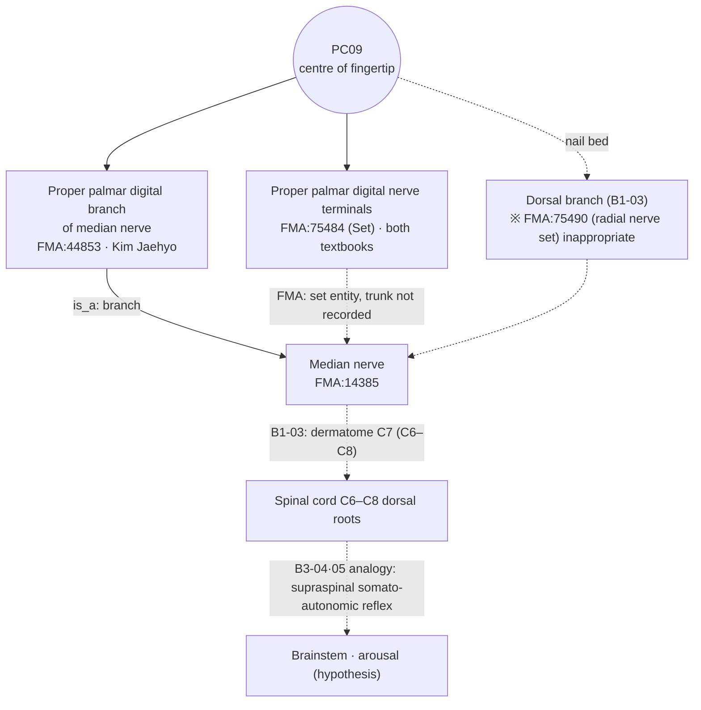

# [Acupoint Anatomical & Physiological Substrate Monograph] Zhongchong (中衝, PC9)

> **Framework**: v2.7 (revised 2026-10-04) · **ARI**: ARI v3.0 | ARI-Core 67.5 ± 1.2 (C) | SI 100 | provisional weights 0.40/0.35/0.25 | sensitivity (equal weights): 65.6 (C, grade unchanged) · **Dual scoring**: completed by two independent raters

---

> **Governing principle documents**: `01_Framework/acupoint_anatomical_logic_framework.md` (v2.7), `01_Framework/layer_b_reference_registry.md`
> **Source datasets**: Classical Needling Depth Database (sheet 1, row 282), Acupoint Nomenclature & Alias Comparative Database (`경혈 종합 목록`, row 283), Common Textbook Anatomical Structure Dataset (`경혈별_해부구조_통합`, row 281), Kim Jaehyo Anatomical Structure Dataset (`경혈별_해부구조_종합`, row 281)
> **Three Primary Classics**: *Zhongguo Zhenjiu Xuewei Tongjian* (《中國針灸穴位通鑑》) `(上卷)_401-480.md` L2922–3175 · *Zhenjiu Shuxue Tongkao* (《針灸腧穴通考》) `(下)_81-160.md` L1628–1745 · *Zhongguo Zhenjiu Zhengzhi Tongjian* (《中國針灸證治通鑑》) `_81-160.md` L178 ff., `_161-240.md` and others
> **Anatomical Ontology**: local index of the FMA (Foundational Model of Anatomy) 5.1.0 — textbook structures are pinned to `FMA:ID`s and their nerve trunks and spinal segments are cross-checked (B1 supplementary, not yet in the registry). Mapping table: FMA Acupoint Anatomical Ontology Mapping Registry; details in Appendix A.
> **Note on script**: Classical quotations and TCM terms are given in Traditional Chinese (繁體字). The cited source files are simplified-script editions, so the file names and line numbers in `code` refer to those files as they are named on disk.

### Summary of Conclusions

Zhongchong (中衝, PC9) lies in **the fingerprint skin and subcutis at the centre of the tip of the distal phalanx of the middle finger (Layer 1)**. The most probable anatomical substrate is **the terminal branches of the proper palmar digital nerve (sensory) arising from the median nerve and the terminal arterial network of the proper palmar digital arteries**. This judgement, however, rests only on agreement between the two textbooks and standard anatomy texts (B1-01 · B1-03); no study has measured PC9 itself in cadavers or by ultrasound. The reflex mechanism explaining the arousal and emergency effects of bloodletting at the Jing-Well point (井穴) scores 6/12 on the B-Check (not concordant) and is therefore described only as a **hypothesis**. The overall verdict is **ARI-Core 67.5 ± 1.2, grade C (possible/hypothesis)**. The needling safety index is **SI 100** (every text gives 1 fen = 2.3 mm, and no text records a contraindication to needling).

---

## 1. Classical Literature Screening Table (Three Primary Classics Excerpts and Chinese–English Collation)

| Classic | Original text (source file & line) | English translation | Remarks |
| :--- | :--- | :--- | :--- |
| 《靈樞·本輸》 | "心出於中衝，中衝，手中指之端也，為井木……手少陰也。" (Tongkao `(下)_81-160` L1642; Tongjian `(上卷)_401-480` L2924 · L2946) | The qi of the Heart (心) emerges at Zhongchong. Zhongchong is the tip of the middle finger and is the Jing-Well Wood point (井木穴) …… it belongs to the hand Shaoyin (手少陰). | Location only, no depth. Assigned to '心/手少陰' (see Section 3) |
| *Huangdi Mingtang Jing* (《黃帝明堂經》) (《甲乙經》 3:50) | "心主出中衝，中衝者，木也。在手中指之端，去爪甲如韭葉陷者中，手心主脈之所出也，為井。" (Tongkao L1643) / "刺入一分，留三呼，灸一壯。" (Tongkao L1727; Tongjian L3084) | At the tip of the middle finger, in the depression a chive-leaf's breadth (韭葉) from the nail. Insert 1 fen and retain for three breaths. Moxibustion 1 cone. | Earliest statement of depth. Reassigns the point to '心主 (Pericardium (心包))' |
| *Huangdi Mingtang Jing* (《黃帝明堂經》), indications | "主熱病煩心，心悶而汗不出，掌中熱，心痛，身熱如火，浸淫煩滿，舌本痛。" (Tongkao L1683; Tongjian L3028) | Febrile disease with vexation of the heart (熱病煩心) and oppression without sweating, heat in the palms (掌中熱), heart pain (心痛), body burning like fire (身熱如火), pain at the root of the tongue (舌本痛) | Single-point article |
| *Zhenjiu Shuxue Tongkao* (《針灸腧穴通考》) 【提要索隱】 | "部位：在手指，中指末端最高點。……針刺操作：淺刺 0.1 寸，或點刺出血。" (Tongkao L1632–1634) | The highest point of the tip of the middle finger. Shallow insertion of 0.1 cun or pricking to bleed | Modern standard |
| *Zhenjiu Shuxue Tongkao* (《針灸腧穴通考》) 【名實考】 | "本穴最後定於中指尖橈側，一方面受勞宮穴定位的影響（勞宮，掌中中指本節之內間也。勞宮在內間，則中衝亦當在中指內側也)，另一方面經脈循行的影響也是一個重要因素。《靈樞·邪客》曰：'心主之脈，出於中指之端，內屈循中指內廉，以上留於掌中'，既曰'中指內廉'，則知是中指內側爪甲角。" (Tongkao L1638) | The point eventually came to be located on the radial side of the middle fingertip under the influence of the location of Laogong (勞宮) ('內間') and of the meridian course (《靈樞·邪客》 '中指內廉'). Since the text says 'medial border of the middle finger (中指內廉)', it must refer to the medial nail corner of the middle finger. | How the radial nail-corner variant arose. **The *Tongkao* contains no description of nerve or vascular substrates** |
| *Zhongguo Zhenjiu Xuewei Tongjian* (《中國針灸穴位通鑑》), location | 2. "在手中指之端，去爪甲如韭葉陷者中。" (《甲乙經》 and about 30 other texts) / 4. "中指內端是中衝。" (《徐氏針灸大全》) / 5. "在手中指內廉之端，去爪甲如韭葉。" (《徐氏針灸大全》 · Yang Jingzhai (楊敬齋)) (Tongjian L2948–2956) | 2. Tip of the middle finger, in the depression a chive-leaf's breadth from the nail / 4 · 5. Medial tip of the middle finger | Concise summary (簡要結語): "歷代文獻記載位置有二說 …… 近世多依據《靈樞經》《針灸甲乙經》定位" (Tongjian L3124) |
| *Zhongguo Zhenjiu Xuewei Tongjian* (《中國針灸穴位通鑑》), local anatomy | "在中指末節之尖端，有指掌側固有動脈形成的動脈網，分佈著來自正中神經的指掌側總神經。" (《新針灸學》) / "針刺通過之組織層：皮膚，皮下組織。神經、血管：指掌側固有神經、指掌側固有動脈。" (《針灸學簡編》) (Tongjian L3108–3114) | At the tip of the distal phalanx there is an arterial network formed by the proper palmar digital arteries, and branches of the median nerve are distributed there. Tissues traversed by the needle: skin and subcutaneous tissue | Modern anatomical description. Not a measurement |
| *Zhongguo Zhenjiu Zhengzhi Tongjian* (《中國針灸證治通鑑》) | 腧穴主治: "《明堂經》主熱病煩心……舌本痛。《素問》主耳聾。《聖惠方》小兒夜啼。《素問保命集》噦嘔無度。" (Zhengzhi Tongjian `_81-160` L178–197) | Besides the *Mingtang Jing* indications: deafness (耳聾), night crying in infants (小兒夜啼), vomiting (噦嘔) | Prescription excerpts in Section 9 |
| WHO 2008 | "On the middle finger, at the centre of the tip of the middle finger." | Centre of the tip of the middle finger | Cited in the earlier report. Source outside the three primary classics |

> The *Tongkao* quotation in the v2.6 earlier edition, "在中指尖端... 實爲固有指神經與固有指動靜脈, 點刺出血", **is a fabricated quotation not found** in the *Tongkao* article on PC9 (L1628–1745) and has been deleted. The *Dongui Bogam* (《東醫寶鑑》) quotation was also deleted because it gives no page of the original and could not be verified. For the *Dongui Bogam*, only the needling-depth DB value (1 fen, cited source given as '靈樞') is kept, in Section 5.

---

## 2. Primary Source vs. Secondary Quotation Table

| Category | Classical source | Content | Adjudication |
| :--- | :--- | :--- | :--- |
| Primary (location) | 《靈樞·本輸》 | 手中指之端, 井木, assigned to 心 (手少陰) | Earliest description. No depth |
| Primary (location detail, depth, indications) | *Huangdi Mingtang Jing* (《黃帝明堂經》) | 去爪甲如韭葉陷者中, 刺入一分 留三呼, 灸一壯, assigned to 心主 | Earliest description of depth and indications |
| Secondary (same wording) | 《千金》《外臺》《銅人》《聖濟總錄》《資生經》《十四經發揮》《針灸大成》《類經圖翼》《醫宗金鑑》 and others, about 30 texts (Tongjian L2948) | Copy the *Mingtang Jing* location wording verbatim | Later agreement. Not independent evidence |
| Variant text (異文) | 《太平聖惠方·明堂》 "中指甲後一分中" (Tongkao L1658) | 1 fen behind the nail | Interpreted as toward the nail |
| Variant text | 《銅人》 穴腧都數 "去爪甲角如韭葉" (Tongkao L1659) | '角' (corner) added | First hint of a shift toward the nail corner |
| Variant text (variant location) | 《竇太師針經》 "在手中指端內側" (Tongkao L1660), 《徐氏針灸大全》 "中指內廉之端" (Tongjian L2956), 《高等針灸學講義》 "中指之內側" | Radial (內廉) nail corner | The *Tongkao* 名實考 explains it by the influence of the location of Laogong (勞宮) and 《靈樞·邪客》 |
| Modern | 2nd edition 《針灸學講義》 "在手中指尖端之中央取穴", 4th, 5th and 7th edition 《針灸學》 "中指尖端的中央" (Tongkao L1664–1666), WHO 2008 | Centre of the tip | Returns to the primary sources (《靈樞》 · 《明堂經》) |

---

## 3. Alias Verification Table

| Source | Value | Adjudication |
| :--- | :--- | :--- |
| Acupoint Nomenclature & Alias Comparative Database `경혈 종합 목록` row 283 | PC09 Jungchung 中衝, alias **'-'** | No alias |
| *Zhongguo Zhenjiu Xuewei Tongjian* (《中國針灸穴位通鑑》) (上卷) L2926 · L3122 | "二.別名無。" / "[別名]無。" | No alias |
| Kim Jaehyo dataset `경혈_기본정보_마스터` row 281 | Alias cell blank | No alias |
| Earlier report, Section 1 | Recorded '手中指端' as a KJH-cross-verified alias | **Error**. '手中指之端' is a location statement of the *Lingshu* (《靈樞》), not an alias, and is not in the KJH DB → deleted |

**Mixed attribution (Heart/Pericardium)**: 《靈樞·本輸》 records Zhongchong as '心出於中衝 …… 手少陰也', treating it as the Jing-Well point of the Heart (心, hand Shaoyin (手少陰)) (Tongkao L1642). Attribution to the Pericardium (心包, hand Jueyin (手厥陰)) first appears in the *Huangdi Mingtang Jing* (《黃帝明堂經》): '心主出中衝 …… 手心主脈之所出也' (Tongkao L1643). At the stage of 《靈樞·本輸》 the Pericardium Meridian (手厥陰心包經) did not have its own series of Five Transport points (五輸穴), so the points now on the Pericardium Meridian were listed under the name of the Heart Meridian. Ordering the sources chronologically resolves this mixing. No case of confusion with the names of other finger Jing-Well points such as Shaochong (少衝, HT9) or Guanchong (關衝, TE1) was found in the classics.

---

## 4. 3D Spatial Coordinates & Layer 1–5 Structure Diagram

**Coordinate system**: X = medial–lateral relative to the centre line of the long axis of the middle finger (radial −, ulnar +), Y = proximal direction (+) from the highest point of the fingertip, Z = depth from the skin surface (mm).

| Position | X | Y | Z | Basis |
| :--- | :--- | :--- | :--- | :--- |
| Target (classical and WHO): centre of the tip | 0 | 0 (fingertip about 1 fen from the free edge of the nail) | 0–2.3 mm | 《靈樞》 · 《明堂經》, 4th–7th edition textbooks, 《針灸學簡編》 "去指甲遊離緣約一分處" |
| Variant location (from Dou Taishi (竇太師) onward): 0.1 cun above the radial nail-root corner | about −5 to −7 mm | about +10 to +13 mm | 0–2.3 mm | Tongkao 【定位】 "另一種取穴：中指末節橈側指甲根角側上方 0.1 寸" (L1654) |

**Note on the variant location**: estimated from typical distal-phalanx dimensions, the distance between the centre of the tip and the radial nail-root-corner variant is about 10–15 mm (not a point-specific measurement). This falls short of the branching threshold of canonical Rank 5 (Δ > 15 mm), so **the Target was not split and was scored as a single Target**. Both positions lie within the terminal distribution of the same proper palmar digital nerves and arteries.

**Layer structure (Target, perpendicular insertion at the centre of the fingertip)**

```
 Z (mm)  Layer (canonical Layer 1–5)   Structures                                     Reached at 1 fen (2.3mm)
 0 ─────┬──────────────────────────────────────────────────────────────────────────────────────
        │ Layer 1 Skin/subcutis        Fingerprint skin (thick glabrous skin), mechano-/nociceptors,  ● reached
        │                              terminal branches of proper palmar digital n. (median n., sensory),
        │                              terminal arterial network of proper palmar digital aa., palmar digital vv.
 2.3 ...│............................  (pricking to bleed is confined to this layer's microvascular network)
        │                              Fingertip fibro-fatty pad (compartmentalised by septa)
        │ Layer 2 Superficial muscle   Not applicable (no muscle at the fingertip)
        │ Layer 3 Deep muscle/tendon   Not applicable. The flexor digitorum profundus tendon inserts on the
        │                              palmar base of the distal phalanx, proximal to and away from the tip
        │ Layer 4 Neurovascular        Main trunks of proper palmar digital nn./aa. run along both sides
        │                              of the finger; at the centre of the tip they are already terminal networks
        ▼ Layer 5 Periosteum           Periosteum of the distal phalangeal tuft — not reached at a depth of 1 fen
```

- The earlier edition's layer-thickness figures (0.8/1.8/2.3 mm, μ 1.8, σ 0.4) had no measurement basis and have been deleted. Layer A contains no study measuring fingertip soft-tissue thickness at PC9 (papers.id 1944 is an ultrasound depth study of Five Transport points, but whether it includes PC9 could not be confirmed).
- Spinal segment: the skin of the middle finger belongs mainly to the C7 dermatome (B1-03).


*Figure 4-1. Schematic median sagittal (longitudinal) section of the distal phalanx of the middle finger at the level of Zhongchong (中衝, PC9) (viewed from the radial side, distal = right, not to scale). Perpendicular insertion or pricking of 1 fen (2.3 mm) at the centre of the tip ends within Layer 1 and does not reach the periosteum of the tuft of the distal phalanx. The main trunks of the proper palmar digital nerves and arteries run outside this median plane (along both sides of the finger) and form terminal networks at the tip. Layer thicknesses and distances are arbitrary because no PC09 measurements exist.*

**FMA substrate cross-check by layer** — structure names from the two textbooks; IDs and relations from FMA 5.1.0 (`fma_query.py profile PC09`)

| Layer | Structure | FMA | FMA relation | Nerve trunk / vascular chain (FMA) | Spinal segment (FMA) |
| :--- | :--- | :--- | :--- | :--- | :--- |
| 1 Skin/subcutis | Proper palmar digital nerves *[both textbooks]* | FMA:75484 | is_a Set of nerves | (set entity — individual trunks not recorded) | Not recorded in FMA |
| 1 Skin/subcutis | Proper palmar digital branch of median nerve *(Kim Jaehyo)* | FMA:44853 | is_a Branch of median nerve | Median nerve (FMA:14385) | Not recorded in FMA |
| 1 Skin/subcutis | Dorsal digital nerve *(Common Textbook)* | FMA:75490 | Set of dorsal digital branches of **radial** nerve | Radial nerve system — **inappropriate for the distal phalanx of the middle finger** (note 1 below) | Not recorded in FMA |
| 1 Skin/subcutis | Proper palmar digital arteries *[both textbooks]* · palmar digital veins *[both textbooks]* | FMA:70804 · 70895 | Set of arteries / Set of systemic veins | — | — |
| 1 Nail bed | Dorsal digital artery *[both textbooks]* · dorsal digital veins *(Kim Jaehyo)* | FMA:321492 · 70917 | artery is_a Branch of radial artery | Radial artery (FMA:22730) → subclavian artery | — |
| 3 (off the path) | Flexor digitorum profundus tendon *(Common Textbook)* | FMA:38478 | has_insertion base of distal phalanx (index to little finger) | Muscular branch of anterior interosseous nerve (FMA:44831) · branch of ulnar nerve (FMA:65351) | **C8 (primary) · T1** |
| 5 Periosteum | Distal phalanx of middle finger · nail | FMA:23947 · 54335 | — | — | — |

- **FMA note 1 — possible mismatch for the dorsal digital nerve**: the mapping table matched the Common Textbook's "dorsal digital nerve" exactly to the **set of dorsal digital branches of the radial nerve** (FMA:75490), which carries the FMA synonym "Dorsal digital nerves". As set out in Section 6, however, the dorsum (nail bed) of the distal phalanx of the middle finger is supplied by the dorsal branch of the proper palmar digital nerve of the median nerve (B1-03). FMA:75490 is therefore **a terminological match, not a positional match**, and this report does not use it as evidence.
- **FMA note 2 — compartment of flexor digitorum profundus**: FMA records flexor digitorum profundus as `contained_in Space of anterior compartment of arm` (anterior compartment of the arm). The muscle lies in the anterior compartment of the forearm, so this is regarded as an FMA modelling error and is not cited. The segments C8 · T1 are values for the whole muscle, not restricted to the middle-finger belly (supplied by the anterior interosseous branch of the median nerve).
- **FMA note 3 — set entities**: many digital nerves and vessels map only to "Set of …" entities (sets for the whole hand). They cannot be narrowed to individual middle-finger entities (e.g. the radial proper palmar digital nerve of the middle finger), so FMA pins only the kind of structure, and the finger position is described from the textbooks and B1.

---

## 5. Needling Depth Calculation Table

Source: Classical Needling Depth Database, sheet 1, row 282 (PC09). 1 fen = 2.3 mm.

| Text | DB value (fen) | Converted depth | Layer reached | Remarks |
| :--- | :---: | :---: | :--- | :--- |
| *Huangdi Mingtang Jing* (《黃帝明堂經》, ed. Huang Longxiang) | 1 | 2.3 mm | Layer 1 | Original text "刺入一分，留三呼" |
| *Zhenjiu Jiayi Jing* (《針灸甲乙經》) | 1 | 2.3 mm | Layer 1 | *Jiayi Jing* ordering number 25 |
| *Chimgu Gyeongheombang* (《鍼灸經驗方》) | 1 | 2.3 mm | Layer 1 | |
| *Dongui Bogam* (《東醫寶鑑》) | 1 | 2.3 mm | Layer 1 | Cited source given as '靈樞' |
| Korean common textbook, *Meridian and Acupoint Studies* (經絡腧穴學) | 1 – 1 | 2.3 mm | Layer 1 | Preferred-technique cell blank |
| Korean common textbook, *Acupuncture and Moxibustion Medicine* (鍼灸醫學) | 1 – 1 | 2.3 mm | Layer 1 | |
| *Zhenjiu Shuxue Tongkao* (《針灸腧穴通考》) | 1 – 1 | 2.3 mm | Layer 1 | *Tongkao* "淺刺 0.1 寸，或點刺出血" |

- **'0' (Contraindicated for needling (禁鍼)) entries: none. 'blank' (not described) entries: none.**
- Note: 《玉龍經》 "無病不用，用則令人悶" (Tongjian L3090) restricts use but is not a contraindication to needling. "禁灸" in 《循經考穴編》 and 《針灸指南》 prohibits moxibustion. 《新編針灸學》 "針二分至三分" (4.6–6.9 mm) is an extended value from a single modern text and is not in the DB.
- Safety verdict: the entire standard depth stays within Layer 1 and is more than 10 mm from any major nerve trunk, artery or organ. Pricking to bleed takes place in the terminal microvascular network. The fingertip is extremely painful, so attention should be paid to stimulus reactions such as vasovagal syncope (a general clinical precaution, not a contraindication in the literature).

---

## 6. Anatomical Structure Textbook Comparison Table (Common Textbook of Acupoint Studies vs. Kim Jaehyo Textbook)

Source: Common Textbook `경혈별_해부구조_통합` row 281; Kim Jaehyo `경혈별_해부구조_종합` row 281 and `해부구조_개별항목_상세` rows 2465–2469.

| Item | Common Textbook of Acupoint Studies | Kim Jaehyo textbook | FMA adjudication | Similarities & differences |
| :--- | :--- | :--- | :--- | :--- |
| Muscle | Flexor digitorum profundus | **(blank)** | Common Textbook only FMA:38478 (has_insertion base of distal phalanx) | Only in the Common Textbook. The FDP tendon inserts on the palmar base of the distal phalanx and is not on the needle path at a fingertip depth of 1 fen. For fingertip anatomy the Kim Jaehyo blank is more accurate |
| Nerves | Proper palmar digital nerves, dorsal digital nerve | Proper palmar digital branch of median nerve, proper palmar digital nerves | Shared FMA:75484 / Common Textbook only FMA:75490 (radial nerve set — Section 4, note 1) / Kim Jaehyo only FMA:44853 (→ median nerve) | Proper palmar digital nerves shared. All are **sensory nerves**. The dorsum (nail bed) of the distal phalanx of the middle finger is supplied by the dorsal branch of the median proper palmar digital nerve (B1-03), so the Common Textbook's 'dorsal digital nerve' should be read as this dorsal branch |
| Vessels | Proper palmar digital arteries, palmar digital veins, dorsal digital artery | Dorsal digital arteries and veins, proper palmar digital arteries, palmar digital veins | Shared FMA:70804 · 70895 · 321492 / Kim Jaehyo only FMA:70917 (set of dorsal digital veins) | Practically in agreement. At the fingertip the proper palmar digital arteries of both sides anastomose to form a terminal arterial network |

**What FMA shows about the textbook differences**: the FMA profile comparison of the two textbooks gives 4 shared · 2 Common Textbook only · 2 Kim Jaehyo only. Of the 2 Common-Textbook-only items, flexor digitorum profundus is off the needle path (inserts at the base), and the dorsal digital nerve is taken by FMA as a **radial nerve set**, which does not fit positionally. The 2 Kim-Jaehyo-only items (proper palmar digital branch of the median nerve, dorsal digital veins) are, in FMA, the median nerve trunk and a venous set, consistent with fingertip anatomy. The FMA cross-check therefore supports the verdicts above ("for fingertip anatomy the Kim Jaehyo textbook is more accurate"; "read the dorsal digital nerve as the dorsal branch of the median nerve"). The $S_{clarity}$ level is unchanged.

> The earlier edition's entry in the Kim Jaehyo muscle cell, 'aponeurosis and nail-muscle attachment', is not in the dataset and has been deleted. The earlier edition's statement of "a layer sequence leading to deep motor nerve branches" was also wrong: the proper palmar digital nerve at the fingertip is a sensory nerve with no motor component.

```
 [Dorsal]  nail ─ nail bed: dorsal branch of proper palmar digital n. (Common Textbook 'dorsal digital n.'), dorsal digital a. (both textbooks)
    │
    ● Variant location (0.1 cun above the radial nail-root corner)
    │
 ── ● Target (centre of the tip): proper palmar digital n. terminals (both textbooks), proper palmar digital a. terminal network (both textbooks)
    │
 [Palmar]  base of distal phalanx ← FDP tendon insertion (Common Textbook only, off the needle path)
```

---

## 7. Spatial Displacement Branching Inference Diagram

Not applied — reason: the distance between the centre of the tip and the radial nail-root-corner variant (from 《竇太師針經》 · 《徐氏針灸大全》 onward; *Tongkao* 名實考) is about 10–15 mm, short of the branching threshold (Δ > 15 mm). Scored as a single Target; the variant is described in a note in Section 4 (see the adjudication record in Section 10).

---

## 8. Biomedical Reflex Pathway Diagram & External Search Log

### ① Layer A Papers (evidence pack `pack_PC9.md`)

| papers.id | Year | Journal | Title | PMID / DOI | Design | Relevance to PC9 |
| :---: | :---: | :--- | :--- | :--- | :--- | :--- |
| 1929 | 2016 | Zhen Ci Yan Jiu | Distribution of Substance P-positive Nerve Fibers in Local Skin Tissues of Five Shu-points of the Pericardium Meridian | 29071923 | Animal | **Includes PC9 (Five Transport points of the Pericardium Meridian)** |
| 1934 | 2012 | J Altern Complement Med | Differential autonomic response to acupuncture at wood and metal of five-shu acupoints | 22916690 / 10.1089/acm.2010.0751 | Human (non-RCT) | **Presumably PC9** (Wood point (木穴) of the Pericardium Meridian) |
| 1933 | 1989 | Am J Chin Med | Needling sensation receptor of an acupoint supplied by the median nerve | 2633617 / 10.1142/s0192415x89000231 | Human (non-RCT) | Point supplied by the median nerve. Not PC9-specific |
| 1930 | 2019 | Zhongguo Zhen Jiu | Effect of bloodletting acupuncture at twelve jing-well points of hand on microcirculatory disturbance in mice | 31621260 / 10.13703/j.0255-2930.2019.10.012 | Animal | Twelve hand Jing-Well points combined |
| 1936 | 2007 | Zhen Ci Yan Jiu | Effect of electroacupuncture on free radical content and HSP70 expression in the brain tissue in rats with cerebral ischemia | 17650653 | Animal | Jing-Well points combined |
| 1938 | 2021 | Zhen Ci Yan Jiu | Effect of blood-letting puncture of "Well-points" on hippocampal mitophagy-related protein expression in rats | 33931995 / 10.13702/j.1000-0607.200599 | Animal | Jing-Well points combined |
| 1931 | 2017 | Zhongguo Zhen Jiu | Clinical study on post-stroke urinary retention treated with acupuncture at the twelve jing-well points | 29354970 / 10.13703/j.0255-2930.2017.10.004 | Human (non-RCT) | Twelve Jing-Well points combined |
| 1935 | 2026 | Zhongguo Zhen Jiu | Multidimensional effect of acupuncture bloodletting technique at hand twelve jing-well points | 41987435 / 10.13703/j.0255-2930.20250924-k0003 | Human (non-RCT) | Twelve Jing-Well points combined |
| 1943 | 2015 | J Pharmacopuncture | The Effects of Sa-am Acupuncture Simpo-jeongkyeok Treatment on the Blood Pressure, Pulse Rate, and Body Temperature | 26120486 / 10.3831/kpi.2015.18.013 | Unclassified | Sa-am (舍岩) Pericardium tonification pattern (心包正格) combination |
| 1944 | 2013 | Complement Ther Med | A validation study on the insertion depth ranges of the five phase points by using musculoskeletal ultrasound | 24280473 / 10.1016/j.ctim.2013.08.003 | Anatomy/imaging | Inclusion of PC9 not confirmed |

- Excluded: 1937 (data mining; not counted among mechanism papers); 1883 · 1932 · 1939 · 1940 · 1941 · 1942 · 1945 (unrelated to a PC9 mechanism or design unclassified).
- **There are only two studies of PC9 itself: 1929 (animal) and 1934 (human non-RCT, presumed PC9).** All studies of Jing-Well bloodletting stimulated several Jing-Well points at once, so they cannot be taken as PC9-only effects.

### Reflex Pathway Diagram (hypothesis — B-Check not concordant)

```
[Fingertip pricking / perpendicular insertion, 1 fen]
   │  Layer 1: mechano-/nociceptors of fingerprint skin, SP-positive fibres (1929, animal)
   ▼
Proper palmar digital n. (median n., sensory) → C7 (C6–C8) dorsal root → spinal dorsal horn   [B1-03, B3-06]
   │
   ├─(hypothesis) segmental route: C7 ↔ cardiac visceral segments T1–T4 — no direct segmental match, by analogy  [B3-03]
   ├─(hypothesis) supraspinal somato-autonomic reflex: strong noxious stimulus → sympathetic activation, pressor  [B3-04, B3-05]
   └─(hypothesis) diffuse noxious inhibitory control (DNIC) and non-specific arousal                             [B3-08]
   ▼
Target effect: emergency treatment of stupor and reversal (厥逆) (arousal), febrile disease — direction matches
   the classical indications, but the evidence is from animal and combined Jing-Well studies
   (1930 · 1936 · 1938 animal, 1931 · 1935 human non-RCT, 1934 autonomic indices)
```

**Pinning the peripheral afferent pathway with FMA**: the first segment of the hypothesised circuit above (fingertip → median nerve) is pinned by FMA relations as shown below. Solid lines are relations recorded in FMA, "is_a" marks trunks linked through class names, and dashed lines lie outside FMA (B1 and B3 analogy). The verdict (not concordant, 6/12) is unchanged.



*Figure 8-1. Peripheral pathway of PC09 drawn from FMA 5.1.0 relations. FMA pins the pathway up to the median nerve but does not record nerve segments, so the C7 dermatome and the subsequent pathway are B1/B3 analogies. Flexor digitorum profundus (C8 · T1) lies off the needle path and was excluded from the afferent pathway.*

> **Caution on non-specificity (B4-04 · B4-05)**: the arousal effect of Jing-Well bloodletting is likely to be a **non-specific response** to a strong noxious stimulus applied to the fingertip, where nociceptors are dense. Taking together the meta-analysis showing small differences between verum and sham needling (B4-04) and the debate on point specificity (B4-05), the same effect may arise from stimulation of other fingertips. No PC9-specific effect has been demonstrated.
>
> The earlier edition's 'RAS (brainstem reticular formation) arousal reflex' had no Layer A or B basis and was replaced by the hypothesised pathway above. No PC9 study has directly confirmed a reticular-formation pathway.

### ② B-Check Scoring Table

| Item | Rater A | Rater B | Final | Layer B reference IDs | papers.id | Rationale |
| :--- | :---: | :---: | :---: | :--- | :--- | :--- |
| ① Peripheral nerve/vessel substrate at needling depth | 2 | 1 | **1** | B1-01, B1-03, B2-09 (+FMA) | 1929 | The two textbooks and B1 agree on the proper palmar digital nerves and arteries (FMA:75484 · 70804 · 44853 → median nerve FMA:14385). FMA maps digital nerves and vessels only to set entities, and there is no depth-specific measurement at PC9 (B2 point-specific), so 1 point |
| ② Spinal segmental concordance | 1 | 1 | **1** | B1-03, B3-03 (+FMA) | — | The C7 dermatome of the middle finger and the cardiac visceral segments T1–T4 do not correspond directly. FMA has no segment for the fingertip nerves, and the only FMA segment (flexor digitorum profundus C8 · T1) is off the needle path and not used. Inferred only via a supraspinal pathway |
| ③ Afferent fibre type & receptors | 1 | 1 | **1** | B2-02, B3-06 | 1929, 1933 | Density of Aδ/C nociceptive fibres at the fingertip, SP-positive fibres (animal), De Qi (得氣) receptors at a median-nerve point (not PC9-specific). By analogy |
| ④ Central relay & pathway | 1 | 1 | **1** | B3-04, B3-05, B3-08 | 1936, 1938 | Inferred from the supraspinal somato-autonomic reflex and DNIC. No direct evidence of a reticular-formation pathway |
| ⑤ Efferent pathway & direction of effect | 1 | 1 | **1** | B3-05 | 1930, 1936, 1938 | Arousal and improved microcirculation point in the same direction as the emergency indications for stroke (中風) and syncope (昏厥). Animal and combined Jing-Well studies |
| ⑥ Human translation | 1 | 1 | **1** | B4-04, B4-05 | 1931, 1934, 1935, 1943 | Only human non-RCT and combined treatments. PC9-only effect and point specificity not demonstrated |
| **Total** | 7 | 6 | **6 / 12** | | | |

**Verdict**: not concordant (< 8/12). Items ① and ② each score at least 1 and meet the condition. Because ⑥ = 1, no '(animal only)' flag is attached. There is no conflicting (0-point) item. Since the verdict is not concordant, the reflex mechanism is described only as a **hypothesis**.

### ③ External Search Log (sync_log; Rank 6 runs of 2026-10-04 and 2026-10-23)

| Timestamp | Source | HTTP | Fetched | Duplicates removed | New | Query |
|---|---|---|---|---|---|---|
| 2026-10-04T09:52:00 | pubmed | 200 | 12 | — | — | ("PC9" OR "Zhongchong" OR "中衝") AND (acupuncture OR electroacupuncture) AND (nerve OR reflex OR autonomic OR mechanism OR anatomy) \| ("PC9" OR "Zhongchong" OR " |
| 2026-10-04T09:52:00 | openalex | 200 | 14 | — | — | doi_starts_with:10.13703,title_and_abstract.search:"Zhongchong" OR "PC9" \| doi_starts_with:10.13702,title_and_abstract.search:"Zhongchong" OR "PC9" \| has_doi:tr |
| 2026-10-04T09:52:00 | crossref | 200 | 0 | — | — | Zhongchong acupuncture nerve reflex |
| 2026-10-04T09:52:00 | all | — | 26 | 9 | 17 |  |
| 2026-10-23T21:44:52 | pubmed | 200 | 12 | — | — | ("PC9" OR "Zhongchong" OR "中冲") AND (acupuncture OR electroacupuncture) AND (nerve OR reflex OR autonomic OR mechanism OR anatomy) |
| 2026-10-23T21:44:52 | openalex | 200 | 14 | — | — | doi_starts_with:10.13703 / 10.13702 · title_and_abstract.search:"Zhongchong" OR "PC9" … |
| 2026-10-23T21:44:52 | crossref | 200 | 0 | — | — | Zhongchong acupuncture nerve reflex |
| 2026-10-23T21:44:52 | all | — | 26 | 26 | 0 | 18 already merged · 8 duplicates within the batch — **no new papers**, verdict unchanged |

---

## 9. Indication Separation Table (Single-point Needling vs. Combinations)

The earlier edition's single-point efficacy probabilities (0.95/0.92/0.91, 'Level A') had no derivation or source and have been deleted. The table below distinguishes only whether a single-point article exists in the classics.

| Indication | Single-point needling/moxibustion article | Combination article | Adjudication |
| :--- | :--- | :--- | :--- |
| Febrile disease with vexation of the heart (熱病煩心) · absence of sweating (汗不出) · heat in the palms (掌中熱) · heart pain (心痛) · pain at the root of the tongue (舌本痛) | 《明堂經》 "……中衝主之" (Tongjian L3028; Tongkao L1683) | 《千金》 "中衝、勞宮、大陵、間使、關衝、少衝、陽谿……主熱病煩心" (Tongjian L3030); "熱病煩心，汗不出：中衝、勞宮……" (Zhengzhi Tongjian `_161-240` L1782) | Single-point primary source exists (earliest indication) |
| Sudden heart pain (卒心痛) | 《肘後備急方》 "卒心痛方：灸手中央長指端三壯" (Tongkao L1712) | "心氣疾痛：心俞、內關……中衝……" (Zhengzhi Tongjian `_161-240` L3828) | Single-point article exists (moxibustion) |
| Night crying in infants (小兒夜啼) | 《太平聖惠方》 "小兒夜啼……灸中指甲後一分中衝穴一壯" (Tongkao L1719; Zhengzhi Tongjian `_321-400` L4175) | — | Single point |
| Stroke (中風) with stupor and loss of consciousness (不省人事) | 《竇太師針經》 "治中風不省人事，補" (Tongkao L1687) | "先針中衝瀉之，次針人中" (《盤石金直刺秘傳》, Tongkao L1708); "中衝、大敦、百會" (《醫學綱目》, Tongkao L1709); 《乾坤生意》 simultaneous bloodletting at the ten Jing-Well points (十井穴) with the three-edged needle (三棱針) (Tongjian L3054); "中風不省人事：人中、中衝、合谷" (Zhengzhi Tongjian `_161-240` L216) | Indication from the Jin–Yuan onward. Actual prescriptions are mostly combinations or simultaneous bloodletting at the ten Jing-Well points |
| Reversal syndrome (厥證) · sudden reversal (暴厥) | Modern: "取穴：中衝，指壓" (*Zhongguo Zhenjiu* (《中國針灸》) 1989;9(6):53, Zhengzhi Tongjian `_161-240` L1192) | 《全生指迷方》 sequential needling of 隱白 · 湧泉 · 中衝 · 神門 (Tongkao L1716); "尸厥暴死：百會、人中、啞門……中衝" (Zhengzhi Tongjian `_161-240` L1106) | Classical sources give combinations; one modern single-point report |
| Summerheat stroke (中暑) | — | "中暑忽然不省人事：百會、人中……中衝、少衝……" (Zhengzhi Tongjian `_161-240` L1864); bloodletting at 少商 · 商陽 · 中衝, etc. (L1890) | Combinations only |
| Deafness (耳聾) · tinnitus (耳鳴) | 《靈樞·厥病》 "耳鳴，取手中指爪甲上" (Tongkao L1702) | 《素問·繆刺論》 needling the middle finger after 商陽 (Tongkao L1703) | Single-point article exists (recorded by location, without the point name) |
| Throat Bi (喉痹) · throat closure (喉閉) | — | "喉閉：少澤、中衝、委中" (Zhengzhi Tongjian `_401-480` L1943) | Combinations only |
| Red, swollen, painful eyes (目赤腫痛) | Modern: "中衝。點刺放血" (*Zhongguo Zhenjiu* (《中國針灸》) 1989;9(2):47, Zhengzhi Tongjian `_401-480` L578) | — | Modern single-point report |

> The earlier edition's overlay of modern disease names, such as '高熱 (infectious high fever)', has been deleted. The classical expressions are '身熱如火' and '熱病'.

---

## 10. ARI v3.0 Profile Evaluation & Final Conclusion

### 10.1 Sub-scores (Target: centre of the tip, single Target)

| Index | Rater A | Rater B | Mean | Rubric-level rationale | Evidence pointers |
| :--- | :---: | :---: | :---: | :--- | :--- |
| S_orig | 68.75 | 75.0 | **71.875** | Location is explicit in the *Lingshu* (《靈樞》) and depth comes from the *Mingtang Jing* (《明堂經》). Agreement in later texts is high but there is the radial nail-corner variant. No aliases; the Heart/Pericardium attribution is resolved chronologically. The earlier edition did not reflect the 名實考 and inserted a fabricated quotation, so ④ = 50 | Tongkao `(下)_81-160` L1638–1666, Tongjian `(上卷)_401-480` L2924–2966, KJH row 283 |
| S_clarity | 75 | 75 | **75.0** | The nerves and vessels of the two textbooks agree and are confirmed as standard entities by B1-01, B1-03 and FMA (in FMA the 2 Common-Textbook-only items are off the path or positionally inappropriate, Section 6). No PC9-specific measurement → below 100 | Common Textbook row 281, Kim Jaehyo row 281, B1-01, B1-03; FMA:75484 · 44853 |
| S_reflex | 50 | 50 | **50.0** | Studies of PC9 itself: one animal (1929) and one human non-RCT (1934, presumed). The rest are combined Jing-Well studies. B-Check 6 | papers.id 1929, 1934; B-Check table |
| S_safety → SI | 100 | 100 | **100** | Every text gives 1 fen = 2.3 mm, within Layer 1. No contraindication and no undescribed entry | Needling-depth xlsx sheet 1, row 282 |

### 10.2 S_orig Sub-items

| Sub-item | A | B | Mean | Summary |
| :--- | :---: | :---: | :---: | :--- |
| ① Clarity of earliest description | 75 | 75 | 75 | 《靈樞·本輸》 location explicit, no depth |
| ② Agreement in later texts | 75 | 100 | 87.5 | About 30 texts follow the *Mingtang Jing* wording. Because of the variants of the Dou Taishi (竇太師) and Xu (徐氏) lines, A judged 60–79% and B ≥ 80% |
| ③ Resolution of alias confusion | 75 | 75 | 75 | No real alias. Points deducted for the fake alias created by the earlier edition and the unresolved Heart/Pericardium attribution of the *Lingshu* |
| ④ Correction of transcription errors by *Tongkao* (《通考》) collation | 50 | 50 | 50 | The 名實考 documented the changes in location, but the earlier edition replaced this with a fabricated quotation and miscopied '留三呼' as '留二呼' |
| Mean | 68.75 | 75.0 | 71.875 | |

### 10.3 Gates Applied

| Gate | Condition | Result |
| :--- | :--- | :--- |
| Gate 1 | S_orig < 50 or S_clarity < 50 | Not triggered (71.9, 75) |
| Gate 2 | 0 Layer A papers | Not triggered (PC9-related 1929 · 1934) |
| Gate 3 | SI ≤ 25 | Not triggered (SI 100) |

### 10.4 ARI-Core, Grade, SI and Sensitivity

| Item | Value |
| :--- | :--- |
| ARI-Core (A) | 0.40×68.75 + 0.35×75 + 0.25×50 = 66.25 |
| ARI-Core (B) | 0.40×75 + 0.35×75 + 0.25×50 = 68.75 |
| **ARI-Core (mean ± half-range)** | **67.5 ± 1.2** |
| Grade & flags | **C (possible/hypothesis)**, no H or ⚠ |
| SI | **100** |
| Equal-weight sensitivity | (71.875 + 75 + 50) / 3 = 65.6 → C, grade unchanged |
| Weights | 0.40/0.35/0.25 provisional (unvalidated) |
| Branch decision | Not applicable (single Target) |

### 10.5 Adjudication Record

- Items differing by 15 points or more: **none** (largest difference S_orig 6.25).
- Adjudication: only Rater A split the radial nail-root-corner variant (from Dou Taishi (竇太師) onward) off as T2. However, its distance from the centre of the tip is about 10–15 mm, short of the canonical Rank 5 branching threshold (Δ > 15 mm), so it was adjusted to a single Target. The variant is described in the location note of Section 4 (for reference, A's T2 scores: S_orig 50 / S_clarity 50 / S_reflex 50 / SI 100). The inter-rater conflicts record is not a direct conflict.
- B-Check item ①: A gave 2 points and B gave 1. Following B's rationale that there is no depth-specific measurement at PC9, the final score is 1.

### 10.6 Final Conclusion

The anatomical substrate of Zhongchong (中衝, PC9) is best regarded, as a probable **hypothesis (grade C, possible/hypothesis)**, as **the terminals of the proper palmar digital nerve (median nerve, sensory) and the terminal arterial network of the proper palmar digital arteries in the fingerprint skin and subcutis of the tip of the middle finger (Layer 1)**. The location has remained the centre of the tip from 《靈樞·本輸》 and the *Mingtang Jing* (《明堂經》) through to the WHO standard. The radial nail-corner variant is a later alternative view arising from the influence of the location of Laogong (勞宮) and of '中指內廉' in 《靈樞·邪客》 (*Tongkao* 名實考). Needling to 1 fen (2.3 mm) or pricking to bleed is very safe (SI 100). However, there is no PC9-only evidence for the emergency and arousal effects of Jing-Well bloodletting, which are likely to be a non-specific response to noxious stimulation, so the reflex mechanism remains at the hypothesis stage. Raising the verdict would require ultrasound measurement of the fingertip soft tissue at PC9 and human studies comparing PC9-only stimulation with stimulation of other fingertips (controls).

---

## Appendix A. FMA Anatomical Substrate Profile (FMA 5.1.0)

Generated by `python .claude/skills/acupoint-anatomy/scripts/fma/fma_query.py profile PC09 --md` (2026-10-23).

| Category | Textbook term | FMA substrate | Match | Source | Innervation / parent trunk | Segment |
| :--- | :--- | :--- | :--- | :--- | :--- | :--- |
| Muscle | Flexor digitorum profundus | FMA:38478 Flexor digitorum profundus | exact | Common Textbook | FMA:44831 Nerve to flexor digitorum profundus · FMA:65351 Branch of ulnar nerve to FDP | C8 (primary) · T1 (secondary) |
| Nerve | Proper palmar digital branch of median nerve | FMA:44853 Proper palmar digital branch of median nerve | exact | Kim Jaehyo | FMA:14385 Median nerve | — |
| Nerve | Dorsal digital nerve | FMA:75490 Set of dorsal digital branches of radial nerve | exact (term) | Common Textbook | Radial nerve system — positionally inappropriate (Section 4, note 1) | — |
| Nerve | Proper palmar digital nerve | FMA:75484 Set of proper palmar digital nerves | exact | Common Textbook · Kim Jaehyo | Set entity | — |
| Vessel | Dorsal digital artery | FMA:321492 Dorsal digital artery | exact | Common Textbook · Kim Jaehyo | FMA:22730 Radial artery → FMA:3951 Subclavian artery | — |
| Vessel | Dorsal digital vein | FMA:70917 Set of dorsal digital veins | exact | Kim Jaehyo | Set entity | — |
| Vessel | Palmar digital vein | FMA:70895 Set of palmar digital veins | exact | Common Textbook · Kim Jaehyo | Set entity | — |
| Vessel | Proper palmar digital artery | FMA:70804 Set of proper palmar digital arteries | exact | Common Textbook · Kim Jaehyo | Set entity | — |

- Union of segments: C8 · T1 — **values for flexor digitorum profundus, which is off the needle path**, so they are not used as input to B-Check ② (FMA does not record segments for the fingertip nerves; described as the C7 dermatome from B1-03).
- Comparison of the two textbooks: 4 shared · 2 Common Textbook only (FMA:38478 · 75490) · 2 Kim Jaehyo only (FMA:44853 · 70917).
- Limits of citation: FMA is a normative anatomical ontology and is not evidence of point-specific depth or reflex function. The dorsal digital nerve mapping (terminological match, positional mismatch), the compartment error for flexor digitorum profundus and the limits of set entities were handled as described in the notes to Section 4.

---

## v2.7 FMA Supplement History (2026-10-23)

| Location | Original content | Change | Basis |
| :--- | :--- | :--- | :--- |
| Header | — | Added FMA 5.1.0 anatomical ontology line | FMA Acupoint Anatomical Ontology Mapping Registry |
| Section 4 | Text layer diagram only | Figure 4-1 longitudinal-section anatomical schematic (PNG), FMA cross-check table by layer, 3 FMA notes (radial-nerve-set mapping of the dorsal digital nerve inappropriate, arm-compartment error for flexor digitorum profundus, limits of set entities) | `.claude/skills/acupoint-anatomy/scripts/fma/figures/PC09_cross_section.py`; `fma_query.py profile PC09`; PC09 row of the mapping table |
| Section 6 | 4-column textbook comparison | FMA adjudication column; interpretation of textbook differences (2 Common-Textbook-only items = off the path or positionally inappropriate) | Section 4 notes |
| Section 8 | Hypothesised mechanism diagram | Added Figure 8-1 FMA peripheral pathway (Mermaid) — verdict (not concordant, 6/12) unchanged | FMA:44853 → 14385 |
| Section 8 ② | B-Check ①, ② rationale | Added FMA IDs and segment-handling pointers (scores unchanged: ① = 1, ② = 1) | Section 4, Appendix A |
| Section 8 ③ | 2026-10-04 log | Added rows for the 2026-10-23 Rank 6 re-run (0 new papers) | `_metadata.sync_log` 2026-10-23T21:44:52 |
| Section 10.1 | $S_{clarity}$ rationale | Noted FMA confirmation (score unchanged at 75) | Section 6, Appendix A |
| Appendix A (new) | — | FMA profile table | `fma_query.py profile PC09 --md` |
| ARI | ARI-Core 67.5 ± 1.2 (C), SI 100 | **No change** | Skill section 5-1 |
| Canonical consistency check | — | Confirmed absence of earlier-edition wording relative to v2.7, non-rubric scores and 'established' verdict wording | Canonical Rank 7, 4.2 |
| Archive | — | Pre-supplement md, html and xlsx kept in `_구판_v2.7_20261023/` | — |

---

## v2.7 Revision History (2026-10-04)

| Location | Original content | Change | Basis |
| :--- | :--- | :--- | :--- |
| Title & header | "(Version 2.6)", "22 Master ASIA Algorithm" | v2.7 citation block, ARI v3.0 notation | Canonical Rank 7, final_PC09.json |
| Section 1 aliases | Alias '手中指端' (KJH cross-verification), confusion "filter-verified" | No alias ('-'); fake alias deleted | KJH `경혈 종합 목록` row 283; Tongjian `(上卷)_401-480` L2926 · L3122 "別名無" |
| Section 2, 《靈樞》 quotation | "中衝，在手中指之端也" | "中衝，手中指之端也" ('在' deleted); the "……手少陰也" attribution issue added | Tongkao `(下)_81-160` L1642; Tongjian L2924 |
| Section 2, 《甲乙經》 quotation | "刺入一分, 留二呼" | "刺入一分，留三呼，灸一壯" | Tongkao L1727; Tongjian `(上卷)_401-480` L3084 |
| Sections 2 and 8, *Tongkao* quotation | "在中指尖端... 實爲固有指神經與固有指動靜脈, 點刺出血", claim of complete agreement with the collation | Fabricated quotation deleted; actual 【名實考】 and 【提要索隱】 text included | Tongkao `(下)_81-160` L1628–1745 (no such passage) |
| Section 2, *Dongui Bogam* quotation | Quotation without source | Deleted; only the needling-depth DB value included | Needling-depth xlsx sheet 1, row 282 |
| Section 3, single-point efficacy probabilities | 0.95/0.92/0.91 (Level A), '高熱 (infectious high fever)' | Deleted; replaced by a table separating single-point and combination articles | No basis; Tongkao L1683–1719, Zhengzhi Tongjian rows as cited |
| Section 4, layers | Layers 1–3, boundaries 0.8/1.8/2.3 mm, broken LaTeX | Rewritten in the canonical Layer 1–5 system; boundary figures without basis deleted | Canonical Rank 5 |
| Section 4, location branching | ARI 96.5/94.0 for two locations | Single Target; variant noted with Δ ≈ 10–15 mm | final_PC09.json override_note |
| Section 5, depth statistics | μ = 1.8 mm, σ = 0.4 mm, z_min 1.0 mm | Deleted; depth table by text (all 7 texts 1 fen) | Needling-depth xlsx sheet 1, row 282 |
| Section 6, nerve interpretation | "A layer sequence leading to deep motor nerve branches" | Corrected: the proper palmar digital nerve is a sensory nerve | B1-01, B1-03 |
| Section 6, Kim Jaehyo muscle | "Aponeurosis and nail-muscle attachment" | (blank) — item not in the dataset deleted | Kim Jaehyo `경혈별_해부구조_종합` row 281 (muscle cell empty) |
| Section 6, Common Textbook muscle | Flexor digitorum profundus "aponeurosis" | Corrected to the source entry (flexor digitorum profundus); noted as off the needle path | Common Textbook `경혈별_해부구조_통합` row 281 |
| Section 6, RAS mechanism | "Brainstem reticular formation activation reflex" (no basis) | Replaced by hypothesised pathways (B3-04 · B3-05 · B3-08); B4-04 · B4-05 caution on non-specificity added | Registry; papers.id 1929 · 1934 and others |
| Section 8 | *Tongkao* cross-validation, overall ARI | New Layer A table, B-Check table and external search log | pack_PC9.md; final_PC09.json bcheck |
| Section 9, audit | Claim of numerical consistency with "PC9 Zhongchong Anatomical Analysis Databook" | Deleted (file name mismatch; a consistency audit is no ground for reliability) | Canonical Rank 7 |
| Sections 2, 9, 10 | No primary/secondary table, indication separation table or ARI v3.0 evaluation table | Newly created | Canonical Section 5 |
| Earlier ARI | **Earlier v2.6 score 96.5 / variant location 94.0 (not comparable)** | ARI-Core 67.5 ± 1.2 (C), SI 100 | Canonical Section 4 |
| xlsx | Earlier ARI sheet | Renamed `구판_ARI_정량평가표`; added sheets `ARI_v3.0`, `B-Check`, `LayerA_papers`, `외부검색로그`, `개정이력`. The other existing sheets (`문헌고증_DB` etc.) keep the earlier-edition content and contain the errors above (fabricated quotation, '留二呼', single-point efficacy probabilities), so this md takes precedence | Author instructions |

---

## English Edition Revision History (2026-10-24)

| Location | Original content | Change | Basis |
| :--- | :--- | :--- | :--- |
| Whole document | Automatically generated "English" edition: Korean body text with only headings and some terms replaced | Fully translated into English from the Korean edition (same content, scores and evidence pointers); Traditional Chinese (繁體字) given for point, meridian and classic names, TCM concepts, indications and classical quotations | Korean edition `PC09_중충_해부생리_실체판명_보고서.md` |
| Classical quotations | Simplified characters (e.g. 中冲, 灵枢, 针灸) | Converted to Traditional characters; file names and line pointers unchanged | Routing rule on Traditional Chinese collation |

## Refinement History (2026-10-24)

| Location | Original wording | Revised wording | Basis |
| :--- | :--- | :--- | :--- |
| Textbook title | *Meridian and Acupoint Studies* (經絡經穴學) | (經絡腧穴學) | The Korean edition names the textbook *Gyeongnak Suhyeolhak* (經絡腧穴學; suhyeol = 腧穴); 經絡經穴學 was a mistranslation carried over from the earlier ST36 English edition |
