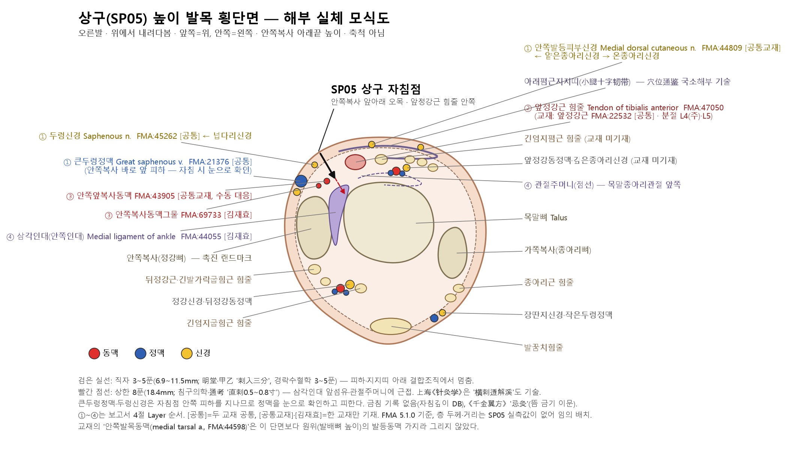
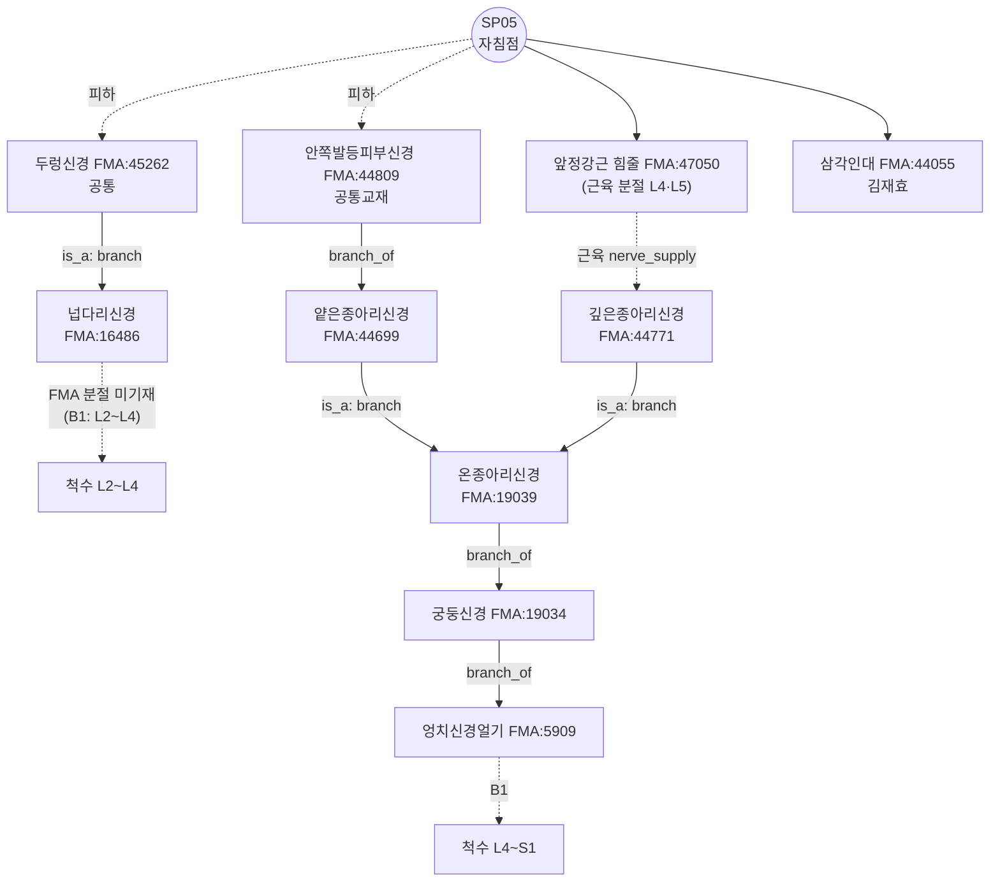

# [경혈 해부생리학 실체 판명 학술 모노그래프] 상구(商丘, SP05)

> **프레임워크**: v2.7 · **ARI**: ARI v3.0 | ARI-Core 75.0 ± 1.3 (B) | SI 75 | 잠정 가중치 0.40/0.35/0.25 | 민감도(등가중치): 71.9 (B, 등급 불변) · **이중 채점**: 독립 채점 2회, SI 1건 조정 완료 · **반사 기전**: B-Check 7/12 미부합 → **가설**

> **핵심 3대 원전**: 《中国针灸穴位通鉴》 · 《中国针灸证治通鉴》 · 《针灸腧穴通考》
> **Layer A 실증 DB**: `02_Master_Datasets/경혈_생의학_신경반사_마스터DB.json` (역색인 SP5 33편 중 **SP05를 실제 자극·관찰한 6편**만 판정에 사용, 8절 ① 표)
> **Layer B 참조 등록부**: `01_Framework/layer_b_reference_registry.md` (B-Check 6항목, 부합 기준 ≥ 8/12)
> **해부 온톨로지**: FMA 5.1.0 로컬 색인 — 교재 구조를 `FMA:ID`로 고정(B1 보조, 등록부 미등재), 부록 A
> **도량형 환산**: 한대 기준 1푼(分) = 2.3mm ($z = \text{푼} \times 2.3\text{mm}$)

---

## 1. 문헌 스크리닝 표 (3대 원전 원문 발췌)

| 문헌 | 원문 발췌 (출처 파일·행) | 한국어 요지 | 비고 |
| :--- | :--- | :--- | :--- |
| 《针灸腧穴通考》 | "部位：在足内侧，内踝前下方，舟骨粗隆与内踝尖连线中点凹陷中。" / "取穴：于内踝前缘直线与内踝下缘横线的交点处取穴，前为中封，后为照海。" — `침구수혈통고(针灸腧穴通考)/针灸腧穴通考_09_上_足太阴脾经穴.md` L969~971 | 안쪽복사 앞아래, 발배뼈 거친면–안쪽복사 끝 연결선 중점의 오목. 앞은 중봉, 뒤는 조해 | 현대 정위 |
| 《针灸腧穴通考》 | "内踝之下陷者之中也。(《灵枢·本输》)" / "在足内踝下微前陷者中。(《黄帝明堂经》…《医宗金鉴》)" / "在内踝前宛宛中。(《针灸甲乙经》卷十)" / "在内踝前陷中。(《千金翼方》卷二十六)" — 같은 파일 L973~979 | 《本输》 '아래', 《明堂》 '아래 조금 앞', 《甲乙》 권10·《千金翼》 '앞' | "本穴定位，古今文献一致"(L1005) |
| 《针灸腧穴通考》 | "刺入三分，留七呼，灸三壮。(《黄帝明堂经》)" / "针五分，灸七壮。(《窦太师针经》)" / "直刺0.5~0.8寸。(4、5、6、7版《针灸学》)" / "亦可横刺透解溪，进针1~1.5寸。(上海《针灸学》)" — 같은 파일 L1079~1095 | 한대 3푼, 현대 5~8푼, 횡자 투자법 | 5절 계산표 |
| 《针灸腧穴通考》 | "《黄帝明堂经》编者皆归于本穴主治，显然是将上述两条《内经》条文中的'足太阴'理解为'商丘'穴。教材中'黄疸'一症，未详所出，暂不列于主治项下。" — 같은 파일 L1055 | 《明堂》이 《내경》의 '足太阴'을 상구로 읽어 주치를 편입. '黄疸'은 출처 불명 | 2·9절 |
| 《中国针灸穴位通鉴》 | "脾……行于商丘，商丘内踝之下陷者之中也，为经。(《灵枢经·本输》1：8)" / 별명 "无。" — `중국침구혈위통감(中国针灸穴位通鉴)/中国针灸穴位通鉴_31_足太阴脾经(1).md` L1040, L1044 | 오수혈 경금(經金) | 출처 |
| 《中国针灸穴位通鉴》 | "针入三分，留三呼，泻五吸，疾出之，忌灸。(《千金翼方》26：321)" / "（刺可入同身寸之四分…）(王冰注)" — 같은 파일 L1212~1216 | 《千金翼》 뜸 금기 — 《明堂》 '灸三壮'과 이문 | 5·10절 |
| 《中国针灸穴位通鉴》 | "在内踝前下方与舟状骨结节之间，小腿十字韧带的下侧，有来自胫前动脉的内踝前动脉，分布着小腿内侧皮神经（隐神经）和来自腓浅神经的足背内侧皮神经。(《新针灸学》：207、《针灸学》)" / "在内踝之前下部，前胫骨筋腱之内侧。(《中国针灸学》：86)" — 같은 파일 L1076, L1242 | 십자인대(아래폄근지지띠) 아래, 앞정강근 힘줄 안쪽, 안쪽앞복사동맥·두렁신경·안쪽발등피부신경 | 4·6절 층차의 문헌 근거 |
| 《中国针灸证治通鉴》 | 《明堂经》 상구 주치 "主寒热善呕。厥头痛，面肿起。脾虚令人病寒不乐，好太息。腹满响响然，不便，心下有寒痛。阴股内痛，气痈，狐疝走上下…痔，骨蚀。…绝子。小儿咳而泄…" — `중국침구증치통감(中国针灸证治通鉴)/中国针灸证治通鉴_05_第壹编_第七篇_足太阴脾经_手少阴心经_手太阳小肠经.md` L118~126 | 단독 주치 목록 | $P_{single}$ 근거 |
| 《中国针灸证治通鉴》 | "商丘，在内踝前陷中，主偏风，痹脚不得履地，刺风，头风，热风，阴痹，针入三分，留三呼，泻五吸，疾出之，忌灸。" — `中国针灸证治通鉴_14_第叁编_内科病症_四中风至八痉证.md` L194 / "身寒痹：曲池、列缺、环跳、风市、委中、商丘、中封、临泣(《神应经·痹厥部》)" — `中国针灸证治通鉴_02_…量化概念.md` L172 | 《千金翼》 단독 조문 / 《神应经》 8혈 배오 | $P_{single}$ / $P_{comb}$ 분리 |

---

## 2. 원천/재인용 구분 표

| 층차 | 문헌 | 기술 내용 | 원천/재인용 |
| :--- | :--- | :--- | :--- |
| 선진·한대 | 《灵枢·本输》 | 内踝之下陷者之中, 경금 | 원천(위치) |
| 한대 | 《黄帝明堂经》 | 内踝下微前陷者中; 刺入三分, 留七呼, 灸三壮; 주치 목록 | 원천(위치 보정·심도·주치). 일부 주치는 《素问·刺疟》·《灵枢·厥病》·《灵枢·杂病》의 '足太阴'을 상구로 읽어 편입(通考 L1055) — **경맥 단위 기술의 혈위 귀속** |
| 위진 | 《针灸甲乙经》 卷三 / 卷十 | 卷三은 《明堂》 계승, 卷十 "在内踝前宛宛中" | 재인용 + 위치 이문(앞) |
| 당 | 《千金翼方》 卷二十六 | "在内踝前陷中"; 针入三分, 留三呼, 泻五吸; **忌灸**; 偏风·痹·脚不得履地 | 독자 기술(뜸 금기·하지 주치) |
| 당 | 王冰 《素问》 주 | 刺四分, 留七呼, 灸三壮; 脾疟 "刺足太阴(商丘主之)" | 재해석(《내경》 조문의 혈위 지정) |
| 송 | 《铜人腧穴针灸图经》 | 腹胀·肠鸣不便·脾虚不乐·痔·骨疽蚀·绝子·魇梦 | 《明堂》 재인용·정리 |
| 원·명 | 《窦太师针经》 | 针五分, 灸七壮; 足红肿·脚无力·脾家受湿两脚生疮 | 독자 기술(국소 하지 주치 확대) |
| 명 | 《针灸聚英》(高武) | 舌本强痛, 怠惰嗜卧, 小儿慢风 | **이론 귀속**: 母子补泻에 따라 족태음 경병후를 상구에 배당(通考 L1037) |
| 명 | 《神应经》·《针灸大成》·《类经图翼》 | 前有中封, 后有照海, 其穴居中 | 위치 보조 기준 |
| 현대 | 1957 南京《针灸学》~7版, 국표 1990/2006 | 舟骨结节(→粗隆)–内踝尖 연결선 중점; 直刺 0.5~0.8寸; 黄疸 | 표준화. '黄疸'은 출처 불명(通考 L1055; papers.id 1540/2215 歌赋 인용 의문) |

---

## 3. 이명·별칭 검증 표 (KJH DB 대조)

| 이명 | 출처 | KJH DB | 판정 |
| :--- | :--- | :--- | :--- |
| 商坵 | 《医学入门》; 1957 南京《针灸学》 별명 (通考 L959, L965) | 등재 | '坵'는 '丘'의 이체자. 같은 혈 |
| 商邱 | 청대·민국 문헌 — 공자 휘(丘) 피휘 (通考 L959) | 등재 | 피휘 표기. 같은 혈 |
| (별명 없음) | 《穴位通鉴》 "别名 无" (L1044) | — | 위 둘은 별명이 아니라 표기 변이 |

KJH DB(`경혈명_비교_정리_KJH.xlsx` 종합 목록 행 136: 133, SP05, 상구, 商丘, "商坵, 商邱")와 일치한다. '商'이 들어간 商阳(LI1)·商曲(KI17), '丘'가 들어간 丘墟(GB40)와 혼용된 기록은 3대 원전에서 찾지 못했다.

---

## 4. 3D 공간 좌표 및 Layer 1~5 층차 구조도

- **X (전후)**: 안쪽복사 앞모서리 직선 위(通考 L971), 앞정강근 힘줄의 **안쪽**(《中国针灸学》, 通鉴 L1076). 앞은 중봉(LR4), 뒤는 조해(KI6).
- **Y (상하)**: 안쪽복사 아래모서리 가로선 높이(通考 L971) = 발배뼈 거친면–안쪽복사 끝 연결선 중점(국표 2006).
- **Z (깊이)**: 아래 층차. **SP05 사체·초음파 실측값이 Layer A에 없으므로 mm 경계는 적지 않고 구조 순서만 기재**한다.

```
[Layer 1 피부·피하]   두렁신경 가지(두 교재) · 큰두렁정맥(두 교재) · 안쪽발등피부신경(공통교재)
        │
[Layer 2 지지띠·힘줄]  아래폄근지지띠 아래가장자리 · 앞정강근 힘줄 안쪽 — 고전 3푼(6.9mm) 도달층(추정)
        │
[Layer 3 오목 결합조직] 안쪽앞복사동맥(공통교재) · 안쪽복사동맥그물(김재효)
        │
[Layer 4 인대·관절주머니] 삼각인대 앞섬유(김재효) · 목말종아리관절 앞 관절주머니 — 상한 8푼(18.4mm) 근접(추정)
        │
[Layer 5 뼈]          목말뼈 · 안쪽복사(정강뼈) · 발배뼈 (심부 장기 없음, 관절강)
```



*그림 4-1. 상구 높이 발목 횡단면 모식도(오른발, 위에서 내려다봄, 축척 아님). 직자 경로는 앞정강근 힘줄 안쪽, 큰두렁정맥 바깥쪽을 지나 오목의 결합조직에 이르고, 상한 깊이에서는 삼각인대 앞섬유·관절주머니에 가까워진다. 층 두께·거리는 SP05 실측값이 없어 임의로 배치했다.*

**FMA 실체 대조(Layer별)** — 구조명은 2대 교재, ID·관계는 FMA 5.1.0

| Layer | 구조 | FMA | 대응 | FMA 관계 | 신경 줄기 / 분절 |
| :--- | :--- | :--- | :--- | :--- | :--- |
| 1 | 두렁신경 [공통] | FMA:45262 | exact | is_a Branch of femoral nerve | 넙다리신경(FMA:16486). 분절은 FMA 미기재 → B1-03: L3~L4 피절 |
| 1 | 큰두렁정맥 [공통] | FMA:21376 | exact | drains_into Femoral vein | — |
| 1 | 안쪽발등피부신경 [공통교재] | FMA:44809 | exact | 상위 Superficial fibular nerve | 얕은종아리신경 → 온종아리신경 → 궁둥신경 → 엉치신경얼기 |
| 2 | 앞정강근 [공통] | FMA:22532 (교재) → **힘줄 FMA:47050** | exact | contained_in 앞칸 공간(FMA:85203) | 분절 L4(주)·L5 (근육 segmental_supply) |
| 3 | 안쪽앞복사동맥 [공통교재] | FMA:43905 | **수동 대응**(자동 none: 교재 어순 'medial anterior' ↔ FMA 'Anterior medial') | 앞정강동맥 가지 | — |
| 3 | 안쪽복사동맥그물 [김재효] | FMA:69733 | exact | is_a Malleolar arterial network | — |
| 4 | 삼각인대(안쪽인대) [김재효] | FMA:44055 | exact | is_a Ligament of ankle joint | — |
| (원위) | 안쪽발목동맥 [공통] | FMA:44598 | exact | Subdivision of anterior tibial artery | 상구 단면보다 원위(발배뼈 높이)의 가지 — 자침 경로 밖 |

- 김재효 데이터셋의 셋째 근육 행 "발목관절의 안쪽힘줄 ligament of ankle joint) (medial (deltoid)"는 삼각인대가 괄호 처리 중 깨져 들어간 **중복 행**이다(FMA 미대응). 구조로 세지 않는다.
- 교재는 '앞정강근'을 적지만 상구 높이에서는 근복이 아니라 힘줄이다. 근육의 분절(L4·L5)은 힘줄 자극의 구심 분절과 같다고 보지 않고 참고로만 둔다.

---

## 5. 자침 깊이 계산표

출처: `침구문헌별 자침깊이 정리_AI 분석용.xlsx` 시트1 Excel 행 135(N0 133, SP05), 보조로 3대 원전.

| 문헌 | 푼(分) | 환산 심도 (×2.3mm) | 도달 Layer(추정) | 비고 |
| :--- | :---: | :---: | :--- | :--- |
| 황제명당경(황룡상 감수) | 3 | 6.9mm | 1~2 | "刺入三分" |
| 침구갑을경 | 3 | 6.9mm | 1~2 | |
| 침구경험방 | 3 | 6.9mm | 1~2 | |
| 동의보감(인용: 동인) | 3 | 6.9mm | 1~2 | 금침 아님 |
| 경락수혈학 공통교재 | 3~5 | 6.9~11.5mm | 1~3 | |
| 침구의학 공통교재 | 5~8 | 11.5~18.4mm | 3~4 | |
| 《针灸腧穴通考》 | 5~8 | 11.5~18.4mm | 3~4 | "直刺0.5~0.8寸" |
| 《千金翼方》(원전 보조) | 3 | 6.9mm | 1~2 | **忌灸** |
| 王冰 주·《医学入门》(원전 보조) | 4 | 9.2mm | 2 | |
| 《窦太师针经》(원전 보조) | 5 | 11.5mm | 3 | |
| 上海《针灸学》(원전 보조) | 횡자 10~15 | (수평 거리 23~34.5mm) | 1~2 | "横刺透解溪" — 깊이가 아닌 피하 수평 진행 |

- 금침('0') 기록 없음, 'blank' 없음(DB 해당 열 기준). 《千金翼方》 '忌灸'는 **뜸** 금기 이문이며 침 금기가 아니다.
- 안전 범위: 3~5푼은 피하·지지띠 아래 결합조직에 머문다. 8푼 직자는 삼각인대 앞섬유·관절주머니에 가까워 관절강 천자 가능성이 있다(추정, 실측 없음). 큰두렁정맥·두렁신경이 자침점 안쪽 피하를 지나므로 정맥을 눈으로 확인하고 피한다.

---

## 6. 해부학 구조 교재 비교표

| 구분 | 경혈학 공통교재 (refine.xlsx 종합 시트 행 134) | 김재효 교재 (종합 시트 행 134) | FMA 판별 | 평가 |
| :--- | :--- | :--- | :--- | :--- |
| 근육·인대 | 앞정강근 | 앞정강근, 삼각인대 (+깨진 중복 행 1) | FMA:22532 공통 / FMA:44055 김재효 단독 | 김재효가 심층 인대까지 기재 |
| 신경 | 두렁신경, 안쪽발등피부신경 | 두렁신경 | FMA:45262 공통 / FMA:44809 공통교재 단독 | 공통교재가 발등 쪽 피부신경 추가 |
| 혈관 | 안쪽앞복사동맥, 안쪽발목동맥, 큰두렁정맥 | 큰두렁정맥, 안쪽발목동맥, 안쪽복사동맥그물 | FMA:21376·44598 공통 / FMA:43905 공통교재 / FMA:69733 김재효 | 안쪽앞복사동맥은 동맥그물의 구성 가지 — 같은 영역의 다른 수준 |

**FMA로 본 차이의 의미**: 두 교재 차이는 상충이 아니라 기재 범위 차이다. ① 공통교재 단독 '안쪽발등피부신경'은 FMA상 **얕은종아리신경 → 온종아리신경(궁둥신경 계통)** 가지이고, 공통 '두렁신경'은 **넙다리신경 계통**이다. 따라서 상구 피부는 두 신경계(L3~L4 대 L5 피절, B1-03)의 경계 부근으로 읽힌다(피절 경계는 FMA가 아니라 B1-03 근거). ② '안쪽앞복사동맥'(공통교재)은 '안쪽복사동맥그물'(김재효)을 이루는 가지로, 같은 혈관 영역을 다른 해상도로 적은 것이다. ③ 김재효의 '삼각인대'는 Layer 4로, 상한 깊이의 안전 판단(5절)에 필요한 정보를 더한다. 《穴位通鉴》 국소해부 기술(L1240~1246: 十字韧带下侧·内踝前动脉·隐神经·足背内侧皮神经)은 공통교재 쪽 구성과 일치한다.

B1-01·B1-03(발목 앞안쪽 국소해부)과 부합한다. 혈위 특이 영상·사체 실측(PMID)은 없다.

---

## 7. 공간 변위 분기 추론도

| 계통 | 근거 | 위치 |
| :--- | :--- | :--- |
| ① 아래 | 《灵枢·本输》 "内踝之下陷者之中"(通考 L973) | 안쪽복사 아래 |
| ② 아래 조금 앞 | 《明堂》 이하 15종 "在足内踝下微前陷者中"(通考 L975) | 안쪽복사 앞아래 |
| ③ 앞 | 《甲乙》 卷十 "在内踝前宛宛中", 《千金翼》 "在内踝前陷中"(通考 L977~979) | 안쪽복사 앞 |
| ④ 현대 | 舟骨粗隆–内踝尖 연결선 중점(국표 2006, 通考 L947) | 안쪽복사 앞아래 |

네 기술은 모두 안쪽복사 앞아래 오목 하나를 서로 다른 기준선으로 가리키며, 《通考》도 "古今文献一致"(L1005)로 판단한다. 차이는 안쪽복사 크기 안쪽(약 1cm)으로 15mm 미만이다(추정, 실측 아님). 따라서 **$\Delta_{discrepancy} \le 15\text{mm}$, Target 분기 불요 — 단일 Target(T1)**.

---

## 8. 생의학적 반사 기전도 및 외부 검색 로그

**기전 기술(가설)**: 상구의 말초 실체(두렁신경·안쪽발등피부신경·앞정강근 힘줄·삼각인대)는 확인되지만(①), 상구 자극이 고전 주치(복창·설사·변비 등 비위 증후)를 일으키는 경로를 **상구에서 직접 검증한 Layer B 실험이 없다.** 동물 연구는 비장 미토콘드리아 유전자(papers.id 2211), 체액 면역(2212), DSS 대장염(2218, 비경 오수혈 레이저), NOS·노르에피네프린(2219, 경혈 6곳) 변화를 보고하나, 경로 검증이 아니라 결과 지표이고 다혈위 설계가 섞여 있다. 체성-자율 반사 일반 틀(B3-04·B3-05)을 유추로 적용할 뿐이므로 **B-Check 7/12(미부합) → 기전은 가설**로 둔다. 국소 주치(足踝痛)는 인체 RCT(2214, 다혈위)로 일부 지지된다.

**말초 구심 경로의 FMA 고정**:



*그림 8-1. FMA 5.1.0 관계로 그린 SP05 말초 구심 경로. 실선은 FMA 기재 관계, "is_a"는 클래스명에서 이은 줄기, 점선은 FMA에 없는 연결(B1 보완)이다. 위·대장 내장절(T6~T12, 원위 대장·직장 S2~S4)과 겹치는 분절은 없다.*

### ① Layer A 논문 표 (SP05를 실제 자극·관찰한 연구)

| papers.id | 연도 | 저널 | 제목(요약) | PMID / DOI | 설계·SP05 역할 |
| :---: | :---: | :--- | :--- | :--- | :--- |
| 2212 | 1989 | Acupunct Electrother Res | Electro-acupuncture modifies humoral immune response in the rat | 2575342 / 10.3727/036012989816358461 | 동물(쥐). "Shangqiu (LP-5)"·曲泉·然谷 비교 |
| 2211 | 2023 | J Acupunct Meridian Stud | Manual acupuncture on mitochondrial fusion/fission gene expression in rat spleen | 37076179 / 10.51507/j.jams.2023.16.2.49 | 동물(쥐). SP1·2·3·5·9 개별군, SP5군 PGC-1α↓·Fis1↑ |
| 2218 | 2014 | Korean J Acupunct | Laser acupuncture on the five transport points of the spleen meridian in DSS colitis | — / 10.14406/acu.2014.011 | 동물(쥐), 830nm 레이저. 개별 혈위 군 여부 확인 불가 |
| 2219 | 2013 | Korean J Acupunct | Acupuncture at the river points (LU8, HT4, PC5, SP5, KI7, LR4) on NOS and norepinephrine | — / 10.14406/acu.2013.30.1.037 | 동물(쥐), 경혈 6곳 |
| 2214 | 2018 | Zhongguo Zhen Jiu | Intradermal needling combined with tuina on ankle sprain sequelae | 29971999 / 10.13703/j.0255-2930.2018.06.004 | 인체 RCT(90명), 丘墟/商丘 등 국소 피내침, 다혈위 |
| 2213 | 2022 | Zhongguo Zhen Jiu | Positive reaction of foot three yin-meridians in type III chronic prostatitis | 37199204 / 10.13703/j.0255-2930.20210625-0004 | 인체 관찰(경락 진찰). 商丘 양성 반응률 보고 |
| 1922 | 2023 | Zhen Ci Yan Jiu | Acupoint compatibility in ankle sprain (complex network) | 36858419 / 10.13702/j.1000-0607.20211265 | 문헌 분석. SP5 빈도 34회(상위 10혈) |

- **문헌학 근거(판정 외, 2·9절에 사용)**: 1472 黄龙祥 "十二'经脉穴'源流考"(1994); 1540·2215 《针灸学》 교재 歌赋 인용 의문(2008, PMID 18928122 — "商丘主治黄疸" 근거 불명 지적).
- **제외**: 846·848(전정핵 연구 — 'Sp5'는 삼차신경척수핵 약어로 오적중), 2210(위암 CT), 2216(하남성 상구시 병원 — 지명 오적중), 2220·2217·2221·57·793·958·1421(SP05 자극 확인 불가 또는 무관), 1487·1488·1510·1534·1735·1738(일반 문헌·다혈위 목록).
- **DB 점검 사항(수정하지 않음)**: 같은 문헌의 active 중복 6쌍(1472/2072, 1487/2089, 1488/2090, 1510/2111, 1540/2136·2215, 1534/2141). SP5 레코드의 `landmark_paper_ids` 첫 항목이 오적중 2210이다.

### ② B-Check 채점표

| 항목 | 내용 | 채점자 A | 채점자 B | 최종 | 참조 ID | papers.id | 근거 요지 |
| :---: | :--- | :---: | :---: | :---: | :--- | :--- | :--- |
| ① | 자침 심도의 말초신경·혈관 실체 | 2 | 2 | **2** | B1-01, B1-03, B2-09 (+FMA) | — | 2대 교재·《穴位通鉴》 국소해부·규범 해부서가 두렁신경·큰두렁정맥·앞정강근 힘줄 안쪽 오목을 일치 기술. 교재 구조 FMA 정확 대응 7종(+수동 1). 혈위 특이 영상 실측 없음 |
| ② | 척수 분절 정합 | 1 | 1 | **1** | B1-02, B1-03, B3-05 (+FMA) | — | SP05 L3~S1(두렁신경 L3~L4, 얕은종아리 L5, 앞정강근 L4·L5) vs 위·비 T6~T10, 원위 대장·직장 S2~S4: 직접 겹침 없음. 상척수 경로 유추 → 1 |
| ③ | 구심 섬유형·수용체 | 1 | 1 | **1** | B3-04, B3-06 | — | SP05 특이 섬유·수용체 연구 없음. 피부·힘줄 기계수용 구심 일반 틀의 유추 |
| ④ | 중추 중계·경로 | 1 | 1 | **1** | B3-04, B3-05 | 2219 | 중추 지표(NOS·NE)는 다혈위 결과 지표. 경로 검증 없음 → 유추 1 |
| ⑤ | 원심 경로·표적 효과($P_{single}$ 일치) | 1 | 1 | **1** | B3-05 | 2211, 2212, 2218 | 비장 유전자·체액 면역·대장염 지표 변화(동물). 2218만 비위 주치(泄泻)와 방향이 맞고 다혈위·개별군 불명 |
| ⑥ | 인체 전환 근거 | 1 | 1 | **1** | B4-04, B4-05 | 2213, 2214 | 인체 RCT는 국소 足踝痛(다혈위), 관찰 연구 1편. 내장 반사의 인체 확인 없음 |
| **합계** | | 7 | 7 | **7 / 12** | | | **판정: 미부합(< 8/12)** → 기전 **가설**. ①·② ≥ 1 충족 |

### ③ 외부 검색 로그 (sync_log, 2026-10-23 Rank 6 실행)

| 일시 | 소스 | HTTP | 수집 | 중복제거 | 신규 | 쿼리 |
|---|---|---|---|---|---|---|
| 2026-10-23T21:42:19 | pubmed | 200 | 8 | — | — | ("SP5" OR "Shangqiu" OR "商丘") AND (acupuncture OR electroacupuncture) AND (nerve OR reflex OR autonomic OR mechanism OR anatomy) \| … AND ("Zhongguo Zhen Jiu"[Journal] OR "Zhen Ci Yan Jiu"[Journal]) |
| 2026-10-23T21:42:19 | openalex | 200 | 8 | — | — | doi_starts_with:10.13703 / 10.13702, title_and_abstract.search:"Shangqiu" OR "SP5" \| has_doi:true … AND (acupuncture OR electroacupuncture) |
| 2026-10-23T21:42:19 | crossref | 200 | 0 | — | — | Shangqiu acupuncture nerve reflex |
| 2026-10-23T21:42:19 | all | — | 16 | 16 | 0 | 기존 병합 13, 배치 내 중복 3 |
| 2026-10-23T18:08:38 | all (선행 실행) | — | 16 | 4 | 12 | pubmed·openalex·crossref ok |

---

## 9. 주치증 분리 표

| 구분 | 주치 | 원문 근거 |
| :--- | :--- | :--- |
| $P_{single}$ | 복만·불편(대변 불통)·심하 한통 | "腹满响响然，不便，心下有寒痛，商丘主之"(《甲乙》 9：123, 通鉴 L1114) |
| $P_{single}$ | 비허 — 寒不乐·好太息 | "脾虚令人病寒，不乐好太息，商丘主之"(《甲乙》 9：122, 通鉴 L1112) |
| $P_{single}$ | 寒热善呕 · 脾疟(寒·腹中痛) | 《甲乙》 8：112(通鉴 L1108); 《素问·刺疟》 "刺足太阴" → 王冰 "商丘主之"(L1104) — 경맥 단위 조문의 혈위 귀속 |
| $P_{single}$ | 음고 내측통·狐疝 | 《甲乙》 9：126(L1116). 통고는 족태음근 "聚于阴器"로 설명(L1055) |
| $P_{single}$ | 痔·骨蚀 | 《甲乙》 9：127(L1118) |
| $P_{single}$ | 癫疾·狂·善笑, 善厌梦, 管疽, 绝子, 小儿咳而泄·痫瘈 | 《甲乙》 11：139·141·143, 12：153·154(L1122~1136) |
| $P_{single}$ | 偏风·痹·脚不得履地 | 《千金翼方》 卷二十六(通考 L1025; 证治通鉴_14 L194) |
| $P_{single}$ | 내과(踝) 홍종·각무력 | 《窦太师针经》·《循经考穴编》(通考 L1031~1033) — 국소 주치 |
| $P_{comb}$ | 喉痹 | 완골·천용 등 12혈 "悉主之"(《甲乙》 12：152, L1132) — 군집 조문 |
| $P_{comb}$ | 각완 동통(绕踝风) | 商丘·中封·丘墟·解溪 "俱泻之"(《针灸集要》, 通考 L1061) |
| $P_{comb}$ | 穿根草鞋风 | 昆仑·丘墟·照海·商丘(《针灸集成》, L1063) |
| $P_{comb}$ | 치질 | 飞扬·商丘·复溜 등 9혈(《千金翼方》 卷二十八, L1069) |
| $P_{comb}$ | 身寒痹 | 曲池·列缺 등 8혈(《神应经》, 证治通鉴_02 L172) |
| $P_{comb}$ | 僻噤·腹胀满不得息·癫疾呕吐 | 《千金要方》 30권 다혈위 조문(通鉴 L1138~1150) |
| 후대 귀속(주치 근거 약함) | 舌本强痛·怠惰嗜卧 | 高武의 母子补泻 이론 배당(通考 L1037) |
| 후대 귀속(출처 불명) | 黄疸 | "未详所出，暂不列于主治项下"(通考 L1055); 교재 歌赋 인용 의문(papers.id 1540/2215) |

---

## 10. ARI v3.0 프로파일 평가표 및 최종 결론

**Target T1 (단일)**: 고전 "足内踝下微前陷者中" = 현대 舟骨粗隆–内踝尖 연결선 중점(앞정강근 힘줄 안쪽).

### 하위 점수

| 지표 | 채점자 A | 채점자 B | 평균 | 루브릭 단계 근거 요지 | 근거 포인터 |
| :--- | :---: | :---: | :---: | :--- | :--- |
| $S_{orig}$ (0.40) | 93.75 | 87.5 | 90.63 | 아래 하위 4항목 평균 | 通考 `_09_上_足太阴脾经穴.md` L939~1095 |
| $S_{clarity}$ (0.35) | 75 | 75 | 75 | 2대 교재 공통 구조 4종 일치 + 기재 범위 차이(FMA로 판별) + B1 확인, 혈위 특이 실측 없음 → 100 미달 | 6절; refine·김재효 종합 행 134; FMA:45262·21376·22532 |
| $S_{reflex}$ (0.25) | 50 | 50 | 50 | Layer A 6편(동물 4·인체 RCT 1·관찰 1)이나 B-Check 7(< 8)로 75 요건 미충족 → "B-Check 6~7" 단계 | 8절 ①②; papers.id 2211·2212·2214 |
| SI ($S_{safety}$) | 75 | 50 → **75**(조정) | 75 | 금침 없음. 상한 8푼은 관절주머니 근접이나 고전·교재 3~5푼과 횡자법 명시, 큰두렁정맥은 육안 회피 가능 | 5절; 자침깊이 DB 행 135 |

### $S_{orig}$ 하위 4항목

| 하위 항목 | A | B | 근거 |
| :--- | :---: | :---: | :--- |
| ① 최초 기술 명확성 | 100 | 75 | A: 《本输》 위치 + 《明堂》(한대) '微前'·'刺入三分'으로 위치·심도 모두 지정. B: 《本输》 자체는 심도 미기재, 《明堂》은 복원 문헌이라 한 단계 낮춤 |
| ② 후대 일치율 | 100 | 100 | 《明堂》 문구를 계승한 후대 문헌 14종(通考 L975), 통고 "古今文献一致"(L1005) |
| ③ 이명 혼용 해소 | 100 | 100 | 商坵·商邱는 이체자·피휘 표기, 타 혈 혼용 없음 |
| ④ 《通考》 교감 | 75 | 75 | 黄疸 출처 불명·舌本强痛 이론 귀속을 통고가 지적(L1037, L1055). 《千金翼》 '忌灸' vs 《明堂》 '灸三壮' 이문은 통고가 판정하지 않음 |
| 평균 | **93.75** | **87.5** | |

### 게이트·등급·민감도

- **게이트**: 게이트 1(S_orig·S_clarity ≥ 50) 미적용, 게이트 2(Layer A 6편) 미적용, 게이트 3(SI 75) 미적용.
- **ARI-Core**: A = 0.40×93.75 + 0.35×75 + 0.25×50 = **76.25** / B = 0.40×87.5 + 0.35×75 + 0.25×50 = **73.75** → 평균 **75.0 ± 1.3** → **등급 B(개연)**, 표지 없음.
- **SI** = 75 (별도 병기).
- **등가중치 민감도**: A 72.9, B 70.8 → 평균 **71.9** → B, 등급 불변.
- **분기 판정**: 단일 Target이므로 해당 없음.
- **조정 기록**: SI가 A 75·B 50으로 25점 차(≥ 15)라 조정했다. B는 "직자 시 Layer 4 신경혈관속 직접 접촉"(50단계)으로 보았으나, 상구 옆 혈관은 피하의 큰두렁정맥으로 육안·촉지로 피할 수 있고, 관절주머니는 신경혈관속이 아니며, 문헌이 3~5푼 심도와 횡자법을 명시하므로 75단계("사자·횡자로 회피 가능, 문헌에 각도·심도 제한 명시")로 확정했다. 나머지 하위 점수의 차이는 $S_{orig}$ ① 1항목(25점, 평균 반영 시 6.25점)으로 조정 대상이 아니다.

### 최종 결론

상구(SP05)의 해부학적 실체는 **개연(B)** 수준이다. 위치는 《灵枢·本输》 이래 안쪽복사 앞아래 오목으로 고금이 일치하고, 그 아래 두렁신경·큰두렁정맥(피하), 앞정강근 힘줄 안쪽 오목, 깊은 곳의 삼각인대·관절주머니가 2대 교재·《穴位通鉴》 국소해부·FMA 표준 실체로 확인된다. 다만 고전 주치의 중심인 비위 증후를 설명하는 반사 경로는 상구에서 검증되지 않았다(B-Check 7/12, **가설**).

적용 범위 제한:
1. 동물 연구(2211·2212·2218·2219)는 결과 지표 변화만 보였고, 경로 검증이 아니며 다혈위 설계가 섞여 있다.
2. 상구(L3~S1)와 위·비(T6~T10)·원위 대장(S2~S4)은 분절이 겹치지 않는다.
3. 인체 근거는 국소 足踝痛(다혈위 RCT 2214)에 한정된다.
4. '黄疸'은 출처 불명, '舌本强痛·怠惰嗜卧'는 이론 귀속이므로 상구 고유 주치로 쓰지 않는다.
5. 《千金翼方》 '忌灸'와 《明堂》 '灸三壮'의 이문은 해결되지 않았다(침 금기는 아님).

---

## 부록 A. FMA 해부 실체 프로파일 (FMA 5.1.0)

생성: `python .claude/skills/acupoint-anatomy/scripts/fma/fma_query.py profile SP05 --md` (2026-10-23). 수동 보정 2건(아래)을 반영했다.

| 구분 | 교재 용어 | FMA 실체 | 대응 | 출처 | 신경 지배 / 상위 줄기 | 척수 분절 |
| :--- | :--- | :--- | :--- | :--- | :--- | :--- |
| 근육 | 앞정강근 (anterior tibial / tibialis anterior) | FMA:22532 Tibialis anterior (상구 높이: 힘줄 FMA:47050) | exact / exact+muscle | 공통교재·김재효 | FMA:80062 → 깊은종아리신경 → 온종아리신경 | L4(주), L5(부) |
| 인대 | 발목관절의 삼각인대 | FMA:44055 Medial ligament of ankle joint | exact | 김재효 | — | — |
| 신경 | 두렁신경 | FMA:45262 Saphenous nerve | exact | 공통교재·김재효 | FMA:16486 Femoral nerve | FMA 미기재 |
| 신경 | 안쪽발등피부신경 | FMA:44809 Medial dorsal cutaneous nerve | exact | 공통교재 | FMA:44699 → 19039 → 19034 → 5909 | FMA 미기재 |
| 혈관 | 큰두렁정맥 | FMA:21376 Great saphenous vein | exact | 공통교재·김재효 | → Femoral vein → … → IVC | — |
| 혈관 | 안쪽발목동맥 | FMA:44598 Medial tarsal artery | exact | 공통교재·김재효 | → Anterior tibial artery | — |
| 혈관 | 안쪽복사동맥그물 | FMA:69733 Medial malleolar arterial network | exact | 김재효 | — | — |
| 혈관 | 안쪽앞복사동맥 | FMA:43905 Anterior medial malleolar artery | **수동**(자동 none) | 공통교재 | 앞정강동맥 가지 | — |
| (중복) | 발목관절의 안쪽힘줄 … (medial (deltoid) | — | none | 김재효 | 삼각인대 행의 파싱 오류 — 제외 | — |

- 분절 합집합(근육 segmental_supply): **L4, L5**. 피부신경 분절은 FMA 미기재 → B1-03(두렁신경 L3~L4, 얕은종아리신경 L5).
- 두 교재 비교: 공통 FMA 실체 4 · 공통교재 단독 2(FMA:44809, 43905) · 김재효 단독 2(FMA:44055, 69733).
- 인용 한계: FMA는 정상 성인 규범 해부 온톨로지로, 혈위 특이 심도·변이·반사 기능의 근거가 아니다.

---

## 개정 이력

| 일자 | 위치 | 원래 내용 | 바꾼 내용 | 근거 |
| :--- | :--- | :--- | :--- | :--- |
| 2026-10-23 | 전체 | ari_analyzer.py 템플릿 초안(21:00): 원전 발췌 원문 덩어리, 범용 Layer mm 경계(2.5/6.5/16.5/22mm), 교재 비교 일반문, 단일 채점 ARI-Core 81.2·S_reflex 100, B-Check 9/12 "확정", "실측 논문 33편 전수 역색인" | Tier 3 재작성(10대 구성 요소 전수), 이중 채점 ARI-Core 75.0 ± 1.3(B), B-Check 7/12 미부합(가설) | 정본 Rank 0~7·4·5절 |
| 2026-10-23 | 1·2·3·7·9절 | 원전 덩어리 인용, 이명 "-" | 3대 원전 행 번호 인용, 원천/재인용 층차표, 商坵·商邱 표기 변이, 분기 불요 판정, $P_{single}$/$P_{comb}$ 분리 | 通考 `_09_上` L939~1095; 通鉴 `_31_(1)` L1036~1260; 证治通鉴 `_05` L118, `_14` L194, `_02` L172; KJH 행 136 |
| 2026-10-23 | 4·6절·부록 A | 범용 층차, FMA 표의 none 2건 | 구조 순서 층차표, 그림 4-1 횡단면 모식도, FMA:43905 수동 대응·FMA:47050 힘줄 보정·김재효 중복 행 제외 | FMA 5.1.0; `.claude/skills/acupoint-anatomy/scripts/fma/figures/SP05_cross_section.py` |
| 2026-10-23 | 5절 | 공식 설명만 | 문헌별 푼수→mm 계산표, 忌灸(뜸) 구분 | 자침깊이 DB 행 135; 通鉴 L1210~1234; 通考 L1079~1095 |
| 2026-10-23 | 8절 | papers.id 57·793·846·848·958·1421 등 10편(PMID 공란) 인용, B-Check 9 | SP05 실제 자극·관찰 6편 + 문헌 1편, 오적중 제외 목록, B-Check 7(②=1·③④⑤⑥=1), 외부 검색 로그 표, 그림 8-1 | 마스터DB.json SP5 역색인·sync_log 21:42:19; PubMed efetch 초록 대조 |
| 2026-10-23 | 10절 | S_orig 75·S_clarity 75·S_reflex 100·SI 75, "엄격하게 검증됨" | S_orig 93.75/87.5, S_clarity 75, S_reflex 50, SI 75(조정), 범위 제한 결론 | 4.2절 루브릭 |
| 2026-10-23 | 구판 보관 | — | 템플릿 md·html·xlsx를 `_구판_template_20261023/`에 보관 | — |
