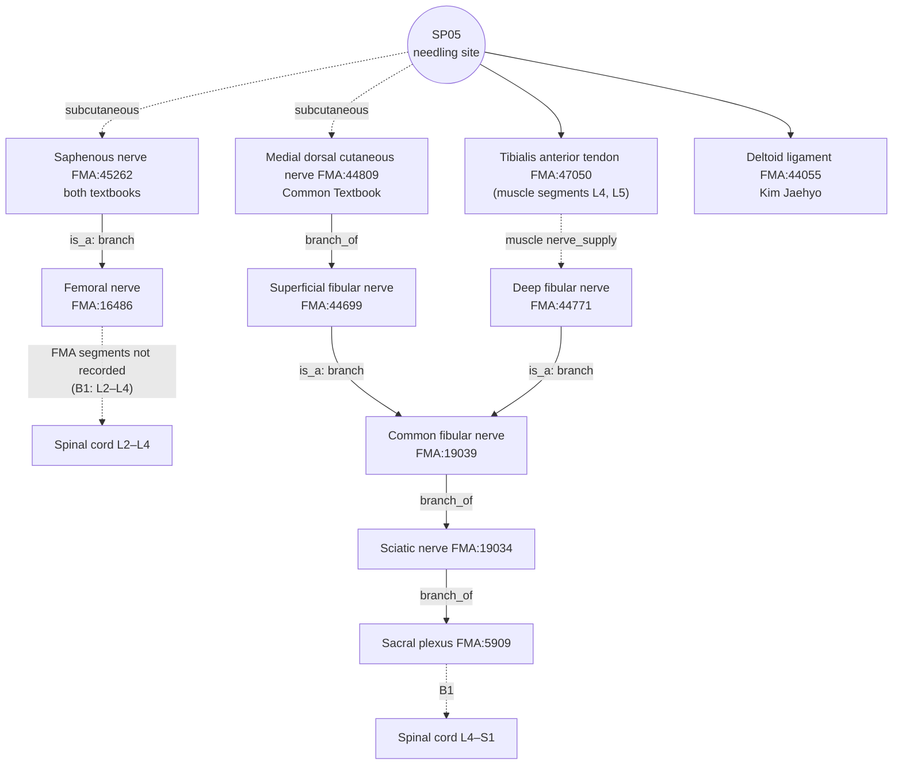

# [Acupoint Anatomical & Physiological Substrate Monograph] Shangqiu (商丘, SP05)

> **Framework**: v2.7.7 (four primary classics, Tri-Target) · **ARI**: ARI v3.0 | ARI-Core 75.0 ± 1.3 (B) | SI 75 | provisional weights 0.40/0.35/0.25 | sensitivity (equal weights): 71.9 (B, grade unchanged) · **Dual scoring**: two independent scorings, 1 SI item adjudicated · **Reflex mechanism**: B-Check 7/12, not concordant → **hypothesis**

> **Four Primary Classics**: *Zhongguo Zhenjiu Xuewei Tongjian* (《中國針灸穴位通鑑》) · *Zhongguo Zhenjiu Zhengzhi Tongjian* (《中國針灸證治通鑑》) (Chinese original as reference text; analysis written from the Korean translation of the same chapter) · *Zhenjiu Shuxue Tongkao* (《針灸腧穴通考》) · *Zhongguo Zhenjiu Jingluo Tongjian* (《中國針灸經絡通鑑》)
> **Layer A Empirical Database**: Integrated Biomedical Master DB v3.0 (of the 33 papers in the SP5 inverted index, only **the 6 papers that actually stimulated or observed SP05** are used for the verdict; Section 8, Table ①)
> **Layer B Reference Registry**: four-tier reference registry (B1–B4) (6-item B-Check, concordance threshold ≥ 8/12)
> **Anatomical Ontology**: local index of FMA 5.1.0 — textbook structures are pinned to `FMA:ID`s (B1 supplementary, not yet in the registry); Appendix A
> **Metrological Standard**: Han-dynasty standard, 1 fen (分) = 2.3 mm ($z = \text{fen} \times 2.3\text{mm}$)
> **Note on script**: Classical quotations and TCM terms are given in Traditional Chinese (繁體字). The cited refined editions are in simplified script; PDF page ranges and line numbers refer to those editions.

---

## 1. Classical Literature Screening Table (Four Primary Classics Excerpts)

| Classic | Original excerpt (file & line) | English summary | Remarks |
| :--- | :--- | :--- | :--- |
| *Zhenjiu Shuxue Tongkao* (《針灸腧穴通考》) | "部位：在足內側，內踝前下方，舟骨粗隆與內踝尖連線中點凹陷中。" / "取穴：於內踝前緣直線與內踝下緣橫線的交點處取穴，前為中封，後為照海。" — 《針灸腧穴通考》 上 足太陰脾經穴 L969–971 | Anteroinferior to the medial malleolus, in the depression at the midpoint of the line joining the tuberosity of the navicular and the tip of the medial malleolus. Zhongfeng (中封) lies in front, Zhaohai (照海) behind | Modern location |
| *Zhenjiu Shuxue Tongkao* (《針灸腧穴通考》) | "內踝之下陷者之中也。(《靈樞·本輸》)" / "在足內踝下微前陷者中。(《黃帝明堂經》…《醫宗金鑑》)" / "在內踝前宛宛中。(《針灸甲乙經》卷十)" / "在內踝前陷中。(《千金翼方》卷二十六)" — same file, L973–979 | 《本輸》 'below'; 《明堂》 'below and slightly anterior'; 《甲乙》 vol. 10 and 《千金翼》 'anterior' | "本穴定位，古今文獻一致" (L1005) |
| *Zhenjiu Shuxue Tongkao* (《針灸腧穴通考》) | "刺入三分，留七呼，灸三壯。(《黃帝明堂經》)" / "針五分，灸七壯。(《竇太師針經》)" / "直刺0.5~0.8寸。(4、5、6、7版《針灸學》)" / "亦可橫刺透解溪，進針1~1.5寸。(上海《針灸學》)" — same file, L1079–1095 | Han dynasty 3 fen; modern 5–8 fen; transverse through-needling | Calculation table in Section 5 |
| *Zhenjiu Shuxue Tongkao* (《針灸腧穴通考》) | "《黃帝明堂經》編者皆歸於本穴主治，顯然是將上述兩條《內經》條文中的'足太陰'理解為'商丘'穴。教材中'黃疸'一症，未詳所出，暫不列於主治項下。" — same file, L1055 | The compilers of 《明堂》 read '足太陰' in the *Neijing* (《內經》) as Shangqiu (商丘) and incorporated those indications. The source of 'jaundice (黃疸)' is unknown | Sections 2 and 9 |
| *Zhongguo Zhenjiu Xuewei Tongjian* (《中國針灸穴位通鑑》) | "脾……行於商丘，商丘內踝之下陷者之中也，為經。(《靈樞經·本輸》1：8)" / alias "無。" — 《中國針灸穴位通鑑》 足太陰脾經(1) L1040, L1044 | River point (經穴), Metal (金), of the five transport points (五輸穴) | Source |
| *Zhongguo Zhenjiu Xuewei Tongjian* (《中國針灸穴位通鑑》) | "針入三分，留三呼，瀉五吸，疾出之，忌灸。(《千金翼方》26：321)" / "（刺可入同身寸之四分…）(王冰注)" — same file, L1212–1216 | 《千金翼》 contraindicates moxibustion — a textual variant against 《明堂》 '灸三壯' | Sections 5 and 10 |
| *Zhongguo Zhenjiu Xuewei Tongjian* (《中國針灸穴位通鑑》) | "在內踝前下方與舟狀骨結節之間，小腿十字韌帶的下側，有來自脛前動脈的內踝前動脈，分佈著小腿內側皮神經（隱神經）和來自腓淺神經的足背內側皮神經。(《新針灸學》：207、《針灸學》)" / "在內踝之前下部，前脛骨筋腱之內側。(《中國針灸學》：86)" — same file, L1242, L1082 | Below the cruciate ligament (inferior extensor retinaculum), medial to the tendon of tibialis anterior; anterior medial malleolar artery, saphenous nerve, medial dorsal cutaneous nerve | Textual basis for the layers in Sections 4 and 6 |
| *Zhongguo Zhenjiu Zhengzhi Tongjian* (《中國針灸證治通鑑》) | Indications of Shangqiu (商丘) in the 《明堂經》: "主寒熱善嘔。厥頭痛，面腫起。脾虛令人病寒不樂，好太息。腹滿響響然，不便，心下有寒痛。陰股內痛，氣癰，狐疝走上下…痔，骨蝕。…絕子。小兒咳而泄…" — 《中國針灸證治通鑑》 第壹編 第七篇 足太陰脾經 手少陰心經 手太陽小腸經 L118–126 (Korean translation L157–165) | Following the Korean translation: \"chills and fever with frequent retching … reversal headache (厥頭痛), swelling of the face. Spleen deficiency makes one ill with cold and joylessness, with frequent sighing. Abdominal fullness with gurgling, irregular stools, cold pain below the heart. Pain of the medial thigh, qi abscess (氣癰), fox-like hernia moving up and down … haemorrhoids, bone erosion (骨蝕) … children who cough with diarrhoea\" — list of single-point indications | Basis for $P_{single}$ |
| *Zhongguo Zhenjiu Zhengzhi Tongjian* (《中國針灸證治通鑑》) | "商丘，在內踝前陷中，主偏風，痹腳不得履地，刺風，頭風，熱風，陰痹，針入三分，留三呼，瀉五吸，疾出之，忌灸。" — 《中國針灸證治通鑑》 第叄編 內科病症 四中風至八痙證 L194 (Korean translation L354) / "身寒痹：曲池、列缺、環跳、風市、委中、商丘、中封、臨泣(《神應經·痹厥部》)" — 《中國針灸證治通鑑》 …量化概念 L172 (Korean translation L215) | Following the Korean translation: "Shangqiu (商丘) lies in the depression in front of the medial malleolus and treats hemilateral wind and Bi (痺) with inability to step on the ground, piercing wind, head wind, heat wind and Yin Bi (陰痺) … moxibustion is avoided" — single-point entry in 《千金翼》 / "cold Bi of the body: Quchi, Lieque, Huantiao, Fengshi, Weizhong, Shangqiu, Zhongfeng, Linqi" — 8-point combination in 《神應經》 | Separation of $P_{single}$ / $P_{comb}$ |
| *Zhongguo Zhenjiu Jingluo Tongjian* (《中國針灸經絡通鑑》) | "脾足太陰之脈，起於大指之端，循指內側白肉際，過核骨後，上內踝前廉" (《靈樞·經脈》) — 《中國針灸經絡通鑑》 第叄編 第四篇 足太陰經脈 (Jingluo Tongjian ch. 21) L162 / "［上內踝前廉，］商丘居此內踝之前" (commentary in 《銅人》, L188) / "歷太白、公孫、商丘，上內踝前廉之三陰交" (《十四經發揮》, L199) / "［上內踝前廉，］內踝下前陷中，商丘穴也" (《醫學綱目》, L230) / "《明堂》足內踝下微前" (Yang Shangshan's (楊上善) commentary on 《太素·本輸》, L306) | The Foot Taiyin (足太陰) channel passes behind the 核骨 and ascends along the anterior border of the medial malleolus. Commentators place Shangqiu (商丘) on that course ('in front of the malleolus', 'depression below and in front of the malleolus'); Yang Shangshan glosses 《本輸》 '內踝之下' with 《明堂》 '下微前' | **No new information on the point's own location — only the course of its parent channel is described**. Consistent with the anteroinferior location (Sections 4 and 7) |
| *Zhongguo Zhenjiu Jingluo Tongjian* (《中國針灸經絡通鑑》) | "足太陰之筋，起於大指之端內側，上結於內踝" → "上結於內踝骨下之商丘" (Ma Shi's (馬蒔) commentary, L845) / "結於內踝下，商丘之次" (Zhang Jiebin's (張介賓) commentary, L851) / "並足太陰商丘之次，走內踝之下" (Zhang Jiebin on the Foot Shaoyin sinew (足少陰之筋), Jingluo Tongjian ch. 25 L980) | Commentators state that the Foot Taiyin sinew (足太陰之筋) binds below the medial malleolus at the site of Shangqiu (商丘) | The sinew-binding site lies in the same region as the ligament and tendon attachments (deltoid ligament, tibialis anterior tendon). Linked to the Tongkao explanation (L1055) of medial-thigh pain and fox-like hernia in Section 9 |
| *Zhongguo Zhenjiu Jingluo Tongjian* (《中國針灸經絡通鑑》) | "經脈十二者，伏行分肉之間…其常見者，足太陰過於外[1]踝之上，無所隱故也" + collation note "[1] 外：疑為'內'字之誤" (L69, L77); 【按】 "明抄本《甲乙經》作'內踝'，《太素》同，與經脈循行部位相符，義長" (L98) / Yang Shangshan "惟此足太陰經，上於內踝薄肉之處，脈得見者也" (L182) / Zhang Jiebin "足太陰刺其橫脈出血，謂足內踝前斜過大脈，則太陰之經，蓋即商丘也" (Jingluo Tongjian ch. 20 L1402) | '外踝' (lateral malleolus) in 《靈樞·經脈》 is a scribal error for '內踝' (medial malleolus), corrected from the Ming manuscript of 《甲乙》 and the 《太素》. The vessel of the Foot Taiyin visible over the thin flesh of the medial malleolus — the 'large vessel' crossing obliquely in front of the malleolus — is identified with Shangqiu (商丘) | **Rank 4 scribal-error collation (外 → 內)**. The visible vessel reads as the subcutaneous great saphenous vein (FMA:21376) (inference; Section 4, Layer 1) |
| *Zhongguo Zhenjiu Jingluo Tongjian* (《中國針灸經絡通鑑》) | "筆者曾將《內經》中所有這類針灸方主治症與《明堂經》相關腧穴主治症進行了系統的比較…其對應關係為：足太陰——商丘、太白" (Jingluo Tongjian ch. 1 L783–785) / "上述十二個'經脈穴'部位，除'足太陰'穴六朝以後變化較大外…" (L731) / 【按】 "《靈樞》'太陰'，《甲乙》、《太素》作'太陽'，而《明堂》則取足陽明'豐隆'，足太陰之'公孫'、'商丘'穴，與《靈樞》相合" (Jingluo Tongjian ch. 20 L1986) / Wang Bing (王冰) "商丘主之。商丘在足內踝下微前陷者中" (Jingluo Tongjian ch. 21 L1247) | In Han times the '足太陰' of *Neijing* (《內經》) acupuncture prescriptions was read not as a channel but as a point name ('channel point' (經脈穴), a pulse-site point), and 《明堂》 assigned those indications to Shangqiu (商丘) and Taibai (太白) | Collates the Tongkao (L1055) attribution '足太陰 → 商丘' as **a 'channel point' reading, not an over-extension of meridian theory** (Sections 2 and 9). The location of the '足太陰' point did, however, change considerably after the Six Dynasties (see SP06) |

---

## 2. Primary Source vs. Secondary Quotation Table

| Stratum | Text | Description | Primary / secondary |
| :--- | :--- | :--- | :--- |
| Pre-Qin & Han | 《靈樞·本輸》 | 內踝之下陷者之中, River point, Metal (經金) | Primary (location) |
| Han | *Huangdi Mingtang Jing* (《黃帝明堂經》) | 內踝下微前陷者中; 刺入三分, 留七呼, 灸三壯; list of indications | Primary (location refinement, depth, indications). Some indications were incorporated by reading the '足太陰' of 《素問·刺瘧》, 《靈樞·厥病》 and 《靈樞·雜病》 as Shangqiu (商丘) (Tongkao L1055) — **attribution of meridian-level descriptions to a point**. The *Jingluo Tongjian* (《經絡通鑑》) shows that Han readers took the '足太陰' of *Neijing* (《內經》) prescriptions as a point name ('channel point' (經脈穴), a pulse-site point) rather than a channel (Jingluo Tongjian ch. 1 L783–785: "足太陰——商丘、太白") — not an over-extension of meridian theory |
| Wei–Jin | *Zhenjiu Jiayi Jing* (《針灸甲乙經》) vol. 3 / vol. 10 | Vol. 3 follows 《明堂》; vol. 10 "在內踝前宛宛中" | Secondary + location variant (anterior) |
| Tang | *Qianjin Yifang* (《千金翼方》) vol. 26 | "在內踝前陷中"; 針入三分, 留三呼, 瀉五吸; **忌灸**; 偏風 · 痹 · 腳不得履地 | Independent description (moxibustion contraindication, lower-limb indications) |
| Tang | Wang Bing's (王冰) commentary on the *Suwen* (《素問》) | 刺四分, 留七呼, 灸三壯; spleen malaria (脾瘧) "刺足太陰(商丘主之)" | Reinterpretation (assignment of a point to a *Neijing* (《內經》) passage). Yang Shangshan (楊上善) reads the same passage as "大都、公孫、商丘等穴" (Jingluo Tongjian ch. 21 L1233; Wang Bing's commentary at L1247) |
| Song | *Tongren Shuxue Zhenjiu Tujing* (《銅人腧穴針灸圖經》) | 腹脹 · 腸鳴不便 · 脾虛不樂 · 痔 · 骨疽蝕 · 絕子 · 魘夢 | Re-quotation and arrangement of 《明堂》 |
| Yuan–Ming | *Dou Taishi Zhenjing* (《竇太師針經》) | 針五分, 灸七壯; 足紅腫 · 腳無力 · 脾家受濕兩腳生瘡 | Independent description (expansion of local lower-limb indications) |
| Yuan–Ming | Channel commentaries in 《十四經發揮》 · 《醫學綱目》 | On the channel segment "上內踝前廉": "歷太白、公孫、商丘，上內踝前廉之三陰交" / "內踝下前陷中，商丘穴也" | Reinterpretation (points placed on the channel-course text; Jingluo Tongjian ch. 21 L199, L230) — location information identical to 《明堂》 |
| Ming | *Zhenjiu Juying* (《針灸聚英》) (Gao Wu (高武)) | 舌本強痛, 怠惰嗜臥, 小兒慢風 | **Theoretical attribution**: syndromes of the Foot Taiyin (足太陰) meridian assigned to Shangqiu (商丘) according to mother–child reinforcing and reducing (母子補瀉) (Tongkao L1037) |
| Ming | 《神應經》 · *Zhenjiu Dacheng* (《針灸大成》) · 《類經圖翼》 | 前有中封, 後有照海, 其穴居中 | Auxiliary locating reference |
| Modern | 1957 Nanjing 《針灸學》 to 7th edition; national standards 1990/2006 | Midpoint of the line joining 舟骨結節 (→ 粗隆) and 內踝尖; 直刺 0.5~0.8寸; 黃疸 | Standardisation. Source of 'jaundice (黃疸)' unknown (Tongkao L1055; papers.id 1540/2215 question the verse (歌賦) citation) |

---

## 3. Alias Verification Table (KJH DB Cross-check)

| Alias | Source | KJH DB | Verdict |
| :--- | :--- | :--- | :--- |
| 商坵 | *Yixue Rumen* (《醫學入門》); alias in 1957 Nanjing 《針灸學》 (Tongkao L959, L965) | Listed | '坵' is a variant character of '丘'. Same point |
| 商邱 | Qing and Republican texts — taboo avoidance (避諱) of Confucius's personal name (丘) (Tongkao L959) | Listed | Taboo-avoidance spelling. Same point |
| (no alias) | *Xuewei Tongjian* (《穴位通鑑》) "別名 無" (L1044) | — | The two above are spelling variants, not aliases |

This agrees with the KJH DB (Acupoint Nomenclature & Alias Comparative Database, comprehensive list row 136: 133, SP05, Sanggu (Korean reading), 商丘, "商坵, 商邱"). No record of confusion with Shangyang (商陽, LI1) or Shangqu (商曲, KI17), which contain '商', or with Qiuxu (丘墟, GB40), which contains '丘', was found in the four primary classics. The *Jingluo Tongjian* (《經絡通鑑》) writes only '商丘'; the spellings 商坵 and 商邱 do not occur (full-text search, including the Foot Taiyin chapter).

---

## 4. 3D Spatial Coordinates & Layer 1–5 Anatomical Substrate Diagram

- **X (anterior–posterior)**: on the vertical line through the anterior border of the medial malleolus (Tongkao L971), **medial** to the tendon of tibialis anterior (《中國針灸學》, Tongjian L1082). Zhongfeng (中封, LR4) lies in front and Zhaohai (照海, KI6) behind.
- **Y (superior–inferior)**: at the level of the horizontal line through the inferior border of the medial malleolus (Tongkao L971) = midpoint of the line joining the tuberosity of the navicular and the tip of the medial malleolus (national standard 2006).
- **Z (depth)**: layers below. **Layer A contains no cadaveric or ultrasound measurement at SP05, so only the order of structures is given, without mm boundaries.**
- **Insertion reference point (Target 2, X–Y)**: the depression indicated by the palpation phrases '陷者之中' (《本輸》), '宛宛中' (《甲乙》 vol. 10) and '陷中' (《千金翼》) is **the tendon–bone gap between the medial edge (緣) of the tibialis anterior tendon (FMA:47050) and the anteroinferior margin of the medial malleolus**. X = just medial to the medial edge of the tibialis anterior tendon (on the Tongkao's '內踝前緣直線'); Y = level of the horizontal line through the inferior border of the medial malleolus. Bounding structures: tibialis anterior tendon (FMA:47050) anteriorly and laterally; medial malleolus (tibia) posteriorly and superiorly; tuberosity of the navicular inferiorly; anterior fibres of the deltoid ligament (FMA:44055) and joint capsule at the floor; great saphenous vein (FMA:21376) and saphenous nerve (FMA:45262) in the subcutis medially. It is not a 分肉 or 兩筋間 gap between two muscles, but its borders (a tendon edge and a bony margin) are distinct, so it is marked as the reference point (position estimated, not measured).
- **Jingluo Tongjian collation (Layer 1)**: the '外' in 《靈樞·經脈》 "足太陰過於外踝之上，無所隱故也" is a scribal error for '內' (Jingluo Tongjian ch. 21 L77, L98), and Yang Shangshan (楊上善) says that only the Foot Taiyin "上於內踝薄肉之處，脈得見" (L182). Zhang Jiebin (張介賓) identifies the "足內踝前斜過大脈" with Shangqiu (商丘) (Jingluo Tongjian ch. 20 L1402). The visible vessel crossing obliquely in front of the medial malleolus corresponds to the subcutaneous great saphenous vein (inference) — the same structure that the Section 5 safety note says should be identified by sight and avoided.

```
[Layer 1 Skin/subcutis]         Branches of saphenous n. (both textbooks) · great saphenous v. (both textbooks) · medial dorsal cutaneous n. (Common Textbook)
        │
[Layer 2 Retinaculum/tendon]    Inferior border of inferior extensor retinaculum · medial to tibialis anterior tendon — layer reached at classical 3 fen (6.9 mm) (estimated)
        │
[Layer 3 Connective tissue of depression] Anterior medial malleolar a. (Common Textbook) · medial malleolar arterial network (Kim Jaehyo)
        │
[Layer 4 Ligament/joint capsule] Anterior fibres of deltoid ligament (Kim Jaehyo) · anterior capsule of talocrural joint — close at upper limit 8 fen (18.4 mm) (estimated)
        │
[Layer 5 Bone]                  Talus · medial malleolus (tibia) · navicular (no deep organs; joint cavity)
```


*Figure 4-1. Schematic transverse section of the ankle at the level of Shangqiu (商丘) (right foot, viewed from above, not to scale). The perpendicular needle path passes medial to the tendon of tibialis anterior and lateral to the great saphenous vein to reach the connective tissue of the depression; at the upper depth limit it approaches the anterior fibres of the deltoid ligament and the joint capsule. Layer thicknesses and distances are arbitrary because no SP05-specific measurements exist.*

**FMA substrate cross-check by layer** — structure names from the two textbooks; IDs and relations from FMA 5.1.0

| Layer | Structure | FMA | Match | FMA relation | Nerve trunk / segment |
| :--- | :--- | :--- | :--- | :--- | :--- |
| 1 | Saphenous nerve [both] | FMA:45262 | exact | is_a Branch of femoral nerve | Femoral nerve (FMA:16486). Segments not recorded in FMA → B1-03: L3–L4 dermatomes |
| 1 | Great saphenous vein [both] | FMA:21376 | exact | drains_into Femoral vein | — |
| 1 | Medial dorsal cutaneous nerve [Common Textbook] | FMA:44809 | exact | Parent: Superficial fibular nerve | Superficial fibular n. → common fibular n. → sciatic n. → sacral plexus |
| 2 | Tibialis anterior [both] | FMA:22532 (textbook) → **tendon FMA:47050** | exact | contained_in anterior compartment space (FMA:85203) | Segments L4 (primary), L5 (muscle segmental_supply) |
| 3 | Anterior medial malleolar artery [Common Textbook] | FMA:43905 | **manual match** (automatic: none; textbook word order 'medial anterior' ↔ FMA 'Anterior medial') | Branch of anterior tibial artery | — |
| 3 | Medial malleolar arterial network [Kim Jaehyo] | FMA:69733 | exact | is_a Malleolar arterial network | — |
| 4 | Deltoid ligament (medial ligament) [Kim Jaehyo] | FMA:44055 | exact | is_a Ligament of ankle joint | — |
| (distal) | Medial tarsal artery [both] | FMA:44598 | exact | Subdivision of anterior tibial artery | Branch distal to the Shangqiu (商丘) section (at the level of the navicular) — outside the needle path |

- The third muscle row in the Kim Jaehyo dataset, "'medial tendon of the ankle joint' ligament of ankle joint) (medial (deltoid)", is a **duplicate row** produced when the deltoid ligament entry was broken during parenthesis processing (no FMA match). It is not counted as a structure.
- The textbooks list 'tibialis anterior', but at the level of Shangqiu (商丘) it is tendon, not muscle belly. The muscle's segments (L4, L5) are not assumed to equal the afferent segments of tendon stimulation and are kept for reference only.

---

## 5. Needling Depth Calculation Table

Source: Classical Needling Depth Database, sheet 1, Excel row 135 (N0 133, SP05), supplemented by the four primary classics (the *Jingluo Tongjian* (《經絡通鑑》) adds no new depth for Shangqiu (商丘) — Ma Shi's (馬蒔) commentary on 《本輸》 "針三分，灸三壯" (Jingluo Tongjian ch. 11 L492) follows 《明堂》).

| Text | Fen (分) | Depth (× 2.3 mm) | Layer reached (estimated) | Remarks |
| :--- | :---: | :---: | :--- | :--- |
| *Huangdi Mingtang Jing* (《黃帝明堂經》, ed. Huang Longxiang) | 3 | 6.9 mm | 1–2 | "刺入三分" |
| *Zhenjiu Jiayi Jing* (《針灸甲乙經》) | 3 | 6.9 mm | 1–2 | |
| *Chimgu Gyeongheombang* (《鍼灸經驗方》) | 3 | 6.9 mm | 1–2 | |
| *Dongui Bogam* (《東醫寶鑑》, citing 《銅人》) | 3 | 6.9 mm | 1–2 | Not contraindicated for needling |
| Korean common textbook, *Meridian and Acupoint Studies* (經絡腧穴學) | 3–5 | 6.9–11.5 mm | 1–3 | |
| Korean common textbook, *Acupuncture and Moxibustion Medicine* (鍼灸醫學) | 5–8 | 11.5–18.4 mm | 3–4 | |
| *Zhenjiu Shuxue Tongkao* (《針灸腧穴通考》) | 5–8 | 11.5–18.4 mm | 3–4 | "直刺0.5~0.8寸" |
| *Qianjin Yifang* (《千金翼方》) (supplementary, from the classics) | 3 | 6.9 mm | 1–2 | **忌灸** |
| Wang Bing's (王冰) commentary · *Yixue Rumen* (《醫學入門》) (supplementary) | 4 | 9.2 mm | 2 | |
| *Dou Taishi Zhenjing* (《竇太師針經》) (supplementary) | 5 | 11.5 mm | 3 | |
| Shanghai 《針灸學》 (supplementary) | transverse 10–15 | (horizontal distance 23–34.5 mm) | 1–2 | "橫刺透解溪" — horizontal subcutaneous advance, not depth |

- No 'Contraindicated for needling (禁鍼)' ('0') entry and no 'blank' entry (per the relevant DB columns). The '忌灸' of *Qianjin Yifang* (《千金翼方》) is a textual variant contraindicating **moxibustion**, not needling.
- Safety range: 3–5 fen stays in the subcutis and the connective tissue beneath the retinaculum. Perpendicular insertion of 8 fen comes close to the anterior fibres of the deltoid ligament and the joint capsule, so puncture of the joint cavity is possible (estimated, not measured). The great saphenous vein and saphenous nerve run subcutaneously medial to the needling point, so the vein should be identified visually and avoided.

---

## 6. Textbook Comparison Table of Anatomical Structures

| Category | Common Textbook of Acupoint Studies (Common Textbook dataset comprehensive sheet row 134) | Kim Jaehyo textbook (comprehensive sheet row 134) | FMA adjudication | Assessment |
| :--- | :--- | :--- | :--- | :--- |
| Muscles & ligaments | Tibialis anterior | Tibialis anterior, deltoid ligament (+1 broken duplicate row) | FMA:22532 shared / FMA:44055 Kim Jaehyo only | Kim Jaehyo records down to the deep ligament |
| Nerves | Saphenous nerve, medial dorsal cutaneous nerve | Saphenous nerve | FMA:45262 shared / FMA:44809 Common Textbook only | The Common Textbook adds a cutaneous nerve on the dorsal side of the foot |
| Vessels | Anterior medial malleolar artery, medial tarsal artery, great saphenous vein | Great saphenous vein, medial tarsal artery, medial malleolar arterial network | FMA:21376 · 44598 shared / FMA:43905 Common Textbook / FMA:69733 Kim Jaehyo | The anterior medial malleolar artery is a constituent branch of the arterial network — different levels of the same territory |

**What FMA shows about the differences**: the differences between the two textbooks are not conflicts but differences in scope. ① The Common-Textbook-only 'medial dorsal cutaneous nerve' is, in FMA, a branch of the **superficial fibular nerve → common fibular nerve (sciatic system)**, while the shared 'saphenous nerve' belongs to the **femoral system**. The skin at Shangqiu (商丘) can therefore be read as lying near the boundary of two nerve systems (L3–L4 vs. L5 dermatomes, B1-03) (the dermatome boundary rests on B1-03, not on FMA). ② The 'anterior medial malleolar artery' (Common Textbook) is a branch forming the 'medial malleolar arterial network' (Kim Jaehyo): the same vascular territory recorded at different resolutions. ③ Kim Jaehyo's 'deltoid ligament' is Layer 4 and adds information needed for the safety judgement at the upper depth limit (Section 5). The local anatomical description in the *Xuewei Tongjian* (《穴位通鑑》) (L1240–1246: 十字韌帶下側 · 內踝前動脈 · 隱神經 · 足背內側皮神經) matches the composition on the Common Textbook side.

Consistent with B1-01 and B1-03 (regional anatomy of the anteromedial ankle). There is no point-specific imaging or cadaveric measurement (PMID).

---

## 7. Spatial Displacement Branching Diagram (Tri-Target)

**Lineages behind Target 1** (classical location statements)

| Tradition | Basis | Position |
| :--- | :--- | :--- |
| ① Below | 《靈樞·本輸》 "內踝之下陷者之中" (Tongkao L973) | Below the medial malleolus |
| ② Below and slightly anterior | 15 texts from 《明堂》 onward, "在足內踝下微前陷者中" (Tongkao L975) | Anteroinferior to the medial malleolus |
| ③ Anterior | 《甲乙》 vol. 10 "在內踝前宛宛中", 《千金翼》 "在內踝前陷中" (Tongkao L977–979) | Anterior to the medial malleolus |
| ④ Modern | Midpoint of the line joining 舟骨粗隆 and 內踝尖 (national standard 2006, Tongkao L947) | Anteroinferior to the medial malleolus |

All four descriptions point to the same anteroinferior depression of the medial malleolus using different reference lines, and the *Tongkao* (《通考》) also judges "古今文獻一致" (L1005). Commentators in the *Jingluo Tongjian* (《經絡通鑑》) likewise gloss 《本輸》 '內踝之下' as 《明堂》 '下微前' (Yang Shangshan (楊上善), Jingluo Tongjian ch. 21 L306; Wang Bing (王冰) L1247) and, in the channel-course commentaries, place Shangqiu (商丘) "內踝之前" (L188) and "內踝下前陷中" (L230).

**Tri-Target coordinates** (X anterior–posterior · Y superior–inferior · Z depth; all positions estimated, no point-specific measurement)

| Target | Definition | X (anterior–posterior) | Y (superior–inferior) | Z (insertion depth) |
| :--- | :--- | :--- | :--- | :--- |
| Target 1 (classical text position) | Earliest description, 《靈樞·本輸》 "內踝之下陷者之中" — with the Han 《明堂》 "下微前" and the commentaries of Yang Shangshan and Wang Bing | Near the line of the anterior border of the medial malleolus | Just below the inferior border of the medial malleolus | 3 fen (6.9 mm), Layers 1–2 |
| Target 2 (palpation-based anatomical locus) | Depression of '陷者之中' · '宛宛中' · '陷中' = gap between the medial edge of the tibialis anterior tendon (FMA:47050) and the anteroinferior margin of the medial malleolus (**insertion reference point**, Section 4) | Just medial to the medial edge of the tibialis anterior tendon | Horizontal line through the inferior border of the medial malleolus | Down to the connective tissue of the depression (Layer 3) |
| Target 3 (WHO standard location) | Depression at the midpoint of the line joining 舟骨粗隆 and 內踝尖 (national standard 2006 = wording of the WHO standard location) | Line of the anterior border of the medial malleolus | Horizontal line through the inferior border of the medial malleolus | Perpendicular 5–8 fen (11.5–18.4 mm) |

**Pairwise displacement** (branching threshold $\Delta_{discrepancy} > 10\text{mm}$)

| Pair | Δ (estimated) | Basis | Verdict |
| :--- | :---: | :--- | :--- |
| Target 1–2 | about 0–10 mm | 《明堂》, Yang Shangshan and Wang Bing read '內踝之下' as the same depression, '下微前'. The difference is the shift from the inferior border of the medial malleolus forward to the tendon edge (within the size of the malleolus) | Merged |
| Target 1–3 | about 0–10 mm | As above. Tongkao "古今文獻一致" (L1005) | Merged (close to the threshold; see note) |
| Target 2–3 | about 0–5 mm | The midpoint of the line is itself the depression medial to the tibialis anterior tendon | Merged |

- **Verdict**: the three Targets lie within 10 mm of each other (estimated), so **Target 1≡2≡3, a single Target — $\Delta_{discrepancy} \le 10\text{mm}$; no branching**.
- **Threshold caution**: if 《本輸》 '內踝之下' were read literally as vertically below the tip of the medial malleolus, the site would move toward the depression of Zhaohai (照海, KI6) and Target 1–3 could exceed 10 mm (estimated). That reading, however, contradicts the Han 《明堂》 '下微前', the commentaries of Yang Shangshan and Wang Bing, and the channel commentaries in the *Jingluo Tongjian* (L188, L230), and it would make Shangqiu (商丘) overlap Zhaohai (照海), so it is not adopted. Because this is an estimated boundary value without measurement, it will be re-judged when point-specific imaging measurements become available.

> **Mapping of earlier labels**: former "single Target (T1)" → **Target 1≡2≡3**. The earlier verdict at the 15 mm threshold (no branching) is unchanged at the 10 mm threshold.

---

## 8. Biomedical Reflex Pathway Diagram & External Search Log

**Mechanism statement (hypothesis)**: the peripheral substrate of Shangqiu (商丘) (saphenous nerve, medial dorsal cutaneous nerve, tendon of tibialis anterior, deltoid ligament) is confirmed (①), but **there is no Layer B experiment that directly verified at Shangqiu (商丘)** the pathway by which its stimulation produces the classical indications (spleen–stomach syndromes such as abdominal distension, diarrhoea and constipation). Animal studies report changes in splenic mitochondrial genes (papers.id 2211), humoral immunity (2212), DSS colitis (2218, laser at the five transport points of the Spleen Meridian) and NOS/norepinephrine (2219, 6 acupoints), but these are outcome indicators rather than pathway verification, and multi-point designs are mixed in. The general somato-autonomic reflex framework (B3-04, B3-05) is applied only by inference, so **B-Check 7/12 (not concordant) → the mechanism is kept as a hypothesis**. The local indication (ankle pain (足踝痛)) is partly supported by a human RCT (2214, multi-point).

**Pinning the peripheral afferent pathway with FMA**:



*Figure 8-1. Peripheral afferent pathway of SP05 drawn from FMA 5.1.0 relations. Solid lines are relations recorded in FMA; "is_a" marks trunks linked through class names; dashed lines are links absent from FMA (supplemented from B1). No segment overlaps with the visceral segments of the stomach and large intestine (T6–T12; distal colon and rectum S2–S4).*

### ① Layer A Papers (Studies That Actually Stimulated or Observed SP05)

| papers.id | Year | Journal | Title (abridged) | PMID / DOI | Design & role of SP05 |
| :---: | :---: | :--- | :--- | :--- | :--- |
| 2212 | 1989 | Acupunct Electrother Res | Electro-acupuncture modifies humoral immune response in the rat | 2575342 / 10.3727/036012989816358461 | Animal (rat). Comparison of "Shangqiu (LP-5)", Ququan (曲泉) and Rangu (然谷) |
| 2211 | 2023 | J Acupunct Meridian Stud | Manual acupuncture on mitochondrial fusion/fission gene expression in rat spleen | 37076179 / 10.51507/j.jams.2023.16.2.49 | Animal (rat). Separate groups for SP1, 2, 3, 5 and 9; SP5 group PGC-1α↓, Fis1↑ |
| 2218 | 2014 | Korean J Acupunct | Laser acupuncture on the five transport points of the spleen meridian in DSS colitis | — / 10.14406/acu.2014.011 | Animal (rat), 830 nm laser. Whether there were separate single-point groups cannot be confirmed |
| 2219 | 2013 | Korean J Acupunct | Acupuncture at the river points (LU8, HT4, PC5, SP5, KI7, LR4) on NOS and norepinephrine | — / 10.14406/acu.2013.30.1.037 | Animal (rat), 6 acupoints |
| 2214 | 2018 | Zhongguo Zhen Jiu | Intradermal needling combined with tuina on ankle sprain sequelae | 29971999 / 10.13703/j.0255-2930.2018.06.004 | Human RCT (90 participants), local intradermal needles at Qiuxu (丘墟) / Shangqiu (商丘) etc., multi-point |
| 2213 | 2022 | Zhongguo Zhen Jiu | Positive reaction of foot three yin-meridians in type III chronic prostatitis | 37199204 / 10.13703/j.0255-2930.20210625-0004 | Human observational (meridian examination). Positive-reaction rate at Shangqiu (商丘) reported |
| 1922 | 2023 | Zhen Ci Yan Jiu | Acupoint compatibility in ankle sprain (complex network) | 36858419 / 10.13702/j.1000-0607.20211265 | Literature analysis. SP5 frequency 34 (top 10 points) |

- **Philological evidence (outside the verdict; used in Sections 2 and 9)**: 1472, Huang Longxiang (黃龍祥), "十二'經脈穴'源流考" (1994); 1540 and 2215, questioning of the verse (歌賦) citation in the 《針灸學》 textbook (2008, PMID 18928122 — points out that the basis of "商丘主治黃疸" is unknown).
- **Excluded**: 846 and 848 (vestibular nucleus studies — 'Sp5' is a false hit for the abbreviation of the spinal trigeminal nucleus), 2210 (CT in gastric cancer), 2216 (hospital in Shangqiu City, Henan — false hit on a place name), 2220, 2217, 2221, 57, 793, 958 and 1421 (SP05 stimulation not confirmed, or unrelated), 1487, 1488, 1510, 1534, 1735 and 1738 (general literature, multi-point lists).
- **DB issues noted (not modified)**: 6 active duplicate pairs of the same publication (1472/2072, 1487/2089, 1488/2090, 1510/2111, 1540/2136 · 2215, 1534/2141). The first item of `landmark_paper_ids` in the SP5 record is the false hit 2210.

### ② B-Check Scoring Table

| Item | Content | Rater A | Rater B | Final | Reference IDs | papers.id | Rationale |
| :---: | :--- | :---: | :---: | :---: | :--- | :--- | :--- |
| ① | Peripheral nerve/vessel substrate at needling depth | 2 | 2 | **2** | B1-01, B1-03, B2-09 (+FMA) | — | The two textbooks, the local anatomy of the *Xuewei Tongjian* (《穴位通鑑》) and normative anatomy agree in describing the saphenous nerve, great saphenous vein and the depression medial to the tibialis anterior tendon. 7 textbook structures map exactly to FMA (+1 manual). No point-specific imaging measurement |
| ② | Spinal segmental concordance | 1 | 1 | **1** | B1-02, B1-03, B3-05 (+FMA) | — | SP05 L3–S1 (saphenous n. L3–L4, superficial fibular n. L5, tibialis anterior L4, L5) vs. stomach and spleen T6–T10, distal colon and rectum S2–S4: no direct overlap. Inference via a supraspinal pathway → 1 |
| ③ | Afferent fibre type & receptors | 1 | 1 | **1** | B3-04, B3-06 | — | No study of SP05-specific fibres or receptors. Inference from the general framework of cutaneous and tendon mechanoreceptive afferents |
| ④ | Central relay & pathway | 1 | 1 | **1** | B3-04, B3-05 | 2219 | Central indicators (NOS, NE) are outcome indicators of a multi-point design. No pathway verification → inference, 1 |
| ⑤ | Efferent pathway & target effect (match with $P_{single}$) | 1 | 1 | **1** | B3-05 | 2211, 2212, 2218 | Changes in splenic genes, humoral immunity and colitis indicators (animal). Only 2218 matches the direction of a spleen–stomach indication (diarrhoea (泄瀉)), and its multi-point design and single-point groups are unclear |
| ⑥ | Human translation | 1 | 1 | **1** | B4-04, B4-05 | 2213, 2214 | The human RCT concerns local ankle pain (足踝痛) (multi-point), plus 1 observational study. No human confirmation of a visceral reflex |
| **Total** | | 7 | 7 | **7 / 12** | | | **Verdict: not concordant (< 8/12)** → mechanism is a **hypothesis**. ① and ② ≥ 1 satisfied |

### ③ External Search Log (sync_log; Rank 6 run of 2026-10-23)

| Timestamp | Source | HTTP | Fetched | Duplicates removed | New | Query |
|---|---|---|---|---|---|---|
| 2026-10-23T21:42:19 | pubmed | 200 | 8 | — | — | ("SP5" OR "Shangqiu" OR "商丘") AND (acupuncture OR electroacupuncture) AND (nerve OR reflex OR autonomic OR mechanism OR anatomy) \| … AND ("Zhongguo Zhen Jiu"[Journal] OR "Zhen Ci Yan Jiu"[Journal]) |
| 2026-10-23T21:42:19 | openalex | 200 | 8 | — | — | doi_starts_with:10.13703 / 10.13702, title_and_abstract.search:"Shangqiu" OR "SP5" \| has_doi:true … AND (acupuncture OR electroacupuncture) |
| 2026-10-23T21:42:19 | crossref | 200 | 0 | — | — | Shangqiu acupuncture nerve reflex |
| 2026-10-23T21:42:19 | all | — | 16 | 16 | 0 | 13 already merged, 3 duplicates within the batch |
| 2026-10-23T18:08:38 | all (earlier run) | — | 16 | 4 | 12 | pubmed · openalex · crossref ok |

---

## 9. Classical Indications Stratification Table

| Type | Indication | Textual basis |
| :--- | :--- | :--- |
| $P_{single}$ | Abdominal fullness (腹滿) · obstructed bowels (不便, constipation) · cold pain below the heart (心下寒痛) | "腹滿響響然，不便，心下有寒痛，商丘主之" (《甲乙》 9：123, Tongjian L1114) |
| $P_{single}$ | Spleen deficiency (脾虛) — 寒不樂 · 好太息 | "脾虛令人病寒，不樂好太息，商丘主之" (《甲乙》 9：122, Tongjian L1112) |
| $P_{single}$ | Chills and fever with frequent vomiting (寒熱善嘔) · spleen malaria (脾瘧) (cold, abdominal pain) | 《甲乙》 8：112 (Tongjian L1108); 《素問·刺瘧》 "刺足太陰" → Wang Bing (王冰) "商丘主之" (L1104) — attribution of a meridian-level passage to a point |
| $P_{single}$ | Pain of the medial thigh (陰股內痛) · fox-like hernia (狐疝) | 《甲乙》 9：126 (L1116). The Tongkao explains it by the Foot Taiyin sinew (足太陰筋) "聚於陰器" (L1055) |
| $P_{single}$ | Haemorrhoids (痔) · bone erosion (骨蝕) | 《甲乙》 9：127 (L1118) |
| $P_{single}$ | 癲疾 · 狂 · 善笑, 善厭夢, 管疽, 絕子, 小兒咳而泄 · 癇瘈 | 《甲乙》 11：139 · 141 · 143, 12：153 · 154 (L1122–1136) |
| $P_{single}$ | Hemilateral wind (偏風) · Bi (痹) · inability to walk (腳不得履地) | *Qianjin Yifang* (《千金翼方》) vol. 26 (Tongkao L1025; 證治通鑑_14 L194) |
| $P_{single}$ | Redness and swelling of the medial malleolus (踝) · weakness of the legs (腳無力) | 《竇太師針經》 · 《循經考穴編》 (Tongkao L1031–1033) — local indications |
| $P_{comb}$ | Throat Bi (喉痹) | 12 points including Wangu (完骨) and Tianrong (天容), "悉主之" (《甲乙》 12：152, L1132) — cluster entry |
| $P_{comb}$ | Pain of the ankle (繞踝風) | 商丘 · 中封 · 丘墟 · 解溪 "俱瀉之" (《針灸集要》, Tongkao L1061) |
| $P_{comb}$ | 穿根草鞋風 | 崑崙 · 丘墟 · 照海 · 商丘 (《針灸集成》, L1063) |
| $P_{comb}$ | Haemorrhoids (痔疾) | 9 points including 飛揚 · 商丘 · 復溜 (*Qianjin Yifang* (《千金翼方》) vol. 28, L1069) |
| $P_{comb}$ | Cold Bi of the body (身寒痹) | 8 points including 曲池 · 列缺 (《神應經》, 證治通鑑_02 L172) |
| $P_{comb}$ | 僻噤 · 腹脹滿不得息 · 癲疾嘔吐 | Multi-point entries in vol. 30 of the *Qianjin Yaofang* (《千金要方》) (Tongjian L1138–1150) |
| Later attribution (weak basis as indication) | 舌本強痛 · 怠惰嗜臥 | Assigned by Gao Wu (高武) according to the mother–child reinforcing and reducing (母子補瀉) theory (Tongkao L1037) |
| Later attribution (source unknown) | Jaundice (黃疸) | "未詳所出，暫不列於主治項下" (Tongkao L1055); questioning of the textbook verse (歌賦) citation (papers.id 1540/2215) |

---

## 10. ARI v3.0 Profile Evaluation & Final Conclusion

**Target 1≡2≡3 (single)**: classical "足內踝下微前陷者中" (Target 1) = gap between the medial edge of the tibialis anterior tendon and the anteroinferior margin of the medial malleolus (Target 2, insertion reference point) = modern midpoint of the line joining 舟骨粗隆 and 內踝尖 (Target 3). It is the same position as the former T1 (single), so the dual scoring is carried over unchanged.

### Sub-scores

| Index | Rater A | Rater B | Mean | Rubric-level rationale | Evidence pointers |
| :--- | :---: | :---: | :---: | :--- | :--- |
| $S_{orig}$ (0.40) | 93.75 | 87.5 | 90.63 | Mean of the 4 sub-items below | Tongkao 上 足太陰脾經穴 L939–1095; Jingluo Tongjian ch. 21 L69–98, L162–306, L1233–1247 |
| $S_{clarity}$ (0.35) | 75 | 75 | 75 | 4 structures shared by the two textbooks agree + differences in scope (adjudicated by FMA) + B1 confirmation; no point-specific measurement → below 100 | Section 6; refine and Kim Jaehyo comprehensive row 134; FMA:45262 · 21376 · 22532 |
| $S_{reflex}$ (0.25) | 50 | 50 | 50 | 6 Layer A papers (4 animal, 1 human RCT, 1 observational), but B-Check 7 (< 8) does not meet the requirement for 75 → "B-Check 6–7" level | Section 8 ①②; papers.id 2211 · 2212 · 2214 |
| SI ($S_{safety}$) | 75 | 50 → **75** (adjudicated) | 75 | No contraindication to needling. The 8-fen upper limit approaches the joint capsule, but classical and textbook 3–5 fen and the transverse method are stated, and the great saphenous vein can be avoided visually | Section 5; needling-depth DB row 135 |

### $S_{orig}$ Sub-items

| Sub-item | A | B | Rationale |
| :--- | :---: | :---: | :--- |
| ① Clarity of earliest description | 100 | 75 | A: location in 《本輸》 + '微前' and '刺入三分' in 《明堂》 (Han) specify both location and depth. B: 《本輸》 itself gives no depth and 《明堂》 is a reconstructed text, so one level lower |
| ② Agreement in later texts | 100 | 100 | 14 later texts inheriting the wording of 《明堂》 (Tongkao L975); Tongkao "古今文獻一致" (L1005) |
| ③ Resolution of alias confusion | 100 | 100 | 商坵 and 商邱 are a variant character and a taboo-avoidance spelling; no confusion with other points |
| ④ Collation in the *Tongkao* (《通考》) and *Jingluo Tongjian* (《經絡通鑑》) | 75 | 75 | The Tongkao points out the unknown source of 黃疸 and the theoretical attribution of 舌本強痛 (L1037, L1055). The Tongkao does not adjudicate the variant 《千金翼》 '忌灸' vs. 《明堂》 '灸三壯'. **2.7.7 re-check**: the *Jingluo Tongjian* corrects the scribal error '外踝 → 內踝' in 《靈樞·經脈》 (ch. 21 L77, L98) and explains the 《明堂》 attribution '足太陰 → 商丘' as a channel-point reading (ch. 1 L783–785), but does not address the remaining variants (忌灸, 黃疸) → the level "minor textual variants corrected" (75) is kept; **score unchanged** |
| Mean | **93.75** | **87.5** | |

### Gates, Grade and Sensitivity

- **Gates**: Gate 1 (S_orig and S_clarity ≥ 50) not triggered; Gate 2 (6 Layer A papers) not triggered; Gate 3 (SI 75) not triggered.
- **ARI-Core**: A = 0.40×93.75 + 0.35×75 + 0.25×50 = **76.25** / B = 0.40×87.5 + 0.35×75 + 0.25×50 = **73.75** → mean **75.0 ± 1.3** → **Grade B (probable)**, no flags.
- **SI** = 75 (reported separately).
- **Equal-weight sensitivity**: A 72.9, B 70.8 → mean **71.9** → B, grade unchanged.
- **Branch decision (Tri-Target)**: all pairwise Δ among the three Targets are within 10 mm (estimated), so Target 1≡2≡3 is a single Target — no independent branch; the ΔARI-Core rule does not apply.
- **Adjudication record**: the SI differed by 25 points (A 75, B 50; ≥ 15), so it was adjudicated. B had taken it as "direct contact with the Layer 4 neurovascular bundle on perpendicular insertion" (level 50), but the vessel beside Shangqiu (商丘) is the subcutaneous great saphenous vein, which can be avoided by sight and palpation; the joint capsule is not a neurovascular bundle; and the literature states a depth of 3–5 fen and the transverse method. The score was therefore fixed at level 75 ("avoidable by oblique or transverse insertion; angle and depth limits stated in the literature"). The only other sub-score difference is one item, $S_{orig}$ ① (25 points, 6.25 points after averaging), which is not subject to adjudication.

### Final Conclusion

The anatomical substrate of Shangqiu (商丘, SP05) is established at the **probable (B)** level. Its location, the anteroinferior depression of the medial malleolus, has been consistent past and present since 《靈樞·本輸》; beneath it, the saphenous nerve and great saphenous vein (subcutaneous), the depression medial to the tibialis anterior tendon, and deeper the deltoid ligament and joint capsule are confirmed by the two textbooks, the local anatomy of the *Xuewei Tongjian* (《穴位通鑑》) and FMA standard entities. However, the reflex pathway that would explain the spleen–stomach syndromes at the core of the classical indications has not been verified at Shangqiu (商丘) (B-Check 7/12, **hypothesis**).

Collation with the *Zhongguo Zhenjiu Jingluo Tongjian* (《中國針灸經絡通鑑》) added three points: ① the Foot Taiyin (足太陰) channel passes along the anterior border of the medial malleolus, and commentators place Shangqiu (商丘) on that course; ② '外踝' in 《靈樞·經脈》 is a scribal error for '內踝', and the 'visible vessel' in front of the medial malleolus reads as the subcutaneous great saphenous vein; ③ the 《明堂》 attribution of '足太陰' indications to Shangqiu (商丘) is a channel-point reading, not an over-extension of meridian theory. This collation does not change any rubric level. The classical text position (Target 1), the palpation-based anatomical locus (Target 2) and the WHO standard location (Target 3) form a single depression within 10 mm of each other (estimated; Target 1≡2≡3).

Limits on the scope of application:
1. The animal studies (2211, 2212, 2218, 2219) showed only changes in outcome indicators; they are not pathway verification and include multi-point designs.
2. Shangqiu (商丘) (L3–S1) does not share segments with the stomach and spleen (T6–T10) or the distal colon (S2–S4).
3. Human evidence is limited to local ankle pain (足踝痛) (multi-point RCT 2214).
4. 'Jaundice (黃疸)' has an unknown source and '舌本強痛 · 怠惰嗜臥' is a theoretical attribution, so they are not used as indications specific to Shangqiu (商丘).
5. The variant between 《千金翼方》 '忌灸' and 《明堂》 '灸三壯' is unresolved (it is not a contraindication to needling).

---

## Appendix A. FMA Anatomical Substrate Profile (FMA 5.1.0)

Generated by FMA 5.1.0 acupoint profile query (SP05; 2026-10-23). Two manual corrections (below) are reflected.

| Category | Textbook term | FMA substrate | Match | Source | Innervation / parent trunk | Spinal segment |
| :--- | :--- | :--- | :--- | :--- | :--- | :--- |
| Muscle | Tibialis anterior (anterior tibial / tibialis anterior) | FMA:22532 Tibialis anterior (at the level of Shangqiu (商丘): tendon FMA:47050) | exact / exact+muscle | Common Textbook · Kim Jaehyo | FMA:80062 → deep fibular nerve → common fibular nerve | L4 (primary), L5 (secondary) |
| Ligament | Deltoid ligament of the ankle joint | FMA:44055 Medial ligament of ankle joint | exact | Kim Jaehyo | — | — |
| Nerve | Saphenous nerve | FMA:45262 Saphenous nerve | exact | Common Textbook · Kim Jaehyo | FMA:16486 Femoral nerve | Not recorded in FMA |
| Nerve | Medial dorsal cutaneous nerve | FMA:44809 Medial dorsal cutaneous nerve | exact | Common Textbook | FMA:44699 → 19039 → 19034 → 5909 | Not recorded in FMA |
| Vessel | Great saphenous vein | FMA:21376 Great saphenous vein | exact | Common Textbook · Kim Jaehyo | → Femoral vein → … → IVC | — |
| Vessel | Medial tarsal artery | FMA:44598 Medial tarsal artery | exact | Common Textbook · Kim Jaehyo | → Anterior tibial artery | — |
| Vessel | Medial malleolar arterial network | FMA:69733 Medial malleolar arterial network | exact | Kim Jaehyo | — | — |
| Vessel | Anterior medial malleolar artery | FMA:43905 Anterior medial malleolar artery | **manual** (automatic: none) | Common Textbook | Branch of anterior tibial artery | — |
| (Duplicate) | 'Medial tendon of the ankle joint' … (medial (deltoid) | — | none | Kim Jaehyo | Parsing error of the deltoid ligament row — excluded | — |

- Union of segments (muscle segmental_supply): **L4, L5**. Cutaneous nerve segments not recorded in FMA → B1-03 (saphenous nerve L3–L4, superficial fibular nerve L5).
- Comparison of the two textbooks: 4 shared FMA entities · 2 Common Textbook only (FMA:44809, 43905) · 2 Kim Jaehyo only (FMA:44055, 69733).
- Limits of citation: FMA is a normative ontology of adult anatomy and is not evidence of point-specific depth, variation or reflex function.

---

## Revision History

| Date | Location | Original content | Change | Basis |
| :--- | :--- | :--- | :--- | :--- |
| 2026-10-23 | Whole document | automatic draft generator template draft (21:00): unprocessed blocks of classical text, generic Layer mm boundaries (2.5/6.5/16.5/22 mm), generic textbook-comparison sentence, single-scored ARI-Core 81.2 and S_reflex 100, B-Check 9/12 "confirmed", "full inverted index of 33 measured papers" | Tier 3 rewrite (all 10 components), dual-scored ARI-Core 75.0 ± 1.3 (B), B-Check 7/12 not concordant (hypothesis) | Canonical Rank 0–7, sections 4 and 5 |
| 2026-10-23 | Sections 1, 2, 3, 7, 9 | Block quotations from the classics, aliases "-" | Citations with line numbers from the three primary classics, primary/secondary stratification table, spelling variants 商坵 and 商邱, no-split verdict, separation of $P_{single}$ / $P_{comb}$ | Tongkao `_09_上` L939–1095; Tongjian `_31_(1)` L1036–1260; Zhengzhi Tongjian `_05` L118, `_14` L194, `_02` L172; KJH row 136 |
| 2026-10-23 | Sections 4, 6, Appendix A | Generic layers, 2 'none' entries in the FMA table | Layer table by order of structures, Figure 4-1 transverse-section schematic, manual match FMA:43905, tendon correction FMA:47050, exclusion of the Kim Jaehyo duplicate row | FMA 5.1.0; figure-generation script (internal) |
| 2026-10-23 | Section 5 | Formula description only | Fen → mm calculation table by text; 忌灸 (moxibustion) distinguished | Needling-depth DB row 135; Tongjian L1210–1234; Tongkao L1079–1095 |
| 2026-10-23 | Section 8 | Cited 10 papers including papers.id 57 · 793 · 846 · 848 · 958 · 1421 (PMIDs blank), B-Check 9 | 6 papers that actually stimulated or observed SP05 + 1 literature paper, list of excluded false hits, B-Check 7 (② = 1; ③④⑤⑥ = 1), external search log table, Figure 8-1 | Integrated Biomedical Master DB SP5 inverted index and sync_log 21:42:19; abstracts checked against PubMed efetch |
| 2026-10-23 | Section 10 | S_orig 75, S_clarity 75, S_reflex 100, SI 75, "rigorously verified" | S_orig 93.75/87.5, S_clarity 75, S_reflex 50, SI 75 (adjudicated), conclusion with scope limits | Rubric in section 4.2 |
| 2026-10-23 | Archive of earlier edition | — | Template md, html and xlsx kept in the internal archive | — |

---

## English Edition Revision History (2026-10-24)

| Location | Original content | Change | Basis |
| :--- | :--- | :--- | :--- |
| Whole document | Automatically generated "English" edition: Korean body text with only some terms replaced | Fully translated into English from the Korean edition (same content, scores and evidence pointers); Traditional Chinese (繁體字) given for point, meridian and classic names, TCM concepts, indications and classical quotations | Korean edition |
| Title, body | Duplicated annotations such as "Shangqiu (商丘, SP05)(SP05)" | Duplicates removed | — |
| Figure 4-1 | Image path corrupted by term replacement (`SP05_Shangqiu (商丘, SP05)_…png`), so the image was missing from the HTML | Restored to the actual file name | File in the report folder |
| Classical quotations | Simplified characters (e.g. 针, 内踝, 灵枢) | Converted to Traditional characters; file names, line pointers and search-query strings unchanged | Routing rule on Traditional Chinese collation |

## Refinement History (2026-10-24)

| Location | Original wording | Revised wording | Basis |
| :--- | :--- | :--- | :--- |
| Sections 1 and 4 | 《穴位通鑑》 local-anatomy quotations "L1076, L1242"; X coordinate "Tongjian L1076" | "L1242, L1082" in quotation order; "Tongjian L1082" (L1076 is the locating passage '內踝微前'). The Section 6 range "L1240–1246" (局部解剖 items 1–4) is correct | 《中國針灸穴位通鑑》 足太陰脾經(1) L1082, L1242 |

---

## Framework 2.7.7 Revision History (2026-10-25)

| Location | Original content | Change | Basis |
| :--- | :--- | :--- | :--- |
| Header, Section 5 | Framework v2.7; three primary classics; Section 5 "supplemented by the three primary classics" | v2.7.7; four primary classics (*Zhongguo Zhenjiu Jingluo Tongjian* (《中國針灸經絡通鑑》) added; *Zhengzhi Tongjian* (《證治通鑑》): Chinese original as reference text, description from the Korean translation) | Canonical framework 2.7.7, Section 1, Ranks 1 & 2 |
| Section 1 | "Three Primary Classics Excerpts"; Korean/English summary of the *Zhengzhi Tongjian* such as "list of single-point indications" | "Four Primary Classics Excerpts". Four *Jingluo Tongjian* rows added (channel-course commentaries, sinew-binding site, scribal error '外踝 → 內踝' and the visible vessel, channel-point attribution). *Zhengzhi Tongjian* descriptions replaced with the wording of the Korean translation of the same chapter, with translation line numbers. No discrepancy between original and translation | Jingluo Tongjian ch. 1 L731, L783–785; ch. 20 L1402, L1986; ch. 21 L69–98, L162–306, L845–851, L1233–1247; ch. 25 L980; Korean translations of the *Zhengzhi Tongjian* chapters (第壹編 第七篇; 第叄編 四中風至八痙證; 量化概念) |
| Section 2 | 《明堂》 '足太陰' attribution = "attribution of meridian-level descriptions to a point" | *Jingluo Tongjian* channel-point reading added; Yang Shangshan's spleen-malaria commentary; row for the channel commentaries of 《十四經發揮》 and 《醫學綱目》 | Jingluo Tongjian ch. 1 L783–785; ch. 21 L199, L230, L1233 |
| Section 3 | "not found in the three primary classics" | "not found in the four primary classics"; the *Jingluo Tongjian* writes only '商丘' | Full-text search of the *Jingluo Tongjian* |
| Section 4 | No insertion reference point | Target 2 insertion reference point (gap between the medial edge of the tibialis anterior tendon and the anteroinferior margin of the medial malleolus) with bounding structures and FMA:IDs; Layer 1 correspondence of the *Jingluo Tongjian* 'visible vessel' | Canonical Rank 5: anatomical realisation of palpation phrases; 分肉 / 兩筋間 / 緣 insertion reference point |
| Section 7 | Four-lineage table + "$\Delta \le 15\text{mm}$, single Target (T1)" | Tri-Target coordinate table and pairwise Δ table (estimated); with the branching threshold Δ > 10 mm, single Target 1≡2≡3; threshold caution; mapping of earlier labels (former T1 → Target 1≡2≡3). No pair changed status under the 10 mm threshold | Canonical Rank 5 Tri-Target; revised branching threshold Δ > 10 mm (2026-10-25) |
| Section 10 | "Target T1 (single)", "④ Collation in the *Tongkao*", "Branch decision: not applicable (single Target)" | "Target 1≡2≡3 (single)" with dual scoring carried over; "④ Collation in the *Tongkao* and *Jingluo Tongjian*" re-checked (75 kept); Tri-Target branch-decision wording; *Jingluo Tongjian* findings added to the conclusion | Canonical Rank 7 $S_{orig}$ ④, Tri-Target decision rule |
| Scores | ARI-Core 75.0 ± 1.3 (B), SI 75, sensitivity 71.9 (B) | **Unchanged** — the ④ re-check did not change any rubric level | Rubric in Section 4.2 |
