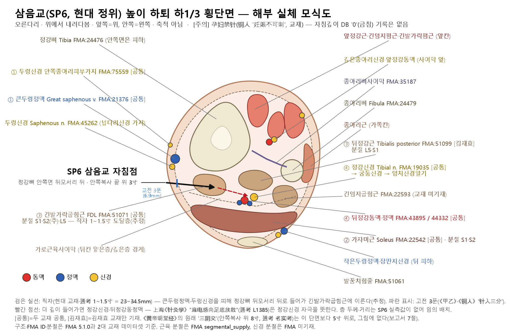
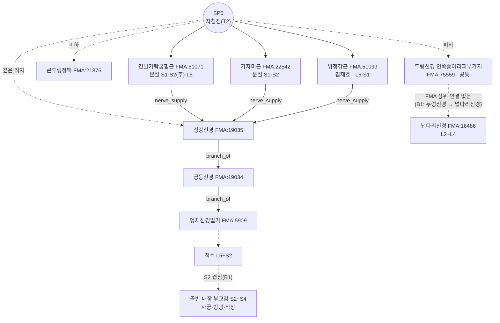

# [경혈 해부생리학 실체 판명 학술 모노그래프] 삼음교(三陰交, SP06)

> **프레임워크**: v2.7 · **공간 변위 분기**: **있음** — T1 《黄帝明堂经》 원래의 '三阴交'(안쪽복사 위 8寸) vs T2 현행 삼음교(안쪽복사 끝 위 3寸 = 본래 '足太阴'穴), $\Delta \gg 15\text{mm}$
> **T2 (현행·우위)**: ARI v3.0 | ARI-Core 75.0 ± 2.5 (B) | SI 50 | 잠정 가중치 0.40/0.35/0.25 | 민감도(등가중치): 75.0 (B, 등급 불변) · 반사 기전 B-Check 10/12 부합(③·⑤ 동물 한정)
> **T1 (명당 원위)**: ARI v3.0 | ARI-Core 41.3 ± 1.3 (D·H) | SI 75 | 잠정 가중치 0.40/0.35/0.25 | 민감도(등가중치): 38.5 (D, 등급 불변) · B-Check 2/12
> **이중 채점**: 독립 채점 2회, 15점 이상 불일치 3건 조정 완료 · **분기 판정**: ΔARI-Core 33.8, ± 구간 비중첩 → T2 우위

> **핵심 3대 원전**: 《中国针灸穴位通鉴》 · 《中国针灸证治通鉴》 · 《针灸腧穴通考》
> **Layer A 실증 DB**: `02_Master_Datasets/경혈_생의학_신경반사_마스터DB.json` (역색인 SP6 68편 중 **SP6를 실제 자극·관찰한 15편**만 판정에 사용, 8절 ① 표. 2026-10-23 개정 검색 스크립트로 Rank 6 실행)
> **Layer B 참조 등록부**: `01_Framework/layer_b_reference_registry.md` (B-Check 6항목, 부합 기준 ≥ 8/12)
> **해부 온톨로지**: FMA 5.1.0 로컬 색인 — 교재 구조를 `FMA:ID`로 고정(B1 보조, 등록부 미등재), 부록 A
> **도량형 환산**: 한대 기준 1푼(分) = 2.3mm ($z = \text{푼} \times 2.3\text{mm}$)
> **⚠ 임신부**: 《铜人》 "故妊娠不可刺", 교재 "孕妇禁针". 자침깊이 DB에는 '0'(금침) 기록이 없다 — 조건부 금기(5절·9절)

---

## 1. 문헌 스크리닝 표 (3대 원전 원문 발췌)

| 문헌 | 원문 발췌 (출처 파일·행) | 한국어 요지 | 비고 |
| :--- | :--- | :--- | :--- |
| 《针灸腧穴通考》 | "三阴交，在内踝上八寸胻骨下陷者中。足太阴、厥阴之会。（《黄帝明堂经》）" — `침구수혈통고(针灸腧穴通考)/针灸腧穴通考_09_上_足太阴脾经穴.md` L1125 | 《明堂》의 삼음교는 안쪽복사 위 **8寸** 정강뼈 아래 오목, 족태음·궐음의 회 | **T1** 근거 |
| 《针灸腧穴通考》 | "内踝上八寸骨下陷中名'三阴交'…隋唐时内踝上三寸处的'足太阴'穴被称作'三阴交'，而原《黄帝明堂经》之'三阴交'渐渐隐而不彰，名存而实亡。内踝上三寸之'三阴交'，不仅名实不符…" / "今之'三阴交'已非《黄帝明堂经》之'三阴交'。" — 같은 파일 L1119, L1121 | 현행 3寸 삼음교는 본래 '足太阴'穴이며 이름만 이어받았다(名实不符) | 名实考 — 7절 분기의 핵심 |
| 《针灸腧穴通考》 | 宋以前 部位: 《医心方》 卷二·卷二十八 "内踝上八寸", 《千金要方》 "八寸", 《甲乙》 卷三·《外台》 "三寸", 《圣惠方》 "八寸" / "实际上只有传世之明刊本《针灸甲乙经》作'内踝上三寸'…其他《黄帝明堂经》传本均作'内踝上八寸'…《外台秘要》'三阴交'穴排在'漏谷'（在内踝上六寸）穴之后" — 같은 파일 L1135~1149 | 《明堂》 전본 대부분이 8寸, 명간본 《甲乙》만 3寸. 《外台》 배열 순서(漏谷 뒤)도 8寸의 흔적 | Rank 4 교감 |
| 《针灸腧穴通考》 | "足太阴穴，在足内踝上三寸是也。（《诸病源候论》卷四十一）" / "足太阴穴，在内踝上一夫，一名三阴交。（《千金翼方》卷二十八）" / "三交二穴，在内踝上三寸是…名大阴" · "三阴二穴，在内踝上八寸，骨下陷中是"（《医心方》卷八） — 같은 파일 L1157~1169 | 3寸 '足太阴'(=三交)과 8寸 '三阴'(=원래 三阴交)이 수당대에 따로 기록됨 | 이명 분리(3절) |
| 《针灸腧穴通考》 | "部位：在小腿内侧，内踝尖上3寸，胫骨内侧缘后际。" / "针刺操作：刺1~1.5寸。孕妇禁针。" — 같은 파일 L1107, L1115 | 현대 정위·심도·임신부 금침 | **T2** 현대 정위 |
| 《针灸腧穴通考》 | "可灸三壮，针入三分。故妊娠不可刺。（《铜人腧穴针灸图经》卷下）" / "直刺…治足部病，略向后，深1~1.5寸。感应：可有麻电感向足底放散。"（上海《针灸学》） — 같은 파일 L1359, L1385 | 송대 '임신부 자침 불가'의 첫 조문. 깊은 직자 시 발바닥으로 전기감 = 정강신경 자극 | 5절 SI 근거 |
| 《中国针灸穴位通鉴》 | "三阴交，在内踝上三寸骨下陷者中。（《针灸甲乙经》3：53）" / 部位 2: "在内踝上八寸[1]骨下陷中。（《备急千金要方》29：510、《太平圣惠方》、《医心方》）… [1]'八寸'系'三寸'之误。同书卷21作'三寸'。" — `중국침구혈위통감(中国针灸穴位通鉴)/中国针灸穴位通鉴_31_足太阴脾经(1).md` L1308, L1336~1338 | 《穴位通鉴》은 8寸을 '三寸의 오기'로 본다 | **《通考》와 상충** — 7절에서 판정 |
| 《中国针灸穴位通鉴》 | 局部解剖: "在胫骨后方，比目鱼与屈趾长肌之间，有胫后动脉，分布着隐神经及胫神经。（《新针灸学》）" / "针刺通过之组织层：皮肤，皮下组织，趾长屈肌。神经、血管：隐神经之小腿内侧皮支，胫神经肌支；胫后动脉。（《针灸学简编》）" — 같은 파일 L1520~1526 | 가자미근–긴발가락굽힘근 사이, 뒤정강동맥·두렁신경·정강신경 | 4·6절 층차의 문헌 근거 |
| 《中国针灸证治通鉴》 | 《明堂经》 三阴交 主治 "主足下热，胫痛不能久立，湿痹不能行。" / 小结 "《明堂经》所载'三阴交'在内踝上八寸，而六朝以后方书所载'三阴交'多位于内踝上三寸，故主治病症大不相同。" — `중국침구증치통감(中国针灸证治通鉴)/中国针灸证治通鉴_05_第壹编_第七篇_足太阴脾经_手少阴心经_手太阳小肠经.md` L154, L184 | 腧穴书(8寸)와 方书(3寸)의 주치가 다르다 | 9절 T1/T2 주치 분리 |
| 《中国针灸证治通鉴》 | "徐文伯针刺堕胎：泻足太阴，补手阳明，胎便应针而落。" / 小结 "六朝后医书多因而取三阴交、合谷穴以治难产，有些腧穴书甚至将此二穴列为孕妇禁刺穴。" — `中国针灸证治通鉴_22_第叁编_妇儿科病证.md` L382, L480 | 임신부 금침의 기원 = 徐文伯 인산(引産) 처방 | 5·9절 |

---

## 2. 원천/재인용 구분 표

| 층차 | 문헌 | 기술 내용 | 원천/재인용 |
| :--- | :--- | :--- | :--- |
| 한대 | 《黄帝明堂经》 | **三阴交 = 内踝上八寸胻骨下陷者中**, 足太阴·厥阴之会; 刺入三分, 留七呼, 灸三壮; 주 "足下热，胫痛不能久立，湿痹不能行" | 원천(T1: 위치·심도·주치) |
| 남조 | 《南史·张融传》 徐文伯 | 泻足太阴, 补手阳明 → 堕胎 | 원천(T2 계열 '足太阴'의 부인과 응용) |
| 수 | 《诸病源候论》 卷四十一 | 足太阴穴 在足内踝上三寸 | 원천(T2: 3寸 '足太阴'穴) |
| 당 | 《千金要方》·《千金翼方》 | 足太阴(内踝上三寸·一夫) 灸 — 漏下赤白·泄痢·劳淋·癞疝; 《千金翼》 卷二十六 "在内踝上三寸骨下陷者中"·"产难，月水不禁，横生胎动皆针三阴交" | 3寸 지점을 '三阴交'로 부르는 최초 기술(通考 L1103) — 단, 전세본은 송대 교정을 거침 |
| 당 | 《外台秘要》 | 三阴交 "内踝上三寸"(《甲乙》 전재), 그러나 배열은 漏谷 뒤; 《素问·藏气法时论》 脾病候를 三阴交 아래 편입 | 재인용 + **귀속 오류**(通考 L1243, L1277) |
| 일본 | 《医心方》 卷二·卷八·卷二十八 | 三阴交 八寸; "三交=三寸(大阴)", "三阴=八寸" 구분 | 재인용(구분 보존) |
| 송 | 《太平圣惠方·明堂》 | 三阴交 八寸; 漏谷 아래에 三阴交 주치 오입 | 재인용 + 혼입(通考 L1415~1423) |
| 송 | 《铜人腧穴针灸图经》 | 三阴交 **三寸** 확정, 归足太阴脾经; "女子漏下不止" 추가; 徐文伯 방 "泻足三阴交，补手阳明合谷"; "故妊娠不可刺" | **현행 정위·임신부 금침의 정본화** |
| 금원명 | 《针经摘英集》·《玉龙经》·《针灸大成》 등 | 합곡·태충·중극 등과의 산과·부인과 배오 | 배오 재생산 |
| 현대 | 1957 南京《针灸学》~7版, 국표 | 内踝尖上3寸, 胫骨内侧缘后际; 直刺1~1.5寸; 孕妇禁针 | 표준화(T2) |

---

## 3. 이명·별칭 검증 표 (KJH DB 대조)

| 이명 | 출처 | KJH DB | 판정 |
| :--- | :--- | :--- | :--- |
| 足太阴(太陰) | 《诸病源候论》·《千金》 — 内踝上三寸(通考 L1157~1161) | 등재 | **T2 지점의 본래 이름**. 별명이 아니라 원명 |
| 三交 | 《医心方》 卷八 "三交二穴，在内踝上三寸…名大阴"(L1167) | 등재 | 수당대 T2 지점의 다른 이름 |
| 足太阴交 · 厥阴交 | 《新雕千金方》 · 《黄帝虾蟆经》(L1151) | 足太陰交 등재 | **T1**(8寸 원래 三阴交)의 이칭 |
| 三阴 | 《医心方》 卷八 "三阴二穴，在内踝上八寸"(L1169) · 《三家脚气论》 | 미등재 | T1의 수당대 이름 |
| 承命 | 1957 南京《针灸学》(일본 교재 인용) / 《千金要方》 "承命 在内踝后上行三寸动脉上"(L1129, L1171) | 등재 | **별개의 혈**(3寸 뒤 맥동처). 별명으로 쓰지 않는다 |
| 下之三里 · 下三里 | 일본 속칭 — 寺尾隆純《十四经腧穴弁解》(1784) "以三阴交为'下三里'"(L1131); 《穴位通鉴》 별명 2(L1314) | 下之三里 등재 | 중국 혈명이 아님. ST36(上三里)과 혼용 주의 — ST36 보고서 3절과 일치 |

KJH DB(`경혈명_비교_정리_KJH.xlsx` 종합 목록 Excel 행 137: 134, SP06, 삼음교, 三陰交, "承命, 太陰, 下之三里, 足太陰交, 足太陰, 三交")는 T1·T2 계열의 이름과 별개 혈(承命)을 한 줄에 함께 싣고 있다. 위 표처럼 계열을 나누어 읽어야 한다. 또 《太平圣惠方》 이후 漏谷(SP7)에 三阴交 주치가 섞여 들어갔다(通考 L1415~1423).

---

## 4. 3D 공간 좌표 및 Layer 1~5 층차 구조도

**T2 (현행)**
- **X (내외측)**: 정강뼈 안쪽면 **뒤모서리 바로 뒤**(胫骨内侧缘后际, 通考 L1107).
- **Y (상하)**: 안쪽복사 끝 위 3寸(4횡지, 1957 南京《针灸学》 이하; 通考 L1201~1213), 交信 위 1寸(L1179).
- **Z (깊이)**: 아래 층차. **SP6 성인 사체·초음파 실측값이 Layer A에 없으므로 mm 경계는 적지 않고 구조 순서만 기재**한다.

```
[Layer 1 피부·피하]   두렁신경 안쪽종아리피부가지(두 교재) · 큰두렁정맥(두 교재) — 고전 3푼(6.9mm) 도달층(추정)
        │
[Layer 2 얕은 근육]   가자미근 안쪽 가장자리(두 교재)
        │
[Layer 3 깊은 근육]   긴발가락굽힘근(두 교재) · 뒤정강근(김재효) — 현대 직자 1~1.5寸(23~34.5mm) 도달층(추정)
        │
[Layer 4 신경혈관속] 정강신경(두 교재) · 뒤정강동·정맥(두 교재) — 깊은 직자 시 "麻电感向足底放散"(通考 L1385)
        │
[Layer 5 바닥]       정강뼈 뒤면 · 종아리뼈사이막 (심부 장기 없음)
```



*그림 4-1. 삼음교(현행 T2) 높이 하퇴 하1/3 횡단면 모식도(오른다리, 위에서 내려다봄, 축척 아님). 직자 경로는 큰두렁정맥·두렁신경을 피해 정강뼈 안쪽면 뒤모서리 뒤로 들어가 긴발가락굽힘근에 이르고, 더 깊으면 정강신경·뒤정강동정맥에 닿을 수 있다. 층 두께·거리는 SP6 실측값이 없어 임의로 배치했다. T1(8寸)은 이 단면보다 5寸 위다.*

**T1 (《明堂》 원위, 内踝上八寸胻骨下陷者中)**: 2대 교재·FMA 대응표에 T1 지점 자체의 항목은 없다. 같은 '정강뼈 뒤모서리' 선 위의 인접 혈 교재 기재로 범위를 좁히면, 아래쪽 漏谷(SP7, 6寸)은 가자미근·긴발가락굽힘근·뒤정강근·정강신경·뒤정강동정맥(두 교재 SP07 행, SP06과 같음), 위쪽 地机(SP8, 아래 10寸)는 장딴지근·가자미근·긴발가락굽힘근·뒤정강근(김재효)·오금근(공통교재)이다. 따라서 T1은 **가자미근·긴발가락굽힘근 층(SP7과 같은 구성)**일 것으로 **추론**할 뿐이며, 교재·실측 근거는 없다($S_{clarity}$ 25).

**FMA 실체 대조(Layer별, T2)** — 구조명은 2대 교재, ID·관계는 FMA 5.1.0

| Layer | 구조 | FMA | 대응 | FMA 관계 | 신경 줄기 / 분절 |
| :--- | :--- | :--- | :--- | :--- | :--- |
| 1 | 두렁신경 안쪽종아리피부가지 [공통] | FMA:75559 | exact(김재효) / **수동**(공통교재 표기 'medial cutaneous branch of the leg of saphenous nerve' 자동 none) | Set of medial crural cutaneous branches of saphenous nerve — **FMA에 두렁신경(FMA:45262)으로의 상위 연결 없음** | B1: 두렁신경 → 넙다리신경, 피절 L3~L4(B1-03) |
| 1 | 큰두렁정맥 [공통] | FMA:21376 | exact | drains_into Femoral vein | — |
| 2 | 가자미근 [공통] | FMA:22542 | exact | contained_in 뒤칸 얕은층 공간(FMA:312103) | 정강신경 가지(FMA:80461·80462). 분절 S1·S2 |
| 3 | 긴발가락굽힘근 [공통] | FMA:51071 | exact | contained_in 뒤칸 깊은층 공간(FMA:312109) | Nerve to FDL(FMA:80101) ← 정강신경. 분절 **S1·S2(주)**·L5 |
| 3 | 뒤정강근 [김재효] | FMA:51099 | **수동**(교재 'posterior tibialis' 어순 → 자동 none) | contained_in 뒤칸 깊은층 공간(FMA:312109) | Nerve to tibialis posterior(FMA:80104). 분절 L5·S1 |
| 4 | 정강신경 [공통] | FMA:19035 | exact | branch_of Sciatic nerve(FMA:19034) | 궁둥신경 → 엉치신경얼기(FMA:5909). 신경 분절 FMA 미기재 → B1: L4~S3 |
| 4 | 뒤정강동맥 · 뒤정강정맥 [공통] | FMA:43895 · FMA:44332 | exact | 동맥 branch_of External iliac artery(FMA 모델링, ST36 보고서와 같은 특이점) / 정맥 tributary_of Popliteal vein | — |
| 5 | 정강뼈 · 종아리뼈사이막 | FMA:24476 · FMA:35187 | — | — | — |

- 공개 초음파 참고 영상은 없다(등록 데이터셋 `marzola_msk`는 앞정강근·안쪽장딴지근·위팔두갈래근만 포함). SP6 높이의 깊이 실측은 PubMed 검색(2026-10-23, `(SP6 OR Sanyinjiao) AND (ultrasound OR cadaver OR CT OR MRI OR anatomical) AND (depth OR needling OR "tibial nerve")`)에서도 성인 연구를 찾지 못했다(소아 층차 기술 1편 PMID 2053869는 DB 미병합·소아라 미사용).

---

## 5. 자침 깊이 계산표

출처: `침구문헌별 자침깊이 정리_AI 분석용.xlsx` 시트1 Excel 행 136(N0 134, SP06), 보조로 《通考》 【操作】(L1353~1385).

| 문헌 | 푼(分) | 환산 심도 (×2.3mm) | 도달 Layer(추정) | 비고 |
| :--- | :---: | :---: | :--- | :--- |
| 황제명당경(황룡상 감수) | 3 | 6.9mm | 1 | "刺入三分" — 名实考상 **T1(8寸)의 심도** |
| 침구갑을경 | 3 | 6.9mm | 1 | |
| 침구경험방 | 3 | 6.9mm | 1 | |
| 동의보감(인용: 동인) | 3 | 6.9mm | 1 | 금침 아님 |
| 경락수혈학 공통교재 | 10~15 | 23.0~34.5mm | 3 | |
| 침구의학 공통교재 | 10~15 | 23.0~34.5mm | 3 | |
| 《针灸腧穴通考》 | 10~15 | 23.0~34.5mm | 3(~4) | "刺1~1.5寸。孕妇禁针" |
| 1957 南京《针灸学》(원전 보조) | 5~8 | 11.5~18.4mm | 2 | L1373 |
| 《中国针灸学》(원전 보조) | 5~10 | 11.5~23.0mm | 2~3 | L1383 |
| 上海《针灸学》(원전 보조) | 직자 10~15(足部病) / 15~20(透悬钟) / 사자 15~25 | 23.0~57.5mm | 3~4 | "麻电感向足底放散" = 정강신경 자극(L1385) |
| 《窦太师针经》(원전 보조) | 횡자 25 | (수평 57.5mm) | 1~3 | "横针入二寸半，亦透绝骨穴"(L1365) |

- 금침('0') 기록 없음, 'blank' 없음(DB 해당 열 기준). **"孕妇禁针"은 조건부 금기**이며, 그 기원은 徐文伯의 인산 처방(泻足太阴·补手阳明)이 후대 腧穴书에서 "妊娠不可刺"로 바뀐 것이다(证治通鉴_22 L480; 通考 L1291, L1359). 임신부에게는 자침하지 않는다는 원칙은 그대로 둔다.
- 안전 범위: 고전 3푼은 피하에 머문다. 현대 1~1.5寸 직자는 긴발가락굽힘근 층에 이르며, 상한 부근과 '略向后' 방향에서는 정강신경·뒤정강동정맥에 닿을 수 있다(上海《针灸学》의 감응 기술). 큰두렁정맥·두렁신경이 정강뼈 뒤모서리 가까운 피하를 지나므로 정맥을 눈으로 확인하고 피한다.

---

## 6. 해부학 구조 교재 비교표 (T2)

| 구분 | 경혈학 공통교재 (refine.xlsx 종합 시트 행 135) | 김재효 교재 (종합 시트 행 135) | FMA 판별 | 평가 |
| :--- | :--- | :--- | :--- | :--- |
| 근육 | 가자미근, 긴발가락굽힘근 | 가자미근, 긴발가락굽힘근, **뒤정강근** | FMA:22542·51071 공통 / FMA:51099 김재효 단독 | 김재효가 더 깊은 층까지 기재 |
| 신경 | 두렁신경의 안쪽종아리피부가지, 깊은층에 정강신경 | 같음 | FMA:75559·19035 (공통교재 표기는 수동 대응) | 일치 |
| 혈관 | 큰두렁정맥, 뒤정강동·정맥 | 같음 | FMA:21376·43895·44332 | 일치 |

**FMA로 본 차이의 의미**: 두 교재는 거의 같다. 유일한 차이인 '뒤정강근'(김재효)은 FMA상 긴발가락굽힘근과 같은 **뒤칸 깊은층 공간(FMA:312109)**에 있고, 긴발가락굽힘근보다 가쪽·깊은 쪽이다. 따라서 이는 상충이 아니라 **기재 깊이의 차이**다. 《穴位通鉴》 국소해부(L1518~1526: 比目鱼与屈趾长肌之间, 胫后动脉, 隐神经·胫神经)는 두 교재와 일치한다. 같은 곳의 《中国针灸学》 "有长总趾伸肌"(L1524)는 뒤칸 혈위에 앞칸 근육(폄근)을 적은 것으로 오기로 본다.

B1-01·B1-03(하퇴 뒤칸 국소해부)과 부합한다. 혈위 특이 영상·사체 실측(PMID)은 없다.

---

## 7. 공간 변위 분기 추론도

| Target | 근거 | 위치 | 판단 |
| :--- | :--- | :--- | :--- |
| **T1** 《明堂》 三阴交 | 《黄帝明堂经》 "在内踝上八寸胻骨下陷者中"(通考 L1125); 《医心方》·《千金要方》·《圣惠方》 八寸(L1137~1147); 足厥阴 "上踝八寸，交出太阴之后"(L1119) | 안쪽복사 위 8寸, 정강뼈 뒤모서리 | 명칭의 원래 혈. 송대 이후 소실 |
| **T2** 현행 三阴交 (= 원 足太阴) | 《诸病源候论》·《千金》 "足太阴…内踝上三寸"(L1157~1161); 명간본 《甲乙》 3：53; 《铜人》 이후 통일(L1185) | 안쪽복사 끝 위 3寸, 정강뼈 뒤모서리 | 현대 표준 정위 |

- **Δ 추정**: 두 지점은 같은 정강뼈 뒤모서리 선 위에서 5寸 떨어진다. 하퇴 골도(안쪽복사 끝~음릉천 13寸)로 성인 1寸을 약 2.5~3cm로 보면 $\Delta \approx 12\sim15\text{cm} \gg 15\text{mm}$ (골도 환산 추정, 실측 아님). → **정본 Rank 5 분기 요건 충족, 두 Target을 따로 채점한다.**
- **상충 판정(《穴位通鉴》 vs 《通考》)**: 《穴位通鉴》은 8寸을 '三寸의 오기'로 보고 그 근거로 "同书卷21作三寸"을 든다(通鉴 L1338). 그러나 《千金要方》 권21의 해당 조문은 "劳淋，灸**足太阴**百壮，在内踝上三寸"(通考 L1339; 证治通鉴_20 L747)으로, '三阴交'가 아니라 '足太阴'을 말한다. 반대로 《通考》는 ① 《明堂》 전본 다수의 8寸, ② 《外台》의 배열 순서(漏谷 뒤), ③ 《圣惠方》의 8寸, ④ 《医心方》의 '三交(3寸)'·'三阴(8寸)' 구분, ⑤ 《产经》 경맥도를 독립 증거로 제시한다(L1149~1173). 《证治通鉴》 소결(L184)도 같은 결론이다. 따라서 **《通考》 판단을 채택**한다. 다만 《通考》 스스로 《千金翼》 전세본의 송대 교정 여부는 "尚不能确定"이라 했으므로(L1103), $S_{orig}$ ④는 100이 아닌 단계로 둔다(10절).
- **분기 판정**: ΔARI-Core = 75.0 − 41.3 = 33.8 (≥ 10), T2 [72.5, 77.5]와 T1 [40.0, 42.5]는 겹치지 않는다 → **T2 우위**. 이는 "현행 삼음교 지점의 해부 실체가 더 잘 판명된다"는 뜻이며, 이름의 원래 주인은 T1이라는 문헌학 결론(名实不符)과 함께 기록한다.

---

## 8. 생의학적 반사 기전도 및 외부 검색 로그 (T2)

**기전 기술(부합, 동물 근거 중심)**: SP6 단독 자극 연구가 말초–중추–표적 장기 고리의 각 단계를 동물에서 보여 준다. ① 말초: 원발성 월경통 쥐에서 SP6 부위 Piezo1·CGRP·tryptase(비만세포 탈과립)가 증가하고, SP6 단독 전침이 이를 낮추며 자궁 Piezo1/COX-2/PG 경로를 억제했다(papers.id 2321). ② 구심·중추: 과민성장증후군 마우스에서 SP6 단독 전침이 DRG 신경을 활성화하고, 뇌 활성 영역이 ST36과 시상하부 실방핵(PVN)에서 가장 많이 겹쳤다(2280). ③ 인체: 월경전증후군 환자 23명에서 SP6 단독 전기자극이 편도체 기능연결을 바꾸었다(2314, 비대조). 고빈도·저빈도 전침의 아편계 기전(B3-10)은 ST36+SP6 조합으로 검증된 것이어서 SP6 단독 근거로는 보조로만 쓴다(5·8·12·46·54). **B-Check 10/12 부합** — 단 ③·⑤는 동물(쥐·마우스) 한정이며, 인체 전환(⑥)은 1점이다.

**분절 소견**: FMA 근육 분절은 L5~S2(긴발가락굽힘근 S1·S2 주, 가자미근 S1·S2, 뒤정강근 L5·S1)다. 자궁·방광·직장의 부교감(골반내장신경) 분절 S2~S4와 **S2에서 겹친다**. 반면 월경통 통증 구심(교감 경로 T10~L1)과는 겹치지 않는다(B1-02·B1-03). 그래서 ②는 간접 1점이다.

**말초 구심 경로의 FMA 고정**:



*그림 8-1. FMA 5.1.0 관계로 그린 SP6(T2) 말초 구심 경로. 실선은 FMA 기재 관계(`nerve_supply`·`branch_of`), 점선은 FMA에 없는 연결이거나 B1 교과서로 보완한 관계다.*

### ① Layer A 논문 표 (SP6를 실제 자극·관찰한 연구)

| papers.id | 연도 | 저널 | 제목(요약) | PMID / DOI | 설계·SP6 역할 |
| :---: | :---: | :--- | :--- | :--- | :--- |
| 2321 | 2026 | Zhen Ci Yan Jiu | EA at sensitized SP6 in primary dysmenorrhea rats — Piezo1 | 42343676 / 10.13702/j.1000-0607.20251011 | 동물(쥐 60). **SP6 단독** 50 Hz. SP6 부위 Piezo1·CGRP·비만세포, 자궁 COX-2/PG |
| 2280 | 2026 | Zhen Ci Yan Jiu | EA at single ST36 vs single SP6 vs ST36+SP6 in IBS mice | 42908445 / 10.13702/j.1000-0607.20260558 | 동물(마우스). **SP6 단독군**. DRG 칼슘 반응, 뇌 영역(PVN 겹침) |
| 1866 | 2026 | J Pharmacopuncture | Acupuncture at ST36, SP6 and combination in MIA osteoarthritis rats | 42812780 / 10.3831/kpi.2026.29.3.286 | 동물(쥐 30). **SP6 단독군**. 통증 역치·IL-1·IL-6·MMP-13 |
| 2041 | 2026 | Zhen Ci Yan Jiu | EA at CV4+SP6 on A20/NF-κB/NLRP3/GSDMD in dysmenorrhea rats | 41735064 / 10.13702/j.1000-0607.20250062 | 동물(쥐). 2혈 |
| 2322 | 2025 | Zhongguo Zhen Jiu | EA at CV4+SP6, miRNA-21-5p/A20 macrophage polarization, dysmenorrhea | 41741990 / 10.13703/j.0255-2930.20250101-k0001 | 동물(쥐). 2혈 |
| 2316 | 2022 | Front Endocrinol | EA at SP6+CV4 in premature ovarian failure mice | 35957829 / 10.3389/fendo.2022.882214 | 동물(마우스). 2혈 |
| 5 | 2001 | Pain | Genotype and sensitivity to EA analgesia (10 inbred strains) | — / — (로컬 PDF) | 동물(마우스). ST36+SP6 |
| 8 | 1996 | Mol Brain Res | Fos/Jun and preproenkephalin/preprodynorphin after EA of different frequencies | — / — (로컬 PDF) | 동물(쥐). ST36+SP6 |
| 12 | 2000 | Neurosci Lett | Endomorphin/μ-opioid receptors mediate 2 Hz but not 100 Hz EA analgesia | — / — (로컬 PDF) | 동물(마우스). ST36+SP6 |
| 2314 | 2020 | Gynecol Endocrinol | EAS at SP6 modulates amygdala functional connectivity in PMS | 33307896 / 10.1080/09513590.2020.1855633 | **인체**(23명, 전후 비교, 대조군 없음). **SP6 단독** |
| 46 | 2003 | NeuroReport | Modulation of cold pain in human brain by electric acupoint stimulation (fMRI) | — / 10.1097/01.wnr.0000085243.71403.6a | 인체 fMRI. ST36+SP6 |
| 54 | 2003 | Brain Res | Brain network activation and analgesia, low vs high frequency EAS (fMRI) | — / 10.1016/s0006-8993(03)02983-4 | 인체 fMRI. ST36+SP6 |
| 510 | 2024 | YMER | Oxytocin levels with acupuncture at LI4 and SP6 after cesarean section: RCT | — / — (로컬 PDF) | 인체 RCT. 2혈(합곡+삼음교) |
| 2315 | 2025 | Neuropsychopharmacology | Intradermal acupuncture for major depressive disorder: multicenter RCT | 39648209 / 10.1038/s41386-024-02036-5 | 인체 RCT. 4혈(HT7·PC6·SP6·LR3) |
| 2327 | 2016 | 대한침구학회지 | Acupuncture and moxibustion at SP6 on foot temperature in healthy adults | — / 10.13045/acupunct.2016036 | 인체, **SP6 단독**(제목 기준 — 초록 미확보로 설계 **확인 불가**) |

- **제외**: 혈위 선택·데이터마이닝 연구(1845, 1970, 2032, 2037, 2264, 2307, 381), 다혈위 임상 보고(1853, 1873, 1957, 1965, 2035, 2036, 2257, 2283, 2286, 2303, 2318~2320, 2323, 2326), 기전 대상이 SP6가 아닌 연구(2042, 2043, 2263, 2291, 2317, 2324, 2325), 인도네시아 증례 보고(2048, 2287, 2288), 이론·문헌·교육 자료(15, 27, 208, 341, 369, 424, 529, 550, 742, 766, 795, 989, 998, 1002, 1377, 1614), SP6를 인용만 한 연구(1015), 다혈위 종설(1698 PCOS, 1699 Cochrane 월경통 — 혈위 비특이).
- **확인 불가**: 1610(이창현 2003, 「치매 관련 뇌 영역에 투사되는 경혈(외관·내관·삼음교·현종) 신경해부 연구」)은 PDF에서 텍스트를 추출할 수 없어 방법·결과를 확인하지 못했다. 원문을 확인하면 ③·④의 SP6 특이 근거가 될 수 있다. 2328(2018, SP6 월경통 지압·침)은 초록이 없어 제외했다.
- **DB 미병합 참고**: PMID 32011502(SP6 직자 vs 횡자 월경통 RCT **프로토콜**, 2020)는 결과가 없어 판정에 쓰지 않는다.

### ② B-Check 채점표 (T2)

| 항목 | 내용 | 채점자 A | 채점자 B | 최종 | 참조 ID | papers.id | 근거 요지 |
| :---: | :--- | :---: | :---: | :---: | :--- | :--- | :--- |
| ① | 자침 심도의 말초신경·혈관 실체 | 2 | 2 | **2** | B1-01, B1-03, B2-09 (+FMA) | — | 2대 교재·《穴位通鉴》 국소해부·규범 해부서가 두렁신경 가지·큰두렁정맥·가자미근·긴발가락굽힘근·정강신경·뒤정강동정맥을 일치 기술. 교재 구조 9종 FMA 대응(정확 7·수동 2). 혈위 특이 영상 실측 없음 |
| ② | 척수 분절 정합 | 2 | 1 | **1** | B1-02, B1-03, B3-05 (+FMA) | — | FMA 근육 분절 L5~S2 vs 골반 내장 부교감 S2~S4: S2에서 겹침(A 2). 월경통 통증 구심 T10~L1과는 불일치, 겹침이 경계 1분절뿐(B 1) → 보수적으로 1 |
| ③ | 구심 섬유형·수용체 | 2 | 2 | **2** | B3-06 | 2321, 2280 | SP6 부위 Piezo1(기계수용 이온통로)·CGRP 섬유·비만세포(2321), SP6 단독 자극의 DRG 신경 반응(2280). 동물 한정 |
| ④ | 중추 중계·경로 | 2 | 2 | **2** | B3-10, B3-11 | 2280, 2314, 8, 12 | SP6 단독 자극의 뇌 영역 활성(PVN 등, 2280)과 인체 편도체 기능연결 변화(2314). 아편계 중추 기전(8·12, B3-10)은 ST36+SP6 조합 근거라 보조 |
| ⑤ | 원심 경로·표적 효과($P_{single}$ 일치) | 2 | 2 | **2** | B3-05 | 2321, 2280, 2041, 2322 | 월경통 모델에서 자궁 PGF2α·COX-2 감소와 통증 행동 개선(2321 단독; 2041·2322 CV4 조합), IBS 대장 염증 개선(2280 단독) — 현행 주치(痛经·泄泻)와 방향 일치. 동물 한정 |
| ⑥ | 인체 전환 근거 | 1 | 1 | **1** | B4-01, B4-03, B4-04, B4-05 | 2314, 510, 2315, 46, 54 | SP6 단독 인체 연구는 비대조 fMRI 1편(2314)뿐이다(2327은 설계 확인 불가). RCT는 2혈·4혈 조합(510, 2315). 혈위 특이성 반증(B4-04·B4-05) 미해결 |
| **합계** | | 11 | 10 | **10 / 12** | | | **판정: 부합(≥ 8/12)**, ①·② ≥ 1 충족. 표지: ③·⑤ 동물(쥐·마우스) 한정 |

**T1의 B-Check**: Layer A 0편(8寸 지점을 자극한 연구 없음). ① 1(인접 혈 교재·FMA로 유추), ② 1(같은 정강신경·S1~S2 근육 영역으로 유추), ③~⑥ 0 → **2/12 미부합**. 게이트 2 적용.

### ③ 외부 검색 로그 (sync_log, 2026-10-23 Rank 6 실행 — 경혈 언급 판정을 넣은 개정 스크립트)

| 일시 | 소스 | HTTP | 수집 | 중복제거 | 신규 | 쿼리 |
|---|---|---|---|---|---|---|
| 2026-10-23T23:57:22 | pubmed | 200 | 16 | — | — | ("SP6"[tiab] OR "Sanyinjiao"[tiab] OR "三阴交"[tiab]) AND (acupuncture OR electroacupuncture) AND (nerve OR reflex OR autonomic OR mechanism OR anatomy) \| … AND ("Zhongguo Zhen Jiu"[Journal] OR "Zhen Ci Yan Jiu"[Journal]) |
| 2026-10-23T23:57:22 | openalex | 200 | 24 | — | — | doi_starts_with:10.13703 / 10.13702, title_and_abstract.search:"Sanyinjiao" OR "SP6" \| has_doi:true … AND (acupuncture OR electroacupuncture) |
| 2026-10-23T23:57:22 | crossref | 200 | 4 | — | — | Sanyinjiao acupuncture nerve reflex |
| 2026-10-23T23:57:22 | all | — | 44 | 29 | 15 | 기존 병합 24, 배치 내 중복 5, 경혈 미언급 제외 0 |

- 보완 검색(DB 미병합): PubMed SP6 해부·깊이 영상 검색(4절) — 성인 실측 0편.

---

## 9. 주치증 분리 표

**T1 (《明堂》 원위 8寸)**

| 구분 | 주치 | 원문 근거 |
| :--- | :--- | :--- |
| $P_{single}$ | 足下热·胫痛不能久立·湿痹不能行 (국소 하지) | 《黄帝明堂经》(通考 L1237; 证治通鉴_05 L154). 《通考》: "与今之定位差异较大，故此条文献不宜作为确定现行三阴交主治的依据"(L1239) |

**T2 (현행 3寸 = 원 足太阴)**

| 구분 | 주치 | 원문 근거 |
| :--- | :--- | :--- |
| $P_{single}$ | 漏下赤白及血·白崩 | "女人漏下赤白及血，灸足太阴五十壮，穴在内踝上三寸"(《千金要方》 卷四, 通考 L1285~1287) |
| $P_{single}$ | 产难·月水不禁·横生胎动 | "产难，月水不禁，横生胎动皆针三阴交"(《千金翼方》 卷二十六, 通考 L1289) |
| $P_{single}$ | 泄痢赤白·痔 | 《千金要方》 卷十五下 "灸足太阴五十壮"; 《千金翼方》 卷二十八 "针痔法：针足太阴穴，在内踝上一夫"(L1327, L1333) |
| $P_{single}$ | 劳淋 | "劳淋，灸足太阴百壮，在内踝上三寸"(《千金要方》 卷二十一, L1339; 证治通鉴_20 L747) |
| $P_{single}$ | 癞疝·卵偏大 | 《千金要方》 卷二十四(L1343~1345) |
| $P_{single}$ | 梦泄精 | "梦泄精，灸三阴交二七壮"(证治通鉴_20 L1261) |
| $P_{single}$ | 霍乱 手足逆冷·胆虚 | 《肘后方》(证治通鉴_05 L162~164); 《千金翼方》 27(通鉴 L1402) |
| $P_{comb}$ | 인산(堕胎)·난산 | 徐文伯 "泻足太阴，补手阳明"(《南史》, 证治通鉴_22 L382) → 《铜人》 "泻足三阴交，补手阳明合谷"(通考 L1291); 太冲+合谷+三阴交, 巨阙+合谷+三阴交(《针经摘英集》, L1295~1297); 独阴+合谷+三阴交(《针灸大成》, L1317) |
| $P_{comb}$ | 산후 혈운·붕중·누하·경폐 | 支沟+三里+三阴交; 三阴交+行间+通里; 三阴交+太冲; 曲池+支沟+三里+三阴交(《针经摘英集》, L1299~1307); 中极+三阴交+合谷(《针灸集成》, L1315) |
| $P_{comb}$ | 부인 혈기통·경맥 부조 | 合谷 补 + 三阴交 泻(《玉龙经》·《针灸集要》, L1309~1313) |
| $P_{comb}$ | 비위 허약·제하통·전포 | 三里+三阴交(L1329); 气海+三阴交(L1331, L1347); 关元+三阴交 "针入三分"(L1341) |
| 후대 귀속(주치 근거 약함) | 脾病 身重·腹胀肠鸣·溏泄食不化 | 王焘가 《素问·藏气法时论》 脾病候를 三阴交 아래 편입 — "欠妥"(通考 L1243, L1277) |
| 후대 귀속 | 漏谷과의 주치 혼입 | 《太平圣惠方》이 三阴交 주치를 漏谷에 오입(通考 L1415~1423) |
| 조건부 금기의 기원 | 孕妇禁针 | 徐文伯 인산 방 → "有些腧穴书甚至将此二穴列为孕妇禁刺穴"(证治通鉴_22 L480); 《铜人》 "故妊娠不可刺"(L1359) |

---

## 10. ARI v3.0 프로파일 평가표 및 최종 결론

**T1**: 《明堂》 "内踝上八寸胻骨下陷者中" / **T2**: 현대 "内踝尖上3寸，胫骨内侧缘后际"(= 원 '足太阴').

### 하위 점수

| Target | 지표 | 채점자 A | 채점자 B | 최종(평균) | 루브릭 단계 근거 요지 | 근거 포인터 |
| :---: | :--- | :---: | :---: | :---: | :--- | :--- |
| T2 | $S_{orig}$ (0.40) | 81.25 | 68.75 | 75.0 | 아래 하위 4항목 평균 | 通考 L1097~1385; 通鉴 L1304~1530 |
| T2 | $S_{clarity}$ (0.35) | 75 | 75 | 75 | 2대 교재 일치(뒤정강근 1항목 깊이 차이, FMA 같은 구획) + B1·《穴位通鉴》 국소해부 확인, 혈위 특이 실측 없음 → 100 미달 | 6절; 두 교재 종합 행 135; FMA:22542·51071·19035 |
| T2 | $S_{reflex}$ (0.25) | 75 | 75 | 75 | 인체 연구 1편(2314) + 동물 연구 다수 + B-Check 10(⑥ = 1) → 100 요건(인체 RCT ≥ 2 + ⑥ = 2) 미충족 | 8절 ①②; papers.id 2321·2280·2314 |
| T2 | SI ($S_{safety}$) | 50 | 75 → **50**(조정) | 50 | 현대 표준 직자 1~1.5寸이 긴발가락굽힘근 층에 이르고, 문헌이 정강신경 자극 감응을 기술. 임신부 조건부 금기 | 5절; 자침깊이 DB 행 136; 通考 L1359, L1385 |
| T1 | $S_{orig}$ (0.40) | 68.75 | 50 → **62.5**(조정) | 65.6 | 아래 하위 4항목 평균 | 通考 L1119~1173 |
| T1 | $S_{clarity}$ (0.35) | 25 | 50 → **25**(조정) | 25 | T1 지점 자체의 교재·실측 기재 없음. 인접 혈(SP7·SP8) 교재로 추론만 가능 | 4절 T1 |
| T1 | $S_{reflex}$ (0.25) | 25 | 25 | 25 | Layer A 0편 → 게이트 2, Layer B 참조만 | 8절 ② T1 |
| T1 | SI ($S_{safety}$) | 75 | 75 | 75 | 《明堂》 3푼(6.9mm) 피하 자침. 하퇴 중간 뒤안쪽에는 심부 장기가 없다. 실측 여유 거리가 없어 100 미달 | 5절; 通考 L1357 |

### $S_{orig}$ 하위 4항목

| Target | 하위 항목 | A | B | 근거 |
| :---: | :--- | :---: | :---: | :--- |
| T2 | ① 최초 기술 명확성 | 50 | 50 | 3寸 지점의 최초 기술은 수당대 '足太阴穴'(《诸病源候论》·《千金》)이며 선진·한대 기술이 없다. 후대 재인용으로 보완 |
| T2 | ② 후대 일치율 | 100 | 75 | A: 《铜人》 이후 거의 모든 문헌이 3寸(通鉴 L1334 목록). B: 송 이전 《明堂》 전본 다수가 8寸이어서 전체로는 60~79% |
| T2 | ③ 이명 혼용 해소 | 75 | 75 | 足太阴·三交·承命·下三里 혼용. 《通考》가 연대순으로 분리했으나 KJH DB는 한 줄에 섞어 싣는다 |
| T2 | ④ 《通考》 교감 | 100 | 75 | A: 《甲乙》 개변·《外台》 '一寸'→'一夫'·《外台》 주치 귀속 오류·《圣惠》 漏谷 혼입을 모두 교정. B: 《千金翼》 송대 교정 여부 미확정(L1103) |
| T2 | 평균 | **81.25** | **68.75** | |
| T1 | ① 최초 기술 명확성 | 100 | 75 | A: 《明堂》이 위치(8寸)·심도(3푼)를 모두 지정. B: 《明堂》은 복원 문헌이고 명간본 《甲乙》과 상충 |
| T1 | ② 후대 일치율 | 25 | 25 | 송 이후 8寸을 따른 문헌이 없다(< 40%) |
| T1 | ③ 이명 혼용 해소 | 75 | 50 → **75** | 三阴·足太阴交·厥阴交로 계보 분리(《医心方》). 조정 기록 참조 |
| T1 | ④ 《通考》 교감 | 75 | 50 → **75** | 《通考》가 다섯 갈래 독립 증거로 8寸 원위를 복원. 《穴位通鉴》의 반대 근거는 다른 혈(足太阴) 조문. 조정 기록 참조 |
| T1 | 평균 | **68.75** | **62.5** | (B 초기 50) |

### 게이트·등급·민감도

- **T2 게이트**: 게이트 1(S_orig 75, S_clarity 75 ≥ 50) 미적용, 게이트 2(Layer A 15편) 미적용, 게이트 3(SI 50 > 25) 미적용.
- **T2 ARI-Core**: A = 0.40×81.25 + 0.35×75 + 0.25×75 = **77.5** / B = 0.40×68.75 + 0.35×75 + 0.25×75 = **72.5** → **75.0 ± 2.5** → **등급 B(개연)**, 표지 없음. **SI 50**(별도 병기).
- **T2 민감도(등가중치)**: A 77.1, B 72.9 → **75.0** → B, 등급 불변.
- **T1 게이트**: 게이트 1 적용($S_{clarity}$ 25 < 50 → 최고 C), 게이트 2 적용(Layer A 0편 → $S_{reflex}$ ≤ 25, **(H)**), 게이트 3 미적용(SI 75).
- **T1 ARI-Core**: A = 0.40×68.75 + 0.35×25 + 0.25×25 = **42.5** / B = 0.40×62.5 + 0.35×25 + 0.25×25 = **40.0** → **41.3 ± 1.3** → **등급 D(미판정)·H**. **SI 75**.
- **T1 민감도(등가중치)**: A 39.6, B 37.5 → **38.5** → D, 등급 불변.
- **분기 판정**: ΔARI-Core 33.8 ≥ 10, ± 구간 비중첩 → **T2 우위**.
- **조정 기록**
  1. T2 SI(A 50·B 75, 25점 차): B는 횡자·각도 회피와 문헌의 심도 제한 명시를 들어 75로 보았다. 그러나 현대 **표준 직자 범위 자체**가 긴발가락굽힘근 층에 이르고, 上海《针灸学》은 정강신경 자극 감응을 **의도된 득기**로 기술하며, 임신부 금기도 있다. 그래서 루브릭 50단계("직자 시 Layer 4 신경혈관속 직접 접촉, 심도 상한 명시 필수")로 확정했다. 같은 날 SP05의 SI 75(피하 정맥만 회피하면 되는 경우)와 대비된다.
  2. T1 $S_{orig}$(A 68.75·B 50, 18.75점 차): B의 ③·④ 50은 "《穴位通鉴》과 《通考》의 상충 미해소"가 근거였다. 7절에서 《穴位通鉴》의 반대 근거(千金 권21)가 '足太阴' 조문이라 반증이 되지 않음을 확인하고, ③·④를 75로 조정했다(B 62.5).
  3. T1 $S_{clarity}$(A 25·B 50): B는 인접 혈 교재로 '조정'이 가능하다고 보았으나, 루브릭 50은 "2대 교재 **불일치**를 추론으로 조정"이고 T1에는 교재 기재 자체가 없으므로 25("추론만 존재")로 확정했다.
  4. B-Check ②(A 2·B 1)는 보수적으로 1을 택했다. 나머지 하위 점수 차이는 15점 미만이다.

### 최종 결론

삼음교는 **이름과 실체가 갈린 혈**이다. 《黄帝明堂经》의 '三阴交'(T1)는 안쪽복사 위 8寸, 정강뼈 아래 오목에 있었다. 지금의 삼음교(T2)는 수당대 '足太阴'穴(안쪽복사 위 3寸)이 이 이름을 이어받은 것이다(《通考》 名实考, 《证治通鉴》 소결). 해부 실체 판명은 현행 T2가 **개연(B, ARI-Core 75.0 ± 2.5)** 수준이다. 정강뼈 안쪽면 뒤모서리 뒤의 두렁신경 가지·큰두렁정맥(피하), 가자미근·긴발가락굽힘근(·뒤정강근), 깊은 곳의 정강신경·뒤정강동정맥이 2대 교재·《穴位通鉴》 국소해부·FMA로 확인된다. SP6 단독 자극의 말초–중추–자궁 고리는 동물에서 보고되어 **B-Check 10/12로 부합**한다. T1은 원래 이름의 주인이지만 교재·실측·실험 근거가 없어 **D·H**에 머문다.

적용 범위 제한:
1. ③·⑤의 기전 근거는 쥐·마우스 연구(2321·2280·2041·2322)이며, SP6 단독 인체 근거는 비대조 fMRI 1편(2314)뿐이다.
2. 분절은 S2에서만 골반 내장 부교감과 겹친다. 월경통 통증 구심(T10~L1)과는 겹치지 않아, 부인과 주치의 분절 설명은 부분적이다.
3. 아편계 진통 기전의 고전적 근거(Han 연구군, B3-10)는 ST36+SP6 조합 자극이어서 SP6 고유 효과로 쓰지 않는다.
4. **SI 50**: 현대 표준 직자 범위에서 정강신경·뒤정강동정맥 접촉이 가능하다. 임신부에게는 자침하지 않는다. 다만 이 금기는 徐文伯 인산 처방에서 유래했으며, 자침깊이 DB에는 금침('0')으로 기록되어 있지 않다.
5. 현행 주치 가운데 '脾病 身重·腹胀肠鸣·溏泄'은 王焘의 귀속 오류에서 비롯된 것이다(通考). 《明堂》 '足下热·胫痛' 조문은 T1의 주치이므로 현행 혈의 근거로 쓰지 않는다.

---

## 부록 A. FMA 해부 실체 프로파일 (FMA 5.1.0)

생성: `python .claude/skills/acupoint-anatomy/scripts/fma/fma_query.py profile SP06 --md` (2026-10-23). 수동 보정 2건을 반영했다.

| 구분 | 교재 용어 | FMA 실체 | 대응 | 출처 | 신경 지배 / 상위 줄기 | 척수 분절 |
| :--- | :--- | :--- | :--- | :--- | :--- | :--- |
| 근육 | 긴발가락굽힘근 (flexor digitorum longus) | FMA:51071 Flexor digitorum longus | exact | 공통교재·김재효 | FMA:80101 Nerve to FDL → Tibial nerve → Sciatic nerve → Sacral nerve plexus | S1·S2(주), L5(부) |
| 근육 | 가자미근 (soleus) | FMA:22542 Soleus | exact | 공통교재·김재효 | FMA:80461·80462 → Tibial nerve → Sciatic nerve → Sacral nerve plexus | S1, S2 |
| 근육 | 뒤정강근 (posterior tibialis) | FMA:51099 Tibialis posterior | **수동**(자동 none: 어순) | 김재효 | FMA:80104 Nerve to tibialis posterior | L5, S1 |
| 신경 | 두렁신경의 안쪽종아리피부가지 | FMA:75559 Set of medial crural cutaneous branches of saphenous nerve | exact(김재효) / **수동**(공통교재 표기) | 공통교재·김재효 | (FMA 상위 연결 없음) | FMA 미기재 |
| 신경 | 정강신경 | FMA:19035 Tibial nerve | exact | 공통교재·김재효 | FMA:19034 Sciatic nerve → FMA:5909 Sacral nerve plexus | FMA 미기재 |
| 혈관 | 큰두렁정맥 | FMA:21376 Great saphenous vein | exact | 공통교재·김재효 | → Femoral vein → … → IVC | — |
| 혈관 | 뒤정강동맥 | FMA:43895 Posterior tibial artery | exact | 공통교재·김재효 | (FMA: → External iliac artery) | — |
| 혈관 | 뒤정강정맥 | FMA:44332 Posterior tibial vein | exact | 공통교재·김재효 | → Popliteal vein → … | — |

- 분절 합집합(근육 segmental_supply): **L5, S1, S2**. 피부신경 분절은 FMA 미기재 → B1-03(두렁신경 L3~L4).
- 두 교재 비교: 공통 FMA 실체 6(수동 보정 후 7) · 김재효 단독 1(FMA:51099).
- FMA 모델링 특이점(인용하지 않음): Set of medial crural cutaneous branches(FMA:75559)에 두렁신경 상위 연결 없음; 뒤정강동맥이 바깥엉덩동맥의 가지로 기재(오금동맥을 바깥엉덩동맥의 연속 구간으로 둔 FMA 모델링).
- 인용 한계: FMA는 정상 성인 규범 해부 온톨로지로, 혈위 특이 심도·변이·반사 기능의 근거가 아니다.

---

## 개정 이력

| 일자 | 위치 | 원래 내용 | 바꾼 내용 | 근거 |
| :--- | :--- | :--- | :--- | :--- |
| 2026-10-24 | 전체(신규 작성) | 구판 v2.6(2026-09-03, 4요인 가중 합산 ARI 97.50, `_구판_v2.6_20260903/`) | Framework v2.7 Tier 3 신규 작성: 10대 구성 요소, **T1(명당 8寸) vs T2(현행 3寸) 분기**, 이중 채점(T2 75.0 ± 2.5 B / T1 41.3 ± 1.3 D·H), B-Check 10/12 부합 | 정본 Rank 0~7·4·5절; 구판 점수는 비교하지 않음 |
| 2026-10-24 | 1~3·7·9절 | — | 《通考》 名实考·辨析(L1097~1423), 《穴位通鉴》(L1304~1530), 《证治通鉴》(_05 L148~184, _20 L747·L1261, _22 L382·L480) 행 단위 인용, 《穴位通鉴》–《通考》 상충 판정 | 3대 원전 |
| 2026-10-24 | 4·6절·부록 A | — | 구조 순서 층차표, 그림 4-1 횡단면 모식도, FMA 대조(수동 보정 2건: FMA:51099, FMA:75559) | FMA 5.1.0; `.claude/skills/acupoint-anatomy/scripts/fma/figures/SP06_cross_section.py` |
| 2026-10-24 | 8절 | — | 역색인 68편 중 SP6 실제 자극·관찰 15편 선별(PubMed 초록·로컬 PDF 본문 대조), 제외·확인 불가 목록, 그림 8-1, 외부 검색 로그 | 마스터DB.json SP6 역색인·sync_log 2026-10-23T23:57:22 |
