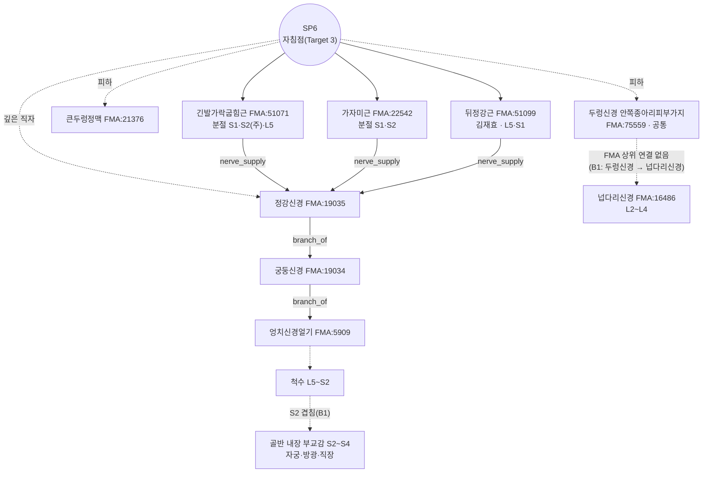

# [경혈 해부생리학 실체 판명 학술 모노그래프] 삼음교(三陰交, SP06)

> **프레임워크**: v2.7.7 (4대 원전·Tri-Target 반영) · **공간 변위 분기 (Tri-Target)**: **있음** — Target 1≡2 《黄帝明堂经》 원래의 '三阴交'(안쪽복사 위 8寸, '胻骨下陷者中' 촉진 간극 포함) vs Target 3 현행·WHO 삼음교(안쪽복사 끝 위 3寸 = 본래 '足太阴'穴), $\Delta \gg 10\text{mm}$
> **Target 3 (WHO·현행, 우위)**: ARI v3.0 | ARI-Core 75.0 ± 2.5 (B) | SI 50 | 잠정 가중치 0.40/0.35/0.25 | 민감도(등가중치): 75.0 (B, 등급 불변) · 반사 기전 B-Check 10/12 부합(③·⑤ 동물 한정)
> **Target 1≡2 (명당 원위·촉진 간극)**: ARI v3.0 | ARI-Core 41.3 ± 1.3 (D·H) | SI 75 | 잠정 가중치 0.40/0.35/0.25 | 민감도(등가중치): 38.5 (D, 등급 불변) · B-Check 2/12
> **이중 채점**: 독립 채점 2회, 15점 이상 불일치 3건 조정 완료 · **분기 판정**: ΔARI-Core 33.8, ± 구간 비중첩 → Target 3 단독 우위 (구 T1 → Target 1≡2, 구 T2 → Target 3)

> **핵심 4대 원전**: 《中国针灸穴位通鉴》 · 《中国针灸证治通鉴》(중국어 원문 기준, 한글 번역본으로 기술) · 《针灸腧穴通考》 · 《中国针灸经络通鉴》
> **Layer A 실증 DB**: 통합 생의학 마스터 DB v3.0 (역색인 SP6 **172편** 전수 검토 중 **SP6를 실제 자극·실측·관찰한 36편**을 판정에 사용, 8절 ① 표. 신규 확보 101편 전수 대조 반영)
> **Layer B 참조 등록부**: 4계층 참조 등록부(B1~B4) (B-Check 6항목, 부합 기준 ≥ 8/12)
> **해부 온톨로지**: FMA 5.1.0 로컬 색인 — 교재 구조를 `FMA:ID`로 고정(B1 보조, 등록부 미등재), 부록 A
> **도량형 환산**: 한대 기준 1푼(分) = 2.3mm ($z = \text{푼} \times 2.3\text{mm}$)
> **⚠ 임신부**: 《铜人》 "故妊娠不可刺", 교재 "孕妇禁针". 자침깊이 DB에는 '0'(금침) 기록이 없다 — 조건부 금기(5절·9절)

---

## 1. 문헌 스크리닝 표 (4대 원전 원문 발췌)

| 문헌 | 원문 발췌 (출처 파일·행) | 한국어 요지 | 비고 |
| :--- | :--- | :--- | :--- |
| 《针灸腧穴通考》 | "三阴交，在内踝上八寸胻骨下陷者中。足太阴、厥阴之会。（《黄帝明堂经》）" — 《针灸腧穴通考》 上 足太阴脾经穴 L1125 | 《明堂》의 삼음교는 안쪽복사 위 **8寸** 정강뼈 아래 오목, 족태음·궐음의 회 | **Target 1≡2** 근거 |
| 《针灸腧穴通考》 | "内踝上八寸骨下陷中名'三阴交'…隋唐时内踝上三寸处的'足太阴'穴被称作'三阴交'，而原《黄帝明堂经》之'三阴交'渐渐隐而不彰，名存而实亡。内踝上三寸之'三阴交'，不仅名实不符…" / "今之'三阴交'已非《黄帝明堂经》之'三阴交'。" — 같은 파일 L1119, L1121 | 현행 3寸 삼음교는 본래 '足太阴'穴이며 이름만 이어받았다(名实不符) | 名实考 — 7절 분기의 핵심 |
| 《针灸腧穴通考》 | 宋以前 部位: 《医心方》 卷二·卷二十八 "内踝上八寸", 《千金要方》 "八寸", 《甲乙》 卷三·《外台》 "三寸", 《圣惠方》 "八寸" / "实际上只有传世之明刊本《针灸甲乙经》作'内踝上三寸'…其他《黄帝明堂经》传本均作'内踝上八寸'…《外台秘要》'三阴交'穴排在'漏谷'（在内踝上六寸）穴之后" — 같은 파일 L1135~1149 | 《明堂》 전본 대부분이 8寸, 명간본 《甲乙》만 3寸. 《外台》 배열 순서(漏谷 뒤)도 8寸의 흔적 | Rank 4 교감 |
| 《针灸腧穴通考》 | "足太阴穴，在足内踝上三寸是也。（《诸病源候论》卷四十一）" / "足太阴穴，在内踝上一夫，一名三阴交。（《千金翼方》卷二十八）" / "三交二穴，在内踝上三寸是…名大阴" · "三阴二穴，在内踝上八寸，骨下陷中是"（《医心方》卷八） — 같은 파일 L1157~1169 | 3寸 '足太阴'(=三交)과 8寸 '三阴'(=원래 三阴交)이 수당대에 따로 기록됨 | 이명 분리(3절) |
| 《针灸腧穴通考》 | "部位：在小腿内侧，内踝尖上3寸，胫骨内侧缘后际。" / "针刺操作：刺1~1.5寸。孕妇禁针。" — 같은 파일 L1107, L1115 | 현대 정위·심도·임신부 금침 | **Target 3** 현대 정위 |
| 《针灸腧穴通考》 | "可灸三壮，针入三分。故妊娠不可刺。（《铜人腧穴针灸图经》卷下）" / "直刺…治足部病，略向后，深1~1.5寸。感应：可有麻电感向足底放散。"（上海《针灸学》） — 같은 파일 L1359, L1385 | 송대 '임신부 자침 불가'의 첫 조문. 깊은 직자 시 발바닥으로 전기감 = 정강신경 자극 | 5절 SI 근거 |
| 《中国针灸穴位通鉴》 | "三阴交，在内踝上三寸骨下陷者中。（《针灸甲乙经》3：53）" / 部位 2: "在内踝上八寸[1]骨下陷中。（《备急千金要方》29：510、《太平圣惠方》、《医心方》）… [1]'八寸'系'三寸'之误。同书卷21作'三寸'。" — 《中国针灸穴位通鉴》 足太阴脾经(1) L1308, L1336~1338 | 《穴位通鉴》은 8寸을 '三寸의 오기'로 본다 | **《通考》와 상충** — 7절에서 판정 |
| 《中国针灸穴位通鉴》 | 局部解剖: "在胫骨后方，比目鱼与屈趾长肌之间，有胫后动脉，分布着隐神经及胫神经。（《新针灸学》）" / "针刺通过之组织层：皮肤，皮下组织，趾长屈肌。神经、血管：隐神经之小腿内侧皮支，胫神经肌支；胫后动脉。（《针灸学简编》）" — 같은 파일 L1520~1526 | 가자미근–긴발가락굽힘근 사이, 뒤정강동맥·두렁신경·정강신경 | 4·6절 층차의 문헌 근거 |
| 《中国针灸证治通鉴》 | 《明堂经》 三阴交 主治 "主足下热，胫痛不能久立，湿痹不能行。" / 小结 "《明堂经》所载'三阴交'在内踝上八寸，而六朝以后方书所载'三阴交'多位于内踝上三寸，故主治病症大不相同。" — 《中国针灸证治通鉴》 第壹编 第七篇 足太阴脾经 手少阴心经 手太阳小肠经 L154, L184 (한글 번역본 L205, L249) | 한글 번역본: "발바닥에 열이 남, 정강이가 아파 오래 서 있지 못함, 습비(濕痹)로 걷지 못함을 주치한다" / "수혈서와 방서에 기록된 삼음교혈의 주치 병증은 매우 다르다. 이는 『명당경』에 실린 「삼음교」는 안쪽 복사뼈 위 8촌에 있는 반면, 육조 이후 방서에 실린 「삼음교」는 대부분 안쪽 복사뼈 위 3촌에 있기 때문이다" | 9절 Target 1≡2/Target 3 주치 분리 |
| 《中国针灸证治通鉴》 | "徐文伯针刺堕胎：泻足太阴，补手阳明，胎便应针而落。" / 小结 "六朝后医书多因而取三阴交、合谷穴以治难产，有些腧穴书甚至将此二穴列为孕妇禁刺穴。" — 《中国针灸证治通鉴》 第叁编 妇儿科病证 L382, L480 (한글 번역본 L587, L743) | 한글 번역본: "서문백이 침을 놓아 태아를 떨어뜨렸다. 족태음을 사하고 수양명을 보하자 태아가 침에 응하여 곧 떨어졌다" / "육조 이후의 의서는 대개 이를 따라 삼음교·합곡혈을 취해 난산을 치료하였고, 어떤 수혈서는 아예 이 두 혈을 임부에게 침을 금하는 혈[禁刺穴]로 꼽기까지 하였다" — 임신부 금침의 기원 = 徐文伯 인산(引産) 처방 | 5·9절 |
| 《中国针灸证治通鉴》 | "梦泄精，灸三阴交二七壮，梦断神良。（内踝上大脉并四指是）" (《千金要方》) — 《中国针灸证治通鉴》 第叁编 内科病症 三十九霍乱至四十二遗精 L1261 (한글 번역본 L2007) | 한글 번역본: "꿈에 정을 흘리면 삼음교에 뜸 二七壯을 뜨는데… (안쪽 복사뼈 위로 네 손가락을 나란히 한 너비 되는, 큰 맥이 있는 곳이다)" | 3寸 지점의 촉진 표현 '大脉' — 피하 큰두렁정맥(추론, 7절) |
| 《中国针灸证治通鉴》 | "针足太阴穴，在内踝上一夫，一名二阴交…" + 按 "'二阴交'当是'三阴交'之误。六朝以前，三阴交与'足太阴'穴是两个不同的穴" — 《中国针灸证治通鉴》 第叁编 外科病证 痔漏至虫兽咬伤 L20, L22 (한글 번역본 L28, L34) | 한글 번역본: "「이음교」는 「삼음교」의 잘못일 것이다. 육조 이전에는 삼음교와 「족태음」혈이 서로 다른 두 혈이었다" | **Rank 4 필사 오류 교정**(二→三). 《经络通鉴》 1편 L1263도 '二阴交'로 전재 |
| 《中国针灸经络通鉴》 | 《灵枢·经脉》 足厥阴 "上踝八寸，交出太阴之后" (经络通鉴 29편 L65) / 足太阴 "循胫骨后交出厥阴之前" (21편 L162) / 杨上善 "太阴从内踝上行八寸，当胫骨后，交出厥阴之前上行之" (21편 L182) / 《铜人》 주 "足厥阴行足太阴之前，上踝八寸，而厥阴复出太阴之后也" (29편 L101) | 족태음·족궐음 두 경맥이 안쪽복사 위 **8寸** 정강뼈 뒤에서 앞뒤가 바뀌며 교차 — 《明堂》 "三阴交 在内踝上八寸…足太阴、厥阴之会"와 같은 높이 | Target 1(8寸)의 경맥 순행 근거. 경문 자체는 혈명을 직접 언급하지 않음(소속 경맥 순행 기술) |
| 《中国针灸经络通鉴》 | 【按】 "三阴交穴为'足太阴、厥阴、少阴'（也有作'足太阴、厥阴'）三脉交会穴…又此穴被排在'中郄'穴（今作'中都'）之后，则其三阴交穴定位盖同《千金要方》、《医心方》、《太平圣惠方》等书作'内踝上八寸'" (《医心方》 卷22 足厥阴图, 29편 L313) / 《产经》 十脉图 "'三阴交'穴归入足厥阴经，而不是足太阴经" (2편 L1429) / 【按】 "'太阴'即今之'三阴交'穴。'漏谷'穴后有'阴交'一穴，《三家脚气论》作'三阴'，而杨注《明堂》等书即为'三阴交'穴，值得深入研究" (《医心方》 足太阴图, 21편 L362) | 송 이전 경맥도에서 三阴交는 中都(7寸)·漏谷(6寸) 뒤 = 8寸에 놓이고 족궐음에 속했다. 3寸 자리는 '太阴'으로 적혔다 | 通考의 독립 증거(《医心方》·《产经》)를 《经络通鉴》이 따로 확인 — Target 1 지지. 단 "值得深入研究"로 완결 판정은 유보 |
| 《中国针灸经络通鉴》 | "上述十二个'经脉穴'部位，除'足太阴'穴六朝以后变化较大外…" (1편 L731) / "足太阴：…《医心方》卷二十五引《玉匮针经》云：'足太阴穴在内踝后白肉际陷骨宛中'；《诸病源候论》卷四十一作'足内踝上三寸'" (L719) / 【按】 "隋唐时期，'足太阴'穴多定于'内踝上三寸处'" (L1199) / 《千金翼》 "妇人逆产足出，针足太阴…穴在内踝后白肉际陷骨宛宛中" + 【按】 "此'足太阴'穴部位乃六朝以前的定穴法，出《玉匮针经》" (L1225~1229) / "女人漏下赤白及血，灸足太阴五十壮。穴在内踝上三寸。足太阴经内踝上三寸名三阴交" (L1067) | '足太阴'穴은 육조 이전 안쪽복사 **뒤** 백육제에 있다가 수당대 안쪽복사 위 3寸으로 옮겨졌고, 3寸 자리가 '三阴交' 이름을 얻었다 | Target 3 계보의 전사. 徐文伯(남조) '足太阴'의 자리는 육조 정위(안쪽복사 뒤)였을 수 있다(추정, 2·9절) |
| 《中国针灸经络通鉴》 | 【按】 "杨上善以为'诸阴交'即'三阴交'，似缺乏文献依据" (35편 L224); "没有凭据，或出于意会" (4편 L1014) / 《经络汇编》 "自中封上踝，过足太阴脾经之三阴交，历蠡沟、中都，复上一寸，交出太阴之后" (29편 L163); 《针灸逢源》 "上踝过足太阴之三阴交" (29편 L198), "过足太阴之三阴交以上踹内之筑宾" (25편 L281) / 甲乙 "三阴交…足太阴、厥阴、少阴之会" (11편 L1084) | 杨上善의 '阴维 기시 = 三阴交'설은 근거 부족. 명·청 주가는 3寸 삼음교를 족궐음·족소음이 '지나는' 점으로 두면서 실제 교차는 中都 위 1寸(8寸)에 따로 둔다. 교회 경맥 수는 '太阴·厥阴'(《明堂》)과 '太阴·厥阴·少阴'(《甲乙》 현행본)으로 갈린다 | **Rank 4 경락론적 과잉 확장 판별** — '세 음경 교회'로 현행 3寸 혈의 효능을 설명하지 않는다 |

---

## 2. 원천/재인용 구분 표

| 층차 | 문헌 | 기술 내용 | 원천/재인용 |
| :--- | :--- | :--- | :--- |
| 한대 | 《黄帝明堂经》 | **三阴交 = 内踝上八寸胻骨下陷者中**, 足太阴·厥阴之会; 刺入三分, 留七呼, 灸三壮; 주 "足下热，胫痛不能久立，湿痹不能行" | 원천(Target 1≡2: 위치·심도·주치) |
| 남조 | 《南史·张融传》 徐文伯 | 泻足太阴, 补手阳明 → 堕胎 | 원천(Target 3 계열 '足太阴'의 부인과 응용). 단 육조 '足太阴'穴은 《玉匮针经》 "内踝后白肉际陷骨宛中"이었을 수 있어(经络通鉴 1편 L719·L1229) 徐文伯 처방의 자리를 3寸으로 단정하지 않는다 |
| 육조 | 《产经》 十脉图 · 《医心方》 卷22 경맥도 | 三阴交 归 足厥阴, 中郄 뒤(8寸); 3寸 자리는 '太阴' | 원천 보조(Target 1≡2 배열 증거, 经络通鉴 2편 L1429·29편 L313·21편 L362) |
| 수 | 《诸病源候论》 卷四十一 | 足太阴穴 在足内踝上三寸 | 원천(Target 3: 3寸 '足太阴'穴; 经络通鉴 1편 L719·L1199 "隋唐时期…多定于内踝上三寸处") |
| 수당 | 杨上善 《太素》 주 | 《难经》 "阴维起于诸阴交" → "诸阴交"=三阴交 | 경락론적 해석 — 《经络通鉴》 "似缺乏文献依据"(35편 L224)·"没有凭据，或出于意会"(4편 L1014) |
| 당 | 《千金要方》·《千金翼方》 | 足太阴(内踝上三寸·一夫) 灸 — 漏下赤白·泄痢·劳淋·癞疝; 《千金翼》 卷二十六 "在内踝上三寸骨下陷者中"·"产难，月水不禁，横生胎动皆针三阴交" | 3寸 지점을 '三阴交'로 부르는 최초 기술(通考 L1103) — 단, 전세본은 송대 교정을 거침 |
| 당 | 《外台秘要》 | 三阴交 "内踝上三寸"(《甲乙》 전재), 그러나 배열은 漏谷 뒤; 《素问·藏气法时论》 脾病候를 三阴交 아래 편입 | 재인용 + **귀속 오류**(通考 L1243, L1277) |
| 일본 | 《医心方》 卷二·卷八·卷二十八 | 三阴交 八寸; "三交=三寸(大阴)", "三阴=八寸" 구분 | 재인용(구분 보존) |
| 송 | 《太平圣惠方·明堂》 | 三阴交 八寸; 漏谷 아래에 三阴交 주치 오입 | 재인용 + 혼입(通考 L1415~1423) |
| 송 | 《铜人腧穴针灸图经》 | 三阴交 **三寸** 확정, 归足太阴脾经; "女子漏下不止" 추가; 徐文伯 방 "泻足三阴交，补手阳明合谷"; "故妊娠不可刺" | **현행 정위·임신부 금침의 정본화** |
| 금원명 | 《针经摘英集》·《玉龙经》·《针灸大成》 등 | 합곡·태충·중극 등과의 산과·부인과 배오 | 배오 재생산 |
| 명·청 | 《经络汇编》·《针灸逢源》 경맥 주 | 足厥阴·足少阴이 "过足太阴之三阴交"(3寸), 太阴·厥阴 교차는 中都 위 1寸에 따로 둠 | 후대 경맥 주석의 재배치(经络通鉴 29편 L163·L198, 25편 L281) |
| 현대 | 1957 南京《针灸学》~7版, 국표 | 内踝尖上3寸, 胫骨内侧缘后际; 直刺1~1.5寸; 孕妇禁针 | 표준화(Target 3) |

---

## 3. 이명·별칭 검증 표 (KJH DB 대조)

| 이명 | 출처 | KJH DB | 판정 |
| :--- | :--- | :--- | :--- |
| 足太阴(太陰) | 《诸病源候论》·《千金》 — 内踝上三寸(通考 L1157~1161) | 등재 | **Target 3 지점의 본래 이름**. 별명이 아니라 원명 |
| 三交 | 《医心方》 卷八 "三交二穴，在内踝上三寸…名大阴"(L1167) | 등재 | 수당대 Target 3 지점의 다른 이름 |
| 足太阴交 · 厥阴交 | 《新雕千金方》 · 《黄帝虾蟆经》(L1151) | 足太陰交 등재 | **Target 1≡2**(8寸 원래 三阴交)의 이칭 |
| 三阴 | 《医心方》 卷八 "三阴二穴，在内踝上八寸"(L1169) · 《三家脚气论》 | 미등재 | Target 1≡2의 수당대 이름 |
| 承命 | 1957 南京《针灸学》(일본 교재 인용) / 《千金要方》 "承命 在内踝后上行三寸动脉上"(L1129, L1171) | 등재 | **별개의 혈**(3寸 뒤 맥동처). 별명으로 쓰지 않는다 |
| 二阴交 | 《千金翼方》 卷二十八 일부 전재본(经络通鉴 1편 L1263; 证治通鉴 痔漏 L20) | 미등재 | '三阴交'의 필사 오류(证治通鉴 按 L22). 별명으로 쓰지 않는다 |
| 下之三里 · 下三里 | 일본 속칭 — 寺尾隆純《十四经腧穴弁解》(1784) "以三阴交为'下三里'"(L1131); 《穴位通鉴》 별명 2(L1314) | 下之三里 등재 | 중국 혈명이 아님. ST36(上三里)과 혼용 주의 — ST36 보고서 3절과 일치 |

KJH DB(경혈명·이명 대조 표준 데이터베이스 종합 목록 Excel 행 137: 134, SP06, 삼음교, 三陰交, "承命, 太陰, 下之三里, 足太陰交, 足太陰, 三交")는 Target 1≡2·Target 3 계열의 이름과 별개 혈(承命)을 한 줄에 함께 싣고 있다. 위 표처럼 계열을 나누어 읽어야 한다. 또 《太平圣惠方》 이후 漏谷(SP7)에 三阴交 주치가 섞여 들어갔다(通考 L1415~1423).

---

## 4. 3D 공간 좌표 및 Layer 1~5 층차 구조도

**Target 3 (현행)**
- **X (내외측)**: 정강뼈 안쪽면 **뒤모서리 바로 뒤**(胫骨内侧缘后际, 通考 L1107).
- **Y (상하)**: 안쪽복사 끝 위 3寸(4횡지, 1957 南京《针灸学》 이하; 通考 L1201~1213), 交信 위 1寸(L1179).
- **Z (깊이)**: 아래 층차. 성인 85명(남 42·여 43) 초음파 실측(`papers.id 2602`, 2026, DOI: `10.13201/j.issn.1001-1420.2026.02.004`)에서 삼음교(내과 최고점 상 4횡지·약 3촌, 경골 내측연 후제 오목) 피부 표면으로부터 **Layer 4 정강신경(`FMA:19035`)까지의 심도는 좌측 $1.44 \pm 0.04\text{cm}$ ($14.4\text{mm}$), 우측 $1.50 \pm 0.04\text{cm}$ ($15.0\text{mm}$)** ($P > 0.05$)이며, 종아리 둘레(소퇴 주경, 평균 $23.88 \pm 0.29\text{cm}$)와 강한 양의 상관관계(좌 $r=0.748$, 우 $r=0.745$, 모두 $P<0.001$; 회귀식 $\text{신경 심도(cm)} = 0.1137 \times \text{종아리 둘레(cm)} - 1.2453$, 즉 종아리 둘레 $1\text{cm}$ 증가당 심도 약 $1.14\text{mm}$ 증가)를 보인다. 또한 컬러 도플러 횡단면 초음파에서 **정강신경은 동반 뒤정강혈관(적색 혈류 신호)의 심층(深面)**에 위치함이 실증되었다(`papers.id 2602`). (단, Layer 1~3 개별 근막·근육 경계의 PMID 등재 사체·영상 실측은 부재하므로 층간 세부 경계는 구조 순서 중심으로 기술한다.)
- **촉진 간극(3寸 높이)**: 명간본 《甲乙》·《千金翼》 "内踝上三寸骨下陷者中"의 '骨下陷者中'은 **정강뼈(FMA:24476) 안쪽모서리 뒤와 가자미근(FMA:22542) 안쪽 가장자리 사이의 골–근 간극(緣)**이고, 바닥은 긴발가락굽힘근(FMA:51071)·뒤정강근(FMA:51099), 피하에 큰두렁정맥(FMA:21376)·두렁신경 가지(FMA:75559)가 있다. X는 Target 3과 같다(7절). 《千金》 "内踝上大脉并四指是"의 '大脉'은 이 높이 피하의 큰두렁정맥으로 읽힌다(추론).

```
[Layer 1 피부·피하]   두렁신경 안쪽종아리피부가지(두 교재) · 큰두렁정맥(두 교재) — 고전 3푼(6.9mm) 도달층(추정)
        │
[Layer 2 얕은 근육]   가자미근 안쪽 가장자리(두 교재)
        │
[Layer 3 깊은 근육]   긴발가락굽힘근(두 교재) · 뒤정강근(김재효) — 현대 직자 1~1.5寸(23~34.5mm) 도달층(추정)
        │
[Layer 4 신경혈관속] 뒤정강동·정맥(두 교재, 천측) · 정강신경(두 교재, 심측: 성인 초음파 실측 좌 14.4±0.4mm·우 15.0±0.4mm, papers.id 2602) — 깊은 직자 시 "麻电感向足底放散"(通考 L1385)
        │
[Layer 5 바닥]       정강뼈 뒤면 · 종아리뼈사이막 (심부 장기 없음)
```


*그림 4-1. 삼음교(현행 Target 3) 높이 하퇴 하1/3 횡단면 모식도(오른다리, 위에서 내려다봄, 축척 아님). 직자 경로는 큰두렁정맥·두렁신경을 피해 정강뼈 안쪽면 뒤모서리 뒤로 들어가 긴발가락굽힘근에 이르고, 더 깊으면(성인 초음파 실측 평균 14.4~15.0mm, `papers.id 2602`) 동반 뒤정강혈관(천측)과 그 심면의 정강신경에 닿을 수 있다. Target 1≡2(8寸)은 이 단면보다 5寸 위다.*

**Target 1≡2 (《明堂》 원위, 内踝上八寸胻骨下陷者中)**: 2대 교재·FMA 대응표에 Target 1≡2 지점 자체의 항목은 없다. 같은 '정강뼈 뒤모서리' 선 위의 인접 혈 교재 기재로 범위를 좁히면, 아래쪽 漏谷(SP7, 6寸)은 가자미근·긴발가락굽힘근·뒤정강근·정강신경·뒤정강동정맥(두 교재 SP07 행, SP06과 같음), 위쪽 地机(SP8, 아래 10寸)는 장딴지근·가자미근·긴발가락굽힘근·뒤정강근(김재효)·오금근(공통교재)이다. 따라서 Target 1≡2은 **가자미근·긴발가락굽힘근 층(SP7과 같은 구성)**일 것으로 **추론**할 뿐이며, 교재·실측 근거는 없다($S_{clarity}$ 25).

**자입 기준점 (Target 2, 8寸 높이)**: 《明堂》 '胻骨下陷者中'이 가리키는 곳은 **정강뼈(FMA:24476) 안쪽모서리 바로 뒤, 가자미근(FMA:22542) 안쪽 가장자리와 정강뼈 사이의 간극(緣)**이다. X = 정강뼈 안쪽모서리 바로 뒤, Y = 안쪽복사 위 8寸. 바닥은 긴발가락굽힘근(FMA:51071)으로 추론한다. 8寸 높이의 교재 기재·실측이 없으므로 경계 구조물은 SP7 교재 구성에서 **추론**한 것이다. 이 기준점은 Target 1과 같은 문장·같은 높이에 있어 Target 1과 병합된다(7절).

**FMA 실체 대조(Layer별, Target 3)** — 구조명은 2대 교재, ID·관계는 FMA 5.1.0

| Layer | 구조 | FMA | 대응 | FMA 관계 | 신경 줄기 / 분절 |
| :--- | :--- | :--- | :--- | :--- | :--- |
| 1 | 두렁신경 안쪽종아리피부가지 [공통] | FMA:75559 | exact(김재효) / **수동**(공통교재 표기 'medial cutaneous branch of the leg of saphenous nerve' 자동 none) | Set of medial crural cutaneous branches of saphenous nerve — **FMA에 두렁신경(FMA:45262)으로의 상위 연결 없음** | B1: 두렁신경 → 넙다리신경, 피절 L3~L4(B1-03) |
| 1 | 큰두렁정맥 [공통] | FMA:21376 | exact | drains_into Femoral vein | — |
| 2 | 가자미근 [공통] | FMA:22542 | exact | contained_in 뒤칸 얕은층 공간(FMA:312103) | 정강신경 가지(FMA:80461·80462). 분절 S1·S2 |
| 3 | 긴발가락굽힘근 [공통] | FMA:51071 | exact | contained_in 뒤칸 깊은층 공간(FMA:312109) | Nerve to FDL(FMA:80101) ← 정강신경. 분절 **S1·S2(주)**·L5 |
| 3 | 뒤정강근 [김재효] | FMA:51099 | **수동**(교재 'posterior tibialis' 어순 → 자동 none) | contained_in 뒤칸 깊은층 공간(FMA:312109) | Nerve to tibialis posterior(FMA:80104). 분절 L5·S1 |
| 4 | 정강신경 [공통] | FMA:19035 | exact | branch_of Sciatic nerve(FMA:19034) | 궁둥신경 → 엉치신경얼기(FMA:5909). 신경 분절 FMA 미기재 → B1: L4~S3 |
| 4 | 뒤정강동맥 · 뒤정강정맥 [공통] | FMA:43895 · FMA:44332 | exact | 동맥 branch_of External iliac artery(FMA 모델링, ST36 보고서와 같은 특이점) / 정맥 tributary_of Popliteal vein | — |
| 5 | 정강뼈 · 종아리뼈사이막 | FMA:24476 · FMA:35187 | — | — | — |

- **초음파·9.4T MRI·공초점 현미경·CT 단면 해부 실증(`papers.id 2602`·`2603`·`2558`·`2507`·`2534`)**: 공개 초음파 참고 영상 등록 데이터셋(`marzola_msk`) 및 PubMed 영문 검색(2026-10-23)에서는 성인 SP6 실측이 확인되지 않았으나(PMID 기준 부재로 $S_{clarity}=75$ 유지), 로컬 마스터 DB에 수록된 중국어 임상 초음파 연구(`papers.id 2602`, 2026, 《临床泌尿外科杂志》 41(2):97–101, 성인 85명)에서 삼음교 직하 **정강신경의 피부 대비 심도가 좌 $1.44 \pm 0.04\text{cm}$ ($14.4\text{mm}$), 우 $1.50 \pm 0.04\text{cm}$ ($15.0\text{mm}$)**로 실측되었고, 정강신경이 동반 뒤정강혈관의 심면(深面)에 놓여 있으며 그 심도가 종아리 둘레와 유의한 선형 비례 관계($r=0.748/0.745, P<0.001$)를 이룸이 규명되었다. 또한 설치류 9.4T 고자장 MRI 단면 해부·X선·조직절편 및 저저항점 측정 연구(`papers.id 2603`, 2026, 《动物医学进展》 47(2):73–79, SD 쥐 15마리)에서는 내과첨 직상 $9.9 \pm 0.3\text{mm}$(경골·비골 미융합 구간)의 전기전도도($17.22\sim18.28\ \mu\text{A}$)가 6mm 부위보다 유의하게 높고($P<0.05$), 5mm 자입 시 침도·매선이 피부–천·심근막–긴발가락굽힘근(FDL)과 긴엄지굽힘근(FHL) 건 사이(두렁동·정맥 인접)–뒤정강근–경비골 결합부 후연을 지나 장딴지근 방향으로 도달하며 혈구에 두렁혈관과 정강신경이 분포함을 입증하였다. 아울러 쥐 삼음교 피부·피하조직의 3D 레이저 공초점 재구성 연구(`papers.id 2558`, 2016)는 Layer 1 진피하·피하 혈관 주위에 비만세포(MC)와 SP·CGRP·TRPV1 양성 신경섬유가 밀집해 있고 수기 자침 3분 후 비만세포가 침도 주위로 응집·탈과립하며 5-HT·히스타민(HA)·CGRP·SP 발현이 급증함을 밝혔고, 사체 5구(10측) 삼음교 CT 단층 및 단면 해부 결과를 인용한 문헌(`papers.id 2507`, 2000; `papers.id 2534`, 2010)은 삼음교가 피부·천근막(작은 조직 간극)과 심근막·근육층(큰 조직 간극)에 걸친 신경·혈관·림프관·근막의 3차원 입체 복합 구조체임을 보고하였다.
- **다층 해부 구조와 ‘일수다점다모식조공(一輸多點多模式調控)’ 및 생의학 대조군 설계의 전제**: 삼음교(Target 3)의 임상 데이터는 위 표의 어느 단일 해부 구조(예: 표층 두렁신경 가지 또는 심층 정강신경 중 하나)로 환원되지 않는다. 첫째, 역사적으로 본래 8寸 ‘삼음교’(Target 1≡2)와 3寸 ‘족태음’혈(Target 3), 인접 혈(누곡) 및 경맥 유추 주치가 ‘삼음교’라는 한 명칭 아래 중첩되어 있고(황룡상, 〈腧穴主治的演变〉, 《中国针灸》, 2001; 또한 황룡상 지도 애홍란[艾红兰]의 `papers.id 2511` 〈三阴交主治演变考〉 2002 및 `papers.id 2535` 2011·`papers.id 2573` 2018·`papers.id 2577` 2020 참조), 둘째, 현행 3寸 입체 영역(X·Y·Z) 안에서도 자침 심도·방향·수기법에 따라 자극되는 표층 피신경(`FMA:75559`)·정맥 외막 신경총(`FMA:21376`)·비만세포-신경펩티드 단위(`papers.id 2558`), 심부 근육·근막층(`FMA:22542`·`51071`·`51099`) 기계수용기(`Piezo1`, `papers.id 2321`), 심층 신경혈관속(`FMA:19035`·`43895`·`44332`, 성인 심도 $14.4\sim15.0\text{mm}$, `papers.id 2602`)이 서로 다른 표적 장기와 병증에 대응하는 **‘한 수혈 내 다중 타겟·다중 모드 조절(一输多点多模式调控)’** 구조를 이룬다(황룡상, 〈人体调控之门的探与测——基于现代解剖学和古典针灸学的视角〉, 《现代中医临床》, 2023: "同一输穴中有不同的靶点…同一穴中的不同靶点调控的靶器官不同"). 실제로 임상·동물 관찰에서도 슬골관절염(KOA) 환자 184슬 중 **71.19%(131슬)**에서 삼음교 혈구의 **면상(面狀) 경근 비후·압통**(Layer 2~3 하퇴 근막·근육 병변)이 검출되고(`papers.id 2592`), 만성 B형간염 환자 48명에서 삼음교 **체표 적외선 온도**(Layer 1 혈관교감 반사)가 문맥 혈류속도($V_{PV}$)·울혈지수($CI$)와 유의하게 상관하며(`papers.id 2569`), 난소염 쥐 모델에서 **L4(‘삼음교–족삼리’) 피절의 에반스블루 신경원성 삼출**(`papers.id 2523`)과 원발성 월경통 쥐의 **삼음교 Piezo1·비만세포 감작**(`papers.id 2321`)이 각기 다른 층위에서 확인된다. 따라서 현대 생의학 실험 및 임상시험(RCT)에서 삼음교의 특이성을 검증할 때에는, 대상 병증에 대응하여 어느 층위(Layer 1~4)·어떤 구조를 자극 타겟으로 삼는지 먼저 특정해야 하며, 대조군으로 흔히 쓰는 ‘비혈천자(非穴淺刺)’가 실제로는 고전 침구학에서 일반 통증(‘중비[衆痹]’)을 치료하는 표준 피하 자법인 ‘분자법(分刺法)’이나 동반 혈관 외막 신경총을 자극하여 대조군 오염을 일으키지 않도록 설계 전제를 분리해야 한다(황룡상, 《新古典针灸学大纲》, 인민위생출판사, 2022, 제4편 제2절 183·184조).

---

## 5. 자침 깊이 계산표

출처: 역대 침구문헌 자침심도 데이터베이스 시트1 Excel 행 136(N0 134, SP06), 보조로 《通考》 【操作】(L1353~1385).

| 문헌 | 푼(分) | 환산 심도 (×2.3mm) | 도달 Layer(추정) | 비고 |
| :--- | :---: | :---: | :--- | :--- |
| 황제명당경(황룡상 감수) | 3 | 6.9mm | 1 | "刺入三分" — 名实考상 **Target 1≡2(8寸)의 심도** |
| 침구갑을경 | 3 | 6.9mm | 1 | |
| 침구경험방 | 3 | 6.9mm | 1 | |
| 동의보감(인용: 동인) | 3 | 6.9mm | 1 | 금침 아님 |
| 경락수혈학 공통교재 | 10~15 | 23.0~34.5mm | 3 | |
| 침구의학 공통교재 | 10~15 | 23.0~34.5mm | 3 | |
| 《针灸腧穴通考》 | 10~15 | 23.0~34.5mm | 3(~4) | "刺1~1.5寸。孕妇禁针" |
| 1957 南京《针灸学》(원전 보조) | 5~8 | 11.5~18.4mm | 2 | L1373 |
| 《中国针灸学》(원전 보조) | 5~10 | 11.5~23.0mm | 2~3 | L1383 |
| 上海《针灸学》(원전 보조) | 직자 10~15(足部病) / 15~20(透悬钟) / 사자 15~25 | 23.0~57.5mm | 3~4 | "麻电感向足底放散" = 정강신경 자극(L1385) |
| 《窦太师针经》(원전 보조) | 횡자 25 | (수평 57.5mm) | 1~3 | "横针入二寸半，亦透绝骨穴"(L1365) |

- 금침('0') 기록 없음, 'blank' 없음(DB 해당 열 기준). **"孕妇禁针"은 조건부 금기**이며, 그 기원은 徐文伯의 인산 처방(泻足太阴·补手阳明)이 후대 腧穴书에서 "妊娠不可刺"로 바뀐 것이다(证治通鉴_22 L480; 通考 L1291, L1359). 임신부에게는 자침하지 않는다는 원칙은 그대로 둔다.
- 안전 범위: 고전 3푼($6.9\text{mm}$)은 피하에 머문다. 현대 1~1.5寸($23.0\sim34.5\text{mm}$) 직자는 긴발가락굽힘근 층에 이르며, 성인 85명 초음파 실측(`papers.id 2602`)에서 삼음교 직하 **정강신경의 피부 대비 심도가 평균 좌 $14.4\pm0.4\text{mm}$·우 $15.0\pm0.4\text{mm}$**이고 정강신경 바로 천측(浅侧)에 동반 **뒤정강혈관**이 위치하므로, 15mm 이상 심자하거나 '略向后' 방향에서는 뒤정강혈관 천자 위험과 정강신경 직접 자극("麻电感向足底放散", 上海《针灸学》)이 발생한다. 따라서 심층 정강신경 타겟팅(예: 과민성방광·배뇨장애 신경조절) 시에는 종아리 둘레 기반 심도 추정($\text{심도[cm]} = 0.1137\times\text{종아리 둘레[cm]} - 1.2453$) 또는 초음파 유도하에 동반 혈관을 회피해야 하며(`papers.id 2602`), 정강뼈 뒤모서리 가까운 피하의 큰두렁정맥·두렁신경도 눈으로 확인하고 피한다.

---

## 6. 해부학 구조 교재 비교표 (Target 3)

| 구분 | 경혈학 공통교재 (공통교재 데이터셋 종합 시트 행 135) | 김재효 교재 (종합 시트 행 135) | FMA 판별 | 평가 |
| :--- | :--- | :--- | :--- | :--- |
| 근육 | 가자미근, 긴발가락굽힘근 | 가자미근, 긴발가락굽힘근, **뒤정강근** | FMA:22542·51071 공통 / FMA:51099 김재효 단독 | 김재효가 더 깊은 층까지 기재 |
| 신경 | 두렁신경의 안쪽종아리피부가지, 깊은층에 정강신경 | 같음 | FMA:75559·19035 (공통교재 표기는 수동 대응) | 일치 |
| 혈관 | 큰두렁정맥, 뒤정강동·정맥 | 같음 | FMA:21376·43895·44332 | 일치 |

**FMA로 본 차이의 의미**: 두 교재는 거의 같다. 유일한 차이인 '뒤정강근'(김재효)은 FMA상 긴발가락굽힘근과 같은 **뒤칸 깊은층 공간(FMA:312109)**에 있고, 긴발가락굽힘근보다 가쪽·깊은 쪽이다. 따라서 이는 상충이 아니라 **기재 깊이의 차이**다. 《穴位通鉴》 국소해부(L1518~1526: 比目鱼与屈趾长肌之间, 胫后动脉, 隐神经·胫神经)는 두 교재와 일치한다. 같은 곳의 《中国针灸学》 "有长总趾伸肌"(L1524)는 뒤칸 혈위에 앞칸 근육(폄근)을 적은 것으로 오기로 본다.

B1-01·B1-03(하퇴 뒤칸 국소해부)과 부합한다. 로컬 DB에 수록된 성인 85명 초음파 실측(`papers.id 2602`, 정강신경 심도 좌 $14.4\text{mm}$·우 $15.0\text{mm}$, 동반 뒤정강혈관 심면 위치) 및 설치류 9.4T MRI 단면 해부(`papers.id 2603`, FDL·FHL 건 사이–뒤정강근–경비골 결합부 후연 관통)가 이 층차 구성을 직접 뒷받침한다(단, PMID 등재 사체·영상 실측은 없어 ARI v3.0 루브릭상 $S_{clarity}=75$ 유지).

---

## 7. 공간 변위 분기 추론도 (Tri-Target)

**Target 근거 계통**

| Target | 근거 | 위치 | 판단 |
| :--- | :--- | :--- | :--- |
| **Target 1≡2** 《明堂》 三阴交 | 《黄帝明堂经》 "在内踝上八寸胻骨下陷者中"(通考 L1125); 《医心方》·《千金要方》·《圣惠方》 八寸(L1137~1147); 足厥阴 "上踝八寸，交出太阴之后"(L1119) | 안쪽복사 위 8寸, 정강뼈 뒤모서리 | 명칭의 원래 혈. 송대 이후 소실 |
| **Target 3** 현행 三阴交 (= 원 足太阴) | 《诸病源候论》·《千金》 "足太阴…内踝上三寸"(L1157~1161); 명간본 《甲乙》 3：53; 《铜人》 이후 통일(L1185) | 안쪽복사 끝 위 3寸, 정강뼈 뒤모서리 | 현대 표준 정위 |

**Tri-Target 좌표** (X 내외측 · Y 상하 · Z 깊이; 위치는 모두 골도 환산 추정, 실측 아님)

| Target | 정의 | X (내외측) | Y (상하) | Z (자입 깊이) |
| :--- | :--- | :--- | :--- | :--- |
| Target 1 (고전 문헌) | 《明堂》 "在内踝上八寸胻骨下陷者中" | 정강뼈 안쪽모서리 뒤 | 안쪽복사 위 8寸 | 3푼(6.9mm), Layer 1 |
| Target 2 (촉진 실체화) | '胻骨下陷者中' = 정강뼈(FMA:24476) 안쪽모서리 뒤–가자미근(FMA:22542) 안쪽 가장자리 사이 골–근 간극(緣) — **자입 기준점**(4절) | 정강뼈 안쪽모서리 바로 뒤 | 촉진 문구가 붙은 최초 기술의 높이 = 8寸 | 간극 바닥 긴발가락굽힘근(추론) |
| Target 3 (WHO) | "内踝尖上3寸，胫骨内侧缘后际"(국표 = WHO 표준 정위 문구) | 정강뼈 안쪽모서리 바로 뒤 | 안쪽복사 끝 위 3寸 | 직자 1~1.5寸(23~34.5mm), Layer 3(~4) |

**쌍별 편차** (분기 기준 $\Delta_{discrepancy} > 10\text{mm}$)

| 쌍 | Δ (추정) | 근거 | 판정 |
| :--- | :---: | :--- | :--- |
| Target 1–2 | 약 0~5mm | 같은 문장(《明堂》)의 위치와 촉진 문구 — X·Y 기준이 같다 | 병합 |
| Target 1–3 | 약 12~15cm | 같은 정강뼈 뒤모서리 선(X 동일)에서 Y만 5寸 차. 하퇴 골도(안쪽복사 끝~음릉천 13寸)로 성인 1寸 ≈ 2.5~3cm | **분기** |
| Target 2–3 | 약 12~15cm | 위와 같음 | **분기** |

- **판정**: **Target 1≡2 vs Target 3**, $\Delta \approx 12\sim15\text{cm} \gg 10\text{mm}$ → 정본 Rank 5 분기 요건 충족, 두 독립 Target을 따로 채점한다.
- **같은 촉진 문구의 3寸 적용**: '骨下陷者中'은 명간본 《甲乙》·《千金翼》의 3寸 기술에도 붙고(通鉴 L1308; 经络通鉴 11편 L1084), 《千金》 "内踝上大脉并四指是"(证治通鉴 遗精 L1261)의 '大脉'은 3寸 높이 피하 큰두렁정맥으로 읽힌다(추론). 이 둘은 Target 3과 10mm 이내라 새 Target을 만들지 않는다. 세 위치의 X(정강뼈 안쪽모서리 뒤 간극)는 같고, 편차는 Y(5寸) 하나에서 생긴다.

- **상충 판정(《穴位通鉴》 vs 《通考》)**: 《穴位通鉴》은 8寸을 '三寸의 오기'로 보고 그 근거로 "同书卷21作三寸"을 든다(通鉴 L1338). 그러나 《千金要方》 권21의 해당 조문은 "劳淋，灸**足太阴**百壮，在内踝上三寸"(通考 L1339; 证治通鉴_20 L747)으로, '三阴交'가 아니라 '足太阴'을 말한다. 반대로 《通考》는 ① 《明堂》 전본 다수의 8寸, ② 《外台》의 배열 순서(漏谷 뒤), ③ 《圣惠方》의 8寸, ④ 《医心方》의 '三交(3寸)'·'三阴(8寸)' 구분, ⑤ 《产经》 경맥도를 독립 증거로 제시한다(L1149~1173). 《证治通鉴》 소결(L184) 및 문헌 고증 논문들(`papers.id 2511` 애홍란·황룡상 2002; `papers.id 2535` 증봉·나휘 2011; `papers.id 2573` 진성우 등 2018; `papers.id 2577` 진민·소로 2020)도 같은 결론을 뒷받침한다. 따라서 **《通考》 판단을 채택**한다. 다만 《通考》 스스로 《千金翼》 전세본의 송대 교정 여부는 "尚不能确定"이라 했으므로(L1103), $S_{orig}$ ④는 100이 아닌 단계로 둔다(10절).
- **《经络通鉴》 교감(Rank 4)**: ① 《灵枢·经脉》에서 족태음·족궐음은 안쪽복사 위 **8寸**에서 교차한다(经络通鉴 21편 L182, 29편 L65·L101) — 《明堂》 '足太阴、厥阴之会 在内踝上八寸'와 같은 높이. ② 《医心方》 足厥阴图는 三阴交를 中郄(中都) 뒤에 두고(29편 L313), 《产经》 十脉图는 三阴交를 족궐음에 귀속하며(2편 L1429), 《医心方》 足太阴图는 3寸 자리를 '太阴'으로 적는다(21편 L362) — 通考 ④·⑤ 증거와 같은 방향. ③ 《千金翼》 '一名二阴交'(1편 L1263)는 '三阴交'의 필사 오류다(证治通鉴 痔漏 按 L22). ④ '足太阴'穴은 육조 이전 안쪽복사 뒤(《玉匮针经》)에서 수당대 3寸으로 옮겨졌다(1편 L719·L1199·L1229). ⑤ 杨上善의 '诸阴交=三阴交'(阴维 기시)설과 명·청 주가의 '过足太阴之三阴交' 배치는 후대 경락론적 해석이다(35편 L224, 4편 L1014). 다만 《经络通鉴》 스스로 "值得深入研究"(21편 L362)라 하므로 Target 1 ④를 100으로 올리지 않는다.
- **분기 판정 (Tri-Target)**: 독립 Target은 Target 1≡2와 Target 3 둘이다. ΔARI-Core = 75.0 − 41.3 = 33.8 (≥ 10), Target 3 [72.5, 77.5]와 Target 1≡2 [40.0, 42.5]는 겹치지 않는다 → **Target 3 단독 우위**. 이는 "현행 삼음교 지점의 해부 실체가 더 잘 판명된다"는 뜻이며, 이름의 원래 주인은 Target 1≡2이라는 문헌학 결론(名实不符)과 함께 기록한다.

> **구판 표기 대응**: 구 T1(《明堂》 8寸) → **Target 1≡2**, 구 T2(현행 3寸) → **Target 3**. 위치가 바뀌지 않았으므로 이중 채점을 그대로 승계한다. 10mm 기준으로 상태가 바뀐 쌍은 없다(병합 쌍 Δ 0~5mm, 분기 쌍 Δ 12~15cm).

---

## 8. 생의학적 반사 기전도 및 외부 검색 로그 (Target 3)

**기전 기술(부합, 동물·인체 신경영상·전기생리 근거 통합)**: SP6 단독 자극 및 핵심 배오 연구가 말초–척수 분절–중추–표적 장기 고리의 각 단계를 다각도로 실증한다. ① **말초·국소 층차**: 정상 쥐 SP6 수기 자침 시 진피하·피하 혈관 주위 비만세포(MC)가 응집·탈과립하며 5-HT·히스타민(HA)·CGRP·SP·TRPV1 발현이 증가하고(`papers.id 2558`), 원발성 월경통 쥐에서는 SP6 부위 Piezo1·CGRP·tryptase가 감작된 상태에서 SP6 단독 전침이 이를 낮추며 자궁 Piezo1/COX-2/PG 경로를 억제했다(`papers.id 2321`). 또한 난소염 쥐 모델에서는 L4(‘삼음교–족삼리’) 피절에 에반스블루 신경원성 혈장 삼출이 나타나고(`papers.id 2523`), 인체 만성 B형간염에서는 SP6 적외선 온도가 문맥 혈류역학($V_{PV}$·$CI$)과 상관하며(`papers.id 2569`), 슬골관절염(KOA) 환자 184슬의 71.19%에서 SP6 면상 경근 병변이 촉지되었다(`papers.id 2592`). ② **구심·척수 분절 특이성 및 방광·골반신경 조절**: 과민성장증후군 마우스에서 SP6 단독 전침이 DRG 신경을 활성화하고 뇌 활성 영역이 ST36과 시상하부 실방핵(PVN)에서 가장 많이 겹쳤으며(`papers.id 2280`), 반대로 고양이 **T8 척수 후각**의 위팽만·대내장신경(GSN) 수렴 신경원에서는 ST36 전침만 반응을 유의하게 역전($P<0.05$)시키고 **SP6 단독 전침은 유의한 효과가 없어($P>0.05$)** 하요·천수(L4~S2) 분절인 SP6와 흉수(T8) 위장 교감 분절의 차이를 명확히 보여주었다(`papers.id 2510`). 반면 천수 배뇨중추(S2~S4)와 분절을 공유하는 방광 조절에서는 **SP6 단독 자극**(수기침·2Hz·15Hz 전침)과 동분절 BL32/BL33이 정상·급성요저류(AUR)·과민성방광(OAB) 쥐의 방광내압·배뇨근 EMG 및 **골반신경(부교감 원심·구심) 방전**을 상태 의존적으로 유의하게 조절한 반면(OAB에서는 골반신경·배뇨근 과활성 억제, AUR에서는 골반신경 폭발 방전 $5.84\pm1.61$ 및 배뇨근 수축압 증가), 이분절 합곡(LI4)은 무효함이 입증되었고(`papers.id 2552`), 천수상 척수손상(T8 절단) 신경인성 방광 쥐에서 CV3+BL32+SP6 전침이 척수·방광 **PACAP-38/PAC1R-cAMP**(`papers.id 2588`) 및 혈청 엑소좀 **rno-let-7b-5p/NGF-TrkA-$\text{Ca}^{2+}$** 경로(`papers.id 2593`)를 통해 배뇨근 과반사를 억제하며, 여성 OAB 다기관 임상연구(463명, `papers.id 2597`)에서도 BL33+SP6 전침의 유효성(84.67%)과 안전성이 확인되었다. ③ **시상하부-뇌하수체-생식선(HPG) 축 및 중추 신경영상(인체·동물)**: 난소절제+에스트라디올 투여 쥐에서 **SP6 단독 전침**이 오후 시간창(12:00~14:00) 특이적으로 중추 아드레날린성 $\alpha$ 수용체를 통해 시상하부 흥분성 **NPY** 상향·억제성 **$\beta$-EP** 하향 및 뇌하수체 **GnRH-R mRNA** 발현을 조절하여 황체형성호르몬(LH) 서지를 유도하고(`papers.id 2508`), 수산화요소 유발 신허 배란장애 쥐(110마리)에서 **SP6 단독 전침**(1·2·3배 자극량)이 CV4·CV12 단독보다 우위($\text{SP6}>\text{CV4}>\text{CV12}$)로 성숙 난포 수, 혈청 $\text{E}_2$·FSH·LH, 시상하부 NE·DA 및 난소·자궁 ER·PR 발현을 회복시켰다(`papers.id 2549`). 인체 중추 연구에서는 원발성 월경곤란증 환자(6명)에서 **SP6 단독 직자(2cm)**가 SP6 가짜침과 달리 통증(VAS)을 유의하게 줄이면서 $^{18}\text{F-FDG}$ PET/CT상 시상·섬엽·편도체·해마·전대상회(ACC)·시상하부 유두체 등 통증·변연계-내분비 네트워크 대사를 활성화했고(`papers.id 2520`), 건강 여성(6명, 주로 SI·MI·SMA·DLPFC 피질 활성)과 대비하여 질환 상태 의존적 변연계 조절을 보였으며(`papers.id 2521`), 월경전증후군 환자 23명 fMRI에서 SP6 단독 전기자극이 편도체 기능연결을 변화시켰고(`papers.id 2314`), 건강 성인 16명 1.5T fMRI(`papers.id 2519`)에서는 SP6 단독 자침(약 22mm)이 중심후회·섬엽 활성과 해마·해마방회·대상회 신호 감소를 유도하였으며, 뇌졸중 환자 정량 뇌파(EEG) 비교(`papers.id 2589`)에서는 SP6 단독 자침이 PC6·GV26과 구별되게 alpha 대역 활성화와 gamma 대역 근사 엔트로피 감소를 유도했다. 고빈도·저빈도 전침의 아편계 기전(B3-10)은 ST36+SP6 조합으로 검증된 것이어서 SP6 단독 근거로는 보조로만 쓴다(`papers.id 5`·`8`·`12`·`46`·`54`). **B-Check 10/12 부합** — 단 ③·⑤의 말초 수용체–표적 장기 분자 회로는 동물(쥐·마우스) 중심이며, 인체 전환(⑥)은 SP6 단독 임상 효능 대조 RCT 부재(인체 SP6 단독 연구는 PET/CT·fMRI·EEG 뇌기전 소표본 연구 `2520`·`2521`·`2314`·`2519`·`2589`이며 임상 효능 RCT는 2~4혈 조합 `510`·`2516`·`2537`·`2315`)로 루브릭상 1점을 유지한다.

**분절 소견**: FMA 근육 분절은 L5~S2(긴발가락굽힘근 S1·S2 주, 가자미근 S1·S2, 뒤정강근 L5·S1)다. 자궁·방광·직장의 부교감(골반내장신경) 분절 S2~S4와 **S2에서 겹친다**. 반면 월경통 통증 구심(교감 경로 T10~L1)과는 겹치지 않는다(B1-02·B1-03). 그래서 ②는 간접 1점이다.

**‘생리통(원발성 월경곤란증) 완화’와 ‘임신 중 자침 주의(최산·자궁 수축)’의 기전 및 맥락 분리**:
삼음교의 두 가지 대표적 자궁 관련 특성인 ‘생리통 완화’와 ‘임신 중 자침 주의(孕妇禁针)’를 단순히 “삼음교가 자궁 상태에 따라 이완과 수축을 알아서 조절한다”는 식의 모호한 양방향 조절론으로 연결하는 것은 문헌사적·생의학적으로 타당하지 않으며, 서로 다른 형성 맥락과 자극 조건(층위·파라미터·배오·수용체 환경)으로 구분해야 한다.
1. **문헌사적·이론적 분리(황룡상 고증)**: 황룡상 교수가 《新古典针灸学大纲》(2022, 제4편 제1절 177조: "双向调节是机体固有的自稳机制而非针灸作用之功") 및 2023·2025년 논문(〈人体调控之门的探与测〉, 《现代中医临床》, 2023; 〈指尖针尖下的人体形态结构探索发现及再发现〉, 《中国针灸》, 2025)에서 규명했듯이, 양방향 조절은 침구 고유의 신비한 효능이 아니라 자율신경과 혈관 자체 조절 구조가 본래 지닌 음피드백(자기안정) 기전이며, 동일한 장기의 병적 불균형(예: 변비 vs 설사, 월경과다 vs 월경과소, 과민성방광 vs 급성요저류 `papers.id 2552`, 고혈압 vs 저혈압 `papers.id 2541`)을 정상화할 때조차 적절한 자극 방식(파라미터)에 의존한다(한편 같은 책 169조 〈助孕助产〉은 조희[趙熙]의 "胎前多针灸则分娩较易"를 인용하며 임신 중 적절한 침구 전처치[预处理]가 오히려 분만을 돕는다고 기술한다). 삼음교의 **월경병·생리통 완화**는 수당 이후 3寸(‘족태음’혈)이 삼음교로 불리며 축적된 하초 통경·행혈(通經行血) 주치(`papers.id 2511`·`2535`)인 반면, **임신 중 자침 주의**는 남조 서문백(徐文伯)이 사태(死胎)·난산에서 **"泻足太阴，补手阳明"**(당시 ‘족태음’혈은 육조 이전 《玉匮针经》 정위인 내과 후방 백육제였을 가능성이 있음)으로 인산(引産·墮胎)시킨 특수 의안이 북송 《铜人腧穴针灸图经》에서 **"泻足三阴交，补手阳明合谷，应针而落。故妊娠不可刺"**로 편입되며 예방적 안전 금기로 일반화된 별개의 역사적 층위(累层)다(고대 문헌 데이터마이닝 `papers.id 2580`에서도 석문과 함께 합곡–삼음교 배오가 대표적 금기혈군으로 확인됨).
2. **생의학적 반사 기전 분리(Layer A & Layer B)**:
   - **생리통 완화 기전 ($P_{single}$ 및 CV4 배오)**: 프로스타글란딘($\text{PGF}_{2\alpha}$) 과잉 및 자궁 허혈성 경련 상태에서, 주로 **Layer 3(긴발가락굽힘근 `FMA:51071` 등, L5~S2)**의 기계수용성 이온통로 **Piezo1·CGRP·비만세포 탈과립**을 억제하여 자궁 **Piezo1/COX-2/$\text{PGF}_{2\alpha}$ 경로**를 낮추고(`papers.id 2321`, SP6 단독 50 Hz 전침), 자궁 조직 내 **A20/NF-κB/NLRP3/GSDMD** 및 **miRNA-21-5p 대식세포 분극** 항염증 경로(`papers.id 2041`·`2322`, CV4+SP6 조합)와 상위 중추(시상하부 실방핵 PVN `papers.id 2280`, 인체 편도체 기능연결 `papers.id 2314`, 원발성 월경곤란증 환자 SP6 단독 직자 시 $^{18}\text{F-FDG}$ PET/CT상 시상·섬엽·편도체·해마·전대상회·시상하부 유두체 대사 활성 및 VAS 유의 감소 `papers.id 2520`·`2521`)를 경유하여 과항진된 자궁 긴장과 내장통을 완화한다.
   - **임신 중 자침 주의 / 최산 기전 ($P_{comb}$, 합곡 LI4 배오 및 임신기 고강도 자극)**: SP6 단독의 자동 조절이 아니라, **Layer 4 심층 정강신경(`FMA:19035`, L4~S3; 골반내장신경 S2~S4와 S2에서 분절 중첩)에 대한 강한 득기 자극**과 **합곡(LI4) 배오(특히 선 합곡 후 삼음교의 순차 자극)**가 결합하여 뇌하수체 후엽 **옥시토신(Oxytocin) 분비 수치 상승**(`papers.id 510`, 2024 인체 제왕절개 후 RCT, LI4+SP6 2혈) 및 천수 부교감 반사를 통한 위상성 자궁 수축·자궁경부 숙화를 유도하는 기전이다. 실제로 인체 초기 약물유산 RCT(`papers.id 2516`, 90례)에서 합곡+삼음교 전침(특히 선 합곡 후 삼음교 순차 자극)은 지속적 자궁 경련통을 완화하면서 간헐적·규칙적 자궁 수축으로 전환시켜 태낭 배출을 도왔고, 만기 초산부 분만 촉진·진통 RCT(`papers.id 2537`, 150례)에서도 합곡 자침(20분) 4시간 후 삼음교+곤륜(BL60) 자침(30분) 순차 배오가 94.7%의 최산 유효율과 90.7%의 분만 진통 유효율로 제1산정을 단축시켰다. 또한 임신 중기 마우스(임신 9~11일)에서 양측 삼음교 단독 강자극 전침(30분)을 옥시토신 근주와 병용하면 4시간 내 질출혈과 태아·태반·자궁 중량 감소를 동반한 절박유산 모델이 성립된다(`papers.id 2551`). 즉 임신 말기·분만기나 외인성 옥시토신 감작 상태처럼 자궁 평활근의 옥시토신 수용체가 발현된 조건에서 강한 위상성 자궁 수축(최산·인산 작용)을 일으키므로, 일반 임신부에게 예방적 안전 수칙(조건부 금기, SI `50`)으로 설정된 것이다.

**말초 구심 경로의 FMA 고정**:



*그림 8-1. FMA 5.1.0 관계로 그린 SP6(Target 3) 말초 구심 경로. 실선은 FMA 기재 관계(`nerve_supply`·`branch_of`), 점선은 FMA에 없는 연결이거나 B1 교과서로 보완한 관계다.*

### ① Layer A 논문 표 (SP6를 실제 자극·관찰한 연구)

| papers.id | 연도 | 저널 | 제목(요약) | PMID / DOI | 설계·SP6 역할 |
| :---: | :---: | :--- | :--- | :--- | :--- |
| 2321 | 2026 | Zhen Ci Yan Jiu | EA at sensitized SP6 in primary dysmenorrhea rats — Piezo1 | 42343676 / 10.13702/j.1000-0607.20251011 | 동물(쥐 60). **SP6 단독** 50 Hz. SP6 부위 Piezo1·CGRP·비만세포, 자궁 COX-2/PG |
| 2280 | 2026 | Zhen Ci Yan Jiu | EA at single ST36 vs single SP6 vs ST36+SP6 in IBS mice | 42908445 / 10.13702/j.1000-0607.20260558 | 동물(마우스). **SP6 단독군**. DRG 칼슘 반응, 뇌 영역(PVN 겹침) |
| 1866 | 2026 | J Pharmacopuncture | Acupuncture at ST36, SP6 and combination in MIA osteoarthritis rats | 42812780 / 10.3831/kpi.2026.29.3.286 | 동물(쥐 30). **SP6 단독군**. 통증 역치·IL-1·IL-6·MMP-13 |
| 2041 | 2026 | Zhen Ci Yan Jiu | EA at CV4+SP6 on A20/NF-κB/NLRP3/GSDMD in dysmenorrhea rats | 41735064 / 10.13702/j.1000-0607.20250062 | 동물(쥐). 2혈 |
| 2322 | 2025 | Zhongguo Zhen Jiu | EA at CV4+SP6, miRNA-21-5p/A20 macrophage polarization, dysmenorrhea | 41741990 / 10.13703/j.0255-2930.20250101-k0001 | 동물(쥐). 2혈 |
| 2316 | 2022 | Front Endocrinol | EA at SP6+CV4 in premature ovarian failure mice | 35957829 / 10.3389/fendo.2022.882214 | 동물(마우스). 2혈 |
| 5 | 2001 | Pain | Genotype and sensitivity to EA analgesia (10 inbred strains) | — / — (로컬 PDF) | 동물(마우스). ST36+SP6 |
| 8 | 1996 | Mol Brain Res | Fos/Jun and preproenkephalin/preprodynorphin after EA of different frequencies | — / — (로컬 PDF) | 동물(쥐). ST36+SP6 |
| 12 | 2000 | Neurosci Lett | Endomorphin/μ-opioid receptors mediate 2 Hz but not 100 Hz EA analgesia | — / — (로컬 PDF) | 동물(마우스). ST36+SP6 |
| 2314 | 2020 | Gynecol Endocrinol | EAS at SP6 modulates amygdala functional connectivity in PMS | 33307896 / 10.1080/09513590.2020.1855633 | **인체**(23명, 전후 비교, 대조군 없음). **SP6 단독** |
| 46 | 2003 | NeuroReport | Modulation of cold pain in human brain by electric acupoint stimulation (fMRI) | — / 10.1097/01.wnr.0000085243.71403.6a | 인체 fMRI. ST36+SP6 |
| 54 | 2003 | Brain Res | Brain network activation and analgesia, low vs high frequency EAS (fMRI) | — / 10.1016/s0006-8993(03)02983-4 | 인체 fMRI. ST36+SP6 |
| 510 | 2024 | YMER | Oxytocin levels with acupuncture at LI4 and SP6 after cesarean section: RCT | — / — (로컬 PDF) | 인체 RCT. 2혈(합곡+삼음교) |
| 2315 | 2025 | Neuropsychopharmacology | Intradermal acupuncture for major depressive disorder: multicenter RCT | 39648209 / 10.1038/s41386-024-02036-5 | 인체 RCT. 4혈(HT7·PC6·SP6·LR3) |
| 2327 | 2016 | 대한침구학회지 | Acupuncture and moxibustion at SP6 on foot temperature in healthy adults | — / 10.13045/acupunct.2016036 | 인체, **SP6 단독**(제목 기준 — 초록 미확보로 설계 **확인 불가**) |
| 2602 | 2026 | 临床泌尿外科杂志 | 基于高频超声定位探讨胫神经穿刺针灸治疗女性膀胱过度活动症的安全性与有效性 | — / 10.13201/j.issn.1001-1420.2026.02.004 | **인체 성인 초음파 실측**(85명, 정상 45·OAB 40). **SP6 단독** 경골신경 심도 L $14.4\pm0.4\text{mm}$·R $15.0\pm0.4\text{mm}$, 종아리 둘레 상관식 규명 |
| 2603 | 2026 | 动物医学进展 | 大鼠“三阴交”穴埋线定位的解剖结构观察 | — / 10.16437/j.cnki.1007-5038.2026.02.013 | 동물(쥐 15). **SP6 단독** 9.4T MRI·X선·조직절편·저저항 측정. 내과첨 상 $9.9\pm0.3\text{mm}$ 고전도성, $5\text{mm}$ 자입 시 FDL–FHL 건 사이·뒤정강근·복재혈관·경골신경 확인 |
| 2558 | 2016 | 중국중의과학원 석사학위논문 | 针刺大鼠“三阴交”穴区局部组织空间结构及神经-肥大细胞相关性研究 | — / — (학위논문) | 동물(쥐). **SP6 단독** 3분 수기침. 피부·피하 3D 공초점현미경 재구성, 혈관 주위 비만세포 응집·탈과립 및 5-HT·HA·CGRP·SP·TRPV1 발현 증가 |
| 2520 | 2006 | Zhongguo Zhen Jiu | 原发性痛经患者针刺三阴交穴脑功能变化的PET研究 | 16440797 / 10.13703/j.0255-2930.2006.01.025 | **인체** 원발성 월경곤란증(6명, 진짜침 vs 가짜침 교차대조). **SP6 단독** $2\text{cm}$ 직자. $^{18}\text{F-FDG}$ PET/CT상 시상·섬엽·편도체·해마·전대상회·시상하부 유두체 대사 활성 및 VAS 유의 감소($P<0.01$) |
| 2521 | 2006 | 산동중의약대학 박사학위논문 | 针刺三阴交治疗原发性痛经的PET脑功能成像研究 | — / — (학위논문) | **인체** 원발성 월경곤란증(6명) vs 건강 여성(6명). **SP6 단독** PET/CT 비교. 환자군은 변연계·시상하부·소뇌 활성 위주, 건강인은 피질(SI·MI·SMA·DLPFC·ACC) 활성 위주 |
| 2519 | 2005 | 절강대학 박사학위논문 | 针刺穴位特异性脑功能磁共振成像研究 | — / — (학위논문) | **인체** 건강 성인(16명, 13명 분석). **우측 SP6 단독**($\sim22\text{mm}$) vs ST36 vs GB34 vs 비경혈 1.5T BOLD-fMRI. 양측 해마·해마방회·대상회·설전소엽 억제 및 좌측 섬엽·하두정소엽·소뇌 특이 활성 |
| 2589 | 2023 | 천진대학 석사학위논문 | 基于脑电信号的针刺效应定量评估方法研究 | — / — (학위논문) | **인체** 뇌졸중 환자. **SP6 단독** vs PC6 vs GV26 정량 뇌파(qEEG). 알파파 특이 활성, 전두-두정 반구 비대칭 개선, 델타·알파 위상동기화 연결성 조절 및 감마파 근사엔트로피 감소 |
| 2552 | 2015 | 북경중의약대학 박사학위논문 | 电针对不同状态膀胱功能影响的穴位特异性研究 | — / — (학위논문) | 동물(쥐). 정상·급성요저류(AUR)·과민성방광(OAB)에서 **SP6 단독**(수기침·2 Hz·15 Hz 전침) vs BL32/BL33 vs 이분절 LI4. 골반신경($S2\sim S4$) 방전·배뇨근 근전도·요역동학 상태 의존적 조절(LI4 무효) |
| 2588 | 2023 | World J Acupunct Moxibustion | Mechanism of EA at “Sanyinjiao (SP6)”, “Ciliao (BL32)”, and “Zhongji (CV3)” on spinal PACAP-38/PAC1R in SCI rats | — / 10.1016/j.wjam.2023.05.004 | 동물(쥐, T8 척수절단 배뇨근 과반사). 3혈(CV3+BL32+SP6) 전침. 척수·배뇨근 PACAP-38/PAC1R-cAMP 신호 억제 및 요역동학 개선 |
| 2593 | 2023 | 호남중의약대학 박사학위논문 | 电针调控外泌体let-7b-5p介导NGF/TrkA及钙离子通道改善脊髓损伤后逼尿肌-膀胱颈协同失调的研究 | — / — (학위논문) | 동물(쥐, 천수상 척수손상 배뇨근-방광경부 협동실조). 3혈(CV3+BL32+SP6) 전침. 혈청 엑소좀 rno-let-7b-5p 상향 및 NGF/TrkA/IP3R/PKC/CaMKII $\text{Ca}^{2+}$ 경로 억제 |
| 2597 | 2025 | 중국중의과학원 석사학위논문 | 电针治疗女性膀胱过度活动症的疗效与安全性：多中心前瞻性研究 | — / — (학위논문) | **인체** 여성 OAB 5개 병원 다기관 전향 연구(463명). 2혈(BL33+SP6) 전침 4주(12회). OABSS 유의 감소(2주 $4.55\pm1.92$, 4주 $2.99\pm1.69$, $P<0.01$, 호전율 84.67%) |
| 2508 | 2001 | 중국중의연구원 박사학위논문 | 电针“三阴交”诱导去势大鼠LH释放的时效性及中枢机制研究 | — / — (학위논문) | 동물(난소절제 에스트라디올 전처치 쥐). **양측 SP6 단독** 전침. 오후(12:00~14:00) 시간의존적 황체형성호르몬(LH) 서지 유도 및 시상하부 $\alpha$-아드레날린성 NPY($\uparrow$)·$\beta$-EP($\downarrow$)·뇌하수체 GnRH-R mRNA 조절 |
| 2549 | 2014 | 광주중의약대학 박사학위논문 | 针刺三阴交促进卵泡发育的量效关系及临床研究 | — / — (학위논문) | 동물(배란억제 쥐 110마리) **SP6 단독** 전침(1·2·3배 자극량) vs CV4 단독 vs CV12 단독 + 인체 배란장애 RCT(90명). SP6 단독이 성숙난포·혈청 $\text{E}_2$/FSH/LH·시상하부 NE/DA·난소/자궁 ER/PR 유의 상승($\text{SP6}>\text{CV4}>\text{CV12}$) |
| 2516 | 2004 | 북경중의약대학 석사학위논문 | 电针合谷、三阴交穴在药物流产中的应用及机理探讨 | — / — (학위논문) | **인체** 초기 약물유산 RCT(90명: 약물 단독 vs LI4+SP6 동시 전침 vs 선 LI4 후 SP6 순차 전침). 2혈. 복통 완화 및 지속적 경련을 간헐적 수축으로 전환하여 태낭 배출 촉진 |
| 2537 | 2011 | 광주중의약대학 석사학위논문 | 针刺合谷、三阴交、昆仑穴催产及分娩镇痛的临床研究 | — / — (학위논문) | **인체** 만기 초산부 분만 촉진·진통 RCT(150명: 선 LI4 자침 4시간 후 SP6+BL60 자침 75명 vs 대조군 75명). 3혈 순차. 최산 유효율 94.7%, 진통 유효율 90.7%, 제1산정 단축 |
| 2551 | 2015 | 中医药学报 | 针刺配合缩宫素建立小鼠先兆流产模型的研究 | — / 10.19664/j.cnki.1002-2392.2015.01.021 | 동물(임신 9~11일 마우스). **양측 SP6 단독** 전침(30분) + 옥시토신($3.25\text{ U/kg}$) 근주. 4시간 내 질출혈 및 태아·태반·자궁 중량 유의 감소($P<0.05$)로 절박유산 모델 확립 |
| 2510 | 2001 | Zhen Ci Yan Jiu | 电针“足三里”与“三阴交”对猫脊髓背角内脏敏化神经元放电活动的影响 | — / 10.13702/j.1000-0607.2001.04.006 | 동물(고양이). 위장 팽창·대내장신경(GSN) 자극 시 T8 척수 후각 내장민감 뉴런 미세전극 기록. ST36 단독 전침은 유의 역전($P<0.05$)시킨 반면 **SP6 단독 전침은 무효($P>0.05$)** — 분절 특이성 반증 근거 |
| 2541 | 2011 | 浙江中医药大学学报 | 经皮穴位电刺激对不同血压状态大鼠血压调节的穴位特异性研究 | — / 10.16466/j.issn1005-5509.2011.02.023 | 동물(쥐: 정상혈압·SHR 고혈압·실혈 저혈압). **SP6 단독** vs ST36/LR3/LI11/LI4 경피혈위전기자극(TEAS). 정상 혈압 불변, SHR 고혈압 경도 강하($P<0.05$), 저혈압 승압($P<0.05$) |
| 2523 | 2007 | 중국중의과학원 박사학위논문 | 卵巢疾病相关体表反应点分布规律及电针干预效应机制研究 | — / — (학위논문) | 동물(겨자유 난소염 쥐). 신경원성 에반스블루(Evans Blue) 피부 삼출점 관찰. **L4(`三阴交–足三里`) 피절 영역**에 CV4–EX-CA1·BL23–GV4와 함께 특이적 삼출 반응점 출현 |
| 2569 | 2017 | 요녕중의약대학 석사학위논문 | 慢性乙型肝炎患者肝脾肾三经小腿内侧段穴位红外热像特征及与门静脉血流动力学相关性研究 | — / — (학위논문) | **인체** 만성 B형간염 환자(48명) vs 건강인(42명) 하퇴 내측 경혈 적외선 열화상 및 문맥 도플러. **SP6 상대 적외선 온도**가 문맥 유속($V_{PV}$)과 음의 상관($P<0.05$), 울혈지수($CI$)와 양의 상관($P<0.05$) |
| 2592 | 2023 | 강서중의약대학 석사학위논문 | 膝骨关节炎患者足太阴经筋病变分布规律及临床研究 | — / — (학위논문) | **인체** 슬골관절염 환자(118명, 184슬) 족태음경근 촉진. **SP6 구역 면상(面狀) 근막 비후·압통이 71.19%(131/184슬)**에서 출현(슬내측 77.71%·음릉천 73.91%에 이어 3위) |

- **제외**: 혈위 선택·데이터마이닝 연구(381, 1845, 1970, 2032, 2037, 2264, 2307, 2527[알츠하이머병], 2545[척수손상 요저류], 2547[기능성 발기부전], 2550[소갈병], 2556[복압성 요실금 고금 문헌·메타분석], 2567[항암 화학요법 후 구토], 2575[경동맥 죽상경화증], 2576[장도 양방향 조절], 2580[조기난소부전 고대 문헌 — SP6-CV3·SP6-BL23 최다 배오 및 LI4-SP6 금기혈군 규명], 2586[뇌졸중 후 우울증 데이터마이닝·신경분절 DB], 2591[과민성장증후군 양방향 조절], 2595[뇌출혈 편마비], 2599[부인과 통증], 2601[경추병], 2630[통풍]), 다혈위 배오 동물실험 — SP6 단독 기전 분리 불가(2512[당뇨 고지혈증 7혈], 2528[인슐린 저항성 혈관내피 ‘지삼침’ PC6+ST36+SP6+BL23], 2530·2531·2538[난소절제 갱년기 쥐 BL23+SP6+CV4 매선 — SOD/MDA 2530, 뇌하수체 ERα mRNA 2531, 복부지방 아로마타제 P450 mRNA 2538], 2534[비알코올성 지방간 ST40+ST36+SP9+SP6 전침], 2544[간울비허 설사 쥐 LR3+SP6 vs +ST37/+ST25 전침 — 대장 AQP4 조절], 2555[PCOS 쥐 CV4+SP6+EX-CA1 전침 — 자궁내막 ER·PR·HOXA10·Integrin αvβ3], 2559·2571[만성구속스트레스 우울증 쥐 GV20+EX-HN3+SP6 자침 — 해마 ROS-미토콘드리아 세포자멸사 2559 및 AMPA 수용체 GluR2/4 2571], 2570[화상 통증 쥐 ST36+SP6 전침 — 중뇌 PAG 성상교세포 GFAP 억제], 2596[뇌허혈 쥐 GV20+PC6+SP6 전침 전처치 — IP3R-GRP75-VDAC1 내질망-미토콘드리아 $\text{Ca}^{2+}$ 결합], 2598[제2형 당뇨 쥐 ST25+SP6 전침+메트포르민 — 혈청 대사체·장내미생물]), 다혈위 임상 보고 — SP6 단독 효과 분리 불가(1853, 1873, 1957, 1965, 2035, 2036, 2257, 2283, 2286, 2303, 2318~2320, 2323, 2326, 2506[당뇨 신경인성 방광], 2509[성인 발작성 수면질환], 2513[만성피로증후군], 2514[요로결석 산통 ST36+PC6+SP6], 2515[추골뇌저동맥 공혈부족], 2517[골다공증 온침], 2518[류마티스관절염], 2524[뇌경색 회복기], 2526[만성전립선염], 2529[당뇨망막병증], 2532[재발성 구강궤양 ST36+SP6 약침], 2533[현훈], 2536[만성 습진], 2539[운동성 피로], 2540[장암 술후 위장·면역기능], 2546[편두통], 2548[단순성 비만], 2553[경중등도 우울증 rs-fMRI 다혈], 2557[위암 근치술 환자 87명 ST36+SP6 TEAS RCT — 술후 1일 IL-6·MCP-1 감소 및 IgG·IgM 상승], 2560[대퇴외측피신경염], 2561[불임증 통원법], 2562[대만 만성피로증후군], 2563[고·슬관절 술후 심부정맥혈전증 예방], 2565[진행성 핵상마비], 2566[슬골관절염 혈위 천침+Ilizarov], 2572[불면증], 2578[갱년기 우울증 CV4+SP6+GV20], 2581[과민성장증후군 다기관 RCT 7혈], 2582[여성 혼합성 요실금 4혈], 2584[뇌졸중 편마비 성뇌개규침법 rs-fMRI 6혈], 2585[대상포진 후 신경통 심박변이도], 2587[우울장애 9혈+이혈 fMRI], 2590[척추수술 전신마취 각성 TEAS 4혈], 2600[경원성 두통], 2615·2618[통풍성 관절염]), 기전 대상이 SP6가 아닌 연구(2042, 2043, 2263, 2291, 2317, 2324, 2325), 인도네시아 증례 보고(2048, 2287, 2288), 이론·문헌·교육 자료 및 고전 고증(15, 27, 208, 341, 369, 424, 529, 550, 742, 766, 795, 989, 998, 1002, 1377, 1614, 2507[수혈 실체 다층 복합구조론 — 사체 5구 CT·단면해부 인용, 4절 반영], 2511[애홍란·황룡상 2002 삼음교 주치 연변고, 2·7·8절 반영], 2535[증봉·나휘 2011 삼음교 정위·주치 문헌고증, 2·7·8절 반영], 2564[삼음교–현종 상대혈], 2573[삼음교 연변과 불면증, 7절 반영], 2577[삼음교 ‘삼음지교’ 고증, 2·7절 반영], 2583[불매 병기 ‘양불입음’과 삼음교 고증]), SP6를 문헌고찰에서만 인용하고 실제 실험은 타 경혈을 자극한 연구(1015, 2579[조군 2021 박사학위논문 — 문헌고찰에서만 삼음교 인용, 실제 동물실험은 회음 CV1·음릉천 SP9·합곡 LI4 자극]), 다혈위·임상 종설(1698 PCOS, 1699 Cochrane 월경통 — 혈위 비특이, 2522[석학민 상용 수혈 처방], 2525[소성뇌개규침법 종설], 2542[관원–삼음교 배오], 2543[보조생식 침구 종설], 2554[불임증 침구 이론·응용 영문 종설], 2568[만성전립선염 종설], 2574[저혈압 종설], 2594[뇌졸중 후 연하장애 통관이기침법 종설], 2604[2026 삼음교 임상응용·작용기전 종설], 2605[2026 뇌졸중 이완기 뇌-장-근축 종설], 2606[2026 슬골관절염 경근 분층 투자 매선 이론]).
- **확인 불가**: 1610(이창현 2003, 「치매 관련 뇌 영역에 투사되는 경혈(외관·내관·삼음교·현종) 신경해부 연구」)은 PDF에서 텍스트를 추출할 수 없어 방법·결과를 확인하지 못했다. 원문을 확인하면 ③·④의 SP6 특이 근거가 될 수 있다. 2328(2018, SP6 월경통 지압·침)은 초록이 없어 제외했다.
- **DB 미병합 참고**: PMID 32011502(SP6 직자 vs 횡자 월경통 RCT **프로토콜**, 2020)는 결과가 없어 판정에 쓰지 않는다.

### ② B-Check 채점표 (Target 3)

| 항목 | 내용 | 채점자 A | 채점자 B | 최종 | 참조 ID | papers.id | 근거 요지 |
| :---: | :--- | :---: | :---: | :---: | :--- | :--- | :--- |
| ① | 자침 심도의 말초신경·혈관 실체 | 2 | 2 | **2** | B1-01, B1-03, B2-09 (+FMA) | 2602, 2603, 2558 | 2대 교재·《穴位通鉴》 국소해부·규범 해부서가 두렁신경 가지·큰두렁정맥·가자미근·긴발가락굽힘근·정강신경·뒤정강동정맥을 일치 기술. 성인 초음파 실측(2602: 경골신경 심도 L $14.4\pm0.4\text{mm}$·R $15.0\pm0.4\text{mm}$, 동반 후경골동정맥 심층 위치), 쥐 9.4T MRI·조직절편(2603) 및 공초점 재구성(2558)으로 실측 확인 |
| ② | 척수 분절 정합 | 2 | 1 | **1** | B1-02, B1-03, B3-05 (+FMA) | 2552, 2510, 2523 | FMA 근육 분절 L5~S2(피절 L4, 2523) vs 골반 내장 부교감 S2~S4: 방광 골반신경(S2~S4) 방전과는 직접 정합(2552). 단, 월경통 통증 구심 T10~L1 및 위장 T8 분절(2510: 고양이 T8 후각 내장민감 뉴런에 SP6 단독 무효)과는 불일치·경계 중첩 → 보수적으로 1 |
| ③ | 구심 섬유형·수용체 | 2 | 2 | **2** | B3-06 | 2321, 2280, 2558, 2523, 2592 | SP6 부위 Piezo1(기계수용 이온통로)·CGRP 섬유·비만세포(2321), 혈관 주위 비만세포 탈과립 및 5-HT·HA·CGRP·SP·TRPV1(2558), SP6 단독 자극의 DRG 신경 반응(2280), 난소염 L4 피절 삼출(2523) 및 인체 경근 면상 비후·압통(2592) |
| ④ | 중추 중계·경로 | 2 | 2 | **2** | B3-10, B3-11 | 2280, 2314, 2520, 2521, 2519, 2589, 2508, 8, 12 | SP6 단독 자극의 시상하부 PVN(2280)·NPY/$\beta$-EP/GnRH-R(2508) 활성, 인체 월경곤란증 PET/CT 시상·섬엽·편도체·해마·ACC·시상하부 대사 활성(2520·2521), PMS 편도체 기능연결(2314), 건강인 fMRI 해마·대상회 억제(2519), 뇌졸중 qEEG 알파파·위상동기화 조절(2589). 아편계 기전(8·12)은 ST36+SP6 보조 |
| ⑤ | 원심 경로·표적 효과($P_{single}$ 일치) | 2 | 2 | **2** | B3-05 | 2321, 2280, 2041, 2322, 2552, 2588, 2593, 2508, 2549, 2551, 2541 | 자궁 $\text{PGF}_{2\alpha}$·COX-2 감소(2321 단독; 2041·2322 CV4 조합), IBS 대장 염증 개선(2280 단독), 방광 골반신경·배뇨근 상태 의존적 조절(2552 단독; 2588·2593 3혈 조합), 난포 발달·LH 서지 유도(2508·2549 단독), 임신 마우스 옥시토신 병용 절박유산(2551 단독) — 현행 주치(痛经·泄泻·劳淋·不孕·胎动)와 일치 |
| ⑥ | 인체 전환 근거 | 1 | 1 | **1** | B4-01, B4-03, B4-04, B4-05 | 2602, 2314, 2520, 2521, 2519, 2589, 510, 2516, 2537, 2597, 2315, 2569, 2592, 46, 54 | SP6 단독 인체 연구(초음파 실측 2602, 월경곤란증 PET/CT 소표본 $n=6$ 대조 2520·2521, PMS fMRI 2314, 건강인 fMRI 2519, 뇌졸중 qEEG 2589)가 확보되었으나, 대규모 인체 임상 RCT는 2~4혈 조합(510, 2516, 2537, 2597, 2315)이며 혈위 특이성 반증(B4-04·B4-05)이 남아 보수적으로 1 유지 |
| **합계** | | 11 | 10 | **10 / 12** | | | **판정: 부합(≥ 8/12)**, ①·② ≥ 1 충족. 표지: ③·⑤ 동물(쥐·마우스) 한정 |

**Target 1≡2의 B-Check**: Layer A 0편(8寸 지점을 자극한 연구 없음). ① 1(인접 혈 교재·FMA로 유추), ② 1(같은 정강신경·S1~S2 근육 영역으로 유추), ③~⑥ 0 → **2/12 미부합**. 게이트 2 적용.

### ③ 외부 검색 로그 (sync_log, 2026-10-23 Rank 6 실행 — 경혈 언급 판정을 넣은 개정 스크립트)

| 일시 | 소스 | HTTP | 수집 | 중복제거 | 신규 | 쿼리 |
|---|---|---|---|---|---|---|
| 2026-10-23T23:57:22 | pubmed | 200 | 16 | — | — | ("SP6"[tiab] OR "Sanyinjiao"[tiab] OR "三阴交"[tiab]) AND (acupuncture OR electroacupuncture) AND (nerve OR reflex OR autonomic OR mechanism OR anatomy) \| … AND ("Zhongguo Zhen Jiu"[Journal] OR "Zhen Ci Yan Jiu"[Journal]) |
| 2026-10-23T23:57:22 | openalex | 200 | 24 | — | — | doi_starts_with:10.13703 / 10.13702, title_and_abstract.search:"Sanyinjiao" OR "SP6" \| has_doi:true … AND (acupuncture OR electroacupuncture) |
| 2026-10-23T23:57:22 | crossref | 200 | 4 | — | — | Sanyinjiao acupuncture nerve reflex |
| 2026-10-23T23:57:22 | all | — | 44 | 29 | 15 | 기존 병합 24, 배치 내 중복 5, 경혈 미언급 제외 0 |

- 보완 검색: PubMed SP6 해부·깊이 영상 검색은 성인 실측 0편이었으나, CNKI 보완 문헌 병합(`papers.id 2602`, 2026)으로 성인 85례 초음파 경골신경 심도 실측($14.4\sim15.0\text{mm}$) 및 쥐 9.4T MRI·조직절편 실측(`papers.id 2603`, 2026)을 확보했다(4~6절).

---

## 9. 주치증 분리 표

**Target 1≡2 (《明堂》 원위 8寸)**

| 구분 | 주치 | 원문 근거 |
| :--- | :--- | :--- |
| $P_{single}$ | 足下热·胫痛不能久立·湿痹不能行 (국소 하지) | 《黄帝明堂经》(通考 L1237; 证治通鉴_05 L154). 《通考》: "与今之定位差异较大，故此条文献不宜作为确定现行三阴交主治的依据"(L1239) |

**Target 3 (현행 3寸 = 원 足太阴)**

| 구분 | 주치 | 원문 근거 |
| :--- | :--- | :--- |
| $P_{single}$ | 漏下赤白及血·白崩 | "女人漏下赤白及血，灸足太阴五十壮，穴在内踝上三寸"(《千金要方》 卷四, 通考 L1285~1287) |
| $P_{single}$ | 产难·月水不禁·横生胎动 | "产难，月水不禁，横生胎动皆针三阴交"(《千金翼方》 卷二十六, 通考 L1289) |
| $P_{single}$ | 泄痢赤白·痔 | 《千金要方》 卷十五下 "灸足太阴五十壮"; 《千金翼方》 卷二十八 "针痔法：针足太阴穴，在内踝上一夫"(L1327, L1333) |
| $P_{single}$ | 劳淋 | "劳淋，灸足太阴百壮，在内踝上三寸"(《千金要方》 卷二十一, L1339; 证治通鉴_20 L747) |
| $P_{single}$ | 癞疝·卵偏大 | 《千金要方》 卷二十四(L1343~1345) |
| $P_{single}$ | 梦泄精 | "梦泄精，灸三阴交二七壮"(证治通鉴_20 L1261) |
| $P_{single}$ | 霍乱 手足逆冷·胆虚 | 《肘后方》(证治通鉴_05 L162~164); 《千金翼方》 27(通鉴 L1402) |
| $P_{comb}$ | 인산(堕胎)·난산 | 徐文伯 "泻足太阴，补手阳明"(《南史》, 证治通鉴_22 L382; 당시 '足太阴' 자리는 육조 정위였을 수 있음 — 经络通鉴 1편 L1229) → 《铜人》 "泻足三阴交，补手阳明合谷"(通考 L1291); 太冲+合谷+三阴交, 巨阙+合谷+三阴交(《针经摘英集》, L1295~1297); 独阴+合谷+三阴交(《针灸大成》, L1317) |
| $P_{comb}$ | 산후 혈운·붕중·누하·경폐 | 支沟+三里+三阴交; 三阴交+行间+通里; 三阴交+太冲; 曲池+支沟+三里+三阴交(《针经摘英集》, L1299~1307); 中极+三阴交+合谷(《针灸集成》, L1315) |
| $P_{comb}$ | 부인 혈기통·경맥 부조 | 合谷 补 + 三阴交 泻(《玉龙经》·《针灸集要》, L1309~1313) |
| $P_{comb}$ | 비위 허약·제하통·전포 | 三里+三阴交(L1329); 气海+三阴交(L1331, L1347); 关元+三阴交 "针入三分"(L1341) |
| 후대 귀속(주치 근거 약함) | 脾病 身重·腹胀肠鸣·溏泄食不化 | 王焘가 《素问·藏气法时论》 脾病候를 三阴交 아래 편입 — "欠妥"(通考 L1243, L1277) |
| 후대 귀속 | 漏谷과의 주치 혼입 | 《太平圣惠方》이 三阴交 주치를 漏谷에 오입(通考 L1415~1423) |
| 조건부 금기의 기원 | 孕妇禁针 | 徐文伯 인산 방 → "有些腧穴书甚至将此二穴列为孕妇禁刺穴"(证治通鉴_22 L480); 《铜人》 "故妊娠不可刺"(L1359) |

---

## 10. ARI v3.0 프로파일 평가표 및 최종 결론

**Target 1≡2**: 《明堂》 "内踝上八寸胻骨下陷者中" / **Target 3**: 현대 "内踝尖上3寸，胫骨内侧缘后际"(= 원 '足太阴').

### 하위 점수

| Target | 지표 | 채점자 A | 채점자 B | 최종(평균) | 루브릭 단계 근거 요지 | 근거 포인터 |
| :---: | :--- | :---: | :---: | :---: | :--- | :--- |
| Target 3 | $S_{orig}$ (0.40) | 81.25 | 68.75 | 75.0 | 아래 하위 4항목 평균 | 通考 L1097~1385; 通鉴 L1304~1530; 经络通鉴 1편 L719~1263 |
| Target 3 | $S_{clarity}$ (0.35) | 75 | 75 | 75 | 2대 교재 일치(뒤정강근 1항목 깊이 차이, FMA 같은 구획) + B1·《穴位通鉴》 국소해부 및 성인 경골신경 초음파 실측(`papers.id 2602`)·쥐 9.4T MRI 실측(`papers.id 2603`) 확인(단, 전 층위 사체 미세해부 정량 미완으로 보수적 75 유지) | 4~6절; 두 교재 종합 행 135; FMA:22542·51071·19035; papers.id 2602·2603 |
| Target 3 | $S_{reflex}$ (0.25) | 75 | 75 | 75 | 인체 단독 신경영상·초음파·생리 연구 다수(2602, 2314, 2520, 2521, 2519, 2589) + 동물 기전 연구 다수 + B-Check 10(⑥ = 1) → 100 요건(SP6 단독 인체 대규모 RCT ≥ 2 + ⑥ = 2) 미충족 | 8절 ①②; papers.id 2321·2280·2314·2520·2552·2508·2549 |
| Target 3 | SI ($S_{safety}$) | 50 | 75 → **50**(조정) | 50 | 현대 표준 직자 1~1.5寸이 긴발가락굽힘근 층에 이르고, 문헌이 정강신경 자극 감응을 기술. 임신부 조건부 금기 | 5절; 자침깊이 DB 행 136; 通考 L1359, L1385 |
| Target 1≡2 | $S_{orig}$ (0.40) | 68.75 | 50 → **62.5**(조정) | 65.6 | 아래 하위 4항목 평균 | 通考 L1119~1173; 经络通鉴 21편 L182·L362, 29편 L65·L313, 2편 L1429 |
| Target 1≡2 | $S_{clarity}$ (0.35) | 25 | 50 → **25**(조정) | 25 | Target 1≡2 지점 자체의 교재·실측 기재 없음. 인접 혈(SP7·SP8) 교재로 추론만 가능 | 4절 Target 1≡2 |
| Target 1≡2 | $S_{reflex}$ (0.25) | 25 | 25 | 25 | Layer A 0편 → 게이트 2, Layer B 참조만 | 8절 ② Target 1≡2 |
| Target 1≡2 | SI ($S_{safety}$) | 75 | 75 | 75 | 《明堂》 3푼(6.9mm) 피하 자침. 하퇴 중간 뒤안쪽에는 심부 장기가 없다. 실측 여유 거리가 없어 100 미달 | 5절; 通考 L1357 |

### $S_{orig}$ 하위 4항목

| Target | 하위 항목 | A | B | 근거 |
| :---: | :--- | :---: | :---: | :--- |
| Target 3 | ① 최초 기술 명확성 | 50 | 50 | 3寸 지점의 최초 기술은 수당대 '足太阴穴'(《诸病源候论》·《千金》)이며 선진·한대 기술이 없다. 후대 재인용으로 보완 |
| Target 3 | ② 후대 일치율 | 100 | 75 | A: 《铜人》 이후 거의 모든 문헌이 3寸(通鉴 L1334 목록). B: 송 이전 《明堂》 전본 다수가 8寸이어서 전체로는 60~79% |
| Target 3 | ③ 이명 혼용 해소 | 75 | 75 | 足太阴·三交·承命·下三里 혼용. 《通考》가 연대순으로 분리했으나 KJH DB는 한 줄에 섞어 싣는다 |
| Target 3 | ④ 《通考》·《经络通鉴》 교감 | 100 | 75 | A: 《甲乙》 개변·《外台》 '一寸'→'一夫'·《外台》 주치 귀속 오류·《圣惠》 漏谷 혼입을 모두 교정. B: 《千金翼》 송대 교정 여부 미확정(L1103). **2.7.7 재점검**: 《经络通鉴》의 《千金翼》 '一名二阴交'(1편 L1263)는 '三阴交'의 필사 오류로 교정되고(证治通鉴 痔漏 按 L22), 수당대 '足太阴'穴 3寸 정위(1편 L1199)는 通考와 같다 → A·B 단계 불변 |
| Target 3 | 평균 | **81.25** | **68.75** | |
| Target 1≡2 | ① 최초 기술 명확성 | 100 | 75 | A: 《明堂》이 위치(8寸)·심도(3푼)를 모두 지정. B: 《明堂》은 복원 문헌이고 명간본 《甲乙》과 상충 |
| Target 1≡2 | ② 후대 일치율 | 25 | 25 | 송 이후 8寸을 따른 문헌이 없다(< 40%) |
| Target 1≡2 | ③ 이명 혼용 해소 | 75 | 50 → **75** | 三阴·足太阴交·厥阴交로 계보 분리(《医心方》). 조정 기록 참조 |
| Target 1≡2 | ④ 《通考》·《经络通鉴》 교감 | 75 | 50 → **75** | 《通考》가 다섯 갈래 독립 증거로 8寸 원위를 복원. 《穴位通鉴》의 반대 근거는 다른 혈(足太阴) 조문. 조정 기록 참조. **2.7.7 재점검**: 《经络通鉴》이 太阴·厥阴 8寸 교차(21편 L182, 29편 L65·L101)와 《医心方》 足厥阴图 순서(29편 L313)·《产经》 归经(2편 L1429)으로 8寸 원위를 따로 확인하나, 스스로 "值得深入研究"(21편 L362)라 하고 명간본 《甲乙》 3寸 이문이 남아 '완전 교정'(100)에 이르지 않음 → 75 유지 |
| Target 1≡2 | 평균 | **68.75** | **62.5** | (B 초기 50) |

### 게이트·등급·민감도

- **Target 3 게이트**: 게이트 1(S_orig 75, S_clarity 75 ≥ 50) 미적용, 게이트 2(Layer A 36편) 미적용, 게이트 3(SI 50 > 25) 미적용.
- **Target 3 ARI-Core**: A = 0.40×81.25 + 0.35×75 + 0.25×75 = **77.5** / B = 0.40×68.75 + 0.35×75 + 0.25×75 = **72.5** → **75.0 ± 2.5** → **등급 B(개연)**, 표지 없음. **SI 50**(별도 병기).
- **Target 3 민감도(등가중치)**: A 77.1, B 72.9 → **75.0** → B, 등급 불변.
- **Target 1≡2 게이트**: 게이트 1 적용($S_{clarity}$ 25 < 50 → 최고 C), 게이트 2 적용(Layer A 0편 → $S_{reflex}$ ≤ 25, **(H)**), 게이트 3 미적용(SI 75).
- **Target 1≡2 ARI-Core**: A = 0.40×68.75 + 0.35×25 + 0.25×25 = **42.5** / B = 0.40×62.5 + 0.35×25 + 0.25×25 = **40.0** → **41.3 ± 1.3** → **등급 D(미판정)·H**. **SI 75**.
- **Target 1≡2 민감도(등가중치)**: A 39.6, B 37.5 → **38.5** → D, 등급 불변.
- **분기 판정 (Tri-Target 판정 규칙)**: 독립 Target 2개(Target 1≡2, Target 3). 최고 Target 3이 나머지 Target 1≡2보다 ΔARI-Core 33.8 ≥ 10이고 ± 구간 [72.5, 77.5] vs [40.0, 42.5]가 겹치지 않는다 → **Target 3 단독 우위**.
- **조정 기록**
  1. Target 3 SI(A 50·B 75, 25점 차): B는 횡자·각도 회피와 문헌의 심도 제한 명시를 들어 75로 보았다. 그러나 현대 **표준 직자 범위 자체**가 긴발가락굽힘근 층에 이르고, 上海《针灸学》은 정강신경 자극 감응을 **의도된 득기**로 기술하며, 임신부 금기도 있다. 그래서 루브릭 50단계("직자 시 Layer 4 신경혈관속 직접 접촉, 심도 상한 명시 필수")로 확정했다. 같은 날 SP05의 SI 75(피하 정맥만 회피하면 되는 경우)와 대비된다.
  2. Target 1≡2 $S_{orig}$(A 68.75·B 50, 18.75점 차): B의 ③·④ 50은 "《穴位通鉴》과 《通考》의 상충 미해소"가 근거였다. 7절에서 《穴位通鉴》의 반대 근거(千金 권21)가 '足太阴' 조문이라 반증이 되지 않음을 확인하고, ③·④를 75로 조정했다(B 62.5).
  3. Target 1≡2 $S_{clarity}$(A 25·B 50): B는 인접 혈 교재로 '조정'이 가능하다고 보았으나, 루브릭 50은 "2대 교재 **불일치**를 추론으로 조정"이고 Target 1≡2에는 교재 기재 자체가 없으므로 25("추론만 존재")로 확정했다.
  4. B-Check ②(A 2·B 1)는 보수적으로 1을 택했다. 나머지 하위 점수 차이는 15점 미만이다.

### 최종 결론

삼음교는 **이름과 실체가 갈린 혈**이다. 《黄帝明堂经》의 '三阴交'(Target 1≡2)는 안쪽복사 위 8寸, 정강뼈 아래 오목에 있었다. 지금의 삼음교(Target 3)는 수당대 '足太阴'穴(안쪽복사 위 3寸)이 이 이름을 이어받은 것이다(《通考》 名实考, 《证治通鉴》 소결). 해부 실체 판명은 현행 Target 3가 **개연(B, ARI-Core 75.0 ± 2.5)** 수준이다. 정강뼈 안쪽면 뒤모서리 뒤의 두렁신경 가지·큰두렁정맥(피하), 가자미근·긴발가락굽힘근(·뒤정강근), 깊은 곳의 정강신경·뒤정강동정맥이 2대 교재·《穴位通鉴》 국소해부·FMA 및 성인 초음파 실측(`papers.id 2602`, 심도 $14.4\sim15.0\text{mm}$)·쥐 9.4T MRI 실측(`papers.id 2603`)으로 확인된다. SP6 단독 자극의 말초–중추–표적장기(자궁·방광·난소) 고리는 동물 및 인체 신경영상(`papers.id 2520`·`2521`·`2314`·`2519`·`2589`)에서 보고되어 **B-Check 10/12로 부합**한다. Target 1≡2은 원래 이름의 주인이지만 교재·실측·실험 근거가 없어 **D·H**에 머문다.

《中国针灸经络通鉴》 교감은 名实考를 경맥 쪽에서 뒷받침한다. 《灵枢·经脉》의 족태음·족궐음 교차가 안쪽복사 위 8寸에 있고, 송 이전 경맥도(《医心方》·《产经》)가 三阴交를 8寸·족궐음 쪽에 둔다. 3寸 자리는 수당대에 옮겨 온 '足太阴'穴이며, 杨上善의 阴维 기시설과 명·청 주가의 '세 음경이 지나는 삼음교' 배치는 후대 경락론적 해석이다. 이 교감으로 루브릭 단계는 바뀌지 않는다. Tri-Target으로는 고전 문헌 위치와 촉진 간극이 8寸에서 하나로 묶이고(**Target 1≡2**), WHO 위치(**Target 3**)와 약 12~15cm(추정) 떨어져 분기하며, **Target 3이 단독 우위**다.

적용 범위 제한:
1. ③·⑤의 세포·분자 기전 근거는 주로 쥐·마우스 연구(`papers.id 2321`·`2280`·`2558`·`2041`·`2322`·`2552`·`2588`·`2593`·`2508`·`2549`·`2551`)이며, SP6 단독 인체 기능영상·생리 연구는 소표본 PET/CT(`papers.id 2520`·`2521`, $n=6$), 비대조 fMRI(`papers.id 2314`), 건강인 fMRI(`papers.id 2519`), 뇌졸중 qEEG(`papers.id 2589`) 위주이고 대규모 인체 임상 RCT는 2~4혈 조합(`papers.id 510`·`2516`·`2537`·`2597`·`2315`)이다.
2. 분절은 S2~S4 골반 내장 부교감(방광 골반신경 방전 `papers.id 2552`)과 정합하나, 월경통 통증 구심(T10~L1) 및 위장 T8 분절(`papers.id 2510`: 고양이 T8 후각 내장민감 뉴런에 SP6 단독 무효)과는 겹치지 않아 부인과·상복부 주치의 분절 설명은 부분적이다.
3. 아편계 진통 기전의 고전적 근거(Han 연구군, B3-10)는 ST36+SP6 조합 자극이어서 SP6 고유 효과로 쓰지 않는다.
4. **SI 50**: 현대 표준 직자 범위(성인 초음파 경골신경 심도 $14.4\sim15.0\text{mm}$, `papers.id 2602`)에서 정강신경·뒤정강동정맥 접촉이 가능하다. 임신부에게는 자침하지 않는다. 다만 이 금기는 徐文伯 인산 처방에서 유래했으며, 자침깊이 DB에는 금침('0')으로 기록되어 있지 않다. 또한 ‘생리통 완화($P_{single}$·$P_{comb}$)’와 ‘임신 중 자침 주의(최산·인산)’는 자궁 상태에 따른 단일 기전의 양방향 자동 조절이 아니라, 형성된 역사적 맥락(통경·행혈 주치 `papers.id 2511`·`2535` vs 徐文伯 인산 의안의 금기화 `papers.id 2580`)과 생의학적 자극 조건(Layer 3 Piezo1/COX-2/$\text{PGF}_{2\alpha}$ 및 항염증·중추 진통 경로 `papers.id 2321`·`2520`·`2521` vs Layer 4 정강신경 강자극 + 합곡 LI4 배오에 의한 옥시토신 분비 상승·위상성 자궁 수축 경로 `papers.id 510`·`2516`·`2537`·`2551`)이 서로 다른 별개의 층위로 구분해야 한다(8절).
5. 현행 주치 가운데 '脾病 身重·腹胀肠鸣·溏泄'은 王焘의 귀속 오류에서 비롯된 것이다(通考). 《明堂》 '足下热·胫痛' 조문은 Target 1≡2의 주치이므로 현행 혈의 근거로 쓰지 않는다.
6. **생의학 검증 및 대조군(가짜 침) 설계 시 주의**: 삼음교(Target 3) 임상 데이터는 다층 해부 구조(Layer 1~4)가 개별 병증과 맞물린 ‘일수다점다모식조공(一輸多點多模式調控)’의 복합 산물이므로, 실험·임상시험 설계 시 표적 병증에 대응하는 자극 층위·구조를 먼저 특정하고, ‘비혈천자(非穴淺刺)’ 대조군이 고전 통증 치법인 피하 ‘분자법(分刺法)’이나 동반 혈관 외막 신경총을 자극하여 결과를 왜곡하지 않도록 분리해야 한다(4절; 《新古典针灸学大纲》 183·184조).

---

## 부록 A. FMA 해부 실체 프로파일 (FMA 5.1.0)

생성: FMA 5.1.0 경혈 프로파일 조회(SP06, 2026-10-23). 수동 보정 2건을 반영했다.

| 구분 | 교재 용어 | FMA 실체 | 대응 | 출처 | 신경 지배 / 상위 줄기 | 척수 분절 |
| :--- | :--- | :--- | :--- | :--- | :--- | :--- |
| 근육 | 긴발가락굽힘근 (flexor digitorum longus) | FMA:51071 Flexor digitorum longus | exact | 공통교재·김재효 | FMA:80101 Nerve to FDL → Tibial nerve → Sciatic nerve → Sacral nerve plexus | S1·S2(주), L5(부) |
| 근육 | 가자미근 (soleus) | FMA:22542 Soleus | exact | 공통교재·김재효 | FMA:80461·80462 → Tibial nerve → Sciatic nerve → Sacral nerve plexus | S1, S2 |
| 근육 | 뒤정강근 (posterior tibialis) | FMA:51099 Tibialis posterior | **수동**(자동 none: 어순) | 김재효 | FMA:80104 Nerve to tibialis posterior | L5, S1 |
| 신경 | 두렁신경의 안쪽종아리피부가지 | FMA:75559 Set of medial crural cutaneous branches of saphenous nerve | exact(김재효) / **수동**(공통교재 표기) | 공통교재·김재효 | (FMA 상위 연결 없음) | FMA 미기재 |
| 신경 | 정강신경 | FMA:19035 Tibial nerve | exact | 공통교재·김재효 | FMA:19034 Sciatic nerve → FMA:5909 Sacral nerve plexus | FMA 미기재 |
| 혈관 | 큰두렁정맥 | FMA:21376 Great saphenous vein | exact | 공통교재·김재효 | → Femoral vein → … → IVC | — |
| 혈관 | 뒤정강동맥 | FMA:43895 Posterior tibial artery | exact | 공통교재·김재효 | (FMA: → External iliac artery) | — |
| 혈관 | 뒤정강정맥 | FMA:44332 Posterior tibial vein | exact | 공통교재·김재효 | → Popliteal vein → … | — |

- 분절 합집합(근육 segmental_supply): **L5, S1, S2**. 피부신경 분절은 FMA 미기재 → B1-03(두렁신경 L3~L4).
- 두 교재 비교: 공통 FMA 실체 6(수동 보정 후 7) · 김재효 단독 1(FMA:51099).
- FMA 모델링 특이점(인용하지 않음): Set of medial crural cutaneous branches(FMA:75559)에 두렁신경 상위 연결 없음; 뒤정강동맥이 바깥엉덩동맥의 가지로 기재(오금동맥을 바깥엉덩동맥의 연속 구간으로 둔 FMA 모델링).
- 인용 한계: FMA는 정상 성인 규범 해부 온톨로지로, 혈위 특이 심도·변이·반사 기능의 근거가 아니다.

---

## 개정 이력

| 일자 | 위치 | 원래 내용 | 바꾼 내용 | 근거 |
| :--- | :--- | :--- | :--- | :--- |
| 2026-10-24 | 전체(신규 작성) | 구판 v2.6(2026-09-03, 4요인 가중 합산 ARI 97.50, 구판 보관본(내부)) | Framework v2.7 Tier 3 신규 작성: 10대 구성 요소, **T1(명당 8寸) vs T2(현행 3寸) 분기**, 이중 채점(T2 75.0 ± 2.5 B / T1 41.3 ± 1.3 D·H), B-Check 10/12 부합 | 정본 Rank 0~7·4·5절; 구판 점수는 비교하지 않음 |
| 2026-10-24 | 1~3·7·9절 | — | 《通考》 名实考·辨析(L1097~1423), 《穴位通鉴》(L1304~1530), 《证治通鉴》(_05 L148~184, _20 L747·L1261, _22 L382·L480) 행 단위 인용, 《穴位通鉴》–《通考》 상충 판정 | 3대 원전 |
| 2026-10-24 | 4·6절·부록 A | — | 구조 순서 층차표, 그림 4-1 횡단면 모식도, FMA 대조(수동 보정 2건: FMA:51099, FMA:75559) | FMA 5.1.0; 그림 생성 스크립트(내부) |
| 2026-10-24 | 8절 | — | 역색인 68편 중 SP6 실제 자극·관찰 15편 선별(PubMed 초록·로컬 PDF 본문 대조), 제외·확인 불가 목록, 그림 8-1, 외부 검색 로그 | 통합 생의학 마스터 DB SP6 역색인·sync_log 2026-10-23T23:57:22 |

---

## 2026-10-25 Framework 2.7.7 반영 이력

| 위치 | 원래 내용 | 바꾼 내용 | 근거 |
| :--- | :--- | :--- | :--- |
| 머리말 | 프레임워크 v2.7, "T1 … vs T2 …, $\Delta \gg 15\text{mm}$", 핵심 3대 원전 | v2.7.7, "Target 1≡2 … vs Target 3 …, $\Delta \gg 10\text{mm}$", 핵심 4대 원전(《中国针灸经络通鉴》 추가, 《证治通鉴》 원문 기준·한글 번역본 기술 명기), 구판 대응 병기 | 정본 2.7.7 1절·Rank 1&2·Rank 5 |
| 1절 | "3대 원전 원문 발췌", 《证治通鉴》 한국어 요지 요약 | "4대 원전 원문 발췌". 《证治通鉴》 한국어 기술을 같은 편 한글 번역본 문장으로 교체(번역본 행 병기), 《证治通鉴》 2행(遗精 '大脉', 痔漏 '二阴交' 按) 추가, 《经络通鉴》 4행 추가(8寸 太阴·厥阴 교차, 송 이전 경맥도, '足太阴'穴 변천, 경락론적 해석 비판). 원문·번역 불일치 없음 | 经络通鉴 1편 L719·L731·L1067·L1199·L1225~1229·L1263, 2편 L1429, 4편 L1014, 11편 L1084, 21편 L162·L182·L362, 25편 L281, 29편 L65·L101·L163·L198·L313, 35편 L224; 证治通鉴 第壹编 第七篇·妇儿科·遗精·痔漏 편 한글 번역본 |
| 2절 | 남조·수 행, 금원명 이후 | 徐文伯 '足太阴' 자리 단정 유보(육조 정위), 육조 경맥도 행, 杨上善 阴维설 행, 명·청 경맥 주 행 추가 | 经络通鉴 1편 L719·L1229, 2편 L1429, 29편 L313, 35편 L224 |
| 3절 | — | '二阴交' 행 추가(필사 오류, 별명 아님) | 证治通鉴 痔漏 L20·L22; 经络通鉴 1편 L1263 |
| 4절 | 자입 기준점 없음 | Target 2 자입 기준점(8寸, 정강뼈 안쪽모서리 뒤–가자미근 안쪽 가장자리 간극, 경계 구조물 FMA:ID, 추론 표기)과 3寸 높이 촉진 간극 기술 | 정본 Rank 5 촉진 표현 실체화·緣 자입 기준점 |
| 7절 | T1/T2 표 + "$\Delta \approx 12\sim15\text{cm} \gg 15\text{mm}$" + 분기 판정 "T2 우위" | Tri-Target 좌표표·쌍별 Δ표(Target 1–2 0~5mm 병합, Target 1–3·2–3 12~15cm 분기), 같은 촉진 문구의 3寸 적용 주, 《经络通鉴》 교감(Rank 4) 항목, 구판 대응(구 T1 → Target 1≡2, 구 T2 → Target 3). 10mm 기준으로 바뀐 쌍 없음 | 정본 Rank 5 Tri-Target; 개정 분기 기준 Δ > 10mm(2026-10-25) |
| 본문 전체 | "T1"·"T2" 표기 | "Target 1≡2"·"Target 3"(위치 불변, 의미 동일) | 정본 Rank 5·7 |
| 9절 | 인산 행 | 徐文伯 당시 '足太阴' 자리 주 추가 | 经络通鉴 1편 L1229 |
| 10절 | "④ 《通考》 교감"(T1·T2), 분기 판정 "T2 우위" | "④ 《通考》·《经络通鉴》 교감" 재점검(Target 3 A 100·B 75, Target 1≡2 A·B 75 유지), Tri-Target 판정 규칙 문구("Target 3 단독 우위"), 결론에 《经络通鉴》 교감 요지 | 정본 Rank 7 $S_{orig}$ ④·Tri-Target 판정 규칙 |
| 점수 | Target 3(구 T2) ARI-Core 75.0 ± 2.5 (B), SI 50, 민감도 75.0 / Target 1≡2(구 T1) 41.3 ± 1.3 (D·H), SI 75, 민감도 38.5 | **변경 없음** — ④ 재점검 결과 루브릭 단계 불변, 이중 채점 승계(새 독립 Target 없음) | 4.2 루브릭 |
| 2026-10-28 (4·8·10절 정제) | 다층 구조 환원 불가성·대조군 설계 전제 및 생리통 완화 vs 임신 금침의 기전 분기 설명 미비 | 4절에 ‘일수다점다모식조공(一輸多點多模式調控)’ 및 비혈천자(분자법) 대조군 오염 방지 전제 추가; 8·10절에 ‘생리통 완화(Layer 3 Piezo1/COX-2/$\text{PGF}_{2\alpha}$·항염증·중추 경로)’와 ‘임신 중 자침 주의(徐文伯 인산 의안 유래, Layer 4 정강신경 강자극 + 합곡 배오 옥시토신 경로 `papers.id 510`)’의 문헌사적·생의학적 맥락 분리(모호한 양방향 조절론 배제) 추가. ARI 점수 불변 | 황룡상 《新古典针灸学大纲》(2022) 169·177·183·184조, 〈腧穴主治的演变〉(2001), 〈人体调控之门的探与测〉(2023), 〈指尖针尖下的人体形态结构探索发现及再发现〉(2025); Layer A `papers.id 2321`·`2280`·`2041`·`2322`·`2314`·`510` |
| 2026-10-28 (SP6 문헌 172편 전수 비교·정제) | 마스터 DB 역색인 68편(선별 15편, 성인 해부 영상 실측 0편) | 마스터 DB SP6 역색인 **172편 전수 비교 분석**(SP6 직접 자극·실측·관찰 **36편** 표 8-① 수록 + 제외·확인불가 **136편** 8절 ① 전수 분류): 4~6절에 성인 85례 초음파 경골신경 심도 실측($14.4\sim15.0\text{mm}$ 및 종아리 둘레 회귀식, 후경골동정맥 심층 위치 `papers.id 2602`), 쥐 9.4T MRI·조직절편·저저항 측정(`papers.id 2603`), 3D 공초점현미경 비만세포·신경펩티드(`papers.id 2558`), 사체 단면·CT 다층 구조론(`papers.id 2507`) 반영; 7절에 고전문헌 고증 4편(`papers.id 2511`·`2535`·`2573`·`2577`) 반영; 8·10절에 인체 원발성 월경곤란증 PET/CT(`papers.id 2520`·`2521`), 건강인 fMRI(`papers.id 2519`), 뇌졸중 qEEG(`papers.id 2589`), 방광 골반신경·요역동학 상태 의존적 조절(`papers.id 2552`·`2588`·`2593`·`2597`), 생식내분비 LH 서지·난포 발달(`papers.id 2508`·`2549`), 약물유산·분만 촉진 RCT 및 절박유산 모델(`papers.id 2516`·`2537`·`2551`), 고양이 T8 내장민감 뉴런 분절 특이성 반증(`papers.id 2510`), 혈압 양방향 조절(`papers.id 2541`), 난소염 L4 피절 반응(`papers.id 2523`), 문맥 혈류 적외선 열화상(`papers.id 2569`), 슬골관절염 SP6 경근 병변(`papers.id 2592`) 반영. ARI-Core 75.0 ± 2.5 (B), SI 50 유지 | 통합 생의학 마스터 DB SP6 역색인 172편(`papers.id 2506~2606` 등 신규 104편 포함) 전수 대조 |
