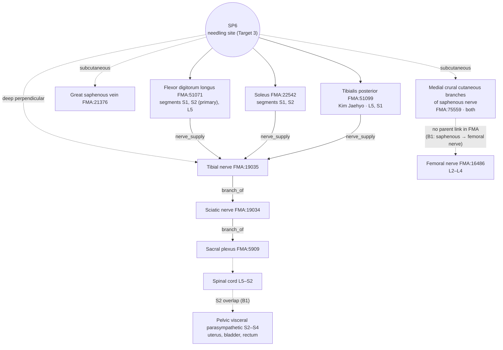

# [Acupoint Anatomical & Physiological Substrate Monograph] Sanyinjiao (三陰交, SP06)

> **Framework**: v2.7.7 (four primary classics, Tri-Target) · **Spatial discrepancy split (Tri-Target)**: **Yes** — Target 1≡2 the original '三陰交' of *Huangdi Mingtang Jing* (《黃帝明堂經》) (8 cun above the medial malleolus, including the palpated gap '胻骨下陷者中') vs Target 3 the current / WHO Sanyinjiao (3 cun above the tip of the medial malleolus = originally the '足太陰' point), $\Delta \gg 10\text{mm}$
> **Target 3 (WHO standard location, current, superior)**: ARI v3.0 | ARI-Core 75.0 ± 2.5 (B) | SI 50 | provisional weights 0.40/0.35/0.25 | sensitivity (equal weights): 75.0 (B, grade unchanged) · reflex-mechanism B-Check 10/12 concordant (③ and ⑤ animal only)
> **Target 1≡2 (original Mingtang location and palpated gap)**: ARI v3.0 | ARI-Core 41.3 ± 1.3 (D·H) | SI 75 | provisional weights 0.40/0.35/0.25 | sensitivity (equal weights): 38.5 (D, grade unchanged) · B-Check 2/12
> **Dual scoring**: two independent scorings; 3 disagreements of 15 points or more adjudicated · **Branch decision**: ΔARI-Core 33.8, ± intervals do not overlap → Target 3 alone superior (former T1 → Target 1≡2, former T2 → Target 3)

> **Four Primary Classics**: *Zhongguo Zhenjiu Xuewei Tongjian* (《中國針灸穴位通鑑》) · *Zhongguo Zhenjiu Zhengzhi Tongjian* (《中國針灸證治通鑑》) (Chinese original as reference text; analysis written from the Korean translation of the same chapter) · *Zhenjiu Shuxue Tongkao* (《針灸腧穴通考》) · *Zhongguo Zhenjiu Jingluo Tongjian* (《中國針灸經絡通鑑》)
> **Layer A Empirical Database**: Integrated Biomedical Master DB v3.0 (of the 68 papers in the SP6 inverted index, **only the 15 that actually stimulated or observed SP6** are used for the verdict, Table 8-①. Rank 6 run with the search script revised on 2026-10-23)
> **Layer B Reference Registry**: four-tier reference registry (B1–B4) (6-item B-Check, concordance threshold ≥ 8/12)
> **Anatomical Ontology**: local index of FMA 5.1.0 — textbook structures are pinned to `FMA:ID`s (B1 supplementary, not yet in the registry); Appendix A
> **Metrological Standard**: Han-dynasty standard, 1 fen (分) = 2.3 mm ($z = \text{fen} \times 2.3\text{mm}$)
> **⚠ Pregnancy**: 《銅人》 "故妊娠不可刺"; textbooks "孕婦禁針". The needling-depth DB has no '0' ('Contraindicated for needling (禁針)') record — a conditional contraindication (Sections 5 and 9)
> **Note on script**: Classical quotations and TCM terms are given in Traditional Chinese (繁體字). The cited refined editions are in simplified script; PDF page ranges and line numbers refer to those editions.

---

## 1. Classical Literature Screening Table (Four Primary Classics Excerpts)

| Classic | Original excerpt (file & line) | English summary & analysis | Remarks |
| :--- | :--- | :--- | :--- |
| *Zhenjiu Shuxue Tongkao* (《針灸腧穴通考》) | "三陰交，在內踝上八寸胻骨下陷者中。足太陰、厥陰之會。（《黃帝明堂經》）" — 《針灸腧穴通考》 上 足太陰脾經穴 L1125 | The Sanyinjiao of 《明堂》 lies **8 cun** above the medial malleolus in the depression below the tibia; meeting point of the foot-taiyin and jueyin (足太陰、厥陰之會) | Basis for **Target 1≡2** |
| *Zhenjiu Shuxue Tongkao* (《針灸腧穴通考》) | "內踝上八寸骨下陷中名'三陰交'…隋唐時內踝上三寸處的'足太陰'穴被稱作'三陰交'，而原《黃帝明堂經》之'三陰交'漸漸隱而不彰，名存而實亡。內踝上三寸之'三陰交'，不僅名實不符…" / "今之'三陰交'已非《黃帝明堂經》之'三陰交'。" — same file, L1119, L1121 | The current 3-cun Sanyinjiao is originally the '足太陰' point and has merely inherited the name (name and reality do not match, 名實不符) | Name–reality study (名實考) — the core of the Section 7 split |
| *Zhenjiu Shuxue Tongkao* (《針灸腧穴通考》) | Pre-Song locations: 《醫心方》 vols. 2 and 28 "內踝上八寸", 《千金要方》 "八寸", 《甲乙》 vol. 3 and 《外臺》 "三寸", 《聖惠方》 "八寸" / "實際上只有傳世之明刊本《針灸甲乙經》作'內踝上三寸'…其他《黃帝明堂經》傳本均作'內踝上八寸'…《外臺秘要》'三陰交'穴排在'漏谷'（在內踝上六寸）穴之後" — same file, L1135–1149 | Most transmitted versions of 《明堂》 give 8 cun; only the Ming printed edition of 《甲乙》 gives 3 cun. The ordering in 《外臺》 (after Lougu (漏谷)) is also a trace of 8 cun | Rank 4 collation |
| *Zhenjiu Shuxue Tongkao* (《針灸腧穴通考》) | "足太陰穴，在足內踝上三寸是也。（《諸病源候論》卷四十一）" / "足太陰穴，在內踝上一夫，一名三陰交。（《千金翼方》卷二十八）" / "三交二穴，在內踝上三寸是…名大陰" · "三陰二穴，在內踝上八寸，骨下陷中是"（《醫心方》卷八） — same file, L1157–1169 | The 3-cun '足太陰' (= 三交) and the 8-cun '三陰' (= the original 三陰交) were recorded separately in the Sui–Tang period | Separation of aliases (Section 3) |
| *Zhenjiu Shuxue Tongkao* (《針灸腧穴通考》) | "部位：在小腿內側，內踝尖上3寸，脛骨內側緣後際。" / "針刺操作：刺1~1.5寸。孕婦禁針。" — same file, L1107, L1115 | Modern location, depth and the prohibition of needling in pregnancy | Modern location of **Target 3** |
| *Zhenjiu Shuxue Tongkao* (《針灸腧穴通考》) | "可灸三壯，針入三分。故妊娠不可刺。（《銅人腧穴針灸圖經》卷下）" / "直刺…治足部病，略向後，深1~1.5寸。感應：可有麻電感向足底放散。"（上海《針灸學》） — same file, L1359, L1385 | First Song-dynasty statement that 'pregnant women must not be needled'. An electric sensation radiating to the sole on deep perpendicular insertion = stimulation of the tibial nerve | Basis for SI in Section 5 |
| *Zhongguo Zhenjiu Xuewei Tongjian* (《中國針灸穴位通鑑》) | "三陰交，在內踝上三寸骨下陷者中。（《針灸甲乙經》3：53）" / Location 2: "在內踝上八寸[1]骨下陷中。（《備急千金要方》29：510、《太平聖惠方》、《醫心方》）… [1]'八寸'系'三寸'之誤。同書卷21作'三寸'。" — 《中國針灸穴位通鑑》 足太陰脾經(1) L1308, L1336–1338 | The *Xuewei Tongjian* (《穴位通鑑》) regards 8 cun as 'a slip for 3 cun' | **Conflicts with the *Tongkao* (《通考》)** — adjudicated in Section 7 |
| *Zhongguo Zhenjiu Xuewei Tongjian* (《中國針灸穴位通鑑》) | Local anatomy: "在脛骨後方，比目魚與屈趾長肌之間，有脛後動脈，分佈著隱神經及脛神經。（《新針灸學》）" / "針刺通過之組織層：皮膚，皮下組織，趾長屈肌。神經、血管：隱神經之小腿內側皮支，脛神經肌支；脛後動脈。（《針灸學簡編》）" — same file, L1520–1526 | Between soleus and flexor digitorum longus; posterior tibial artery, saphenous nerve and tibial nerve | Textual basis for the layers in Sections 4 and 6 |
| *Zhongguo Zhenjiu Zhengzhi Tongjian* (《中國針灸證治通鑑》) | Indications of 三陰交 in 《明堂經》: "主足下熱，脛痛不能久立，濕痹不能行。" / Summary (小結): "《明堂經》所載'三陰交'在內踝上八寸，而六朝以後方書所載'三陰交'多位於內踝上三寸，故主治病症大不相同。" — 《中國針灸證治通鑑》 第壹編 第七篇 足太陰脾經 手少陰心經 手太陽小腸經 L154, L184 (Korean translation L205, L249) | Following the Korean translation: "treats heat in the soles, shin pain with inability to stand for long, and damp Bi (濕痹) with inability to walk" / "the indications of Sanyinjiao recorded in the point books and in the prescription books differ greatly, because the 'Sanyinjiao' in the *Mingtang Jing* lies 8 cun above the medial malleolus, whereas the 'Sanyinjiao' in the prescription books after the Six Dynasties mostly lies 3 cun above it" | Separation of Target 1≡2/Target 3 indications in Section 9 |
| *Zhongguo Zhenjiu Zhengzhi Tongjian* (《中國針灸證治通鑑》) | "徐文伯針刺墮胎：瀉足太陰，補手陽明，胎便應針而落。" / Summary (小結): "六朝後醫書多因而取三陰交、合谷穴以治難產，有些腧穴書甚至將此二穴列為孕婦禁刺穴。" — 《中國針灸證治通鑑》 第叄編 婦兒科病證 L382, L480 (Korean translation L587, L743) | Following the Korean translation: "Xu Wenbo (徐文伯) needled to make the foetus fall: he drained the foot-taiyin (足太陰) and tonified the hand-yangming (手陽明), and the foetus came away in response to the needle" / "medical books after the Six Dynasties mostly followed this and took Sanyinjiao and Hegu to treat difficult labour, and some point books even listed these two points as points forbidden to needle in pregnant women (禁刺穴)" — the origin of the prohibition of needling in pregnancy = Xu Wenbo's prescription for inducing delivery (引產) | Sections 5 and 9 |
| *Zhongguo Zhenjiu Zhengzhi Tongjian* (《中國針灸證治通鑑》) | "夢泄精，灸三陰交二七壯，夢斷神良。（內踝上大脈並四指是）" (《千金要方》) — 《中國針灸證治通鑑》 第叄編 內科病症 三十九霍亂至四十二遺精 L1261 (Korean translation L2007) | Following the Korean translation: "for seminal emission with dreams, moxa Sanyinjiao with twice seven cones … (it is where the large vessel lies, four finger-breadths above the medial malleolus)" | Palpation phrase '大脈' at the 3-cun site — subcutaneous great saphenous vein (inference, Section 7) |
| *Zhongguo Zhenjiu Zhengzhi Tongjian* (《中國針灸證治通鑑》) | "針足太陰穴，在內踝上一夫，一名二陰交…" + 按 "'二陰交'當是'三陰交'之誤。六朝以前，三陰交與'足太陰'穴是兩個不同的穴" — 《中國針灸證治通鑑》 第叄編 外科病證 痔漏至蟲獸咬傷 L20, L22 (Korean translation L28, L34) | Following the Korean translation: "'二陰交' is probably an error for '三陰交'. Before the Six Dynasties, Sanyinjiao and the '足太陰' point were two different points" | **Rank 4 correction of a scribal error** (二 → 三). The *Jingluo Tongjian* ch. 1 L1263 also transmits '二陰交' |
| *Zhongguo Zhenjiu Jingluo Tongjian* (《中國針灸經絡通鑑》) | 《靈樞·經脈》 foot-jueyin "上踝八寸，交出太陰之後" (Jingluo Tongjian ch. 29 L65) / foot-taiyin "循脛骨後交出厥陰之前" (ch. 21 L162) / Yang Shangshan (楊上善) "太陰從內踝上行八寸，當脛骨後，交出厥陰之前上行之" (ch. 21 L182) / commentary in 《銅人》 "足厥陰行足太陰之前，上踝八寸，而厥陰復出太陰之後也" (ch. 29 L101) | The foot-taiyin and foot-jueyin channels cross, changing front and back, behind the tibia **8 cun** above the medial malleolus — the same level as 《明堂》 "三陰交 在內踝上八寸…足太陰、厥陰之會" | Channel-course basis for Target 1 (8 cun). The canonical text itself does not name the point (course of the parent channels only) |
| *Zhongguo Zhenjiu Jingluo Tongjian* (《中國針灸經絡通鑑》) | 【按】 "三陰交穴為'足太陰、厥陰、少陰'（也有作'足太陰、厥陰'）三脈交會穴…又此穴被排在'中郄'穴（今作'中都'）之後，則其三陰交穴定位蓋同《千金要方》、《醫心方》、《太平聖惠方》等書作'內踝上八寸'" (foot-jueyin chart of 《醫心方》 vol. 22, ch. 29 L313) / ten-channel charts of 《產經》: "'三陰交'穴歸入足厥陰經，而不是足太陰經" (ch. 2 L1429) / 【按】 "'太陰'即今之'三陰交'穴。'漏谷'穴後有'陰交'一穴，《三家腳氣論》作'三陰'，而楊注《明堂》等書即為'三陰交'穴，值得深入研究" (foot-taiyin chart of 《醫心方》, ch. 21 L362) | In pre-Song channel charts 三陰交 is placed after Zhongdu (中都, 7 cun) and Lougu (漏谷, 6 cun) = 8 cun and belongs to the foot-jueyin; the 3-cun site is labelled '太陰' | The *Jingluo Tongjian* separately confirms the *Tongkao*'s independent evidence (《醫心方》, 《產經》) — supports Target 1. Final judgement left open ("值得深入研究") |
| *Zhongguo Zhenjiu Jingluo Tongjian* (《中國針灸經絡通鑑》) | "上述十二個'經脈穴'部位，除'足太陰'穴六朝以後變化較大外…" (ch. 1 L731) / "足太陰：…《醫心方》卷二十五引《玉匱針經》云：'足太陰穴在內踝後白肉際陷骨宛中'；《諸病源候論》卷四十一作'足內踝上三寸'" (L719) / 【按】 "隋唐時期，'足太陰'穴多定於'內踝上三寸處'" (L1199) / 《千金翼》 "婦人逆產足出，針足太陰…穴在內踝後白肉際陷骨宛宛中" + 【按】 "此'足太陰'穴部位乃六朝以前的定穴法，出《玉匱針經》" (L1225–1229) / "女人漏下赤白及血，灸足太陰五十壯。穴在內踝上三寸。足太陰經內踝上三寸名三陰交" (L1067) | The '足太陰' point lay **behind** the medial malleolus at the red-white skin border before the Six Dynasties, moved to 3 cun above the medial malleolus in the Sui–Tang period, and the 3-cun site acquired the name '三陰交' | Pre-history of the Target 3 lineage. The site of Xu Wenbo's (徐文伯, Southern Dynasties) '足太陰' may have been the Six-Dynasties location (behind the malleolus) (estimate; Sections 2 and 9) |
| *Zhongguo Zhenjiu Jingluo Tongjian* (《中國針灸經絡通鑑》) | 【按】 "楊上善以為'諸陰交'即'三陰交'，似缺乏文獻依據" (ch. 35 L224); "沒有憑據，或出於意會" (ch. 4 L1014) / 《經絡彙編》 "自中封上踝，過足太陰脾經之三陰交，歷蠡溝、中都，復上一寸，交出太陰之後" (ch. 29 L163); 《針灸逢源》 "上踝過足太陰之三陰交" (ch. 29 L198), "過足太陰之三陰交以上踹內之築賓" (ch. 25 L281) / 甲乙 "三陰交…足太陰、厥陰、少陰之會" (ch. 11 L1084) | Yang Shangshan's view that the origin of the Yin Linking Vessel (陰維脈) 'meeting of the yins' (諸陰交) = 三陰交 lacks evidence. Ming–Qing commentators put the 3-cun Sanyinjiao as a point the foot-jueyin and foot-shaoyin 'pass', while placing the actual crossing separately 1 cun above Zhongdu (8 cun). The number of meeting channels splits between 'taiyin and jueyin' (《明堂》) and 'taiyin, jueyin and shaoyin' (current 《甲乙》) | **Rank 4 identification of over-extension of meridian theory** — the 'meeting of three yin channels' is not used to explain the effects of the current 3-cun point |

---

## 2. Primary Source vs. Secondary Quotation: Historical Stratification Table

| Era / stratum | Classical source | Textual description | Primary / secondary |
| :--- | :--- | :--- | :--- |
| Han | *Huangdi Mingtang Jing* (《黃帝明堂經》) | **三陰交 = 內踝上八寸胻骨下陷者中**, meeting point of the foot-taiyin and jueyin (足太陰·厥陰之會); 刺入三分, 留七呼, 灸三壯; indications "足下熱，脛痛不能久立，濕痹不能行" | Primary (Target 1≡2: location, depth, indications) |
| Southern Dynasties | 《南史·張融傳》, Xu Wenbo (徐文伯) | 瀉足太陰, 補手陽明 → 墮胎 (termination of pregnancy) | Primary (gynaecological application of the Target 3-lineage '足太陰'). However, the Six-Dynasties '足太陰' point may have been 《玉匱針經》 "內踝後白肉際陷骨宛中" (Jingluo Tongjian ch. 1 L719, L1229), so the site of Xu Wenbo's prescription is not assumed to be 3 cun |
| Six Dynasties | Ten-channel charts of 《產經》 · channel charts in 《醫心方》 vol. 22 | 三陰交 assigned to the foot-jueyin, after 中郄 (8 cun); the 3-cun site labelled '太陰' | Supplementary primary (ordering evidence for Target 1≡2; Jingluo Tongjian ch. 2 L1429, ch. 29 L313, ch. 21 L362) |
| Sui | 《諸病源候論》 vol. 41 | 足太陰穴 在足內踝上三寸 | Primary (Target 3: the 3-cun '足太陰' point; Jingluo Tongjian ch. 1 L719, L1199 "隋唐時期…多定於內踝上三寸處") |
| Sui–Tang | Yang Shangshan's (楊上善) commentary in the 《太素》 | 《難經》 "陰維起於諸陰交" → "諸陰交" = 三陰交 | Meridian-theory interpretation — *Jingluo Tongjian*: "似缺乏文獻依據" (ch. 35 L224), "沒有憑據，或出於意會" (ch. 4 L1014) |
| Tang | *Qianjin Yaofang* (《千金要方》) · *Qianjin Yifang* (《千金翼方》) | Moxibustion at 足太陰 (內踝上三寸, 一夫) — 漏下赤白, 泄痢, 勞淋, 癩疝; 《千金翼》 vol. 26 "在內踝上三寸骨下陷者中", "產難，月水不禁，橫生胎動皆針三陰交" | First description calling the 3-cun point '三陰交' (Tongkao L1103) — but the transmitted editions went through Song-dynasty editing |
| Tang | *Waitai Miyao* (《外臺秘要》) | 三陰交 "內踝上三寸" (transcribed from 《甲乙》), but ordered after 漏谷; the spleen-disease signs of 《素問·藏氣法時論》 incorporated under 三陰交 | Secondary quotation + **misattribution** (Tongkao L1243, L1277) |
| Japan | *Ishinpō* (《醫心方》) vols. 2, 8, 28 | 三陰交 八寸; distinction "三交 = 三寸 (大陰)", "三陰 = 八寸" | Secondary quotation (distinction preserved) |
| Song | 《太平聖惠方·明堂》 | 三陰交 八寸; 三陰交 indications wrongly inserted under 漏谷 | Secondary quotation + admixture (Tongkao L1415–1423) |
| Song | *Tongren Shuxue Zhenjiu Tujing* (《銅人腧穴針灸圖經》) | 三陰交 fixed at **三寸** and assigned to the Spleen Meridian of Foot-Taiyin (足太陰脾經); "女子漏下不止" added; Xu Wenbo's prescription as "瀉足三陰交，補手陽明合谷"; "故妊娠不可刺" | **Canonisation of the current location and of the prohibition of needling in pregnancy** |
| Jin–Yuan–Ming | 《針經摘英集》, 《玉龍經》, *Zhenjiu Dacheng* (《針灸大成》) etc. | Obstetric and gynaecological combinations with Hegu (合谷), Taichong (太衝), Zhongji (中極) etc. | Reproduction of combinations |
| Ming–Qing | Channel commentaries in 《經絡彙編》 and 《針灸逢源》 | The foot-jueyin and foot-shaoyin "過足太陰之三陰交" (3 cun); the taiyin–jueyin crossing placed separately 1 cun above Zhongdu | Re-placement by later channel commentaries (Jingluo Tongjian ch. 29 L163, L198; ch. 25 L281) |
| Modern | 1957 Nanjing 《針灸學》 to the 7th edition; national standard | 內踝尖上3寸, 脛骨內側緣後際; 直刺1~1.5寸; 孕婦禁針 | Standardisation (Target 3) |

---

## 3. Nomenclature & Alias Collation Table (KJH DB Verification)

| Alias | Source | KJH DB | Verdict |
| :--- | :--- | :--- | :--- |
| 足太陰 (太陰) | 《諸病源候論》, 《千金》 — 內踝上三寸 (Tongkao L1157–1161) | Listed | **The original name of the Target 3 point**. Not an alias but the original name |
| 三交 | 《醫心方》 vol. 8 "三交二穴，在內踝上三寸…名大陰" (L1167) | Listed | Another Sui–Tang name for the Target 3 point |
| 足太陰交 · 厥陰交 | 《新雕千金方》 · 《黃帝蝦蟆經》 (L1151) | 足太陰交 listed | Alternative names of **Target 1≡2** (the original 8-cun 三陰交) |
| 三陰 | 《醫心方》 vol. 8 "三陰二穴，在內踝上八寸" (L1169) · 《三家腳氣論》 | Not listed | Sui–Tang name of Target 1≡2 |
| 承命 | 1957 Nanjing 《針灸學》 (citing a Japanese textbook) / 《千金要方》 "承命 在內踝後上行三寸動脈上" (L1129, L1171) | Listed | **A separate point** (pulsation site 3 cun behind and above). Not used as an alias |
| 二陰交 | Some transmissions of 《千金翼方》 vol. 28 (Jingluo Tongjian ch. 1 L1263; Zhengzhi Tongjian 痔漏 L20) | Not listed | Scribal error for '三陰交' (按 in the *Zhengzhi Tongjian*, L22). Not used as an alias |
| 下之三里 · 下三里 | Japanese popular names — Terao Ryūjun (寺尾隆純), 《十四經腧穴弁解》 (1784) "以三陰交為'下三里'" (L1131); alias 2 in the *Xuewei Tongjian* (L1314) | 下之三里 listed | Not a Chinese point name. Beware of confusion with ST36 (上三里) — consistent with Section 3 of the ST36 report |

The KJH DB (Acupoint Nomenclature & Alias Comparative Database, master list, Excel row 137: 134, SP06, Samumgyo, 三陰交, "承命, 太陰, 下之三里, 足太陰交, 足太陰, 三交") lists names from the Target 1≡2 and Target 3 lineages and a separate point (承命) together on one line. It must be read by lineage, as in the table above. In addition, from *Taiping Shenghui Fang* (《太平聖惠方》) onward, 三陰交 indications became mixed into Lougu (漏谷, SP7) (Tongkao L1415–1423).

---

## 4. 3D Spatial Coordinates & Layer 1–5 Anatomical Substrate Diagram

**Target 3 (current)**
- **X (medial–lateral)**: **just behind the posterior border** of the medial surface of the tibia (脛骨內側緣後際, Tongkao L1107).
- **Y (superior–inferior)**: 3 cun above the tip of the medial malleolus (4 finger-breadths, from the 1957 Nanjing 《針灸學》 onward; Tongkao L1201–1213), 1 cun above Jiaoxin (交信, KI8) (L1179).
- **Z (depth)**: layers below. **Layer A contains no adult cadaveric or ultrasound measurement at SP6, so only the order of structures is given, without mm boundaries**.
- **Palpated gap (3-cun level)**: '骨下陷者中' in the Ming printed 《甲乙》 and 《千金翼》 "內踝上三寸骨下陷者中" is **the bone–muscle gap between the medial border of the tibia (FMA:24476) and the medial edge of soleus (FMA:22542) (緣)**, floored by flexor digitorum longus (FMA:51071) and tibialis posterior (FMA:51099), with the great saphenous vein (FMA:21376) and saphenous nerve branches (FMA:75559) in the subcutis. Its X is that of Target 3 (Section 7). The '大脈' of 《千金》 "內踝上大脈並四指是" reads as the subcutaneous great saphenous vein at this level (inference).

```
[Layer 1 Skin/subcutis]   Medial crural cutaneous branches of saphenous n. (both textbooks) · great saphenous v. (both textbooks)
                          — layer reached by the classical 3 fen (6.9 mm) (estimated)
        │
[Layer 2 Superficial muscle] Medial margin of soleus (both textbooks)
        │
[Layer 3 Deep muscle]     Flexor digitorum longus (both textbooks) · tibialis posterior (Kim Jaehyo)
                          — layer reached by modern perpendicular insertion of 1–1.5 cun (23–34.5 mm) (estimated)
        │
[Layer 4 Neurovascular]   Tibial n. (both textbooks) · posterior tibial a./vv. (both textbooks)
                          — on deep perpendicular insertion "麻電感向足底放散" (Tongkao L1385)
        │
[Layer 5 Floor]           Posterior surface of tibia · interosseous membrane of leg (no deep organs)
```


*Figure 4-1. Schematic cross-section of the lower third of the leg at the level of Sanyinjiao (current Target 3) (right leg, viewed from above, not to scale). The perpendicular needling path avoids the great saphenous vein and saphenous nerve, enters behind the posterior border of the medial surface of the tibia and reaches flexor digitorum longus; deeper, it may reach the tibial nerve and posterior tibial artery and veins. Layer thicknesses and distances are arranged arbitrarily because there are no SP6 measurements. Target 1≡2 (8 cun) lies 5 cun above this section.*

**Target 1≡2 (original 《明堂》 location, 內踝上八寸胻骨下陷者中)**: neither the two textbooks nor the FMA mapping table contains an entry for the Target 1≡2 site itself. Narrowing the range using the textbook entries for adjacent points on the same 'posterior border of the tibia' line: below it, Lougu (漏谷, SP7, 6 cun) has soleus, flexor digitorum longus, tibialis posterior, the tibial nerve and the posterior tibial artery and veins (SP07 rows of both textbooks, the same as SP06); above it, Diji (地機, SP8, 10 cun below) has gastrocnemius, soleus, flexor digitorum longus, tibialis posterior (Kim Jaehyo) and popliteus (Common Textbook). Target 1≡2 is therefore only **inferred** to lie in the **soleus/flexor digitorum longus layer (the same composition as SP7)**; there is no textbook or measured evidence ($S_{clarity}$ 25).

**Insertion reference point (Target 2, 8-cun level)**: the place indicated by 《明堂》 '胻骨下陷者中' is **just behind the medial border of the tibia (FMA:24476), in the gap between the tibia and the medial edge of soleus (FMA:22542) (緣)**. X = just behind the medial border of the tibia; Y = 8 cun above the medial malleolus. Its floor is inferred to be flexor digitorum longus (FMA:51071). Because there is no textbook entry or measurement at the 8-cun level, the bounding structures are **inferred** from the textbook composition of SP7. This reference point lies in the same sentence and at the same level as Target 1 and is merged with it (Section 7).

**FMA substrate cross-check (by layer, Target 3)** — structure names from the two textbooks; IDs and relations from FMA 5.1.0

| Layer | Structure | FMA | Match | FMA relation | Nerve trunk / segment |
| :--- | :--- | :--- | :--- | :--- | :--- |
| 1 | Medial crural cutaneous branches of saphenous nerve [both] | FMA:75559 | exact (Kim Jaehyo) / **manual** (Common Textbook term 'medial cutaneous branch of the leg of saphenous nerve' — automatic match none) | Set of medial crural cutaneous branches of saphenous nerve — **no parent link to the saphenous nerve (FMA:45262) in FMA** | B1: saphenous nerve → femoral nerve, dermatomes L3–L4 (B1-03) |
| 1 | Great saphenous vein [both] | FMA:21376 | exact | drains_into Femoral vein | — |
| 2 | Soleus [both] | FMA:22542 | exact | contained_in superficial posterior compartment space (FMA:312103) | Branches of the tibial nerve (FMA:80461, 80462). Segments S1, S2 |
| 3 | Flexor digitorum longus [both] | FMA:51071 | exact | contained_in deep posterior compartment space (FMA:312109) | Nerve to FDL (FMA:80101) ← tibial nerve. Segments **S1, S2 (primary)**, L5 |
| 3 | Tibialis posterior [Kim Jaehyo] | FMA:51099 | **manual** (textbook word order 'posterior tibialis' → automatic match none) | contained_in deep posterior compartment space (FMA:312109) | Nerve to tibialis posterior (FMA:80104). Segments L5, S1 |
| 4 | Tibial nerve [both] | FMA:19035 | exact | branch_of Sciatic nerve (FMA:19034) | Sciatic nerve → sacral plexus (FMA:5909). Nerve segments not in FMA → B1: L4–S3 |
| 4 | Posterior tibial artery · posterior tibial vein [both] | FMA:43895 · FMA:44332 | exact | Artery branch_of External iliac artery (FMA modelling; the same peculiarity as in the ST36 report) / vein tributary_of Popliteal vein | — |
| 5 | Tibia · interosseous membrane of leg | FMA:24476 · FMA:35187 | — | — | — |

- There is no public reference ultrasound image (the registered dataset `marzola_msk` contains only tibialis anterior, medial gastrocnemius and biceps brachii). A PubMed search for depth measurements at the SP6 level (2026-10-23, `(SP6 OR Sanyinjiao) AND (ultrasound OR cadaver OR CT OR MRI OR anatomical) AND (depth OR needling OR "tibial nerve")`) also found no adult study (one paediatric layer description, PMID 2053869, was not used because it is not merged into the DB and concerns children).
- **Multi-layered anatomical substrates, 'multi-target, multi-mode regulation within a single acupoint (一輸多點多模式調控)', and methodological prerequisites for sham-control design**: The clinical data accumulated under Sanyinjiao (三陰交, Target 3) cannot be reduced to any single anatomical structure in the table above (e.g., either the superficial saphenous nerve branches or the deep tibial nerve alone). First, historically, clinical records from the original 8-cun 'Sanyinjiao' (Target 1≡2), the 3-cun 'Foot-Taiyin (足太陰)' point (Target 3), adjacent points such as Lougu (漏谷, SP7), and meridian-deduced indications were superimposed under the single name 'Sanyinjiao' (Huang Longxiang, 〈腧穴主治的演變〉, 《中國針灸》, 2001). Second, even within the current 3-cun three-dimensional zone (X·Y·Z), the superficial cutaneous nerves (`FMA:75559`) and perivascular nerve plexus of the great saphenous vein (`FMA:21376`), the mechanoreceptors in the deep muscle layer (`FMA:22542`, `51071`, `51099`), and the deep neurovascular bundle (`FMA:19035`, `43895`, `44332`)—selectively recruited depending on needling depth, angle, and manipulation—correspond to distinct target organs and disease patterns, forming a structure of **'multi-target, multi-mode regulation within a single acupoint (一輸多點多模式調控)'** (Huang Longxiang, 〈人體調控之門的探與測——基於現代解剖學和古典針灸學的視角〉, 《現代中醫臨床》, 2023: "同一輸穴中有不同的靶點…同一穴中的不同靶點調控的靶器官不同"). Consequently, when designing modern biomedical experiments or randomized controlled trials (RCTs) to test the point specificity of Sanyinjiao, researchers must first specify which anatomical layer (Layers 1–4) and structure constitute the intended stimulation target for a given indication, and ensure that 'non-acupoint shallow needling (非穴淺刺)' used as a sham control does not inadvertently stimulate the subcutaneous fascial layer—which in classical acupuncture is the standard analgesic technique known as 'fascial-plane needling (分刺法)' for general pain ('general Bi syndrome, 衆痹')—or accompanying perivascular autonomic nerve plexuses, thereby confounding the control group (Huang Longxiang, *Xin Gudian Zhenjiuxue Dagang* (《新古典針灸學大綱》), People's Medical Publishing House, 2022, Part 4, Section 2, Articles 183–184).

---

## 5. Classical Needling Depth Calculation Table

Source: Classical Needling Depth Database, sheet 1, Excel row 136 (N0 134, SP06), supplemented by Tongkao 【操作】 (L1353–1385).

| Text | Fen (分) | Depth (× 2.3 mm) | Layer reached (estimated) | Remarks |
| :--- | :---: | :---: | :--- | :--- |
| *Huangdi Mingtang Jing* (《黃帝明堂經》, ed. Huang Longxiang) | 3 | 6.9 mm | 1 | "刺入三分" — by the name–reality study, **the depth of Target 1≡2 (8 cun)** |
| *Zhenjiu Jiayi Jing* (《針灸甲乙經》) | 3 | 6.9 mm | 1 | |
| *Chimgu Gyeongheombang* (《針灸經驗方》) | 3 | 6.9 mm | 1 | |
| *Dongui Bogam* (《東醫寶鑑》, citing 《銅人》) | 3 | 6.9 mm | 1 | Not contraindicated |
| Korean common textbook, *Meridian and Acupoint Studies* (經絡腧穴學) | 10–15 | 23.0–34.5 mm | 3 | |
| Korean common textbook, *Acupuncture and Moxibustion Medicine* (針灸醫學) | 10–15 | 23.0–34.5 mm | 3 | |
| *Zhenjiu Shuxue Tongkao* (《針灸腧穴通考》) | 10–15 | 23.0–34.5 mm | 3 (–4) | "刺1~1.5寸。孕婦禁針" |
| 1957 Nanjing 《針灸學》 (supplementary, from the classic) | 5–8 | 11.5–18.4 mm | 2 | L1373 |
| 《中國針灸學》 (supplementary, from the classic) | 5–10 | 11.5–23.0 mm | 2–3 | L1383 |
| Shanghai 《針灸學》 (supplementary, from the classic) | Perpendicular 10–15 (foot disorders) / 15–20 (through to Xuanzhong 懸鐘) / oblique 15–25 | 23.0–57.5 mm | 3–4 | "麻電感向足底放散" = stimulation of the tibial nerve (L1385) |
| 《竇太師針經》 (supplementary, from the classic) | Transverse 25 | (horizontal 57.5 mm) | 1–3 | "橫針入二寸半，亦透絕骨穴" (L1365) |

- No 'Contraindicated for needling' ('0') record and no 'blank' (per the relevant DB column). **"孕婦禁針" is a conditional contraindication**, originating in Xu Wenbo's (徐文伯) prescription for inducing delivery (瀉足太陰·補手陽明), which later point books (腧穴書) turned into "妊娠不可刺" (Zhengzhi Tongjian_22 L480; Tongkao L1291, L1359). The principle of not needling pregnant women is retained.
- Safety range: the classical 3 fen stays subcutaneous. Modern perpendicular insertion of 1–1.5 cun reaches the flexor digitorum longus layer, and near the upper limit and in the '略向後' (slightly backward) direction it may reach the tibial nerve and posterior tibial artery and veins (the needling-sensation description in Shanghai 《針灸學》). Because the great saphenous vein and saphenous nerve run subcutaneously close to the posterior border of the tibia, the vein should be identified visually and avoided.

---

## 6. Textbook Comparison Table (Target 3)

| Category | Common Textbook of Acupoint Studies (Common Textbook dataset master sheet row 135) | Kim Jaehyo textbook (master sheet row 135) | FMA adjudication | Assessment |
| :--- | :--- | :--- | :--- | :--- |
| Muscles | Soleus, flexor digitorum longus | Soleus, flexor digitorum longus, **tibialis posterior** | FMA:22542, 51071 shared / FMA:51099 Kim Jaehyo only | Kim Jaehyo lists down to a deeper layer |
| Nerves | Medial crural cutaneous branches of saphenous nerve; tibial nerve in the deep layer | Same | FMA:75559, 19035 (Common Textbook term mapped manually) | Agree |
| Vessels | Great saphenous vein, posterior tibial artery and veins | Same | FMA:21376, 43895, 44332 | Agree |

**What FMA shows about the difference**: the two textbooks are almost identical. The only difference, 'tibialis posterior' (Kim Jaehyo), lies in FMA in the same **deep posterior compartment space (FMA:312109)** as flexor digitorum longus, lateral and deep to it. This is therefore not a conflict but **a difference in the depth recorded**. The local anatomy in the *Xuewei Tongjian* (L1518–1526: 比目魚與屈趾長肌之間, 脛後動脈, 隱神經·脛神經) agrees with both textbooks. The statement of 《中國針灸學》 at the same place, "有長總趾伸肌" (L1524), records an anterior-compartment muscle (an extensor) at a posterior-compartment point and is regarded as an error.

Consistent with B1-01 and B1-03 (regional anatomy of the posterior compartment of the leg). There is no point-specific imaging or cadaveric measurement (PMID).

---

## 7. Spatial Discrepancy Branch Inference Diagram (Tri-Target)

**Lineages behind the Targets**

| Target | Basis | Location | Judgement |
| :--- | :--- | :--- | :--- |
| **Target 1≡2** 三陰交 of 《明堂》 | *Huangdi Mingtang Jing* (《黃帝明堂經》) "在內踝上八寸胻骨下陷者中" (Tongkao L1125); 八寸 in 《醫心方》, 《千金要方》, 《聖惠方》 (L1137–1147); foot-jueyin (足厥陰) "上踝八寸，交出太陰之後" (L1119) | 8 cun above the medial malleolus, posterior border of the tibia | The original point of the name. Lost after the Song |
| **Target 3** current 三陰交 (= the original 足太陰) | 《諸病源候論》, 《千金》 "足太陰…內踝上三寸" (L1157–1161); Ming printed 《甲乙》 3：53; unified from 《銅人》 onward (L1185) | 3 cun above the tip of the medial malleolus, posterior border of the tibia | Modern standard location |

**Tri-Target coordinates** (X medial–lateral · Y superior–inferior · Z depth; all positions are estimates by bone-proportional conversion, not measured)

| Target | Definition | X (medial–lateral) | Y (superior–inferior) | Z (insertion depth) |
| :--- | :--- | :--- | :--- | :--- |
| Target 1 (classical text position) | 《明堂》 "在內踝上八寸胻骨下陷者中" | Behind the medial border of the tibia | 8 cun above the medial malleolus | 3 fen (6.9 mm), Layer 1 |
| Target 2 (palpation-based anatomical locus) | '胻骨下陷者中' = bone–muscle gap (緣) between the medial border of the tibia (FMA:24476) and the medial edge of soleus (FMA:22542) — **insertion reference point** (Section 4) | Just behind the medial border of the tibia | Level of the earliest description carrying the palpation phrase = 8 cun | Floor of the gap: flexor digitorum longus (inferred) |
| Target 3 (WHO standard location) | "內踝尖上3寸，脛骨內側緣後際" (national standard = wording of the WHO standard location) | Just behind the medial border of the tibia | 3 cun above the tip of the medial malleolus | Perpendicular 1–1.5 cun (23–34.5 mm), Layer 3 (–4) |

**Pairwise displacement** (branching threshold $\Delta_{discrepancy} > 10\text{mm}$)

| Pair | Δ (estimated) | Basis | Verdict |
| :--- | :---: | :--- | :--- |
| Target 1–2 | about 0–5 mm | Location and palpation phrase from the same sentence (《明堂》) — same X and Y references | Merged |
| Target 1–3 | about 12–15 cm | Same posterior-tibial-border line (same X); Y differs by 5 cun. From the bone-proportional length of the leg (tip of medial malleolus to Yinlingquan (陰陵泉) = 13 cun), 1 cun in an adult ≈ 2.5–3 cm | **Branch** |
| Target 2–3 | about 12–15 cm | As above | **Branch** |

- **Verdict**: **Target 1≡2 vs Target 3**, $\Delta \approx 12\sim15\text{cm} \gg 10\text{mm}$ → the canon's Rank 5 split requirement is met; the two independent Targets are scored separately.
- **The same palpation phrase at 3 cun**: '骨下陷者中' is also attached to the 3-cun descriptions of the Ming printed 《甲乙》 and 《千金翼》 (Tongjian L1308; Jingluo Tongjian ch. 11 L1084), and the '大脈' of 《千金》 "內踝上大脈並四指是" (Zhengzhi Tongjian 遺精 L1261) reads as the subcutaneous great saphenous vein at the 3-cun level (inference). Both lie within 10 mm of Target 3 and do not create a new Target. The X of all three positions (the gap behind the medial border of the tibia) is the same; the displacement arises from Y (5 cun) alone.
- **Adjudication of the conflict (*Xuewei Tongjian* vs *Tongkao*)**: the *Xuewei Tongjian* regards 8 cun as 'a slip for 3 cun', citing "同書卷21作三寸" (Tongjian L1338). However, the corresponding passage in vol. 21 of 《千金要方》 is "勞淋，灸**足太陰**百壯，在內踝上三寸" (Tongkao L1339; Zhengzhi Tongjian_20 L747), which speaks of '足太陰', not '三陰交'. The *Tongkao*, by contrast, presents independent evidence: ① 8 cun in most transmitted versions of 《明堂》, ② the ordering in 《外臺》 (after 漏谷), ③ 8 cun in 《聖惠方》, ④ the distinction in 《醫心方》 between '三交 (3 cun)' and '三陰 (8 cun)', ⑤ the channel chart of 《產經》 (L1149–1173). The summary (小結) of the *Zhengzhi Tongjian* (L184) reaches the same conclusion. **The judgement of the *Tongkao* is therefore adopted.** However, the *Tongkao* itself says that whether the transmitted edition of 《千金翼》 underwent Song-dynasty editing "尚不能確定" (cannot yet be determined) (L1103), so $S_{orig}$ ④ is set at a level below 100 (Section 10).
- **Collation with the *Jingluo Tongjian* (Rank 4)**: ① in 《靈樞·經脈》 the foot-taiyin and foot-jueyin cross **8 cun** above the medial malleolus (Jingluo Tongjian ch. 21 L182; ch. 29 L65, L101) — the same level as 《明堂》 '足太陰、厥陰之會 在內踝上八寸'. ② The foot-jueyin chart of 《醫心方》 places 三陰交 after 中郄 (中都) (ch. 29 L313), the ten-channel charts of 《產經》 assign 三陰交 to the foot-jueyin (ch. 2 L1429), and the foot-taiyin chart of 《醫心方》 labels the 3-cun site '太陰' (ch. 21 L362) — in the same direction as the *Tongkao*'s evidence ④ and ⑤. ③ '一名二陰交' in 《千金翼》 (ch. 1 L1263) is a scribal error for '三陰交' (按 in the *Zhengzhi Tongjian* 痔漏, L22). ④ The '足太陰' point moved from behind the medial malleolus (《玉匱針經》) before the Six Dynasties to 3 cun in the Sui–Tang period (ch. 1 L719, L1199, L1229). ⑤ Yang Shangshan's (楊上善) '諸陰交 = 三陰交' (origin of the Yin Linking Vessel) and the Ming–Qing placement '過足太陰之三陰交' are later meridian-theory interpretations (ch. 35 L224; ch. 4 L1014). Because the *Jingluo Tongjian* itself says "值得深入研究" (ch. 21 L362), Target 1 ④ is not raised to 100.
- **Branch decision (Tri-Target)**: there are two independent Targets, Target 1≡2 and Target 3. ΔARI-Core = 75.0 − 41.3 = 33.8 (≥ 10), and Target 3 [72.5, 77.5] and Target 1≡2 [40.0, 42.5] do not overlap → **Target 3 alone superior**. This means that "the anatomical substrate of the current Sanyinjiao site is better established", and it is recorded together with the philological conclusion that the original owner of the name is Target 1≡2 (name and reality do not match, 名實不符).

> **Mapping of earlier labels**: former T1 (《明堂》 8 cun) → **Target 1≡2**; former T2 (current 3 cun) → **Target 3**. Because the positions are unchanged, the dual scoring is carried over unchanged. No pair changed status under the 10 mm threshold (merged pair Δ 0–5 mm; branched pairs Δ 12–15 cm).

---

## 8. Biomedical Reflex Pathway Diagram & External Search Log (Target 3)

**Mechanism description (concordant, centred on animal evidence)**: studies stimulating SP6 alone show each stage of the peripheral–central–target-organ loop in animals. ① Peripheral: in rats with primary dysmenorrhoea, Piezo1, CGRP and tryptase (mast-cell degranulation) increased at the SP6 site; electroacupuncture at SP6 alone reduced them and suppressed the uterine Piezo1/COX-2/PG pathway (papers.id 2321). ② Afferent/central: in mice with irritable bowel syndrome, electroacupuncture at SP6 alone activated DRG neurons, and the activated brain regions overlapped most with ST36 in the hypothalamic paraventricular nucleus (PVN) (2280). ③ Human: in 23 patients with premenstrual syndrome, electrical stimulation of SP6 alone changed amygdala functional connectivity (2314, uncontrolled). The opioid mechanism of high- and low-frequency electroacupuncture (B3-10) was verified with the ST36+SP6 combination and is used only as supplementary evidence for SP6 alone (5, 8, 12, 46, 54). **B-Check 10/12 concordant** — but ③ and ⑤ are limited to animals (rat, mouse), and human translation (⑥) scores 1 point.

**Segmental findings**: the FMA muscle segments are L5–S2 (flexor digitorum longus S1, S2 primary; soleus S1, S2; tibialis posterior L5, S1). They **overlap at S2** with the parasympathetic (pelvic splanchnic nerve) segments S2–S4 of the uterus, bladder and rectum. They do not overlap with the pain afferents of dysmenorrhoea (sympathetic route T10–L1) (B1-02, B1-03). ② therefore scores 1 point (indirect).

**Historiographical and Biomedical Differentiation between 'Dysmenorrhoea Relief (痛經緩解)' and 'Contraindication in Pregnancy (孕婦禁針 / 催產)'**:
Linking the two uterine-related attributes of Sanyinjiao (三陰交)—'relief of dysmenorrhoea' and 'caution/contraindication of needling during pregnancy (孕婦禁針)'—as a single, vague 'state-dependent bidirectional regulation (雙向調節)' of the uterus is neither historiographically nor biomedically valid. Instead, they must be understood as distinct strata formed in different historical contexts and governed by different stimulation conditions (anatomical layer, parameters, point combination, and uterine receptor state):
1. **Historiographical and theoretical differentiation (Huang Longxiang's textual research)**: As demonstrated in *Xin Gudian Zhenjiuxue Dagang* (《新古典針灸學大綱》, 2022, Part 4, Section 1, Article 177: "雙向調節是機體固有的自穩機制而非針灸作用之功") and subsequent papers (〈人體調控之門的探與測〉, 《現代中醫臨床》, 2023; 〈指尖針尖下的人體形態結構探索發現及再發現〉, 《中國針灸》, 2025), bidirectional regulation is not a mystical property intrinsic to acupuncture, but an inherent negative-feedback homeostatic mechanism of the autonomic nervous system and vascular self-regulatory structures—and even when normalizing opposite pathological states of the same organ (e.g., constipation vs. diarrhoea, menorrhagia vs. hypomenorrhoea, hypertension vs. hypotension), it depends on appropriate stimulation parameters (moreover, Article 169 〈助孕助產〉 of the same book cites Zhao Xi's (趙熙) finding that "胎前多針灸則分娩較易", noting that appropriate prenatal acupuncture preconditioning actually facilitates labour). In Sanyinjiao, **dysmenorrhoea and menstrual-disorder relief** accumulated as a therapeutic indication for promoting blood flow and regulating the lower jiao (通經行血) after the 3-cun 'Foot-Taiyin (足太陰)' point came to be called Sanyinjiao in the Sui–Tang period. By contrast, **caution/contraindication in pregnancy** originated from the Southern Dynasties physician Xu Wenbo's (徐文伯) emergency obstetric case of expelling a dead foetus (死胎不下) via **"瀉足太陰，補手陽明"** (where the Six-Dynasties '足太陰' point was likely located behind the medial malleolus per *Yugui Zhenjing* (《玉匱針經》)), which Song-dynasty *Tongren Shuxue Zhenjiu Tujing* (《銅人腧穴針灸圖經》) incorporated under the 3-cun Sanyinjiao as **"瀉足三陰交，補手陽明合谷，應針而落。故妊娠不可刺"**, thereby generalizing a specific labour-inducing combination into a preventive contraindication.
2. **Biomedical reflex differentiation (Layer A & Layer B)**:
   - **Dysmenorrhoea relief pathway ($P_{single}$ and CV4 combination)**: Under conditions of prostaglandin ($\text{PGF}_{2\alpha}$) excess and ischaemic uterine spasm, stimulation primarily targeting **Layer 3 (flexor digitorum longus `FMA:51071`, etc., L5–S2)** downregulates local mechanosensitive **Piezo1 channels, CGRP, and mast-cell degranulation** and suppresses the uterine **Piezo1/COX-2/$\text{PGF}_{2\alpha}$ pathway** (`papers.id 2321`, SP6-alone 50 Hz EA), modulates uterine **A20/NF-κB/NLRP3/GSDMD** and **miRNA-21-5p macrophage polarization** anti-inflammatory pathways (`papers.id 2041`, `2322`, CV4+SP6 combination), and engages supraspinal centres (hypothalamic PVN `papers.id 2280`, human amygdala connectivity `papers.id 2314`) to inhibit sympathetic hyperactivity and visceral pain.
   - **Pregnancy caution / labour-induction pathway ($P_{comb}$, combined with Hegu LI4)**: Rather than an automatic response to SP6 alone, **strong Deqi (得氣) stimulation reaching the Layer 4 deep tibial nerve trunk (`FMA:19035`, L4–S3; overlapping at S2 with the pelvic splanchnic nerve S2–S4)** combined with **Hegu (合谷, LI4)** elevates posterior pituitary **oxytocin secretion** (`papers.id 510`, 2024 human RCT, LI4+SP6) and sacral parasympathetic reflexes. Because this can trigger phasic uterine contractions when myometrial oxytocin receptors are highly expressed (such as in late pregnancy or labour), it is established as a conditional safety precaution (SI `50`) for pregnant women in general.

**Anchoring the peripheral afferent pathway in FMA**:



*Figure 8-1. Peripheral afferent pathway of SP6 (Target 3) drawn from FMA 5.1.0 relations. Solid lines are relations recorded in FMA (`nerve_supply`, `branch_of`); dashed lines are links absent from FMA or relations supplemented from B1 textbooks.*

### ① Layer A Papers (studies that actually stimulated or observed SP6)

| papers.id | Year | Journal | Title (summary) | PMID / DOI | Design & role of SP6 |
| :---: | :---: | :--- | :--- | :--- | :--- |
| 2321 | 2026 | Zhen Ci Yan Jiu | EA at sensitized SP6 in primary dysmenorrhea rats — Piezo1 | 42343676 / 10.13702/j.1000-0607.20251011 | Animal (60 rats). **SP6 alone**, 50 Hz. Piezo1, CGRP and mast cells at the SP6 site; uterine COX-2/PG |
| 2280 | 2026 | Zhen Ci Yan Jiu | EA at single ST36 vs single SP6 vs ST36+SP6 in IBS mice | 42908445 / 10.13702/j.1000-0607.20260558 | Animal (mouse). **SP6-alone group**. DRG calcium responses, brain regions (PVN overlap) |
| 1866 | 2026 | J Pharmacopuncture | Acupuncture at ST36, SP6 and combination in MIA osteoarthritis rats | 42812780 / 10.3831/kpi.2026.29.3.286 | Animal (30 rats). **SP6-alone group**. Pain threshold, IL-1, IL-6, MMP-13 |
| 2041 | 2026 | Zhen Ci Yan Jiu | EA at CV4+SP6 on A20/NF-κB/NLRP3/GSDMD in dysmenorrhea rats | 41735064 / 10.13702/j.1000-0607.20250062 | Animal (rat). 2 points |
| 2322 | 2025 | Zhongguo Zhen Jiu | EA at CV4+SP6, miRNA-21-5p/A20 macrophage polarization, dysmenorrhea | 41741990 / 10.13703/j.0255-2930.20250101-k0001 | Animal (rat). 2 points |
| 2316 | 2022 | Front Endocrinol | EA at SP6+CV4 in premature ovarian failure mice | 35957829 / 10.3389/fendo.2022.882214 | Animal (mouse). 2 points |
| 5 | 2001 | Pain | Genotype and sensitivity to EA analgesia (10 inbred strains) | — / — (local PDF) | Animal (mouse). ST36+SP6 |
| 8 | 1996 | Mol Brain Res | Fos/Jun and preproenkephalin/preprodynorphin after EA of different frequencies | — / — (local PDF) | Animal (rat). ST36+SP6 |
| 12 | 2000 | Neurosci Lett | Endomorphin/μ-opioid receptors mediate 2 Hz but not 100 Hz EA analgesia | — / — (local PDF) | Animal (mouse). ST36+SP6 |
| 2314 | 2020 | Gynecol Endocrinol | EAS at SP6 modulates amygdala functional connectivity in PMS | 33307896 / 10.1080/09513590.2020.1855633 | **Human** (23 participants, before–after comparison, no control group). **SP6 alone** |
| 46 | 2003 | NeuroReport | Modulation of cold pain in human brain by electric acupoint stimulation (fMRI) | — / 10.1097/01.wnr.0000085243.71403.6a | Human fMRI. ST36+SP6 |
| 54 | 2003 | Brain Res | Brain network activation and analgesia, low vs high frequency EAS (fMRI) | — / 10.1016/s0006-8993(03)02983-4 | Human fMRI. ST36+SP6 |
| 510 | 2024 | YMER | Oxytocin levels with acupuncture at LI4 and SP6 after cesarean section: RCT | — / — (local PDF) | Human RCT. 2 points (Hegu (合谷) + Sanyinjiao (三陰交)) |
| 2315 | 2025 | Neuropsychopharmacology | Intradermal acupuncture for major depressive disorder: multicenter RCT | 39648209 / 10.1038/s41386-024-02036-5 | Human RCT. 4 points (HT7, PC6, SP6, LR3) |
| 2327 | 2016 | Journal of Korean Acupuncture & Moxibustion Medicine Society | Acupuncture and moxibustion at SP6 on foot temperature in healthy adults | — / 10.13045/acupunct.2016036 | Human, **SP6 alone** (based on the title — abstract not obtained, so the design **cannot be confirmed**) |

- **Excluded**: point-selection and data-mining studies (1845, 1970, 2032, 2037, 2264, 2307, 381), multi-point clinical reports (1853, 1873, 1957, 1965, 2035, 2036, 2257, 2283, 2286, 2303, 2318–2320, 2323, 2326), studies whose mechanistic target is not SP6 (2042, 2043, 2263, 2291, 2317, 2324, 2325), Indonesian case reports (2048, 2287, 2288), theoretical, literature and educational materials (15, 27, 208, 341, 369, 424, 529, 550, 742, 766, 795, 989, 998, 1002, 1377, 1614), a study that only cites SP6 (1015), and multi-point reviews (1698 PCOS, 1699 Cochrane dysmenorrhoea — not point-specific).
- **Could not be confirmed**: for 1610 (Lee Changhyun 2003, "neuroanatomical study of acupoints (Waiguan, Neiguan, Sanyinjiao, Xuanzhong) projecting to dementia-related brain regions"), text could not be extracted from the PDF, so methods and results could not be checked. If the original is checked, it may become SP6-specific evidence for ③ and ④. 2328 (2018, SP6 acupressure and acupuncture for dysmenorrhoea) was excluded because it has no abstract.
- **Reference not merged into the DB**: PMID 32011502 (RCT **protocol** of perpendicular vs transverse needling at SP6 for dysmenorrhoea, 2020) has no results and is not used in the verdict.

### ② B-Check Scoring Table (Target 3)

| Item | Content | Rater A | Rater B | Final | Reference IDs | papers.id | Rationale |
| :---: | :--- | :---: | :---: | :---: | :--- | :--- | :--- |
| ① | Peripheral nerve/vessel substrate at needling depth | 2 | 2 | **2** | B1-01, B1-03, B2-09 (+FMA) | — | The two textbooks, the local anatomy in the *Xuewei Tongjian* and normative anatomy texts agree on the saphenous nerve branches, great saphenous vein, soleus, flexor digitorum longus, tibial nerve and posterior tibial artery and veins. 9 textbook structures mapped to FMA (7 exact, 2 manual). No point-specific imaging measurement |
| ② | Spinal segmental concordance | 2 | 1 | **1** | B1-02, B1-03, B3-05 (+FMA) | — | FMA muscle segments L5–S2 vs pelvic visceral parasympathetic S2–S4: overlap at S2 (A 2). Mismatch with the dysmenorrhoea pain afferents T10–L1, and the overlap is only one boundary segment (B 1) → conservatively 1 |
| ③ | Afferent fibre type & receptors | 2 | 2 | **2** | B3-06 | 2321, 2280 | Piezo1 (mechanosensitive ion channel), CGRP fibres and mast cells at the SP6 site (2321); DRG neuronal responses to stimulation of SP6 alone (2280). Animal only |
| ④ | Central relay & pathway | 2 | 2 | **2** | B3-10, B3-11 | 2280, 2314, 8, 12 | Brain-region activation by stimulation of SP6 alone (PVN etc., 2280) and changes in human amygdala functional connectivity (2314). The central opioid mechanism (8, 12, B3-10) rests on the ST36+SP6 combination and is supplementary |
| ⑤ | Efferent pathway & target effect (match with $P_{single}$) | 2 | 2 | **2** | B3-05 | 2321, 2280, 2041, 2322 | In dysmenorrhoea models, reduced uterine PGF2α and COX-2 and improved pain behaviour (2321 alone; 2041, 2322 combined with CV4); improved colonic inflammation in IBS (2280 alone) — same direction as the current indications (痛經, 泄瀉). Animal only |
| ⑥ | Human translation | 1 | 1 | **1** | B4-01, B4-03, B4-04, B4-05 | 2314, 510, 2315, 46, 54 | The only human study of SP6 alone is one uncontrolled fMRI study (2314) (the design of 2327 cannot be confirmed). The RCTs use 2- and 4-point combinations (510, 2315). Counter-evidence on point specificity (B4-04, B4-05) unresolved |
| **Total** | | 11 | 10 | **10 / 12** | | | **Verdict: concordant (≥ 8/12)**, ① and ② ≥ 1 satisfied. Flag: ③ and ⑤ animal (rat, mouse) only |

**B-Check for Target 1≡2**: 0 Layer A papers (no study stimulated the 8-cun site). ① 1 (inferred from the textbooks for adjacent points and FMA), ② 1 (inferred from the same tibial nerve and S1–S2 muscle territory), ③–⑥ 0 → **2/12, not concordant**. Gate 2 applies.

### ③ External Search Log (sync_log; Rank 6 run of 2026-10-23 — revised script including the acupoint-mention check)

| Timestamp | Source | HTTP | Fetched | Duplicates removed | New | Query |
|---|---|---|---|---|---|---|
| 2026-10-23T23:57:22 | pubmed | 200 | 16 | — | — | ("SP6"[tiab] OR "Sanyinjiao"[tiab] OR "三陰交"[tiab]) AND (acupuncture OR electroacupuncture) AND (nerve OR reflex OR autonomic OR mechanism OR anatomy) \| … AND ("Zhongguo Zhen Jiu"[Journal] OR "Zhen Ci Yan Jiu"[Journal]) |
| 2026-10-23T23:57:22 | openalex | 200 | 24 | — | — | doi_starts_with:10.13703 / 10.13702, title_and_abstract.search:"Sanyinjiao" OR "SP6" \| has_doi:true … AND (acupuncture OR electroacupuncture) |
| 2026-10-23T23:57:22 | crossref | 200 | 4 | — | — | Sanyinjiao acupuncture nerve reflex |
| 2026-10-23T23:57:22 | all | — | 44 | 29 | 15 | 24 already merged, 5 duplicates within the batch, 0 excluded for not mentioning the acupoint |

- Supplementary search (not merged into the DB): PubMed search for SP6 anatomy and depth imaging (Section 4) — 0 adult measurement studies.

---

## 9. Classical Indications Stratification Table

**Target 1≡2 (original 《明堂》 location, 8 cun)**

| Type | Indication | Textual basis |
| :--- | :--- | :--- |
| $P_{single}$ | Heat in the soles (足下熱), shin pain with inability to stand for long (脛痛不能久立), damp Bi with inability to walk (濕痹不能行) (local, lower limb) | *Huangdi Mingtang Jing* (《黃帝明堂經》) (Tongkao L1237; Zhengzhi Tongjian_05 L154). Tongkao: "與今之定位差異較大，故此條文獻不宜作為確定現行三陰交主治的依據" (L1239) |

**Target 3 (current 3 cun = the original 足太陰)**

| Type | Indication | Textual basis |
| :--- | :--- | :--- |
| $P_{single}$ | Red and white vaginal discharge and bleeding (漏下赤白及血), white flooding (白崩) | "女人漏下赤白及血，灸足太陰五十壯，穴在內踝上三寸" (《千金要方》 vol. 4, Tongkao L1285–1287) |
| $P_{single}$ | Difficult labour (產難), menstrual incontinence (月水不禁), transverse presentation and restless foetus (橫生胎動) | "產難，月水不禁，橫生胎動皆針三陰交" (《千金翼方》 vol. 26, Tongkao L1289) |
| $P_{single}$ | Red and white dysentery (泄痢赤白), haemorrhoids (痔) | 《千金要方》 vol. 15B "灸足太陰五十壯"; 《千金翼方》 vol. 28 "針痔法：針足太陰穴，在內踝上一夫" (L1327, L1333) |
| $P_{single}$ | Taxation strangury (勞淋) | "勞淋，灸足太陰百壯，在內踝上三寸" (《千金要方》 vol. 21, L1339; Zhengzhi Tongjian_20 L747) |
| $P_{single}$ | Bulging disorder (癩疝), enlarged testicle on one side (卵偏大) | 《千金要方》 vol. 24 (L1343–1345) |
| $P_{single}$ | Seminal emission with dreams (夢泄精) | "夢泄精，灸三陰交二七壯" (Zhengzhi Tongjian_20 L1261) |
| $P_{single}$ | Cholera (霍亂) with counterflow cold of the extremities (手足逆冷), gallbladder deficiency (膽虛) | 《肘後方》 (Zhengzhi Tongjian_05 L162–164); 《千金翼方》 27 (Tongjian L1402) |
| $P_{comb}$ | Induced delivery / termination (墮胎), difficult labour | Xu Wenbo (徐文伯) "瀉足太陰，補手陽明" (《南史》, Zhengzhi Tongjian_22 L382; the '足太陰' site of his time may have been the Six-Dynasties location — Jingluo Tongjian ch. 1 L1229) → 《銅人》 "瀉足三陰交，補手陽明合谷" (Tongkao L1291); 太衝+合谷+三陰交, 巨闕+合谷+三陰交 (《針經摘英集》, L1295–1297); 獨陰+合谷+三陰交 (《針灸大成》, L1317) |
| $P_{comb}$ | Postpartum blood dizziness (血運), flooding (崩中), spotting (漏下), amenorrhoea (經閉) | 支溝+三里+三陰交; 三陰交+行間+通里; 三陰交+太衝; 曲池+支溝+三里+三陰交 (《針經摘英集》, L1299–1307); 中極+三陰交+合谷 (《針灸集成》, L1315) |
| $P_{comb}$ | Women's blood–qi pain (血氣痛), irregular menstruation (經脈不調) | 合谷 tonified + 三陰交 drained (《玉龍經》, 《針灸集要》, L1309–1313) |
| $P_{comb}$ | Spleen–stomach weakness (脾胃虛弱), pain below the umbilicus (臍下痛), shifted bladder (轉胞) | 三里+三陰交 (L1329); 氣海+三陰交 (L1331, L1347); 關元+三陰交 "針入三分" (L1341) |
| Later attribution (weak basis for indication) | Spleen disease with heavy body (脾病 身重), abdominal distension and borborygmus (腹脹腸鳴), loose stools with undigested food (溏泄食不化) | Wang Tao (王燾) incorporated the spleen-disease signs of 《素問·藏氣法時論》 under 三陰交 — "欠妥" (inappropriate) (Tongkao L1243, L1277) |
| Later attribution | Admixture of indications with Lougu (漏谷) | 《太平聖惠方》 wrongly inserted 三陰交 indications under 漏谷 (Tongkao L1415–1423) |
| Origin of the conditional contraindication | Prohibition of needling in pregnancy (孕婦禁針) | Xu Wenbo's prescription for inducing delivery → "有些腧穴書甚至將此二穴列為孕婦禁刺穴" (Zhengzhi Tongjian_22 L480); 《銅人》 "故妊娠不可刺" (L1359) |

---

## 10. ARI v3.0 Quantitative Profile Evaluation & Final Conclusion

**Target 1≡2**: 《明堂》 "內踝上八寸胻骨下陷者中" / **Target 3**: modern "內踝尖上3寸，脛骨內側緣後際" (= the original '足太陰').

### Sub-scores

| Target | Index | Rater A | Rater B | Final (mean) | Rubric-level rationale | Evidence pointers |
| :---: | :--- | :---: | :---: | :---: | :--- | :--- |
| Target 3 | $S_{orig}$ (0.40) | 81.25 | 68.75 | 75.0 | Mean of the 4 sub-items below | Tongkao L1097–1385; Tongjian L1304–1530; Jingluo Tongjian ch. 1 L719–1263 |
| Target 3 | $S_{clarity}$ (0.35) | 75 | 75 | 75 | The two textbooks agree (one item, tibialis posterior, differs in depth, same FMA compartment) + confirmed by B1 and the local anatomy in the *Xuewei Tongjian*; no point-specific measurement → below 100 | Section 6; master rows 135 of both textbooks; FMA:22542, 51071, 19035 |
| Target 3 | $S_{reflex}$ (0.25) | 75 | 75 | 75 | 1 human study (2314) + many animal studies + B-Check 10 (⑥ = 1) → requirements for 100 (≥ 2 human RCTs + ⑥ = 2) not met | Section 8 ①②; papers.id 2321, 2280, 2314 |
| Target 3 | SI ($S_{safety}$) | 50 | 75 → **50** (adjudicated) | 50 | Modern standard perpendicular insertion of 1–1.5 cun reaches the flexor digitorum longus layer, and the literature describes the needling sensation of tibial-nerve stimulation. Conditional contraindication in pregnancy | Section 5; needling-depth DB row 136; Tongkao L1359, L1385 |
| Target 1≡2 | $S_{orig}$ (0.40) | 68.75 | 50 → **62.5** (adjudicated) | 65.6 | Mean of the 4 sub-items below | Tongkao L1119–1173; Jingluo Tongjian ch. 21 L182, L362; ch. 29 L65, L313; ch. 2 L1429 |
| Target 1≡2 | $S_{clarity}$ (0.35) | 25 | 50 → **25** (adjudicated) | 25 | No textbook or measured entry for the Target 1≡2 site itself. Only inference from the textbooks for adjacent points (SP7, SP8) is possible | Section 4, Target 1≡2 |
| Target 1≡2 | $S_{reflex}$ (0.25) | 25 | 25 | 25 | 0 Layer A papers → Gate 2; Layer B references only | Section 8 ②, Target 1≡2 |
| Target 1≡2 | SI ($S_{safety}$) | 75 | 75 | 75 | Subcutaneous needling of 3 fen (6.9 mm) in 《明堂》. There are no deep organs in the posteromedial mid-leg. No measured safety margin, so below 100 | Section 5; Tongkao L1357 |

### $S_{orig}$ Sub-items

| Target | Sub-item | A | B | Rationale |
| :---: | :--- | :---: | :---: | :--- |
| Target 3 | ① Clarity of earliest description | 50 | 50 | The earliest description of the 3-cun site is the Sui–Tang '足太陰穴' (《諸病源候論》, 《千金》); there is no pre-Qin or Han description. Supplemented by later secondary quotations |
| Target 3 | ② Agreement in later texts | 100 | 75 | A: from 《銅人》 onward almost all texts give 3 cun (list in Tongjian L1334). B: most pre-Song versions of 《明堂》 give 8 cun, so overall 60–79% |
| Target 3 | ③ Resolution of alias confusion | 75 | 75 | 足太陰, 三交, 承命 and 下三里 are conflated. The *Tongkao* separates them chronologically, but the KJH DB lists them mixed on one line |
| Target 3 | ④ Collation in the *Tongkao* (《通考》) and *Jingluo Tongjian* (《經絡通鑑》) | 100 | 75 | A: corrects the alteration of 《甲乙》, the change '一寸'→'一夫' in 《外臺》, the misattribution of indications in 《外臺》 and the 漏谷 admixture in 《聖惠》. B: whether 《千金翼》 underwent Song editing is undetermined (L1103). **2.7.7 re-check**: '一名二陰交' in 《千金翼》 transmitted by the *Jingluo Tongjian* (ch. 1 L1263) is corrected as a scribal error for '三陰交' (按 in the *Zhengzhi Tongjian* 痔漏, L22), and the Sui–Tang 3-cun location of the '足太陰' point (ch. 1 L1199) agrees with the *Tongkao* → levels of A and B unchanged |
| Target 3 | Mean | **81.25** | **68.75** | |
| Target 1≡2 | ① Clarity of earliest description | 100 | 75 | A: 《明堂》 specifies both location (8 cun) and depth (3 fen). B: 《明堂》 is a reconstructed text and conflicts with the Ming printed 《甲乙》 |
| Target 1≡2 | ② Agreement in later texts | 25 | 25 | No text after the Song follows 8 cun (< 40%) |
| Target 1≡2 | ③ Resolution of alias confusion | 75 | 50 → **75** | Lineages separated as 三陰, 足太陰交 and 厥陰交 (《醫心方》). See adjudication record |
| Target 1≡2 | ④ Collation in the *Tongkao* (《通考》) and *Jingluo Tongjian* (《經絡通鑑》) | 75 | 50 → **75** | The *Tongkao* reconstructs the original 8-cun location from five independent lines of evidence. The counter-evidence of the *Xuewei Tongjian* is a passage about a different point (足太陰). See adjudication record. **2.7.7 re-check**: the *Jingluo Tongjian* separately confirms the original 8-cun location through the 8-cun taiyin–jueyin crossing (ch. 21 L182; ch. 29 L65, L101), the ordering of the foot-jueyin chart of 《醫心方》 (ch. 29 L313) and the channel assignment in 《產經》 (ch. 2 L1429), but itself says "值得深入研究" (ch. 21 L362), and the 3-cun variant of the Ming printed 《甲乙》 remains, so 'completely corrected' (100) is not reached → 75 kept |
| Target 1≡2 | Mean | **68.75** | **62.5** | (B initially 50) |

### Gates, Grade and Sensitivity

- **Target 3 gates**: Gate 1 (S_orig 75, S_clarity 75 ≥ 50) not triggered, Gate 2 (15 Layer A papers) not triggered, Gate 3 (SI 50 > 25) not triggered.
- **Target 3 ARI-Core**: A = 0.40×81.25 + 0.35×75 + 0.25×75 = **77.5** / B = 0.40×68.75 + 0.35×75 + 0.25×75 = **72.5** → **75.0 ± 2.5** → **Grade B (probable)**, no flags. **SI 50** (reported separately).
- **Target 3 sensitivity (equal weights)**: A 77.1, B 72.9 → **75.0** → B, grade unchanged.
- **Target 1≡2 gates**: Gate 1 triggered ($S_{clarity}$ 25 < 50 → at most C), Gate 2 triggered (0 Layer A papers → $S_{reflex}$ ≤ 25, **(H)**), Gate 3 not triggered (SI 75).
- **Target 1≡2 ARI-Core**: A = 0.40×68.75 + 0.35×25 + 0.25×25 = **42.5** / B = 0.40×62.5 + 0.35×25 + 0.25×25 = **40.0** → **41.3 ± 1.3** → **Grade D (undetermined)·H**. **SI 75**.
- **Target 1≡2 sensitivity (equal weights)**: A 39.6, B 37.5 → **38.5** → D, grade unchanged.
- **Branch decision (Tri-Target decision rule)**: two independent Targets (Target 1≡2, Target 3). The top Target 3 exceeds the remaining Target 1≡2 by ΔARI-Core 33.8 ≥ 10, and the ± intervals [72.5, 77.5] vs [40.0, 42.5] do not overlap → **Target 3 alone superior**.
- **Adjudication record**
  1. Target 3 SI (A 50, B 75; 25-point difference): B gave 75, citing avoidance by transverse insertion and angling and the depth limits stated in the literature. However, the modern **standard perpendicular range itself** reaches the flexor digitorum longus layer, Shanghai 《針灸學》 describes the needling sensation of tibial-nerve stimulation as **intended De Qi (得氣)**, and there is a contraindication in pregnancy. The score was therefore fixed at rubric level 50 ("direct contact with the Layer 4 neurovascular bundle on perpendicular insertion; an upper depth limit must be stated"). This contrasts with SI 75 for SP05 on the same day (where only a subcutaneous vein needs to be avoided).
  2. Target 1≡2 $S_{orig}$ (A 68.75, B 50; 18.75-point difference): B's 50 for ③ and ④ was based on "the conflict between the *Xuewei Tongjian* and the *Tongkao* is unresolved". Section 7 confirmed that the counter-evidence of the *Xuewei Tongjian* (千金 vol. 21) is a '足太陰' passage and does not refute it, so ③ and ④ were adjusted to 75 (B 62.5).
  3. Target 1≡2 $S_{clarity}$ (A 25, B 50): B considered that 'adjustment' was possible using the textbooks of adjacent points, but rubric level 50 is "a **disagreement** between the two textbooks adjusted by inference", and for Target 1≡2 there is no textbook entry at all, so it was fixed at 25 ("inference only").
  4. For B-Check ② (A 2, B 1), 1 was chosen conservatively. The remaining sub-score differences are under 15 points.

### Final Conclusion

Sanyinjiao (三陰交) is **a point whose name and substance have parted ways**. The '三陰交' of *Huangdi Mingtang Jing* (《黃帝明堂經》) (Target 1≡2) lay 8 cun above the medial malleolus, in the depression below the tibia. The present Sanyinjiao (Target 3) is the Sui–Tang '足太陰' point (3 cun above the medial malleolus), which inherited this name (Tongkao name–reality study (名實考); summary (小結) of the *Zhengzhi Tongjian*). The anatomical substrate is established for the current Target 3 at the **probable (B, ARI-Core 75.0 ± 2.5)** level. Behind the posterior border of the medial surface of the tibia, the saphenous nerve branches and great saphenous vein (subcutaneous), soleus and flexor digitorum longus (and tibialis posterior), and deep to them the tibial nerve and posterior tibial artery and veins are confirmed by the two textbooks, the local anatomy in the *Xuewei Tongjian* and FMA. A peripheral–central–uterine loop for stimulation of SP6 alone has been reported in animals and is **concordant on the B-Check at 10/12**. Target 1≡2 is the original owner of the name but, lacking textbook, measured and experimental evidence, remains at **D·H**.

Collation with the *Zhongguo Zhenjiu Jingluo Tongjian* (《中國針灸經絡通鑑》) supports the name–reality study from the channel side. The crossing of the foot-taiyin and foot-jueyin in 《靈樞·經脈》 lies 8 cun above the medial malleolus, and pre-Song channel charts (《醫心方》, 《產經》) put 三陰交 at 8 cun on the foot-jueyin side. The 3-cun site is the '足太陰' point moved there in the Sui–Tang period, and Yang Shangshan's (楊上善) Yin Linking Vessel origin theory and the Ming–Qing placement of a 'Sanyinjiao that three yin channels pass' are later meridian-theory interpretations. This collation does not change any rubric level. In Tri-Target terms, the classical text position and the palpated gap merge at 8 cun (**Target 1≡2**), branch from the WHO standard location (**Target 3**) by about 12–15 cm (estimated), and **Target 3 alone is superior**.

Limits on the scope of application:
1. The mechanistic evidence for ③ and ⑤ comes from rat and mouse studies (2321, 2280, 2041, 2322); the only human evidence for SP6 alone is one uncontrolled fMRI study (2314).
2. The segments overlap with the pelvic visceral parasympathetic supply only at S2. They do not overlap with the pain afferents of dysmenorrhoea (T10–L1), so the segmental explanation of the gynaecological indications is partial.
3. The classical evidence for the opioid analgesic mechanism (Han's research group, B3-10) involves combined ST36+SP6 stimulation and is not used as evidence of an effect intrinsic to SP6.
4. **SI 50**: within the modern standard perpendicular range, contact with the tibial nerve and posterior tibial artery and veins is possible. Pregnant women are not needled. However, this contraindication derives from Xu Wenbo's (徐文伯) prescription for inducing delivery and is not recorded as 'Contraindicated for needling' ('0') in the needling-depth DB. Furthermore, 'dysmenorrhoea relief ($P_{single}$·$P_{comb}$)' and 'contraindication in pregnancy (labour induction, 催產·引產)' are not a single state-dependent bidirectional regulation of the uterus, but distinct historical and biomedical strata differing in origin (menstrual blood-regulating indication vs. generalisation of Xu Wenbo's labour-inducing case) and stimulation conditions (Layer 3 Piezo1/COX-2/$\text{PGF}_{2\alpha}$, anti-inflammatory and central analgesic pathways vs. Layer 4 deep tibial-nerve stimulation combined with Hegu (合谷, LI4) elevating oxytocin secretion, `papers.id 510`) (Section 8).
5. Among the current indications, 'spleen disease with heavy body, abdominal distension and borborygmus, loose stools (脾病 身重·腹脹腸鳴·溏泄)' derives from Wang Tao's (王燾) misattribution (Tongkao). The 《明堂》 passage on '足下熱·脛痛' gives the indications of Target 1≡2 and is not used as evidence for the current point.
6. **Prerequisites for biomedical verification and sham-control design**: Because the clinical data of Sanyinjiao (Target 3) represent a composite of 'multi-target, multi-mode regulation within a single acupoint (一輸多點多模式調控)' across Layers 1–4, experimental and RCT designs must first specify the target anatomical layer and structure corresponding to the indication under study, and prevent 'non-acupoint shallow needling (非穴淺刺)' controls from inadvertently stimulating the subcutaneous fascial plane—the classical 'fascial-plane needling (分刺法)' for general pain (衆痹)—or perivascular nerve plexuses (Section 4; 《新古典針灸學大綱》 Articles 183–184).

---

## Appendix A. FMA Anatomical Substrate Profile (FMA 5.1.0)

Generated by: FMA 5.1.0 acupoint profile query (SP06; 2026-10-23). Two manual corrections applied.

| Category | Textbook term | FMA substrate | Match | Source | Innervation / parent trunk | Spinal segment |
| :--- | :--- | :--- | :--- | :--- | :--- | :--- |
| Muscle | Flexor digitorum longus | FMA:51071 Flexor digitorum longus | exact | Common Textbook · Kim Jaehyo | FMA:80101 Nerve to FDL → Tibial nerve → Sciatic nerve → Sacral nerve plexus | S1, S2 (primary), L5 (secondary) |
| Muscle | Soleus | FMA:22542 Soleus | exact | Common Textbook · Kim Jaehyo | FMA:80461, 80462 → Tibial nerve → Sciatic nerve → Sacral nerve plexus | S1, S2 |
| Muscle | Tibialis posterior (posterior tibialis) | FMA:51099 Tibialis posterior | **manual** (automatic none: word order) | Kim Jaehyo | FMA:80104 Nerve to tibialis posterior | L5, S1 |
| Nerve | Medial crural cutaneous branches of the saphenous nerve | FMA:75559 Set of medial crural cutaneous branches of saphenous nerve | exact (Kim Jaehyo) / **manual** (Common Textbook term) | Common Textbook · Kim Jaehyo | (no parent link in FMA) | Not in FMA |
| Nerve | Tibial nerve | FMA:19035 Tibial nerve | exact | Common Textbook · Kim Jaehyo | FMA:19034 Sciatic nerve → FMA:5909 Sacral nerve plexus | Not in FMA |
| Vessel | Great saphenous vein | FMA:21376 Great saphenous vein | exact | Common Textbook · Kim Jaehyo | → Femoral vein → … → IVC | — |
| Vessel | Posterior tibial artery | FMA:43895 Posterior tibial artery | exact | Common Textbook · Kim Jaehyo | (FMA: → External iliac artery) | — |
| Vessel | Posterior tibial vein | FMA:44332 Posterior tibial vein | exact | Common Textbook · Kim Jaehyo | → Popliteal vein → … | — |

- Union of segments (muscle segmental_supply): **L5, S1, S2**. Cutaneous-nerve segments are not in FMA → B1-03 (saphenous nerve L3–L4).
- Comparison of the two textbooks: 6 shared FMA entities (7 after manual correction) · 1 Kim Jaehyo only (FMA:51099).
- FMA modelling peculiarities (not cited): the Set of medial crural cutaneous branches (FMA:75559) has no parent link to the saphenous nerve; the posterior tibial artery is recorded as a branch of the external iliac artery (FMA models the popliteal artery as a continuation segment of the external iliac artery).
- Limits of citation: FMA is a normative ontology of adult anatomy and is not evidence of point-specific depth, variation or reflex function.

---

## Revision History

| Date | Location | Original content | Change | Basis |
| :--- | :--- | :--- | :--- | :--- |
| 2026-10-24 | Whole document (newly written) | Earlier edition v2.6 (2026-09-03, 4-factor weighted-sum ARI 97.50, the internal archive) | Newly written as a Framework v2.7 Tier 3 report: 10 required components, **T1 (Mingtang 8 cun) vs T2 (current 3 cun) split**, dual scoring (T2 75.0 ± 2.5 B / T1 41.3 ± 1.3 D·H), B-Check 10/12 concordant | Canon Rank 0–7 and sections 4, 5; earlier-edition score not compared |
| 2026-10-24 | Sections 1–3, 7, 9 | — | Line-level citations from the Tongkao name–reality study and analysis (名實考·辨析) (L1097–1423), the *Xuewei Tongjian* (L1304–1530) and the *Zhengzhi Tongjian* (_05 L148–184, _20 L747, L1261, _22 L382, L480); adjudication of the *Xuewei Tongjian*–*Tongkao* conflict | Three primary classics |
| 2026-10-24 | Sections 4, 6, Appendix A | — | Layer table by order of structures, Figure 4-1 cross-section schematic, FMA cross-check (2 manual corrections: FMA:51099, FMA:75559) | FMA 5.1.0; figure-generation script (internal) |
| 2026-10-24 | Section 8 | — | 15 papers that actually stimulated or observed SP6 selected from the 68 in the inverted index (checked against PubMed abstracts and local PDF full texts), lists of excluded and unconfirmable items, Figure 8-1, external search log | Integrated Biomedical Master DB SP6 inverted index, sync_log 2026-10-23T23:57:22 |

---

## English Edition Revision History (2026-10-24)

| Location | Original content | Change | Basis |
| :--- | :--- | :--- | :--- |
| Whole document | Automatically generated "English" edition: Korean body text with only headings and some terms replaced | Fully translated into English from the Korean edition (same content, scores and evidence pointers); Traditional Chinese (繁體字) given for point, meridian and classic names, TCM concepts, indications and classical quotations | Korean edition |
| Title and body | "Sanyinjiao (三陰交, SP06)(三陰交, SP06)" and similar duplicated annotations | Duplicates removed | — |
| Figure 4-1 | Image path corrupted by term replacement (`SP06_Sanyinjiao (三陰交, SP06)_…png`), so the image was missing from the HTML | Restored to the actual file name | Files in the report folder |
| Classical quotations | Simplified characters (e.g. 针, 阴, 胫, 鉴) | Converted to Traditional characters; file names and line pointers unchanged | Routing rule on Traditional Chinese collation |

## Refinement History (2026-10-24)

| Location | Original wording | Revised wording | Basis |
| :--- | :--- | :--- | :--- |
| Textbook title | *Meridian and Acupoint Studies* (經絡經穴學) | (經絡腧穴學) | The Korean edition names the textbook *Gyeongnak Suhyeolhak* (經絡腧穴學; suhyeol = 腧穴); 經絡經穴學 was a mistranslation carried over from the earlier ST36 English edition |

---

## Framework 2.7.7 Revision History (2026-10-25)

| Location | Original content | Change | Basis |
| :--- | :--- | :--- | :--- |
| Header | Framework v2.7, "T1 … vs T2 …, $\Delta \gg 15\text{mm}$", three primary classics | v2.7.7, "Target 1≡2 … vs Target 3 …, $\Delta \gg 10\text{mm}$", four primary classics (*Zhongguo Zhenjiu Jingluo Tongjian* (《中國針灸經絡通鑑》) added; *Zhengzhi Tongjian*: Chinese original as reference text, description from the Korean translation), mapping of earlier labels | Canonical framework 2.7.7, Section 1, Ranks 1 & 2, Rank 5 |
| Section 1 | "Three Primary Classics Excerpts", summaries of the *Zhengzhi Tongjian* | "Four Primary Classics Excerpts". *Zhengzhi Tongjian* descriptions replaced with the wording of the Korean translation of the same chapter (translation line numbers given); 2 *Zhengzhi Tongjian* rows added (遺精 '大脈'; 痔漏 '二陰交' 按); 4 *Jingluo Tongjian* rows added (8-cun taiyin–jueyin crossing, pre-Song channel charts, history of the '足太陰' point, critique of meridian-theory interpretations). No discrepancy between original and translation | Jingluo Tongjian ch. 1 L719, L731, L1067, L1199, L1225–1229, L1263; ch. 2 L1429; ch. 4 L1014; ch. 11 L1084; ch. 21 L162, L182, L362; ch. 25 L281; ch. 29 L65, L101, L163, L198, L313; ch. 35 L224; Korean translations of the *Zhengzhi Tongjian* chapters (第壹編 第七篇; 婦兒科; 遺精; 痔漏) |
| Section 2 | Southern Dynasties and Sui rows; rows from Jin–Yuan–Ming | Site of Xu Wenbo's '足太陰' not assumed (Six-Dynasties location); rows added for the Six-Dynasties channel charts, Yang Shangshan's Yin Linking Vessel theory and the Ming–Qing channel commentaries | Jingluo Tongjian ch. 1 L719, L1229; ch. 2 L1429; ch. 29 L313; ch. 35 L224 |
| Section 3 | — | Row for '二陰交' added (scribal error, not an alias) | Zhengzhi Tongjian 痔漏 L20, L22; Jingluo Tongjian ch. 1 L1263 |
| Section 4 | No insertion reference point | Target 2 insertion reference point (8 cun; gap between the medial border of the tibia and the medial edge of soleus; bounding structures with FMA:IDs, marked as inferred) and description of the palpated gap at the 3-cun level | Canonical Rank 5: anatomical realisation of palpation phrases, 緣 insertion reference point |
| Section 7 | T1/T2 table + "$\Delta \approx 12\sim15\text{cm} \gg 15\text{mm}$" + branch decision "T2 superior" | Tri-Target coordinate table and pairwise Δ table (Target 1–2 0–5 mm merged; Target 1–3 and 2–3 12–15 cm branched), note on the same palpation phrase at 3 cun, *Jingluo Tongjian* collation (Rank 4) item, mapping of earlier labels (former T1 → Target 1≡2, former T2 → Target 3). No pair changed status under the 10 mm threshold | Canonical Rank 5 Tri-Target; revised branching threshold Δ > 10 mm (2026-10-25) |
| Whole body | Labels "T1", "T2" | "Target 1≡2", "Target 3" (positions unchanged, same meaning) | Canonical Ranks 5 and 7 |
| Section 9 | Induced-delivery row | Note on the site of '足太陰' in Xu Wenbo's time | Jingluo Tongjian ch. 1 L1229 |
| Section 10 | "④ Collation in the *Tongkao*" (T1, T2); branch decision "T2 superior" | "④ Collation in the *Tongkao* and *Jingluo Tongjian*" re-checked (Target 3 A 100 / B 75; Target 1≡2 A and B 75 kept); Tri-Target decision-rule wording ("Target 3 alone superior"); *Jingluo Tongjian* findings added to the conclusion | Canonical Rank 7 $S_{orig}$ ④, Tri-Target decision rule |
| Scores | Target 3 (former T2) ARI-Core 75.0 ± 2.5 (B), SI 50, sensitivity 75.0 / Target 1≡2 (former T1) 41.3 ± 1.3 (D·H), SI 75, sensitivity 38.5 | **Unchanged** — the ④ re-check did not change any rubric level; dual scoring carried over (no new independent Target) | Rubric in Section 4.2 |
| 2026-10-28 (Refinement of Sections 4, 8, 10) | Non-reducibility of multi-layer substrates, sham-control prerequisites, and differentiation between dysmenorrhoea relief and pregnancy contraindication not explicitly detailed | Added 'multi-target, multi-mode regulation within a single acupoint (一輸多點多模式調控)' and sham-control ('non-acupoint shallow needling' vs. classical 'fascial-plane needling 分刺法') design prerequisites to Section 4; added historiographical and biomedical differentiation between dysmenorrhoea relief (Layer 3 Piezo1/COX-2/$\text{PGF}_{2\alpha}$, anti-inflammatory and central pathways) and pregnancy caution (originating from Xu Wenbo's (徐文伯) labour-induction prescription; Layer 4 tibial-nerve stimulation + Hegu (合谷, LI4) oxytocin pathway, `papers.id 510`) to Sections 8 and 10, ruling out vague bidirectional-regulation explanations. ARI scores unchanged | Huang Longxiang, 《新古典針灸學大綱》 (2022) Articles 169, 177, 183, 184; 〈腧穴主治的演變〉 (2001); 〈人體調控之門的探與測〉 (2023); 〈指尖針尖下的人體形態結構探索發現及再發現〉 (2025); Layer A `papers.id 2321`, `2280`, `2041`, `2322`, `2314`, `510` |
