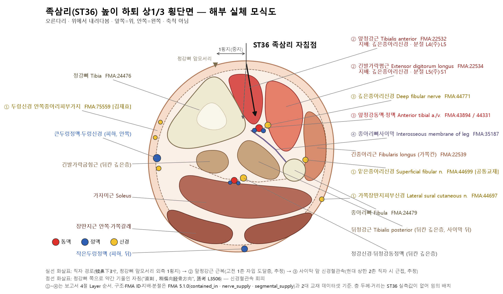
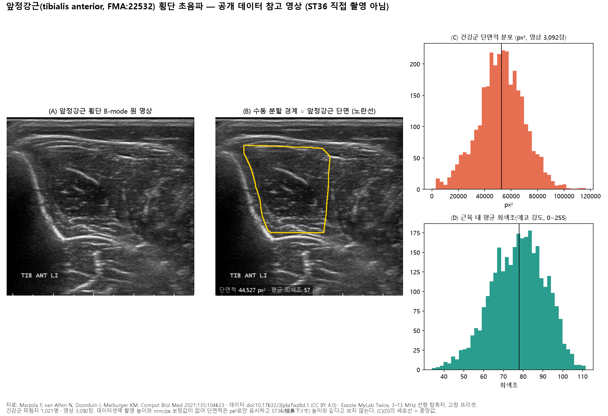
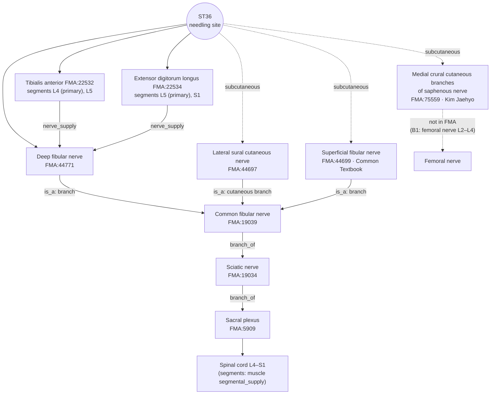

# [Acupoint Anatomical & Physiological Substrate Monograph] Zusanli (足三里, ST36)

> **Framework**: v2.7 (revised 2026-10-04) · **ARI**: ARI v3.0 | ARI-Core 77.5 ± 0 (B) | SI 75 | provisional weights 0.40/0.35/0.25 | sensitivity (equal weights): 77.1 (B, grade unchanged) · **Dual scoring**: completed by two independent raters

> **Three Primary Classics**: *Zhongguo Zhenjiu Xuewei Tongjian* (《中國針灸穴位通鑑》) · *Zhongguo Zhenjiu Zhengzhi Tongjian* (《中國針灸證治通鑑》) · *Zhenjiu Shuxue Tongkao* (《針灸腧穴通考》)
> **Layer A Empirical Database**: `02_Master_Datasets/경혈_생의학_신경반사_마스터DB.json` (ST36 evidence pack: 38 landmark papers, 109 locally mapped papers, 39 external papers — only the 15 papers in Table 8-① are used for the mechanism verdict)
> **Layer B Reference Registry**: `01_Framework/layer_b_reference_registry.md` (6-item B-Check, concordance threshold ≥ 8/12)
> **Metrological Standard**: Han-dynasty standard, 1 fen (分) = 2.3 mm ($z = \text{fen} \times 2.3\,\text{mm}$)
> **Anatomical Ontology**: local index of the FMA (Foundational Model of Anatomy) 5.1.0 — textbook structures are pinned to `FMA:ID`s and their innervation, spinal segments and nerve trunks are cross-checked (B1 supplementary, not yet in the registry). Mapping table: `02_Master_Datasets/FMA/acupoint_fma_mapping.json`; details in Appendix A.
> **Note on script**: Classical quotations and TCM terms are given in Traditional Chinese (繁體字). The cited source files are simplified-script editions, so the file names and line numbers in `code` refer to those files as they are named on disk.

---

## 1. Classical Literature Screening Table (Three Primary Classics Excerpts)

| Classic | Original excerpt (file & line) | English summary & analysis | Remarks |
| :--- | :--- | :--- | :--- |
| *Zhenjiu Shuxue Tongkao* (《針灸腧穴通考》) | "入于下陵，下陵者，膝下三寸，胻外三里也，為合。"(《黃帝內經太素·本輸》) / "所謂三里者，下膝三寸也。所謂跗之者，舉膝分易見也。"(《素問·針解》) / "取之三里者，低跗。"(《靈樞·邪氣藏府病形》) — `针灸腧穴通考(上)_321-400.md` L3124–3130 | Three cun below the knee, on the lateral side of the shin; located with the foot dorsiflexed (低跗) | One of the rare points for which the *Neijing* (《內經》) gives the name, its meaning, the location and the locating method (L3096) |
| *Zhenjiu Shuxue Tongkao* (《針灸腧穴通考》) | "入于三里，三里者，土也。在膝下三寸，胻外廉，足陽明脈氣所入也，為合。"(《黃帝明堂經》) / "刺入一寸，留七呼，灸三壯。"(《黃帝明堂經》) — same file, L3136, L3478 | Lateral border of the shin; He-Sea (Earth) point (合土穴); needle insertion 1 cun | Earliest statement of needling depth |
| *Zhenjiu Shuxue Tongkao* (《針灸腧穴通考》) | "本穴的縱向定位，古代文獻明確作'膝下三寸'……至於本穴的橫向定位，《靈樞》《明堂經》均未明確說明。" — same file, L3244–3248 | Longitudinal position is explicit; the transverse position is not stated in Han-dynasty sources | Three competing transverse traditions (Section 7) |
| *Zhongguo Zhenjiu Xuewei Tongjian* (《中國針灸穴位通鑑》) | "足三里二穴，土也，在膝下三寸外廉兩筋間，當舉足取之。"(《聖濟總錄》) / aliases "三里" · "下陵" · "一名鬼邪" · "下陵、鬼邪、下三里" — `中国针灸穴位通鉴(上卷)_801-880.md` L3410–3428 | Gives 《聖濟總錄》 as the source of the point name and collects four alias lines | The name '足三里' dates from the Song dynasty |
| *Zhongguo Zhenjiu Xuewei Tongjian* (《中國針灸穴位通鑑》) | "刺入一寸五分，留七呼，灸三壯。"(《針灸甲乙經》) / "三里刺入四分，令人氣上。"(《千金翼方》) / "針入八分，留十呼"(《太平聖惠方》) — same file, L3676–3692 | Needling depth varies between texts | Entered in the depth table (Section 5) |
| *Zhongguo Zhenjiu Zhengzhi Tongjian* (《中國針灸證治通鑑》) | Indications of 足三里 in 《明堂經》: "腹中寒，脹滿，善噫，惡聞食臭，胃氣不足，腸鳴腹痛，泄利，食不化，心下脹" — `中国针灸证治通鉴_1-80.md` L2162–2166 | Single-point indications centred on gastrointestinal signs | Basis for $P_{single}$ (Section 9) |
| *Zhongguo Zhenjiu Zhengzhi Tongjian* (《中國針灸證治通鑑》) | "喉痹，胸中暴逆，先取衝脈，後取三里、雲門，皆瀉之。" — `中国针灸证治通鉴_1-80.md` L1242 | Combination with 衝脈 (氣衝) and 雲門 | Basis for $P_{comb}$ (Section 9). The earlier edition wrongly placed this passage in the point-location column |

---

## 2. Primary Source vs. Secondary Quotation: Historical Stratification Table

| Era / stratum | Classical source | Textual description | Primary / secondary |
| :--- | :--- | :--- | :--- |
| Pre-Qin & Han | 《靈樞·本輸》, 《靈樞·邪氣藏府病形》, 《素問·針解》 | 下陵 膝下三寸 胻外三里 / 低跗 / 下膝三寸 · 舉膝 | Primary (location, locating method) |
| Han | *Huangdi Mingtang Jing* (《黃帝明堂經》) | 膝下三寸, 胻外廉, 合土; 刺入一寸, 留七呼, 灸三壯; list of indications | Primary (depth, indications) |
| Wei–Jin | *Zhenjiu Jiayi Jing* (《針灸甲乙經》) | 在膝下三寸外廉; 刺入一寸五分 (Tongjian L3676) | Quotes 《明堂》; variant depth |
| Tang | *Qianjin Yaofang* (《千金要方》) · *Qianjin Yifang* (《千金翼方》) | Location by the one-fu (一夫, four-finger breadth) method; "一名鬼邪"; 刺入四分; "灸頭不灸三里" | Partly independent (moxibustion point location) |
| Tang | Wang Bing's (王冰) commentary on the *Suwen* (《素問》) | 犢鼻下三寸, 胻外兩筋肉分間; firm pressure stops the pulse of the 跗上動脈 (dorsal pedal artery) | Reinterpretation (lateral shift; 犢鼻 substituted as the reference) |
| Tang | *Waitai Miyao* (《外臺秘要》) | "若不灸三里" — the two characters '灸頭' dropped | Transcription error (collated by the Tongkao) |
| Song | *Taiping Shenghui Fang* (《太平聖惠方》) | Name '足三里' first used; 胻骨外 · 大筋內 · 筋骨之間 (medial shift); 針入八分 | Name separated; variant transverse position |
| Song | *Tongren* (《銅人》) · *Zhenjiu Zisheng Jing* (《針灸資生經》) | 胻骨外大筋內 / criticism that "犢鼻下三寸 ≠ 膝下三寸" | Secondary; collation debate |
| Ming–Qing | *Zhenjiu Dacheng* (《針灸大成》) · 《類經圖翼》 · *Yizong Jinjian* (《醫宗金鑑》) | 骨外廉大筋內宛宛中; the "小兒忌灸" (no moxibustion in children) claim | Secondary; corruption (Tongkao L3148–3168) |
| Modern | Textbooks; Chinese national standard GB/T 12346-2006 | 犢鼻下3寸, on the line joining 犢鼻 and 解溪, within 脛骨前肌; 直刺1–2寸 | Modern location |

---

## 3. Nomenclature & Alias Collation Table (KJH DB Verification)

| Alias (別名) | Classical source | KJH database | Textual adjudication |
| :--- | :--- | :--- | :--- |
| 三里 | 《素問·針解》 and texts before the Song (Tongjian L3414) | — | Same name as the hand-yangming '三里' (手三里); split off as '足三里' in *Taiping Shenghui Fang* (《太平聖惠方》). Resolved chronologically |
| 下陵 | 《靈樞·本輸》 (Tongjian L3420) | — | Tongkao "名實考": not an alias but an abbreviation of the full name '下陵三里' (Tongkao L3112). Not treated as an alias |
| 鬼邪 | *Qianjin Yaofang* (《千金要方》) vol. 14, "邪病大喚罵走遠，三里主之，一名鬼邪" | Listed | Whether it belongs to 手三里: the Tongkao assigns it to 足三里 on the basis of the indications |
| 下三里 | 1957 Nanjing 《針灸學》 (citing a Japanese textbook) | Listed | In Japan '下三里' is also used for 三陰交 (SP6) (Tongkao L3144–3146) → risk of confusion |

The KJH DB (`경혈명_비교_정리_KJH.xlsx`, row 122: No. 119, ST36, 족삼리 (Joksamni), 足三里, "下三里, 鬼邪") agrees with the alias columns of both textbook datasets.

---

## 4. 3D Spatial Coordinates & Layer 1–5 Anatomical Substrate Diagram

- **X (medial–lateral)**: one finger-breadth (middle finger) lateral to the anterior crest of the tibia (脛骨前嵴). The range of classical transverse variants is given in Section 7.
- **Y (proximal–distal)**: 3 cun below 犢鼻 (ST35) (bone-proportional 16 cun from 犢鼻 to 解溪; depends on body build). The Han-dynasty '膝下三寸' is measured from the apex of the patella and lies at almost the same height as the modern 犢鼻 reference (Tongkao L3114–3116).
- **Z (depth)**: layers below. **Layer A contains no cadaveric or ultrasound measurement at ST36, so only the order of structures is given, without millimetre boundaries** (the 2.5/6.5/16.5/22 mm boundaries of the earlier edition were generic template values and have been removed).

```
[Layer 1 Skin/subcutis]    Lateral sural cutaneous n. / superficial fibular n. (Common Textbook)
                           or medial crural cutaneous branches of saphenous n. (Kim Jaehyo)
        │
[Layer 2-3 Muscle]         Belly of tibialis anterior; extensor digitorum longus laterally
                           — layer reached at the classical depth of ~1 cun (23 mm) (estimated)
        │
[Layer 4 Neurovascular]    Deep fibular n. + anterior tibial a./vv. on the interosseous membrane
                           — reachable by perpendicular insertion at the modern upper limit of 2 cun (46 mm) (estimated)
        │
[Layer 5 Floor]            Interosseous membrane of leg / tibial periosteum (no deep organs)
```



*Figure 4-1. Schematic cross-section of the upper third of the leg at the level of Zusanli (足三里, ST36) (right leg, viewed from above, not to scale). A perpendicular needle passes through the belly of tibialis anterior and reaches the neurovascular bundle in front of the interosseous membrane. Angling slightly toward the tibia (Tongkao L3506) avoids the bundle. Layer thicknesses and distances are arbitrary because no ST36-specific measurements exist.*

**FMA substrate cross-check by layer** — structure names from the two textbooks; IDs and relations from FMA 5.1.0

| Layer | Structure | FMA | FMA compartment / relation | Innervation / trunk (FMA) | Spinal segment (FMA) |
| :--- | :--- | :--- | :--- | :--- | :--- |
| 1 Subcutis | Lateral sural cutaneous nerve | FMA:44697 | is_a Cutaneous branch of common fibular nerve | Common fibular n. → sciatic n. → sacral plexus | Not recorded in FMA |
| 1 Subcutis | Superficial fibular nerve *(Common Textbook)* | FMA:44699 | is_a Branch of common fibular nerve | Common fibular n. → sciatic n. → sacral plexus | Not recorded in FMA |
| 1 Subcutis | Medial crural cutaneous branches of saphenous nerve *(Kim Jaehyo)* | FMA:75559 | Set of medial crural cutaneous branches of saphenous nerve | Link saphenous n. → femoral n. **not recorded in FMA** (supplemented by B1-01) | Not recorded in FMA |
| 2–3 Muscle | Tibialis anterior | FMA:22532 | contained_in Space of anterior compartment of leg (FMA:85203) | Nerve to tibialis anterior (FMA:80062) ← deep fibular n. | **L4 (primary)**, L5 |
| 2–3 Muscle | Extensor digitorum longus | FMA:22534 | contained_in anterior compartment space (FMA:85203) | Nerve to extensor digitorum longus (FMA:80068) ← deep fibular n. | **L5 (primary)**, S1 |
| 4 Neurovascular | Deep fibular nerve | FMA:44771 | is_a Branch of common fibular nerve | Common fibular n. → sciatic n. → sacral plexus | Not recorded in FMA |
| 4 Neurovascular | Anterior tibial artery | FMA:43894 | branch_of External iliac artery (FMA models the popliteal artery as a continuation segment of the external iliac artery) | — | — |
| 4 Neurovascular | Anterior tibial vein | FMA:44331 | tributary_of Popliteal vein | Popliteal v. → femoral v. → external iliac v. | — |
| 5 Floor | Interosseous membrane of leg · tibia | FMA:35187 · FMA:24476 | — | — | — |

- FMA records the muscular branches to tibialis anterior and extensor digitorum longus as branches of the *medial terminal branch of the deep fibular nerve (FMA:44777, the segment below the ankle)*. In normative anatomy (B1-01) these muscular branches arise from the trunk of the deep fibular nerve in the leg, so this report cites FMA **only down to the level of the deep fibular nerve**.
- FMA gives segments only in the `segmental_supply` of muscles, not for nerves themselves. Nerve segments (e.g. common fibular nerve L4–S2) are taken from B1-01 and B1-02.

**Reference ultrasound image — tibialis anterior, transverse view (public dataset)**



*Figure 4-2. Transverse B-mode ultrasound of tibialis anterior (FMA:22532). (A) Raw image, (B) manual segmentation by the dataset authors, (C)(D) distributions of cross-sectional area and mean intramuscular grey level in the healthy group (3,092 images, 1,021 subjects). Source: Marzola F, van Alfen N, Doorduin J, Meiburger KM. Comput Biol Med 2021;135:104623; data doi:10.17632/3jykz7wz8d.1 (CC BY 4.0). Esaote MyLab Twice, 3–13 MHz linear probe, fixed preset.*

| Measure | Healthy group (median [IQR]) | Interpretation |
| :--- | :--- | :--- |
| Cross-sectional area of tibialis anterior | 52,590 px² [41,397–63,967] | The dataset has no mm/px calibration, so values are given **in px² only**. Inter-individual variation exceeds 1.5-fold |
| Mean intramuscular grey level (0–255) | 78.0 [67.8–87.0] | General range of muscle echo intensity; rises in neuromuscular disease (original paper) |
| Muscle interior / surrounding ring echo ratio | 0.913 | The muscle is slightly darker than the surrounding fascia and bone border |

- **What the image shows**: it confirms the arrangement in Figure 4-1, with Layer 2–3 (belly of tibialis anterior) lying just lateral to the lateral surface of the tibia (the hyperechoic curve on the left with its acoustic shadow). In some images the central aponeurosis appears as a bright line within the muscle.
- **What it does not show / limits**: the scanning level is not recorded in the dataset, so it is not assumed to match the level of ST36 (犢鼻下3寸). The subjects are patients and controls examined for neuromuscular diagnosis, not needling-study participants. The image is therefore **a general reference for the ultrasound appearance of tibialis anterior**; it is neither point-specific measurement (B2) nor Layer A evidence and is not used for layer depth boundaries or the SI (skill section 5-2).
- **Reproduction**: `python .claude/skills/acupoint-anatomy/scripts/us/us_fetch.py get marzola_msk` → `extract marzola_msk "DeepLearningUS/TA/"` → `python .claude/skills/acupoint-anatomy/scripts/us/figures/ST36_ultrasound_TA.py <output.png> --json <stats.json>` (raw statistics: `ST36_앞정강근_초음파_통계.json`).
- The direct depth measurement at the ST36 level is papers.id 1896 (TI 1.09) in Section 5.

---

## 5. Classical Needling Depth Calculation Table (Han Dynasty 1 fen = 2.3 mm)

Source: `침구문헌별 자침깊이 정리_AI 분석용.xlsx`, sheet 1, row 121 (N0 = 119), supplemented by the three primary classics.

| Text | Fen (分) | Depth (× 2.3 mm) | Layer reached (estimated) | Remarks |
| :--- | :---: | :---: | :--- | :--- |
| *Huangdi Mingtang Jing* (《黃帝明堂經》, ed. Huang Longxiang) | 10 | 23.0 mm | 2–3 | "刺入一寸" |
| *Zhenjiu Jiayi Jing* (《針灸甲乙經》) | 10 | 23.0 mm | 2–3 | DB value. The *Xuewei Tongjian* (《穴位通鑑》), however, quotes the *Jiayi Jing* as "刺入一寸五分" (15 fen = 34.5 mm) — textual variant |
| *Chimgu Gyeongheombang* (《鍼灸經驗方》) | 8 | 18.4 mm | 2–3 | |
| *Dongui Bogam* (《東醫寶鑑》, citing 《銅人》) | 10 | 23.0 mm | 2–3 | |
| Korean common textbook, *Meridian and Acupoint Studies* (經絡經穴學) | 10–20 | 23.0–46.0 mm | 2–4 | |
| Korean common textbook, *Acupuncture and Moxibustion Medicine* (鍼灸醫學) | 10–20 | 23.0–46.0 mm | 2–4 | |
| *Zhenjiu Shuxue Tongkao* (《針灸腧穴通考》) | 10–20 | 23.0–46.0 mm | 2–4 | "直刺 1~2 寸" |
| *Qianjin Yifang* (《千金翼方》) (supplementary) | 4 | 9.2 mm | 1–2 | "刺入四分，令人氣上" |
| *Taiping Shenghui Fang* (《太平聖惠方》) (supplementary) | 8 | 18.4 mm | 2–3 | |
| 《竇太師針經》 (supplementary) | 25 | 57.5 mm | 4–5 | "針入二寸半" — maximum |

- No 'Contraindicated for needling (禁鍼)' ('0') entry and no 'blank' entry (per the relevant DB columns).
- Safety range: about 23 mm stays within the belly of tibialis anterior. Perpendicular insertion of 46 mm or more may reach the deep fibular nerve and anterior tibial vessels, so these are avoided by angling, as in the Shanghai 《針灸學》 instruction "直刺，稍偏向脛骨方向" (Tongkao L3506).
- **Ultrasound measurement (added 2026-10-23)**: papers.id 1896 (Choi DH et al. *Integr Med Res* 2026;15:101305, PMID 42500462) measured the effective depth (ED₅₀) and hazardous depth (HD₅₀) under ultrasound guidance in 39 participants and reported their ratio, the therapeutic index (TI), as **1.09 for ST36** (1.54 for GB21), describing a "narrow margin in which harm can occur". This agrees with the judgement above that the effective stimulation depth lies close to the depth of the neurovascular bundle. Because the authors describe the result as exploratory, SI 75 is kept, but the finding is noted as grounds for checking depth individually, the more so for deep perpendicular insertion. (This paper is active in the master DB but is not linked in the ST36 inverted index.)

---

## 6. Textbook Comparison Table & FMA Ontology Mapping (Common Textbook vs. Prof. Kim Jaehyo)

| Category | Common Textbook of Acupoint Studies (refine.xlsx detail sheet rows 650–655; *Acupoint Studies* vol. 1, p. 331) | Kim Jaehyo textbook (detail sheet rows 954–959) | FMA adjudication | Assessment |
| :--- | :--- | :--- | :--- | :--- |
| Muscles | Tibialis anterior (앞정강근), extensor digitorum longus (긴발가락폄근) | Tibialis anterior, extensor digitorum longus | FMA:22532, FMA:22534 (same IDs in both) | Agree |
| Cutaneous nerves | Lateral sural cutaneous n. (가쪽장딴지피부신경), superficial fibular n. (얕은종아리신경) | Lateral sural cutaneous n., medial crural cutaneous branches of saphenous n. (두렁신경의 안쪽종아리피부가지) | Shared FMA:44697 / Common Textbook only FMA:44699 / Kim Jaehyo only FMA:75559 | **Differ** in one cutaneous sensory branch |
| Deep nerve | Deep fibular n. (깊은종아리신경) | Deep fibular n. (deep fibular / deep peroneal both given) | FMA:44771 — the two English terms denote the same entity (synonyms) | Agree |
| Vessels | Anterior tibial a. & v. (앞정강동·정맥) | Anterior tibial a. & v. | FMA:43894, FMA:44331 | Agree |

Consistent with B1-01 and B1-03 (anatomy of the anterior compartment of the leg). There is no point-specific imaging or cadaveric measurement (PMID).

**What FMA shows about the cutaneous-nerve difference**: the Common-Textbook-only item (superficial fibular nerve) belongs, in FMA, to the same **common fibular trunk (→ sciatic nerve → sacral plexus)** as the lateral sural cutaneous nerve. The Kim-Jaehyo-only item (medial crural cutaneous branches of the saphenous nerve) belongs to the **saphenous nerve (femoral system)**, a different trunk. The difference between the textbooks is therefore not "one lists more branches of the same nerve" but **whether the cutaneous sensory territory is drawn to include the lateral side (toward the L5 dermatome) or the medial side (toward the L4 dermatome)**. Since ST36 lies one finger-breadth lateral to the anterior tibial crest, it can be read as lying near the boundary of the two territories; however, the dermatome boundary rests on B1-03, not on FMA, and there is no point-specific measurement. The difference is not a conflict, so the $S_{clarity}$ level is unchanged.

---

## 7. Spatial Discrepancy Dual-Target Analysis (Discrepancy Δ > 15 mm)

| Tradition | Source | Transverse position |
| :--- | :--- | :--- |
| ① Lateral shift | Wang Bing's commentary, "胻外兩筋肉分間" (Tongkao L3198) | Between tibialis anterior and extensor digitorum longus |
| ② Medial shift | *Taiping Shenghui Fang* (《太平聖惠方》), "胻骨外，大筋內，筋骨之間" (Tongkao L3190) | Between the tibia and tibialis anterior |
| ③ Modern | Line joining 犢鼻 and 解溪, 脛骨前肌中 (Tongkao L3248) | Belly of tibialis anterior |

The longitudinal position ('膝下三寸') is the same in classical and modern sources, and the transverse variants fall within roughly the width of tibialis anterior, judged to be under 15 mm (estimate, not measured). Therefore **$\Delta_{discrepancy} \le 15\,\text{mm}$; no target split — single Target (T1)**.

---

## 8. Biomedical Reflex Pathway Diagram & External Search Log

**Mechanism summary (animal evidence)**: PROKR2 sensory fibres in the deep fascia at ST36 → spinal cord → medulla (DMV/vagal) → vagal–adrenal axis → anti-inflammatory effect (mouse; B3-15, B3-16, B3-17). This pathway dominates only at low intensity; high intensity recruits non-specific sympathetic pathways (B3-16). Gastrointestinal effects are explained by supraspinal rather than segmental pathways (somato-autonomic reflex framework: B3-04, B3-05). **Translation to humans has not been demonstrated.**

**Pinning the peripheral afferent pathway with FMA**: the first segment of the reflex pathway (needling site → spinal cord) is pinned by FMA relations as shown below. The B3-17 finding that "deep-fascia sensory fibres at ST36 enter via the sciatic nerve route" agrees with this anatomical chain (agreement at the structural level only; PROKR2 fibres themselves are outside the scope of FMA).



*Figure 8-1. Peripheral afferent pathway of ST36 drawn from FMA 5.1.0 relations. Solid lines are relations recorded in FMA (`nerve_supply`, `branch_of`); "is_a" marks trunks linked through class names; dashed lines are links absent from FMA (supplemented from B1).*

### ① Layer A Papers (ST36-specific studies first)

| papers.id | Year | Journal | Title | PMID / DOI | Design |
| :---: | :---: | :--- | :--- | :--- | :--- |
| 317 | 2021 | Nature | A neuroanatomical basis for electroacupuncture to drive the vagal-adrenal axis | 34646018 / 10.1038/s41586-021-04001-4 | Animal (mouse) |
| 294 | 2020 | Neuron | Somatotopic organization and intensity dependence in driving distinct NPY-expressing sympathetic pathways by electroacupuncture | 32791039 / 10.1016/j.neuron.2020.07.015 | Animal (mouse) |
| 295 | 2014 | Nature Medicine | Dopamine mediates the vagal modulation of the immune system by electroacupuncture | 24562381 (registry B3-15) / 10.1038/nm.3479 | Animal (mouse) |
| 189 | 2010 | Nature Neuroscience | Adenosine A1 receptors mediate local anti-nociceptive effects of acupuncture | 20512135 (registry B3-18) / 10.1038/nn.2562 | Animal (mouse) |
| 34 | 2003 | Am J Physiol | Dual effects of acupuncture on gastric motility in conscious rats | — / 10.1152/ajpregu.00715.2002 | Animal (rat), dual effect |
| 1840 | 2024 | Adv Sci | Electroacupuncture promotes liver regeneration by activating DMV acetylcholinergic neurons-vagus-macrophage axis | 38923873 / 10.1002/advs.202402856 | Animal (mouse) |
| 1841 | 2024 | Microb Biotechnol | Electroacupuncture at ST36 modulates the intestinal microecology ... severe acute pancreatitis | 38381095 / (DB DOI 10.1111/1751-7915.14401 suspected not to match the journal) | Animal (rat) |
| 1844 | 2021 | Life Sci | Electroacupuncture regulates inflammatory cytokines by activating the vagus nerve ... breast tumors | 33636172 / 10.1016/j.lfs.2021.119259 | Animal (mouse) |
| 1851 | 2026 | Zhen Ci Yan Jiu | Electroacupuncture in ameliorating mild duodenal inflammation in rats with functional dyspepsia | 42779395 / 10.13702/j.1000-0607.20260535 | Animal (rat) |
| 1861 | 2026 | Zhen Ci Yan Jiu | Electroacupuncture at "Zusanli" (ST36) on colonic mucosal injury ... | 42621716 / 10.13702/j.1000-0607.20250960 | Animal (mouse) |
| 1866 | 2026 | J Pharmacopuncture | Acupuncture at ST36 and SP6 ... osteoarthritis rat model | 42812780 / 10.3831/kpi.2026.29.3.286 | Animal (rat), multiple points |
| 1869 | 2008 | J Acupunct Tuina Sci | Peripheral nerve discharge elicited by manual acupuncture at Zusanli (ST 36) regulates blood pressure in anesthetized rats | — / 10.1007/s11726-008-0281-z | Animal (anaesthetised rat) |
| 237 | 2005 | NeuroImage | The integrated response of the human cerebro-cerebellar and limbic systems to acupuncture stimulation at ST 36 as evidenced by fMRI | — / 10.1016/j.neuroimage.2005.04.037 | Human (non-RCT, fMRI) |
| 35 | 2003 | Eur J Appl Physiol | Effects of acupuncture on skin and muscle blood flow in healthy subjects | — / 10.1007/s00421-003-0825-3 | Human (non-RCT) |
| 1843 | 2021 | J Integr Med | Perioperative transcutaneous electrical acupoint stimulation for improving postoperative gastrointestinal function: an RCT | 33495134 / 10.1016/j.joim.2021.01.005 | Human RCT (multi-point TEAS, not ST36 alone) |

- Excluded: papers.id 5, 12, 19, 27, 38, 46, 54, 59 from the earlier list (point not confirmed or unrelated to an ST36 mechanism; 27 is a hypothesis paper). papers.id 1700 could not be bibliographically verified (superseded) and is not cited.
- papers.id 1850 is classed as 'human (non-RCT)' in the evidence pack but is actually a mouse psoriasis model; it was not used in this verdict.

### ② B-Check Scoring Table

| Item | Content | Rater A | Rater B | Final | Reference IDs | papers.id | Rationale |
| :---: | :--- | :---: | :---: | :---: | :--- | :--- | :--- |
| ① | Peripheral nerve/vessel substrate at needling depth | 2 | 2 | **2** | B1-01, B1-03, B2-09, B3-17 (+FMA) | 317 | Both textbooks and normative anatomy agree on the deep fibular nerve and anterior tibial vessels deep to tibialis anterior. All 8 textbook structures map exactly to FMA (FMA:22532, 22534, 44771, 43894, 44331, 44697, 44699, 75559). B3-17 verified deep-fascia sensory fibres at ST36 (mouse). No human imaging measurement |
| ② | Spinal segmental concordance | 1 | 1 | **1** | B1-02, B3-05, B3-16 (+FMA) | 294 | ST36 L4–S1 (FMA segmental_supply: tibialis anterior L4, L5; extensor digitorum longus L5, S1) vs stomach T6–T9: segments do not match. Gastrointestinal effects are explained by the supraspinal vagal pathway (B3-05, B3-16) → indirect, 1 point |
| ③ | Afferent fibre type & receptors | 2 | 2 | **2** | B3-06, B3-15, B3-17, B3-18 | 189, 295, 317 | PROKR2 deep-fascia fibres, the sciatic-nerve route and local adenosine A1 verified directly at ST36. Mouse only |
| ④ | Central relay & pathway | 2 | 2 | **2** | B3-12, B3-15, B3-16, B3-17 | 294, 295, 317, 1840 | DMV/vagal–adrenal axis (mouse); rVLM cardiovascular pathway (anaesthetised cat and rat, including ST36). Animal only |
| ⑤ | Efferent pathway & target effect (match with $P_{single}$) | 2 | 1 | **1** | B3-05, B3-15, B3-16 | 34, 1841, 1851, 1861 | Effects on gastric motility (34, condition-dependent dual effect) and intestinal mucosa point in the same direction as the classical gastrointestinal indications, but the key verified effect is anti-inflammation in sepsis, which corresponds only weakly to the classical indications → 1 |
| ⑥ | Human translation | 1 | 1 | **1** | B4-01, B4-03, B4-04, B4-05 | 35, 237, 1843 | Human ST36 fMRI, muscle blood flow and a multi-point TEAS RCT exist, but the vagal–adrenal reflex arc has not been confirmed in humans. Counter-evidence on point specificity (B4-04, B4-05) unresolved |
| **Total** | | 10 | 9 | **9 / 12** | | | **Verdict: concordant (≥ 8/12)** · flag: ③–⑤ animal (mouse/rat) only |

### ③ External Search Log (sync_log; Rank 6 run of 2026-10-04)

| Timestamp | Source | HTTP | Fetched | Duplicates removed | New | Query |
|---|---|---|---|---|---|---|
| 2026-10-04T09:51:40 | pubmed | 200 | 16 | — | — | ("ST36" OR "Zusanli" OR "足三里") AND (acupuncture OR electroacupuncture) AND (nerve OR reflex OR autonomic OR mechanism OR anatomy) |
| 2026-10-04T09:51:40 | openalex | 200 | 24 | — | — | doi_starts_with:10.13703,title_and_abstract.search:"Zusanli" OR "ST36" / doi_starts_with:10.13702,title_and_abstract.search:"Zusanli" OR "ST36" / has_doi:true,t… |
| 2026-10-04T09:51:40 | crossref | 200 | 5 | — | — | Zusanli acupuncture nerve reflex |
| 2026-10-04T09:51:40 | all | — | 45 | 10 | 35 | |
| 2026-10-23T21:45:27 | pubmed | 200 | 16 | — | — | Same query as above (re-run) |
| 2026-10-23T21:45:27 | openalex | 200 | 24 | — | — | Same query as above (re-run) |
| 2026-10-23T21:45:27 | crossref | 200 | 5 | — | — | Same query as above (re-run) |
| 2026-10-23T21:45:27 | all | — | 45 | 27 | 18 | 24 already merged, 3 duplicates within the batch. The 18 new papers do not change the B-Check or ARI verdict |

---

## 9. Classical Indications Stratification Table (Single-Point $P_{single}$ vs. Combinations $P_{comb}$)

| Type | Indication | Textual basis |
| :--- | :--- | :--- |
| $P_{single}$ (single point) | Epigastric pain (胃脘痛), abdominal distension (腹䐜脹), inability to get food down (食飲不下) | "胃病者，腹䐜脹，胃脘當心而痛……食飲不下，取之三里也" (《靈樞·邪氣藏府病形》, Tongkao L3310) |
| $P_{single}$ | Borborygmus (腸鳴), abdominal pain (腹痛), cold or heat in the middle (寒中/熱中), regardless of deficiency/excess or cold/heat | "邪在脾胃……寒中腸鳴腹痛……皆調於三里" (《靈樞·五邪》, Tongkao L3318) |
| $P_{single}$ | Bowel obstruction (腸中不便) | "腸中不便，取三里，盛瀉之，虛補之" (《靈樞·四時氣》, Tongkao L3312) |
| $P_{single}$ | Insufficient stomach qi (胃氣不足), indigestion (食不化), diarrhoea (泄利) | *Huangdi Mingtang Jing* (《黃帝明堂經》) "腹中寒，脹滿，善噫，惡聞食臭，胃氣不足，腸鳴腹痛，泄利，食不化" (Zhengzhi Tongjian L2166) |
| $P_{single}$ | Mania (狂) (是動病 of the foot yangming) | "邪病大喚罵走遠，三里主之" (*Qianjin Yaofang* (《千金要方》)); 《明堂》 "狂歌妄言……罵詈" |
| $P_{single}$ | Bi (痹) of the lower limb | "著痹不去，久寒不已，卒取其三里" (《靈樞·四時氣》) |
| $P_{comb}$ (combination) | Throat Bi (喉痹), sudden counterflow in the chest (胸中暴逆) | 衝脈 (氣衝) + 三里 + 雲門, "皆瀉之" (Zhengzhi Tongjian L1242) — the 'descending qi (下氣)' action belongs mainly to the combined points (Tongkao, textual analysis) |
| $P_{comb}$ | Pathogenic qi in the large intestine (大腸邪氣) | 肓之原 + 巨虛上廉 + 三里 (《靈樞·四時氣》) |
| $P_{comb}$ | Spleen–stomach deficiency (脾胃虛弱) | 三里 + 三陰交 (《針經摘英集》) |
| $P_{comb}$ | Stroke (中風) prevention | Moxibustion at 7 points: 百會 · 耳前髮際 · 肩井 · 風市 · 三里 · 絕骨 · 曲池 (*Taiping Shenghui Fang* (《太平聖惠方》)) |
| $P_{comb}$ | Modern prescriptions (e.g. hemiplegia (半身不遂) after stroke) | Numerous multi-point prescriptions (`中国针灸证治通鉴_161-240.md` L212–298) |

---

## 10. ARI v3.0 Quantitative Profile Evaluation & Final Conclusion

**Target T1 (single)**: classical "膝下三寸，胻外廉" = modern 犢鼻下3寸, one finger-breadth lateral to the anterior tibial crest (within tibialis anterior).

### Sub-scores

| Index | Rater A | Rater B | Mean | Rubric-level rationale | Evidence pointers |
| :--- | :---: | :---: | :---: | :--- | :--- |
| $S_{orig}$ (0.40) | 81.25 | 81.25 | 81.25 | Mean of the 4 sub-items below | Tongkao `(上)_321-400.md` L3096–3248, L3478–3506 |
| $S_{clarity}$ (0.35) | 75 | 75 | 75 | The two textbooks agree (one cutaneous-nerve item differs, resolved by FMA as a difference of trunk) + standard entities confirmed by B1 and FMA; no point-specific measurement → below 100 | Section 6, B1-01, B1-03, FMA:22532, 44771 |
| $S_{reflex}$ (0.25) | 75 | 75 | 75 | Many ST36 animal studies + human non-RCT and multi-point RCT; B-Check 9 (⑥ = 1) → below 100 | Section 8 ①②, papers.id 317, 294, 295, 237, 1843 |
| SI ($S_{safety}$) | 75 | 75 | 75 | No 'Contraindicated for needling (禁鍼)' record. 23 mm reaches Layer 2–3; perpendicular insertion at the 46 mm upper limit may reach Layer 4 but can be avoided by angling; upper depth limit stated in the literature | Section 5, needling-depth DB row 121 |

### $S_{orig}$ Sub-items

| Sub-item | A | B | Final | Rationale |
| :--- | :---: | :---: | :---: | :--- |
| ① Clarity of earliest description | 75 | 75 | 75 | *Lingshu* (《靈樞》), *Suwen* (《素問》) and 《明堂》 give location and depth, but not the transverse position |
| ② Agreement in later texts | 75 | 75 | 75 | '膝下三寸' agrees; three transverse traditions and depths ranging from 4 to 25 fen |
| ③ Resolution of alias confusion | 75 | 75 | 75 | Confusion of 三里 (手三里), 鬼邪 and 下三里 (三陰交), resolved chronologically |
| ④ Collation in the *Tongkao* (《通考》) | 100 | 100 | 100 | The loss of '灸頭' in 《外臺》 corrected from 《千金翼》; changes in the 犢鼻-based location explained |

### Gates, Grade and Sensitivity

- **Gates**: Gate 1 ($S_{orig}$ and $S_{clarity}$ ≥ 50) not triggered; Gate 2 (15 Layer A papers) not triggered; Gate 3 (SI 75) not triggered.
- **ARI-Core** = 0.40 × 81.25 + 0.35 × 75 + 0.25 × 75 = **77.5 ± 0** → **Grade B (probable)**, no flags.
- **SI** = 75 (reported separately).
- **Equal-weight sensitivity**: (81.25 + 75 + 75) / 3 = 77.1 → B, grade unchanged.
- **Branch decision**: not applicable (single Target).
- **Adjudication record**: no item differed by 15 points or more (no needs_adjudication). Only B-Check ⑤ split (A 2, B 1; final 1). The counter-evidence on point specificity (B4-04, B4-05), intensity dependence (B3-16) and the dual effect on gastric motility (papers.id 34) are treated as limits on the scope of application rather than direct conflicts, so the B-Check verdict stays 'concordant' and these limits are stated in the conclusion.

### Final Conclusion

The anatomical substrate of Zusanli (足三里, ST36) is established at the **probable (B)** level. Its longitudinal position has been fixed since the Han dynasty as '膝下三寸，胻外廉'; beneath it, the belly of tibialis anterior and, deeper, the deep fibular nerve and anterior tibial vessels agree between the two textbooks, and all 8 textbook structures are confirmed as FMA standard entities (Appendix A). As for the neural reflex mechanism, the pathway from deep-fascia sensory fibres at ST36 to the vagal–adrenal axis has been verified directly **only in mice** (B3-15, B3-16, B3-17).

Limits on the scope of application:
1. The vagal–adrenal anti-inflammatory pathway rests on mouse evidence only and has not been confirmed in humans.
2. This pathway dominates only at low stimulation intensity; high intensity recruits non-specific sympathetic pathways (B3-16).
3. Counter-evidence on point specificity, showing small differences between verum and sham needling (B4-04, B4-05), remains unresolved.
4. The effect on gastric motility is a dual effect, facilitatory or inhibitory depending on conditions (papers.id 34).
5. The stomach (T6–T9) and ST36 (L4–S1) do not share segments, so the gastrointestinal indications are explained by a supraspinal vagal pathway **hypothesis**, not by a segmental reflex.

---

## Appendix A. FMA Anatomical Substrate Profile (FMA 5.1.0)

Generated by `python .claude/skills/acupoint-anatomy/scripts/fma/fma_query.py profile ST36 --md` (2026-10-23). Match level `exact` means the textbook's English term matched an FMA label, synonym or Latin name exactly after normalisation.

| Category | Textbook term | FMA substrate (ID & label) | Match | Source | Innervation & nerve trunk chain | Spinal segment |
| :--- | :--- | :--- | :--- | :--- | :--- | :--- |
| Muscle | Extensor digitorum longus (긴발가락폄근) | FMA:22534 Extensor digitorum longus | exact | Common Textbook · Kim Jaehyo | FMA:80068 Nerve to extensor digitorum longus → deep fibular n. → common fibular n. | L5 (primary), S1 (secondary) |
| Muscle | Tibialis anterior (앞정강근) | FMA:22532 Tibialis anterior | exact | Common Textbook · Kim Jaehyo | FMA:80062 Nerve to tibialis anterior → deep fibular n. → common fibular n. | L4 (primary), L5 (secondary) |
| Nerve | Deep fibular / deep peroneal nerve (깊은종아리신경) | FMA:44771 Deep fibular nerve | exact | Common Textbook · Kim Jaehyo | FMA:19039 Common fibular nerve → FMA:19034 Sciatic nerve → FMA:5909 Sacral nerve plexus | — |
| Nerve | Lateral sural cutaneous nerve (가쪽장딴지피부신경) | FMA:44697 Lateral sural cutaneous nerve | exact | Common Textbook · Kim Jaehyo | FMA:19039 → FMA:19034 → FMA:5909 | — |
| Nerve | Medial crural cutaneous branches of saphenous nerve (두렁신경의 안쪽종아리피부가지) | FMA:75559 Set of medial crural cutaneous branches of saphenous nerve | exact | Kim Jaehyo | (no link above the saphenous nerve in FMA) | — |
| Nerve | Superficial peroneal nerve (얕은종아리신경) | FMA:44699 Superficial fibular nerve | exact | Common Textbook | FMA:19039 → FMA:19034 → FMA:5909 | — |
| Vessel | Anterior tibial artery (앞정강동맥) | FMA:43894 Anterior tibial artery | exact | Common Textbook · Kim Jaehyo | FMA:18805 External iliac artery → FMA:14764 Common iliac artery | — |
| Vessel | Anterior tibial vein (앞정강정맥) | FMA:44331 Anterior tibial vein | exact | Common Textbook · Kim Jaehyo | FMA:44327 Popliteal vein → … → FMA:10951 Inferior vena cava | — |

- Union of segments (input to B-Check ②): **L4, L5, S1**
- Comparison of the two textbooks: 6 shared FMA entities · 1 Common Textbook only (FMA:44699) · 1 Kim Jaehyo only (FMA:75559)
- Neo4j cross-check (`fma_neo4j.py query shared_structure --param a=ST36 --param b=GB34`): ST36 and Yanglingquan (陽陵泉, GB34) directly share the deep fibular nerve, the superficial fibular nerve and extensor digitorum longus, and have the common fibular nerve as a common trunk. Useful when comparing points in the same nerve territory (some trunk links are derived from FMA is_a class names).
- Limits of citation: FMA is a normative ontology of adult anatomy and is not evidence of point-specific depth, variant frequency or reflex function. The origin of the anterior muscular branches (recorded on the medial terminal branch), the missing saphenous–femoral link and the absence of nerve segments were supplemented from B1 as noted in Section 4.

---

## v2.7 FMA & Ultrasound Supplement History (2026-10-23)

| Location | Original content | Change | Basis |
| :--- | :--- | :--- | :--- |
| Header | — | Added FMA 5.1.0 anatomical ontology line | `02_Master_Datasets/FMA/acupoint_fma_mapping.json` |
| Section 4 | Text layer diagram only | Figure 4-1 cross-section schematic, FMA cross-check table by layer, 2 notes on FMA modelling limits | FMA:22532, 22534, 44771, 43894, 44331, 44697, 44699, 75559, 35187, 24476; contained_in FMA:85203 |
| Section 6 | 4-column textbook comparison | FMA adjudication column; interpretation of the cutaneous-nerve difference by trunk (common fibular vs saphenous) | FMA is_a / branch_of chains, B1-03 |
| Section 8 | Mechanism summary | Figure 8-1 FMA peripheral afferent pathway (Mermaid) | FMA:44771 → 19039 → 19034 → 5909 |
| Section 8 ② | B-Check ①, ② rationale | Added FMA IDs and segmental_supply pointers (scores unchanged: ① = 2, ② = 1) | FMA segmental_supply |
| Section 10 | $S_{clarity}$ rationale | Noted FMA confirmation of standard entities (score unchanged at 75); one clause added to the conclusion | Section 6, Appendix A |
| Appendix A | — | FMA profile table; Neo4j ST36–GB34 shared structures | `fma_query.py profile ST36 --md`, `fma_neo4j.py` |
| ARI | ARI-Core 77.5 ± 0 (B), SI 75 | **No change** — FMA and ultrasound are B1-supplementary/reference evidence and do not change rubric levels | Skill sections 5-1, 5-2 |
| Archive | — | Pre-supplement md, html and xlsx kept in `_구판_v2.7_20261023/` | — |
| Section 4, Figure 4-2 | — | Reference transverse ultrasound of tibialis anterior from public data (Marzola 2021, CC BY 4.0, 3,092 healthy-group images), statistics table and stated limits | `scripts/us/figures/ST36_ultrasound_TA.py`, Mendeley 3jykz7wz8d |
| Section 5 | Safety-range text | Added ultrasound measurement papers.id 1896, TI 1.09 (GB21 1.54); SI 75 kept | PubMed PMID 42500462 |
| Section 8 ③ | 2026-10-04 run | 4 rows for the 2026-10-23 Rank 6 re-run (18 new papers, verdict unchanged) | `_metadata.sync_log` |
| Restoration | At 21:17 another tool overwrote the report with a template regeneration (B-Check ② = 2, "confirmed", single-scored ARI 81.2, loss of Tongkao row citations — reintroducing errors already fixed in v2.7) | Restored the v2.7 + FMA supplemented version; the regenerated version kept unchanged (with 2 figures) in `_구판_antigravity_20261023/` | User decision, 2026-10-23 |

---

## v2.7 Revision History (2026-10-04)

| Location | Original content | Change | Basis |
| :--- | :--- | :--- | :--- |
| Header | Framework wording, "full inverted index of 148 measured papers" | v2.7 citation block, ARI notation / replaced by evidence-pack counts (38, 109, 39) | final_ST36.json notation, pack_ST36.md |
| Section 1 | Fragments of the Tongjian table of contents, a Zhengzhi Tongjian 衝脈 collation paragraph, fragments of the Tongkao table of contents | Original text of 《靈樞·本輸》, 《素問·針解》 and 《明堂》 with source line numbers | Tongkao `(上)_321-400.md` L3096–3248; Tongjian `(上卷)_801-880.md` L3410–3692; Zhengzhi Tongjian `_1-80.md` L1242, L2162 |
| Section 2 | Title-only template | Primary/secondary table by era | Same classics |
| Section 3 | "Verified classical aliases: -" | Table of 三里, 下陵, 鬼邪, 下三里 | KJH xlsx row 122; Tongkao L3096–3146; Tongjian L3412–3428 |
| Section 4 | Generic layer boundaries 2.5/6.5/16.5/22 mm, 'Layer 5 joint capsule' | ST36 order of structures (tibialis anterior → deep fibular nerve and anterior tibial vessels → interosseous membrane), X and Y description; mm boundaries omitted for lack of measurement | Textbook datasets; Tongkao L3114–3116 |
| Section 5 | Formula only | Fen → mm table by text | Needling-depth xlsx row 121; Tongjian L3676–3692 |
| Section 6 | Generic sentence "the two textbooks agree" | Actual structure names; cutaneous-nerve difference stated | Common Textbook refine.xlsx detail rows 650–655; Kim Jaehyo xlsx detail rows 954–959 |
| Section 7 | Rule description only | Table of three transverse traditions; Δ ≤ 15 mm, no split | Tongkao L3190–3248 |
| Section 8 ① | papers.id 5, 12, 19, 27, 38, 46, 54, 59 (PMIDs blank) | 15 ST36 studies with PMID/DOI | pack_ST36.md, master DB .json |
| Section 8 ② | ② = 2 (B3-01 Head zone) | ② = 1 (L4–S1 vs T6–T9 segmental mismatch, supraspinal pathway) | final bcheck n = 2 |
| Section 8 ② | ③ = 1, ④ = 1 (B3-11), ⑤ = 2 | ③ = 2, ④ = 2 (B3-12, 15, 16, 17), ⑤ = 1 | final bcheck n = 3–5 |
| Section 8 ② | "Concordance verdict: confirmed" | "Concordant", animal-only flag | Framework section 5, item 8 |
| Section 8 ③ | None | External search log table | pack sync_log |
| Section 9 | Definition only | Actual $P_{single}$ / $P_{comb}$ separation | Tongkao L3310–3460; Zhengzhi Tongjian L1242, L2166 |
| Section 10 | Single scoring: $S_{orig}$ 85, ARI-Core 79.0, sensitivity 78.3, "rigorously verified" | Dual scoring: $S_{orig}$ 81.25, ARI-Core 77.5 ± 0, sensitivity 77.1, conclusion with scope limits | final_ST36.json |
| Unresolved | — | *Jiayi Jing* depth: DB 10 fen vs "一寸五分" (15 fen) as quoted in the Tongjian. The original *Jiayi Jing* was not checked, so the DB value is kept and the variant noted | Needling-depth xlsx row 121; Tongjian L3676 |
| Unresolved | — | DOI of papers.id 1841 suspected not to match the journal. DB not modified | Master DB .json |
| Excluded from citation | Landmark paper papers.id 1700 in the pack | Not cited because it could not be bibliographically verified (superseded); the somato-autonomic reflex framework is cited as B3-04, B3-05 | Adjudicator notice, 2026-10-04 |
| Earlier-edition score | — | v2.6 score 79.0 (not comparable) | Report in `_구판_v2.6/` |

---

## English Edition Revision History (2026-10-24)

| Location | Original content | Change | Basis |
| :--- | :--- | :--- | :--- |
| Whole document | Automatically generated "English" edition: Korean body text with only headings and some terms replaced | Fully translated into English from the Korean edition (same content, scores and evidence pointers); Traditional Chinese (繁體字) given for point, meridian and classic names, TCM concepts, indications and classical quotations | Korean edition `ST36_족삼리_해부생리_실체판명_보고서.md` |
| Title, Sections 4 and 10 | "Zusanli (足三里, ST36)(足三里, ST36)" and similar duplicated annotations | Duplicates removed | — |
| Figures 4-1, 4-2 | Image paths corrupted by term replacement (`ST36_Zusanli (足三里, ST36)_…png`), so images were missing from the HTML | Restored to the actual file names | Files in the report folder |
| Classical quotations | Simplified characters (e.g. 针, 胫, 犊鼻, 灵枢) | Converted to Traditional characters; file names and line pointers unchanged | Routing rule on Traditional Chinese collation |
