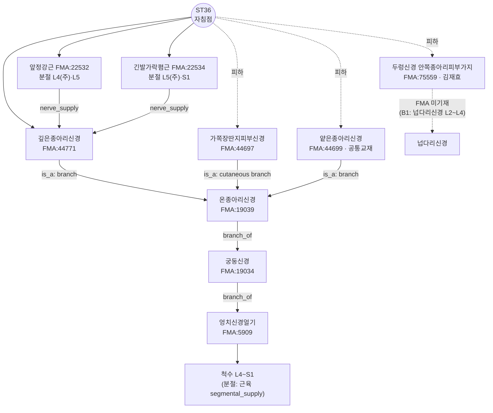

# [Acupoint Anatomical & Physiological Monograph] Zusanli (足三里, ST36)(足三里, ST36)

> **Framework**: v2.7 (2026-10-04 개정) · **ARI**: ARI v3.0 | ARI-Core 77.5 ± 0 (B) | SI 75 | 잠정 가중치 0.40/0.35/0.25 | 민감도(등가중치): 77.1 (B, 등급 불변) · **이중 채점**: Independent dual-adjudication completed

> **Three Primary Classics**: *Zhongguo Zhenjiu Xuewei Tongjian* (《中國針灸穴位通鑑》) · *Zhongguo Zhenjiu Zhengzhi Tongjian* (《中國針灸證治通鑑》) · *Zhenjiu Shuxue Tongkao* (《針灸腧穴通考》)
> **Layer A Empirical Database**: `02_Master_Datasets/경혈_생의학_신경반사_마스터DB.json` (ST36 근거 묶음: 랜드마크 38편, 로컬 매핑 109편, 외부 39편 — 기전 판정에는 아래 8절 ① 표의 15편만 사용)
> **Layer B Reference Registry**: `01_Framework/layer_b_reference_registry.md` (B-Check 6항목, 부합 기준 ≥ 8/12)
> **Metrological Standard**: Han Dynasty standard: 1 fen (分) = 2.3 mm ($z = \text{푼} \times 2.3\text{mm}$)
> **Anatomical Ontology**: FMA(Foundational Model of Anatomy) 5.1.0 로컬 색인 — 교재 구조를 `FMA:ID`로 고정하고 지배신경·척수 분절·신경 줄기를 대조(B1 보조, 등록부 미등재). 대응표 `02_Master_Datasets/FMA/acupoint_fma_mapping.json`, 상세는 부록 A

---

## 1. Classical Literature Screening Table (Three Primary Classics Excerpts)

| Classic Book | Original Excerpt (File & Line) | English Summary & TCM Analysis | Remarks |
| :--- | :--- | :--- | :--- |
| *Zhenjiu Shuxue Tongkao* (《針灸腧穴通考》) | "入于下陵，下陵者，膝下三寸，胻外三里也，为合。"(《黄帝内经太素·本输》) / "所谓三里者，下膝三寸也。所谓跗之者，举膝分易见也。"(《素问·针解》) / "取之三里者，低跗。"(《灵枢·邪气藏府病形》) — `针灸腧穴通考(上)_321-400.md` L3124~3130 | 무릎 아래 3촌, 정강이 바깥. 발등을 젖혀(低跗) 취혈 | 《内经》에 혈명·명칭 해석·부위·취혈법이 모두 갖춰진 드문 혈위(L3096) |
| *Zhenjiu Shuxue Tongkao* (《針灸腧穴通考》) | "入于三里，三里者，土也。在膝下三寸，胻外廉，足阳明脉气所入也，为合。"(*Huangdi Mingtang Jing* (《黃帝明堂經》)) / "刺入一寸，留七呼，灸三壮。"(*Huangdi Mingtang Jing* (《黃帝明堂經》)) — 같은 파일 L3136, L3478 | 정강이 바깥 모서리, He-Sea (Earth) Point (合土穴). 자입 1촌 | 심도 최초 기술 |
| *Zhenjiu Shuxue Tongkao* (《針灸腧穴通考》) | "本穴的纵向定位，古代文献明确作'膝下三寸'……至于本穴的横向定位，*Lingshu* (《靈樞》)*Huangdi Mingtang Jing* (《黃帝明堂經》)均未明确说明。" — 같은 파일 L3244~3248 | 종향은 명확, 횡향은 한대 문헌에 불명 | 횡향 3계통 분기(7절) |
| *Zhongguo Zhenjiu Xuewei Tongjian* (《中國針灸穴位通鑑》) | "足三里二穴，土也，在膝下三寸外廉两筋间，当举足取之。"(《圣济总录》) / 별명 "三里"·"下陵"·"一名鬼邪"·"下陵、鬼邪、下三里" — `中国针灸穴位通鉴(上卷)_801-880.md` L3410~3428 | 혈명 출처를 《圣济总录》로 표기, 별명 4계열 집록 | '足三里' 명칭은 송대 |
| *Zhongguo Zhenjiu Xuewei Tongjian* (《中國針灸穴位通鑑》) | "刺入一寸五分，留七呼，灸三壮。"(*Zhen Jiu Jia Yi Jing* (《針灸甲乙經》)) / "三里刺入四分，令人气上。"(*Qianjin Yifang* (《千金翼方》)) / "针入八分，留十呼"(*Taiping Shenghui Fang* (《太平聖惠方》)) — 같은 파일 L3676~3692 | 문헌별 심도 이문 | 5절 계산표에 반영 |
| *Zhongguo Zhenjiu Zhengzhi Tongjian* (《中國針灸證治通鑑》) | 《明堂经》 足三里 주치 "腹中寒，胀满，善噫，恶闻食臭，胃气不足，肠鸣腹痛，泄利，食不化，心下胀" — `中国针灸证治通鉴_1-80.md` L2162~2166 | 위장 증후 중심 단독 주치 | $P_{single}$ 근거(9절) |
| *Zhongguo Zhenjiu Zhengzhi Tongjian* (《中國針灸證治通鑑》) | "喉痹，胸中暴逆，先取冲脉，后取三里、云门，皆泻之。" — `中国针灸证治通鉴_1-80.md` L1242 | 冲脉(气冲)·云门과의 배오 | $P_{comb}$ 근거(9절). 구판은 이 구절을 취혈 기술 칸에 잘못 넣음 |

---

## 2. Primary Source vs. Secondary Quotation Historical Stratification Table

| Era / Stratum | Classical Source | Textual Description | Primary / Secondary |
| :--- | :--- | :--- | :--- |
| 선진·한대 | 《灵枢·本输》, 《灵枢·邪气藏府病形》, 《素问·针解》 | 下陵 膝下三寸 胻外三里 / 低跗 / 下膝三寸·举膝 | 원천(위치·취혈법) |
| 한대 | *Huangdi Mingtang Jing* (《黃帝明堂經》) | 膝下三寸, 胻外廉, 合土; 刺入一寸, 留七呼, 灸三壮; 주치 목록 | 원천(심도·주치) |
| 위진 | *Zhen Jiu Jia Yi Jing* (《針灸甲乙經》) | 在膝下三寸外廉; 刺入一寸五分(通鉴 L3676) | 《明堂》 재인용, 심도 이문 |
| 당 | *Qianjin Yaofang* (《千金要方》)·*Qianjin Yifang* (《千金翼方》) | 一夫법 취혈, "一名鬼邪", 刺入四分, "灸头不灸三里" | 일부 독자 기술(灸方 취혈) |
| 당 | 王冰 *Suwen* (《素問》) 주 | 犊鼻下三寸, 胻外两筋肉分间, 세게 누르면 跗上动脉이 멎음 | 재해석(외측 편위, 犊鼻 기준 치환) |
| 당 | *Waitai Miyao* (《外臺秘要》) | "若不灸三里" — '灸头' 2자 탈락 | 전사 오류(通考 교감) |
| 송 | *Taiping Shenghui Fang* (《太平聖惠方》) | '足三里' 명칭 시작; 胻骨外·大筋内·筋骨之间(내측 편위); 针入八分 | 명칭 분리·횡향 이설 |
| 송 | *Tongren* (《銅人》)·*Zhenjiu Zisheng Jing* (《針灸資生經》) | 胻骨外大筋内 / "犊鼻下三寸≠膝下三寸" 비판 | 재인용·교감 논쟁 |
| 명·청 | *Zhenjiu Dacheng* (《針灸大成》)·《类经图翼》·*Yizong Jinjian* (《醫宗金鑑》) | 骨外廉大筋内宛宛中; "小儿忌灸" 설 | 재인용·와전(通考 L3148~3168) |
| 현대 | 교재·국표 2006 | 犊鼻下3寸, 犊鼻-解溪 연결선, 胫骨前肌中; 直刺1~2寸 | 현대 정위 |

---

## 3. Nomenclature & Alias Collation Table (KJH DB Verification)

| Alias (別名) | Classical Source | KJH Database | Textual Adjudication |
| :--- | :--- | :--- | :--- |
| 三里 | 《素问·针解》 이하 宋 이전 문헌(通鉴 L3414) | — | 手阳明 '三里'(手三里)와 동명 → *Taiping Shenghui Fang* (《太平聖惠方》)에서 '足三里'로 분리. 연대순 해소 |
| 下陵 | 《灵枢·本输》(通鉴 L3420) | — | 通考 名实考: 별명이 아니라 '下陵三里' 전칭의 약칭(通考 L3112). 별명 취급 보류 |
| 鬼邪 | *Qianjin Yaofang* (《千金要方》) 卷十四 "邪病大唤骂走远，三里主之，一名鬼邪" | 등재 | 手三里와의 귀속 문제는 通考가 주치로 足三里 판정 |
| 下三里 | 1957 南京《针灸学》(일본 교재 인용) | 등재 | 일본에서 三阴交를 '下三里'로 부르는 용례 존재(通考 L3144~3146) → 혼용 주의 |

KJH DB(`경혈명_비교_정리_KJH.xlsx` 행 122: 119, ST36, Zusanli (足三里, ST36), 足三里, "下三里, 鬼邪")와 두 교재 데이터셋의 이명 열이 일치한다.

---

## 4. 3D Spatial Coordinates & Layer 1~5 Anatomical Substrate Diagram

- **X (내외측)**: 정강뼈 앞모서리(胫骨前嵴)에서 외측 1횡지(중지). 고전 횡향 이설 범위는 7절.
- **Y (근위→원위)**: 犊鼻 아래 3촌(犊鼻~解溪 16촌 골도, 체형 의존). 한대 '膝下三寸'은 髌尖 아래 3촌이며 현대 犊鼻 높이와 거의 같다(通考 L3114~3116).
- **Z (깊이)**: 아래 층차. **ST36 사체·초음파 실측값이 Layer A에 없으므로 mm 경계는 제시하지 않고 구조 순서만 기재**한다(구판의 2.5/6.5/16.5/22mm 경계는 범용 템플릿 값이라 삭제).

```
[Layer 1 피부·피하]  가쪽장딴지피부신경 / 얕은종아리신경(공통교재) 또는 두렁신경 안쪽종아리피부가지(김재효)
        │
[Layer 2~3 근육]     앞정강근 근복, 외측에 긴발가락폄근 — 고전 심도 1촌(23mm) 내외 도달층(추정)
        │
[Layer 4 신경혈관속] 종아리뼈사이막 위 깊은종아리신경 + 앞정강동·정맥 — 현대 상한 2촌(46mm) 직자 시 도달 가능(추정)
        │
[Layer 5 바닥]       종아리뼈사이막·정강뼈 골막 (심부 장기 없음)
```

_횡단면_해부모식도.png)

*그림 4-1. Zusanli (足三里, ST36) 높이 하퇴 상1/3 횡단면 모식도(오른다리, 위에서 내려다봄, 축척 아님). 직자 경로는 앞정강근 근복을 지나 종아리뼈사이막 앞 신경혈관속에 이른다. 정강뼈 쪽으로 약간 기울이면(通考 L3506) 신경혈관속을 피한다. 층 두께·거리는 ST36 실측값이 없어 임의로 배치했다.*

**FMA 실체 대조(Layer별)** — 구조명은 2대 교재, ID·관계는 FMA 5.1.0

| Layer | 구조 | FMA | FMA 구획·관계 | 지배신경 / 줄기 (FMA) | 척수 분절 (FMA) |
| :--- | :--- | :--- | :--- | :--- | :--- |
| 1 피하 | 가쪽장딴지피부신경 | FMA:44697 | is_a Cutaneous branch of common fibular nerve | 온종아리신경 → 궁둥신경 → 엉치신경얼기 | FMA 미기재 |
| 1 피하 | 얕은종아리신경 *(공통교재)* | FMA:44699 | is_a Branch of common fibular nerve | 온종아리신경 → 궁둥신경 → 엉치신경얼기 | FMA 미기재 |
| 1 피하 | 두렁신경 안쪽종아리피부가지 *(김재효)* | FMA:75559 | Set of medial crural cutaneous branches of saphenous nerve | 두렁신경 → 넙다리신경 연결은 **FMA 미기재**(B1-01로 보완) | FMA 미기재 |
| 2~3 근육 | 앞정강근 | FMA:22532 | contained_in Space of anterior compartment of leg (FMA:85203) | Nerve to tibialis anterior (FMA:80062) ← 깊은종아리신경 | **L4(주)**·L5 |
| 2~3 근육 | 긴발가락폄근 | FMA:22534 | contained_in 앞칸 공간(FMA:85203) | Nerve to extensor digitorum longus (FMA:80068) ← 깊은종아리신경 | **L5(주)**·S1 |
| 4 신경혈관속 | 깊은종아리신경 | FMA:44771 | is_a Branch of common fibular nerve | 온종아리신경 → 궁둥신경 → 엉치신경얼기 | FMA 미기재 |
| 4 신경혈관속 | 앞정강동맥 | FMA:43894 | branch_of External iliac artery(FMA 모델링: 오금동맥을 바깥엉덩동맥의 연속 구간으로 둠) | — | — |
| 4 신경혈관속 | 앞정강정맥 | FMA:44331 | tributary_of Popliteal vein | 오금정맥 → 넙다리정맥 → 바깥엉덩정맥 | — |
| 5 바닥 | 종아리뼈사이막 · 정강뼈 | FMA:35187 · FMA:24476 | — | — | — |

- FMA는 앞정강근·긴발가락폄근의 근육가지를 깊은종아리신경의 *안쪽종말가지(FMA:44777, 발목 아래 구간)* 가지로 기록한다. 규범 해부(B1-01)에서 이 근육가지는 하퇴에서 깊은종아리신경 줄기에서 나오므로, 본 보고서는 **깊은종아리신경 수준까지만** FMA를 인용한다.
- FMA 분절은 근육의 `segmental_supply`에만 있고 신경 자체에는 없다. 신경의 분절(온종아리신경 L4~S2 등)은 B1-01·B1-02로 기술한다.

**초음파 참고 영상 — 앞정강근 횡단면 (공개 데이터)**

_앞정강근_초음파_참고영상.png)

*그림 4-2. 앞정강근(FMA:22532) 횡단 B-mode 초음파. (A) 원 영상, (B) 연구진의 수동 분할 경계, (C)(D) 건강군 3,092장(피험자 1,021명)의 단면적·근육 내 평균 회색조 분포. 자료: Marzola F, van Alfen N, Doorduin J, Meiburger KM. Comput Biol Med 2021;135:104623, 데이터 doi:10.17632/3jykz7wz8d.1 (CC BY 4.0). Esaote MyLab Twice, 3–13 MHz 선형 탐촉자, 고정 프리셋.*

| 항목 | 건강군 값 (중앙값 [사분위]) | 해석 |
| :--- | :--- | :--- |
| 앞정강근 단면적 | 52,590 px² [41,397–63,967] | 데이터셋에 mm/px 보정값이 없어 **px²로만** 쓴다. 개인 간 차이가 1.5배 이상이다 |
| 근육 내 평균 회색조(0~255) | 78.0 [67.8–87.0] | 근육 에코 강도의 일반 범위. 신경근 질환에서 높아지는 지표로 쓰인다(원 논문) |
| 근육 내부/주변 고리 에코비 | 0.913 | 근육이 둘레 근막·뼈 경계보다 약간 어둡다 |

- **보이는 것**: 그림 4-1 모식도의 Layer 2~3(앞정강근 근복)이 실제 영상에서 정강뼈 가쪽면(왼쪽 고에코 곡선과 그 뒤 음향 음영) 바로 바깥에 놓인다는 배치를 확인할 수 있다. 일부 영상에서는 근육 가운데 건막(central aponeurosis)이 밝은 선으로 보인다.
- **보이지 않는 것·한계**: 촬영 높이는 데이터셋에 기록되어 있지 않아 ST36(犊鼻下3寸) 높이와 같다고 보지 않는다. 피험자는 신경근 질환 진단 목적의 환자·대조군이며 자침 연구 대상이 아니다. 따라서 이 영상은 **"앞정강근의 일반 초음파 형태 참고"**이며, 경혈 특이 실측(B2)이나 Layer A 근거가 아니고 Layer mm 경계·SI 판단에 쓰지 않는다(스킬 5-2절).
- **재현**: `python .claude/skills/acupoint-anatomy/scripts/us/us_fetch.py get marzola_msk` → `extract marzola_msk "DeepLearningUS/TA/"` → `python .claude/skills/acupoint-anatomy/scripts/us/figures/ST36_ultrasound_TA.py <출력.png> --json <통계.json>` (통계 원본: `ST36_앞정강근_초음파_통계.json`).
- ST36 높이에서 깊이를 직접 잰 근거는 5절의 papers.id 1896(TI 1.09)이다.

---

## 5. Classical Needling Depth Calculation Table (Han Dynasty 1 fen = 2.3 mm)

출처: `침구문헌별 자침깊이 정리_AI 분석용.xlsx` 시트1 행 121(N0=119), 보조로 3대 원전.

| 문헌 | 푼(分) | 환산 심도 (×2.3mm) | 도달 Layer(추정) | 비고 |
| :--- | :---: | :---: | :--- | :--- |
| 황제명당경(황룡상 감수) | 10 | 23.0mm | 2~3 | "刺入一寸" |
| 침구갑을경 | 10 | 23.0mm | 2~3 | DB값. 단 《穴位通鉴》은 《甲乙经》을 "刺入一寸五分"(15푼=34.5mm)으로 인용 — 이문 |
| 침구경험방 | 8 | 18.4mm | 2~3 | |
| 동의보감(인용: 동인) | 10 | 23.0mm | 2~3 | |
| 경락수혈학 공통교재 | 10~20 | 23.0~46.0mm | 2~4 | |
| 침구의학 공통교재 | 10~20 | 23.0~46.0mm | 2~4 | |
| *Zhenjiu Shuxue Tongkao* (《針灸腧穴通考》) | 10~20 | 23.0~46.0mm | 2~4 | "直刺 1~2 寸" |
| *Qianjin Yifang* (《千金翼方》)(원전 보조) | 4 | 9.2mm | 1~2 | "刺入四分，令人气上" |
| *Taiping Shenghui Fang* (《太平聖惠方》)(원전 보조) | 8 | 18.4mm | 2~3 | |
| 《窦太师针经》(원전 보조) | 25 | 57.5mm | 4~5 | "针入二寸半" — 최대치 |

- Contraindicated for Needling (禁鍼)('0') 기록 없음, 'blank' 없음(DB 해당 열 기준).
- 안전 범위: 23mm 내외는 앞정강근 근복에 머문다. 46mm 이상 직자는 깊은종아리신경·앞정강동정맥에 닿을 수 있으므로 상해《针灸学》의 "直刺，稍偏向胫骨方向"(通考 L3506)처럼 각도로 회피한다.
- **초음파 실측(2026-10-23 추가)**: papers.id 1896(Choi DH et al. *Integr Med Res* 2026;15:101305, PMID 42500462)은 39명에서 초음파 유도로 유효 깊이(ED₅₀)와 위험 깊이(HD₅₀)를 재어, 그 비인 치료 지수(TI)가 **ST36 1.09**(GB21 1.54)로 "좁고 위험이 생길 수 있는 여유"라고 보고했다. 유효 자극 깊이와 신경혈관속 깊이가 가깝다는 위 판단과 같은 방향이다. 저자가 탐색적 결과라고 밝혔으므로 SI 75는 유지하되, 깊은 직자일수록 개인별 깊이 확인이 필요하다는 근거로 병기한다. (이 논문은 마스터 DB에 active로 있으나 ST36 역색인에는 연결되어 있지 않다.)

---

## 6. Textbook Comparison Table & FMA Ontology Mapping (Common Textbook vs. Prof. Kim Jaehyo)

| 구분 | 경혈학 공통교재 (refine.xlsx 상세 시트 행 650~655, 경혈학 상 p.331) | 김재효 교재 (상세 시트 행 954~959) | FMA 판별 | 평가 |
| :--- | :--- | :--- | :--- | :--- |
| 근육 | 앞정강근, 긴발가락폄근 | 앞정강근, 긴발가락폄근 | FMA:22532, FMA:22534 (양 교재 같은 ID) | 일치 |
| 피부신경 | 가쪽장딴지피부신경, 얕은종아리신경 | 가쪽장딴지피부신경, 두렁신경의 안쪽종아리피부가지 | 공통 FMA:44697 / 공통교재 단독 FMA:44699 / 김재효 단독 FMA:75559 | **차이**: 피부 감각 분지 1항목 |
| 심부신경 | 깊은종아리신경 | 깊은종아리신경 (deep fibular / deep peroneal 병기) | FMA:44771 — 두 영문 표기가 같은 실체(동의어) | 일치 |
| 혈관 | 앞정강동·정맥 | 앞정강동·정맥 | FMA:43894, FMA:44331 | 일치 |

B1-01·B1-03(정강이 앞칸 해부)과 부합한다. 혈위 특이 영상·사체 실측(PMID)은 없다.

**FMA로 본 피부신경 차이의 의미**: 공통교재 단독 항목(얕은종아리신경)은 FMA상 가쪽장딴지피부신경과 같은 **온종아리신경 줄기(→ 궁둥신경·엉치신경얼기)** 에 속한다. 반면 김재효 단독 항목(두렁신경 안쪽종아리피부가지)은 **두렁신경(넙다리신경 계통)** 이라 줄기가 다르다. 따라서 두 교재 차이는 "같은 신경의 가지를 더 적었는가"가 아니라 **피부 감각 분포를 외측(L5 피부분절 쪽)과 내측(L4 피부분절 쪽) 중 어디까지 포함했는가**의 차이다. ST36이 정강뼈 앞모서리 외측 1횡지라는 점에서 두 분포의 경계 부근에 놓인다는 해석이 가능하나, 피부분절 경계는 FMA가 아니라 B1-03에 근거한 것이며 혈위 특이 실측은 없다. 이 차이는 상충이 아니므로 $S_{clarity}$ 단계는 바꾸지 않는다.

---

## 7. Spatial Discrepancy Dual-Target Analysis (Discrepancy Δ > 15 mm)

| 계통 | 근거 | 횡향 위치 |
| :--- | :--- | :--- |
| ① 외측 편위 | 王冰 주 "胻外两筋肉分间"(通考 L3198) | 앞정강근-긴발가락폄근 사이 |
| ② 내측 편위 | *Taiping Shenghui Fang* (《太平聖惠方》) "胻骨外，大筋内，筋骨之间"(通考 L3190) | 정강뼈와 앞정강근 사이 |
| ③ 현대 | 犊鼻-解溪 연결선, 胫骨前肌中(通考 L3248) | 앞정강근 근복 |

종향은 '膝下三寸'으로 고금이 같고, 횡향 차이는 앞정강근 폭 안팎으로 15mm 미만으로 판단한다(추정, 실측 아님). 따라서 **$\Delta_{discrepancy} \le 15\text{mm}$, Target 분기 불요 — 단일 Target(T1)**.

---

## 8. Biomedical Reflex Pathway Diagram & External Search Log

**기전 요약(동물 근거)**: ST36 심부 근막의 PROKR2 감각섬유 → 척수 → 연수(DMV/미주) → 미주-부신 축 → 항염증(마우스, B3-15·B3-16·B3-17). 저강도에서만 이 경로가 우세하고 고강도는 비특이 교감 경로를 동원한다(B3-16). 위장 효과는 분절이 아닌 상척수 경로로 설명된다(체성-자율 반사 틀: B3-04, B3-05). **인체 전환은 미입증.**

**말초 구심 경로의 FMA 고정**: 반사 기전도의 첫 구간(자침점 → 척수)은 FMA 관계로 아래와 같이 고정된다. B3-17이 보고한 "ST36 심부 근막 감각섬유가 궁둥신경 경로로 들어간다"는 소견은 이 해부 사슬과 일치한다(일치는 구조 수준이며, PROKR2 섬유 자체는 FMA 대상이 아니다).



*그림 8-1. FMA 5.1.0 관계로 그린 ST36 말초 구심 경로. 실선은 FMA에 기재된 관계(`nerve_supply`·`branch_of`), "is_a"는 클래스명에서 이은 줄기, 점선은 FMA에 없는 연결(B1 보완)이다.*

### ① Layer A 논문 표 (ST36 자체 연구 우선)

| papers.id | 연도 | 저널 | 제목 | PMID / DOI | 설계 |
| :---: | :---: | :--- | :--- | :--- | :--- |
| 317 | 2021 | Nature | A neuroanatomical basis for electroacupuncture to drive the vagal-adrenal axis | 34646018 / 10.1038/s41586-021-04001-4 | 동물(마우스) |
| 294 | 2020 | Neuron | Somatotopic organization and intensity dependence in driving distinct NPY-expressing sympathetic pathways by electroacupuncture | 32791039 / 10.1016/j.neuron.2020.07.015 | 동물(마우스) |
| 295 | 2014 | Nature Medicine | Dopamine mediates the vagal modulation of the immune system by electroacupuncture | 24562381(B3-15 등록부) / 10.1038/nm.3479 | 동물(마우스) |
| 189 | 2010 | Nature Neuroscience | Adenosine A1 receptors mediate local anti-nociceptive effects of acupuncture | 20512135(B3-18 등록부) / 10.1038/nn.2562 | 동물(마우스) |
| 34 | 2003 | Am J Physiol | Dual effects of acupuncture on gastric motility in conscious rats | — / 10.1152/ajpregu.00715.2002 | 동물(쥐), 이중 효과 |
| 1840 | 2024 | Adv Sci | Electroacupuncture promotes liver regeneration by activating DMV acetylcholinergic neurons-vagus-macrophage axis | 38923873 / 10.1002/advs.202402856 | 동물(마우스) |
| 1841 | 2024 | Microb Biotechnol | Electroacupuncture at ST36 modulates the intestinal microecology ... severe acute pancreatitis | 38381095 / (DB의 DOI 10.1111/1751-7915.14401는 저널과 불일치 의심) | 동물(쥐) |
| 1844 | 2021 | Life Sci | Electroacupuncture regulates inflammatory cytokines by activating the vagus nerve ... breast tumors | 33636172 / 10.1016/j.lfs.2021.119259 | 동물(마우스) |
| 1851 | 2026 | Zhen Ci Yan Jiu | Electroacupuncture in ameliorating mild duodenal inflammation in rats with functional dyspepsia | 42779395 / 10.13702/j.1000-0607.20260535 | 동물(쥐) |
| 1861 | 2026 | Zhen Ci Yan Jiu | Electroacupuncture at "Zusanli" (ST36) on colonic mucosal injury ... | 42621716 / 10.13702/j.1000-0607.20250960 | 동물(마우스) |
| 1866 | 2026 | J Pharmacopuncture | Acupuncture at ST36 and SP6 ... osteoarthritis rat model | 42812780 / 10.3831/kpi.2026.29.3.286 | 동물(쥐), 다혈위 |
| 1869 | 2008 | J Acupunct Tuina Sci | Peripheral nerve discharge elicited by manual acupuncture at Zusanli (ST 36) regulates blood pressure in anesthetized rats | — / 10.1007/s11726-008-0281-z | 동물(마취 쥐) |
| 237 | 2005 | NeuroImage | The integrated response of the human cerebro-cerebellar and limbic systems to acupuncture stimulation at ST 36 as evidenced by fMRI | — / 10.1016/j.neuroimage.2005.04.037 | 인체(비RCT, fMRI) |
| 35 | 2003 | Eur J Appl Physiol | Effects of acupuncture on skin and muscle blood flow in healthy subjects | — / 10.1007/s00421-003-0825-3 | 인체(비RCT) |
| 1843 | 2021 | J Integr Med | Perioperative transcutaneous electrical acupoint stimulation for improving postoperative gastrointestinal function: an RCT | 33495134 / 10.1016/j.joim.2021.01.005 | 인체 RCT(다혈위 TEAS, ST36 단독 아님) |

- 제외: 구판 목록의 papers.id 5·12·19·27·38·46·54·59(혈위 미확인 또는 ST36 기전 무관, 27은 가설 논문). papers.id 1700은 서지 검증 불가(superseded)로 인용하지 않는다.
- papers.id 1850은 근거 묶음에 '인체(비RCT)'로 분류되어 있으나 실제로는 마우스 건선 모델이며, 본 판정에 쓰지 않았다.

### ② B-Check 채점표

| 항목 | 내용 | 채점자 A | 채점자 B | 최종 | 참조 ID | papers.id | 근거 요지 |
| :---: | :--- | :---: | :---: | :---: | :--- | :--- | :--- |
| ① | 자침 심도의 말초신경·혈관 실체 | 2 | 2 | **2** | B1-01, B1-03, B2-09, B3-17 (+FMA) | 317 | 2대 교재·규범 해부서가 앞정강근 심층 깊은종아리신경·앞정강동정맥 일치. 교재 구조 8종 모두 FMA 정확 대응(FMA:22532·22534·44771·43894·44331·44697·44699·75559). B3-17이 ST36 심부 근막 감각섬유 검증(마우스). 인체 영상 실측 없음 |
| ② | 척수 분절 정합 | 1 | 1 | **1** | B1-02, B3-05, B3-16 (+FMA) | 294 | ST36 L4~S1(FMA segmental_supply: 앞정강근 L4·L5, 긴발가락폄근 L5·S1) vs 위 T6~T9: 분절 불일치. 위장 효과는 상척수 미주 경로(B3-05, B3-16)로 설명 → 간접 1점 |
| ③ | 구심 섬유형·수용체 | 2 | 2 | **2** | B3-06, B3-15, B3-17, B3-18 | 189, 295, 317 | PROKR2 심부 근막 섬유·좌골신경 경로·국소 아데노신 A1을 ST36에서 직접 검증. 마우스 한정 |
| ④ | 중추 중계·경로 | 2 | 2 | **2** | B3-12, B3-15, B3-16, B3-17 | 294, 295, 317, 1840 | DMV/미주-부신 축(마우스), rVLM 심혈관 경로(마취 고양이·쥐, ST36 포함). 동물 한정 |
| ⑤ | 원심 경로·표적 효과($P_{single}$ 일치) | 2 | 1 | **1** | B3-05, B3-15, B3-16 | 34, 1841, 1851, 1861 | 위운동(34, 조건 의존 이중 효과)·장 점막 효과는 고전 위장 주치와 방향이 맞으나, 핵심 검증 효과가 패혈증 항염증이라 고전 주치와 직접 대응이 약함 → 1 |
| ⑥ | 인체 전환 근거 | 1 | 1 | **1** | B4-01, B4-03, B4-04, B4-05 | 35, 237, 1843 | ST36 인체 fMRI·근혈류·다혈위 TEAS RCT는 있으나 미주-부신 반사궁의 인체 확인 없음. 혈위 특이성 반증(B4-04, B4-05) 미해결 |
| **합계** | | 10 | 9 | **9 / 12** | | | **판정: 부합(≥ 8/12)** · 표지: ③~⑤ 동물(마우스·쥐) 한정 |

### ③ 외부 검색 로그 (sync_log, 2026-10-04 Rank 6 실행)

| 일시 | 소스 | HTTP | 수집 | 중복제거 | 신규 | 쿼리 |
|---|---|---|---|---|---|---|
| 2026-10-04T09:51:40 | pubmed | 200 | 16 | — | — | ("ST36" OR "Zusanli" OR "足三里") AND (acupuncture OR electroacupuncture) AND (nerve OR reflex OR autonomic OR mechanism OR anatomy) |
| 2026-10-04T09:51:40 | openalex | 200 | 24 | — | — | doi_starts_with:10.13703,title_and_abstract.search:"Zusanli" OR "ST36" / doi_starts_with:10.13702,title_and_abstract.search:"Zusanli" OR "ST36" / has_doi:true,t… |
| 2026-10-04T09:51:40 | crossref | 200 | 5 | — | — | Zusanli acupuncture nerve reflex |
| 2026-10-04T09:51:40 | all | — | 45 | 10 | 35 | |
| 2026-10-23T21:45:27 | pubmed | 200 | 16 | — | — | 위와 같은 쿼리 (재실행) |
| 2026-10-23T21:45:27 | openalex | 200 | 24 | — | — | 위와 같은 쿼리 (재실행) |
| 2026-10-23T21:45:27 | crossref | 200 | 5 | — | — | 위와 같은 쿼리 (재실행) |
| 2026-10-23T21:45:27 | all | — | 45 | 27 | 18 | 기존 병합 24, 배치 내 중복 3. 신규 18편은 B-Check·ARI 판정을 바꾸지 않음 |

---

## 9. Classical Indications Stratification Table (Single-Point P_single vs. Complex Formulae)

| 구분 | 주치 | 원문 근거 |
| :--- | :--- | :--- |
| $P_{single}$ (단독) | Epigastric / Stomach pain (胃痛)·Abdominal distension (腹脹)·식불하 | "胃病者，腹䐜胀，胃脘当心而痛……食饮不下，取之三里也"(《灵枢·邪气藏府病形》, 通考 L3310) |
| $P_{single}$ | 장명·복통·한중/열중(허실한열 불문) | "邪在脾胃……寒中肠鸣腹痛……皆调于三里"(《灵枢·五邪》, 通考 L3318) |
| $P_{single}$ | 장 불통 | "肠中不便，取三里，盛泻之，虚补之"(《灵枢·四时气》, 通考 L3312) |
| $P_{single}$ | 위기 부족·식불화·설리 | *Huangdi Mingtang Jing* (《黃帝明堂經》) "腹中寒，胀满，善噫，恶闻食臭，胃气不足，肠鸣腹痛，泄利，食不化"(证治通鉴 L2166) |
| $P_{single}$ | 광증(족양명 是动病) | "邪病大唤骂走远，三里主之"(*Qianjin Yaofang* (《千金要方》)), 《明堂》 "狂歌妄言……骂詈" |
| $P_{single}$ | 하지 비증 | "着痹不去，久寒不已，卒取其三里"(《灵枢·四时气》) |
| $P_{comb}$ (배오) | 후비·흉중폭역 | 冲脉(气冲)+三里+云门 "皆泻之"(证治通鉴 L1242) — '下气' 작용은 주로 배혈용(通考 文献分析) |
| $P_{comb}$ | 대장 사기 | 肓之原+巨虚上廉+三里(《灵枢·四时气》) |
| $P_{comb}$ | 비위허약 | 三里+三阴交(《针经摘英集》) |
| $P_{comb}$ | 중풍 예방 | 百会·耳前发际·肩井·风市·三里·绝骨·曲池 7혈 灸(*Taiping Shenghui Fang* (《太平聖惠方》)) |
| $P_{comb}$ | 현대 처방(중풍 Hemiplegia (半身不遂) 등) | 다혈위 처방 다수(`中国针灸证治通鉴_161-240.md` L212~298) |

---

## 10. ARI v3.0 Quantitative Profile Evaluation & Final Conclusion

**Target T1 (단일)**: 고전 "膝下三寸，胻外廉" = 현대 犊鼻下3寸·胫骨前嵴 외측 1횡지(앞정강근 중).

### 하위 점수

| 지표 | 채점자 A | 채점자 B | 평균 | 루브릭 단계 근거 요지 | 근거 포인터 |
| :--- | :---: | :---: | :---: | :--- | :--- |
| $S_{orig}$ (0.40) | 81.25 | 81.25 | 81.25 | 아래 하위 4항목 평균 | 通考 `(上)_321-400.md` L3096~3248, L3478~3506 |
| $S_{clarity}$ (0.35) | 75 | 75 | 75 | 2대 교재 일치(피부신경 1항목 차이, FMA상 줄기 차이로 판별) + B1·FMA 표준 실체 확인, 혈위 특이 실측 없음 → 100 미달 | 6절, B1-01·B1-03, FMA:22532·44771 |
| $S_{reflex}$ (0.25) | 75 | 75 | 75 | ST36 동물 연구 다수 + 인체 비RCT·다혈위 RCT, B-Check 9(⑥=1)로 100 미달 | 8절 ①②, papers.id 317·294·295·237·1843 |
| SI ($S_{safety}$) | 75 | 75 | 75 | Contraindicated for Needling (禁鍼) 없음. 23mm는 Layer 2~3, 상한 46mm 직자 시 Layer 4 가능하나 각도로 회피 가능, 심도 상한 문헌 명시 | 5절, 자침깊이 DB 행 121 |

### $S_{orig}$ 하위 4항목

| 하위 항목 | A | B | 최종 | 근거 |
| :--- | :---: | :---: | :---: | :--- |
| ① 최초 기술 명확성 | 75 | 75 | 75 | *Lingshu* (《靈樞》)·*Suwen* (《素問》)·《明堂》에 위치·심도 있으나 횡향 미기재 |
| ② 후대 일치율 | 75 | 75 | 75 | '膝下三寸' 일치, 횡향 3계통·심도 4~25푼 분기 |
| ③ 이명 혼용 해소 | 75 | 75 | 75 | 三里(手三里)·鬼邪·下三里(三阴交) 혼용, 연대순 해소 |
| ④ 《通考》 교감 | 100 | 100 | 100 | 《外台》 '灸头' 탈락을 《千金翼》으로 교정, 犊鼻 정위 변천 해명 |

### 게이트·등급·민감도

- **게이트**: 게이트 1(S_orig·S_clarity ≥ 50) 미적용, 게이트 2(Layer A 15편) 미적용, 게이트 3(SI 75) 미적용.
- **ARI-Core** = 0.40×81.25 + 0.35×75 + 0.25×75 = **77.5 ± 0** → **등급 B(개연)**, 표지 없음.
- **SI** = 75 (별도 병기).
- **등가중치 민감도**: (81.25+75+75)/3 = 77.1 → B, 등급 불변.
- **분기 판정**: 단일 Target이므로 해당 없음.
- **조정 기록**: 15점 이상 불일치 항목 없음(needs_adjudication 없음). B-Check ⑤만 A 2·B 1로 갈려 최종 1. 혈위 특이성 반증(B4-04·B4-05), 강도 의존성(B3-16), 위운동 이중 효과(papers.id 34)는 직접 상충이 아닌 적용 범위 제한으로 보아 B-Check 판정은 '부합'으로 두고 결론에 병기한다.

### 최종 결론

Zusanli (足三里, ST36)(ST36)의 해부학적 실체는 **개연(B)** 수준이다. 위치는 한대 이래 '膝下三寸，胻外廉'으로 종향이 고정되어 있고, 그 아래 앞정강근 근복과 더 깊은 깊은종아리신경·앞정강동정맥이 2대 교재에서 일치하며, 교재 구조 8종은 모두 FMA 표준 실체로 확인된다(부록 A). 신경반사 기전은 ST36 심부 근막 감각섬유에서 미주-부신 축으로 이어지는 경로가 **마우스에서만** 직접 검증되었다(B3-15·B3-16·B3-17).

적용 범위 제한:
1. 미주-부신 항염증 경로는 마우스 근거뿐이며 인체에서 확인되지 않았다.
2. 이 경로는 저강도 자극에서만 우세하고, 고강도에서는 비특이 교감 경로가 동원된다(B3-16).
3. 진침-가침 차이가 작다는 혈위 특이성 반증(B4-04, B4-05)이 해소되지 않았다.
4. 위운동 효과는 조건에 따라 촉진·억제가 갈리는 이중 효과다(papers.id 34).
5. 위(T6~T9)와 ST36(L4~S1)은 분절이 맞지 않아, 위장 주치는 분절 반사가 아닌 상척수 미주 경로 **가설**로 설명된다.

---

## 부록 A. FMA 해부 실체 프로파일 (FMA 5.1.0)

생성: `python .claude/skills/acupoint-anatomy/scripts/fma/fma_query.py profile ST36 --md` (2026-10-23). 대응 수준 `exact`는 교재 영문 용어가 FMA 라벨·동의어·라틴명과 정규화 후 정확히 일치한 것이다.

| Category | Textbook Term | FMA Substrate (ID & Label) | Match | Source | Innervation & Nerve Trunk Chain | Spinal Segment |
| :--- | :--- | :--- | :--- | :--- | :--- | :--- |
| 근육 | 긴발가락폄근 (extensor digitorum longus) | FMA:22534 Extensor digitorum longus | exact | 공통교재·김재효 | FMA:80068 Nerve to extensor digitorum longus → 깊은종아리신경 → 온종아리신경 | L5(주), S1(부) |
| 근육 | 앞정강근 (tibialis anterior) | FMA:22532 Tibialis anterior | exact | 공통교재·김재효 | FMA:80062 Nerve to tibialis anterior → 깊은종아리신경 → 온종아리신경 | L4(주), L5(부) |
| 신경 | 깊은종아리신경 (deep fibular / deep peroneal nerve) | FMA:44771 Deep fibular nerve | exact | 공통교재·김재효 | FMA:19039 Common fibular nerve → FMA:19034 Sciatic nerve → FMA:5909 Sacral nerve plexus | — |
| 신경 | 가쪽장딴지피부신경 (lateral sural cutaneous nerve) | FMA:44697 Lateral sural cutaneous nerve | exact | 공통교재·김재효 | FMA:19039 → FMA:19034 → FMA:5909 | — |
| 신경 | 두렁신경의 안쪽종아리피부가지 | FMA:75559 Set of medial crural cutaneous branches of saphenous nerve | exact | 김재효 | (FMA에 두렁신경 상위 연결 없음) | — |
| 신경 | 얕은종아리신경 (superficial peroneal nerve) | FMA:44699 Superficial fibular nerve | exact | 공통교재 | FMA:19039 → FMA:19034 → FMA:5909 | — |
| 혈관 | 앞정강동맥 | FMA:43894 Anterior tibial artery | exact | 공통교재·김재효 | FMA:18805 External iliac artery → FMA:14764 Common iliac artery | — |
| 혈관 | 앞정강정맥 | FMA:44331 Anterior tibial vein | exact | 공통교재·김재효 | FMA:44327 Popliteal vein → … → FMA:10951 Inferior vena cava | — |

- 분절 합집합(B-Check ② 입력): **L4, L5, S1**
- 두 교재 비교: 공통 FMA 실체 6 · 공통교재 단독 1(FMA:44699) · 김재효 단독 1(FMA:75559)
- Neo4j 교차 확인(`fma_neo4j.py query shared_structure --param a=ST36 --param b=GB34`): ST36과 양릉천(GB34)은 깊은종아리신경·얕은종아리신경·긴발가락폄근을 직접 공유하고, 온종아리신경을 공통 줄기로 갖는다. 같은 신경 분포 영역의 혈위 비교 시 참고한다(줄기 일부는 FMA is_a 클래스명에서 이은 파생 관계).
- 인용 한계: FMA는 정상 성인 규범 해부 온톨로지로, 혈위 특이 심도·변이 빈도·반사 기능의 근거가 아니다. 앞 근육가지의 기원(안쪽종말가지 기록), 두렁신경-넙다리신경 연결 누락, 신경 분절 미기재는 4절 주석대로 B1로 보완했다.

---

## v2.7 FMA·초음파 보강 이력 (2026-10-23)

| 위치 | 원래 내용 | 바꾼 내용 | 근거 |
| :--- | :--- | :--- | :--- |
| 머리말 | — | FMA 5.1.0 해부 온톨로지 줄 추가 | `02_Master_Datasets/FMA/acupoint_fma_mapping.json` |
| 4절 | 문자 층차도만 | 그림 4-1 횡단면 모식도, Layer별 FMA 대조표, FMA 모델링 한계 주석 2건 | FMA:22532·22534·44771·43894·44331·44697·44699·75559·35187·24476, contained_in FMA:85203 |
| 6절 | 교재 비교 4열 | FMA 판별 열, 피부신경 차이의 줄기(온종아리신경 vs 두렁신경) 해석 | FMA is_a·branch_of 사슬, B1-03 |
| 8절 | 기전 요약 | 그림 8-1 FMA 말초 구심 경로(Mermaid) | FMA:44771→19039→19034→5909 |
| 8절 ② | B-Check ①·② 근거 | FMA ID·segmental_supply 포인터 추가(점수 불변: ①=2, ②=1) | FMA segmental_supply |
| 10절 | $S_{clarity}$ 근거 | FMA 표준 실체 확인 병기(점수 불변 75), 결론 1구 추가 | 6절·부록 A |
| 부록 A | — | FMA 프로파일 표, Neo4j ST36–GB34 공유 구조 | `fma_query.py profile ST36 --md`, `fma_neo4j.py` |
| ARI | ARI-Core 77.5 ± 0 (B), SI 75 | **변경 없음** — FMA·초음파는 B1 보조·참고 근거로 루브릭 단계를 바꾸지 않음 | 스킬 5-1·5-2절 |
| 구판 보관 | — | 보강 전 md·html·xlsx를 `_구판_v2.7_20261023/`에 보관 | — |
| 4절 그림 4-2 | — | 앞정강근 횡단 초음파 공개 데이터 참고 영상(Marzola 2021, CC BY 4.0, 건강군 3,092장) 및 통계 표, 한계 명시 | `scripts/us/figures/ST36_ultrasound_TA.py`, Mendeley 3jykz7wz8d |
| 5절 | 안전 범위 서술 | papers.id 1896 TI 1.09(GB21 1.54) 초음파 실측 추가, SI 75 유지 | PubMed PMID 42500462 |
| 8절 ③ | 2026-10-04 실행분 | 2026-10-23 Rank 6 재실행 4행(신규 18편, 판정 불변) | `_metadata.sync_log` |
| 복원 | 21:17 다른 도구가 템플릿 재생성본으로 덮어씀(B-Check ②=2·"확정"·단일 채점 ARI 81.2·通考 행 인용 소실 — v2.7에서 이미 고친 오류 재도입) | v2.7+FMA 보강본을 복원하고 재생성본은 `_구판_antigravity_20261023/`(그림 2장 포함)에 그대로 보관 | 사용자 결정 2026-10-23 |

---

## v2.7 개정 이력 (2026-10-04)

| 위치 | 원래 내용 | 바꾼 내용 | 근거 |
| :--- | :--- | :--- | :--- |
| 머리말 | 프레임워크 문구, "실측 논문 148편 전수 역색인" | v2.7 인용 블록, ARI 표기 / 근거 묶음 수치(38·109·39)로 교체 | final_ST36.json notation, pack_ST36.md |
| 1절 | 通鉴 목차 조각, 证治通鉴 冲脉 고증 문단, 通考 목차 조각 | 《灵枢·本输》·《素问·针解》·《明堂》 원문과 출처 행 | 通考 `(上)_321-400.md` L3096~3248; 通鉴 `(上卷)_801-880.md` L3410~3692; 证治通鉴 `_1-80.md` L1242, L2162 |
| 2절 | 제목뿐인 템플릿 | 시대별 원천/재인용 표 | 같은 원전 |
| 3절 | "검증된 고전 이명: -" | 三里·下陵·鬼邪·下三里 표 | KJH xlsx 행 122; 通考 L3096~3146; 通鉴 L3412~3428 |
| 4절 | 범용 Layer 경계 2.5/6.5/16.5/22mm, 'Layer 5 관절낭' | ST36 구조 순서(앞정강근→깊은종아리신경·앞정강동정맥→뼈사이막), X·Y 기술, mm 경계는 실측 없음으로 미기재 | 교재 데이터셋; 通考 L3114~3116 |
| 5절 | 공식 설명만 | 문헌별 푼수→mm 계산표 | 자침깊이 xlsx 행 121; 通鉴 L3676~3692 |
| 6절 | "2대 교재 일치" 일반문 | 실제 구조명, 피부신경 차이 명시 | 공통교재 refine.xlsx 상세 행 650~655; 김재효 xlsx 상세 행 954~959 |
| 7절 | 규칙 설명만 | 횡향 3계통 표, Δ ≤ 15mm 분기 불요 | 通考 L3190~3248 |
| 8절 ① | papers.id 5·12·19·27·38·46·54·59(PMID 공란) | ST36 연구 15편, PMID/DOI 기재 | pack_ST36.md, 마스터DB.json |
| 8절 ② | ②=2(B3-01 Head zone 근거) | ②=1(L4~S1 vs T6~T9 분절 불일치, 상척수 경로) | final bcheck n=2 |
| 8절 ② | ③=1, ④=1(B3-11), ⑤=2 | ③=2, ④=2(B3-12·15·16·17), ⑤=1 | final bcheck n=3~5 |
| 8절 ② | "부합 판정: 확정" | "부합", 동물 한정 표지 | 프레임워크 5절 8번 |
| 8절 ③ | 없음 | 외부 검색 로그 표 | pack sync_log |
| 9절 | 정의문만 | $P_{single}$/$P_{comb}$ 실제 분리 | 通考 L3310~3460; 证治通鉴 L1242, L2166 |
| 10절 | 단일 채점 S_orig 85, ARI-Core 79.0, 민감도 78.3, "엄격하게 검증됨" | 이중 채점 S_orig 81.25, ARI-Core 77.5 ± 0, 민감도 77.1, 범위 제한 결론 | final_ST36.json |
| 확인 불가 | — | 《甲乙经》 심도: DB 10푼 vs 通鉴 인용 "一寸五分"(15푼). 원 《甲乙经》 미대조로 DB값 유지, 이문 병기 | 자침깊이 xlsx 행 121; 通鉴 L3676 |
| 확인 불가 | — | papers.id 1841 DOI가 저널과 불일치 의심. DB 수정은 하지 않음 | 마스터DB.json |
| 인용 제외 | pack 랜드마크 papers.id 1700 | 서지 검증 불가(superseded)로 미인용, 체성-자율 반사 틀은 B3-04·B3-05로 인용 | 조정자 통지 2026-10-04 |
| 구판 점수 | — | 구판 v2.6 점수 79.0(비교 불가) | `_구판_v2.6/` 보고서 |