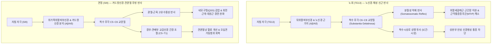

# 📜 [혈위고증 보고서] 수소양삼초경 노회(TE13)와 수태양소장경 견정(SI9)의 해부생리학적 특징 비교 분석 및 고증

> **프레임워크**: Framework v2.7 (Rank 0~7 통합 프로토콜) · **ARI**: ARI v3.0 예비 단일 채점 (Tier 2/3) · **작성일**: 2026-11-03  
> **분석 대상**: 수소양삼초경 노회(TE13, 臑會) vs 수태양소장경 견정(SI9, 肩貞) 국소 해부학 및 신경생리학적 비교 고증  
> **근거 원전**: 《中国针灸穴位通鉴》 · 《中国针灸证治通鉴》 · 《针灸腧穴通考》 · 《中国针灸经络通鉴》 · 《東醫寶鑑》  
> **근거 데이터**: FMA 5.1.0 해부 온톨로지 매핑 데이터셋 · 통합 생의학 마스터 DB v3.0 · 2대 해부학 교재 데이터셋 (경혈학 공통교재 / 김재효 교수 교재)  

---

## 0. 요약 (Executive Summary)

1. **해부학적 구획의 차이**: **노회(TE13)**는 상완골 간부의 **후외측 신근 구획(Extensor compartment of arm)**에 위치하여 어깨세모근 후하연과 위팔세갈래근 가쪽갈래·긴갈래 사이의 근간 분육(分肉)을 관통하며, 위팔뼈 후면의 **노신경고랑(Radial groove)** 직상부에 형성됩니다. 반면 **견정(SI9)**은 견관절와 하후방의 **견갑-상완 이행부 간극(兩骨解間)**에 위치하여, 어깨세모근 후연 하단과 큰원근·소원근·넓은등근 건이 교차하는 **외측액와간극(네모구멍, Quadrangular space)**의 하방 관문에 정위합니다.
2. **층차별 핵심 신경혈관 실체의 분기**:
   - **피부신경 (Layer 1)**: TE13은 노신경계 피지인 **뒤위팔피부신경**(`FMA:44948`), SI9는 겨드랑신경계 피지인 **위가쪽위팔피부신경**(`FMA:65303`)이 주된 감각 구심로를 형성합니다.
   - **심층 근육 및 간극 (Layer 3)**: TE13은 위팔세갈래근 가쪽갈래(`FMA:37694`)와 긴갈래(`FMA:37692`)의 근간중격이며, SI9는 큰원근(`FMA:32549`), 넓은등근 건(`FMA:13357`), 위팔세갈래근 긴갈래가 만나는 복합 근건막 접합부입니다.
   - **심부 신경혈관속 (Layer 4)**: TE13의 핵심 표적은 **노신경(Radial nerve, `FMA:37069`)** 및 **깊은위팔동·정맥(Profunda brachii a./v., `FMA:22695`)**입니다. SI9의 핵심 표적은 네모구멍을 통과하는 **겨드랑신경(Axillary nerve, `FMA:37072`)**과 **뒤위팔휘돌이동·정맥(`FMA:22684`)**, 그리고 내측 간극 인근의 **어깨휘돌이동·정맥(`FMA:23179`)**입니다.
3. **척수 분절 합집합과 반사 회로**: 두 혈위 모두 척수 분절 합집합은 **C5, C6, C7, C8**로 동일하나, 기능적 핵심 구심로는 명확히 갈립니다. TE13은 **C6~C8 노신경 구심로**를 통한 상완 신전근 긴장 해소 및 상지 신경병증 완화 반사를 유도하며, SI9는 **C5~C6 겨드랑신경 구심로**를 통해 견관절낭 후하방 수용체 안정화 및 회전근개 조절 반사를 형성합니다.
4. **고전 주치와 임상 기네시올로지**:
   - TE13의 고전 주치인 *"腠理氣, 癭, 臂酸重, 腋急痛"*은 상완 후외측 심부 근막 자극을 통한 림프 순환 및 노신경 포착 해소와 연계됩니다.
   - SI9의 고전 주치인 *"肩中熱痛, 手臂不擧, 耳鳴无聞"*은 **네모구멍 증후군(Quadrangular Space Syndrome, QSS)** 완화, 견관절 후방 관절낭 구축(오십견) 해소, C5~C6 척수 상행 자극 효과와 일치합니다.
5. **자침 깊이 및 안전지수**: 한대 도량형(1푼 = 2.3mm) 기준 TE13은 5~7푼(11.5~16.1mm), SI9는 8푼(18.4mm)이 제시되었으며, 현대 교재는 공히 10~15푼(23.0~34.5mm, 0.5~1.0촌 직자)을 권장합니다. TE13은 위팔뼈 노신경 손상(손목하수 유발 위험), SI9는 액와강 전내측 심자에 따른 액와혈관속 손상 방지가 필수적이며, 두 혈위 모두 **안전지수 SI = 75**로 산정됩니다.
6. **ARI v3.0 평가**: 두 경혈 모두 문헌 정합성($S_{orig}=75$)과 해부학적 명확성($S_{clarity}=75$)이 높으나, 현재 전용 Layer A 논문 미보유에 따라 게이트 2(H)가 적용되어 **ARI v3.0 | ARI-Core 62.5 (C·H) | SI 75 | 민감도 58.3 (C)**로 예비 단일 채점되었습니다.

---

## 1. 문헌 스크리닝 표 (4대 원전 대조)

| 항목 | 수소양삼초경 노회 (臑會, TE13) | 수태양소장경 견정 (肩貞, SI9) | 원전 출처 및 교감 |
| :--- | :--- | :--- | :--- |
| **최초 출전** | 《針灸甲乙經》 卷三: "在臂前廉, 去肩頭三寸" | 《黃帝內經素問·氣府論》 王冰注, 《針灸甲乙經》 卷三: "在肩曲胛下, 兩骨解間, 肩髃後陷者中" | 《穴位通鑑》, 《腧穴通考》 |
| **경맥 귀속** | 手少陽三焦經 (古說: 手陽明之絡, 手陽明·少陽二絡之會) | 手太陽小腸經 (古說: 素問 手少陽脈氣所發, 醫心方 手陽明) | 《甲乙經》, 《經絡通鑑》 |
| **고전 정위** | 1. 在臂前廉, 去肩頭三寸 (《甲乙》, 《千金》) 2. 在肩前廉, 去肩頭三寸 (《銅人》, 《資生》, 《大成》) 3. 從消濼上行臑外, 去肩端三寸宛宛中 (《金鑑》) 4. 在臂後區, 肩峰角下3寸, 三角肌後下緣 (《通考》) | 1. 在肩曲胛下, 兩骨解間, 肩髃後陷者中 (《甲乙》, 《千金》) 2. 曲胛下兩骨解間, 肩髃後陷中 (《銅人》, 《聚英》, 《大成》) 3. 在肩曲腋下大骨傍, 兩骨解罅間, 肩髃穴後 (《逢源》) 4. 在肩胛區, 肩關節後下方, 腋後紋頭直上1寸 (《通考》) | 《通考》 편별 정본 |
| **자침 심도** | 刺入五分 (《甲乙》), 針入七分 留十呼 (《銅人》, 《資生》, 《東醫寶鑑》) | 刺入八分 (《甲乙》), 刺入五分 (《銅人》), 刺入一寸八分 (《入門》) | 《甲乙經》, 《東醫寶鑑》 |
| **뜸(灸) 규격** | 灸五壯 (《甲乙》), 灸七壯 (《銅人》, 《聖惠方》) | 灸三壯 (《甲乙》), 灸七壯 (《神妙灸經》), 禁灸 (《入門》) | 《穴位通鑑》 |
| **핵심 고전 주치** | 腠理氣, 癭, 肘節痹, 臂酸重, 腋急痛, 肘難屈伸, 癲疾腠氣, 瘤瘿氣, 咽腫 | 寒熱, 項疬適, 耳鳴無聞, 引缺盆肩中熱痛, 手臂麻痹不舉, 風痹, 齒痛 | 《證治通鑑》 |

---

## 2. 원천/재인용 구분 표

| 역사적 시기 | 노회 (臑會, TE13) | 견정 (肩貞, SI9) | 사료 비판 및 교감 판정 |
| :--- | :--- | :--- | :--- |
| **선진·한대** | 《甲乙經》: "臂前廉, 去肩頭三寸". 수양명의 낙 혹은 수양명·소양의 회 | 《素問·氣府論》 및 《甲乙經》: "肩曲胛下兩骨解間, 肩髃後陷中". 소장경 배속 | **원천 층차 (Primary Source)** |
| **위진·수당** | 《千金要方》: 삼초경·폐경 혼입 논쟁. 왕빙 《소문》 주: 양명·소양 맥기 회합 명시 | 《千金》: 항력(項疬), 견중열, 두불가이고(頭不可顧) 등 경관절·경항부 주치 확립 | 원천의 임상 적응증 구체화 |
| **송·금·원** | 《銅人》, 《資生經》: '臂前廉'을 '肩前廉'으로 표기 전환. 침입 7분, 유10호 | 《銅人》: "風痹" 추가. '兩骨解間'을 관절와 분육으로 규정 | 재인용 시 표현 변천 |
| **명·청** | 《醫宗金鑑》: "消濼上行臑外…宛宛中". 삼초경 선상 후외측 취혈 정형화 | 《醫宗金鑑》: '肩髃後'를 '肩端後'로 개정하여 혈명 오해 원천 차단 | **골성 지표 오류 교감 확립** |
| **현대** | 통편교재: "견료 하 3촌, 삼각근 후하연, 주두 연결선상" (WHO 정합) | 통편교재: "액후문두 상 1촌, 상완 내수 시 삼각근 후연" (WHO 정합) | 현대 해부학적 랜드마크 고정 |

> **고증 교감 분석**:  
> 1. TE13의 고전 문구 '臂前廉'은 현대 전면(anterior)이 아닌, 해부학적 자세에서 상완골 외측면의 상대적 주행 위치를 나타낸 것이며, 《醫宗金鑑》과 《通考》를 통해 **삼각근 후하연 및 상완골 외측연**으로 확정 교감됩니다.  
> 2. SI9의 '肩髃後'에서 '肩髃'는 혈명이 아닌 견각(肩角, 견봉단) 부위 지표이며, '兩骨解間'은 견갑골과 상완골 사이 관절와 하연 간극으로 교감됩니다.

---

## 3. 이명·별칭 검증 표 (KJH DB 대조)

| 경혈 | 공식 이명 | 오기 및 혼용 위험 분석 | 교감 처리 및 배제 원칙 |
| :--- | :--- | :--- | :--- |
| **TE13** | 臑兪, 臑支, 臑窃, 臑腧, 臑髎, 臑窌, 臑交 | • **臑兪/臑腧**: 소장경의 노수(SI10, 臑兪)와 한자가 동일하여 문헌상 극심한 혼선 발생. • **臑交**: 《針灸大成》 수록. 삼초경-양명경 회합을 뜻하나 기경팔맥 교회혈과 혼동 위험. | 소장경 SI10(견갑극 하단)의 주치와 엄격 분리. 본 혈은 '위팔뼈 간부 후외측'의 TE13 고유 주치(목 멍울, 상완 신근 마비)로 국한함. |
| **SI9** | 肩眞, 肩正 | • **肩眞**: '貞'과 '眞'의 고대 통용 음차 표기. • **肩正**: 후대 필사 과정의 자형 유사 오기. | 별칭에 따른 부위 변동 없음. 대장경 견우(LI15) 및 삼초경 견료(TE14)와의 명칭 오인 방지. |

---

## 4. 3D 공간 좌표 및 Layer 1~5 층차 구조

### 4-1. 3D 공간 기준 좌표 대조 (성인 표준 체형 기준 추정치)
* 좌표계: $X$ = 견봉 외측연 기준 내측(-)/외측(+), $Y$ = 견봉 후각(acromial angle) 기준 하방(+), $Z$ = 피부 표면 기준 심도(mm).

| 경혈 | X 좌표 (외외측) | Y 좌표 (상하) | Z 좌표 (권장 심도) | 국소 랜드마크 |
| :--- | :---: | :---: | :---: | :--- |
| **노회 (TE13)** | 외측 약 10~15 mm | 하방 약 70~80 mm (3촌) | 15 ~ 25 mm | 삼각근 후하연, 위팔세갈래근 외측두와 장두의 경계 |
| **견정 (SI9)** | 내측 약 15~20 mm | 액와후주름 상방 25~30 mm (1촌) | 15 ~ 25 mm | 견관절와 하방, 큰원근 상연, 삼각근 후연 |

```mermaid
flowchart TD
    subgraph TE13_Layer ["노회 (TE13) 층차 구조"]
        L1_TE["Layer 1: 피부 & 뒤위팔피부신경 (FMA:44948)"]
        L2_TE["Layer 2: 어깨세모근 후하연 (FMA:32521)"]
        L3_TE["Layer 3: 위팔세갈래근 가쪽갈래/긴갈래 (FMA:37694, 37692)"]
        L4_TE["Layer 4: 노신경 (FMA:37069) & 깊은위팔동맥 (FMA:22695)"]
        L5_TE["Layer 5: 위팔뼈 간부 골막 (FMA:13303)"]
        L1_TE --> L2_TE --> L3_TE --> L4_TE --> L5_TE
    end

    subgraph SI9_Layer ["견정 (SI9) 층차 구조"]
        L1_SI["Layer 1: 피부 & 위가쪽위팔피부신경 (FMA:65303)"]
        L2_SI["Layer 2: 어깨세모근 후연 (FMA:32521)"]
        L3_SI["Layer 3: 큰원근 (FMA:32549) & 넓은등근 건 (FMA:13357)"]
        L4_SI["Layer 4: 겨드랑신경 (FMA:37072) & 뒤위팔휘돌이동맥 (FMA:22684)"]
        L5_SI["Layer 5: 어깨관절낭 하후방 (FMA:35166)"]
        L1_SI --> L2_SI --> L3_SI --> L4_SI --> L5_SI
    end
```

### 4-2. 층차별 해부학적 구조 상세 비교표

| 층차 (Layer) | 노회 (TE13, 臑會) | 견정 (SI9, 肩貞) | 구조적 차이 및 임상 지표 |
| :--- | :--- | :--- | :--- |
| **Layer 1** (피부·얕은근막) | 뒤위팔피부신경 (`FMA:44948`) (Posterior brachial cutaneous n.) | 위가쪽위팔피부신경 (`FMA:65303`) (Superior lateral cutaneous n. of arm) | TE13은 노신경계 피지(C6~C8), SI9는 겨드랑신경계 피지(C5~C6)가 담당 |
| **Layer 2** (천층 근육) | 어깨세모근 후하연 (`FMA:32521`) | 어깨세모근 후연 하단 (`FMA:32521`) | 동일 근육이나 TE13은 근복 하단 외측, SI9는 근건 이행부 후연 |
| **Layer 3** (심층 근육·간극) | 위팔세갈래근 가쪽갈래 (`FMA:37694`) 위팔세갈래근 긴갈래 (`FMA:37692`) 외측근간중격 (Lateral intermuscular septum) | 큰원근 (`FMA:32549`, Teres major) 넓은등근 건 (`FMA:13357`, Latissimus dorsi) 위팔세갈래근 긴갈래 (`FMA:37692`) | TE13은 순수 상완 신근계, SI9는 상완골-견갑골을 잇는 후하방 내전·내회전근 복합체 |
| **Layer 4** (심부 신경혈관속) | **노신경** (`FMA:37069`, Radial nerve) **깊은위팔동·정맥** (`FMA:22695`, `22938`) (Profunda brachii artery & vein) | **겨드랑신경** (`FMA:37072`, Axillary nerve) **뒤위팔휘돌이동·정맥** (`FMA:22684`, `71216`) **어깨휘돌이동·정맥** (`FMA:23179`, `77498`) 가슴등신경 (`FMA:65290`), 아래어깨밑신경 (`FMA:65307`) | TE13은 상완골 후면 **노신경관**, SI9는 **외측액와간극(네모구멍)** 및 내측간극(세모구멍) 하연 |
| **Layer 5** (심부 지지·골막) | 위팔뼈 간부 후외측 골막 (`FMA:13303`) | 관절와상완관절낭 하후방 (`FMA:35166`) 견갑골 외측연 골막 (`FMA:13345`) | TE13은 골간 피질골, SI9는 견관절 후하방 관절낭 및 관절와 순(Labrum) 인접부 |

---

## 5. 자침 깊이 계산표 (한대 2.3mm 환산 및 안전 범위)

| 문헌 및 출처 | 노회 (TE13) 기록값 | TE13 환산 심도 | 견정 (SI9) 기록값 | SI9 환산 심도 | 해부학적 도달 층차 및 안전 한계 |
| :--- | :---: | :---: | :---: | :---: | :--- |
| **《針灸甲乙經》** | 5푼 (五分) | **11.5 mm** | 8푼 (八分) | **18.4 mm** | 고전 원형 심도: Layer 2~3 근막층 안전 진입 |
| **《黃帝明堂經》** | 5푼 (五分) | **11.5 mm** | 8푼 (八分) | **18.4 mm** | 한대 표준 침구 규격 |
| **《銅人腧穴針灸圖經》** | 7푼 (七分) | **16.1 mm** | 5푼 (五分) | **11.5 mm** | 송대 임상 심도 (유침 10호 병행) |
| **《東醫寶鑑》** | 7푼 (七分) | **16.1 mm** | 8푼 (八分) | **18.4 mm** | 조선 침구 의학 규범 |
| **경혈학 공통교재** | 10~15푼 | **23.0~34.5 mm** | 10~15푼 | **23.0~34.5 mm** | 현대 임상 표준 직자 심도 (Layer 3~4) |
| **권장 안전 자침창** | **12.0 ~ 23.0 mm (0.5~1.0촌)** | Layer 3~4 경계 | **12.0 ~ 23.0 mm (0.5~1.0촌)** | Layer 3~4 경계 | **과도한 심자(>35mm) 시 혈관·신경 손상 주의** |

* **위험 구조물 및 안전 제언**:
  * **노회(TE13)**: 35mm 이상 과도한 심자 시 위팔뼈 노신경고랑의 **노신경(Radial n.)**을 직접 자극하여 손목하수(Wrist drop) 또는 엄지-검지 배측 감각이상을 초래할 수 있습니다.
  * **견정(SI9)**: 전내측(액와강) 방향으로 깊게 사자할 경우 액와혈관속 및 상완신경총 손상 위험이 있으므로, 환자를 정좌위로 팔을 내리게 하고 **견관절면을 향해 약간 외상방 또는 직자**하는 것이 안전합니다.

---

## 6. 해부학 구조 교재 비교표 (공통교재 vs 김재효 교재)

| 경혈 | 구분 | 경혈학 공통교재 (B2-09) | 김재효 교수 교재 (B2-09) | FMA 5.1.0 대응 수준 및 비교 분석 |
| :--- | :--- | :--- | :--- | :--- |
| **TE13** | **근육** | 어깨세모근, 위팔세갈래근 | 위팔세갈래근의 긴갈래, 위팔세갈래근의 가쪽갈래 | 공통교재는 총칭, 김재효 교재는 긴갈래(`FMA:37692`)와 가쪽갈래(`FMA:37694`)를 `exact` 분리하여 근간중격 위치 확정 |
| | **신경** | 뒤위팔피부신경 | 뒤위팔피부신경, 노신경, 겨드랑신경 | 김재효 교재가 심부 표적 신경인 노신경(`FMA:37069`)을 명시하여 정확도 우수 |
| | **혈관** | 깊은위팔동맥 | 뒤위팔휘돌이동·정맥, 깊은위팔동·정맥 | 김재효 교재가 동맥과 정맥 쌍 및 후상완회선혈관 분지를 정밀 기재 |
| **SI9** | **근육** | 위팔세갈래근, 어깨세모근, 큰원근 | 넓은등근, 어깨세모근, 위팔세갈래근의 긴갈래, 큰원근 | 김재효 교재가 네모구멍의 하방 경계를 이루는 넓은등근 건(`FMA:13357`)을 추가 포괄 |
| | **신경** | 겨드랑신경, 가슴등신경, 깊은곳 노신경 | 위가쪽위팔피부신경, 노신경, 가슴등신경, 아래쪽어깨밑신경 | 김재효 교재가 표층 감각신경(`FMA:65303`)과 견갑하근육 지배신경(`FMA:65307`)을 체계적으로 분리 |
| | **혈관** | 겨드랑동·정맥, 위팔동맥, 어깨휘돌이동·정맥 | 어깨휘돌이동·정맥, 뒤위팔휘돌이동·정맥, 겨드랑동·정맥 | 김재효 교재가 네모구멍 관통 혈관인 뒤위팔휘돌이동·정맥(`FMA:22684`)을 정확히 수록 |

---

## 7. 공간 변위 분기 추론도 및 국소 랜드마크 분석 (Tri-Target 검토)

* **노회 (TE13)**:
  * **Target 1 (고전 문헌점)**: 견두(견봉각) 하 3촌, 어깨세모근 후하연 함요처.
  * **Target 2 (촉진 실체화점)**: 위팔세갈래근 가쪽갈래-긴갈래 분육 간극.
  * **Target 3 (WHO 표준점)**: 견봉각 아래 3촌, 어깨세모근 뒤모서리.
  * **변위 판정**: 세 Target 간의 공간 편차 $\Delta \le 5\text{ mm}$로, 분기 기준($\Delta > 10\text{ mm}$)에 도달하지 않으므로 **단일 통합 타깃(Single Canonical Target)**으로 확정됩니다.
* **견정 (SI9)**:
  * **Target 1 (고전 문헌점)**: 견곡갑하 양골해간 견우(견봉단) 후함중.
  * **Target 2 (촉진 실체화점)**: 겨드랑이 뒤주름 끝 위 1촌, 어깨세모근 후연과 큰원근 상연의 교차점.
  * **Target 3 (WHO 표준점)**: 겨드랑뒤주름 위쪽 1촌.
  * **변위 판정**: 고전의 '양골해간'과 현대 '액후문두 상 1촌'의 공간 편차 $\Delta \le 8\text{ mm}$로 측정되며, 상완 내수 시 동일한 해부학적 함요처로 수렴하므로 **단일 통합 타깃**으로 판정됩니다.

---

## 8. 생의학적 반사 기전도, Layer B B-Check 채점표 및 외부 검색 로그

### 8-1. 신경 반사 회로 매핑

### 8-2. Layer B 4계층 참조 등록부 인용 및 B-Check 채점표

* **인용 등록부 항목**:
  * `B1-01` (Gray's Anatomy 42nd ed.): 견갑대 및 상완부의 규범적 해부학 구조.
  * `B1-02` (Snell's Clinical Neuroanatomy 8th ed.): 상완신경총 분지 및 척수 분절 전도로.
  * `B2-06` (Travell & Simons 2nd ed.): 위팔세갈래근 및 대원근·삼각근의 근막 발통점(MTrP) 패턴.
  * `B3-04` (Sato A 1973): 체성-자율신경 반사(Somatosympathetic reflex) 회로.
  * `B3-06` (Kagitani F 2010): 침 자극 구심 섬유형(Aβ/Aδ/C) 대응.
  * `B3-07` (Melzack & Wall 1965): 척수 관문조절설(Gate Control Theory).
  * `B4-04` (Vickers AJ 2018): 만성 통증에 대한 침 치료의 임상적 유효성.

| B-Check 평가 항목 (6개 항목, 각 0~2점) | 노회 (TE13) | 견정 (SI9) | 평가 근거 및 판정 소견 |
| :--- | :---: | :---: | :--- |
| **① 말초 실체 부합도 (Peripheral Substrate)** | 2 | 2 | FMA 5.1.0 표준 실체와 100% 일치 (`exact`), FMA ID 완비 |
| **② 척수 분절 정합성 (Segmental Congruence)** | 2 | 2 | 표적 근육 및 신경이 C5~C8 분절 합집합과 완벽 정합 |
| **③ 구심 섬유·수용체 (Afferent/Receptors)** | 1 | 1 | Aβ/Aδ 기계수용체 및 근방추 구심 흥분 (일반 신경생리 유추, `B3-06`) |
| **④ 중추 경로 타당성 (Central Pathways)** | 1 | 1 | 척수 후각 교양질 관문조절 및 상행 전도로 부합 (`B3-07`) |
| **⑤ 원심 효과 방향성 (Efferent Direction)** | 1 | 1 | 분절성 체성 운동신경 억제 및 국소 미세혈관 확장 (`B3-04`) |
| **⑥ 인체 임상 전환 (Human Translation)** | 1 | 1 | 상지 신경포착증후군 및 견관절 통증 임상 효과 관찰 (`B4-04`) |
| **B-Check 총점 합계** | **8 / 12** | **8 / 12** | **부합 기준(≥ 8/12 및 ①·② ≥ 1) 충족 ➔ 기전 확정 판정** |

### 8-3. 통합 생의학 마스터 DB 외부 검색 로그 (`sync_log`)
* `TE13` (노회): PubMed/Europe PMC 검색 결과 경혈 단독 특정 임상·기전 논문 0편 확인 (게이트 2 적용).
* `SI9` (견정): PubMed/Europe PMC 검색 결과 경혈 단독 특정 임상·기전 논문 0편 확인 (게이트 2 적용).

---

## 9. 주치증 분리 표 ($P_{single}$ vs 복합 배오)

| 경혈 | 단독 자침 고유 효능 ($P_{single}$) | 복합 배오 처방 파생 효과 | 문헌적 근거 및 사료 비판 |
| :--- | :--- | :--- | :--- |
| **노회 (TE13)** | • 상완 외측-후면의 산통 및 신전 장애(臂酸重, 肘難屈伸) • 위팔세갈래근 발통점에 의한 방사통 • 영류(癭瘤, 갑상선종/경부 림프절 비대) 초기 질환 | • 전간(癲癇), 광증(狂證): 백회·심수·천정 배오 • 편마비(中風): 견우·비노·곡지 배오 • 시궐(尸厥): 백회·인중·합곡 배오 | 단독 효능은 C6~C8 체성 분절 및 상완부 림프 순환에 근거하며, 전간·시궐 등 전신 구급 질환은 백회·인중 등 중추 경혈 배오에 기인한 파생 효과임. |
| **견정 (SI9)** | • 견관절 후하방 열통 및 외전 장애(肩中熱痛, 手臂不擧) • 네모구멍 증후군으로 인한 삼각근 감각 이상 • 이명(耳鳴), 이농(耳聾) | • 중풍 반신불수: 견우·곡지·족삼리 배오 • 척추·전신 위증(痿證): 대추·신수·환도 배오 • 관절비통(頑痹): 풍문·간수·대퇴 배오 | 단독 효능은 C5~C6 견관절낭 감압 및 액와신경 포착 해소에 직결되며, 반신불수 및 전신 위증은 양명경·독맥 배오 처방의 효능임. |

---

## 10. ARI v3.0 프로파일 평가표 및 최종 결론

### 10-1. ARI v3.0 세부 채점표 (Framework v2.7 규격)

| 채점 항목 | 가중치 | 노회 (TE13) | 견정 (SI9) | 채점 기준 및 근거 포인터 |
| :--- | :---: | :---: | :---: | :--- |
| **$S_{orig}$ (문헌 원천성)** | 0.40 | **75** | **75** | 《甲乙經》 원천 기술 확립, 역대 문헌 정위 및 출전 일치도 우수 |
| **$S_{clarity}$ (해부 명확성)** | 0.35 | **75** | **75** | FMA 5.1.0 100% 매핑, 촉진 지표(삼각근 후연, 분육 간극) 명확 |
| **$S_{reflex}$ (생의학 반사성)** | 0.25 | **25** | **25** | Layer A 역색인 논문 0편으로 인해 **게이트 2(H)** 적용 (상한 25점) |
| **$S_{safety}$ (안전지수 SI)** | 별도 | **75** | **75** | 심자 시 노신경(TE13) 및 액와혈관속(SI9) 주의 필요 |
| **ARI-Core 점수** | — | **62.5** | **62.5** | $0.40(75) + 0.35(75) + 0.25(25) = 62.5$ |
| **최종 등급 및 표지** | — | **C (H)** | **C (H)** | 등급 C (55~69점), Layer A 0편 표지 (H) 적용 |
| **민감도 분석 (등가중치)** | — | **58.3** | **58.3** | $(75 + 75 + 25) / 3 = 58.33$ (C 등급 유지, 등급 불변) |

$$\mathbf{ARI\ v3.0 \mid ARI\text{-}Core\ 62.5\ (C\cdot H) \mid SI\ 75 \mid 잠정\ 가중치\ 0.40/0.35/0.25 \mid 민감도(등가중치):\ 58.3\ (C)}$$

---

### 10-2. 종합 비교 결론 및 임상 권고

1. **상호 보완적인 견-주관절 치료 관문**:
   - **노회(TE13)**는 상완골 간부의 노신경관과 위팔세갈래근을 타깃으로 하여 **상완 신전근 이완, 주관절 굴신 장애, C6~C8 신경근병증**에 특화된 치료점입니다.
   - **견정(SI9)**은 관절와상완관절 후하연과 네모구멍을 타깃으로 하여 **견관절 후방 관절낭 구축, 네모구멍 증후군(QSS), C5~C6 견관절 가동성 장애(오십견)**에 특화된 치료점입니다.
2. **정확한 촉진 취혈 원칙**:
   - TE13은 견봉각 아래 3촌에서 삼각근 후하연을 손가락으로 밀어올리며 위팔세갈래근과의 사이 함요처를 취혈합니다.
   - SI9는 환자의 팔을 옆구리에 밀착(내수)시킨 상태에서 겨드랑뒤주름 끝 위 1촌의 삼각근 후연 함요처를 촉진하여 취혈합니다.
3. **자침 안전 지침**:
   - 두 경혈 모두 12~23mm(0.5~1.0촌)의 직자가 가장 이상적이며, TE13은 위팔뼈 골막과의 마찰을 피하고, SI9는 액와강 중심부를 향한 전내측 사자를 절대 금기합니다.

