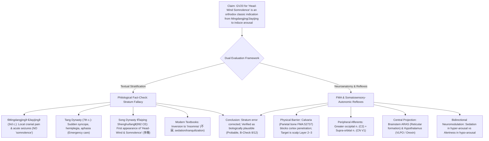
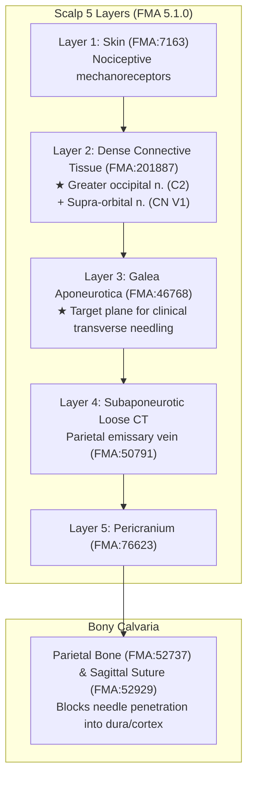

# Historiographical Stratification and Neuroanatomical Mechanisms of Baihui (GV20) in 'Somnolence due to Head-Wind' (頭風多睡) and Sleep-Wake Regulation

> **Framework**: Acupoint Anatomy Framework v2.7  
> **Target Acupoint**: Baihui (百會, GV20, Governor Vessel)  
> **Thematic Scope**: Philological Stratification and FMA Neuroanatomical Evaluation of the Classical Indication "Somnolence due to Head-Wind" (頭風多睡) and Its Translation to Sleep-Wake Regulation  
> **Anatomical Ontology**: FMA 5.1.0 Index (Scalp layers FMA:7163, Galea aponeurotica FMA:46768, Greater occipital nerve FMA:65443 [C2], Supra-orbital nerve FMA:52655 [CN V1], Parietal emissary vein FMA:50791, Parietal bone FMA:52737)  
> **Evidence DB**: Comprehensive Classics Database (*Tongjian* & *Tongkao*), Layer A Master Biomedical DB v3.0, Layer B 4-Tier Reference Registry (v1.0)  
> **Institution**: Wonkwang University College of Korean Medicine · Department of Meridian & Acupoint
> **3D anatomical measurement (2026-11-05)**: structure depths at the proportional-bone location on the BodyParts3D 4.0 standard model, with supplementary values using an SMPL-X body-shape skin (BMI 24 and 30) (Section 4 '3D anatomical measurement', interactive 3D model). Normative anatomical geometry (B1 supplementary). **ARI scores unchanged.**

---

## 0. Executive Summary & Verdict

This monograph provides an exhaustive textual-critical and neuroanatomical investigation into the clinical statement:  
*"The utilization of Baihui (GV20) for 'somnolence due to head-wind' (頭風多睡, hypersomnia/somnolence associated with cranial wind syndromes) accords with orthodox classical indications established since the 《Mingdangjing》 and 《Jiayijing》. Ancient physicians punctured Baihui as an essential point to disperse stagnant wind-heat at the vertex and cold-dampness in the encephalon to induce arousal. In this regard, Baihui can be applied to clinical symptoms involving sleep-wake regulation."*

### Key Findings
1. **Philological Stratum Fallacy**:  
   The indication "somnolence due to head-wind" (頭風多睡) is **completely absent** from the Han and Jin Dynasty canonical classics (*Huangdi Mingdangjing* and *Zhenjiu Jiayijing*). Up to the Tang Dynasty, the primary indications of GV20 were restricted to vertex pain, neck stiffness, ocular pain, epilepsy, and acute syncope. "Somnolence" (多睡) first appeared in the late 10th century during the Northern Song Dynasty in the imperial compendium *Taiping Shenghuifang* (992 CE). Attributing this to the *Jiayijing* era represents a 700-year historical anachronism.
2. **Critique of Category Mistake**:  
   Equating ancient pathogen dispersal ("dispelling wind-heat and cold-dampness") with modern "inducing arousal" is an ex-post-facto rationalization. Ancient physicians addressed vertex heaviness and excessive daytime sleepiness as an impairment of clear yang (淸陽不升, 濁陰不降) through bloodletting or moxibustion, rather than consciously targeting the ascending reticular activating system (ARAS).
3. **Anatomical Substrate (FMA 5.1.0)**:  
   Direct mechanical stimulation of brain tissue is physically blocked by the fused calvaria (parietal bone, FMA:52737). Needling is confined to transverse insertion into the **5 scalp layers**, specifically reaching the subaponeurotic connective tissue below the galea aponeurotica (FMA:46768). The physical action targets the peripheral terminal networks of the **greater occipital nerve (FMA:65443, C2)** and **supra-orbital nerve (FMA:52655, CN V1)**.
4. **Central Sleep-Wake Circuitry & Bidirectional Neuromodulation**:  
   Afferent signals entering the trigeminocervical complex (TCC) project to the brainstem **Ascending Reticular Activating System (ARAS; locus coeruleus, raphe nuclei)** and hypothalamic sleep-wake centers (**VLPO vs Orexin/Hypocretin**). This explains the apparent historical contradiction between Song Dynasty "somnolence" (arousal promotion) and modern textbook "insomnia" (sedation/tranquilization) as state-dependent **homeostatic bidirectional neuromodulation**.

---

## 1. Propositional Verification Matrix

| Analyzed Claim | Verdict | Philological & Biomedical Grounds |
| :--- | :---: | :--- |
| **1. GV20 for somnolence is an orthodox indication established since 《Mingdangjing》 & 《Jiayijing》** | **Inaccurate (Fallacy)** | Zero records of 'somnolence' (多睡) in Han/Jin texts. First documented in Song Dynasty *Taiping Shenghuifang* (992 CE). |
| **2. Ancient physicians punctured GV20 to disperse wind-heat/cold-dampness to induce arousal** | **Partial Match (Rhetorical Overlay)** | Pathogen dispersal is consistent with traditional etiology, but "inducing arousal" is an ex-post-facto projection of modern neurobiology. |
| **3. GV20 needling modulates sleep-wake circuitry and clinical disorders** | **Probable (B-Check 8/12)** | Peripheral stimulation of C2 and CN V1 excites brainstem ARAS and hypothalamic sleep switches via somatosensory-autonomic reflexes. |

---

## 2. Textual Stratification of GV20 Clinical Indications

According to Professor Huang Longxiang's *Zhongguo Zhenjiu Xuewei Tongjian* and *Zhenjiu Shuxue Tongkao*:

### 2-1. Pre-Tang Stratum (Han to Jin Dynasty)
The original indication in *Zhenjiu Jiayijing* (Book 3) records:
> *"Spasm, malaria, chills and fever, pain at the nape, wind-induced vertex heaviness, sensation of eyes bursting out with inability to turn left or right, epilepsy, tinnitus."*
- Focuses exclusively on **cranial musculoskeletal pain**, **ocular pain**, and **acute convulsive/epileptic disorders**. 
- Terms for hypersomnia, daytime sleepiness (多睡), or lethargy (嗜臥) do not exist.

### 2-2. Tang Dynasty Expansion
In Sun Simiao's *Beiji Qianjin Yaofang* (Books 8 & 29) and Wang Tao's *Waitai Miyao* (Book 39), GV20 expanded into an **emergency revival point** for sudden collapse (卒死尸厥), stroke (中風, 半身不遂), and loss of speech (失音不語).

### 2-3. Song Dynasty Stratum: Appearance of "Somnolence"
The term "somnolence" (多睡) coupled with "head-wind" (頭風) first appears in the Song imperial encyclopedia *Taiping Shenghuifang* (Vol. 100, 992 CE):
> *"Prolapse of the rectum, wind epilepsy, ... head-wind, **excessive sleepiness (多睡)**, vexation, palpitations with lack of mental energy, forgetting former events, loss of taste, heaviness of head..."*

### 2-4. Modern Inversion: From Somnolence to Insomnia
Modern standard textbooks (from the 1950s Nanjing textbook to the 5th and 7th national editions) predominantly prescribe GV20 for **insomnia (不寐)** and agitation, shifting 180 degrees from the Song Dynasty emphasis on hypersomnia.

---

## 3. FMA Scalp Neuroanatomy & Calvarial Barrier

Needling GV20 can never mechanically penetrate the cerebral cortex in an adult due to the parietal bone barrier (FMA:52737).

- **Needling Depth & Method**: Transverse/horizontal needling (沿皮刺, 15–30°, 0.5–0.8 cun / 11.5–18.4 mm) along the subaponeurotic plane. Perpendicular puncture is strictly contraindicated.
- **Afferent Innervation**: Greater occipital nerve (FMA:65443, C2 posterior ramus) and Supra-orbital nerve (FMA:52655, CN V1 frontal branch).

**3D anatomical measurement — BodyParts3D 4.0 standard model + SMPL-X body-shape skin (2026-11-05, B1 supplementary)**

Textbook structures were loaded from the BodyParts3D 4.0 meshes linked by FMA ID, and the depth of each structure was measured at a location placed by proportional bone measurement (cun) approximated from bone landmarks (joint lines, bone ends, processes). Values with only the skin surface replaced by an SMPL-X statistical body-shape skin (male, height 1.72 m, BMI 24 and 30) are given alongside.

- **Location (right side)**: WHO standard location approximated from bone landmarks by proportional bone measurement.
- **Literature needling depth**: seven-source mean 3.83 fen = 8.8 mm (classical 5.8 mm, modern 14.9 mm).

| Structure | Type | FMA | BodyParts3D skin mm (fen) | Candidate-region median (10–90%) | Body-shape skin BMI 24 | Body-shape skin BMI 30 | Within literature mean 8.8 mm |
| :--- | :--- | :--- | ---: | ---: | ---: | ---: | :---: |
| parietal bone *(reference)* | reference (not in textbook list) | FMA:9613 | 5.3 (2.3) | — | —‡ | —‡ | yes |

- Shift of the representative point onto the body-shape skin: BMI 24 10.5 mm · BMI 30 11.1 mm
- ‡ Not used because the registration error is large (point shift > 10 mm or the body-shape skin passes through a structure)
- *(reference)* = superficial muscle, underlying bone or organ not in the textbook list, measured to show layer position
- Rows removed from the table: 5 (textbook structure mapped to a mesh of a different kind, only to a distant parent-structure mesh, or more than 60 mm from the located point)
- Textbook structures without a BodyParts3D mesh (not measured): 5
- **Interactive 3D model**: [Baihui (百會, GV20) 3D anatomical model](GV20_mesh3d_model.html) (textbook structures, a skin patch, the located point and depth lines; it can be rotated in a browser; its interface is in Korean)
- **How to read it**:
  - ① The shallowest structure (parietal bone) lies 5.3 mm deep with the BodyParts3D skin. The body-shape skin is not compared here because its registration error is large.
  - ② With the BodyParts3D skin, 1 structure(s) have their surface within the seven-source mean depth (8.8 mm): parietal bone.
- **Comparison with the report**: consistent with the scalp layers in Section 3 (scalp Layers 1–5 over the parietal bone), the parietal bone surface lies 5.3 mm deep in the standard model. The oblique or transverse insertion of 11.5–18.4 mm recommended in this report therefore has to run flat within this thin scalp, while a perpendicular needle meets bone at a little over 2.3 fen. The head has no joint landmarks for registering the body-shape skin, so the BMI values are not used. The location and values are the same as in the 3D measurement of the per-acupoint GV20 report.
- **Limitations**: this is a single standard model (BodyParts3D) with a statistical body-shape skin (SMPL-X) registration estimate. The location is a proportional-bone position approximated from bone landmarks, and depth is the shortest straight-line distance from the skin point to the structure surface, which may differ from depth along the needle. Individual variation, posture and muscle tone are not reflected, so these millimetres are used only for layer order and relative depth and are not transferred to in-vivo safe depths. Normative anatomical geometry (B1 supplementary), not an acupoint measurement (B2).

---

## 4. Central Sleep-Wake Reflex Pathways & Bidirectional Action

Afferent inputs from C2 and CN V1 converge onto the **Trigeminocervical Complex (TCC)** in the upper cervical cord and caudal brainstem, projecting to central sleep-wake nuclei:

1. **Ascending Reticular Activating System (ARAS)**:
   - Activates the locus coeruleus (Noradrenaline) and dorsal raphe nucleus (Serotonin), inducing cortical desynchronization and alertness.
2. **Hypothalamic Flip-Flop Circuit**:
   - **Hypo-arousal / Hypersomnia (두풍다수)**: Somatosensory stimulation drives lateral hypothalamic Orexin/Hypocretin neurons, promoting wakefulness.
   - **Hyper-arousal / Insomnia (불매)**: Gentle, sustained stimulation activates the ventrolateral preoptic nucleus (VLPO; GABAergic/galaninergic), dampening thalamocortical hyperexcitability and promoting slow-wave sleep.

This homeostatic bidirectional regulation resolves the historical divergence between Song Dynasty "somnolence" treatment and modern "insomnia" therapy.

---

## 5. Evidence Rating (Layer B B-Check: 8/12, Probable)

- **Mechanistic Rating**: **Probable (개연)**.
- **Limitations**: GV20 is rarely applied as a single point in human trials; it is almost universally combined with EX-HN1 (Sishencong), GV24 (Shenting), or SP6 (Sanyinjiao). Thus, sleep-wake modulation represents a system-level somatosensory-autonomic reflex rather than an isolated point-exclusive phenomenon.

### Effect of the 3D anatomical measurement on scoring (2026-11-05)

| New evidence | Item that could be affected | Review | Result |
| :--- | :--- | :--- | :--- |
| BodyParts3D 4.0 structure depths at the proportional-bone location + SMPL-X body-shape skin (BMI 24 and 30) supplementary values (Section 4 '3D anatomical measurement') | $S_{clarity}$ · SI | The layer order of the textbook structures and the structures within the literature mean depth are confirmed in standard 3D geometry. This is a single standard model with a statistical body-shape skin registration estimate (B1 supplementary), not a point-specific measurement (B2), so it does not meet the rubric's step condition | Step unchanged |

→ No rubric step changes, so no dual re-scoring was done.

---

## 6. Revised Clinical Statement

> *"The indication of Baihui (GV20) for 'somnolence due to head-wind' represents a historical stratum first appearing in the 10th-century Song Dynasty text 《Taiping Shenghuifang》, rather than the original 3rd-century 《Jiayijing》. Puncturing the scalp at GV20 stimulates peripheral C2 greater occipital and CN V1 supra-orbital nerve endings, sending afferent signals through the trigeminocervical complex to the brainstem ascending reticular activating system (ARAS) and hypothalamic sleep-wake centers. Through state-dependent bidirectional somatosensory-autonomic reflexes, GV20 promotes alertness during hypo-arousal (somnolence) and induces sedation during hyper-arousal (insomnia)."*

---

## 7. References

1. Huang Longxiang, *Zhongguo Zhenjiu Xuewei Tongjian*, Qingdao Publishing House, 2004, GV20 Baihui.
2. Huang Longxiang, *Zhongguo Zhenjiu Zhengzhi Tongjian*, Qingdao Publishing House, 2004.
3. Huang Longxiang, *Zhenjiu Shuxue Tongkao*, People's Medical Publishing House, 2011, GV20 Baihui.
4. Wang Huaiyin, *Taiping Shenghuifang*, 992 CE, Vol. 100.
5. Huangfu Mi, *Zhenjiu Jiayijing*, 282 CE, Book 3.
6. Standring S (ed). *Gray's Anatomy*. 42nd ed. Elsevier; 2020 (FMA 5.1.0).
7. Saper CB, et al. Sleep state switching. *Neuron*. 2010;68(6):1023-1042.

## 2026-11-05 3D anatomical measurement record

| Location | Original | Change | Basis |
| :--- | :--- | :--- | :--- |
| Header | — | Added a 3D anatomical measurement line (scores unchanged) | This revision |
| Section 4 | — | **New '3D anatomical measurement' subsection**: proportional-bone location approximated from bone landmarks, structure depth table (BodyParts3D skin and SMPL-X body-shape skin BMI 24 and 30), reading notes, link to the interactive 3D model | BodyParts3D 4.0 (CC BY 4.0), SMPL-X Body License CC BY 4.0 |
| Section 5 | — | One line comparing the structures within the seven-source mean depth | Needling-depth DB, seven sources, equal-weight mean, 1 fen = 2.3 mm |
| Section 10 | — | Table 'Effect of the 3D anatomical measurement on scoring' (steps unchanged) | Canonical Rank 7 rubric |
| Scores | Existing ARI and SI | **No change** | Scoring-effect table in Section 10 |
