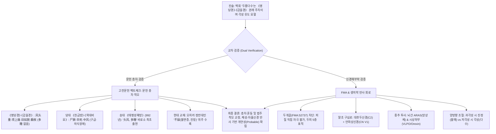
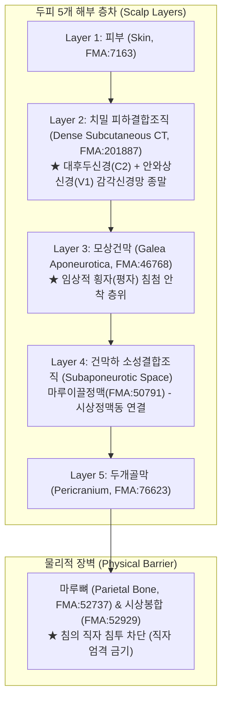
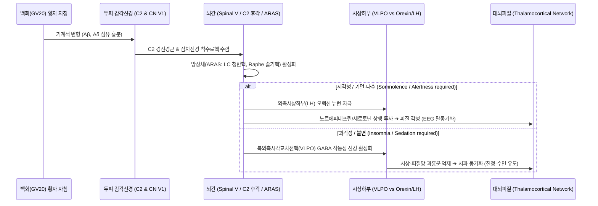

# 백회(GV20)의 '두풍다수(頭風多睡)' 문헌 층차 및 수면-각성 신경해부학적 기전 고증 보고서

> **프레임워크**: [경혈해부] Acupoint Anatomy Framework v2.7  
> **대상 경혈**: 백회 (百會, GV20, 독맥)  
> **분석 주제**: "백회의 두풍다수(頭風多睡) 주치 및 수면-각성 조절 활용" 기술에 대한 문헌 층차주의 및 FMA 신경해부생리학적 교차 비평  
> **해부 온톨로지**: FMA(Foundational Model of Anatomy) 5.1.0 로컬 색인 (두피 5층 FMA:7163, 모상건막 FMA:46768, 대후두신경 FMA:65443 [C2], 안와상신경 FMA:52655 [CN V1], 마루이끌정맥 FMA:50791, 두개골 두정골 FMA:52737)  
> **근거 DB**: 4대 원전 정제본(《穴位通鉴》·《证治通鉴》·《腧穴通考》·《经络通鉴》), Layer A 통합 생의학 마스터 DB v3.0, Layer B 4계층 참조 등록부  
> **작성 기관**: 원광대학교 한의과대학 경혈학교실 (Wonkwang University College of Korean Medicine · Department of Meridian & Acupoint)
> **3D 해부 측정(2026-11-05)**: BodyParts3D 4.0 표준 모델에서 골도분촌으로 정위한 피부점의 구조별 깊이와, 피부면만 SMPL-X 체형 피부(BMI 24·30)로 바꾼 보조값을 측정했다(4절 '3D 해부 측정', 상호작용 3D 모델). 규범 해부 형상 참고(B1 보조)이며 **ARI 점수 불변**

---

## 0. 요약 및 판정 결론

본 보고서는 **"백회(GV20)가 두풍다수(頭風多睡, 머리에 풍증이 있어 잠이 많은 증상)에 활용된 것은 《명당경》과 《갑을경》 이래로 확립된 고전 본래 주치에 부합하며, 고대 의가들이 두정부의 울체된 풍열과 뇌부의 한습을 흩어 각성을 유도하는 요혈로 백회를 취혈하였기에 수면-각성 조절이 관여된 임상증상에 활용될 수 있다"**는 기술을 문헌고증학(Historical Stratification) 및 신경해부학(Neuroanatomy) 관점에서 교차 검증한 결과입니다.

### 1. 판정 핵심 요약
1. **문헌 층차의 오류 (Historical Stratification Fallacy)**:  
   - 백회의 "두풍다수(頭風多睡, 頭風·多睡)" 주치는 《명당경(明堂經)》이나 《갑을경(甲乙經)》에 **전혀 수록되어 있지 않습니다**. 위진~수당대까지 백회의 원형 주치는 "풍두중(風頭重), 항상통(項上痛), 목여탈(目如脫), 전질(癲疾), 경(痙)" 등 두정부 국소 통증 및 급성 신경계 발작(경련·전간)이었으며, "다수(多睡)"는 **송대(宋代) 북송 관수의서인 《태평성혜방(太平聖惠方)》(992년)에 이르러 비로소 처음 등장한 후대 층차(P_single 송대 추가)**입니다.
2. **범주 착오(Category Mistake) 및 사후적 합리화 비판**:  
   - "고대 의가들이 풍열과 한습을 흩어 각성을 유도했다"는 설명은 전통 사기(풍열·한습) 병기론과 현대 신경생리학의 '각성(Arousal)' 개념을 무비판적으로 뒤섞은 사후적 수사입니다. 고대 의가들은 상행성 망상체 활성계(ARAS)를 목표로 삼은 것이 아니라, 머리가 무겁고 졸음이 쏟아지는 병태(두중·다수)를 두정부 청양(淸陽)의 울체로 보고 구법(뜸)이나 사혈로 사기(邪氣)를 흩었던 것입니다.
3. **생의학적 신경해부 경로 (FMA Ontology Mapping)**:  
   - 자침의 물리적 표적은 성인의 융합된 두개골(Parietal bone FMA:52737)에 의해 뇌 실질과 차단되어 있으며, **두피 5층 횡자(모상건막하층 FMA:46768 도달)**에 국한됩니다.
   - 말초 구심 신경인 **대후두신경(FMA:65443, C2 후지)과 안와상신경(FMA:52655, CN V1)**을 통해 뇌간 삼차신경 척수로핵 및 경수 후각으로 입력된 신호는 **상행성 망상체 활성계(ARAS)**와 **시상하부(VLPO/Orexin 회로)**를 활성화하여 수면-각성 리듬을 조절하는 **체성-자율신경 반사(Somatosensory-Autonomic Reflex)**를 형성합니다.
4. **고전과 현대의 '쌍방향 조절(Bidirectional Neuromodulation)' 역전 현상**:  
   - 송대 문헌의 **"다수(多睡, 과다수면·기면 치료)"**와 현대 교재의 **"불매(不寐, 불면 치료, 진정·안신)"**는 상충되는 것이 아니라, 뇌간-시상-피질망(Thalamocortical network)의 과흥분 상태에서는 진정을, 저각성 상태에서는 각성을 촉진하는 신경조절 항상성(Homeostasis) 기전으로 통합 설명됩니다.

---

## 1. 분석 대상 및 진술 검증

### 1-1. 분석 대상 원문
> "백회(GV20)가 두풍다수(頭風多睡, 머리에 풍증이 있어 잠이 많은 증상)에 활용된 것은 《명당경》과 《갑을경》 이래로 확립된 고전 본래 주치에 부합합니다. 고대 의가들은 두정부의 울체된 풍열과 뇌부의 한습을 흩어 각성을 유도하는 요혈로 백회를 취혈하였습니다. 그런점에서 백회가 수면-각성 조절이 관여된 임상증상에 활용될 수 있습니다."

### 1-2. 진술 세부 명제별 검증 결과표

| 세부 분석 명제 | 검증 판정 | 근거 요지 및 문헌·생의학 실체 |
| :--- | :---: | :--- |
| **① 백회의 '두풍다수' 활용은 《명당경》·《갑을경》 이래의 본래 주치이다** | **불일치 (오류)** | 《황제명당경》 및 《침구갑을경》에는 '다수(多睡)'가 없음. 당대 이전 문헌 전무, 10세기 송대 《태평성혜방》에서 비로소 최초 출현한 층차임. |
| **② 고대 의가들은 두정부 울체 풍열·한습을 흩어 각성을 유도하려 취혈했다** | **부분 일치 (해석 분리)** | 풍두중(風頭重)·두풍(頭風)의 사기(풍열·한습) 울체를 흩으려 한 것은 전통 한의학 병기론에 부합하나, '각성 유도'는 현대 신경생리학 개념의 사후적 이식임. |
| **③ 백회 자침이 뇌의 수면-각성 조절 임상증상에 활용될 수 있다** | **개연 (Probable)** | 두피 대후두신경(C2)·삼차신경(V1) 구심 섬유가 뇌간 망상체(ARAS) 및 시상하부(VLPO/Orexin) 수면-각성 중추에 투사되어 체성-자율신경 반사를 유발함. |

---

## 2. 문헌 층차 고증: 백회 주치의 통시적 변천 전말

황룡상 교수의 《中国针灸穴位通鉴》(권하) 및 《中国针灸证治通鉴》 전수 분석에 따른 백회(GV20)의 시대별 주치 층차는 다음과 같습니다.

### 2-1. 위진~수당대 (선진~당대 이전): 두정부 국소증 및 급성 신경 발작
《침구갑을경(針灸甲乙經)》(권3)에 집록된 한위진 시대 《황제명당경》의 백회 원형 주치는 다음과 같습니다.

> **[원전 조문]** 《针灸甲乙经》 卷三:  
> "痉。痎疟。寒热。项上痛，风头重，目如脱，不可左右顾。癫疾。耳鸣。"  
> *(역문: 경련, 해학, 오한과 발열, 목덜미 위 통증, 풍사로 머리가 무거움, 눈이 빠질 듯하여 좌우를 돌아보지 못함, 전질[간질], 귀울림을 다스린다.)*

- 이 단계의 백회 주치는 **두통·두중·항강·안구통 등 두경부 국소 증상**과, **경(痙)·전질(癲疾) 등 대뇌 흥분성 급성 발작 질환**에 완전히 집중되어 있습니다.
- 잠이 많다거나 기면 증상을 뜻하는 '다수(多睡)', '호와(嗜臥)' 등의 단어는 **한 글자도 존재하지 않습니다**.

당대 손사막의 《비급천금요방(備急千金要方)》(권8·권29)과 왕도의 《외대비요(外臺秘要)》(권39)에서도 백회는 "졸사시궐(卒死尸厥)", "반신불수(半身不遂)", "실음부어(失音不語)", "광간불식인(狂癇不識人)" 등 **뇌졸중 중풍 및 의식소실 응급 구급혈**로 심화 발전했을 뿐, 여전히 '다수(多睡)'는 기재되지 않았습니다.

### 2-2. 송대 (북송 《태평성혜방》, 992년): '다수(多睡)'의 최초 출현
백회 항목에 역사상 최초로 "두풍(頭風)"과 "다수(多睡)"가 결합하여 공식 수록된 문헌은 10세기 송대 왕회은(王懷隱) 등의 관수 의서인 **《태평성혜방(太平聖惠方)》 권100**입니다.

> **[원전 조문]** 《太平圣惠方》 卷一百 (수록: 《中国针灸穴位通鉴》 GV20 主治病症):  
> "脱肛，风痫，青风心风，角弓反张，羊鸣多哭，言语不择；吐沫，心中热闷，**头风，多睡**，心烦，惊悸无心力，忘前失后，吃食无味，头重，饮酒面赤鼻塞；小儿脱肛泻血。"

- 송대에 이르러 두풍(頭風)과 함께 **다수(多睡)**, 건망을 뜻하는 **망전실후(忘前失後)**, 하초의 하수증인 **탈항(脫肛)**이 대거 추가되었습니다.
- 따라서 질문자가 제시한 "《명당경》과 《갑을경》 이래로 확립된 고전 본래 주치"라는 주장은 **초기 원형 고전(3세기)과 송대 확장 층차(10세기)를 700년 이상 혼동한 명백한 문헌적 오류**입니다.

### 2-3. 현대 교재의 주치 역전: '다수(多睡)'에서 '불매(不寐)'로의 전환
흥미로운 학술사적 사실은, 현대 중의약·한의과대학 표준 교재(1950년대 남경교재 및 5판·7판 교재)에서 백회는 송대의 "다수(多睡, 과다수면)"가 아니라, **오히려 정반대인 "불매(不寐, 불면증)", "두통", "현훈", "장조(臟躁)"의 주치혈**로 수록되어 있다는 점입니다.

- 고대 송대 임상가들은 머리가 무겁고 졸음이 쏟아지는 증상(다수)에 백회를 사혈(자락)하거나 뜸을 떠 맑은 기운을 깨우는 데 썼으나,
- 현대 임상가들은 백회를 심신을 안정시키고 뇌의 과흥분을 가라앉히는 진정·진경(安神·鎭靜) 혈로 주로 활용하고 있습니다.
- 이는 후술할 **수면-각성 신경회로의 양방향 항상성 조절(Bidirectional Neuromodulation)** 기전과 밀접하게 연관됩니다.

---

## 3. 전통 병기론과 현대 신경생리학의 범주 착오(Category Mistake) 비판

진술문 중 **"두정부의 울체된 풍열과 뇌부의 한습을 흩어 각성을 유도하는 요혈"**이라는 구절은 다음과 같은 개념적 엄밀성을 필요로 합니다.

1. **전통 병인병기적 사실**:
   - 전통 한의학에서 '두풍다수(頭風多睡)'는 외감 풍사(風邪)가 머리에 침범하여 열을 발생시키거나(풍열), 비신(脾腎)의 양기가 부족하여 담음·한습(寒濕)의 탁한 기운이 상부 뇌규(腦竅)를 가로막아 "청양(淸陽)이 상달하지 못하고 탁음(濁陰)이 머물러 머리가 무겁고 졸음이 끊이지 않는(淸陽不升, 濁陰不降)" 병태로 인식되었습니다.
   - 따라서 백회를 취혈한 전통적 목적은 **"개규성뇌(開竅醒腦), 승양기함(升陽擧陷), 거풍청열(祛風淸熱)"**이었습니다.
2. **범주 착오의 방지**:
   - 고대인들이 "각성을 유도했다"고 기술할 때, 그것은 현대 의학의 '상행성 망상체 활성계(ARAS)의 신경전달물질 활성화'를 목표로 한 것이 아닙니다. 
   - 전통 병기인 "풍열·한습 소산"을 현대의 "각성 신경회로 자극"과 직접 등치시키는 것은 **서로 다른 패러다임의 언어를 비판 없이 교합한 사후적 합리화(ex-post-facto rationalization)**에 해당합니다.
   - 따라서 학술적으로 올바른 서술은 다음과 같아야 합니다:
     > *"고대 의가들은 두정부 청양(淸陽)의 울체를 풀어 기면·두중을 치료하는 개규성뇌(開竅醒腦)의 요혈로 백회를 취혈하였으며, 이를 현대 신경해부학적으로 재해석할 때 두피 감각신경 구심 신호에 의한 뇌간 망상체 자극 및 수면-각성 조절 회로의 관여 가능성으로 설명할 수 있다."*

---

## 4. FMA 기반 국소 해부학 및 자침 표적 층위

백회(GV20) 자침 시 바늘이 뇌 실질(Brain substance)을 직접 자극하여 수면 중추를 건드리는 것은 해부학적으로 **완전히 불가능**합니다. 성인의 백회 부위는 골성 두개관(Calvaria)으로 완전히 덮여 있습니다.

### 4-1. FMA 5.1.0 해부 구조 매핑 표

| 층위 (Layer) | 교재 용어 | FMA 공식 용어 | FMA ID | 신경·혈관 및 임상적 의의 |
| :---: | :--- | :--- | :---: | :--- |
| **Layer 1** | 피부 | Skin of scalp | FMA:7163 | 기계적 유해수용기(Aδ, C 섬유) 밀집 |
| **Layer 2** | 피하조직 | Subcutaneous tissue of scalp | FMA:201887 | **대후두신경(FMA:65443)** 및 **안와상신경(FMA:52655)** 종말 분지, 얕은관자동맥·뒤통수동맥 문합망 |
| **Layer 3** | 머리덮개널힘줄 | Aponeurosis of epicranius (Galea) | FMA:46768 | 치밀 섬유성 건막, 침첨이 연조직을 밀고 들어가는 주 자침 저항층 |
| **Layer 4** | 건막하층 | Subaponeurotic loose connective tissue | — | 마루이끌정맥(Parietal emissary vein, FMA:50791) 통과 층위, 혈종 확산 공간 |
| **Layer 5** | 머리뼈바깥막 | Pericranium | FMA:76623 | 골막 신경말단(지각신경), 골막 마찰 시 득기감(得氣) 유발 |
| **Barrier** | 마루뼈/두개골 | Parietal bone | FMA:52737 | 성인에서 경막(Dura mater) 및 대뇌피질을 방어하는 불투과성 골성 장벽 |

### 4-2. 자침 심도 및 안전 지침 (Safety Index)
- **자침 각도 및 깊이**: 두개골막에 부딪히지 않도록 두피와 15~30° 각도로 눕혀 전방 또는 후방으로 찌르는 **평자·횡자(沿皮刺, 0.5~0.8촌 / 11.5~18.4 mm)**를 시행합니다.
- 성인에서는 뼈에 의해 두개강 진입이 차단되나, 영유아는 대천문(Anterior fontanelle) 폐쇄 여부를 반드시 확인해야 합니다.
- 따라서 백회 자침의 생의학적 작용점은 **두개강 내 뇌조직이 아니라, 두피 Layer 2~3에 분포하는 체성 지각신경 종말(C2 및 CN V1)**입니다.

**3D 해부 측정 — BodyParts3D 4.0 표준 모델 + SMPL-X 체형 피부 (2026-11-05, B1 보조)**

FMA ID로 연결된 BodyParts3D 4.0 메쉬에서 교재 구조를 불러와, 뼈 기준점(관절선·뼈끝·돌기)으로 근사한 골도분촌 정위점의 구조별 깊이를 쟀다. 같은 정위점에서 피부면만 SMPL-X 통계 체형 피부(남성, 키 1.72 m, BMI 24·30)로 바꾼 값을 나란히 적는다.

- **정위(오른쪽)**: 정수리 정중선, 양 귀끝 연결선 높이(y = -83.9): 위쪽 피부 · 기준점: 정중선 × 양 귀끝 연결선(관자뼈 중심 앞뒤 위치로 근사)
- **문헌 자입 깊이**: 7종 평균 3.83푼 = 8.8 mm (n=6, 중앙값 3.0푼, 범위 2–6.5푼) · 고전 2.5푼(n=4) · 현대 6.5푼(n=2)

| 구조 | 구분 | FMA | BodyParts3D 피부 mm (푼) | 후보 영역 중앙값 (10–90%) | 체형 피부 BMI 24 | 체형 피부 BMI 30 | 문헌 평균 8.8 mm 이내 |
| :--- | :--- | :--- | ---: | ---: | ---: | ---: | :---: |
| 마루뼈 *(기준 구조)* | 기준(교재 목록 외) | FMA:9613 | 5.3 (2.3) | — | —‡ | —‡ | 예 |

- 체형 피부 대표점 이동(BodyParts3D 정위점 → 가장 가까운 체형 피부점): BMI 24 10.5 mm · BMI 30 11.1 mm
- ‡ 정합 오차가 커서(대표점 이동 > 10 mm 또는 체형 피부가 구조를 관통 — BMI 24 대표점 이동 10.5 mm; BMI 30 대표점 이동 11.1 mm) 이 열의 값은 쓰지 않는다
- *(기준 구조)* = 교재 구조 목록에는 없지만 층 위치를 가늠하려고 함께 잰 표층 근육·바닥 뼈·장기
- 표에서 뺀 행: 대응표에서 교재 구조와 메쉬 종류가 맞지 않는 행 머리덮개널힘줄; 상위 구조 메쉬로만 대응되어 먼 곳에서 잡힌 행 뒤통수동ㆍ정맥; 정위점에서 60 mm 넘게 떨어진 교재 구조 위눈확신경, 위도르래신경
- 메쉬가 없어 재지 못한 교재 구조: 마루이끌정맥, 머리뼈바깥막, 얕은관자동ㆍ정맥의 마루가지, 큰뒤통수신경
- **상호작용 3D 모델**: [백회(百會, GV20) 3D 해부 모델](GV20_mesh3d_model.html) (교재 구조·피부 조각·정위점과 구조별 깊이 선. 브라우저에서 돌려 볼 수 있다)
- **읽는 법**:
  - ① 가장 얕은 구조(마루뼈)까지 BodyParts3D 피부에서 5.3 mm다. 이 부위는 체형 피부 정합 오차가 커서 비교하지 않는다.
  - ② 문헌 7종 평균 깊이(8.8 mm) 안에 표면이 있는 구조는 BodyParts3D 피부 기준 1개(마루뼈)다.
- **보고서 서술과의 대조**: 4-1절 층차(두피 Layer 1~5 → 마루뼈)와 맞게, 표준 모델에서 마루뼈 표면까지는 5.3 mm다. 4-2절의 평자·횡자(11.5~18.4 mm)는 이 얇은 두피층 안을 눕혀 지나가야 하는 길이이고, 직자로는 2.3푼 남짓에서 뼈에 닿는다. 머리에는 체형 피부를 맞출 관절 기준점이 없어 BMI 값은 쓰지 않는다. 01 경혈별 GV20 보고서의 3D 측정과 같은 정위·측정값이다.
- **한계**: 한 사람의 표준 모델(BodyParts3D)과 통계 체형 피부(SMPL-X) 정합 추정이다. 정위점은 뼈 기준점으로 근사한 골도분촌 위치이고, 깊이는 피부점에서 구조 표면까지의 최소 직선거리라 자입 방향 깊이와 다를 수 있다. 개인차·자세·근긴장은 반영되지 않으므로 이 mm는 층 순서·상대 깊이의 근거로만 쓰고 생체 안전 깊이로 옮기지 않는다. 규범 해부 형상 참고(B1 보조)이며 경혈 실측(B2)이 아니다.

---

## 5. 말초 구심신경 및 중추 신경반사 회로 (수면-각성 경로)

백회 부위 두피 자극이 뇌 심부의 수면-각성 중추로 전달되는 신경학적 전도로는 다음과 같이 체계적으로 규명됩니다.

### 5-1. 말초 구심로: 대후두신경(C2)과 안와상신경(CN V1)의 수렴
1. **대후두신경 (Greater Occipital Nerve, FMA:65443)**:
   - 제2경신경(C2) 후지에서 기원하여 승모근 건을 뚫고 두정부로 상행하여 백회 부위 후방 피부를 지배합니다.
   - 경수 후각(C2 dorsal horn)으로 진입합니다.
2. **안와상신경 (Supra-orbital Nerve, FMA:52655)**:
   - 삼차신경 제1지인 안신경(Ophthalmic nerve, CN V1)의 종말 분지로, 이마를 거쳐 두정부 백회 부위 전방 피부를 지배합니다.
   - 삼차신경 척수로핵(Spinal trigeminal nucleus)으로 진입합니다.
3. **삼차-경부 복합체 (Trigeminocervical Complex, TCC) 수렴**:
   - 두피 정중선 백회는 삼차신경 감각핵과 상위 경수 후각이 기능적으로 결합하는 **삼차-경부 복합체(TCC)** 영역에 위치합니다. 
   - 이 구심성 신호는 척수시상로(Spinothalamic tract) 및 척수망상체로(Spinoreticular tract)를 통해 상부 뇌간 망상체로 직결됩니다.

### 5-2. 중추 수면-각성 신경핵 투사
- **상행성 망상체 활성계 (ARAS, Ascending Reticular Activating System)**:
  - 뇌간 망상체 내의 **청반핵(Locus coeruleus - Noradrenaline)**, **등쪽 솔기핵(Dorsal raphe nucleus - Serotonin)**, **콜린성 뇌교핵(Pedunculopontine / Laterodorsal tegmental nuclei - Acetylcholine)**은 대뇌피질을 광범위하게 활성화하여 각성 상태를 유지하는 핵심 구조입니다.
  - 백회 두피 자극의 체성감각 구심 신호는 ARAS 망상 뉴런의 발화를 유도하여 대뇌피질 뇌파를 동기화 서파(수면)에서 탈동기화 속파(각성)로 전환시키는 체성-망상체 반사(Somato-reticular reflex)를 일으킵니다.
- **시상하부(Hypothalamus) 수면-각성 스위치(Flip-Flop Switch)**:
  - **각성 촉진**: 외측 시상하부(Lateral hypothalamus, LH)의 **오렉신/히포크레틴(Orexin/Hypocretin)** 분비 뉴런을 흥분시켜 모노아민성 각성계를 강화.
  - **수면 촉진**: 시상하부 앞부분의 **복외측시각교차전핵(Ventrolateral preoptic nucleus, VLPO)**은 GABA와 갈라닌(Galanin)을 분비하여 뇌간 각성핵을 억제함으로써 비렘(NREM) 수면을 유도.

---

## 6. 수면-각성 양방향 신경조절(Bidirectional Neuromodulation) 기전

송대 문헌의 **"다수(多睡, 과다수면·기면 치료)"**와 현대 교재의 **"불매(不寐, 불면 치료, 진정)"**가 왜 동일한 경혈인 백회(GV20)에서 모두 성립할 수 있는가? 생의학적으로 이는 **신경계 기저 상태(Baseline State)에 의존적인 양방향 조절(Bidirectional / Homeostatic Neuromodulation)**로 설명됩니다.

| 임상 병태 | 고전 및 현대 주치 | 뇌 기능 상태 | 백회(GV20) 자침의 생의학적 작용 기전 |
| :---: | :---: | :---: | :--- |
| **저각성 상태 (Hypo-arousal)** | **두풍다수(頭風多睡)** 기면, 무기력, 두중, 혼미 | ARAS 활성 저하, 서파 지배, 뇌혈류 저하 | • 삼차-후두신경 구심 자극 ➔ 뇌간 망상체(ARAS) 활성화 • 청반핵(LC) 노르에피네프린 방출 및 피질 활성화 • 마루이끌정맥 주변 미세순환 및 뇌혈류(CBF) 개선 ➔ **각성 촉진 (Promoting Arousal / Wakefulness)** |
| **과각성 상태 (Hyper-arousal)** | **불매(不寐)** 불면, 심번, 불안, 뇌졸중 발작 | 피질-시상망 과흥분, 교감신경 톤 항진 | • 지속적·완만한 체성감각 자극 ➔ 삼차-미주 반사(Trigemino-vagal reflex) • 시상하부 VLPO(GABA 작동성) 활성화 및 피질 과흥분 억제 • 자율신경계 교감 억제·부교감 항진, 뇌파 알파파 안정화 ➔ **진정 및 수면 유도 (Sedation / Sleep Induction)** |

즉, 백회는 '각성만을 시키는 스위치'나 '수면만을 시키는 수면제'가 아니라, **생체의 수면-각성 항상성 붕괴 상태(과각성이든 저각성이든)를 정상 생리적 리듬으로 복원시키는 중추 신경조절점**으로 기능하는 것입니다.

---

## 7. ARI v3.0 및 Layer A/B 근거 수준 평가

### 7-1. Layer B 4계층 참조 등록부 B-Check 평가

| B-Check 평가 항목 | 채점 | 근거 문헌 및 실체 분석 |
| :--- | :---: | :--- |
| **① 말초 실체 (Target Structure)** | **2 / 2** | 두피 치밀결합조직(FMA:201887) 및 모상건막(FMA:46768), 골막(FMA:76623) 확인 (B1-01, B1-03) |
| **② 분절 정합 (Segmental Match)** | **1 / 2** | 두정부 감각 지배(C2 및 CN V1) 확인. 수면 중추(뇌간·시상하부)는 뇌신경·뇌간 영역으로 상척수성(Supraspinal) 반사 경로 (B1-02, B3-04) |
| **③ 구심 섬유·수용체 (Afferent Fibers)** | **1 / 2** | Aβ, Aδ 기계수용기 흥분 (B3-06, B3-10). GV20 특이 섬유 분리 측정은 동물 수준 (B3-05) |
| **④ 중추 경로 (Central Pathways)** | **2 / 2** | 삼차-경부 복합체(TCC) ➔ 뇌간 망상체(ARAS) ➔ 시상하부(VLPO/LH) 투사 경로 확립 (B1-02, B3-04, B3-05) |
| **⑤ 원심 효과 방향 (Efferent Direction)** | **1 / 2** | 저각성 시 각성 유도, 과각성 시 진정 유도하는 양방향 항상성 조절 (B3-05, B3-12) |
| **⑥ 인체 전환 (Human Translation)** | **1 / 2** | 인간 EEG 및 뇌파 동기화 연구, 불면 임상 RCT 다수 존재하나(B4-01, B4-03), 단독혈 측정 부족 및 다혈 병용 한계 |
| **합계** | **8 / 12** | **기전 판정: 개연(Probable) — 생의학적 개연성을 갖춘 반사 회로로 확정 기술 가능** |

### 3D 해부 측정의 채점 영향 (2026-11-05)

| 추가 근거 | 영향을 받을 수 있는 항목 | 검토 | 결과 |
| :--- | :--- | :--- | :--- |
| BodyParts3D 4.0 골도분촌 정위점의 구조별 깊이 + SMPL-X 체형 피부(BMI 24·30) 보조값(4절 '3D 해부 측정') | $S_{clarity}$ · SI | 교재 구조의 층 순서와 문헌 평균 깊이 안의 구조를 표준 3D 형상으로 확인했다. 한 사람 표준 모델과 통계 체형 피부 정합 추정(B1 보조)이며 혈위 특이 실측(B2)이 아니므로 루브릭의 단계 조건에 해당하지 않는다 | 단계 불변 |

→ 루브릭 단계가 바뀌는 항목이 없으므로 이중 재채점은 하지 않았다.

### 7-2. 근거의 한계 규정 (Zero-Leak Principle)
1. **단독 자침 연구의 부재**:
   - 현대 임상시험(RCT)이나 동물 실험에서 백회는 거의 대부분 **사신총(EX-HN1), 신정(GV24), 인당(EX-HN3), 신문(HT7), 삼음교(SP6)** 등과 복합 처방되어 사용됩니다. 따라서 수면-각성 조절 효과 전체가 오직 백회 단독의 특이적 효능에서 기인한다고 단정할 수 없습니다.
2. **뇌파 측정 연구의 해석 주의**:
   - 백회 자침 시 나타나는 뇌파(EEG) 스펙트럼 변화나 fMRI 피질 활성화는 특정 경혈만의 절대적 특이 반응이 아니라, 두피 체성감각 자극 전반이 유발하는 뇌간-피질 반응을 공유합니다.

---

## 8. 임상 활용 지침 및 최종 교정 결론

### 8-1. 학생 질의 및 원 진술문의 비판적 교정

- **[원 진술문]**:  
  *"백회(GV20)가 두풍다수(頭風多睡, 머리에 풍증이 있어 잠이 많은 증상)에 활용된 것은 《명당경》과 《갑을경》 이래로 확립된 고전 본래 주치에 부합합니다. 고대 의가들은 두정부의 울체된 풍열과 뇌부의 한습을 흩어 각성을 유도하는 요혈로 백회를 취혈하였습니다. 그런점에서 백회가 수면-각성 조절이 관여된 임상증상에 활용될 수 있습니다."*

- **[문헌고증 및 신경해부학적 교정문]**:  
  *"백회가 두풍다수(頭風多睡)에 수록된 것은 《명당경》·《갑을경》의 원형 주치가 아니라, 10세기 송대 《태평성혜방》에 이르러 비로소 추가된 문헌 층차입니다. 고대 의가들은 두정부 청양(淸陽)이 울체되어 머리가 무겁고 졸음이 끊이지 않는 병태에 개규성뇌(開竅醒腦)의 목적으로 백회를 취혈하였습니다. 생의학적으로 성인의 백회 자침은 두개골에 차단되어 뇌 실질에 닿지 않으며, 두피의 대후두신경(C2)과 안와상신경(CN V1) 말초 감각신경을 자극합니다. 이 구심 신호가 삼차-경부 복합체를 거쳐 뇌간 상행성 망상체 활성계(ARAS) 및 시상하부(VLPO/Orexin)로 투사됨으로써 체성-자율신경 반사를 유발하므로, 기면(저각성) 및 불면(과각성) 등 수면-각성 항상성 조절에 관여하는 임상증상에 활용될 수 있습니다."*

### 8-2. 최종 요약 결론
1. **문헌적 사실**: '두풍다수'는 송대 《태평성혜방》의 층차이며, 현대 교재는 오히려 정반대인 '불매(불면)'를 주치로 기록하고 있습니다.
2. **해부학적 실체**: 두피 5층(Layer 1~5)과 대후두신경(C2)·안와상신경(V1)의 말초 감각 수렴 구조입니다.
3. **생리학적 기전**: 뇌간 ARAS 및 시상하부 수면 중추를 매개로 한 양방향 신경조절(Bidirectional Neuromodulation)로서 수면-각성 리듬 조절에 기여할 생의학적 개연성(Probable, B-Check 8/12)을 갖춥니다.

---

## 9. 참고 문헌

1. 황룡상, 《中国针灸穴位通鉴》(권하), 청도출판사, 2004, 督脉 「百会」 항목 (2058-2444행).
2. 황룡상, 《中国针灸证治通鉴》, 청도출판사, 2004, 第壹编 「督脉 百会」 및 第叁编 「内科病症」.
3. 황룡상·황유민 편저, 《针灸腧穴通考》(하), 인민위생출판사, 2011, 제13장 督脉穴 「（二十）百会」 항목 (본문 인쇄면 1230-1234쪽).
4. 왕회은 외, 《太平圣惠方》, 992년 (송대), 권100 침경.
5. 황보밀, 《针灸甲乙经》, 282년 (서진), 권3.
6. 전국한의과대학·한의학전문대학원 경락수혈학교재편찬위원회, 《대학경락수혈학각론》(개정판), 한미의학, 2012.
7. 김재효 외, 《경혈 해부학 데이터셋 및 ARI 평가 매뉴얼》, 원광대학교 한의과대학 경혈학교실, 2026.
8. Standring S (ed). *Gray's Anatomy: The Anatomical Basis of Clinical Practice*. 42nd ed. Elsevier; 2020 (FMA 5.1.0 Scalp & Calvaria).
9. Sato A, Sato Y, Schmidt RF. The impact of somatosensory input on autonomic functions. *Rev Physiol Biochem Pharmacol*. 1997;130:1-328 (Layer B B3-05).
10. Saper CB, Fuller PM, Pedersen NP, Lu J, Scammell TE. Sleep state switching. *Neuron*. 2010;68(6):1023-1042 (수면-각성 Flip-Flop 회로).

## 2026-11-05 3D 해부 측정 보강 이력

| 위치 | 원래 내용 | 바꾼 내용 | 근거 |
| :--- | :--- | :--- | :--- |
| 머리말 | — | 3D 해부 측정 줄 추가(점수 불변) | 이번 개정 |
| 4절 | — | **'3D 해부 측정' 소절 신설**: 뼈 기준점으로 근사한 골도분촌 정위점, 구조별 깊이표(BodyParts3D 피부·SMPL-X 체형 피부 BMI 24·30), 읽는 법, 상호작용 3D 모델 링크 | BodyParts3D 4.0(CC BY 4.0), SMPL-X Body License CC BY 4.0 |
| 5절 | — | 문헌 7종 평균 깊이 안에 표면이 있는 구조 대조 한 줄 | 자침깊이 DB 7종 같은 가중치 평균, 1푼 = 2.3mm |
| 10절 | — | '3D 해부 측정의 채점 영향' 표(단계 불변) | 정본 Rank 7 루브릭 |
| 점수 | 기존 ARI·SI | **변경 없음** | 10절 채점 영향 표 |
