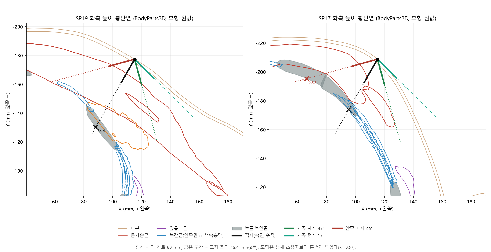
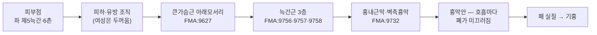
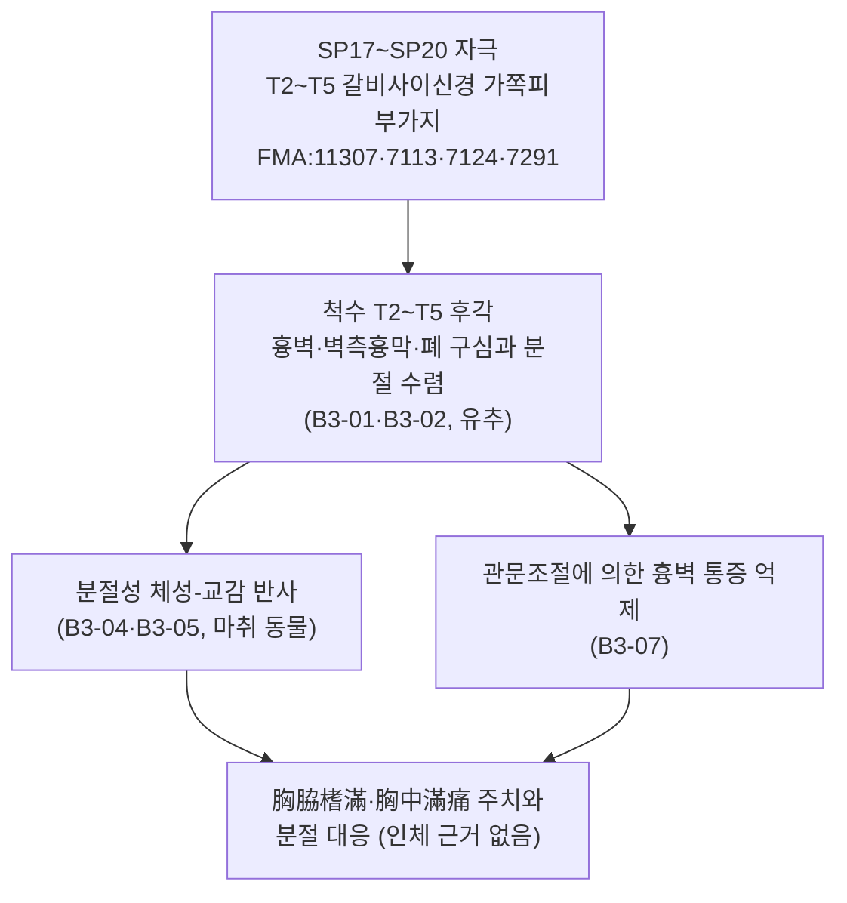

# 식두·천계·흉향·주영(SP17~SP20) 자침 깊이와 호흡: 흉막까지의 거리는 호흡·체형·자침 방향 중 무엇에 가장 크게 좌우되는가

> **질문**: 흡기와 호기에 따라 폐·흉막까지의 거리가 얼마나 달라지는가. 임상에서 자침 깊이를 정할 때 호흡 상태를 고려하는가. 체형이나 자침 방향이 호흡에 따른 변화보다 더 중요한가.
> **대상**: 足太陰脾經 흉부 4혈 — 食竇 SP17(제5늑간)·天谿 SP18(제4늑간)·胸鄕 SP19(제3늑간)·周榮 SP20(제2늑간), 모두 앞정중선 옆 6촌
> **분류**: 주제별 경혈 고증·가설 검증 (Tier 3) · **프레임워크**: v2.7 · **산출식**: ARI v3.0 (잠정 가중치 0.40/0.35/0.25, 이중 채점)
> **해부 근거**: FMA(Foundational Model of Anatomy) 5.1.0 로컬 색인 + BodyParts3D 4.0 3D 메쉬(FMA ID 기반, CC BY 4.0) 흉벽 두께 기하 측정, 생체 초음파·CT 문헌으로 보정
> **4대 원전**: 《中国针灸穴位通鉴》 足太阴脾经篇 · 《针灸腧穴通考》 足太阴脾经穴 · 《中国针灸证治通鉴》 第贰编 针灸禁忌·第叁编 内科·妇儿科病证 · 《中国针灸经络通鉴》 第叁编 足太阴经脉篇 (보조: 《東醫寶鑑》 鍼灸篇)
> **작성**: 2026-10-28 · 통합 생의학 마스터 DB v3.0 동기화(4혈) 완료

---

## 결론 요약

1. **흡기와 호기에 따른 흉막 거리 변화는 작고, 깊이를 정하는 기준이 아니다.** 벽측흉막은 흉내근막으로 늑골·늑간근 안쪽면에 붙어 있다. 따라서 피부에서 벽측흉막까지의 거리는 흉벽 두께 그 자체이며, 숨을 쉴 때 흉벽은 피부·근육·흉막이 한 덩어리로 움직인다. 두께를 바꾸는 요인은 늑간근·가슴근 수축 정도뿐이어서 조용한 호흡에서는 1 mm 안팎으로 추정된다(추론, B1-01). 이 네 혈 부위에서 흡기·호기 차이를 직접 잰 연구는 찾지 못했다. 최대 흡기와 최대 호기를 모두 잰 등 부위 초음파 연구에서도 흉막 깊이를 설명한 변수는 성별·BMI·흉곽 둘레였다(분산의 69.7%).
2. **이 네 혈에는 "안전한 호흡 위상"이 없다.** 제2~5늑간, 앞정중선 옆 6촌 아래에는 흡기·호기 어느 때든 폐가 있다. 호흡에 따라 폐 아래 경계가 크게 오르내리는 늑골횡격막오목은 이보다 아래(大包 SP21 이하)다. 호흡이 실제로 위험을 키우는 경로는 따로 있다. 바늘 끝이 벽측흉막에 닿거나 뚫은 상태에서 폐가 호흡마다 그 아래를 미끄러지는 것이다. 그래서 호흡은 **깊이 결정 변수가 아니라 유침 중 관리 변수**다.
3. **영향의 크기는 체형 > 자침 방향 > 자세 > 호흡 순이다.**
   - **체형**: 같은 제2늑간 쇄골중앙선에서 생체 초음파 중앙값은 22.8 mm, 과체중 외상 환자 CT 평균은 41~47 mm로 약 2배 차이 난다. 소아 CT에서도 흉부 혈위 28곳의 안전 깊이가 체중군 사이에서 1.24~2.11배 달랐고, SP17·SP19·SP20은 성별 차이도 유의했다.
   - **자침 방향**: 같은 자입 길이에서 수직 깊이는 sin θ배로 줄어든다(15° 평자는 직자의 0.26배). BodyParts3D에서 **가쪽으로 45° 이하로 눕혀 찌르면 바늘이 볼록한 흉벽의 접선 방향으로 진행해, 120 mm 안에서 흉벽에 닿지 않았다**(SP17·SP19·SP20 좌우).
   - **자세**: 어깨 위치만 바꿔도 피부~폐 거리가 7 mm 달라졌다.
   - **호흡**: 위 1항과 같이 1 mm 안팎으로 추정된다.
4. **교재 상한 직자는 이 부위에서 여유가 크지 않다.** BodyParts3D 흉벽 두께를 생체 초음파 중앙값으로 보정(k = 0.571)하면, 직자 축의 흉막 깊이는 SP17 23.1~26.3 mm, SP18 27.2~27.4 mm, SP19 31.1~31.5 mm, SP20 30.2 mm다. 60° 원뿔 안 어느 방향이든 가장 짧은 경로는 SP17 21.5 mm, SP20 24.1 mm, SP18 25.4 mm, SP19 26.4 mm였다. 교재 최대값 8푼(18.4 mm)을 그대로 직자하면 **食竇는 흉막까지 약 3 mm**, 나머지 세 혈은 6~8 mm만 남는다(보통 체형 기준). 마른 체형이면 이 여유는 사라진다. 《黃帝明堂經》의 "刺入四分"(9.2 mm)은 같은 조건에서 12~17 mm의 여유를 남기는 보수적인 값이다.
5. **고전 문헌은 이미 방향 해법을 가지고 있었다.** 《循經考穴編》은 네 혈 모두에 "刺入一分，沿皮向外一寸五分"이라는 별법을 실었다. 1푼 들어간 뒤 피부를 따라 바깥으로 1촌 5푼(약 34.5 mm) 나아가는 이 평자는 3D 측정에서 흉벽에 전혀 닿지 않는 경로다. 현대 교재의 "斜刺或向外平刺"는 이 별법의 계승으로 볼 수 있다.
6. **ARI v3.0 (4혈, 이중 채점)**: 食竇 66.25 ± 1.25 (C) · 天谿 66.25 ± 1.25 (C·H) · 胸鄕 60.0 ± 1.25 (C) · 周榮 66.25 ± 1.25 (C). 네 혈 모두 SI 25로 **게이트 3(⚠ 안전주의)**에 해당한다. 실체 판명 신뢰도는 원전 정합성(S_orig 81~94)이 높다. 그러나 반사 기전 인체 근거가 없어(S_reflex 25) C 등급에 머문다.

> 이 보고서는 해부학·문헌학적 안전성 분석이다. BodyParts3D는 단일 규범 모형이라 개인차·호흡·자세를 반영하지 못한다. 개별 환자의 안전 깊이는 체형 평가와(가능하면) 초음파로 정한다.

---

## 0. 질문과 분석 범위

| 항목 | 내용 |
| :--- | :--- |
| 출발점 | "식두·천계·흉향·주영은 사자 또는 횡자로 자침한다"는 강의 내용과 《针灸腧穴通考》의 "斜刺或向外平刺" 및 기흉 경고가 일치함을 확인한 뒤, 호흡·체형·자침 방향의 상대적 중요도를 묻는 질문 |
| 분석 축 | ① 원전의 자침 깊이·방향·금기 기술 ② 흉벽 층차와 두께(3D 측정 + 문헌 보정) ③ 호흡이 흉막 거리에 미치는 기전과 크기 ④ 체형·방향·자세와의 크기 비교 ⑤ ARI v3.0 |
| 3D 측정 | BodyParts3D 좌·우 SP17~SP20 8점 + 보정점 2점(제2늑간 쇄골중앙선 좌·우). 경로: 축면 직자, 3D 피부 법선, 가쪽·안쪽·아래·위로 45°·30°·15° 경사, 30°·45°·60° 원뿔(각 500방향) |
| 원전 검색 | 4대 원전 혈명·별명·번체/간체 전수 검색, 원문 행 확인. 《東醫寶鑑》 보조 |
| 외부 검색 | 통합 생의학 마스터 DB v3.0 동기화 4혈(PubMed·OpenAlex·Crossref) + PubMed 추가 검색(흉막 깊이·호흡 위상·자세·체형·기흉 위험인자) |

---

## A. 핵심 질문에 대한 분석: 호흡·체형·자침 방향·자세

### A-1. 호흡은 흉막까지의 거리를 어떻게 바꾸는가

| 요소 | 흡기 ↔ 호기 변화 | 자침 안전에 대한 의미 | 근거 수준 |
| :--- | :--- | :--- | :--- |
| 피부 ~ 벽측흉막 거리 | 벽측흉막(늑골면)은 흉내근막으로 흉벽 안쪽에 붙어 있어 흉벽과 함께 움직인다. 두께 변화는 늑간근 수축·가슴근(보조호흡근) 수축에 따른 것뿐 | **사실상 고정값**. 조용한 호흡에서 1 mm 안팎으로 추정. 호흡 위상으로 깊이를 고를 근거 없음 | 추론(B1-01) · 등 부위 최대 흡기/호기 초음파 연구에서 호흡이 최종 예측 변수에 들지 않음 |
| 흉벽 전체의 위치 | 흡기 때 위쪽 늑골은 앞·위로, 아래쪽 늑골은 옆으로 들림 | 피부·바늘·흉막이 함께 움직여 바늘 끝과 흉막의 상대 위치는 대체로 유지 | B1-01 |
| 폐(내장측흉막) | 벽측흉막 아래에서 접선 방향으로 미끄러짐(lung sliding) | 바늘 끝이 흉막에 닿았거나 뚫었으면 **호흡이 폐를 바늘 끝에 문지른다** → 기흉 기전의 핵심 | B1-01 · 영상 유도 폐생검 문헌의 기흉 위험인자 |
| 늑간 폭 | 흡기에 넓어지고 호기에 좁아짐 | 늑골을 받침(backstop)으로 쓰는 사자에서 바늘 끝이 늑간으로 빠질 수 있음. 3D 원뿔 경로의 25~57%만 흉막 전에 늑골을 먼저 만났다 | 3D 측정 · 늑골 촉진 정확도 73% 연구 |
| 폐 아래 경계 | 횡격막 운동으로 크게 이동 | SP17~SP20과 무관(이 높이에서는 늘 폐가 있음). 大包·期門·日月 같은 아래쪽 혈에서 중요 | B1-01 |
| 깊은 흡기·기침·말하기 | 보조호흡근(큰가슴근·작은가슴근) 수축, 흉곽 급변 | 깊이 자체보다 **유침 중 바늘과 폐의 상대 운동**이 커짐 | 추론 |

- 최대 흡기와 최대 호기 각각에서 59명(236회 측정)의 능형근 부위 흉막 깊이를 초음파로 잰 연구가 있다. 흉막 깊이 변이의 69.7%를 성별·BMI·흉곽 둘레가 설명했고, 초록 기준으로 호흡 상태는 최종 예측 모형에 들지 않았다 ([Valera-Calero 2021](https://doi.org/10.1111/ijcp.14176)). 부위가 등이라 이 네 혈에 그대로 옮길 수는 없다(유추).
- 같은 맥락에서 피부~흉막 거리가 짧을수록(≤ 30 mm, OR 2.25), 폐기종이 있을수록(COPD OR 2.28) 바늘에 의한 기흉 위험이 컸다 ([Lamfichekh 2023](https://doi.org/10.1097/RTI.0000000000000729); [Weon 2021](https://doi.org/10.1111/1754-9485.13187)). 깊이 변수는 흉벽 두께이고, 호흡 관련 변수는 폐 실질 상태다.

### A-2. 크기 비교: 무엇이 흉막 거리를 더 크게 바꾸는가

| 요인 | 흉막까지 거리(또는 수직 깊이)에 미치는 크기 | 근거 |
| :--- | :--- | :--- |
| **체형(체중·BMI·성별·유방)** | 같은 부위에서 약 2배. 제2늑간 쇄골중앙선: 생체 초음파 중앙값 22.8 mm vs 외상 CT 평균 41~47 mm. 소아 흉부 혈위 28곳(SP17·SP19·SP20 포함): 체중 최상위군/최하위군 1.24~2.11배, SP17·SP19·SP20은 여아가 유방 때문에 더 깊음 | [Nelson 2022](https://doi.org/10.1016/j.jemermed.2022.08.004) · [Stevens 2009](https://doi.org/10.1080/10903120802471998) · [Chang 2014](https://doi.org/10.1097/TA.0000000000000158) · papers.id 2504 ([Ma 2015](https://doi.org/10.1155/2015/126028)) |
| **자침 방향(각도)** | 수직 깊이 = 자입 길이 × sin θ → 45° 0.71배, 30° 0.50배, 15° 0.26배. 가쪽 경사는 볼록한 흉벽의 접선 방향이라 흉벽에 아예 닿지 않을 수 있음(3D: SP17·SP19·SP20 가쪽 45°·15° 경로 120 mm 내 미도달). 반대로 **안쪽 경사**는 흉벽에 수직에 가까워져 짧아질 수 있음(SP17 우측 안쪽 45°: 보정 24.3 mm) | 기하 · 3D 측정 4-2절 |
| **자세** | 어깨 아래 받침 하나로 피부~폐 거리 +7 mm(95% CI 4~10 mm), 근육 두께 최대 +4 mm | [Mitchell 2018](https://doi.org/10.1016/j.physio.2018.08.002) |
| **부위(늑간 위치)** | 제5늑간 앞겨드랑선은 제2늑간 쇄골중앙선보다 평균 13 mm 얇음. 단, 비만군에서는 반대가 될 수 있음 | [Inaba 2012](https://doi.org/10.1001/archsurg.2012.751) · [Alkan 2025](https://doi.org/10.1007/s11739-025-04110-2) |
| **호흡 위상** | 조용한 호흡 1 mm 안팎(추론), 이 네 혈 부위 직접 실측 없음 | A-1절 |

### A-3. 임상에서 호흡은 어떻게 고려하는가

- **깊이를 정할 때는 호흡 위상을 쓰지 않는다.** 깊이는 개인의 흉벽 두께(체형·유방·근육량, 가능하면 초음파)와 자침 각도로 정한다. 흡기 끝이나 호기 끝에 맞춰 깊이를 바꾸는 방법은 근거가 없다.
- **고전의 호흡 연동 자침(呼吸補瀉)은 보사 조작 이론이지 깊이 안전 규칙이 아니다.** 이 보고서는 그 효과를 판정하지 않는다.
- **유침 중에는 호흡을 관리한다.**
  - 환자에게 조용히 숨 쉬도록 한다. 깊은 숨, 기침, 말하기, 자세 바꾸기를 피하게 한다.
  - 깊은 곳에서 강하게 제삽하지 않는다.
  - 기침이 잦은 환자는 유침을 짧게 하거나 하지 않는다.
- **이 네 혈의 주치증 자체가 호흡 위험군이다.** 원천 주치(9절)는 "咳逆上氣"(天谿), "咳唾陳膿穢濁"(周榮), "胸脇榰滿"(네 혈 공통)이다. 곧 이 혈을 쓰는 환자는 기침·호흡곤란이 있을 가능성이 높아, 유침 중 호흡 관리가 특히 중요하다.
- **고위험군**:
  - 마른 체형·악액질
  - COPD·폐기종(과팽창 폐와 기포. 周榮은 상엽 쪽)
  - 기흉 병력, 천식 발작 중, 인공호흡 중
  - 마른 BMI 환자에게서 dry needling 뒤 양측 기흉이 생긴 증례가 있다 ([Dalton 2022](https://pubmed.ncbi.nlm.nih.gov/35420007/)).
- **작은가슴근을 노린 자입(SP19·SP20 층)**: 손가락으로 근육을 집어 올리는 방식(pincer)은 초보 시술자에서 정확도가 낮았고 사체 1례에서 흉막을 뚫었다. 근육 위를 평평하게 지나는 방식(flat)이 더 정확했다 ([Sánchez-Sánchez 2026](https://doi.org/10.3390/jfmk11010121)).

---

## 1. 문헌 스크리닝 표 (4대 원전 원문 발췌 및 한중 대조)

### 1-1. 흉부 자침 금기의 총칙

| 원문 | 출처 | 한국어 | 이 네 혈과의 관계 |
| :--- | :--- | :--- | :--- |
| 刺膺中陷，中肺，為喘逆仰息。 | 《素問·刺禁論》(《针灸腧穴通考》 中府 항, 《中国针灸证治通鉴》 针灸禁忌, 《東醫寶鑑》 鍼灸篇) | 가슴 앞을 깊이 찔러 폐에 맞으면 숨이 차서 거꾸로 치밀고 고개를 젖혀 숨쉰다 | 가슴 앞 전체(膺中)의 폐 손상 경고 |
| 刺腋下脇間內陷，令人欬。 | 《素問·刺禁論》(《证治通鉴》·《東醫寶鑑》) | 겨드랑이 아래 옆구리 사이를 깊이 찌르면 기침을 하게 된다 | 앞겨드랑이 쪽 가슴옆벽(6촌선)에 더 직접 해당 |
| 刺中肺三日死，其動為欬。 | 《素問·刺禁論》(《東醫寶鑑》 鍼灸篇, 《中国针灸穴位通鉴》 足太阳膀胱经篇 재인용) | 폐를 찌르면 사흘 만에 죽으며 그 변동은 기침이다 | 기흉의 초기 징후(기침)를 기록 |

### 1-2. 혈위별 4대 원전 대조 (위치·깊이·방향)

| 혈 | 《黃帝明堂經》(《甲乙》 3권) 위치·깊이 | 《针灸腧穴通考》【操作】 총칙 | 현대 교재 연혁(《腧穴通考》 수록) | 《循經考穴編》 별법 | 《東醫寶鑑》 |
| :--- | :--- | :--- | :--- | :--- | :--- |
| 食竇 SP17 | 在天谿下一寸六分陷者中，**舉臂取之**(통행본 《甲乙》 "仰而取之"는 전사 착오). 刺入四分，灸五壯 | 斜刺或向外平刺。勿直刺過深，以免刺入胸腔損傷肺臟 | 1957 南京·1판: 針三至四分 → 2판: 斜刺3~4分 → 4·5판: 斜刺或向外平刺0.5~0.8寸 → **6·7판: 0.5~0.9寸, "本經自食竇至大包諸穴，內有肺臟均不可深刺"** → 《中國針灸學》: 斜刺0.3~0.5寸 | 《銅人》針五分 … 一法刺入一分，沿皮向外一寸五分 | 鍼入四分，可灸五壯(銅人) |
| 天谿 SP18 | 在胸鄕下一寸六分陷者中，仰而取之。刺入四分，灸五壯 | 斜刺或向外平刺。不宜深刺和直刺，以免刺傷心肺 | 針四至五分 → 斜刺4~5分 → 4~7판: 斜刺或向外平刺0.5~0.8寸 → 《中國針灸學》 0.3~0.5寸 | 一法刺入一分，沿皮向外一寸五分 | 鍼入四分，可灸五壯 |
| 胸鄕 SP19 | 在周榮下一寸六分陷者中，仰而取之。刺入四分，灸五壯 | 斜刺或向外平刺。不宜深刺和直刺，**以免造成氣胸** | 위와 같음 | 一法刺入一分，沿皮向外一寸五分，可灸二七壯 | 鍼入四分，可灸五壯 |
| 周榮 SP20 | 在中府下一寸六分陷者中，仰而取之。刺入四分，灸五壯 | 斜刺或向外平刺。不宜深刺和直刺，以免刺傷心肺 | 위와 같음 | 一法刺入一分，沿皮向外一寸五分，可灸七壯 | 鍼入四分，**禁不可灸**(銅人) |

- **위치 기술의 구조**: 네 혈은 모두 "윗혈 아래 1촌 6푼"의 사슬로 정해지며 기점은 中府(手太陰)다(《穴位通鉴》 "历代文献记载基本一致"). 1촌 6푼은 위아래 늑간 사이의 거리로 해석된다(《穴位通鉴》 食竇 简要结语).
- **현대 교재의 "0.5~0.8寸"은 사자·평자를 전제로 한 바늘 진행 길이**다. 고전 직자 깊이 "四分"과 같은 축의 값이 아니다(5절).
- **周榮 禁灸**: 《醫學入門》·《針灸大全》(《证治通鉴》 표2-4① 禁灸穴 주)·《東醫寶鑑》(銅人)이 禁灸로 기록했다. **禁鍼 기록은 4대 원전 어디에도 없다.**
- 《中国针灸经络通鉴》 足太陰經脈篇은 네 혈을 경맥 순행상 "由腹哀上膈，循食竇、天谿、胸鄕、周榮，由周榮外曲折向下至大包"로 정리한다. 위치·깊이 정보는 없다.

---

## 2. 원천/재인용 구분 표

| 기술 | 원천(최초) | 재인용·계승 | 비고 |
| :--- | :--- | :--- | :--- |
| 위치 "下一寸六分陷者中" | 《黃帝明堂經》(《甲乙》 3권 수록) | 《千金》·《外臺》·《醫心方》·《銅人》·《資生經》·《十四經發揮》·《大成》·《類經圖翼》 등 | 4혈 모두 후대 일치 |
| 자침 깊이 "刺入四分" | 《黃帝明堂經》 | 《醫心方》·《銅人》·《聖濟總錄》·《資生經》·《醫學入門》·《類經圖翼》·《東醫寶鑑》 등 | 《循經考穴編》이 食竇에 "《銅人》針五分"으로 인용한 것은 이문(4절 S_orig ④) |
| "沿皮向外一寸五分" 평자 별법 | 《循經考穴編》(明) | 현대 교재 "向外平刺"로 계승된 것으로 판단 | 원천은 명대. 이전 문헌에 없음 |
| "斜刺或向外平刺 0.5~0.8寸" | 4·5판 《針灸學》 | 6·7판(0.5~0.9寸, 食竇)·한국 공통교재(5~8푼) | 현대 교재 |
| "本經自食竇至大包諸穴，內有肺臟均不可深刺" | 6·7판 《針灸學》 | 《针灸腧穴通考》 食竇 【操作】 수록 | 현대 교재 |
| 胸部 자침 폐 손상 경고 | 《素問·刺禁論》 | 《针灸腧穴通考》 中府·《证治通鉴》 총론·《東醫寶鑑》 | 부위 단위 금기 |
| 食竇 = 命關 | 《扁鵲心書》(宋) | 1957 南京 《針灸學》 별명 채택 | 《针灸腧穴通考》은 위치·주치가 달라 별명으로 인정하지 않음 |

---

## 3. 이명·별칭 검증 표 (KJH 경혈 이명 대조 DB + 4대 원전)

| 혈 | KJH DB 이명 | 원전상 이명·혼동 | 판정 |
| :--- | :--- | :--- | :--- |
| 食竇 SP17 | 없음 | 命關(《扁鵲心書》 "在脇下宛中，舉臂取之，對中脘向乳三角取之"). 《证治通鉴》 한글 번역본 역주는 "命關은 食竇로 보는 것이 일반적"이라 하나, 《腧穴通考》은 정위·주치가 달라 별명으로 인정하지 않음 | 별명 불인정(《腧穴通考》 따름). 《扁鵲心書》의 대량 뜸(百壯·二三百壯)은 이 보고서의 자침 분석에서 제외 |
| 天谿 SP18 | 없음 | "天溪/太溪" 자형 혼동: 통행본 《甲乙》 9권의 "胸中滿痛，乳腫，潰癰，咳逆上氣 … 太溪主之"는 天谿의 주치가 잘못 들어간 것 | 《腧穴通考》으로 완전 교감 |
| 胸鄕 SP19 | 없음 | 없음 | 혼동 없음 |
| 周榮 SP20 | 없음 | "周榮/周營" 통용(전세본 《甲乙》), 《甲乙》 9권 탈문으로 周榮 주치 일부가 天谿 조에 섞임 | 《腧穴通考》으로 교감 |

---

## 4. 3D 공간 좌표 및 Layer 1~5 층차 구조도

### 4-1. 측정 방법 (FMA·BodyParts3D)

- **모형**: BodyParts3D 4.0(일본 생명과학DB센터, CC BY 4.0). 단일 성인 남성 규범 3D 모형(단위 mm). 피부(FMA:7163), 좌·우 제1~7늑골·제2~6늑연골, 큰가슴근(FMA:9627)·작은가슴근(FMA:13109)·앞톱니근(FMA:13397), 바깥·속·최내늑간근(FMA:9756·9757·9758) 메쉬를 썼다.
- **좌표계**: X = 정중선 기준 좌(+)·우(−), Y = 전후(전방 −), Z = 높이(상방 +). 1 B-cun = 19.2 mm(두 쇄골 중점 사이 8 B-cun), 6촌 = 115.2 mm.
- **혈위 피부점**: 같은 X에서 제n늑골(늑연골) 앞쪽 조각의 하연과 제n+1늑골 상연의 중앙 높이를 늑간 높이로 정하고, 정면에서 피부에 닿는 점을 피부점으로 삼았다. 이 모형에서 제2·3늑골은 6촌선(X = 115.2 mm)까지 뻗지 않아 SP20은 X = 95.2 mm, SP19는 X = 107.2 mm에서 늑간 높이를 정했다(피부점은 모두 6촌선).
- **벽측흉막 근사**: BodyParts3D에는 흉막·폐 실질 표면 메쉬가 없다. 그래서 경로가 흉벽(늑간근·늑골·늑연골)에 처음 들어간 뒤 20 mm 안에서 흉벽을 마지막으로 빠져나가는 점을 벽측흉막 위치로 보았다. 흉내근막·흉막 두께(1 mm 안팎)는 무시했다.
- **경로**: ① 축면 직자(피부 법선을 수평면에 투영 — CT 축면 측정과 같은 조건) ② 3D 피부 법선(반경 25 mm 평균) ③ 축면 법선에서 가쪽·안쪽(수평)과 아래·위(수직)로 45°·60°·75° 기울인 경로(피부와 45°·30°·15°) ④ 축면 법선 기준 30°·45°·60° 원뿔 안의 무작위 500방향. 교차 계산은 Möller–Trumbore 광선-삼각형 교차법.
- **한계**: ① 흉막·폐 실질 메쉬 없음(흉벽 안쪽면으로 근사) ② 단일 남성 모형, 팔을 내린 자세 → 食竇의 "舉臂取之" 자세, 유방, 체형, 호흡은 반영되지 않음 ③ SP20 피부점은 이 모형에서 앞겨드랑주름에 가까워 축면 경로가 큰가슴근을 스치듯 지나므로 신뢰도가 낮다.

### 4-2. 측정 결과 (BodyParts3D 원값, mm)

| 혈위 | 늑간 폭 | 축면 직자: 첫 근육 | 축면 직자: 흉막 | 3D 법선 직자: 흉막 | 원뿔 최단(모든 방향) | 원뿔에서 늑골이 먼저 막는 비율 | 가쪽 45° | 가쪽 15° | 안쪽 45° | 아래 45° |
| :--- | ---: | ---: | ---: | ---: | ---: | :---: | :---: | :---: | :---: | :---: |
| 周榮 SP20-좌 | 22.2 | — (근육 스침) | 52.9 | 50.4 | 42.1 | 27~45% | 미도달 | 미도달 | 64.5 | 52.2 |
| 周榮 SP20-우 | 21.9 | 28.8 | 52.9 | 49.5 | 42.8 | 27~48% | 미도달 | 미도달 | 70.5 | 52.5 |
| 胸鄕 SP19-좌 | 18.9 | 11.5 | 54.4 | 48.8 | 46.2 | 25~52% | 미도달 | 미도달 | 범위 밖 | 55.4 |
| 胸鄕 SP19-우 | 17.5 | 11.5 | 55.1 | 49.8 | 46.9 | 31~48% | 미도달 | 미도달 | 54.4 | 55.7 |
| 天谿 SP18-좌 | 31.4 | 6.6 | 47.9 | 46.5 | 44.5 | 35~57% | 58.7 | 미도달 | 범위 밖 | 48.8 |
| 天谿 SP18-우 | 30.8 | 7.5 | 47.6 | 45.6 | 44.7 | 37~53% | 62.2 | 미도달 | 범위 밖 | 48.5 |
| 食竇 SP17-좌 | 21.9 | 14.5 | **40.4** | 43.4 | **37.6** | 45~47% | 미도달 | 미도달 | 50.8 | 52.0 |
| 食竇 SP17-우 | 21.6 | 19.9 | 46.0 | 48.5 | **37.8** | 40~54% | 미도달 | 미도달 | 42.6 | 53.8 |

- "미도달" = 120 mm 안에서 흉벽에 닿지 않음(볼록한 흉벽의 접선 방향으로 연부조직 안을 지나감). "범위 밖" = 피부점 150 mm 밖에서 흉벽에 닿아 계산 범위를 벗어남.
- **가쪽으로 눕힌 경로가 가장 안전하다.** 가쪽 45°·15°는 SP17·SP19·SP20에서 모두 흉벽에 닿지 않았다. SP18만 가쪽 45°에서 58.7~62.2 mm(보정 33.5~35.5 mm)에 닿았다. 반대로 **안쪽 경사는 짧아질 수 있다**(SP17 우측 안쪽 45° 42.6 mm → 보정 24.3 mm, 직자 축면보다 짧음).
- 원뿔 경로 가운데 흉막보다 늑골을 먼저 만나는 비율은 25~57%였다. 늑골이 "받침"이 되는 경우는 절반 정도이고, 나머지 방향은 늑간으로 곧장 흉막에 닿는다.

### 4-3. 체형 보정 (생체 초음파·CT 문헌)

단일 모형의 흉벽 두께를 실제 집단과 맞추기 위해, 같은 부위(제2늑간 쇄골중앙선)를 잰 문헌 값을 보정점으로 썼다. 모형의 축면 직자 흉막 깊이는 좌·우 모두 39.9 mm였다.

| 보정 기준 | 실측값 (mm) | 보정 계수 k = 실측/모형 | 대표 집단 |
| :--- | :---: | :---: | :--- |
| 생체 초음파 중앙값 ([Nelson 2022](https://doi.org/10.1016/j.jemermed.2022.08.004)) | 22.8 | **0.571** | 건강 자원자, 선형 탐촉자(조직 압박 가능) |
| 외상 CT 평균 우·좌 ([Stevens 2009](https://doi.org/10.1080/10903120802471998)) | 45 · 41 | 1.13 · 1.03 | 성인 외상 환자 110명 |
| 외상 CT 평균 ([Chang 2014](https://doi.org/10.1097/TA.0000000000000158)) | 43.3~46.7 | 1.09~1.17 | 외상 환자 100명, 평균 BMI 26.8 |

- 이 모형은 과체중 외상 CT 집단과 비슷하고, 건강 자원자 초음파보다 약 1.75배 두껍다. 한국 한의 외래 환자는 건강 자원자 쪽에 가깝다고 보아, **k = 0.571을 "보통 체형" 기준**으로 쓰고 k ≈ 1.0~1.17을 "과체중" 기준으로 병기한다. 마른 체형은 k = 0.571보다 더 얇다.
- 보정점이 제2늑간 한 곳뿐이고, 초음파는 탐촉자 압박으로 실제보다 얕게 잴 수 있다. 그러므로 아래 보정값은 "보통 체형의 대략적 범위"로만 쓴다.

| 혈위 (좌/우) | 축면 직자 흉막: 모형 | 보통 체형(k 0.571) | 과체중(k 1.03~1.17) | 원뿔 최단 보통 체형 | 교재 최대 18.4 mm 직자 시 남는 여유(최단 경로 기준) | 《明堂》 4푼 9.2 mm 직자 시 여유 |
| :--- | :---: | :---: | :---: | :---: | :---: | :---: |
| 周榮 SP20 | 52.9 / 52.9 | 30.2 / 30.2 | 54~62 | 24.1 / 24.5 | **5.7 / 6.1 mm** | 14.9 / 15.3 mm |
| 胸鄕 SP19 | 54.4 / 55.1 | 31.1 / 31.5 | 56~64 | 26.4 / 26.8 | **8.0 / 8.4 mm** | 17.2 / 17.6 mm |
| 天谿 SP18 | 47.9 / 47.6 | 27.4 / 27.2 | 49~56 | 25.4 / 25.5 | **7.0 / 7.1 mm** | 16.2 / 16.3 mm |
| 食竇 SP17 | 40.4 / 46.0 | 23.1 / 26.3 | 42~54 | **21.5 / 21.6** | **3.1 / 3.2 mm** | 12.3 / 12.4 mm |

- **食竇가 네 혈 중 가장 얕다.** 큰가슴근 아래모서리 쪽이라 근육층이 얇기 때문이다(축면 경로 큰가슴근 두께 약 20 mm, 天谿는 36 mm). 이는 6·7판 교재와 《腧穴通考》이 食竇에 "勿直刺過深，以免刺入胸腔損傷肺臟"을 가장 강하게 적은 것과 맞는다.
- **여성은 天谿·食竇 부위에 유방 조직이 있어 흉벽이 더 두껍다**(소아 CT, 성인 CT 모두 여성이 깊음 — papers.id 2504, B2-07). 다만 유방 아래 늑간은 자세에 따라 위치가 크게 바뀐다.

### 4-4. Layer 1~5 층차 구조도 — 좌측 食竇 SP17 (가장 얕은 혈)

| Layer | 구조 (FMA) | 축면 직자 깊이 (모형 → 보통 체형) | 비고 |
| :---: | :--- | :--- | :--- |
| 1 피부·피하 | 다섯째 갈비사이신경 가쪽피부가지 FMA:7291, 가슴배벽정맥 FMA:13416 | 0~14.5 → 0~8.3 mm | 《明堂》 4푼(9.2 mm)이 여기~Layer 2 입구 |
| 2 표층근 | 큰가슴근 FMA:9627 (안쪽가슴근신경 FMA:65293), 앞톱니근 갈래 FMA:13397 (긴가슴신경 FMA:65275, C5~C7), 배바깥빗근 기시부 FMA:13335 | 14.5~34.1 → 8.3~19.5 mm | 교재 5~8푼(11.5~18.4 mm) 직자가 여기 |
| 3 심층근 | 바깥·속·최내늑간근 FMA:9756·9757·9758, 제5·6늑골 | 35.3~40.2 → 20.2~23.0 mm | 늑골에 막히는 방향은 원뿔의 약 절반 |
| 4 신경혈관속 | 다섯째 갈비사이신경 FMA:8605, 다섯째 뒤갈비사이동·정맥 FMA:12288·12530(위 늑골 아래모서리), 가쪽가슴동맥 FMA:22674(Layer 2 표면) | 약 20~23 mm(늑간 위쪽) | 늑간 아래쪽 1/2로 들어가면 신경혈관속을 피함(B1-01) |
| 5 심부장기 | 흉내근막 FMA:9732 → **벽측흉막(늑골면) → 흉막안 → 폐(좌 상엽 혀구역·하엽)** | 40.4 → **23.1 mm** (원뿔 최단 21.5 mm) | 교재 최대 18.4 mm 직자 시 3 mm 여유 |

- **두 교재 모두 Layer 5(흉막·폐)를 수록하지 않는다**(6절). 교재 해부구조는 늑간근에서 끝나며, 그 아래 1~2 mm에 흉막이 있다는 사실이 표에 없다.

---

## 5. 자침 깊이 계산표 (문헌별 자침 깊이 DB, 1푼 = 2.3 mm)

| 문헌·교재 | 食竇 SP17 | 天谿 SP18 | 胸鄕 SP19 | 周榮 SP20 |
| :--- | :---: | :---: | :---: | :---: |
| 《針灸甲乙經》·《黃帝明堂經》(황룡상 감수) | 4푼 = 9.2 mm | 4푼 = 9.2 mm | 4푼 = 9.2 mm | 4푼 = 9.2 mm |
| 《東醫寶鑑》(銅人) | 4푼 = 9.2 mm | 4푼 = 9.2 mm | 4푼 = 9.2 mm | 4푼 = 9.2 mm |
| 《循經考穴編》 별법 | 1푼 직자 후 沿皮向外 1촌 5푼 (진행 34.5 mm) | 같음 | 같음 | 같음 |
| 《針灸經驗方》 | 미기술 | 미기술 | 미기술 | 미기술 |
| 경락수혈학·침구의학 공통교재 | 사자·횡자 5~8푼 = 11.5~18.4 mm | 같음 | 같음 | 같음 |
| 《针灸腧穴通考》 선호 자침법 | 사자·횡자 | 사자·횡자 | 사자·횡자 | 사자·횡자 |

**자입 길이와 각도에 따른 수직 깊이 (mm) — 피부와 이루는 각 θ, 수직 깊이 = L × sin θ (평면 흉벽 근사)**

| 자입 길이 L | 직자 90° | 사자 45° | 사자 30° | 평자 15° | 食竇 보통 체형 최단 21.5 mm 대비 |
| :--- | :---: | :---: | :---: | :---: | :--- |
| 4푼 9.2 mm (《明堂》) | 9.2 | 6.5 | 4.6 | 2.4 | 모든 각도에서 여유 ≥ 12 mm |
| 5푼 11.5 mm (교재 하한) | 11.5 | 8.1 | 5.8 | 3.0 | 직자도 여유 10 mm |
| 8푼 18.4 mm (교재 상한) | **18.4** | 13.0 | 9.2 | 4.8 | **직자 여유 3.1 mm**, 45° 8.5 mm |
| 1촌 5푼 34.5 mm (《循經考穴編》 평자) | 34.5 | 24.4 | 17.3 | 8.9 | 평면 근사로도 15° 이하면 여유 12 mm 이상. 실제로는 볼록한 흉벽이라 가쪽 평자는 흉벽에 닿지 않음(4-2절) |

- 평면 근사는 흉벽이 평평하다고 본 값이다. 실제 6촌선은 가슴 앞면에서 옆면으로 꺾이는 곳이라, **가쪽으로 눕힌 바늘은 평면 근사보다 훨씬 안전**하고 **안쪽으로 눕힌 바늘은 평면 근사보다 위험**할 수 있다.
- `'0'`(금침) 기록은 네 혈 모두 없다. 周榮의 禁灸 기록은 뜸에 관한 것이다.

---

## 6. 해부학 구조 교재 비교표 및 FMA 표준 실체 매핑

| 혈 | 공통 FMA 실체 | 공통교재 단독 | 김재효 교재 단독 | 쟁점 |
| :--- | :--- | :--- | :--- | :--- |
| 食竇 SP17 | Pectoralis major FMA:9627 · External intercostal FMA:9756 · Lateral thoracic artery FMA:22674 (3개) | Internal intercostal FMA:9757 · Intercostal nerve FMA:6028 · Thoracoepigastric vein FMA:13416 | Serratus anterior FMA:13397 · External oblique FMA:13335 · Long thoracic nerve FMA:65275 · Lateral pectoral nerve FMA:65296 · Lateral cutaneous branch of 5th intercostal nerve FMA:7291 · 5th posterior intercostal a./v. 가지 등 (10개) | 김재효 교재가 제5늑간 가쪽의 앞톱니근·배바깥빗근 기시를 더함. 3D 축면 경로에서는 큰가슴근 → 늑간근만 지나 앞톱니근은 경로 밖(가쪽)에 있음 |
| 天谿 SP18 | FMA:9627 · 9756 · 22674 · Internal thoracic vein FMA:4729(parent) (4개) | FMA:9757 · 6028 · 13416 · 71521 | Pectoralis minor FMA:13109 · FMA:13397 · 65275 · 65293 · 65296 · Lateral cutaneous branch of 4th intercostal nerve FMA:7124 · Pectoral branch of thoraco-acromial artery FMA:23062 등 (12개) | 작은가슴근: 3D 축면 경로에서 SP18은 큰가슴근 바로 아래 늑간근(작은가슴근 아래모서리 바깥). 교재 차이는 위치 미세차로 설명 |
| 胸鄕 SP19 | Pectoralis minor FMA:13109 · FMA:9756 · 22674 · 4729 (4개) | FMA:9757 · 6028 · 71521 | **Pectoralis major FMA:9627** · FMA:13397 · 65275 · 65293 · 65296 · FMA:7113 등 (12개) | **공통교재가 큰가슴근을 빠뜨림.** 3D 축면 경로는 큰가슴근(11.5~39.1 mm) → 작은가슴근(37.9~50.4 mm) → 늑간 순. 김재효 교재가 맞음 → S_clarity 50(추론으로 조정) |
| 周榮 SP20 | FMA:9627 · 9756 · 4729 · 22674 (4개) | FMA:9757 · 6028 · 71521 | FMA:13109 · 13397 · 65275 · 65293 · 65296 · FMA:11307 · FMA:23062 등 (12개) | 작은가슴근: 《穴位通鉴》 局部解剖도 "胸大肌中，下层为胸小肌". 김재효 교재와 일치 |

- **분절**: 피부·늑간 = T2(周榮)·T3(胸鄕)·T4(天谿)·T5(食竇) 갈비사이신경. 근육 = 안쪽·가쪽가슴근신경(C5~T1), 긴가슴신경(C5~C7, FMA segmental). FMA 분절 합집합: SP17 {C5, C6, C7, T5}, SP18 {C5~C7, T4}, SP19 {C5~C7, T3}, SP20 {C5~C7}(제2갈비사이신경은 FMA 분절 미기재 → B1-01로 T2 보완).
- **늑골면 벽측흉막도 같은 갈비사이신경(T2~T5)의 지배를 받는다**(B1-01). 흉막을 건드리면 그 분절의 날카로운 흉통이 생기며, 이는 자침 중 경고 신호다.
- 두 교재 모두 **Layer 5(흉막·폐) 미수록**.

---

## 7. 공간 변위 분기 추론 (Tri-Target)

| Target | 정의 | SP17~SP20 위치 | 쌍별 Δ |
| :--- | :--- | :--- | :--- |
| Target 1 (고전 문헌) | 《明堂》 "中府 → 下一寸六分" 사슬, 정중선 옆 6촌(《針方六集》 "侠任脉两旁各六寸") | 제2·3·4·5늑간 × 6촌 | — |
| Target 2 (촉진 실체화) | "陷者中" = 늑간 함요(위 늑골 하연과 아래 늑골 상연 사이) | 같은 늑간의 함요, X = 6촌 | Δ(1,2) < 10 mm |
| Target 3 (WHO 2008, B1-05) | 제2~5늑간, 앞정중선 옆 6 B-cun | 같음 | Δ(1,3), Δ(2,3) < 10 mm |

- **판정: Target 1 ≡ 2 ≡ 3** (분기 없음). "一寸六分"(B-cun 기준 30.7 mm)은 이 모형의 늑골 중심 간격과 같은 크기이며, 고전 사슬이 늑간 단위로 맞물린다.
- **참고 이설(Target 제외)**: ① 《循經考穴編》 食竇 일법 "乳下一寸六分，橫過一寸，與中庭平" — 정위가 1촌 다르고 근거 불명(《腧穴通考》 "未详所据") ② 《勉學堂針灸集成》 天谿 "直乳頭後二寸" — 단독 이설. 둘 다 후대 이설이므로 Δ > 10 mm라도 Target으로 분기하지 않는다.
- **자세 변수**: 食竇는 원래 "舉臂取之"다. 팔을 들면 큰가슴근이 늘어나 얇아지고 늑간이 넓어진다(추론). 그 자세로 자침하면 흉막까지의 여유가 팔을 내린 자세보다 줄어들 수 있으므로, **취혈 자세와 자침 자세를 같게** 하고 거리를 다시 확인한다.

---

## 8. 생의학적 반사 기전도, B-Check 및 외부 검색 로그

### 8-1. 반사 기전 요약 (P_single 기준)

- 기전은 **분절 대응 가설** 수준이다. 이 네 혈을 특정한 인체 생리 실험·RCT는 없다.

### 8-2. B-Check 6항목 채점표 (채점자 A / B)

| 항목 | 食竇 SP17 | 天谿 SP18 | 胸鄕 SP19 | 周榮 SP20 |
| :--- | :---: | :---: | :---: | :---: |
| ① 말초 실체 (B1-01·B2-09, FMA exact) | 2 / 2 | 2 / 2 | 2 / 2 | 2 / 2 |
| ② 분절 정합 (T2~T5 ↔ 흉벽·흉막·폐, B1-03·B3-01) | 2 / 2 | 2 / 2 | 2 / 2 | 2 / 1 (T2 FMA 미기재) |
| ③ 구심 섬유·수용체 (B3-06, 유추) | 1 / 1 | 1 / 1 | 1 / 1 | 1 / 1 |
| ④ 중추 경로 (B3-02·B3-05, 유추) | 1 / 1 | 1 / 1 | 1 / 1 | 1 / 1 |
| ⑤ 원심 효과 방향 ↔ P_single (B3-20) | 1 / 0 | 1 / 1 | 1 / 0 | 1 / 1 |
| ⑥ 인체 전환 (Layer A 인체 기전 연구) | 0 / 0 | 0 / 0 | 0 / 0 | 0 / 0 |
| **합계** | **7 / 6** | **7 / 7** | **7 / 6** | **7 / 6** |
| 판정 | 미부합 → 가설 | 미부합 → 가설 | 미부합 → 가설 | 미부합 → 가설 |

### 8-3. 외부 API 검색 로그 (통합 생의학 마스터 DB v3.0, 2026-10-28 11:27~11:28, 트리거 rank6)

| 혈위 | PubMed (HTTP·수집) | OpenAlex (HTTP·수집) | Crossref (HTTP·수집) | 후보 | 신규 병합 | 기존 병합 | 결과 |
| :--- | :---: | :---: | :---: | ---: | ---: | ---: | :--- |
| SP17 食竇 | 200 · 0 | 200 · 1 | 200 · 0 | 1 | 0 | 1 | papers.id 2504 연결 |
| SP18 天谿 | 200 · 0 | 200 · 1 | 200 · 0 | 1 | 0 | 1 | papers.id 1810(손목 염좌 아시혈 증례, 주제 무관 오검출) |
| SP19 胸鄕 | 200 · 0 | 200 · 1 | 200 · 0 | 1 | 0 | 1 | papers.id 2504 연결 |
| SP20 周榮 | 200 · 0 | 200 · 2 | 200 · 0 | 2 | 1 | 1 | papers.id 2504 + 2505(오십견 침 치료, 임상) |

- 전 소스 성공, validate 통과. PubMed 쿼리는 혈위 코드·병음·한자 × 침·전침 × 신경·반사·자율신경·기전·해부, 그리고 《中国针灸》·《针刺研究》 저널 필터였다.
- **이 네 혈의 반사 기전 논문은 없다.** 관련 Layer A는 안전 깊이 영상 연구 1편(papers.id 2504, 소아 CT, SP17·SP19·SP20 포함)뿐이다.
- **추가 PubMed 검색(DB 미병합)**: 흉막 깊이·호흡 위상([Valera-Calero 2021](https://doi.org/10.1111/ijcp.14176)), 자세([Mitchell 2018](https://doi.org/10.1016/j.physio.2018.08.002)), 늑골 촉진 정확도([Cushman 2020](https://doi.org/10.1016/j.jbmt.2020.10.008)), 흉벽 두께 생체 초음파·CT([Nelson 2022](https://doi.org/10.1016/j.jemermed.2022.08.004), [Inaba 2012](https://doi.org/10.1001/archsurg.2012.751), [Chang 2014](https://doi.org/10.1097/TA.0000000000000158), [Stevens 2009](https://doi.org/10.1080/10903120802471998), [Sanchez 2011](https://doi.org/10.1111/j.1553-2712.2011.01159.x), [Alkan 2025](https://doi.org/10.1007/s11739-025-04110-2)), 기흉 위험인자([Lamfichekh 2023](https://doi.org/10.1097/RTI.0000000000000729), [Weon 2021](https://doi.org/10.1111/1754-9485.13187)), 증례([Dalton 2022](https://pubmed.ncbi.nlm.nih.gov/35420007/)), 작은가슴근 자입([Sánchez-Sánchez 2026](https://doi.org/10.3390/jfmk11010121)), 성인 흉부 혈위 CT 안전 깊이([Sheu·Lin 1992](https://pubmed.ncbi.nlm.nih.gov/1338010/), 중국어, 초록만 확인).

---

## 9. 주치증 분리 표 (단독 자침 P_single vs 복합 배오)

| 혈위 | P_single (《黃帝明堂經》 원천) | 후대 추가·배오 | 호흡 위험과의 관련 |
| :--- | :--- | :--- | :--- |
| 食竇 | 胸脇榰滿，膈中雷鳴，察察隱隱，常有水聲(懸飲 유사) | 《循經考穴編》 痰飲·食積·噎膈·翻胃(《腧穴通考》: 膈俞 주치 혼입) · 《醫學綱目》 饑不能食·呕而雷鳴: 大迎·中極·食竇 · 《扁鵲心書》 黃疸·脇下脹悶에 灸食竇(命關, 뜸) | 흉수(懸飲) 환자는 폐가 흉벽에서 밀려나 있을 수 있으나 흉수 천자 위험이 따름(추론) |
| 天谿 | 胸中滿痛，乳腫潰癰，**咳逆上氣**，咽喉有聲 | 현대: 乳汁少·乳癰 | 기침·상기 환자 → 유침 중 기침 위험 |
| 胸鄕 | 胸脇榰滿，却引背痛，臥不得轉側 | 현대: 胸脇脹滿 | 흉막성 통증 유사 |
| 周榮 | 胸脇支滿，不得俛仰，飲食不下，**咳唾陳膿穢濁** | 《針方六集》 喜飲·乳癰 · 《证治通鉴》 痛經 기혈허한형 배오(周榮·氣海·歸來·腎俞·血海·足三里·三陰交, 1983 현대 처방) | 기침·객담·폐 질환 환자 → 폐 실질 이상(기종·기포) 가능 |

- 네 혈의 원천 주치는 모두 흉곽·폐 증상이다. **주치 대상 환자군이 곧 호흡 위험군**이라는 점이 이 보고서의 임상적 요점이다.

---

## 10. ARI v3.0 프로파일 평가표 및 최종 결론

### 10-1. 하위 점수와 루브릭 단계 (채점자 A / B)

| 혈위 | S_orig ①②③④ (A) | S_orig ①②③④ (B) | S_clarity A/B | S_reflex A/B | SI A/B |
| :--- | :--- | :--- | :---: | :---: | :---: |
| 食竇 SP17 | 75·100·75·100 = 87.5 | 75·100·75·75 = 81.25 | 75 / 75 | 25 / 25 | **25 / 25** |
| 天谿 SP18 | 75·100·75·100 = 87.5 | 75·100·75·75 = 81.25 | 75 / 75 | 25 / 25 | **25 / 25** |
| 胸鄕 SP19 | 75·100·100·100 = 93.75 | 75·100·100·75 = 87.5 | 50 / 50 | 25 / 25 | **25 / 25** (B 조정 전 75) |
| 周榮 SP20 | 75·100·75·100 = 87.5 | 75·100·75·75 = 81.25 | 75 / 75 | 25 / 25 | **25 / 25** (B 조정 전 75) |

**루브릭 판정 근거**

- **S_orig**:
  - ① 《明堂》이 깊이(四分)는 명시했지만 위치는 이웃 혈에 기대는 상대 기술("下一寸六分")이라 75.
  - ② 네 혈 모두 "历代文献记载基本一致"라 100.
  - ③ 食竇 命關, 天谿 太溪 혼동, 周榮 周營·탈문 혼입은 《腧穴通考》로 해소되어 75. 胸鄕은 혼동이 없어 100.
  - ④ 食竇의 "仰而取之 → 舉臂取之", 天谿의 "太溪 → 天谿", 胸鄕의 "輸側 → 轉側", 周榮의 《甲乙》 탈문을 《腧穴通考》·《穴位通鉴》이 완전 교감했다(A 100). B는 《循經考穴編》의 "《銅人》針五分"(食竇) 같은 미해소 이문, 교감이 주치 문구에 한정된 점을 들어 75.
- **S_clarity**:
  - 食竇·天谿·周榮은 두 교재가 핵심 구조(큰가슴근·늑간근·가쪽가슴동맥)에서 FMA로 일치하고 B1으로 확인된다. 혈위 특이 실측은 소아 CT(papers.id 2504)뿐이라 75.
  - 胸鄕은 공통교재가 표층근(큰가슴근)을 빠뜨려 두 교재가 불일치한다. 3D·《穴位通鉴》 局部解剖로 조정했으므로 50.
- **S_reflex**: 네 혈 모두 B-Check 6~7, 인체·동물 기전 연구 없음 → 25. 天谿는 관련 Layer A가 0편(papers.id 1810은 오검출)이라 **게이트 2(H)**.
- **SI**:
  - 금침 기록은 없지만 보통 체형 보정에서 교재 상한(18.4 mm) 직자 시 흉막까지 3~8 mm(< 10 mm)다. 체형 변수가 크고(최대 2배 이상), 문헌에 기흉 경고가 명시되어 25.
  - 채점자 B는 처음에 胸鄕·周榮을 축면 직자 보정 깊이(30~31 mm, 여유 12~13 mm)를 근거로 75로 매겼다. 그러나 원뿔 최단 경로 여유가 6~8 mm이고 마른 체형에서는 더 줄어든다는 점을 들어 25로 조정했다(15점 이상 불일치 조정 기록).

### 10-2. ARI v3.0 최종 프로파일

| 혈위 | ARI-Core (평균 ± 반범위) | 등급 | 게이트 | SI | 등가중치 민감도 |
| :--- | :---: | :---: | :--- | :---: | :---: |
| 食竇 SP17 | 66.25 ± 1.25 | C | 게이트 3 ⚠ | 25 | 61.5 (C, 등급 불변) |
| 天谿 SP18 | 66.25 ± 1.25 | C·H | 게이트 2 (H) · 게이트 3 ⚠ | 25 | 61.5 (C, 등급 불변) |
| 胸鄕 SP19 | 60.0 ± 1.25 | C | 게이트 3 ⚠ | 25 | 55.2 (C, 등급 불변) |
| 周榮 SP20 | 66.25 ± 1.25 | C | 게이트 3 ⚠ | 25 | 61.5 (C, 등급 불변) |

**표준 표기**

- 食竇 SP17: `ARI v3.0 | ARI-Core 66.25 ± 1.25 (C) | ⚠ | SI 25 | 잠정 가중치 0.40/0.35/0.25 | 민감도(등가중치): 61.5 (C, 등급 불변)`
- 天谿 SP18: `ARI v3.0 | ARI-Core 66.25 ± 1.25 (C·H) | ⚠ | SI 25 | 잠정 가중치 0.40/0.35/0.25 | 민감도(등가중치): 61.5 (C, 등급 불변)`
- 胸鄕 SP19: `ARI v3.0 | ARI-Core 60.0 ± 1.25 (C) | ⚠ | SI 25 | 잠정 가중치 0.40/0.35/0.25 | 민감도(등가중치): 55.2 (C, 등급 불변)`
- 周榮 SP20: `ARI v3.0 | ARI-Core 66.25 ± 1.25 (C) | ⚠ | SI 25 | 잠정 가중치 0.40/0.35/0.25 | 민감도(등가중치): 61.5 (C, 등급 불변)`

### 10-3. 결론: 질문 세 가지에 대한 답

| 질문 | 답 | 근거 강도 |
| :--- | :--- | :--- |
| 흡기·호기에 따라 폐·흉막까지의 거리가 얼마나 달라지는가 | 피부~벽측흉막 거리는 흉벽 두께라 거의 변하지 않는다(조용한 호흡 1 mm 안팎 추정). 이 네 혈 높이에서는 흡기·호기 모두 폐가 흉막 바로 아래에 있다. 바뀌는 것은 흉막 아래 폐의 미끄럼 운동이다 | 추론(B1-01) + 등 부위 최대 흡기/호기 초음파 1편(유추). **이 네 혈 직접 실측 없음** |
| 임상에서 자침 깊이를 정할 때 호흡 상태를 고려하는가 | 깊이 결정에는 쓰지 않는다. 유침 중 호흡 안정(깊은 숨·기침·말·자세 변경 금지)과 고위험군 선별(COPD·기흉 병력·마른 체형·기침 환자)에 쓴다 | 기흉 위험인자 문헌 + 원천 주치 분석 |
| 체형이나 자침 방향이 호흡에 따른 변화보다 더 중요한가 | **그렇다.** 체형은 흉벽 두께를 약 2배, 자침 각도는 수직 깊이를 최대 1/4로 바꾸고, 가쪽 평자는 흉벽에 아예 닿지 않게 한다. 자세도 약 7 mm를 바꾼다. 호흡은 1 mm 안팎이다 | 생체 초음파·CT 문헌 + BodyParts3D 기하 |

### 10-4. 임상 안전 권고

1. **직자하지 않는다.** 특히 食竇는 교재 상한(8푼 = 18.4 mm)으로 직자하면 보통 체형에서도 흉막까지 약 3 mm만 남는다.
2. **"向外平刺"를 기본으로 한다.** 1푼(약 2~3 mm) 들어간 뒤 바늘을 피부와 15° 이하로 눕혀 가쪽(겨드랑이 쪽)으로 진행한다(《循經考穴編》 "沿皮向外一寸五分"). 3D에서 이 경로는 흉벽에 닿지 않았다. **안쪽(정중선 쪽)으로 눕히지 않는다.**
3. **사자를 쓸 때는 45°, 진행 길이 5~8푼 이내**로 한다(수직 깊이 8~13 mm).
4. **마른 체형·노인·악액질·소아는 《明堂》 "刺入四分"(9.2 mm) 이하**로 한다. 여성은 유방 조직으로 깊이가 늘지만, 유방을 젖힌 자세에서는 반대로 얕아질 수 있다.
5. **취혈 자세 = 자침 자세.** 食竇를 "舉臂取之"로 잡았다면 팔을 든 상태의 흉벽은 더 얇을 수 있으므로 더 얕게 찌른다.
6. **호흡 관리**: 자입과 유침 중 조용한 호흡을 유지한다. 깊은 숨·기침·말하기·자세 변경을 피하고, 깊은 곳에서 강한 제삽을 하지 않는다. 기침이 잦은 환자(이 혈들의 주치 대상)는 유침을 짧게 하거나 생략한다.
7. **고위험군(COPD·폐기종·기흉 병력·천식 발작·인공호흡)에는 이 네 혈의 자침을 피하거나 평자로만** 한다. 가능하면 초음파로 흉막 깊이를 확인한다.
8. 자침 중이나 뒤에 갑작스러운 흉통·기침(《素問》 "其動爲欬")·호흡곤란이 생기면 기흉을 의심해 진료를 의뢰한다. 기흉은 몇 시간 뒤 늦게 나타날 수도 있다.

### 10-5. 감사 기록

| 항목 | 내용 |
| :--- | :--- |
| Rank 0 | 두 IDE 스킬 설정 동기화 점검: 드리프트 없음(편집 PC). 정본 v2.7 적용 |
| 원전 | 4대 원전 MCP 검색 + 원문 행 확인. 《证治通鉴》에는 胸鄕·天谿 적중 없음(食竇 11건, 周榮 4건). 周榮의 《針灸大全》 기록은 禁灸 표(표2-4①)의 주석이며 禁鍼이 아님을 확인 |
| 원전 평가의 한계 | 《循經考穴編》의 "沿皮向外一寸五分"은 명대 별법으로, 그 이전 원천은 찾지 못함 |
| 3D 모형 한계 | 흉막·폐 실질 메쉬 없음(늑간근 안쪽면으로 근사), 단일 남성·팔 내린 자세, SP20 피부점이 앞겨드랑주름 근처(축면 경로 신뢰도 낮음). 보정점은 제2늑간 쇄골중앙선 한 곳 → 보통 체형(k 0.571)과 과체중(k 1.03~1.17)을 병기 |
| 호흡 효과 | 이 네 혈 높이의 흡기·호기 흉막 깊이 직접 실측 문헌 없음 → 1 mm 안팎은 해부학적 추론. 등 부위 최대 흡기/호기 연구(호흡이 예측 변수에 들지 않음)는 유추 근거 |
| 이중 채점 조정 | 胸鄕·周榮 SI B 75 → 25 (원뿔 최단 경로 여유 6~8 mm, 체형 변수). 그 밖에 15점 이상 불일치 없음 |
| Layer A | 4혈 동기화 성공(신규 1편). papers.id 1810은 SP18 오검출(손목 염좌)로 근거에서 제외. 흉막 깊이·호흡·자세 문헌은 DB 미병합(DOI로만 인용) |
| ICC | 누적 10혈 미만(이 보고서 4혈) → ICC 미산출 |

---

## 부록 A. FMA 프로파일 요약 (FMA 5.1.0 로컬 색인)

| 혈위 | 교재 구조 → FMA 실체 (대응 수준) | 신경 줄기 | 분절 |
| :--- | :--- | :--- | :---: |
| 食竇 SP17 | Pectoralis major FMA:9627 · External/Internal intercostal FMA:9756/9757 (exact+muscle) · Serratus anterior FMA:13397 · External oblique FMA:13335 · Intercostal nerve FMA:6028 · Lateral cutaneous branch of fifth intercostal nerve FMA:7291 · Lateral/Medial pectoral n. FMA:65296 · Long thoracic n. FMA:65275 · Lateral thoracic a./v. FMA:22674/71210 · Thoracoepigastric v. FMA:13416 · 5th posterior intercostal v. FMA:12530 · Lateral cutaneous branch of 5th posterior intercostal a. FMA:12391 (exact) · Internal thoracic a./v. FMA:3960/4729 (parent) | FMA:7291 → Fifth intercostal nerve FMA:8605 | C5~C7, T5 |
| 天谿 SP18 | FMA:9627 · 9756/9757 · Pectoralis minor FMA:13109 · 13397 · 6028 · Lateral cutaneous branch of fourth intercostal nerve FMA:7124 · 65293/65296 · 65275 · 22674/71210 · 13416 · Set of anterior intercostal branches of internal thoracic a. FMA:71521 · Pectoral branch of thoraco-acromial a. FMA:23062 · FMA:12390 · 12529 (exact) · FMA:3960/4729/23058 (parent) | FMA:7124 → Fourth intercostal nerve FMA:8604 | C5~C7, T4 |
| 胸鄕 SP19 | FMA:13109 · 9627 · 9756/9757 · 13397 · 6028 · Lateral cutaneous branch of third intercostal nerve FMA:7113 · 65293/65296 · 65275 · 22674/71210 · 71521 · 23062 · 12389 · 12528 (exact) · FMA:3960/4729/23058 (parent) | FMA:7113 → Third intercostal nerve FMA:8603 | C5~C7, T3 |
| 周榮 SP20 | FMA:9627 · 13109 · 9756/9757 · 13397 · 6028 · Lateral cutaneous branch of second intercostal nerve FMA:11307 · 65293/65296 · 65275 · 22674/71210 · 71521 · 23062 · 12388 · 4745 (exact) · FMA:3960/4729/23058 (parent) | FMA:11307 → Intercostal nerve FMA:6028 | C5~C7 (T2는 FMA 분절 미기재, B1-01로 보완) |
| Layer 5 (보충) | Endothoracic fascia FMA:9732 · Parietal pleura · Pleural cavity · Lung | 늑골면 벽측흉막: 갈비사이신경(B1-01) | T2~T5 |

- FMA 표기는 모두 FMA 5.1.0이며, Layer B 등록부에 미등재이므로 **B1 보조**로 인용한다.

## 부록 B. 인용 근거

**Layer A (통합 생의학 마스터 DB v3.0 병합, papers.id)**: 2504 Ma YC 외, Evid Based Complement Alternat Med 2015 (doi:10.1155/2015/126028, PMID 26457105) · 2505 오십견 침 치료 임상(SP20 검출, doi:10.59710/oaijoaru2312023z) · 1810 (SP18 오검출, 근거 제외)

**PubMed 추가 검색 (DB 미병합)**: Valera-Calero JA 외, Int J Clin Pract 2021 (doi:10.1111/ijcp.14176) · Mitchell UH 외, Physiotherapy 2018 (doi:10.1016/j.physio.2018.08.002) · Cushman DM 외, J Bodyw Mov Ther 2020 (doi:10.1016/j.jbmt.2020.10.008) · Nelson M 외, J Emerg Med 2022 (doi:10.1016/j.jemermed.2022.08.004) · Inaba K 외, Arch Surg 2012 (doi:10.1001/archsurg.2012.751) · Chang SJ 외, J Trauma Acute Care Surg 2014 (doi:10.1097/TA.0000000000000158) · Stevens RL 외, Prehosp Emerg Care 2009 (doi:10.1080/10903120802471998) · Sanchez LD 외, Acad Emerg Med 2011 (doi:10.1111/j.1553-2712.2011.01159.x) · Alkan F 외, Intern Emerg Med 2025 (doi:10.1007/s11739-025-04110-2) · Lamfichekh Y 외, J Thorac Imaging 2023 (doi:10.1097/RTI.0000000000000729) · Weon J 외, J Med Imaging Radiat Oncol 2021 (doi:10.1111/1754-9485.13187) · Dalton B 외, Ir Med J 2022 (PMID 35420007) · Sánchez-Sánchez JL 외, J Funct Morphol Kinesiol 2026 (doi:10.3390/jfmk11010121) · Sheu CY·Lin JG, Zhonghua Yi Xue Za Zhi (Taipei) 1992 (PMID 1338010)

**Layer B 등록부**: B1-01 (Gray's Anatomy 42판, 흉벽·흉막·호흡 운동 장) · B1-03 (Moore 8판, 흉부 체표 해부·피절) · B1-05 (WHO 2008 표준 정위) · B2-07 (Lin 1997, PMID 9594291: 흉부 혈위 안전 깊이는 여성에서 더 깊고 체형과 관련) · B2-09 (2대 국내 교재) · B2-10 (영상 기반 안전 심도 연구군) · B3-01 · B3-02 · B3-04 · B3-05 · B3-06 · B3-07 · B3-20

**3D 데이터**: BodyParts3D, © The Database Center for Life Science, CC BY 4.0. FMA 5.1.0 (University of Washington Structural Informatics Group).

---

## 개정 이력

| 일자 | 내용 |
| :--- | :--- |
| 2026-10-28 | 최초 작성 (Tier 3, 주제별 고증). 4대 원전 대조, 호흡·체형·방향·자세 비교 분석, BodyParts3D 흉벽 두께 측정(4혈 8점, 원뿔·경사 경로), 생체 초음파·CT 문헌 보정, ARI v3.0 이중 채점 4혈 |
