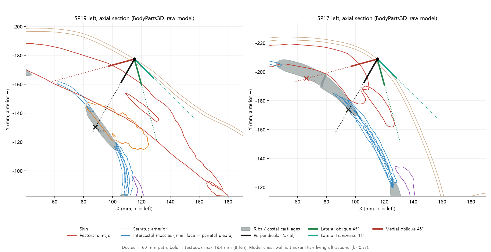
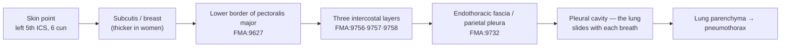
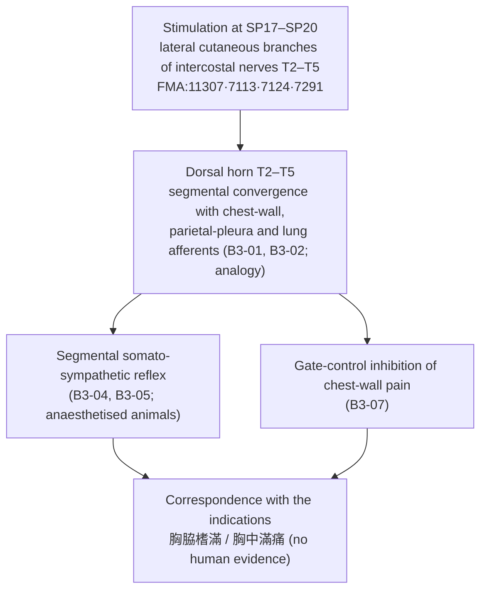

# Needling Depth and Respiration at Shidou, Tianxi, Xiongxiang and Zhourong (SP17–SP20): Is the Distance to the Pleura Governed Most by Breathing, Body Habitus or Needle Direction?

> **Question**: How much does the distance to the lung and pleura change between inspiration and expiration? Do clinicians take the patient's breathing into account when setting needling depth? Are body habitus and needle direction more important than respiratory change?
> **Points**: the four thoracic points of the Spleen Meridian of Foot-Taiyin (足太陰脾經, SP) — Shidou (食竇, SP17; 5th intercostal space), Tianxi (天谿, SP18; 4th ICS), Xiongxiang (胸鄕, SP19; 3rd ICS) and Zhourong (周榮, SP20; 2nd ICS), all 6 cun lateral to the anterior midline
> **Category**: Topic-specific acupoint textual study and hypothesis test (Tier 3) · **Framework**: v2.7 · **Formula**: ARI v3.0 (provisional weights 0.40/0.35/0.25, dual scoring)
> **Anatomical evidence**: FMA (Foundational Model of Anatomy) 5.1.0 local index + BodyParts3D 4.0 3D meshes (FMA-ID based, CC BY 4.0) for chest-wall geometry, calibrated against in-vivo ultrasound and CT literature
> **Four core classics**: Zhongguo Zhenjiu Xuewei Tongjian (《中國針灸穴位通鑑》), Spleen Meridian chapter · Zhenjiu Shuxue Tongkao (《針灸腧穴通考》), Spleen Meridian points · Zhongguo Zhenjiu Zhengzhi Tongjian (《中國針灸證治通鑑》), Part II Needling and moxibustion contraindications and Part III Internal medicine and Gynaecology/Paediatrics · Zhongguo Zhenjiu Jingluo Tongjian (《中國針灸經絡通鑑》), Part III Foot-Taiyin channel (auxiliary: Dongui Bogam (《東醫寶鑑》), Acupuncture chapter)
> **Date**: 2026-10-28 · Integrated Biomedical Master DB v3.0 synchronised for the four points

---

## Key findings

1. **The change in pleural distance between inspiration and expiration is small, and it is not a criterion for setting depth.** The costal parietal pleura is attached by the endothoracic fascia to the inner surface of the ribs and intercostal muscles. The skin-to-parietal-pleura distance is therefore simply the chest-wall thickness, and the skin, muscles and pleura move together as one block during breathing. Thickness changes only with contraction of the intercostal and pectoral muscles, which we estimate at about 1 mm in quiet breathing (inference, B1-01). No study measuring the inspiratory–expiratory difference at these four points was found. In an ultrasound study that measured pleural depth at both maximal inspiration and maximal expiration over the upper back, sex, BMI and chest circumference explained 69.7% of the variance; breathing phase did not enter the final model.
2. **There is no "safe respiratory phase" at these four points.** Beneath the 2nd–5th intercostal spaces, 6 cun lateral, the lung is present in both inspiration and expiration. The costodiaphragmatic recess, where the lower lung border moves a lot with breathing, lies lower (Dabao (大包, SP21) and below). Breathing raises risk through another route: once the needle tip touches or pierces the parietal pleura, the lung slides beneath it with every breath. **Breathing is therefore a variable to manage during needle retention, not a variable for choosing depth.**
3. **Order of magnitude: body habitus > needle direction > posture > breathing.**
   - **Body habitus**: at the same site (2nd ICS, midclavicular line) the in-vivo ultrasound median is 22.8 mm, while the mean in overweight trauma CT is 41–47 mm, about a twofold difference. In paediatric CT, safe depths at 28 chest points differed 1.24–2.11-fold between weight groups, and SP17, SP19 and SP20 also showed significant sex differences.
   - **Needle direction**: for the same insertion length, vertical depth scales with sin θ (a 15° transverse insertion reaches 0.26 of the perpendicular depth). In BodyParts3D, **needles laid laterally at 45° or flatter ran tangentially to the convex chest wall and did not reach it within 120 mm** (SP17, SP19 and SP20, both sides).
   - **Posture**: changing only shoulder position altered the skin-to-lung distance by 7 mm.
   - **Breathing**: about 1 mm, as in point 1.
4. **Perpendicular needling to the textbook maximum leaves little margin here.** Calibrating BodyParts3D chest-wall thickness to the in-vivo ultrasound median (k = 0.571), the pleural depth along the perpendicular axis is SP17 23.1–26.3 mm, SP18 27.2–27.4 mm, SP19 31.1–31.5 mm and SP20 30.2 mm. The shortest path in any direction within a 60° cone was SP17 21.5 mm, SP20 24.1 mm, SP18 25.4 mm and SP19 26.4 mm. Needling perpendicularly to the textbook maximum of 8 fen (分, 18.4 mm) leaves **about 3 mm to the pleura at Shidou** and 6–8 mm at the other three points in a person of average build. In a thin patient this margin disappears. The "insert four fen" (刺入四分, 9.2 mm) of the Yellow Emperor's Mingtang Classic (《黃帝明堂經》) is conservative, leaving 12–17 mm under the same conditions.
5. **The classics already contained the directional solution.** Xunjing Kaoxue Bian (《循經考穴編》) records for all four points the alternative method "insert one fen, then run along the skin outward for one cun five fen" (刺入一分，沿皮向外一寸五分). In the 3D measurement this transverse path, about 34.5 mm long, never reaches the chest wall. The modern textbook instruction "oblique or outward transverse needling" (斜刺或向外平刺) can be seen as its continuation.
6. **ARI v3.0 (four points, dual scoring)**: Shidou 66.25 ± 1.25 (C) · Tianxi 66.25 ± 1.25 (C·H) · Xiongxiang 60.0 ± 1.25 (C) · Zhourong 66.25 ± 1.25 (C). All four have SI 25 and trigger **Gate 3 (⚠ safety caution)**. Concordance with the classical sources is high (S_orig 81–94), but there is no human mechanistic evidence (S_reflex 25), so all remain grade C.

> This report is an anatomical and philological safety analysis. BodyParts3D is a single normative model and does not reflect individual variation, breathing or posture. Safe depth for an individual patient should be set from body-habitus assessment and, where possible, ultrasound.

---

## 0. Question and scope

| Item | Content |
| :--- | :--- |
| Starting point | A lecture stated that SP17–SP20 are needled obliquely or transversely. This matches the "oblique or outward transverse needling" and the pneumothorax warning in 《針灸腧穴通考》. The question then asks about the relative importance of breathing, body habitus and needle direction |
| Axes of analysis | ① depth, direction and contraindication statements in the classics ② chest-wall layers and thickness (3D measurement + literature calibration) ③ mechanism and size of the respiratory effect on pleural distance ④ comparison with habitus, direction and posture ⑤ ARI v3.0 |
| 3D measurement | BodyParts3D, SP17–SP20 left and right (8 points) + 2 calibration points (2nd ICS midclavicular line, both sides). Paths: axial perpendicular, 3D skin normal, lateral/medial (horizontal) and caudal/cranial (vertical) tilts of 45°, 30° and 15° to the skin, and 30°, 45° and 60° cones (500 directions each) |
| Classical search | Full search of the four core classics by point name, alias and traditional/simplified forms, with verification of the original lines; Dongui Bogam (《東醫寶鑑》) as auxiliary |
| External search | Integrated Biomedical Master DB v3.0 synchronisation for 4 points (PubMed, OpenAlex, Crossref) + additional PubMed searches (pleural depth, respiratory phase, posture, habitus, pneumothorax risk factors) |

---

## A. Core question: breathing, body habitus, needle direction and posture

### A-1. How does breathing change the distance to the pleura?

| Element | Change between inspiration and expiration | Meaning for needling safety | Evidence level |
| :--- | :--- | :--- | :--- |
| Skin to parietal pleura | The costal parietal pleura is attached to the inner chest wall by the endothoracic fascia and moves with it. Thickness changes only with intercostal and pectoral (accessory) muscle contraction | **Practically fixed.** About 1 mm in quiet breathing (estimate). No basis for choosing depth by respiratory phase | Inference (B1-01) · in an upper-back ultrasound study at maximal inspiration/expiration, breathing did not enter the final predictive model |
| Position of the chest wall | Upper ribs move forward and up, lower ribs move laterally on inspiration | Skin, needle and pleura move together, so the needle tip keeps roughly the same relation to the pleura | B1-01 |
| Lung (visceral pleura) | Slides tangentially beneath the parietal pleura (lung sliding) | Once the tip touches or pierces the pleura, **breathing rubs the lung against the tip**, the key mechanism of pneumothorax | B1-01 · risk factors in image-guided lung biopsy |
| Intercostal width | Widens on inspiration, narrows on expiration | In oblique needling that uses a rib as a backstop, the tip can slip into the intercostal space. Only 25–57% of the cone paths met a rib before the pleura | 3D measurement · rib palpation accuracy 73% |
| Lower lung border | Moves widely with the diaphragm | Irrelevant to SP17–SP20, where lung is always present. Important for lower points such as Dabao (大包), Qimen (期門) and Riyue (日月) | B1-01 |
| Deep breaths, coughing, talking | Accessory muscles (pectoralis major and minor) contract; the thorax moves abruptly | Increases **relative movement between needle and lung during retention** rather than depth itself | Inference |

- One study measured pleural depth over the rhomboid region by ultrasound in 59 people (236 measurements) at both maximal inspiration and maximal expiration. Sex, BMI and chest circumference explained 69.7% of the variance in pleural depth; according to the abstract, breathing phase did not enter the final model ([Valera-Calero 2021](https://doi.org/10.1111/ijcp.14176)). The site is the back, so transfer to these four points is by analogy.
- In needle procedures, a shorter skin-to-pleura distance (≤ 30 mm, OR 2.25) and emphysema (COPD OR 2.28) increased pneumothorax risk ([Lamfichekh 2023](https://doi.org/10.1097/RTI.0000000000000729); [Weon 2021](https://doi.org/10.1111/1754-9485.13187)). The depth variable is chest-wall thickness; the breathing-related variable is the state of the lung parenchyma.

### A-2. Which factor changes the distance most?

| Factor | Size of effect on distance to the pleura (or vertical depth) | Evidence |
| :--- | :--- | :--- |
| **Body habitus (weight, BMI, sex, breast)** | About twofold at the same site. 2nd ICS midclavicular line: in-vivo ultrasound median 22.8 mm vs trauma CT means 41–47 mm. 28 paediatric chest points (including SP17, SP19, SP20): 1.24–2.11-fold between highest and lowest weight groups; at SP17, SP19 and SP20 girls were deeper because of breast tissue | [Nelson 2022](https://doi.org/10.1016/j.jemermed.2022.08.004) · [Stevens 2009](https://doi.org/10.1080/10903120802471998) · [Chang 2014](https://doi.org/10.1097/TA.0000000000000158) · papers.id 2504 ([Ma 2015](https://doi.org/10.1155/2015/126028)) |
| **Needle direction (angle)** | Vertical depth = insertion length × sin θ → 0.71 at 45°, 0.50 at 30°, 0.26 at 15°. A lateral tilt runs tangentially to the convex chest wall and may never reach it (3D: lateral 45° and 15° paths at SP17, SP19 and SP20 did not reach the wall within 120 mm). A **medial tilt**, by contrast, can become more nearly perpendicular to the wall and shorter (SP17 right, medial 45°: 24.3 mm calibrated) | Geometry · 3D measurement, Section 4-2 |
| **Posture** | A single bolster under the shoulder increased the skin-to-lung distance by 7 mm (95% CI 4–10 mm) and muscle thickness by up to 4 mm | [Mitchell 2018](https://doi.org/10.1016/j.physio.2018.08.002) |
| **Site (intercostal level)** | The 5th ICS at the anterior axillary line averaged 13 mm thinner than the 2nd ICS at the midclavicular line; in obesity the order can reverse | [Inaba 2012](https://doi.org/10.1001/archsurg.2012.751) · [Alkan 2025](https://doi.org/10.1007/s11739-025-04110-2) |
| **Respiratory phase** | About 1 mm in quiet breathing (inference); no direct measurement at these points | Section A-1 |

### A-3. How should breathing be considered in practice?

- **Respiratory phase is not used to set depth.** Depth is set by the individual's chest-wall thickness (habitus, breast, muscle mass; ultrasound where available) and the needle angle. Changing depth to match end-inspiration or end-expiration has no evidence base.
- **Classical breath-synchronised needling (呼吸補瀉) is a tonifying/reducing technique, not a depth-safety rule.** This report does not judge its effect.
- **During retention, breathing is managed.**
  - Ask the patient to breathe quietly. Have them avoid deep breaths, coughing, talking and changes of position.
  - Do not lift and thrust vigorously at depth.
  - In patients who cough often, shorten retention or omit it.
- **The indications of these points define a respiratory risk group.** The original indications (Section 9) include "cough with counterflow qi" (咳逆上氣, Tianxi), "coughing and spitting old, foul pus" (咳唾陳膿穢濁, Zhourong) and "fullness of the chest and flanks" (胸脇榰滿, all four). Patients treated at these points are therefore likely to cough or be short of breath, which makes breathing management during retention especially important.
- **High-risk groups**:
  - thin build, cachexia
  - COPD or emphysema (hyperinflated lung and bullae; Zhourong lies over the upper lobe)
  - previous pneumothorax, acute asthma, mechanical ventilation
  - A case of bilateral pneumothorax after dry needling was reported in a patient with low-normal BMI ([Dalton 2022](https://pubmed.ncbi.nlm.nih.gov/35420007/)).
- **Needling aimed at pectoralis minor (the SP19/SP20 layer)**: a pincer approach that lifts the muscle between the fingers was less accurate for a novice and punctured the pleura in one cadaver. A flat approach over the muscle was more accurate ([Sánchez-Sánchez 2026](https://doi.org/10.3390/jfmk11010121)).

---

## 1. Literature screening (four core classics, original text with translation)

### 1-1. General contraindications for thoracic needling

| Original | Source | Translation | Relevance to these points |
| :--- | :--- | :--- | :--- |
| 刺膺中陷，中肺，為喘逆仰息。 | 《素問·刺禁論》 (cited under Zhongfu (中府) in 《針灸腧穴通考》, in the contraindications section of 《中國針灸證治通鑑》, and in 《東醫寶鑑》) | Needling deep into the front of the chest and striking the lung causes panting counterflow with the head thrown back to breathe | Lung-injury warning for the whole anterior chest (膺中) |
| 刺腋下脇間內陷，令人欬。 | 《素問·刺禁論》 (《證治通鑑》, 《東醫寶鑑》) | Needling deep between the flank ribs below the axilla makes the patient cough | Applies more directly to the anterolateral chest wall near the anterior axilla (the 6-cun line) |
| 刺中肺三日死，其動為欬。 | 《素問·刺禁論》 (《東醫寶鑑》; cited in the Bladder Meridian chapter of 《中國針灸穴位通鑑》) | Striking the lung brings death in three days; its sign is cough | Records cough as the first sign of pneumothorax |

### 1-2. Point-by-point comparison (location, depth, direction)

| Point | 《黃帝明堂經》 (in 《甲乙》 vol. 3): location and depth | 《針灸腧穴通考》, general operation note | Modern textbook history (as collected in 《腧穴通考》) | 《循經考穴編》 alternative method | 《東醫寶鑑》 |
| :--- | :--- | :--- | :--- | :--- | :--- |
| Shidou (食竇, SP17) | 在天谿下一寸六分陷者中, **舉臂取之** (located with the arm raised; "仰而取之" in the common edition of 《甲乙》 is a copying error). 刺入四分，灸五壯 | 斜刺或向外平刺。勿直刺過深，以免刺入胸腔損傷肺臟 | 1957 Nanjing and 1st ed.: 3–4 fen → 2nd ed.: oblique 3–4 fen → 4th/5th eds.: oblique or outward transverse 0.5–0.8 cun → **6th/7th eds.: 0.5–0.9 cun, "all points of this channel from Shidou to Dabao overlie the lung and must not be needled deeply" (本經自食竇至大包諸穴，內有肺臟均不可深刺)** → 《中國針灸學》: oblique 0.3–0.5 cun | 《銅人》 needle five fen … 一法刺入一分，沿皮向外一寸五分 | 鍼入四分，可灸五壯 (銅人) |
| Tianxi (天谿, SP18) | 在胸鄕下一寸六分陷者中，仰而取之。刺入四分，灸五壯 | 斜刺或向外平刺。不宜深刺和直刺，以免刺傷心肺 | 4–5 fen → oblique 4–5 fen → 4th–7th eds.: oblique or outward transverse 0.5–0.8 cun → 《中國針灸學》 0.3–0.5 cun | 一法刺入一分，沿皮向外一寸五分 | 鍼入四分，可灸五壯 |
| Xiongxiang (胸鄕, SP19) | 在周榮下一寸六分陷者中，仰而取之。刺入四分，灸五壯 | 斜刺或向外平刺。不宜深刺和直刺，**以免造成氣胸** (to avoid pneumothorax) | As above | 一法刺入一分，沿皮向外一寸五分，可灸二七壯 | 鍼入四分，可灸五壯 |
| Zhourong (周榮, SP20) | 在中府下一寸六分陷者中，仰而取之。刺入四分，灸五壯 | 斜刺或向外平刺。不宜深刺和直刺，以免刺傷心肺 | As above | 一法刺入一分，沿皮向外一寸五分，可灸七壯 | 鍼入四分，**禁不可灸** (moxibustion forbidden; 銅人) |

- **Structure of the location statements**: all four points are defined by a chain of "1 cun 6 fen below the point above", starting from Zhongfu (中府) of the Lung Meridian (《穴位通鑑》: "records through the ages are essentially consistent"). The 1 cun 6 fen is read as the distance between adjacent intercostal spaces (《穴位通鑑》, Shidou summary).
- **The modern "0.5–0.8 cun" is a needle-travel length that presupposes oblique or transverse insertion.** It is not on the same axis as the classical perpendicular depth "four fen" (Section 5).
- **Zhourong and moxibustion**: Yixue Rumen (《醫學入門》), Zhenjiu Daquan (《針灸大全》; note to Table 2-4① of forbidden-moxibustion points in 《證治通鑑》) and 《東醫寶鑑》 (銅人) record it as forbidden for moxibustion. **None of the four classics records any of the four points as forbidden for needling.**
- 《中國針灸經絡通鑑》 (Foot-Taiyin channel) records the four points only in the channel course ("由腹哀上膈，循食竇、天谿、胸鄕、周榮，由周榮外曲折向下至大包"), with no location or depth information.

---

## 2. Original vs. derivative sources

| Statement | Original (earliest) | Later citations | Note |
| :--- | :--- | :--- | :--- |
| Location "下一寸六分陷者中" | 《黃帝明堂經》 (in 《甲乙》 vol. 3) | 《千金》, 《外臺》, 《醫心方》, 《銅人》, 《資生經》, 《十四經發揮》, 《大成》, 《類經圖翼》, etc. | Consistent for all four points |
| Depth "刺入四分" | 《黃帝明堂經》 | 《醫心方》, 《銅人》, 《聖濟總錄》, 《資生經》, 《醫學入門》, 《類經圖翼》, 《東醫寶鑑》, etc. | 《循經考穴編》 quotes "《銅人》 needle five fen" for Shidou, a textual variant (S_orig ④) |
| Transverse alternative "沿皮向外一寸五分" | 《循經考穴編》 (Ming) | Judged to be continued in the modern "outward transverse needling" | Originates in the Ming; not found earlier |
| "斜刺或向外平刺 0.5–0.8 cun" | 4th/5th eds. of 《針灸學》 | 6th/7th eds. (0.5–0.9 cun for Shidou); Korean common textbook (5–8 fen) | Modern textbooks |
| "本經自食竇至大包諸穴，內有肺臟均不可深刺" | 6th/7th eds. of 《針灸學》 | Collected under Shidou in 《針灸腧穴通考》 | Modern textbooks |
| Lung-injury warning for the chest | 《素問·刺禁論》 | 《針灸腧穴通考》 (Zhongfu), 《證治通鑑》 general part, 《東醫寶鑑》 | Region-based contraindication |
| Shidou = Mingguan (命關) | 《扁鵲心書》 (Song) | Adopted as alias by the 1957 Nanjing 《針灸學》 | 《針灸腧穴通考》 rejects it because location and indications differ |

---

## 3. Alias verification (KJH Acupoint Alias DB + four core classics)

| Point | KJH DB alias | Aliases or confusions in the classics | Judgement |
| :--- | :--- | :--- | :--- |
| Shidou (食竇, SP17) | None | Mingguan (命關) in 《扁鵲心書》 ("在脇下宛中，舉臂取之，對中脘向乳三角取之"). The translator's note in the Korean translation of 《證治通鑑》 says Mingguan is generally taken as Shidou, but 《腧穴通考》 does not accept it as an alias because location and indications differ | Alias rejected (following 《腧穴通考》). The heavy moxibustion of 《扁鵲心書》 (百壯, 二三百壯) is excluded from this needling analysis |
| Tianxi (天谿, SP18) | None | Graphic confusion "天溪/太溪": the indications in vol. 9 of the common 《甲乙》 ("胸中滿痛，乳腫，潰癰，咳逆上氣 … 太溪主之") belong to Tianxi | Fully corrected by 《腧穴通考》 |
| Xiongxiang (胸鄕, SP19) | None | None | No confusion |
| Zhourong (周榮, SP20) | None | 周榮/周營 used interchangeably (transmitted 《甲乙》); a lacuna in vol. 9 of 《甲乙》 moved part of Zhourong's indications into the Tianxi entry | Corrected by 《腧穴通考》 |

---

## 4. 3D coordinates and Layer 1–5 structure

### 4-1. Method (FMA, BodyParts3D)

- **Model**: BodyParts3D 4.0 (Database Center for Life Science, Japan; CC BY 4.0), a single adult male normative 3D model (mm). Meshes used: skin (FMA:7163); left/right ribs 1–7 and costal cartilages 2–6; pectoralis major (FMA:9627), pectoralis minor (FMA:13109) and serratus anterior (FMA:13397); external, internal and innermost intercostal muscles (FMA:9756, 9757, 9758).
- **Coordinates**: X = left (+)/right (−) of the midline, Y = anteroposterior (anterior −), Z = height (cranial +). 1 B-cun = 19.2 mm (8 B-cun between the midpoints of the clavicles), so 6 cun = 115.2 mm.
- **Skin points**: at a given X, the intercostal height was set midway between the lower border of the anterior part of rib n (or its cartilage) and the upper border of rib n+1; the skin point was then found from the front. In this model ribs 2 and 3 do not reach the 6-cun line (X = 115.2 mm), so the intercostal height for SP20 was taken at X = 95.2 mm and for SP19 at X = 107.2 mm (all skin points are on the 6-cun line).
- **Parietal-pleura proxy**: BodyParts3D has no meshes for the pleura or the lung surface. The pleura was therefore taken as the last exit from the chest wall (intercostal muscles, ribs, cartilages) within 20 mm after the path first enters it. Endothoracic fascia and pleural thickness (about 1 mm) were ignored.
- **Paths**: ① axial perpendicular (skin normal projected onto the horizontal plane, matching CT axial measurements) ② 3D skin normal (25 mm averaging radius) ③ the axial normal tilted laterally/medially (horizontal) and caudally/cranially (vertical) by 45°, 60° and 75° (i.e., 45°, 30° and 15° to the skin) ④ 500 random directions in 30°, 45° and 60° cones about the axial normal. Intersections used the Möller–Trumbore ray–triangle algorithm.
- **Limitations**: ① no pleural or lung meshes (approximated by the inner face of the intercostal muscles) ② single male model with arms down, so Shidou's "arm raised" posture, breast tissue, habitus and breathing are not modelled ③ in this model the SP20 skin point lies close to the anterior axillary fold, and the axial path only grazes pectoralis major, so its reliability is low.

### 4-2. Results (raw BodyParts3D values, mm)

| Point | ICS width | Axial perp.: first muscle | Axial perp.: pleura | 3D normal: pleura | Shortest path in cones (any direction) | Cone paths blocked by rib first | Lateral 45° | Lateral 15° | Medial 45° | Caudal 45° |
| :--- | ---: | ---: | ---: | ---: | ---: | :---: | :---: | :---: | :---: | :---: |
| Zhourong SP20-L | 22.2 | — (grazes muscle) | 52.9 | 50.4 | 42.1 | 27–45% | not reached | not reached | 64.5 | 52.2 |
| Zhourong SP20-R | 21.9 | 28.8 | 52.9 | 49.5 | 42.8 | 27–48% | not reached | not reached | 70.5 | 52.5 |
| Xiongxiang SP19-L | 18.9 | 11.5 | 54.4 | 48.8 | 46.2 | 25–52% | not reached | not reached | out of range | 55.4 |
| Xiongxiang SP19-R | 17.5 | 11.5 | 55.1 | 49.8 | 46.9 | 31–48% | not reached | not reached | 54.4 | 55.7 |
| Tianxi SP18-L | 31.4 | 6.6 | 47.9 | 46.5 | 44.5 | 35–57% | 58.7 | not reached | out of range | 48.8 |
| Tianxi SP18-R | 30.8 | 7.5 | 47.6 | 45.6 | 44.7 | 37–53% | 62.2 | not reached | out of range | 48.5 |
| Shidou SP17-L | 21.9 | 14.5 | **40.4** | 43.4 | **37.6** | 45–47% | not reached | not reached | 50.8 | 52.0 |
| Shidou SP17-R | 21.6 | 19.9 | 46.0 | 48.5 | **37.8** | 40–54% | not reached | not reached | 42.6 | 53.8 |

- "Not reached" = no contact with the chest wall within 120 mm (the path stays in soft tissue, tangential to the convex wall). "Out of range" = the path meets the wall more than 150 mm from the skin point, beyond the computation window.
- **Laterally laid paths are the safest.** At lateral 45° and 15°, SP17, SP19 and SP20 never reached the chest wall; only SP18 at lateral 45° reached it at 58.7–62.2 mm (33.5–35.5 mm calibrated). **Medial tilts, by contrast, can be shorter** (SP17 right, medial 45°: 42.6 mm → 24.3 mm calibrated, shorter than the axial perpendicular path).
- Of the cone paths, 25–57% met a rib before the pleura. The rib acts as a "backstop" in only about half the directions; the rest pass through the intercostal space straight to the pleura.

### 4-3. Habitus calibration (in-vivo ultrasound and CT literature)

To bring the single model's chest-wall thickness in line with real populations, published values at the same site (2nd ICS, midclavicular line) were used as calibration points. The model's axial perpendicular pleural depth there was 39.9 mm on both sides.

| Calibration reference | Measured (mm) | Factor k = measured/model | Population |
| :--- | :---: | :---: | :--- |
| In-vivo ultrasound median ([Nelson 2022](https://doi.org/10.1016/j.jemermed.2022.08.004)) | 22.8 | **0.571** | Healthy volunteers, linear probe (possible tissue compression) |
| Trauma CT means, right/left ([Stevens 2009](https://doi.org/10.1080/10903120802471998)) | 45 · 41 | 1.13 · 1.03 | 110 adult trauma patients |
| Trauma CT means ([Chang 2014](https://doi.org/10.1097/TA.0000000000000158)) | 43.3–46.7 | 1.09–1.17 | 100 trauma patients, mean BMI 26.8 |

- The model resembles the overweight trauma CT population and is about 1.75 times thicker than healthy volunteers on ultrasound. Korean medicine outpatients are taken to be closer to the healthy volunteers, so **k = 0.571 is used as the "average build" reference**, with k ≈ 1.0–1.17 given as the "overweight" reference. A thin build is thinner than k = 0.571.
- There is only one calibration site (2nd ICS), and ultrasound may read shallower than reality because of probe compression. The calibrated values below are an approximate range for an average build.

| Point (L/R) | Axial perp. pleura: model | Average build (k 0.571) | Overweight (k 1.03–1.17) | Shortest cone path, average build | Margin left by perpendicular needling to the textbook maximum 18.4 mm (shortest path) | Margin at 《明堂》 4 fen, 9.2 mm |
| :--- | :---: | :---: | :---: | :---: | :---: | :---: |
| Zhourong SP20 | 52.9 / 52.9 | 30.2 / 30.2 | 54–62 | 24.1 / 24.5 | **5.7 / 6.1 mm** | 14.9 / 15.3 mm |
| Xiongxiang SP19 | 54.4 / 55.1 | 31.1 / 31.5 | 56–64 | 26.4 / 26.8 | **8.0 / 8.4 mm** | 17.2 / 17.6 mm |
| Tianxi SP18 | 47.9 / 47.6 | 27.4 / 27.2 | 49–56 | 25.4 / 25.5 | **7.0 / 7.1 mm** | 16.2 / 16.3 mm |
| Shidou SP17 | 40.4 / 46.0 | 23.1 / 26.3 | 42–54 | **21.5 / 21.6** | **3.1 / 3.2 mm** | 12.3 / 12.4 mm |

- **Shidou is the shallowest of the four.** It lies towards the lower border of pectoralis major, where the muscle layer is thin (about 20 mm along the axial path, against 36 mm at Tianxi). This fits the fact that the 6th/7th-edition textbooks and 《腧穴通考》 give Shidou the strongest warning: "勿直刺過深，以免刺入胸腔損傷肺臟".
- **In women, breast tissue at Tianxi and Shidou makes the wall thicker** (both paediatric and adult CT show greater depths in females — papers.id 2504, B2-07). The intercostal space under the breast, however, shifts considerably with posture.

### 4-4. Layer 1–5 structure — left Shidou SP17 (shallowest point)

| Layer | Structures (FMA) | Axial perpendicular depth (model → average build) | Note |
| :---: | :--- | :--- | :--- |
| 1 Skin, subcutis | Lateral cutaneous branch of fifth intercostal nerve FMA:7291, thoracoepigastric vein FMA:13416 | 0–14.5 → 0–8.3 mm | 《明堂》 4 fen (9.2 mm) reaches here, up to the entrance of Layer 2 |
| 2 Superficial muscle | Pectoralis major FMA:9627 (medial pectoral nerve FMA:65293), slips of serratus anterior FMA:13397 (long thoracic nerve FMA:65275, C5–C7), origin of external oblique FMA:13335 | 14.5–34.1 → 8.3–19.5 mm | Textbook 5–8 fen (11.5–18.4 mm) perpendicular reaches here |
| 3 Deep muscle | External, internal and innermost intercostals FMA:9756/9757/9758; ribs 5 and 6 | 35.3–40.2 → 20.2–23.0 mm | About half the cone directions are blocked by a rib |
| 4 Neurovascular bundle | Fifth intercostal nerve FMA:8605, fifth posterior intercostal artery and vein FMA:12288/12530 (lower border of the upper rib); lateral thoracic artery FMA:22674 (Layer 2 surface) | About 20–23 mm (upper part of the space) | Entering the lower half of the space (near the upper border of the lower rib) avoids the bundle (B1-01) |
| 5 Deep organ | Endothoracic fascia FMA:9732 → **costal parietal pleura → pleural cavity → lung (left upper-lobe lingula and lower lobe)** | 40.4 → **23.1 mm** (shortest cone path 21.5 mm) | Perpendicular needling to the textbook maximum 18.4 mm leaves 3 mm |

- **Neither textbook lists Layer 5 (pleura, lung)** (Section 6). Their anatomy stops at the intercostal muscles, and the presence of the pleura 1–2 mm beneath is not in the tables.

---

## 5. Needling depth table (Needling Depth by Classical Source DB, 1 fen = 2.3 mm)

| Source | Shidou SP17 | Tianxi SP18 | Xiongxiang SP19 | Zhourong SP20 |
| :--- | :---: | :---: | :---: | :---: |
| 《針灸甲乙經》 / 《黃帝明堂經》 (ed. Huang Longxiang (黃龍祥)) | 4 fen = 9.2 mm | 4 fen = 9.2 mm | 4 fen = 9.2 mm | 4 fen = 9.2 mm |
| 《東醫寶鑑》 (銅人) | 4 fen = 9.2 mm | 4 fen = 9.2 mm | 4 fen = 9.2 mm | 4 fen = 9.2 mm |
| 《循經考穴編》 alternative | 1 fen perpendicular, then along the skin outward 1 cun 5 fen (travel 34.5 mm) | Same | Same | Same |
| 《針灸經驗方》 | Not stated | Not stated | Not stated | Not stated |
| Korean common textbooks (meridian/point and acupuncture) | Oblique/transverse 5–8 fen = 11.5–18.4 mm | Same | Same | Same |
| Preferred technique in 《針灸腧穴通考》 | Oblique, transverse | Oblique, transverse | Oblique, transverse | Oblique, transverse |

**Vertical depth by insertion length and angle (mm) — angle θ to the skin, vertical depth = L × sin θ (flat-wall approximation)**

| Insertion length L | Perpendicular 90° | Oblique 45° | Oblique 30° | Transverse 15° | Against Shidou average-build shortest path 21.5 mm |
| :--- | :---: | :---: | :---: | :---: | :--- |
| 4 fen 9.2 mm (《明堂》) | 9.2 | 6.5 | 4.6 | 2.4 | Margin ≥ 12 mm at any angle |
| 5 fen 11.5 mm (textbook minimum) | 11.5 | 8.1 | 5.8 | 3.0 | Margin 10 mm even perpendicular |
| 8 fen 18.4 mm (textbook maximum) | **18.4** | 13.0 | 9.2 | 4.8 | **Perpendicular margin 3.1 mm**, 8.5 mm at 45° |
| 1 cun 5 fen 34.5 mm (《循經考穴編》 transverse) | 34.5 | 24.4 | 17.3 | 8.9 | Even under the flat approximation the margin is ≥ 12 mm at 15° or flatter. On the real convex wall a lateral transverse path does not reach the wall (Section 4-2) |

- The flat approximation assumes a flat chest wall. The 6-cun line is where the front of the chest turns into the side, so **a needle laid laterally is much safer than the flat approximation suggests**, while **a needle laid medially may be more dangerous**.
- None of the four points has a `'0'` (forbidden needling) entry. The Zhourong record concerns moxibustion.

---

## 6. Textbook comparison and FMA standard entities

| Point | Shared FMA entities | Common textbook only | Kim Jae-hyo textbook only | Issue |
| :--- | :--- | :--- | :--- | :--- |
| Shidou SP17 | Pectoralis major FMA:9627 · External intercostal FMA:9756 · Lateral thoracic artery FMA:22674 (3) | Internal intercostal FMA:9757 · Intercostal nerve FMA:6028 · Thoracoepigastric vein FMA:13416 | Serratus anterior FMA:13397 · External oblique FMA:13335 · Long thoracic nerve FMA:65275 · Lateral pectoral nerve FMA:65296 · Lateral cutaneous branch of 5th intercostal nerve FMA:7291 · branches of 5th posterior intercostal a./v. (10) | The Kim textbook adds the serratus anterior and external oblique origins on the lateral 5th ICS. In 3D the axial path passes only pectoralis major → intercostals; serratus anterior lies lateral to the path |
| Tianxi SP18 | FMA:9627 · 9756 · 22674 · Internal thoracic vein FMA:4729 (parent) (4) | FMA:9757 · 6028 · 13416 · 71521 | Pectoralis minor FMA:13109 · FMA:13397 · 65275 · 65293 · 65296 · Lateral cutaneous branch of 4th intercostal nerve FMA:7124 · Pectoral branch of thoraco-acromial artery FMA:23062, etc. (12) | Pectoralis minor: in 3D, the axial path at SP18 reaches the intercostals directly beneath pectoralis major (lateral to the lower border of pectoralis minor). The textbook difference is explained by a small difference in location |
| Xiongxiang SP19 | Pectoralis minor FMA:13109 · FMA:9756 · 22674 · 4729 (4) | FMA:9757 · 6028 · 71521 | **Pectoralis major FMA:9627** · FMA:13397 · 65275 · 65293 · 65296 · FMA:7113, etc. (12) | **The common textbook omits pectoralis major.** The 3D axial path runs pectoralis major (11.5–39.1 mm) → pectoralis minor (37.9–50.4 mm) → intercostal space. The Kim textbook is correct → S_clarity 50 (adjusted by inference) |
| Zhourong SP20 | FMA:9627 · 9756 · 4729 · 22674 (4) | FMA:9757 · 6028 · 71521 | FMA:13109 · 13397 · 65275 · 65293 · 65296 · FMA:11307 · FMA:23062, etc. (12) | Pectoralis minor: the local anatomy in 《穴位通鑑》 also reads "胸大肌中，下层为胸小肌", consistent with the Kim textbook |

- **Segments**: skin and intercostal space are supplied by the intercostal nerves T2 (Zhourong), T3 (Xiongxiang), T4 (Tianxi) and T5 (Shidou). Muscles: medial and lateral pectoral nerves (C5–T1) and long thoracic nerve (C5–C7, FMA segmental). FMA segment unions: SP17 {C5, C6, C7, T5}, SP18 {C5–C7, T4}, SP19 {C5–C7, T3}, SP20 {C5–C7} (the second intercostal nerve has no FMA segment entry → T2 supplemented from B1-01).
- **The costal parietal pleura is supplied by the same intercostal nerves (T2–T5)** (B1-01). Touching the pleura produces sharp chest pain in that segment, a warning sign during needling.
- **Neither textbook lists Layer 5 (pleura, lung).**

---

## 7. Spatial displacement analysis (Tri-Target)

| Target | Definition | SP17–SP20 location | Pairwise Δ |
| :--- | :--- | :--- | :--- |
| Target 1 (classical) | 《明堂》 chain "Zhongfu → 1 cun 6 fen below", 6 cun lateral to the midline (《針方六集》 "侠任脉两旁各六寸") | 2nd, 3rd, 4th, 5th ICS × 6 cun | — |
| Target 2 (palpation) | "陷者中" = intercostal depression (between the lower border of the upper rib and the upper border of the lower rib) | Depression of the same ICS, X = 6 cun | Δ(1,2) < 10 mm |
| Target 3 (WHO 2008, B1-05) | 2nd–5th ICS, 6 B-cun lateral to the anterior midline | Same | Δ(1,3), Δ(2,3) < 10 mm |

- **Judgement: Target 1 ≡ 2 ≡ 3** (no branching). "One cun six fen" (30.7 mm on the B-cun scale) is the same size as the rib-centre spacing in this model, so the classical chain fits the intercostal spaces one by one.
- **Variant locations noted (excluded as Targets)**: ① 《循經考穴編》, an alternative for Shidou, "乳下一寸六分，橫過一寸，與中庭平", which differs by 1 cun and has no stated basis (《腧穴通考》: "未详所据") ② 《勉學堂針灸集成》 for Tianxi, "直乳頭後二寸", an isolated variant. Both are later variants and are not branched as Targets even if Δ > 10 mm.
- **Posture**: Shidou is originally located "with the arm raised" (舉臂取之). Raising the arm stretches and thins pectoralis major and widens the intercostal space (inference). If the needle is inserted in that posture, the margin to the pleura may be smaller than with the arm down. **Locate and needle in the same posture**, and recheck the distance.

---

## 8. Reflex mechanism, B-Check and external search log

### 8-1. Mechanism summary (P_single)

- The mechanism stands only as a **segmental-correspondence hypothesis**. No human physiological experiment or RCT has targeted these four points.

### 8-2. B-Check (rater A / B)

| Item | Shidou SP17 | Tianxi SP18 | Xiongxiang SP19 | Zhourong SP20 |
| :--- | :---: | :---: | :---: | :---: |
| ① Peripheral entity (B1-01, B2-09, FMA exact) | 2 / 2 | 2 / 2 | 2 / 2 | 2 / 2 |
| ② Segmental match (T2–T5 ↔ chest wall, pleura, lung; B1-03, B3-01) | 2 / 2 | 2 / 2 | 2 / 2 | 2 / 1 (T2 not in FMA) |
| ③ Afferent fibres / receptors (B3-06, analogy) | 1 / 1 | 1 / 1 | 1 / 1 | 1 / 1 |
| ④ Central pathway (B3-02, B3-05, analogy) | 1 / 1 | 1 / 1 | 1 / 1 | 1 / 1 |
| ⑤ Efferent direction ↔ P_single (B3-20) | 1 / 0 | 1 / 1 | 1 / 0 | 1 / 1 |
| ⑥ Human translation (Layer A human mechanistic study) | 0 / 0 | 0 / 0 | 0 / 0 | 0 / 0 |
| **Total** | **7 / 6** | **7 / 7** | **7 / 6** | **7 / 6** |
| Verdict | Not met → hypothesis | Not met → hypothesis | Not met → hypothesis | Not met → hypothesis |

### 8-3. External API search log (Integrated Biomedical Master DB v3.0, 2026-10-28 11:27–11:28, trigger rank6)

| Point | PubMed (HTTP · fetched) | OpenAlex (HTTP · fetched) | Crossref (HTTP · fetched) | Candidates | New | Merged into existing | Result |
| :--- | :---: | :---: | :---: | ---: | ---: | ---: | :--- |
| SP17 Shidou | 200 · 0 | 200 · 1 | 200 · 0 | 1 | 0 | 1 | Linked papers.id 2504 |
| SP18 Tianxi | 200 · 0 | 200 · 1 | 200 · 0 | 1 | 0 | 1 | papers.id 1810 (ashi-point case series for wrist sprain; off-topic false detection) |
| SP19 Xiongxiang | 200 · 0 | 200 · 1 | 200 · 0 | 1 | 0 | 1 | Linked papers.id 2504 |
| SP20 Zhourong | 200 · 0 | 200 · 2 | 200 · 0 | 2 | 1 | 1 | papers.id 2504 + 2505 (acupuncture for frozen shoulder; clinical) |

- All sources succeeded and validation passed. PubMed queries combined point code, pinyin and characters × acupuncture/electroacupuncture × nerve/reflex/autonomic/mechanism/anatomy, plus journal filters for 《中國針灸》 and 《針刺研究》.
- **There are no reflex-mechanism papers for these four points.** The only relevant Layer A paper is a safe-depth imaging study (papers.id 2504, paediatric CT, including SP17, SP19, SP20).
- **Additional PubMed searches (not merged into the DB)**: pleural depth and respiratory phase ([Valera-Calero 2021](https://doi.org/10.1111/ijcp.14176)); posture ([Mitchell 2018](https://doi.org/10.1016/j.physio.2018.08.002)); rib palpation accuracy ([Cushman 2020](https://doi.org/10.1016/j.jbmt.2020.10.008)); chest-wall thickness by in-vivo ultrasound and CT ([Nelson 2022](https://doi.org/10.1016/j.jemermed.2022.08.004), [Inaba 2012](https://doi.org/10.1001/archsurg.2012.751), [Chang 2014](https://doi.org/10.1097/TA.0000000000000158), [Stevens 2009](https://doi.org/10.1080/10903120802471998), [Sanchez 2011](https://doi.org/10.1111/j.1553-2712.2011.01159.x), [Alkan 2025](https://doi.org/10.1007/s11739-025-04110-2)); pneumothorax risk factors ([Lamfichekh 2023](https://doi.org/10.1097/RTI.0000000000000729), [Weon 2021](https://doi.org/10.1111/1754-9485.13187)); a case report ([Dalton 2022](https://pubmed.ncbi.nlm.nih.gov/35420007/)); pectoralis minor needling ([Sánchez-Sánchez 2026](https://doi.org/10.3390/jfmk11010121)); adult chest-acupoint CT safe depth ([Sheu & Lin 1992](https://pubmed.ncbi.nlm.nih.gov/1338010/), Chinese, abstract only).

---

## 9. Separation of indications (single-point P_single vs combinations)

| Point | P_single (original, 《黃帝明堂經》) | Later additions / combinations | Relation to respiratory risk |
| :--- | :--- | :--- | :--- |
| Shidou | Fullness of the chest and flanks with gurgling in the diaphragm region, a constant sound of water (胸脇榰滿，膈中雷鳴，察察隱隱，常有水聲; resembles suspended fluid, 懸飲) | 《循經考穴編》 phlegm-fluid, food accumulation, dysphagia, regurgitation (痰飲·食積·噎膈·翻胃; per 《腧穴通考》 these are the indications of Geshu (膈俞) mixed in) · 《醫學綱目》 hunger without ability to eat, vomiting and gurgling: Daying (大迎) + Zhongji (中極) + Shidou · 《扁鵲心書》 moxibustion at Shidou for jaundice and flank distension (Mingguan, moxibustion) | In pleural effusion (懸飲) the lung may be displaced from the chest wall, but needling then risks entering the effusion (inference) |
| Tianxi | Fullness and pain in the chest, swollen and ulcerating breast abscess, **cough with counterflow qi**, sound in the throat (胸中滿痛，乳腫潰癰，咳逆上氣，咽喉有聲) | Modern: insufficient lactation, mastitis | Patients with cough → risk of coughing during retention |
| Xiongxiang | Fullness of the chest and flanks radiating to the back, unable to turn while lying (胸脇榰滿，却引背痛，臥不得轉側) | Modern: distension of chest and flanks | Resembles pleuritic pain |
| Zhourong | Fullness of the chest and flanks, unable to bend forward or back, food does not go down, **coughing and spitting old, foul pus** (胸脇支滿，不得俛仰，飲食不下，咳唾陳膿穢濁) | 《針方六集》 thirst, breast abscess · 《證治通鑑》 combination for dysmenorrhoea of qi-blood deficiency-cold type (Zhourong, Qihai (氣海), Guilai (歸來), Shenshu (腎俞), Xuehai (血海), Zusanli (足三里), Sanyinjiao (三陰交); a modern prescription, 1983) | Cough, sputum, lung disease → possible parenchymal abnormality (emphysema, bullae) |

- All four original indications are thoracic and pulmonary. That **the target patient group is itself a respiratory risk group** is the main clinical point of this report.

---

## 10. ARI v3.0 profile and final conclusions

### 10-1. Sub-scores and rubric levels (rater A / B)

| Point | S_orig ①②③④ (A) | S_orig ①②③④ (B) | S_clarity A/B | S_reflex A/B | SI A/B |
| :--- | :--- | :--- | :---: | :---: | :---: |
| Shidou SP17 | 75·100·75·100 = 87.5 | 75·100·75·75 = 81.25 | 75 / 75 | 25 / 25 | **25 / 25** |
| Tianxi SP18 | 75·100·75·100 = 87.5 | 75·100·75·75 = 81.25 | 75 / 75 | 25 / 25 | **25 / 25** |
| Xiongxiang SP19 | 75·100·100·100 = 93.75 | 75·100·100·75 = 87.5 | 50 / 50 | 25 / 25 | **25 / 25** (B before adjudication: 75) |
| Zhourong SP20 | 75·100·75·100 = 87.5 | 75·100·75·75 = 81.25 | 75 / 75 | 25 / 25 | **25 / 25** (B before adjudication: 75) |

**Rationale for rubric levels**

- **S_orig**:
  - ① 《明堂》 states the depth (four fen) explicitly but gives the location relative to a neighbouring point ("1 cun 6 fen below"), so 75.
  - ② All four are "essentially consistent through the ages", so 100.
  - ③ The Mingguan alias of Shidou, the Taixi confusion of Tianxi, and the 周營 variant and lacuna-related mixing at Zhourong are resolved by 《腧穴通考》, so 75. Xiongxiang has no confusion, so 100.
  - ④ 《腧穴通考》 and 《穴位通鑑》 fully correct "仰而取之 → 舉臂取之" (Shidou), "太溪 → 天谿" (Tianxi), "輸側 → 轉側" (Xiongxiang) and the 《甲乙》 lacuna (Zhourong) (A 100). Rater B gives 75, citing unresolved variants such as "《銅人》 needle five fen" in 《循經考穴編》 (Shidou) and the fact that the corrections concern the wording of indications.
- **S_clarity**:
  - At Shidou, Tianxi and Zhourong the two textbooks agree, via FMA, on the core structures (pectoralis major, intercostals, lateral thoracic artery), confirmed by B1. The only point-specific measurement is paediatric CT (papers.id 2504), so 75.
  - At Xiongxiang the common textbook omits the superficial muscle (pectoralis major), so the textbooks disagree. This was adjusted using 3D geometry and the local anatomy in 《穴位通鑑》, so 50.
- **S_reflex**: B-Check 6–7 for all four and no human or animal mechanistic study → 25. For Tianxi the relevant Layer A count is 0 (papers.id 1810 is a false detection), so **Gate 2 (H)** applies.
- **SI**:
  - There is no forbidden-needling record, but with average-build calibration, perpendicular needling to the textbook maximum (18.4 mm) leaves 3–8 mm (< 10 mm) to the pleura. Habitus variation is large (more than twofold), and the literature explicitly warns of pneumothorax, so 25.
  - Rater B first gave Xiongxiang and Zhourong 75, based on the calibrated axial perpendicular depth (30–31 mm, 12–13 mm margin). This was adjudicated to 25 because the shortest cone-path margin is only 6–8 mm and shrinks further in a thin build (adjudication of a ≥ 15-point disagreement recorded).

### 10-2. Final ARI v3.0 profile

| Point | ARI-Core (mean ± half-range) | Grade | Gates | SI | Equal-weight sensitivity |
| :--- | :---: | :---: | :--- | :---: | :---: |
| Shidou SP17 | 66.25 ± 1.25 | C | Gate 3 ⚠ | 25 | 61.5 (C, unchanged) |
| Tianxi SP18 | 66.25 ± 1.25 | C·H | Gate 2 (H) · Gate 3 ⚠ | 25 | 61.5 (C, unchanged) |
| Xiongxiang SP19 | 60.0 ± 1.25 | C | Gate 3 ⚠ | 25 | 55.2 (C, unchanged) |
| Zhourong SP20 | 66.25 ± 1.25 | C | Gate 3 ⚠ | 25 | 61.5 (C, unchanged) |

**Standard notation**

- Shidou SP17: `ARI v3.0 | ARI-Core 66.25 ± 1.25 (C) | ⚠ | SI 25 | provisional weights 0.40/0.35/0.25 | sensitivity (equal weights): 61.5 (C, unchanged)`
- Tianxi SP18: `ARI v3.0 | ARI-Core 66.25 ± 1.25 (C·H) | ⚠ | SI 25 | provisional weights 0.40/0.35/0.25 | sensitivity (equal weights): 61.5 (C, unchanged)`
- Xiongxiang SP19: `ARI v3.0 | ARI-Core 60.0 ± 1.25 (C) | ⚠ | SI 25 | provisional weights 0.40/0.35/0.25 | sensitivity (equal weights): 55.2 (C, unchanged)`
- Zhourong SP20: `ARI v3.0 | ARI-Core 66.25 ± 1.25 (C) | ⚠ | SI 25 | provisional weights 0.40/0.35/0.25 | sensitivity (equal weights): 61.5 (C, unchanged)`

### 10-3. Answers to the three questions

| Question | Answer | Strength of evidence |
| :--- | :--- | :--- |
| How much does the distance to the lung and pleura change between inspiration and expiration? | The skin-to-parietal-pleura distance is the chest-wall thickness and barely changes (estimated about 1 mm in quiet breathing). At these four levels the lung lies directly beneath the pleura in both phases. What changes is the sliding of the lung beneath the pleura | Inference (B1-01) + one upper-back maximal inspiration/expiration ultrasound study (analogy). **No direct measurement at these four points** |
| Do clinicians consider breathing when setting needling depth? | Not for setting depth. Breathing is used for stabilising the patient during retention (no deep breaths, coughing, talking or position changes) and for screening high-risk patients (COPD, previous pneumothorax, thin build, coughing patients) | Pneumothorax risk-factor literature + analysis of original indications |
| Are body habitus and needle direction more important than respiratory change? | **Yes.** Habitus changes chest-wall thickness about twofold; needle angle reduces vertical depth to as little as one quarter, and lateral transverse needling never reaches the wall. Posture changes it by about 7 mm. Breathing changes it by about 1 mm | In-vivo ultrasound and CT literature + BodyParts3D geometry |

### 10-4. Clinical safety recommendations

1. **Do not needle perpendicularly.** At Shidou in particular, perpendicular needling to the textbook maximum (8 fen = 18.4 mm) leaves only about 3 mm to the pleura even in an average build.
2. **Make "outward transverse needling" the default.** Enter about 1 fen (2–3 mm), then lay the needle at 15° or less to the skin and advance laterally, towards the axilla (《循經考穴編》 "沿皮向外一寸五分"). In 3D this path did not reach the chest wall. **Do not lay the needle medially, towards the midline.**
3. **For oblique needling, use 45° and a travel length within 5–8 fen** (vertical depth 8–13 mm).
4. **In thin, elderly, cachectic or paediatric patients, stay within the 《明堂》 "insert four fen" (9.2 mm).** In women, breast tissue adds depth, but with the breast displaced the wall can become shallower instead.
5. **Locating posture = needling posture.** If Shidou is located "with the arm raised", the chest wall may be thinner in that posture, so needle more shallowly.
6. **Breathing management**: keep breathing quiet during insertion and retention. Avoid deep breaths, coughing, talking and changes of position, and do not lift and thrust vigorously at depth. In patients who cough often (the target patients of these points), shorten or omit retention.
7. **In high-risk groups (COPD, emphysema, previous pneumothorax, acute asthma, mechanical ventilation), avoid needling these four points or use transverse needling only.** Where possible, confirm pleural depth by ultrasound.
8. If sudden chest pain, cough (《素問》 "其動爲欬") or breathlessness appears during or after needling, suspect pneumothorax and refer. Pneumothorax may appear several hours later.

### 10-5. Audit record

| Item | Content |
| :--- | :--- |
| Rank 0 | Skill-setting synchronisation between the two IDEs checked: no drift (editing PC). Canonical v2.7 applied |
| Classics | MCP search of the four classics + verification of original lines. 《證治通鑑》 has no hits for Xiongxiang or Tianxi (11 for Shidou, 4 for Zhourong). The 《針灸大全》 record for Zhourong is a note to the forbidden-moxibustion table (Table 2-4①), not a needling prohibition |
| Limits of the classical evaluation | "沿皮向外一寸五分" in 《循經考穴編》 is a Ming alternative; no earlier source was found |
| Limits of the 3D model | No pleural or lung meshes (approximated by the inner face of the intercostals); single male model with arms down; the SP20 skin point is near the anterior axillary fold (axial path less reliable). One calibration site (2nd ICS, midclavicular line) → average build (k 0.571) and overweight (k 1.03–1.17) both given |
| Respiratory effect | No literature directly measures inspiratory/expiratory pleural depth at these four levels → about 1 mm is an anatomical inference. The upper-back maximal inspiration/expiration study (breathing not a predictor) is evidence by analogy |
| Dual-scoring adjudication | Xiongxiang and Zhourong SI, rater B 75 → 25 (shortest cone-path margin 6–8 mm; habitus variation). No other disagreement ≥ 15 points |
| Layer A | Synchronisation succeeded for 4 points (1 new paper). papers.id 1810 is a false detection for SP18 (wrist sprain) and is excluded from the evidence. Pleural depth, breathing and posture papers are not merged into the DB (cited by DOI only) |
| ICC | Fewer than 10 cumulative points (4 in this report) → ICC not calculated |

---

## Appendix A. FMA profile summary (FMA 5.1.0 local index)

| Point | Textbook structures → FMA entities (match level) | Nerve trunk | Segments |
| :--- | :--- | :--- | :---: |
| Shidou SP17 | Pectoralis major FMA:9627 · External/Internal intercostal FMA:9756/9757 (exact+muscle) · Serratus anterior FMA:13397 · External oblique FMA:13335 · Intercostal nerve FMA:6028 · Lateral cutaneous branch of fifth intercostal nerve FMA:7291 · Lateral/Medial pectoral n. FMA:65296 · Long thoracic n. FMA:65275 · Lateral thoracic a./v. FMA:22674/71210 · Thoracoepigastric v. FMA:13416 · 5th posterior intercostal v. FMA:12530 · Lateral cutaneous branch of 5th posterior intercostal a. FMA:12391 (exact) · Internal thoracic a./v. FMA:3960/4729 (parent) | FMA:7291 → Fifth intercostal nerve FMA:8605 | C5–C7, T5 |
| Tianxi SP18 | FMA:9627 · 9756/9757 · Pectoralis minor FMA:13109 · 13397 · 6028 · Lateral cutaneous branch of fourth intercostal nerve FMA:7124 · 65293/65296 · 65275 · 22674/71210 · 13416 · Set of anterior intercostal branches of internal thoracic a. FMA:71521 · Pectoral branch of thoraco-acromial a. FMA:23062 · FMA:12390 · 12529 (exact) · FMA:3960/4729/23058 (parent) | FMA:7124 → Fourth intercostal nerve FMA:8604 | C5–C7, T4 |
| Xiongxiang SP19 | FMA:13109 · 9627 · 9756/9757 · 13397 · 6028 · Lateral cutaneous branch of third intercostal nerve FMA:7113 · 65293/65296 · 65275 · 22674/71210 · 71521 · 23062 · 12389 · 12528 (exact) · FMA:3960/4729/23058 (parent) | FMA:7113 → Third intercostal nerve FMA:8603 | C5–C7, T3 |
| Zhourong SP20 | FMA:9627 · 13109 · 9756/9757 · 13397 · 6028 · Lateral cutaneous branch of second intercostal nerve FMA:11307 · 65293/65296 · 65275 · 22674/71210 · 71521 · 23062 · 12388 · 4745 (exact) · FMA:3960/4729/23058 (parent) | FMA:11307 → Intercostal nerve FMA:6028 | C5–C7 (T2 not in FMA; supplemented from B1-01) |
| Layer 5 (supplement) | Endothoracic fascia FMA:9732 · parietal pleura · pleural cavity · lung | Costal parietal pleura: intercostal nerves (B1-01) | T2–T5 |

- All FMA identifiers are FMA 5.1.0. They are not yet in the Layer B registry and are cited as **B1 auxiliary**.

## Appendix B. References

**Layer A (merged into the Integrated Biomedical Master DB v3.0, papers.id)**: 2504 Ma YC et al., Evid Based Complement Alternat Med 2015 (doi:10.1155/2015/126028, PMID 26457105) · 2505 clinical study of acupuncture for frozen shoulder (SP20 detected, doi:10.59710/oaijoaru2312023z) · 1810 (false detection for SP18; excluded)

**Additional PubMed searches (not merged)**: Valera-Calero JA et al., Int J Clin Pract 2021 (doi:10.1111/ijcp.14176) · Mitchell UH et al., Physiotherapy 2018 (doi:10.1016/j.physio.2018.08.002) · Cushman DM et al., J Bodyw Mov Ther 2020 (doi:10.1016/j.jbmt.2020.10.008) · Nelson M et al., J Emerg Med 2022 (doi:10.1016/j.jemermed.2022.08.004) · Inaba K et al., Arch Surg 2012 (doi:10.1001/archsurg.2012.751) · Chang SJ et al., J Trauma Acute Care Surg 2014 (doi:10.1097/TA.0000000000000158) · Stevens RL et al., Prehosp Emerg Care 2009 (doi:10.1080/10903120802471998) · Sanchez LD et al., Acad Emerg Med 2011 (doi:10.1111/j.1553-2712.2011.01159.x) · Alkan F et al., Intern Emerg Med 2025 (doi:10.1007/s11739-025-04110-2) · Lamfichekh Y et al., J Thorac Imaging 2023 (doi:10.1097/RTI.0000000000000729) · Weon J et al., J Med Imaging Radiat Oncol 2021 (doi:10.1111/1754-9485.13187) · Dalton B et al., Ir Med J 2022 (PMID 35420007) · Sánchez-Sánchez JL et al., J Funct Morphol Kinesiol 2026 (doi:10.3390/jfmk11010121) · Sheu CY & Lin JG, Zhonghua Yi Xue Za Zhi (Taipei) 1992 (PMID 1338010)

**Layer B registry**: B1-01 (Gray's Anatomy, 42nd ed., chest wall, pleura and respiratory movement) · B1-03 (Moore, 8th ed., thoracic surface anatomy and dermatomes) · B1-05 (WHO 2008 standard locations) · B2-07 (Lin 1997, PMID 9594291: safe depths of chest points are greater in females and related to body size) · B2-09 (two Korean textbooks) · B2-10 (imaging-based safe-depth study type) · B3-01 · B3-02 · B3-04 · B3-05 · B3-06 · B3-07 · B3-20

**3D data**: BodyParts3D, © The Database Center for Life Science, CC BY 4.0. FMA 5.1.0 (University of Washington Structural Informatics Group).

---

## Revision history

| Date | Content |
| :--- | :--- |
| 2026-10-28 | First version (Tier 3, topic study). Comparison of the four classics; analysis of breathing vs habitus, direction and posture; BodyParts3D chest-wall thickness measurement (4 points, 8 sites, cone and tilted paths); calibration against in-vivo ultrasound and CT literature; ARI v3.0 dual scoring of 4 points |
