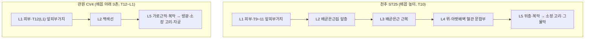
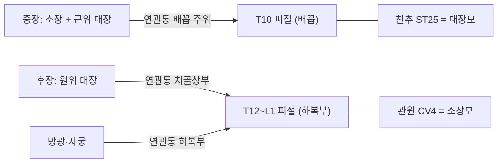

# 📜 [혈위고증 보고서] 천추(ST25)·관원(CV4) 모혈의 신경분절 정합성 고증 및 질의응답 검증

> **프레임워크**: v2.7 (Tier 3, Rank 0~7 전개) · **ARI**: v3.0 이중 채점 · **작성일**: 2026-10-12
> **분석 대상**: 강의 질의("배꼽 높이 T10의 천추와 T11~12 높이의 관원 — 모혈이 신경분절 반응점이라면 모순 아닌가?")와 그에 대한 강의 답변("관원은 해부학적 소장이 아니라 '소장'이라는 병증 유형을 치료하는 혈이다")
> **근거 원전**: 《中国针灸穴位通鉴》 · 《中国针灸证治通鉴》 · 《针灸腧穴通考》(정제본 `chunks_refined`)
> **근거 데이터**: `천추_관원_모혈분절_문헌고증_DB.xlsx` (본 폴더) · 통합 생의학 DB v3.0 (`02_Master_Datasets/경혈_생의학_신경반사_마스터DB.json`, 2026-10-12 Rank 6 동기화)
> **연관 분석**: 같은 질의의 문헌사 측면은 황룡상 스킬 검토(2026-10-12 대화)에서 다루었으며, 본 보고서는 해부·신경분절·반사 기전 측면을 맡는다.

---

## 0. 요약 (Executive Summary)

1. **질의의 관찰은 해부학적으로 맞다.** 배꼽 높이(T10 피절)의 천추는 중장(中腸) 유래 장관, 곧 소장과 근위 대장의 연관통 구역과 겹친다. 관원(T12~L1 피절)은 후장(後腸) 유래 원위 대장과 방광·자궁의 연관통 구역에 더 가깝다. 따라서 "모혈 = 해당 부(腑)의 분절 반응점"이라는 전제를 세우면 천추는 부분적으로, 관원은 거의 맞지 않는다.
2. **모순은 전제에서 생긴다.** 고전의 모혈 귀속은 분절 원리로 만들어지지 않았다. 문헌상 두 혈 모두 귀속된 부(腑)의 병을 치료하는 대표 혈도 아니었다. 《영추》는 대장병을 상거허로, 《명당경》은 소장창(小肠胀)을 관원이 아닌 중료로 치료했다.
3. **분절 모델만으로는 천추의 작용도 다 설명되지 않는다.** 2025년 마우스 연구에서 천추 전침의 대장염 개선은 T10 분절의 교감신경절(SMG·IMG)을 거치지 않았고, 천수(S2~4) 부교감 경로(골반신경절)를 거쳤다(papers.id 2023). 다른 연구에서는 자극 강도에 따라 척수 분절성 교감 경로가 동원되었다(B3-16). 천추의 효과는 분절 반사와 비분절 경로가 섞여 있다.
4. **강의 답변은 결론이 타당하지만 근거 하나는 바꿔야 한다.** 관원이 '소장병'이라는 병증 범주, 특히 하복통·산증(疝症)을 치료한다는 결론은 해부 분석으로도 지지된다. 관원의 분절은 골반 장기와 맞고, 서혜부 탈장 주머니에는 실제로 소장 고리가 들어간다. 반면 "소장 병증 = 방광의 소변 배출 기능"이라는 설명은 초기 문헌 층차에서 확인되지 않는다. 관원의 배뇨장애 주치는 T11~L2 분절의 방광과 맞는 하복부 국소 주치로 설명하는 편이 낫다.
5. **ARI v3.0**(이중 채점, 10절): 천추는 **ARI-Core 71 (B, 가중치 민감)**, 관원은 **ARI-Core 68 (C)**이며, 두 혈 모두 **SI 25 ⚠ 안전주의**다. 두 혈 모두 실체 판명의 병목은 반사 기전의 인체 근거 부족(B-Check 7/12, 기전은 "가설")이다. 관원은 교재 간 심층 구조 기술이 다르다는 점도 감점 요인이다. 안전 측면에서는 관원 《명당경》 "刺入二寸"(약 46mm)이 복막을 넘을 수 있다는 점이 핵심이다.
6. **이전 답변 정정**: 같은 날 천추·소아 질의에 대한 Tier 1 답변에서 "천추와 소아를 연결한 기록을 찾지 못했다"고 했다. 그러나 《针灸腧穴通考》 정제본의 【提要索隐】에 "灸治小儿慢性消化道症状"이 있다. 그 출처는 1957년 남경 《针灸学》 "小儿慢性疾患灸之大有效"로, 현대 교재 층차다(9절). 결론(현대 층차의 관행)은 유지되지만, "기록 없음"은 틀렸으므로 정정한다.

---

## 1. 문헌 스크리닝 표 (3대 원전 대조)

| 항목 | 천추(ST25) | 관원(CV4) | 출처 |
| :--- | :--- | :--- | :--- |
| 최초 출전 | 《黄帝明堂经》 | 《灵枢·寒热病》 "脐下三寸关元也" | 《通考》(上) p.321 / (下) p.1292 |
| 모혈 귀속 | "天枢，大肠募也。一名长溪，一名谷门。去肓俞一寸五分，夹脐两旁各二寸陷者中。足阳明脉气所发。" | "关元，小肠募也，一名次门，在脐下三寸，足三阴、任脉之会。" | 《明堂经》(《通考》 수록) |
| 《명당경》 자침 | "刺入五分，留七呼，灸三壮" | "刺入二寸，留七呼，灸七壮" | 《通考》 【操作】 |
| 《명당경》 주치 핵심 | 대장병(肠中切痛而鸣濯濯, 冬日重感于寒则泄, 当脐而痛, 食不化), 산증(脐疝·气疝·阴疝·奔肫), 부인 월경병, 학질 | 石水, 胞转不得溺, 少腹满, 奔肫, 溺血, 小便数, 腰背脐痛引阴, 后泄不止, 暴疝痛, 女子绝子 | 《证治通鉴》·《通考》 |
| 침 금기 기록 | 《千金》 "魂魄之舍，不可针", "勿针", "忌针" | 《圣惠方》 "若怀胎必不针"; 현대 교재 "孕妇慎用。针前让患者排尿" | 《通考》 |
| 소아 관련 | 1957 남경《针灸学》 "小儿慢性疾患灸之大有效"; 1986 《中国针灸》 소아 단순성 소화불량 天枢·中脘 | 2001 소아 신경성 빈뇨 관원 자침, 1995 신생아 무뇨 관원 외敷 | 《通考》 임상 응용 예 |

> 검색 경로: 《针灸腧穴通考》 `chunks_refined/针灸腧穴通考(上)_321-400.md` L1050~1310(천추), `(下)_481-560.md` L1396~1586(관원). 《中国针灸证治通鉴》 `_1-80.md` L2006(천추), `_81-160.md` L1684(관원). 《中国针灸穴位通鉴》 관원 주치 인용 `(上卷)_1-80.md` L1526.

## 2. 원천/재인용 구분 표

| 시기 | 천추 | 관원 | 판정 |
| :--- | :--- | :--- | :--- |
| 선진·한대 | 《명당경》: 위치·심도·모혈 귀속·대장병 주치 | 《영추·寒热病》: 위치("三结交"). 《명당경》: 소장모 귀속·심도 2촌·하복부 주치 | **원천** |
| 위진·수당 | 《千金》: "夹脐相去五寸"(배꼽 직경 1촌), 다량 뜸(百壮)과 금침 | 《千金》: 기림·석림·고환 치우침 뜸 | 원천 확장 |
| 송·금·원 | 《铜人》: "可灸百壮" | 《铜人》: 灸量을 "百壮至三百壮"으로 개편(《圣惠方》 "日灸三十壮，至三百壮止"의 오독) | 재편, 오류 혼입 |
| 명·청 | 《针灸大成》: 脐中 기준 오해 계열 | 《针灸大成·玉龙歌》: "阑门"을 "关元"으로 오기 | 재인용 오류 |
| 현대 | 1957 교재: 소아 만성질환 뜸 추가 | 7판 교재: 비뇨·생식·원기허손 6계통으로 확대 | 현대 확장 |

**원문/해석 분리**: 황룡상은 천추의 정위가 '배꼽 가장자리에서 2촌(除脐)'이라고 교감했다. 후대의 '배꼽 중심 2촌'은 '脐'를 오해한 재해석이다. 천추의 대장병 주치는 《명당경》 편자가 하합혈(상거허) 주치를 모혈로 옮긴 결과이므로, 원천 기술이지만 귀속 자체는 편찬 단계의 판단으로 본다.

## 3. 이명·별칭 검증 표 (KJH DB 대조)

| 혈 | KJH DB 이명 | 혼용 위험 | 처리 |
| :--- | :--- | :--- | :--- |
| ST25 | 長溪·長谿·谷門·長谷·循際·循元·補元·穀門 | 魂舍(夹脐相去三寸)·長谷을 별도 기혈로 세운 현대 오류. "長谷"은 "長谿"의 坏字. 1957 교재 "循元·補元"은 일본 교재를 거친 오류 | 정명과 일치하는 것은 長溪·谷門·循際뿐(황룡상 교감). 魂舍 정위 정보는 천추 정위에서 분리 |
| CV4 | 三結交·上氣海·下肓·下記·丹田·大中極·太中極·次門·肓原 | **丹田**: CV4·CV5·CV6·CV7이 공유하며, 도가 단전과 침가 개념이 섞였다. **下肓**: CV4·CV6 공유. 《大成》 "关元" = "阑门" 오기. 関元兪(BL26)는 별개 | 丹田 계열 주치("下元虚冷" 등)는 도가 문헌 혼입 가능성을 표시. 《玉龙歌》 疝气 조문의 "关元"은 阑门(급맥 부근)으로 분리 |

## 4. 3D 공간 좌표 및 Layer 1~5 층차 구조

좌표계: X = 정중선 기준 외측(mm), Y = 배꼽(0) 기준 하방(+), Z = 피부 기준 심도(mm). 촌→mm 환산은 성인 평균 체형을 가정한 추정이다(1 B-cun ≈ 24~30mm).

| 혈 | X | Y | 표준 Z 범위(현대) | 비고 |
| :--- | :--- | :--- | :--- | :--- |
| ST25 Target 2(WHO, 배꼽 중심 2촌) | 약 50~60 | 0 | 20~40 | 배곧은근 근복 위 |
| ST25 Target 1(명당경, 배꼽 가장자리 2촌) | 약 60~72 | 0 | 동일 | Δ ≈ 10~15mm (7절) |
| CV4 | 0 | 약 72~90 (3촌) | 20~40 | 활꼴선(arcuate line) 아래 백색선 |

### 4-1. 천추 층차 (배꼽 높이, 활꼴선 위)

| Layer | 구조 | 근거 |
| :--- | :--- | :--- |
| L1 피부·피하 | 제9~11 갈비사이신경 앞피부가지(T10 중심), 얕은배벽동·정맥 분지 | 김재효 교재, B1-03 |
| L2 표층 근막 | 배곧은근집 앞층(배바깥빗근·배속빗근 널힘줄) | 김재효 교재, B1-01 |
| L3 근육 | 배곧은근 근복, 갈비사이신경 근가지 | 두 교재 공통 |
| L4 신경혈관속 | 배곧은근 뒤면의 위·아랫배벽동·정맥 문합부(배꼽 높이), 갈비사이신경 본줄기 | 두 교재(위배벽동·정맥), B1-01(배꼽 높이 문합) |
| L5 심부 | 배곧은근집 뒤층·가로근막·복막전지방·벽측복막 → **복강(소장 고리·큰그물막, 체위에 따라 횡행결장)** | B1-01 |

### 4-2. 관원 층차 (배꼽 아래 3촌, 활꼴선 아래)

| Layer | 구조 | 근거 |
| :--- | :--- | :--- |
| L1 피부·피하 | 갈비밑신경(T12) 앞피부가지, (공통교재) 엉덩아랫배신경(L1) 앞피부가지, 얕은배벽동·정맥 | 두 교재 |
| L2 표층 근막 | 백색선(정중선 널힘줄 교차부) | 두 교재 공통 |
| L3 근육 | 정중선이므로 근복 없음. 양옆에 배곧은근 | B1-01 |
| L4 신경혈관속 | 아랫배벽동·정맥은 배곧은근 뒤 외측을 지나며 정중선 직하에는 없다 | 두 교재(혈관 명칭), B1-01(주행) |
| L5 심부 | 활꼴선 아래라 배곧은근집 뒤층이 없다. 가로근막 → 복막 → **방광(충만 시 치골 위로 상승)·소장 고리·임신 자궁** | 김재효 교재(배가로근막), B1-01 |

## 5. 자침 깊이 계산표 (1푼 = 2.3mm)

| 문헌 | 천추 푼수 | 천추 mm | 관원 푼수 | 관원 mm | 도달 Layer(성인 추정) |
| :--- | :---: | :---: | :---: | :---: | :--- |
| 《黄帝明堂经》(황룡상 감수) | 5 | 11.5 | 20 | **46.0** | 천추 L1~L2 / 관원 **L5 이상(복막 관통 가능)** |
| 《针灸甲乙经》 | 5 | 11.5 | 20 | 46.0 | 동일 |
| 《针灸经验方》 | 5 | 11.5 | 8 | 18.4 | 천추 L1~L2 / 관원 L1~L2 |
| 《东医宝鉴》(동인 인용) | 8 | 18.4 | 8 | 18.4 | L2~L3 |
| 공통교재 | 10~15(현대 촌) | 체형 비례 | 10~15(현대 촌) | 체형 비례 | 1~1.5 B-cun ≈ 24~45mm |
| 《针灸腧穴通考》 현대 권장 | 0.8~1.2촌 | 체형 비례 | 1~1.5촌 | 체형 비례 | — |

- 자침깊이 DB에 '0'(금침)은 없다. 다만 천추에는 《千金》의 "不可针·勿针·忌针" 기록이 있고, 관원에는 임신 시 금침 기록이 있다(DB 미반영, 원전 확인).
- **참고 실측**: 상복부 정중선 CV12의 초음파 허용 자침 깊이(ANIR)는 성인 83명 평균 **25.3 ± 10.2mm**였다(papers.id 1444, DOI 10.3390/healthcare10091707). 관원은 같은 정중선이고 활꼴선 아래라 뒤층이 없으므로, 비만하지 않은 성인에서 46mm는 복막을 넘을 가능성이 높다. 천추는 배곧은근이 더해져 CV12보다 두꺼울 것으로 추정되지만, 경혈 특이 실측은 없다.
- **[해석·교차 참조]** 《명당경》 관원 "刺入二寸"은 복강 내 막 층위를 겨냥한 고전 심자법일 가능성이 있다. 이는 황룡상의 '기병치막(器病治膜)·장침모자법' 고증과 맞물리는 부분이다. 그러나 현대 임상 심도로 쓸 수는 없다.

## 6. 해부학 구조 교재 비교표

| 혈 | 구분 | 공통교재 | 김재효 교재 | 판정 |
| :--- | :--- | :--- | :--- | :--- |
| ST25 | 근육 | 배곧은근 | 배바깥빗근·배속빗근·배곧은근·배가로근 | 일치(김재효가 상위 집합) |
| ST25 | 신경 | 갈비사이신경 | 제9~11 갈비사이신경 + 앞피부가지 | 일치(김재효가 분절 명시) |
| ST25 | 혈관 | 위배벽동·정맥 | 위배벽동·정맥 + 얕은배벽동·정맥 | 일치(김재효가 표층 추가) |
| CV4 | 근육·근막 | 백색선·배곧은근집 | 백색선·배가로근막 | **부분 불일치**: 활꼴선 아래에는 배곧은근집 뒤층이 없으므로 깊은 층은 김재효 교재(가로근막)가 해부학적으로 정확 |
| CV4 | 신경 | 엉덩아랫배신경(L1) + 갈비밑신경(T12) 앞피부가지 | 갈비밑신경(T12) 앞피부가지 | **부분 불일치**: L1 포함 여부. 배꼽-치골 3/5 지점은 T12와 L1 피절의 경계 부근이므로 두 기술 모두 가능 범위 |
| CV4 | 혈관 | 얕은·아랫배벽동·정맥 | 동일 | 일치 |

> **추가 지적(B1-01)**: 두 교재 모두 천추의 깊은 혈관을 '위배벽동·정맥'으로만 적었다. 그러나 배꼽 높이는 위배벽동맥과 아랫배벽동맥의 문합부이므로 '위·아랫배벽동·정맥 문합부'로 적는 것이 더 정확하다.

## 7. 공간 변위 분기 추론

- **천추**: Target 1(명당경, 除脐 2촌)과 Target 2(WHO, 脐中 2촌)의 차이는 배꼽 반지름(약 0.5 B-cun)이다. 성인 기준 Δ ≈ 10~15mm로 기준값 15mm 이하이므로 **분기 분석을 하지 않는다.** 두 지점은 같은 배곧은근 근복 위에 있고 피절(T10)도 같다.
- **관원**: 고금 정위가 모두 "脐下三寸"이므로 Δ ≈ 0, 분기 불필요.

## 8. 생의학적 반사 기전과 외부 검색 로그

### 8-1. 질의의 핵심: 분절 정합 분석

| 표적 | 내장 구심·자율 분절(B1-03) | 연관통 체표 구역(B3-01·B3-02) | 천추(T10)와의 정합 | 관원(T12~L1)과의 정합 |
| :--- | :--- | :--- | :---: | :---: |
| 소장(중장) | 교감 T8~T11 | 배꼽 주위(T10) | **정합** | 부분 |
| 근위 대장: 맹장~횡행결장 근위 2/3(중장) | 교감 T10~T12, 미주신경 | 배꼽 주위 | **정합** | 부분 |
| 원위 대장: 횡행결장 원위~직장(후장) | 교감 L1~L2, 부교감 S2~S4 | 치골상부(하복부) | 불일치 | **정합** |
| 방광 | 교감 T11~L2, 부교감 S2~S4 | 치골상부 | 불일치 | **정합** |
| 자궁 | 교감 T10~L1 | 하복부·요천부 | 부분 | **정합** |
| 고환(산증 방사통 표적) | T10~T11(고환은 발생상 높은 분절) | 서혜부·음낭 | 부분 | 부분 |

**판독**:
- 천추는 소장과 근위 대장의 분절 모두와 겹친다. 분절로 보면 '대장 모혈'이 아니라 '중장 모혈'이다.
- 관원은 원위 대장·방광·자궁의 분절과 겹치고, 소장 분절과는 1~3분절 떨어져 있다.
- 따라서 분절 지도로는 오히려 "천추 = 소장·근위 대장, 관원 = 원위 대장·골반 장기"가 된다. 질의자의 지적은 해부학적으로 정확하다.
- 이 불일치는 **모혈 귀속이 분절 원리로 정해지지 않았다**는 문헌적 사실과 함께 보아야 해소된다. 황룡상의 고증에 따르면, 모혈은 장부의 막이 매달린 '원(原)'으로서 삼초 구획(중초 = 배꼽 옆, 하초 = 배꼽 아래)에 따라 배치되었다.
- **[해석·B1]** 고전 '소장병'의 핵심 증후는 "小腹痛，腰脊控睾而痛"(《영추·邪气藏府病形》)이다. 송대 이후 산증이 '小肠气'로 불린 것도 같은 맥락이다. 이는 서혜부 탈장 주머니에 소장 고리가 실제로 들어가는 해부학적 사실과 맞는다. 관원(하복부, T12~L1)이 '소장병'을 치료한다는 귀속은, 병증이 나타나는 자리(하복·서혜·고환)와 일치한다는 점에서 해부학적 근거가 있다.

### 8-2. Layer A 주요 논문 (Rank 6, 2026-10-12)

| papers.id | PMID | 대상·설계 | 핵심 결과 | 분절 쟁점과의 관계 |
| :---: | :---: | :--- | :--- | :--- |
| 2023 | 40854853 | 마우스 DSS 대장염, 양측 ST25 전침 2mA·10Hz | 원위 대장 ACh 증가, NE 무변화. SMG·IMG 교감 뉴런 c-Fos 무변화, 골반신경절 콜린성 뉴런 c-Fos 증가 | **천추의 원위 대장 효과가 T10 분절 교감이 아닌 천수 부교감을 거침** → 단순 분절 모델 반증 |
| 2009 | 40763037 | 수술 후 장폐색 동물, ST25 전침 | 복강 교감 과활성 억제, NE-α2 수용체 경로로 장운동 개선. 교감신경절제가 효과 모사 | 교감(분절성) 경로 관여 |
| 2018 | 42343522 | 감염 후 IBS 쥐, ST25+BL25 | 내장과민 감소 | 모혈·배수혈 배오(단독 아님) |
| 2017 | 42443084 | 서행성 변비 쥐, 대장 모혈·배수혈 | 카할 사이질세포 자가포식 조절 | 배오 |
| 2011 | 38750560 | 만성 염증성 내장통 쥐, 뜸 | 척수 circRNA 네트워크 | 뜸 자극의 척수 수준 작용 |
| 317 | 34646018 | 마우스(B3-17) | ST25에는 PROKR2 섬유가 없어 저강도로 미주-부신 축을 구동하지 못함 | 복부 경혈의 비사지형 기전 |
| 2031 | 41194515 | 골반염 쥐, CV4 전침 2/100Hz | 교감 활성(TH)·신경염증 억제로 통증 완화 | 관원-골반 장기 분절(T11~L2) 정합 |
| 2052 | — | 노년 여성 복압성 요실금 31례(비대조), 침+뜸 | 임상 개선 보고 | 관원-방광, 인체 간접 |
| 2036 | 42343515 | 원발성 월경통 뜸 RCT | 임상 효과·경제성 | 관원-자궁, 인체 |

### 8-3. B-Check 6항목 채점표

| 항목 | 천추(표적: 대장) | 근거 | 관원(표적: 골반 장기) | 근거 |
| :--- | :---: | :--- | :---: | :--- |
| ① 말초 실체 | 1 | B2-09 교재 일치, 경혈 특이 실측 없음 | 1 | B2-09(부분 불일치), 실측 없음 |
| ② 분절 정합 | 2 | B1-03·B3-01: T10 ↔ 중장(근위 대장) | 2 | B1-03: T12~L1 ↔ 방광·자궁·후장 |
| ③ 구심 섬유 | 1 | B3-16·B3-17(마우스, 강도 의존·PROKR2 부재) | 1 | B3-05(마취 쥐 일반) |
| ④ 중추 경로 | 1 | B3-16 척수-교감, 2023 천수 부교감(동물) | 1 | 2031 척수 신경염증(동물) |
| ⑤ 효과 방향 | 1 | 2009·2023: 장운동·염증 개선이 대장병 주치와 일치하나 경로가 연구마다 다름(동물) | 1 | 2031: 하복통 완화가 주치와 일치(동물) |
| ⑥ 인체 전환 | 1 | 수술 후 장기능·소화불량 임상(간접), 자율신경 지표 없음 | 1 | 2036 RCT·2052 증례군(간접), 기전 지표 없음 |
| **합계** | **7/12** | **부합 기준(≥8) 미달 → "가설"** | **7/12** | **부합 기준 미달 → "가설"** |

### 8-4. 외부 API 검색 로그 (`_metadata.sync_log`)

| 일시 | 경혈 | 소스 | 쿼리(요약) | HTTP | 수집 | 비고 |
| :--- | :---: | :--- | :--- | :---: | :---: | :--- |
| 2026-10-12 15:25:11 | ST25 | PubMed | ST25/Tianshu/天枢 × acupuncture × nerve·reflex·autonomic + 中国针灸·针刺研究 | 200 | 16 | |
| 2026-10-12 15:25:11 | ST25 | OpenAlex | doi 10.13703·10.13702 + 일반 | 200 | 24 | |
| 2026-10-12 15:25:11 | ST25 | Crossref | Tianshu acupuncture nerve reflex | 200 | 0 | |
| 2026-10-12 15:25:11 | ST25 | 합계 | — | — | 40 | 신규 20, 기존 병합 9, 배치 중복 11 |
| 2026-10-12 15:25:28 | CV4 | PubMed | CV4/Guanyuan/关元 동일 구조 | 200 | 16 | |
| 2026-10-12 15:25:28 | CV4 | OpenAlex | 동일 | 200 | 24 | |
| 2026-10-12 15:25:28 | CV4 | Crossref | Guanyuan acupuncture nerve reflex | 200 | 2 | |
| 2026-10-12 15:25:28 | CV4 | 합계 | — | — | 42 | 신규 25, 기존 병합 9, 배치 중복 8 |

`validate` 두 번 모두 OK. 통합 DB는 2,036편(외부 266편)으로 갱신되었다.

## 9. 주치증 분리 표 ($P_{single}$ vs 배오)

| 혈 | 단독 주치($P_{single}$, 《명당경》·단독 처방) | 배오 파생 | 현대 확장 |
| :--- | :--- | :--- | :--- |
| ST25 | 대장병(泄·당제통·장명), 산증, 월경병, 《千金》 단독 뜸(설사·이질·복통) | 《脉经》 灸天枢+针关元(척맥 긴·배꼽 아래 통증), 《针经摘英集》 中脘·气海+天枢·气冲·三里(기가 아랫배에서 치밀 때), 1986 소아 소화불량 天枢+中脘 | 1957 교재 "小儿慢性疾患灸之大有效" → 《通考》 提要 "灸治小儿慢性消化道症状" |
| CV4 | 배뇨장애(胞转不得溺·小便数·溺血), 하복통·산증, 부인 불임, 石水 | 《金匮》 劳宫+关元(임신 소변불리), 《席弘赋》 气海+关元(칠산), 《针灸大全》 白环俞·太溪·三阴交+关元 | 《扁鹊心书》 이후 '원기허손' 다량 뜸(도가 단전 개념 혼입 가능), 7판 교재 6계통 |

**판정**: 관원의 단독 주치는 처음부터 하복·배뇨·산증·생식 계열이며, 소장 소화 기능과 관련된 단독 주치는 확인되지 않는다. 천추의 소아 소화장애 사용은 단독·뜸 형태로는 1957년 교재가 처음이고, 그 이전 층차에서는 확인되지 않는다.

## 10. ARI v3.0 프로파일 평가표 및 최종 결론

### 10-1. 이중 채점 (채점 1: 분석자, 채점 2: 근거 패키지만 받은 독립 에이전트)

| 혈 | 항목 | 채점 1 | 채점 2 | 차이 | 조정 후 | 근거 포인터 |
| :--- | :--- | :---: | :---: | :---: | :---: | :--- |
| ST25 | S_orig ① 최초 기술 | 75 | 75 | 0 | 75 | 《명당경》 위치·심도 명시, '脐' 기준 모호 |
| ST25 | S_orig ② 후대 일치율 | 75 | 75 | 0 | 75 | 脐旁二寸 계열 약 69~80% |
| ST25 | S_orig ③ 이명 해소 | 75 | 75 | 0 | 75 | KJH DB, 魂舍·长谷 분리 |
| ST25 | S_orig ④ 통고 교정 | 75 | 100 | **25** | **100** | 황룡상이 除脐 2촌으로 정위 난립을 완전히 교정 |
| ST25 | **S_orig 평균** | 75.0 | 81.25 | | **81.25** | |
| ST25 | S_clarity | 75 | 75 | 0 | 75 | 두 교재 상충 없음(김재효가 상위 집합), B1-03, 실측 없음 |
| ST25 | S_reflex | 50 | 50 | 0 | 50 | B-Check 7/12, 동물 다수 + 인체 임상 간접 |
| ST25 | S_safety(SI) | 25 | 25 | 0 | 25 | 현대 1~1.5촌 직자 시 복막까지 10mm 이내 가능, 《千金》 不可针 |
| CV4 | S_orig ① | 100 | 100 | 0 | 100 | 《영추·寒热病》 위치 + 《명당경》 심도 |
| CV4 | S_orig ② | 100 | 100 | 0 | 100 | 거의 전 문헌 脐下三寸 |
| CV4 | S_orig ③ | 75 | 75 | 0 | 75 | 丹田·下肓 공유, 阑门 오기 |
| CV4 | S_orig ④ | 100 | 75 | **25** | **100** | 정위 관련 전사 오류 없음, 이명·灸量 오류는 황룡상이 완전히 교정 |
| CV4 | **S_orig 평균** | 93.75 | 87.5 | | **93.75** | |
| CV4 | S_clarity | 50 | 75 | **25** | **50** | 두 교재가 깊은 층(배곧은근집 vs 배가로근막)과 신경(L1 포함 여부)에서 서로 다른 구조를 지목한다. 활꼴선·피절 경계라는 B1 추론으로 조정해야 하므로 루브릭 50 단계에 해당 |
| CV4 | S_reflex | 50 | 50 | 0 | 50 | B-Check 7/12 |
| CV4 | S_safety(SI) | 25 | 25 | 0 | 25 | 《명당경》 46mm, 정중선 복막·충만 방광, 임신 금침 |

**조정 메모**: 세 항목의 차이는 모두 루브릭 문구를 해석하는 방식의 차이였다. ④는 "완전 교정"을 정위 오류 기준으로 읽어 두 혈 모두 100으로 맞추었다. CV4 S_clarity는 두 교재가 서로 다른 구조를 기술하고 있어(생략 관계가 아니라 지목 대상의 차이) 50으로 확정했다. 조정 전 ARI-Core 범위는 ST25 68.75~71.25, CV4 67.5~73.75였다.

### 10-2. ARI v3.0 프로파일

| 혈 | ARI-Core (0.40/0.35/0.25) | 등급 | 게이트 | SI | 등가중치 민감도 | B-Check |
| :--- | :---: | :---: | :--- | :---: | :---: | :---: |
| ST25 천추 | 0.40×81.25 + 0.35×75 + 0.25×50 = **71.25** | **B (개연)** | 게이트 1·2 미적용, 게이트 3 적용 | **25 ⚠** | 68.75 → **C (가중치 민감)** | 7/12, 기전 "가설" |
| CV4 관원 | 0.40×93.75 + 0.35×50 + 0.25×50 = **67.5** | **C (가능·가설)** | 게이트 1·2 미적용, 게이트 3 적용 | **25 ⚠** | 64.6 → C (등급 불변) | 7/12, 기전 "가설" |

**표준 표기**
- `ARI v3.0 | ST25 ARI-Core 71 ± 0 (조정 후, 조정 전 69~71) (B) | SI 25 ⚠ | 잠정 가중치 0.40/0.35/0.25 | 민감도(등가중치): 69 (C, 가중치 민감)`
- `ARI v3.0 | CV4 ARI-Core 68 ± 0 (조정 후, 조정 전 68~74) (C) | SI 25 ⚠ | 잠정 가중치 0.40/0.35/0.25 | 민감도(등가중치): 65 (C, 등급 불변)`

**민감 항목**: CV4는 S_clarity를 75로 보면 76.25(B)가 되고, B-Check ⑥을 2점으로 보면(RCT를 명시 근거로 인정) S_reflex가 75가 되어 73.75(B)가 된다. ST25는 S_clarity를 50으로 보면 62.5(C)로 내려간다.

### 10-3. 최종 결론

1. **두 혈의 위치와 층차 구조는 비교적 분명하다.** 위치는 S_orig 81~94점이다. 천추는 배곧은근 근복 위(T10), 관원은 활꼴선 아래 백색선(T12~L1)이다.
2. **"모혈 = 해당 부(腑)의 분절 반응점"이라는 가설은 지지되지 않는다.** 분절로는 천추가 중장 전체(소장 + 근위 대장), 관원이 골반 장기(방광·자궁·원위 대장)와 맞는다. 문헌상 모혈 귀속은 삼초 구획과 병증이 나타나는 자리에 따른 것이다.
3. **반사 기전은 두 혈 모두 "가설" 단계다.** 천추에서는 강도에 따라 분절성 교감 반사(B3-16, papers.id 2009)와 비분절 천수 부교감 경로(papers.id 2023)가 함께 보고되었다. 인체 자율신경 지표 연구가 나와야 B-Check ⑥을 채울 수 있다.
4. **⚠ 안전**: 관원은 시술 전 배뇨, 임신 확인, 정중선 직자 심도를 성인 기준 약 25mm 안팎으로 제한해야 한다(CV12 실측 유추). 천추는 마른 체형과 소아에서 복막까지의 여유가 작다. 고전 심도(5푼, 11.5mm)가 오히려 안전 범위에 든다.
5. **후속 과제**: ST25·CV4 초음파 허용 자침 깊이 실측(소아 포함), B1 교과서의 판·장·쪽 대조, 천추 전침의 인체 자율신경 지표 연구 검색.

## 11. 강의 질의·답변 검증 결론

| 쟁점 | 판정 | 해부·기전 근거 |
| :--- | :--- | :--- |
| 질의: "천추 바로 아래는 소장이다" | **타당** | 배꼽 높이 배곧은근 아래 복강에는 주로 소장 고리와 큰그물막이 있다(B1-01). 횡행결장은 체위에 따라 이 높이를 지난다 |
| 질의: "대장 병변 반응은 바깥쪽 배벽에 나타난다" | **부분 타당** | 상행·하행결장은 옆구리 쪽 후복벽에 붙어 있어 국소 압통이 바깥쪽에 나타날 수 있다. 다만 연관통은 중장 부분이 배꼽 주위, 후장 부분이 치골상부로 간다(B1-03) |
| 질의: "천추 T10은 중장 분절과 겹치고, 관원 T11~12는 원위 대장 쪽에 가깝다" | **타당** | 8-1 분절 정합표 |
| 답변: "관원은 해부학적 소장보다 '소장'이라는 병증 유형을 치료한다" | **타당** | 관원의 단독 주치(하복·배뇨·산증)는 T12~L1 분절의 골반 장기·서혜부와 정합한다(B-Check ② = 2) |
| 답변: "소장 병증 = 방광의 소변 배출 과정" | **수정 필요** | 《영추》에서 소변 장애는 삼초병·방광병 조문에 있다. 관원의 배뇨 주치는 방광 분절(T11~L2) 국소 주치로 설명된다 |
| 답변: "하복부 산증을 소장 범주로 분류" | **타당** | 서혜부 탈장의 내용물이 소장이라는 해부 사실, '小肠气' 용어와 일치 |

**수정 답변 제안(해부학 관점 보충)**

> 모혈을 신경분절 반응점으로만 보면 천추(T10)는 소장과 근위 대장, 관원(T12~L1)은 원위 대장과 방광·자궁의 분절에 놓입니다. 그래서 '대장모-천추, 소장모-관원'은 분절 지도와 맞지 않습니다. 이 모순은 모혈 귀속이 분절 원리로 정해지지 않았기 때문에 생깁니다.
>
> 고전에서 '소장병'은 아랫배가 아프고 허리와 고환으로 당기는 병, 곧 산증 유형입니다. 서혜부 탈장 주머니에 소장이 실제로 들어간다는 점을 생각하면, 하복부의 관원이 이 병을 맡은 것은 병이 나타나는 자리와 맞습니다. 관원의 배뇨장애 주치는 소장의 기능이 아니라 같은 분절(T11~L2)에 있는 방광에 대한 국소 주치로 이해하는 것이 정확합니다.
>
> 천추의 효과도 분절만으로는 설명되지 않습니다. 동물 실험에서 천추 전침의 대장 효과는 T10 교감신경절이 아니라 천수 부교감 경로를 거치기도 했습니다. 따라서 모혈은 분절 반응점으로 보기보다, 국소 분절 반사와 비분절 경로가 함께 작동하는 복부 자극점으로 보는 것이 현재 근거에 맞습니다.

---

## 부록 A. 감사 기록 (Audit)

- Rank 0: `sync_skill_settings.py --check` → 드리프트 없음(`.claude/CLAUDE.md` 변경만 표시). 정본 v2.7 적용.
- Rank 6: `sync_master_db.py --dry-run` 확인 후 실제 반영. ST25·CV4 모두 PubMed·OpenAlex·Crossref HTTP 200, `validate` OK. 핵심 3편(papers.id 2009·2023·2031)의 초록은 NCBI E-utilities로 원문을 확인했다.
- 해부 기술 중 B1(규범 해부) 근거는 일반 해부학 지식으로 적었고, Moore·Gray's의 판·장·쪽은 대조하지 못했다(등록부 규칙 ⑤ 미충족). 분절 범위는 교과서마다 1분절 정도 차이가 날 수 있다.
- ST25·CV4 모두 경혈 특이 영상 실측 논문이 없다. 5절의 mm 추정은 CV12 실측(papers.id 1444)을 유추한 것이다.
- 이전 Tier 1 답변(천추·소아) 정정: 0절 6항, 1절, 9절 참조.
