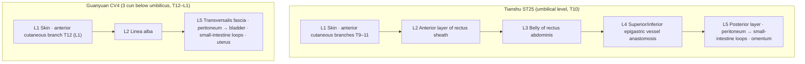
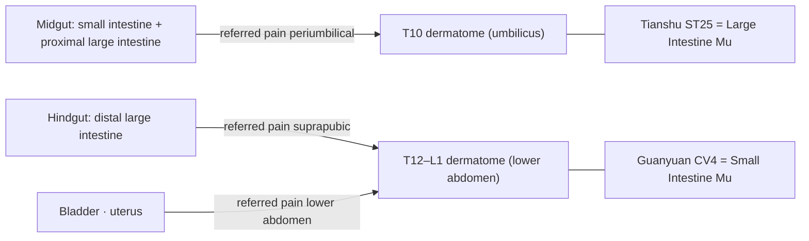

# 📜 [Textual Research Report on Acupoints] Neural-Segment Consistency of the Front-Mu Points (募穴) Tianshu (天樞, ST25) and Guanyuan (關元, CV4): Textual Research and Verification of a Lecture Q&A

> **Framework**: v2.7 (Tier 3, Rank 0–7 executed) · **ARI**: v3.0 dual scoring · **Date**: 2026-10-12
> **Subject of analysis**: a lecture question ("Tianshu (天樞) lies at the level of the umbilicus, T10, and Guanyuan (關元) at the level of T11–12 — if the Front-Mu points (募穴) are neural-segment reaction points, isn't this a contradiction?") and the lecturer's answer ("Guanyuan does not treat the anatomical small intestine; it treats the disease pattern called 'Small Intestine (小腸)'")
> **Source classics**: *Zhongguo Zhenjiu Xuewei Tongjian* (《中國針灸穴位通鑑》) · *Zhongguo Zhenjiu Zhengzhi Tongjian* (《中國針灸證治通鑑》) · *Zhenjiu Shuxue Tongkao* (《針灸腧穴通考》) (refined edition `chunks_refined`)
> **Source data**: Tianshu & Guanyuan Mu-Point Segmental Concordance Database (this folder) · Integrated Biomedical DB v3.0 (Integrated Biomedical Master DB v3.0, synchronised at Rank 6 on 2026-10-12)
> **Related analysis**: The literary-historical side of the same question was covered in the Huang Longxiang (黃龍祥) skill review (conversation of 2026-10-12); this report covers the anatomical, neural-segment and reflex-mechanism side.
> **Note on script**: Classical quotations and TCM terms are given in Traditional Chinese (繁體字). The cited source files are simplified-script editions, so the file names and line numbers in `code` refer to those files as they are named on disk.

---

## 0. Executive Summary

1. **The questioner's observation is anatomically correct.** Tianshu (天樞), at the level of the umbilicus (T10 dermatome), overlaps the referred-pain zone of midgut-derived bowel, i.e. the small intestine and proximal large intestine. Guanyuan (關元) (T12–L1 dermatome) lies closer to the referred-pain zone of the hindgut-derived distal large intestine and of the bladder and uterus. Hence, if one adopts the premise "Front-Mu point = segmental reaction point of the corresponding Fu organ (腑)", Tianshu fits only partly and Guanyuan hardly at all.
2. **The contradiction arises from the premise.** The classical Front-Mu attributions were not built on a segmental principle. In the literature, neither point was the representative point for treating disease of the Fu organ to which it is assigned. The *Lingshu* (《靈樞》) treats large-intestine disease with Shangjuxu (上巨虛, ST37), and the *Mingtang Jing* (《明堂經》) treats small-intestine distension (小腸脹) with Zhongliao (中髎, BL33), not Guanyuan.
3. **The segmental model alone cannot fully explain even Tianshu's action.** In a 2025 mouse study, the improvement of colitis by electroacupuncture at Tianshu did not pass through the T10-segment sympathetic ganglia (SMG, IMG) but through the sacral (S2–4) parasympathetic pathway (pelvic ganglion) (papers.id 2023). In another study, a spinal segmental sympathetic pathway was recruited depending on stimulus intensity (B3-16). Tianshu's effects are a mixture of segmental reflexes and non-segmental pathways.
4. **The lecturer's conclusion is sound, but one of its supporting arguments must be replaced.** The conclusion that Guanyuan treats the disease category "Small Intestine disease (小腸病)", especially lower abdominal pain and Shan disorders (疝症), is also supported by anatomical analysis: Guanyuan's segments match the pelvic organs, and loops of small intestine do enter inguinal hernial sacs. By contrast, the explanation "Small Intestine disease = the bladder's function of voiding urine" is not confirmed in the early literary strata. Guanyuan's indication for urinary disorders is better explained as a local lower-abdominal indication matching the bladder in segments T11–L2.
5. **ARI v3.0** (dual scoring, Section 10): Tianshu scores **ARI-Core 71.25 ± 0 (B, weight-sensitive)** and Guanyuan **ARI-Core 67.5 ± 0 (C)**; both are **SI 25 ⚠ safety caution**. For both points the bottleneck for substrate identification is the lack of human evidence for the reflex mechanism (B-Check 7/12, mechanism "hypothesis"). For Guanyuan, the discrepancy between textbooks in describing the deep structures is a further deduction. On the safety side, the key point is that the *Mingtang Jing*'s (《明堂經》) Guanyuan depth "刺入二寸" (about 46 mm) may pass through the peritoneum.
6. **Correction of an earlier answer**: In a Tier 1 answer the same day to a question on Tianshu and children, it was stated that "no record linking Tianshu to children was found". However, the 【提要索隱】 section of the refined *Zhenjiu Shuxue Tongkao* (《針灸腧穴通考》) contains "灸治小兒慢性消化道症狀". Its source is the 1957 Nanjing *Zhenjiu Xue* (《針灸學》) "小兒慢性疾患灸之大有效", i.e. the modern-textbook stratum (Section 9). The conclusion (a practice of the modern stratum) stands, but "no record" was wrong and is hereby corrected.

---

## 1. Literature Screening Table (Comparison of the Three Primary Classics)

| Item | Tianshu (天樞, ST25) | Guanyuan (關元, CV4) | Source |
| :--- | :--- | :--- | :--- |
| Earliest source | 《黃帝明堂經》 | 《靈樞·寒熱病》 "臍下三寸關元也" | 《通考》 (vol. 1) p.321 / (vol. 2) p.1292 |
| Front-Mu attribution | "天樞，大腸募也。一名長溪，一名谷門。去肓俞一寸五分，夾臍兩旁各二寸陷者中。足陽明脈氣所發。" | "關元，小腸募也，一名次門，在臍下三寸，足三陰、任脈之會。" | 《明堂經》 (as collected in 《通考》) |
| Needling in the *Mingtang Jing* (《明堂經》) | "刺入五分，留七呼，灸三壯" | "刺入二寸，留七呼，灸七壯" | 《通考》 【操作】 |
| Core indications in the *Mingtang Jing* (《明堂經》) | Large-intestine disease (腸中切痛而鳴濯濯, 冬日重感於寒則泄, 當臍而痛, 食不化), Shan disorders (臍疝·氣疝·陰疝·奔肫), women's menstrual disorders, malaria (瘧) | 石水, 胞轉不得溺, 少腹滿, 奔肫, 溺血, 小便數, 腰背臍痛引陰, 後泄不止, 暴疝痛, 女子絕子 | 《證治通鑑》·《通考》 |
| Records of needling prohibition | 《千金》 "魂魄之舍，不可針", "勿針", "忌針" | 《聖惠方》 "若懷胎必不針"; modern textbooks "孕婦慎用。針前讓患者排尿" | 《通考》 |
| Paediatric use | 1957 Nanjing 《針灸學》 "小兒慢性疾患灸之大有效"; 1986 《中國針灸》 simple dyspepsia in children with 天樞·中脘 | 2001 needling of Guanyuan for paediatric nervous urinary frequency; 1995 external application on Guanyuan for neonatal anuria | 《通考》 examples of clinical application |

> Search paths: *Zhenjiu Shuxue Tongkao* (《針灸腧穴通考》) `chunks_refined/针灸腧穴通考(上)_321-400.md` L1050–1310 (Tianshu), `(下)_481-560.md` L1396–1586 (Guanyuan). *Zhongguo Zhenjiu Zhengzhi Tongjian* (《中國針灸證治通鑑》) `_1-80.md` L2006 (Tianshu), `_81-160.md` L1684 (Guanyuan). *Zhongguo Zhenjiu Xuewei Tongjian* (《中國針灸穴位通鑑》) quotation of Guanyuan indications `(上卷)_1-80.md` L1526.

## 2. Primary Source vs. Secondary Quotation Table

| Period | Tianshu (天樞) | Guanyuan (關元) | Verdict |
| :--- | :--- | :--- | :--- |
| Pre-Qin & Han | 《明堂經》: location, depth, Front-Mu attribution, indication for large-intestine disease | 《靈樞·寒熱病》: location ("三結交"). 《明堂經》: attribution as Small Intestine Mu (小腸募), depth 2 cun, lower-abdominal indications | **Primary source** |
| Wei-Jin & Sui-Tang | 《千金》: "夾臍相去五寸" (umbilical diameter 1 cun), heavy moxibustion (百壯) and needling prohibition | 《千金》: moxibustion for Qi-strangury (氣淋), stone strangury (石淋) and testicular deviation | Extension of primary source |
| Song, Jin & Yuan | 《銅人》: "可灸百壯" | 《銅人》: moxibustion dose revised to "百壯至三百壯" (a misreading of 《聖惠方》 "日灸三十壯，至三百壯止") | Reorganisation, errors introduced |
| Ming & Qing | 《針灸大成》: line of misunderstanding based on 臍中 | 《針灸大成·玉龍歌》: "闌門" miswritten as "關元" | Errors in secondary quotation |
| Modern | 1957 textbook: moxibustion for chronic paediatric diseases added | 7th-edition textbook: expanded to six systems (urinary, reproductive, depletion of Original Qi (元氣虛損), etc.) | Modern extension |

**Separation of original text and interpretation**: Huang Longxiang (黃龍祥) collated the location of Tianshu as "2 cun from the edge of the umbilicus (除臍)". The later "2 cun from the centre of the umbilicus" is a reinterpretation arising from a misunderstanding of '臍'. Tianshu's indication for large-intestine disease is the result of the *Mingtang Jing* (《明堂經》) compiler transferring the indications of the Lower He-Sea point (下合穴) (Shangjuxu (上巨虛)) to the Front-Mu point; it is therefore primary-source text, but the attribution itself is regarded as a judgement made at the compilation stage.

## 3. Alias / Alternative-Name Verification Table (Cross-checked with KJH DB)

| Point | Aliases in KJH DB | Risk of confusion | Handling |
| :--- | :--- | :--- | :--- |
| ST25 | 長溪·長谿·谷門·長谷·循際·循元·補元·穀門 | A modern error established 魂舍 (夾臍相去三寸) and 長谷 as separate extra points. "長谷" is a corrupted character (坏字) for "長谿". "循元·補元" in the 1957 textbook are errors that passed through a Japanese textbook | Only 長溪·谷門·循際 agree with the standard name (collation by Huang Longxiang (黃龍祥)). The locating information of 魂舍 is separated from the location of Tianshu |
| CV4 | 三結交·上氣海·下肓·下記·丹田·大中極·太中極·次門·肓原 | **丹田 (Dantian)**: shared by CV4, CV5, CV6 and CV7, mixing the Daoist Dantian with the acupuncturists' concept. **下肓**: shared by CV4 and CV6. 《大成》 "關元" = miswriting of "闌門". Guanyuanshu (關元俞, BL26) is a separate point | Indications of the 丹田 lineage (e.g. "下元虛冷") are flagged as possibly contaminated by Daoist literature. The "關元" in the 疝氣 clause of 《玉龍歌》 is separated out as 闌門 (near Jimai (急脈)) |

## 4. 3D Spatial Coordinates and Layer 1–5 Stratified Structure

Coordinate system: X = lateral distance from the midline (mm), Y = distance below the umbilicus (0) (+), Z = depth from the skin (mm). The cun→mm conversion is an estimate assuming an average adult build (1 B-cun ≈ 24–30 mm).

| Point | X | Y | Standard Z range (modern) | Remarks |
| :--- | :--- | :--- | :--- | :--- |
| ST25 Target 2 (WHO, 2 cun from the centre of the umbilicus) | approx. 50–60 | 0 | 20–40 | Over the belly of rectus abdominis |
| ST25 Target 1 (*Mingtang Jing*, 2 cun from the edge of the umbilicus) | approx. 60–72 | 0 | Same | Δ ≈ 10–15 mm (Section 7) |
| CV4 | 0 | approx. 72–90 (3 cun) | 20–40 | Linea alba below the arcuate line |

### 4-1. Layers of Tianshu (level of the umbilicus, above the arcuate line)

| Layer | Structure | Evidence |
| :--- | :--- | :--- |
| L1 Skin & subcutis | Anterior cutaneous branches of the 9th–11th intercostal nerves (centred on T10), branches of the superficial epigastric artery and vein | Kim Jae-hyo textbook, B1-03 |
| L2 Superficial fascia | Anterior layer of the rectus sheath (aponeuroses of external and internal oblique) | Kim Jae-hyo textbook, B1-01 |
| L3 Muscle | Belly of rectus abdominis, muscular branches of the intercostal nerves | Common to both textbooks |
| L4 Neurovascular bundle | Anastomosis of the superior and inferior epigastric arteries and veins on the posterior surface of rectus abdominis (at the level of the umbilicus), main trunks of the intercostal nerves | Both textbooks (superior epigastric artery and vein), B1-01 (anastomosis at the umbilical level) |
| L5 Deep | Posterior layer of the rectus sheath · transversalis fascia · preperitoneal fat · parietal peritoneum → **peritoneal cavity (loops of small intestine, greater omentum, and the transverse colon depending on posture)** | B1-01 |

### 4-2. Layers of Guanyuan (3 cun below the umbilicus, below the arcuate line)

| Layer | Structure | Evidence |
| :--- | :--- | :--- |
| L1 Skin & subcutis | Anterior cutaneous branch of the subcostal nerve (T12), (common textbook) anterior cutaneous branch of the iliohypogastric nerve (L1), superficial epigastric artery and vein | Both textbooks |
| L2 Superficial fascia | Linea alba (decussation of the aponeuroses in the midline) | Common to both textbooks |
| L3 Muscle | No muscle belly, as it lies in the midline; rectus abdominis on either side | B1-01 |
| L4 Neurovascular bundle | The inferior epigastric artery and vein run posterolaterally behind rectus abdominis and are not directly beneath the midline | Both textbooks (vessel names), B1-01 (course) |
| L5 Deep | Below the arcuate line there is no posterior layer of the rectus sheath. Transversalis fascia → peritoneum → **bladder (rises above the pubis when full), loops of small intestine, gravid uterus** | Kim Jae-hyo textbook (transversalis fascia), B1-01 |

## 5. Needling Depth Calculation Table (1 fen = 2.3 mm)

| Text | Tianshu fen | Tianshu mm | Guanyuan fen | Guanyuan mm | Layer reached (adult estimate) |
| :--- | :---: | :---: | :---: | :---: | :--- |
| 《黃帝明堂經》 (ed. Huang Longxiang) | 5 | 11.5 | 20 | **46.0** | Tianshu L1–L2 / Guanyuan **L5 or beyond (may penetrate peritoneum)** |
| 《針灸甲乙經》 | 5 | 11.5 | 20 | 46.0 | Same |
| 《針灸經驗方》 | 5 | 11.5 | 8 | 18.4 | Tianshu L1–L2 / Guanyuan L1–L2 |
| 《東醫寶鑑》 (citing 《銅人》) | 8 | 18.4 | 8 | 18.4 | L2–L3 |
| Common textbook | 10–15 (modern cun) | Proportional to build | 10–15 (modern cun) | Proportional to build | 1–1.5 B-cun ≈ 24–45 mm |
| 《針灸腧穴通考》 modern recommendation | 0.8–1.2 cun | Proportional to build | 1–1.5 cun | Proportional to build | — |

- The needling-depth DB contains no '0' (needling prohibited) entries. However, Tianshu has the records "不可針·勿針·忌針" in 《千金》, and Guanyuan has a record of needling prohibition during pregnancy (not reflected in the DB; confirmed in the source texts).
- **Reference measurement**: The ultrasound-based allowable needle insertion depth (ANIR) at the upper-abdominal midline point CV12 averaged **25.3 ± 10.2 mm** in 83 adults (papers.id 1444, DOI 10.3390/healthcare10091707). Guanyuan lies on the same midline and below the arcuate line, without a posterior layer, so in non-obese adults 46 mm is likely to pass the peritoneum. Tianshu is presumed to be thicker than CV12 because of the added rectus abdominis, but there is no point-specific measurement.
- **[Interpretation · cross-reference]** The *Mingtang Jing*'s (《明堂經》) Guanyuan depth "刺入二寸" may be a classical deep-needling method aimed at the membranous layers within the abdominal cavity. This links with Huang Longxiang's (黃龍祥) textual research on "treating organ disease through the membranes (器病治膜)" and the long-needle Mu-point needling method. It cannot, however, be used as a modern clinical depth.

## 6. Comparison of Anatomical Structures Between Textbooks

| Point | Category | Common textbook | Kim Jae-hyo textbook | Verdict |
| :--- | :--- | :--- | :--- | :--- |
| ST25 | Muscle | Rectus abdominis | External oblique · internal oblique · rectus abdominis · transversus abdominis | Agreement (Kim Jae-hyo is a superset) |
| ST25 | Nerve | Intercostal nerves | 9th–11th intercostal nerves + anterior cutaneous branches | Agreement (Kim Jae-hyo specifies segments) |
| ST25 | Vessels | Superior epigastric artery and vein | Superior epigastric artery and vein + superficial epigastric artery and vein | Agreement (Kim Jae-hyo adds the superficial layer) |
| CV4 | Muscle & fascia | Linea alba · rectus sheath | Linea alba · transversalis fascia | **Partial disagreement**: below the arcuate line there is no posterior layer of the rectus sheath, so for the deep layer the Kim Jae-hyo textbook (transversalis fascia) is anatomically correct |
| CV4 | Nerve | Anterior cutaneous branches of the iliohypogastric nerve (L1) + subcostal nerve (T12) | Anterior cutaneous branch of the subcostal nerve (T12) | **Partial disagreement**: whether L1 is included. The point 3/5 of the way from umbilicus to pubis lies near the boundary of the T12 and L1 dermatomes, so both descriptions fall within the possible range |
| CV4 | Vessels | Superficial and inferior epigastric arteries and veins | Same | Agreement |

> **Additional remark (B1-01)**: Both textbooks list the deep vessels of Tianshu only as the "superior epigastric artery and vein". However, the umbilical level is the anastomosis of the superior and inferior epigastric arteries, so "anastomosis of the superior and inferior epigastric arteries and veins" is more accurate.

## 7. Inference on Spatial-Displacement Branching

- **Tianshu**: The difference between Target 1 (*Mingtang Jing*, 2 cun from the edge of the umbilicus (除臍)) and Target 2 (WHO, 2 cun from the centre of the umbilicus (臍中)) is the radius of the umbilicus (about 0.5 B-cun). In adults Δ ≈ 10–15 mm, at or below the 15 mm threshold, so **no branching analysis is performed.** Both sites lie over the same belly of rectus abdominis and share the same dermatome (T10).
- **Guanyuan**: Both ancient and modern locations are "臍下三寸", so Δ ≈ 0 and no branching is needed.

## 8. Biomedical Reflex Mechanisms and External Search Log

### 8-1. Core of the Question: Segmental Consistency Analysis

| Target | Visceral afferent / autonomic segments (B1-03) | Referred-pain surface zone (B3-01, B3-02) | Consistency with Tianshu (T10) | Consistency with Guanyuan (T12–L1) |
| :--- | :--- | :--- | :---: | :---: |
| Small intestine (midgut) | Sympathetic T8–T11 | Periumbilical (T10) | **Consistent** | Partial |
| Proximal large intestine: caecum to proximal 2/3 of transverse colon (midgut) | Sympathetic T10–T12, vagus nerve | Periumbilical | **Consistent** | Partial |
| Distal large intestine: distal transverse colon to rectum (hindgut) | Sympathetic L1–L2, parasympathetic S2–S4 | Suprapubic (lower abdomen) | Inconsistent | **Consistent** |
| Bladder | Sympathetic T11–L2, parasympathetic S2–S4 | Suprapubic | Inconsistent | **Consistent** |
| Uterus | Sympathetic T10–L1 | Lower abdomen and lumbosacral region | Partial | **Consistent** |
| Testis (target of radiating pain in Shan disorders) | T10–T11 (the testis derives from high segments developmentally) | Groin and scrotum | Partial | Partial |

**Reading**:
- Tianshu overlaps the segments of both the small intestine and the proximal large intestine. Segmentally it is a "midgut Mu point" rather than a "large-intestine Mu point".
- Guanyuan overlaps the segments of the distal large intestine, bladder and uterus, and is 1–3 segments away from the small-intestine segments.
- On the segmental map, therefore, one actually gets "Tianshu = small intestine and proximal large intestine; Guanyuan = distal large intestine and pelvic organs". The questioner's point is anatomically correct.
- This inconsistency is resolved only when read together with the textual fact that **the Front-Mu attributions were not determined by a segmental principle**. According to Huang Longxiang's (黃龍祥) research, the Front-Mu points were arranged as the "Yuan (原)" from which the membranes of the Zang-Fu organs (臟腑) are suspended, following the Sanjiao (三焦) divisions (Middle Jiao (中焦) = beside the umbilicus, Lower Jiao (下焦) = below the umbilicus).
- **[Interpretation · B1]** The core sign of classical "Small Intestine disease (小腸病)" is "小腹痛，腰脊控睪而痛" (《靈樞·邪氣藏府病形》). That Shan disorders came to be called "Small Intestine Qi (小腸氣)" from the Song dynasty onward belongs to the same context. This matches the anatomical fact that loops of small intestine actually enter inguinal hernial sacs. The attribution of Guanyuan (lower abdomen, T12–L1) to treating "Small Intestine disease" has an anatomical basis in that it coincides with the site where the disease manifests (lower abdomen, groin, testis).

### 8-2. Key Layer A Papers (Rank 6, 2026-10-12)

| papers.id | PMID | Subjects & design | Key results | Relation to the segmental issue |
| :---: | :---: | :--- | :--- | :--- |
| 2023 | 40854853 | Mouse DSS colitis, bilateral ST25 electroacupuncture 2 mA · 10 Hz | ACh increased in the distal colon, NE unchanged. c-Fos unchanged in SMG/IMG sympathetic neurons, c-Fos increased in cholinergic neurons of the pelvic ganglion | **Tianshu's effect on the distal colon passes through sacral parasympathetic rather than T10 segmental sympathetic pathways** → refutes the simple segmental model |
| 2009 | 40763037 | Animal model of postoperative ileus, ST25 electroacupuncture | Suppression of abdominal sympathetic overactivity; gut motility improved via the NE–α2 receptor pathway. Sympathectomy mimicked the effect | Involvement of a sympathetic (segmental) pathway |
| 2018 | 42343522 | Post-infectious IBS rats, ST25+BL25 | Reduced visceral hypersensitivity | Front-Mu + Back-Shu combination (not single point) |
| 2017 | 42443084 | Slow-transit constipation rats, Large Intestine Front-Mu and Back-Shu points | Modulation of autophagy in interstitial cells of Cajal | Combination |
| 2011 | 38750560 | Chronic inflammatory visceral pain rats, moxibustion | Spinal circRNA network | Spinal-level action of moxibustion stimulation |
| 317 | 34646018 | Mouse (B3-17) | ST25 lacks PROKR2 fibres and thus cannot drive the vagal–adrenal axis at low intensity | Non-limb-type mechanism of abdominal points |
| 2031 | 41194515 | Pelvic inflammatory disease rats, CV4 electroacupuncture 2/100 Hz | Pain relief via suppression of sympathetic activity (TH) and neuroinflammation | Consistent with Guanyuan–pelvic-organ segments (T11–L2) |
| 2052 | — | 31 elderly women with stress urinary incontinence (uncontrolled), acupuncture + moxibustion | Clinical improvement reported | Guanyuan–bladder, indirect human evidence |
| 2036 | 42343515 | RCT of moxibustion for primary dysmenorrhoea | Clinical effect and cost-effectiveness | Guanyuan–uterus, human |

### 8-3. Six-Item B-Check Scoring Table

| Item | Tianshu (target: large intestine) | Evidence | Guanyuan (target: pelvic organs) | Evidence |
| :--- | :---: | :--- | :---: | :--- |
| ① Peripheral substrate | 1 | B2-09 textbooks agree, no point-specific measurement | 1 | B2-09 (partial disagreement), no measurement |
| ② Segmental consistency | 2 | B1-03, B3-01: T10 ↔ midgut (proximal large intestine) | 2 | B1-03: T12–L1 ↔ bladder, uterus, hindgut |
| ③ Afferent fibres | 1 | B3-16, B3-17 (mouse; intensity-dependent, absence of PROKR2) | 1 | B3-05 (anaesthetised rats, general) |
| ④ Central pathway | 1 | B3-16 spinal–sympathetic, 2023 sacral parasympathetic (animal) | 1 | 2031 spinal neuroinflammation (animal) |
| ⑤ Direction of effect | 1 | 2009, 2023: improvement of gut motility and inflammation matches the large-intestine indication, but the pathway differs between studies (animal) | 1 | 2031: relief of lower abdominal pain matches the indication (animal) |
| ⑥ Human translation | 1 | Clinical studies on postoperative bowel function and dyspepsia (indirect), no autonomic indices | 1 | 2036 RCT, 2052 case series (indirect), no mechanistic indices |
| **Total** | **7/12** | **Below concordance threshold (≥ 8) → "hypothesis"** | **7/12** | **Below concordance threshold → "hypothesis"** |

### 8-4. External API Search Log (`_metadata.sync_log`)

| Timestamp | Point | Source | Query (summary) | HTTP | Collected | Remarks |
| :--- | :---: | :--- | :--- | :---: | :---: | :--- |
| 2026-10-12 15:25:11 | ST25 | PubMed | ST25/Tianshu/天枢 × acupuncture × nerve·reflex·autonomic + 中国针灸·针刺研究 | 200 | 16 | |
| 2026-10-12 15:25:11 | ST25 | OpenAlex | doi 10.13703·10.13702 + general | 200 | 24 | |
| 2026-10-12 15:25:11 | ST25 | Crossref | Tianshu acupuncture nerve reflex | 200 | 0 | |
| 2026-10-12 15:25:11 | ST25 | Total | — | — | 40 | 20 new, 9 merged with existing, 11 in-batch duplicates |
| 2026-10-12 15:25:28 | CV4 | PubMed | CV4/Guanyuan/关元, same structure | 200 | 16 | |
| 2026-10-12 15:25:28 | CV4 | OpenAlex | Same | 200 | 24 | |
| 2026-10-12 15:25:28 | CV4 | Crossref | Guanyuan acupuncture nerve reflex | 200 | 2 | |
| 2026-10-12 15:25:28 | CV4 | Total | — | — | 42 | 25 new, 9 merged with existing, 8 in-batch duplicates |

`validate` returned OK both times. The integrated DB was updated to 2,036 papers (266 external).

## 9. Indication Separation Table ($P_{single}$ vs. Combinations)

| Point | Single-point indications ($P_{single}$, *Mingtang Jing* and single-point prescriptions) | Derived from combinations | Modern extensions |
| :--- | :--- | :--- | :--- |
| ST25 | Large-intestine disease (diarrhoea (泄), periumbilical pain (當臍痛), borborygmus (腸鳴)), Shan disorders (疝), menstrual disorders, single-point moxibustion in 《千金》 (diarrhoea, dysentery, abdominal pain) | 《脈經》 灸天樞+針關元 (tight chi pulse, pain below the umbilicus); 《針經摘英集》 中脘·氣海+天樞·氣衝·三里 (when Qi surges up from the lower abdomen); 1986 paediatric dyspepsia 天樞+中脘 | 1957 textbook "小兒慢性疾患灸之大有效" → 《通考》 提要 "灸治小兒慢性消化道症狀" |
| CV4 | Urinary disorders (胞轉不得溺·小便數·溺血), lower abdominal pain and Shan disorders, female infertility, 石水 | 《金匱》 勞宮+關元 (difficult urination in pregnancy); 《席弘賦》 氣海+關元 (seven Shan (七疝)); 《針灸大全》 白環俞·太溪·三陰交+關元 | Heavy moxibustion for "depletion of Original Qi (元氣虛損)" from 《扁鵲心書》 onward (possible contamination by the Daoist Dantian (丹田) concept); six systems in the 7th-edition textbook |

**Verdict**: Guanyuan's single-point indications belong from the outset to the lower-abdominal, urinary, Shan and reproductive series; no single-point indication related to the digestive function of the small intestine is found. The use of Tianshu for paediatric digestive disorders in single-point moxibustion form appears first in the 1957 textbook and is not found in earlier strata.

## 10. ARI v3.0 Profile Evaluation and Final Conclusions

### 10-1. Dual Scoring (Rater 1: analyst; Rater 2: independent agent given only the evidence package)

| Point | Item | Rater 1 | Rater 2 | Difference | Adjusted | Evidence pointer |
| :--- | :--- | :---: | :---: | :---: | :---: | :--- |
| ST25 | S_orig ① Earliest description | 75 | 75 | 0 | 75 | *Mingtang Jing* gives location and depth; the reference '臍' is ambiguous |
| ST25 | S_orig ② Later concordance rate | 75 | 75 | 0 | 75 | 臍旁二寸 lineage approx. 69–80% |
| ST25 | S_orig ③ Alias resolution | 75 | 75 | 0 | 75 | KJH DB, 魂舍 and 長谷 separated |
| ST25 | S_orig ④ Correction by *Tongkao* | 75 | 100 | **25** | **100** | Huang Longxiang (黃龍祥) fully corrected the proliferation of locations to 除臍 2 cun |
| ST25 | **S_orig mean** | 75.0 | 81.25 | | **81.25** | |
| ST25 | S_clarity | 75 | 75 | 0 | 75 | No conflict between the two textbooks (Kim Jae-hyo is a superset), B1-03, no measurement |
| ST25 | S_reflex | 50 | 50 | 0 | 50 | B-Check 7/12, mostly animal + indirect human clinical evidence |
| ST25 | S_safety (SI) | 25 | 25 | 0 | 25 | Modern perpendicular needling of 1–1.5 cun may come within 10 mm of the peritoneum; 《千金》 不可針 |
| CV4 | S_orig ① | 100 | 100 | 0 | 100 | 《靈樞·寒熱病》 location + *Mingtang Jing* depth |
| CV4 | S_orig ② | 100 | 100 | 0 | 100 | Almost all texts give 臍下三寸 |
| CV4 | S_orig ③ | 75 | 75 | 0 | 75 | 丹田 and 下肓 shared, 闌門 miswriting |
| CV4 | S_orig ④ | 100 | 75 | **25** | **100** | No transcription errors concerning location; alias and moxibustion-dose errors fully corrected by Huang Longxiang (黃龍祥) |
| CV4 | **S_orig mean** | 93.75 | 87.5 | | **93.75** | |
| CV4 | S_clarity | 50 | 75 | **25** | **50** | The two textbooks point to different structures for the deep layer (rectus sheath vs. transversalis fascia) and the nerve (whether L1 is included). Because reconciliation requires B1 inference (arcuate line, dermatome boundary), this corresponds to rubric level 50 |
| CV4 | S_reflex | 50 | 50 | 0 | 50 | B-Check 7/12 |
| CV4 | S_safety (SI) | 25 | 25 | 0 | 25 | *Mingtang Jing* 46 mm, midline peritoneum and full bladder, needling prohibited in pregnancy |

**Adjustment memo**: All three discrepancies arose from different readings of the rubric wording. For ④, "fully corrected" was read with respect to locating errors, and both points were aligned at 100. CV4 S_clarity was fixed at 50 because the two textbooks describe different structures (a difference in the structures identified, not one of omission). Before adjustment, the ARI-Core ranges were ST25 68.75–71.25 and CV4 67.5–73.75.

### 10-2. ARI v3.0 Profile

| Point | ARI-Core (0.40/0.35/0.25) | Grade | Gates | SI | Equal-weight sensitivity | B-Check |
| :--- | :---: | :---: | :--- | :---: | :---: | :---: |
| ST25 Tianshu (天樞) | 0.40×81.25 + 0.35×75 + 0.25×50 = **71.25** | **B (probable)** | Gates 1·2 not applied, Gate 3 applied | **25 ⚠** | 68.75 → **C (weight-sensitive)** | 7/12, mechanism "hypothesis" |
| CV4 Guanyuan (關元) | 0.40×93.75 + 0.35×50 + 0.25×50 = **67.5** | **C (possible / hypothesis)** | Gates 1·2 not applied, Gate 3 applied | **25 ⚠** | 64.6 → C (grade unchanged) | 7/12, mechanism "hypothesis" |

**Standard notation**
- `ARI v3.0 | ST25 ARI-Core 71.25 ± 0 (adjusted; before adjustment 68.75–71.25) (B) | SI 25 ⚠ | provisional weights 0.40/0.35/0.25 | sensitivity (equal weights): 68.75 (C, weight-sensitive)`
- `ARI v3.0 | CV4 ARI-Core 67.5 ± 0 (adjusted; before adjustment 67.5–73.75) (C) | SI 25 ⚠ | provisional weights 0.40/0.35/0.25 | sensitivity (equal weights): 64.6 (C, grade unchanged)`

**Sensitive items**: For CV4, taking S_clarity as 75 gives 76.25 (B); taking B-Check ⑥ as 2 points (accepting the RCT as explicit evidence) makes S_reflex 75 and gives 73.75 (B). For ST25, taking S_clarity as 50 lowers the score to 62.5 (C).

### 10-3. Final Conclusions

1. **The locations and layered structures of the two points are relatively clear.** Location scores S_orig 81–94. Tianshu lies over the belly of rectus abdominis (T10); Guanyuan on the linea alba below the arcuate line (T12–L1).
2. **The hypothesis "Front-Mu point = segmental reaction point of the corresponding Fu organ (腑)" is not supported.** Segmentally, Tianshu matches the whole midgut (small intestine + proximal large intestine) and Guanyuan the pelvic organs (bladder, uterus, distal large intestine). In the literature, Front-Mu attribution followed the Sanjiao (三焦) divisions and the site at which disease manifests.
3. **The reflex mechanism of both points is at the "hypothesis" stage.** For Tianshu, both intensity-dependent segmental sympathetic reflexes (B3-16, papers.id 2009) and a non-segmental sacral parasympathetic pathway (papers.id 2023) have been reported. Human studies with autonomic indices are needed to satisfy B-Check ⑥.
4. **⚠ Safety**: For Guanyuan, the patient should void before treatment, pregnancy should be ruled out, and perpendicular midline depth should be limited to around 25 mm in adults (inferred from the CV12 measurement). For Tianshu, the margin to the peritoneum is small in thin individuals and children; the classical depth (5 fen, 11.5 mm) in fact falls within the safe range.
5. **Follow-up tasks**: ultrasound measurement of the allowable needling depth at ST25 and CV4 (including children); checking edition, chapter and page of the B1 textbooks; searching for human studies of autonomic indices with electroacupuncture at Tianshu.

## 11. Conclusions on the Lecture Q&A

| Issue | Verdict | Anatomical / mechanistic basis |
| :--- | :--- | :--- |
| Question: "Directly beneath Tianshu lies the small intestine" | **Valid** | In the peritoneal cavity beneath rectus abdominis at the umbilical level lie mainly loops of small intestine and the greater omentum (B1-01). The transverse colon passes this level depending on posture |
| Question: "Reactions to large-intestine lesions appear on the lateral abdominal wall" | **Partly valid** | The ascending and descending colon are attached to the posterior abdominal wall towards the flanks, so local tenderness can appear laterally. Referred pain, however, goes periumbilically for the midgut portion and suprapubically for the hindgut portion (B1-03) |
| Question: "Tianshu (T10) overlaps the midgut segments, while Guanyuan (T11–12) is closer to the distal large intestine" | **Valid** | Segmental consistency table in 8-1 |
| Answer: "Guanyuan treats the disease pattern called 'Small Intestine' rather than the anatomical small intestine" | **Valid** | Guanyuan's single-point indications (lower abdomen, urination, Shan disorders) match the pelvic organs and groin of segments T12–L1 (B-Check ② = 2) |
| Answer: "Small Intestine disease = the bladder's process of voiding urine" | **Needs revision** | In the *Lingshu* (《靈樞》), urinary disorders appear in the clauses on Sanjiao disease (三焦病) and Bladder disease (膀胱病). Guanyuan's urinary indication is explained as a local indication for the bladder segments (T11–L2) |
| Answer: "Lower-abdominal Shan disorders are classified under the Small Intestine category" | **Valid** | Consistent with the anatomical fact that the contents of inguinal hernias are small intestine, and with the term "Small Intestine Qi (小腸氣)" |

**Proposed revised answer (supplementing the anatomical perspective)**

> If the Front-Mu points are regarded solely as neural-segment reaction points, Tianshu (T10) sits on the segments of the small intestine and proximal large intestine, and Guanyuan (T12–L1) on those of the distal large intestine, bladder and uterus. Therefore "Large Intestine Mu = Tianshu, Small Intestine Mu = Guanyuan" does not fit the segmental map. This contradiction arises because the Front-Mu attributions were not determined by a segmental principle.
>
> In the classics, "Small Intestine disease (小腸病)" is a condition in which the lower abdomen is painful and pulls towards the lower back and testes — that is, a Shan (疝) type of disorder. Considering that the small intestine actually enters inguinal hernial sacs, it fits the site of manifestation that Guanyuan in the lower abdomen should be responsible for this disease. Guanyuan's indication for urinary disorders is more accurately understood not as a function of the small intestine but as a local indication for the bladder, which lies in the same segments (T11–L2).
>
> Tianshu's effects, too, cannot be explained by segments alone. In animal experiments, the colonic effect of electroacupuncture at Tianshu sometimes passed not through the T10 sympathetic ganglia but through the sacral parasympathetic pathway. It therefore fits current evidence better to regard the Front-Mu points not merely as segmental reaction points but as abdominal stimulation sites at which local segmental reflexes and non-segmental pathways act together.

---

## Appendix A. Audit Record

- Rank 0: `sync_skill_settings.py --check` → no drift (only a change to `.claude/CLAUDE.md` was shown). Canonical v2.7 applied.
- Rank 6: `sync_master_db.py --dry-run` checked, then applied. Both ST25 and CV4 returned HTTP 200 from PubMed, OpenAlex and Crossref; `validate` OK. The abstracts of the three key papers (papers.id 2009, 2023, 2031) were checked against the originals via NCBI E-utilities.
- B1 (normative anatomy) evidence in the anatomical descriptions was written from general anatomical knowledge; edition, chapter and page in Moore and Gray's were not cross-checked (registry rule ⑤ not satisfied). Segmental ranges may differ by about one segment between textbooks.
- Neither ST25 nor CV4 has a point-specific imaging measurement paper. The mm estimates in Section 5 are inferred from the CV12 measurement (papers.id 1444).
- Correction of the earlier Tier 1 answer (Tianshu and children): see Section 0 item 6, Section 1 and Section 9.

## Refinement History (2026-10-24)

| Location | Original wording | Revised wording | Basis |
| :--- | :--- | :--- | :--- |
| Section 0, item 5 summary | ARI-Core 71 / 68 (rounded to integers) | 71.25 ± 0 / 67.5 ± 0 | Matches the Section 10-2 formulas and the xlsx `ARI` sheet (71.25, 67.5); unrounded values as in the other reports |
| Section 10-2 standard notation | ST25 "71 ± 0 (before adjustment 69–71)", sensitivity 69 / CV4 "68 ± 0 (before adjustment 68–74)", sensitivity 65 | ST25 "71.25 ± 0 (before adjustment 68.75–71.25)", sensitivity 68.75 / CV4 "67.5 ± 0 (before adjustment 67.5–73.75)", sensitivity 64.6 | Recalculated from raters 1 and 2 in Section 10-1: ST25 0.40×75+0.35×75+0.25×50 = 68.75, 0.40×81.25+… = 71.25; CV4 0.40×93.75+0.35×50+0.25×50 = 67.5, 0.40×87.5+0.35×75+0.25×50 = 73.75. Grades and conclusions unchanged |
