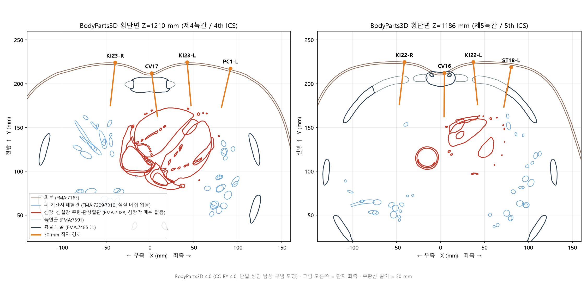
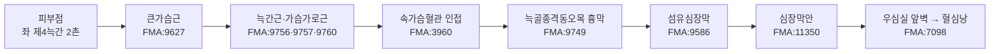
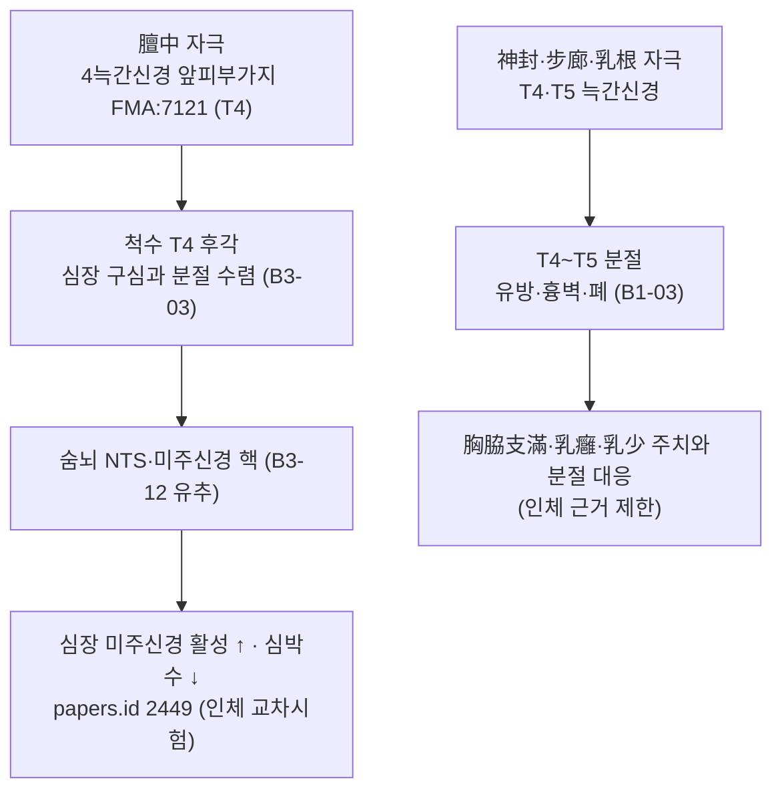

# 흉부 경혈 심장막 내 자상(刺傷) 사건 고증 및 50 mm 침 위험도 평가 보고서

> **사건**: 가슴에 침 3개를 놓던 중 1개가 깊이 들어가 심장막 안에서 미세한 심근 파열(혈심낭)이 생긴 사건
> **분류**: 주제별 경혈 고증·가설 검증 (Tier 3) · **프레임워크**: v2.7 (2.7.10 반영) · **산출식**: ARI v3.0 (잠정 가중치 0.40/0.35/0.25, 이중 채점)
> **해부 근거**: FMA(Foundational Model of Anatomy) 5.1.0 로컬 색인 + BodyParts3D 4.0 3D 메쉬(FMA ID 기반, CC BY 4.0) 기하 측정
> **4대 원전**: 《中国针灸穴位通鉴》 任脉·足少阴肾经·足阳明胃经篇 · 《针灸腧穴通考》 任脉穴·足少阴肾经穴·足阳明胃经穴 · 《中国针灸证治通鉴》 第贰编 针灸禁忌·第叁编 妇儿科病证 · 《中国针灸经络通鉴》 第壹编 经络学说的演变·第叁编 手厥阴篇 (보조: 《東醫寶鑑》 鍼灸篇)
> **작성**: 2026-10-27 · 통합 생의학 마스터 DB v3.0 동기화(6혈) 완료

---

## 결론 요약

1. **사건과 가장 잘 맞는 혈위는 좌측 흉골옆 족소음신경 혈위(神封 KI23·步廊 KI22·靈墟 KI24)와 膻中(CV17, 흉골공이 있는 경우)이다.** 이 네 곳은 직자 경로가 모두 **우심실** 앞벽에 닿는다(BodyParts3D 측정). 우심실 자유벽은 얇아서(약 3~5 mm) 가는 침에도 미세 파열과 혈심낭이 생길 수 있으며, 이는 "심장막 안의 미세한 심근 파열"이라는 사건 양상과 일치한다.
2. **"가슴에 침 3개"의 전형적 조합은 膻中 + 양측 乳根(ST18)이다.** 《中国针灸证治通鉴》 妇儿科 편에 따르면 유즙 부족·유옹 처방이 膻中·乳根·少泽 조합이다. 이 조합이었다면 깊이 찌른 침은 ① 흉골공을 지난 膻中 직자이거나 ② 안쪽으로 기운 좌측 乳根일 가능성이 높다(좌측 乳根 아래는 심첨부).
3. **50 mm 침의 위험도**: 표준 자침 깊이 상한(흉부 혈위 5~8푼 = 11.5~18.4 mm)의 **2.7~4.3배**다. BodyParts3D 표준 모형에서는 50 mm 직자가 심장에 닿기 직전에서 멈추지만(좌 靈墟 52.1 mm, 좌 神封 56.5 mm, 좌 步廊 57.2 mm), 이 모형은 MRI 실측 집단보다 깊이를 약 30% 크게 잡는다. 이 비율로 보정하면 네 곳 모두 **36~40 mm에서 우심실에 닿는다**. 膻中은 흉골공이 있으면(유병률 4.3~10.5%) 보정 전에도 46.8 mm, 보정 후 약 33 mm에서 우심실에 닿는다.
4. **고전 문헌의 경고와 현대 해부가 엇갈리는 지점**: 고전은 膻中·鳩尾를 금침혈로 두었지만 좌측 步廊·神封은 금침혈로 두지 않았다. 《中国针灸证治通鉴》 총론은 이 점을 짚어, 심장 오상을 피하려면 "오히려 좌측 步廊·神封을 깊이 찌르지 말아야 한다"고 평한다. FMA·3D 측정 결과는 이 평가를 지지한다. 다만 膻中을 "흉골이 있어 안전하다"고 본 같은 대목은 흉골공 변이를 고려하지 않았으므로 수정이 필요하다.
5. **ARI v3.0 (5혈, 이중 채점)**: 膻中 78.75 ± 1.25 (B) SI 0 ⚠ · 神封(좌) 75.0 ± 1.25 (B) SI 25 ⚠ · 步廊(좌) 72.5 ± 1.25 (B, 가중치 민감) SI 25 ⚠ · 乳根(좌) 71.25 ± 2.5 (B) SI 25 ⚠ · 鳩尾 70.0 ± 1.25 (B, 가중치 민감) SI 0 ⚠. 다섯 혈 모두 **게이트 3(⚠ 안전주의)**에 해당한다.

> 이 보고서는 해부학·문헌학적 위험도 분석이며, 개별 사건의 과실이나 인과관계를 법적으로 판단하지 않는다. 실제 침 경로를 확정하려면 환자의 흉부 CT(흉골공 유무, 침 자국)와 심초음파상 파열 위치(우심실 앞벽인지 좌심실 심첨인지)가 필요하다.

---

## 0. 사건 개요와 분석 범위

| 항목 | 내용 |
| :--- | :--- |
| 사건 | 흉부에 3침 자입, 그중 1침이 깊이 들어가 심장막 안에 미세 심근 파열(혈심낭) |
| 침 길이 가정 | 50 mm (≈ 21.7푼 ≈ 2.2촌, 한대 1푼 = 2.3 mm). 손잡이까지 전부 들어간 최악 조건을 기준으로 함 |
| 혈위를 특정하지 않은 이유 | 사건 기록에 혈위명이 없음 → 흉부·명치의 심장 투영 영역 혈위를 모두 후보로 두고 3D로 선별 |
| 3D 측정 혈위 (10혈 18점) | 膻中 CV17, 中庭 CV16, 鳩尾 CV15, 巨闕 CV14, 靈墟 KI24, 神封 KI23, 步廊 KI22, 膺窗 ST16, 乳根 ST18, 天池 PC1, 期門 LR14 (정중선 외 혈은 좌·우) |
| ARI 이중 채점 혈위 (5혈) | 膻中 CV17, 鳩尾 CV15, 神封 KI23(좌), 步廊 KI22(좌), 乳根 ST18(좌) — 3D 선별에서 심장 도달 가능성이 높거나 고전 금침 기록이 있는 혈 |
| 원전 검색 | 4대 원전 전수 검색(혈명·별명·번체/간체), 《東醫寶鑑》 보조 |
| 외부 검색 | 통합 생의학 마스터 DB v3.0 동기화 6혈(PubMed·OpenAlex·Crossref) + PubMed 추가 검색(증례·흉골공·안전 심도) |

---

## 1. 문헌 스크리닝 표 (4대 원전 원문 발췌 및 한중 대조)

### 1-1. 심장 자상 금기의 총칙

| 원전 | 원문 | 한글 기술 |
| :--- | :--- | :--- |
| 《東醫寶鑑》 鍼灸篇 (《內經》 인용) | 刺中心一日死其動爲噫 | 심장을 찌르면 하루 만에 죽으며, 그 징후는 트림(噫)이다 |
| 《中国针灸穴位通鉴》 足太阳膀胱经篇 (心俞 조, 《素问·刺禁论》 재인용) | 《素问·刺禁论》：刺中心一日死，其动为噫 | 같은 금기가 《针灸资生经》 이후 心俞 조에 거듭 인용됨 |
| 《中国针灸证治通鉴》 第叁编 内科(中风) | 一则不知刺禁（假令刺中心即死之类是也） | 침 뒤 갑자기 죽는 첫째 원인은 자침 금기를 모르는 것이니, 예컨대 심장을 찌르면 곧 죽는 것과 같다 |

### 1-2. 혈위별 4대 원전 대조

| 혈위 | 《穴位通鉴》 (위치·침법) | 《腧穴通考》 (교감·조작) | 《证治通鉴》 (원문 → 한글 번역 기술) | 《经络通鉴》 (경락 교감) |
| :--- | :--- | :--- | :--- | :--- |
| **膻中 CV17** | 《甲乙》 "在玉堂下一寸六分陷者中", "刺入三分". 《千金翼方》 "胸痹心痛灸亶中百壮，忌针". 《太平圣惠方》 "其穴禁不可针，针不幸令人死矣". 宋 이후 대부분 "禁针" | 【操作】 平刺. 《明堂》 刺入三分 / 《圣惠方》 禁针·"不幸令人死" / 현대 교재 平刺 0.3~0.5촌. 위치 이문 "鸠尾上一寸"(《千金》)은 《新雕孙真人千金要》 "二寸"이 옳다고 교감 | 第贰编 针灸禁忌: 『영추』 "膻中者，心主之宮城也"의 '膻中'을 혈명으로 오해하여 금혈에 넣었다. **"사실 전중혈 아래에는 흉골이 있어 이 혈을 찔러도 심장을 다치지 않는다."** (원문: 其实，膻中穴下有胸骨，针刺此穴不会伤及心脏) | "膻中者，心主之宫城也"의 '心主'는 본래 심장을 뜻하며 心包가 아니다. 이를 心包로 읽고 '膻中'을 혈로 오인해 膻中을 心包의 募穴로 삼았다(第壹编 经络学说的演变) |
| **鳩尾 CV15** | 《甲乙》 "在臆前蔽骨之下五分", "不可灸刺". 《圣惠方》 "此处是大难针，非是大好手方可下针…不幸令人死". 《针方六集》 窦氏 "针头向下施，禁不宜直入" | 【操作】 向下斜刺 0.5~1촌. **"勿直刺或向上斜刺，以免刺伤心、肺、肝脏."** 《循经考穴编》 "此穴正当心之尽处". 6판 교재 "向上斜刺"는 7판에서 "向下斜刺"로 바로잡힘 | 같은 편: 鸠尾는 《명당경》 이하 모두 "불가구자"라 했으나 주치가 많이 실려 본래 금혈이 아니었다. **"환자의 심장 위치가 비정상이거나 시술자가 침을 넣은 뒤 침끝을 위로 향하면 심장을 잘못 다칠 수 있다."** (원문: 如果患者心脏异位，或医者进针后针尖向上则有可能误伤心脏) | 鸠尾는 任脉之别(尾翳) 락맥의 출발점. 순행 기술은 위치 교감 이상의 주치 확장 근거가 되지 않음 |
| **神封 KI23** | 《甲乙》 "在灵墟下一寸六分陷者中…仰而取之", "刺入四分". 《针灸学简编》 "适对肺脏（右）及心脏（左）", "不可直刺太深，以免刺伤心、肺" | 【操作】 斜刺 또는 平刺 0.5~0.8촌. **"不宜深刺和直刺，以免刺伤心脏."** 전사 오류 지적 없음 | 같은 편: **"실제로 심장을 잘못 다치지 않으려면 오히려 왼쪽 「보랑」·「신봉」혈을 깊이 찌르지 못하게 해야 한다. 그런데 옛 의서에는 이 두 혈을 금혈로 올리지 않았다."** (원문: 如为避免误伤心脏，左侧"步廊"、"神封"穴倒是应当禁深刺。但古医书中并未将此二穴列为禁穴) | 足少阴 "其支者，从肺出络心，注胸中"(《灵枢·经脉》, 第贰编·第叁编 다수 인용). 경락론적 연결이며 해부 근거 아님(Rank 4 필터) |
| **步廊 KI22** | 《甲乙》 "在神封下一寸六分陷者中", "刺入四分". "一寸六分，指上下肋间隙之间的距离". 《针灸学简编》 "深部适对肺脏（右）和心脏（左）" | 【操作】 "不宜深刺和直刺，以免刺伤心肺." 명칭 "步郎"(宋 이전) → "步廊"(明刊) 교감 | 위와 같음(神封과 함께 언급) | 위와 같음 |
| **乳根 ST18** | 《甲乙》 "在乳下一寸六分陷者中", "刺入四分". 《千金》 "在两乳下第一肋间宛宛中". 《中国针灸学》 **"在前胸部第五肋间，乳房之直下心尖之部"** | 【操作】 사자·횡자. "奇穴'乳中'辨"에서 경외혈 乳中과 구분 | 第叁编 妇儿科: 무유(無乳) "少泽、合谷、膻中", 유즙 부족 "膻中、乳根、少泽、内关、太冲", 유옹 "膻中、大陵、委中、少泽、俞府" → **膻中·乳根은 같은 처방에 함께 쓰이는 흉부 배오** | 해당 없음 |

> 《证治通鉴》은 중국어 원문을 기준 텍스트로 하고 같은 편 한글 번역본과 대조했다. 한글 번역본은 '膻中'을 '전중'으로 읽었으나, 이 보고서는 KJH 경혈 이명 대조 DB의 표준 독음 '단중'을 따른다(감사 기록 10-4).

---

## 2. 원천/재인용 구분 표

| 혈위 | 원천(최초 기술) | 시기 | 재인용·주석(간접) | 판정 |
| :--- | :--- | :--- | :--- | :--- |
| 膻中 | 《黄帝明堂经》(《甲乙》 3권 수록) 위치·"刺入三分" | 한~위진 | 금침: 《千金翼方》 "忌针"(唐) → 《圣惠方》 "针不幸令人死"(宋) → 《铜人》·《资生经》·《医学入门》·《東醫寶鑑》 "禁不可鍼" | 최초 기술에는 금침이 없고 3푼(6.9 mm) 자침. 금침은 唐 이후 누적 |
| 鳩尾 | 《灵枢·九针十二原》 "膏之原，出于鸠尾"(명칭) + 《明堂》 위치 "臆前蔽骨下五分"·"不可灸刺" | 한 | 《圣惠方》 "大难针…不幸令人死", 《针方六集》 "针头向下，禁不宜直入" | 금침이 최초 원천부터 있음. 단 주치 다수로 보아 실제 금침은 아니었다는 《证治通鉴》 평가 병기 |
| 神封·步廊 | 《明堂》 위치·"刺入四分" | 한~위진 | 宋 "针入三分", 현대 교재 "不可深刺" | 금침 기록 없음. 깊이 제한(3~4푼)만 있음 |
| 乳根 | 《明堂》 위치·"刺入四分" | 한~위진 | 《千金》 "第一肋间宛宛中", 근현대 "心尖之部" | 금침 기록 없음 |
| 심장 자상 총칙 | 《素问·刺禁论》 "刺中心一日死" | 한 | 《资生经》·《東醫寶鑑》 등 재인용 | 혈위가 아닌 장기 단위 금기 |

---

## 3. 이명·별칭 검증 표 (KJH 경혈 이명 대조 DB + 4대 원전)

| 혈위 | KJH DB 이명 | 원전 확인 | 섞임 위험·처리 |
| :--- | :--- | :--- | :--- |
| 膻中 CV17 | 上氣海, 元兒, 元見, 炎元, 胸堂, 亶中 | 《穴位通鉴》 별명 5종, "元见"은 "元儿"의 형오(形誤) | **'膻中' 자체가 『영추』에서 心包(심장 둘레) 부위 명칭으로도 쓰임** → 장기명과 혈명이 섞여 금침설이 생김(《证治通鉴》·《经络通鉴》 교감). 혈명 '膻中'과 장기명 '膻中'을 분리하여 분석 |
| 鳩尾 CV15 | 尾翳, 膏原, 𩩲骬, 髑骬 | 《腧穴通考》: 鸠尾는 골명(검상돌기)이자 혈명. "曷曷·干于"는 "髑骬"의 형오, "神府·龙头"는 위치가 달라 별명 아님 | 골명 '鸠尾骨'(검상돌기)과 혈명 '鸠尾穴'을 구분. "神府"를 鸠尾로 본 기술(《千金翼方》)은 위치 차이로 분리 |
| 神封 KI23 | 없음 | 별명 없음 | 위험 없음 |
| 步廊 KI22 | 步郞 | 宋 이전 "步郎", 明刊 이후 "步廊" | 같은 혈의 이체 표기. 섞임 없음 |
| 乳根 ST18 | 薛息 | 《千金》 출전 | 섞임 없음. 경외혈 '乳中'과는 별개(《腧穴通考》) |

---

## 4. 3D 공간 좌표 및 Layer 1~5 층차 구조도

### 4-1. 측정 방법 (FMA·BodyParts3D)

- **모형**: BodyParts3D 4.0(일본 과학기술진흥기구 생명과학DB센터, CC BY 4.0). FMA ID로 구조가 나뉜 단일 성인 남성 규범 3D 모형(키 약 1.72 m, 단위 mm). 피부(FMA:7163), 흉골(FMA:7485)·흉골체(FMA:7487)·검상돌기(FMA:7488), 좌·우 제1~10늑골, 제1~7늑연골(FMA:7591 계열), 심장(FMA:7088), 간(FMA:7197), 가로막(FMA:13295) 메쉬를 사용했다.
- **좌표계**: X = 정중선 기준 좌(+)·우(−), Y = 전후(전방 −), Z = 발바닥 기준 높이(상방 +). 정본의 X(내외측)·Y(근위원위)·Z(깊이) 체계로 옮길 때는 표의 "정중선 거리"(X), "높이"(Y), "깊이"(Z)로 적었다.
- **B-cun**: WHO 2008 기준 두 쇄골 중점 사이 = 8 B-cun → **1 B-cun = 19.2 mm**.
- **혈위 피부점**: 늑간극은 같은 X에서 제n늑골·늑연골 하연과 제n+1늑골 상연을 직접 잘라 그 중앙 높이로 정했다. 膻中은 제4늑간 높이의 정중선, 鳩尾·巨闕은 흉골체-검상돌기 결합(Z 1182.1 mm) 아래 1·2 B-cun.
- **자입 방향**: 피부점 주변 12 mm 피부면의 법선(직자). 법선 기준 30°·45°·60° 원뿔 안에서 방향 600개씩을 무작위로 뽑아 경사 자입도 평가했다. 교차 계산은 Möller–Trumbore 광선-삼각형 교차법.
- **한계(중요)**: ① BodyParts3D에는 **심장막 메쉬가 없고**, 심장 메쉬는 심실강 주형·유두근·관상혈관 위주라 심외막 표면도 없다. 측정값은 "심장 구조물(대개 심실강)까지의 거리"이며, 실제 심장막은 우심실 자유벽 두께(약 3~5 mm, B1-01)만큼 더 얕다. ② **폐 메쉬는 기관지·폐혈관만 있고 폐 실질 표면이 없어** 기흉 위험은 측정할 수 없었다(그림의 파란 원). ③ 단일 규범 모형이므로 체형·성별·호흡·자세 차이를 반영하지 못한다 → 4-3절 보정과 임계 체형 계수로 보완했다.

### 4-2. 혈위 피부점 좌표와 50 mm 직자 경로 (BodyParts3D 원값)

| 혈위 | 정중선 거리 (mm) | 높이 Z (mm) | 직자 첫 골 (mm) | 직자 첫 늑연골 (mm) | 직자 심장 (mm) | 피부점→심장 최단 (mm) | 직자 간 (mm) | 50 mm 직자 심장 도달 |
| :--- | ---: | ---: | ---: | ---: | ---: | ---: | ---: | :---: |
| 膻中 CV17 | 1.9 | 1209.7 | 4.8 (흉골) | — | 46.8 (흉골 뒤) | 40.4 | — | 흉골이 막음. **흉골공이면 도달** |
| 中庭 CV16 | 3.0 | 1183.1 | 0.7 (흉골) | — | — | 45.3 | — | 아니오 |
| 鳩尾 CV15 | 2.7 | 1160.0 | — | — | — | 57.7 | 24.3 | 아니오 (간 24.3 mm) |
| 巨闕 CV14 | −2.7 | 1144.5 | — | — | — | 71.9 | 18.0 | 아니오 (간 18.0 mm) |
| 靈墟 KI24-좌 | 38.9 | 1235.2 | — | 23.4 | 52.1 | 42.2 | — | 아니오 (2.1 mm 부족) |
| 靈墟 KI24-우 | −37.3 | 1233.2 | — | 22.8 | — | 60.5 | — | 아니오 |
| 神封 KI23-좌 | 39.2 | 1205.3 | — | — | 56.5 | 51.3 | — | 아니오 (6.5 mm 부족) |
| 神封 KI23-우 | −39.8 | 1204.9 | — | — | — | 67.2 | — | 아니오 |
| 步廊 KI22-좌 | 35.8 | 1185.7 | — | 17.1 | 57.2 | 53.9 | — | 아니오 (7.2 mm 부족) |
| 步廊 KI22-우 | −40.0 | 1184.5 | — | 17.0 | — | 72.4 | — | 아니오 |
| 膺窗 ST16-좌 | 79.7 | 1244.9 | — | — | 67.4 | 53.5 | — | 아니오 |
| 膺窗 ST16-우 | −75.6 | 1239.3 | 33.1 | — | — | 78.3 | — | 아니오 |
| 乳根 ST18-좌 | 80.7 | 1167.6 | — | 19.6 | — | 59.0 | — | 아니오 (경사 시 4-3절) |
| 乳根 ST18-우 | −79.1 | 1167.5 | — | 19.2 | — | 95.5 | — | 아니오 |
| 天池 PC1-좌 | 95.2 | 1207.6 | 37.6 | — | — | 56.7 | — | 아니오 |
| 天池 PC1-우 | −97.8 | 1205.3 | 36.2 | — | — | 96.1 | — | 아니오 |
| 期門 LR14-좌 | 75.3 | 1129.9 | — | — | — | 79.1 | 32.9 | 아니오 |
| 期門 LR14-우 | −75.5 | 1134.2 | — | — | — | 110.0 | 33.1 | 아니오 |

- **膻中 경로 세부**: 피부→흉골 4.8 mm, 흉골 통과 16.6 mm(경사 단면), 흉골 뒷면→심장 25.3 mm. 흉골공이 있으면 침은 뼈의 저항 없이 흉골 뒤 공간을 지나 46.8 mm에서 우심실에 닿는다.
- **직자 경로가 닿는 심장 부위**: 膻中·靈墟(좌)·神封(좌) → 우심실강(FMA:9291 Cavity of right ventricle), 步廊(좌) → 우심실 앞유두근(FMA:7260), 膺窗(좌) → 좌심실강(FMA:9466). 모두 우심실 또는 좌심실 앞벽을 먼저 뚫어야 닿는 위치다.
- **경사 자입(보정 전)**: 법선 기준 30° 원뿔 안에서 50 mm 이내에 심장이 있는(골 차단 없음) 방향의 비율은 靈墟(좌) 21.5%, 45° 원뿔 9.8%, 60° 원뿔 7.2%였다. 늑연골도 막는다고 보면 각각 12.8%·6.8%·4.8%다. 나머지 혈은 보정 전 0%다.

### 4-3. 체형 보정과 임계 체형 계수 k*

단일 규범 모형의 깊이를 실측 집단과 맞추기 위해, 같은 조건을 측정한 **MRI 실측 연구(papers.id 2476, PMID 22741258, 성인 10명)**를 보정점으로 썼다. 이 연구에서 鳩尾 직자의 위험 깊이는 **16.99 ± 2.86 mm**인데, BodyParts3D에서 같은 경로의 첫 장기(간)는 24.3 mm였다. 따라서 이 모형은 실측 집단보다 깊이를 약 1.43배 크게 잡으며, 보정 계수는 **k_cal = 16.99 / 24.3 = 0.70**(평균 ± 1 SD 범위 0.58~0.82)이다. 보정점이 한 곳뿐이라는 한계가 있으므로, 보정값과 함께 "그 체형 계수 이하이면 50 mm 침이 닿는다"는 **임계 체형 계수 k* = 50 / 측정 깊이**를 같이 적는다.

| 혈위 | 모형 원값 (mm) | 보정값 (mm, k = 0.70) | 보정 범위 (mm, k = 0.58~0.82) | k* (직자) | k* (모든 방향) | 50 mm 판정(보정) |
| :--- | ---: | ---: | :---: | ---: | ---: | :--- |
| 膻中 CV17 (흉골공 가정) | 46.8 | 32.7 | 27.2~38.2 | **1.07** | 1.24 | **도달** — 표준 모형에서도 도달 |
| 靈墟 KI24-좌 | 52.1 | 36.4 | 30.3~42.6 | **0.96** | 1.19 | **도달** |
| 神封 KI23-좌 | 56.5 | 39.5 | 32.8~46.2 | **0.885** | 0.975 | **도달** |
| 步廊 KI22-좌 | 57.2 | 40.0 | 33.2~46.7 | **0.874** | 0.928 | **도달** |
| 膺窗 ST16-좌 | 67.4 | 47.1 | 39.2~55.1 | 0.742 | 0.935 | 경계(마른 체형에서 도달) |
| 乳根 ST18-좌 (경사, 최단) | 59.0 | 41.2 | 34.3~48.2 | — | 0.847 | **안쪽으로 기울이면 도달** |
| 天池 PC1-좌 (경사, 최단) | 56.7 | 39.6 | 32.9~46.5 | — | 0.882 | 안쪽으로 기울이면 도달 |
| 鳩尾 CV15 (두측 30~45° 경사) | 68.0~68.6 | 47.6~48.0 | 39.4~56.3 | — | — | **경계** — 위로 기울이면 도달 가능 |
| 巨闕 CV14 (두측 45~60° 경사) | 81.7~87.5 | 57.2~61.3 | 47.4~71.8 | — | — | 대부분 미도달 |
| 우측 흉골옆·젖꼭지선 혈 (최단) | 60.5~96.1 | 42.3~67.2 | — | — | 0.52~0.83 | 우측 靈墟만 경계, 나머지 미도달 |

- 위 표의 깊이는 심실강까지이므로 **심장막은 3~5 mm 더 얕다**. 따라서 보정값은 위험을 과소평가하는 쪽이다.
- 鳩尾 두측 경사 세부(모형 원값): 0° 간 24.3 mm · 15° 간 27.6 mm · 30° 가로막 40.7 mm 뒤 심장 68.6 mm · 45° 가로막 13.8 mm 뒤 심장 68.0 mm · 60° 흉골(검상돌기) 11.0 mm. 《腧穴通考》의 "向上斜刺 금지"와 《证治通鉴》의 "침끝을 위로 향하면 심장을 다칠 수 있다"는 경고가 기하학적으로 확인된다.

### 4-4. Layer 1~5 층차 구조도 — 좌측 神封·步廊 (사건 최유력 경로)

| Layer | 구조 (FMA) | 좌 神封 KI23 경로 깊이 (보정) | 비고 |
| :---: | :--- | :--- | :--- |
| 1 피부·피하 | 넷째 갈비사이신경 앞피부가지 FMA:7121 (KI22는 FMA:7288) | 0~약 5 mm | 표재 감각 |
| 2 표층근 | 큰가슴근 FMA:9627 (안쪽·가쪽가슴근신경 FMA:65293·65296) | 약 5~15 mm | 교재 표준 깊이(5~8푼 = 11.5~18.4 mm)가 여기까지 |
| 3 심층근 | 바깥·속갈비사이근 FMA:9756·9757, 가슴가로근 FMA:9760 (공통교재만 수록) | 약 15~25 mm | 늑간 통과 → 골 차단 없음 |
| 4 신경혈관속 | 넷째 갈비사이신경 FMA:8604, 속가슴동맥 FMA:3960 및 앞갈비사이가지 FMA:10655, 가슴속근막 FMA:9732 | 약 20~28 mm | 속가슴동맥은 흉골 가장자리 바깥 약 1~2 cm를 내려가므로 2촌 외측 혈 바로 안쪽에 가까움(B1-01) |
| 5 심부장기 | 벽측 흉막·늑골종격동오목 FMA:9747/9749, 좌폐 심장패임 FMA:13157, **섬유심장막 FMA:9586, 심장막안 FMA:11350, 우심실 FMA:7098** | 우심실강 약 39.5 mm (모형 56.5 mm) → 심장막 약 35 mm | **50 mm 침은 Layer 5를 15 mm 이상 지나침** |

- **두 교재 모두 Layer 5를 수록하지 않는다**(6절). 교재 해부구조는 늑간근·가슴가로근에서 끝나며, 그 아래 1~2 cm에 흉막과 심장막이 있다는 사실이 표에 없다. 50 mm 침 사고는 바로 이 "교재 밖 층"에서 일어난다.

---

## 5. 자침 깊이 계산표 (문헌별 자침 깊이 DB, 1푼 = 2.3 mm)

| 문헌·교재 | 膻中 CV17 | 鳩尾 CV15 | 神封 KI23 | 步廊 KI22 | 乳根 ST18 |
| :--- | :---: | :---: | :---: | :---: | :---: |
| 《針灸甲乙經》 | 3푼 = 6.9 mm | **0 = 금침** | 4푼 = 9.2 mm | 4푼 = 9.2 mm | 4푼 = 9.2 mm |
| 《黃帝明堂經》(황룡상 감수 편찬) | 3푼 = 6.9 mm | **0 = 금침** | 4푼 = 9.2 mm | 4푼 = 9.2 mm | 4푼 = 9.2 mm |
| 《東醫寶鑑》 | **0 = 금침**(《入門》) | **0 = 금침**(《銅人》) | 3푼 = 6.9 mm | 2푼 = 4.6 mm | 3푼 = 6.9 mm |
| 《鍼灸經驗方》 | **0 = 금침** | 3푼 = 6.9 mm | 미기술 | 미기술 | 미기술 |
| 《針灸腧穴通考》 | 최대·최소 미기술, 平刺 | 5~10푼 = 11.5~23.0 mm, 사자 | 5~8푼 = 11.5~18.4 mm | 5~8푼 = 11.5~18.4 mm | 미기술, 사자·횡자 |
| 경락수혈학·침구의학 공통교재 | 3~5푼 = 6.9~11.5 mm | 3~6푼(경락수혈학)·5~10푼(침구의학) = 6.9~23.0 mm | 5~8푼 = 11.5~18.4 mm | 5~8푼 = 11.5~18.4 mm | 5~8푼 = 11.5~18.4 mm |
| **표준 상한 대비 50 mm 배율** | **4.3배** (상한 11.5 mm) | **2.2배** (23.0 mm) / MRI 안전 깊이 대비 2.9배 | **2.7배** (18.4 mm) | **2.7배** (18.4 mm) | **2.7배** (18.4 mm) |
| Layer 도달 (표준 상한) | Layer 1~2 (흉골 앞) | Layer 3~4 (백색선·가로근막) | Layer 2~3 | Layer 2~3 | Layer 2~3 |
| Layer 도달 (50 mm) | 흉골공 시 **Layer 5 심장** | 간(직자)·**심장(위로 경사)** | **Layer 5 심장** | **Layer 5 심장** | Layer 5 흉막·폐, 경사 시 심장 |

- '0'은 금침, '미기술'은 기재 없음(금침과 구분). 50 mm = 21.7푼으로, 어느 문헌의 허용치보다 깊다.

---

## 6. 해부학 구조 교재 비교표 및 FMA 표준 실체 매핑

| 혈위 | 공통교재 | 김재효 교재 | FMA 대응 (대응 수준) | 두 교재 FMA 실체 (공통/공통교재 단독/김재효 단독) | 분절 합집합 |
| :--- | :--- | :--- | :--- | :---: | :---: |
| 膻中 | 복장근 / 4늑간신경 앞피부가지 / 속가슴동·정맥 관통가지 | 복장막·복장뼈막 / 같음 / 같음 | Sternalis FMA:9717 (exact), Sternal membrane FMA:76873 (exact), 복장뼈막 (none), FMA:7121 (exact), FMA:70370 (exact), FMA:4729 (parent) | 3 / 1 / 1 | T4 |
| 鳩尾 | 백색선·배곧은근집 / 6늑간신경 앞피부가지 / 위배벽동·정맥 | 백색선·배가로근막 / 같음 / 얕은·위배벽동·정맥 | FMA:11336, 9587, 12265, 8859, 10646, 4731, 20734 (모두 exact) | 4 / 1 / 3 | T6 |
| 神封 | 큰가슴근·바깥·속갈비사이근·가슴가로근 / 갈비사이신경 / 속가슴동·정맥 안쪽젖샘가지·앞갈비사이가지 | 큰가슴근·바깥·속갈비사이근 / 4늑간신경·앞피부가지·안쪽·가쪽가슴근신경 / 4뒤갈비사이동·정맥·속가슴동·정맥 4갈비사이가지 | FMA:9627, 9756, 9757, 9760, 8604, 7121, 65293, 65296, 10655, 12287 (exact), 젖샘가지 (parent) | 4 / 4 / 7 | T3~T7 |
| 步廊 | 神封과 같은 구성 (5늑간) | 5늑간신경 계열 | FMA:7288, 8605, 10656, 12288 등 (exact) | 3 / 4 / 8 | T3~T7 |
| 乳根 | 큰가슴근·속·바깥갈비사이근 / 갈비사이신경 / 앞갈비사이가지 | + 배곧은근·작은가슴근·배바깥빗근 / 5늑간신경·가쪽가슴근신경 / + 가슴배벽정맥 | FMA:9627, 13109, 9628, 13335, 8605, 13416 (exact) | 5 / 1 / 6 | T5 |

- **공통점**: 다섯 혈 모두 표층 신경(늑간신경 앞피부가지)은 두 교재가 FMA exact로 일치한다.
- **차이점**: 공통교재는 일반명(갈비사이신경)을, 김재효 교재는 분절 특정명(넷째 갈비사이신경)과 가슴근신경을 쓴다. FMA로 보면 같은 계열 실체이므로 모순이 아니라 해상도 차이다. 가슴가로근(FMA:9760)은 공통교재만, 작은가슴근·배곧은근은 김재효 교재(乳根)만 수록한다.
- **두 교재 공통의 공백**: 흉막·심장막·심장(Layer 5)을 어느 교재도 수록하지 않는다. 이 보고서는 FMA로 Layer 5 실체를 보충했다: Pericardium FMA:9869, Fibrous pericardium FMA:9586(T5~T9 부분으로 나뉨, 중간종격 공간 FMA:85013에 포함), Pericardial cavity FMA:11350, Costomediastinal recess FMA:9747, Cardiac notch of left lung FMA:13157, Right ventricle FMA:7098, Anterior interventricular branch FMA:3862. 심장의 신경 지배는 FMA에서 심장신경얼기(FMA:6649·6650)·관상신경얼기(FMA:6651·6652)로 기재된다(B1 보조, 등록부 미등재).

---

## 7. 공간 변위 분기 추론 (Tri-Target)

| 혈위 | Target 1 (고전 문헌) | Target 2 (촉진 표현 실체화) | Target 3 (WHO) | 쌍별 Δ | 판정 |
| :--- | :--- | :--- | :--- | :---: | :--- |
| 膻中 | 《明堂》 "玉堂下一寸六分，直两乳间陷者中" → 제4늑간 높이 정중선 | "陷者中"·《肘后》 "胸厌骨解间" → 흉골체 분절 사이 오목(제4 늑연골 부착 높이) | 정중선·제4늑간 높이 | ≤ 5 mm | **Target 1≡2≡3 단일** |
| 鳩尾 | 《甲乙》 "臆前蔽骨之下五分" → 검상돌기 끝 아래 0.5촌 (Z 1154.4 mm) | 촉진 표현 없음(《圣惠方》 "陷者中"은 宋대 후출) → **Target 2 설정 불가** | 흉골체-검상돌기 결합 아래 1 B-cun (Z 1162.9 mm) | 8.5 mm | **Target 1≡3 단일** (검상돌기가 길거나 두 갈래인 사람(17.5%)은 Δ > 10 mm 가능) |
| 神封 | 《明堂》 "灵墟下一寸六分陷者中，侠任脉两旁各二寸" | "陷者中" → 제4늑간 오목 (경계: 제4·제5 늑연골) | 제4늑간, 정중선 옆 2 B-cun | ≤ 5 mm | **단일** |
| 步廊 | 《明堂》 "神封下一寸六分陷者中" | "陷者中" → 제5늑간 오목 (경계: 제5·제6 늑연골) | 제5늑간, 정중선 옆 2 B-cun | ≤ 5 mm | **단일** |
| 乳根 | 《明堂》 "乳下一寸六分陷者中" | 《千金》 "两乳下第一肋间宛宛中" → 제5늑간 | 제5늑간, 정중선 옆 4 B-cun | ≤ 5 mm (남성) | **단일** (여성은 유방 때문에 젖꼭지 기준이 흔들림 → 늑간 기준을 따름) |

- **Target 제외(정위 주석)**: 膻中 "正对第五肋骨之端"(《针灸十四经穴位考订》)·1957년 南京 《针灸学》 "여성은 제5늑간"은 근현대 이설이므로 Target에서 제외했다(모형에서 제4늑간과 약 24 mm 차이). 步廊·乳根의 "第六肋间"(《高等针灸学讲义》)도 근현대 이설로 제외했다.
- 다섯 혈 모두 분기가 없으므로 ARI는 혈위당 하나씩 산출했다.

---

## 8. 생의학적 반사 기전도, B-Check 및 외부 검색 로그

### 8-1. 반사 기전 요약 (P_single 기준)

### 8-2. B-Check 6항목 채점표 (채점자 A / B)

| 항목 | 膻中 CV17 | 鳩尾 CV15 | 神封 KI23-좌 | 步廊 KI22-좌 | 乳根 ST18-좌 |
| :--- | :---: | :---: | :---: | :---: | :---: |
| ① 말초 실체 (B1-01·B2-09, FMA exact) | 2 / 2 | 2 / 2 | 2 / 2 | 2 / 2 | 2 / 2 |
| ② 분절 정합 (FMA 분절 합집합 ↔ 표적 장기, B1-03·B3-03) | 2 / 2 (T4 ↔ 심장 T1~T5) | 1 / 1 (T6 ↔ 심장·위 혼재) | 2 / 2 (T4 ↔ 유방·흉벽) | 2 / 2 (T5 ↔ 흉벽·폐) | 2 / 2 (T5 ↔ 유방) |
| ③ 구심 섬유·수용체 (B3-06) | 1 / 1 | 1 / 1 | 1 / 1 | 1 / 1 | 1 / 1 |
| ④ 중추 경로 (B3-12·B3-05, 유추) | 1 / 1 | 1 / 1 | 0 / 0 | 0 / 0 | 1 / 1 |
| ⑤ 원심 효과 방향 ↔ P_single | 1 / 1 | 1 / 1 | 1 / 1 | 1 / 1 | 1 / 1 |
| ⑥ 인체 전환 (Layer A 인체 연구) | 2 / 1 (id 2449) | 0 / 0 | 1 / 0 (id 2493) | 0 / 0 | 1 / 1 (id 2499·2503) |
| **합계** | **9 / 8** | **6 / 6** | **7 / 6** | **6 / 6** | **8 / 8** |
| 판정 | 부합(≥ 8) | 미부합 → 가설 | 미부합 → 가설 | 미부합 → 가설 | 부합(≥ 8) |

- 膻中의 기전 근거 papers.id 2449(Kurono 등 2011, 건강 남성 14명 교차설계): 膻中 근막 위 자극은 심박수를 낮추고 HRV 고주파 성분(심장 미주신경 지표)을 높였으나, 이웃한 中庭은 효과가 없었다. **혈위 특이성을 보인 드문 인체 자료**다.
- 심장 손상 위험은 반사 기전과 별개다. 안전 근거(SI)는 10절에 따로 채점했다.

### 8-3. 외부 API 검색 로그 (통합 생의학 마스터 DB v3.0, 2026-10-27 13:49~13:50, 트리거 rank6)

| 혈위 | PubMed (HTTP·수집) | OpenAlex (HTTP·수집) | Crossref (HTTP·수집) | 후보 | 중복 제거 | 신규 병합 | 기존 병합 |
| :--- | :---: | :---: | :---: | ---: | ---: | ---: | ---: |
| CV17 膻中 | 200 · 16 | 200 · 24 | 200 · 1 | 41 | 14 | 27 | 5 |
| CV15 鳩尾 | 200 · 6 | 200 · 8 | 200 · 0 | 14 | 6 | 8 | 2 |
| CV14 巨闕 | 200 · 8 | 200 · 10 | 200 · 0 | 18 | 3 | 12 | 0 (경혈 미언급 3건 제외) |
| KI23 神封 | 200 · 1 | 200 · 1 | 200 · 0 | 2 | 1 | 1 | 1 |
| KI22 步廊 | 200 · 1 | 200 · 0 | 200 · 0 | 1 | 1 | 0 | 1 |
| ST18 乳根 | 200 · 8 | 200 · 11 | 200 · 0 | 19 | 8 | 11 | 4 |

- 전 소스 성공(validate 통과). 쿼리는 혈위 코드·병음·한자 × 침·전침 × 신경·반사·자율신경·기전, 그리고 《中国针灸》·《针刺研究》 저널 필터. 神封·步廊은 기전 논문이 사실상 없다(게이트 2는 해당 혈 인체·임상 논문이 있어 미적용).
- **추가 PubMed 검색(DB 미병합, 안전 근거)**: 침 관련 심장압전 체계적 고찰 26례 중 14례 사망(PMID 21093944), 흉골공을 통한 치명적 심장압전(PMID 7723561, 7623587), 흉골 자침 뒤 우심실 천공(PMID 10807845), 우심실 직접 관통(PMID 24685234, 9338656, 30803795), 흉골 아래 자침 뒤 관상동맥 손상(PMID 23549831), 유선증식증 침 치료 중 심장 천자로 지연성 심장압전 사망(PMID 36914399), 흉골공 유병률 CT 4.3%(PMID 3989043)·8.44%(PMID 31907578)·10.5%(PMID 25023390)·건조 흉골 19.1%(PMID 38845617). DB 병합 논문 중 안전 관련: 鳩尾 MRI 안전 각도·깊이(papers.id 2476), 鳩尾 디지털 가시인체(papers.id 2473, 안전 깊이 1.0~1.5 cm), 검상돌기 아래 자침 뒤 대량 심낭내 혈종 증례 논평(papers.id 2478), 소아 흉부 혈위 피부-장기 깊이 CT(papers.id 2504).

---

## 9. 주치증 분리 표 (단독 자침 P_single vs 복합 배오)

| 혈위 | P_single (唐 이전 원천, 단독 기재) | 배오 파생 (《证治通鉴》 처방) | 사건과의 관련 |
| :--- | :--- | :--- | :--- |
| 膻中 | 《甲乙》 咳逆上气, 唾喘短气不得息, 口不能言 · 《千金翼》 胸痹心痛 | 무유: 少泽·合谷·膻中 / 유즙 부족: 膻中·乳根·少泽(+内关·太冲) / 유옹: 膻中·大陵·委中·少泽·俞府 | 유방·수유 문제로 흉부에 침 3개를 놓는 대표 배오의 중심 혈 |
| 鳩尾 | 《灵枢》 腹皮痛·痒搔(任脉之别) · 《甲乙》 喉痹食不下 · 《千金》 心痛暴绞急绝欲死, 牛痫 | 宋 이후 癫痫(五般痫) 배오, 《席弘赋》 "鸠尾能治五般痫，若下涌泉人不死" | 심통·간질에 명치 자침 |
| 神封 | 《甲乙》 胸胁榰满不得息, 咳逆, 乳痈, 洒淅恶寒 | 단독 기재 위주, 배오 드묾 | 흉협 창만·유옹으로 좌측 흉골옆 자침 |
| 步廊 | 《甲乙》 胸胁榰满, 鬲逆不通, 呼吸少气, 喘息不得举臂 | 단독 기재 위주 | 호흡곤란·흉협 창만 |
| 乳根 | 《甲乙》 胸下满痛, 膺肿, 乳痈, 凄索寒热, 痛不可按 | 유즙 부족: 膻中·乳根·少泽(《针灸学简编》 "配膻中、合谷、少泽") | 膻中과 짝을 이루는 흉부 배오 |

- 宋 이후 추가된 주치(哮喘·肋膜炎·心绞痛 등)는 근현대 해석이 섞인 것으로 보아 P_single에서 뺐다. 경락 순행(足少阴 "从肺出络心")으로 주치를 넓힌 기술도 Rank 4 노이즈로 제외했다.

---

## 10. ARI v3.0 프로파일 평가표 및 최종 결론

### 10-1. 하위 점수와 루브릭 단계 (채점자 A / B)

| 혈위 | S_orig ①②③④ (A) | S_orig ①②③④ (B) | S_clarity A/B | S_reflex A/B | SI A/B |
| :--- | :--- | :--- | :---: | :---: | :---: |
| 膻中 CV17 | 100·100·75·75 = 87.5 | 75·100·75·75 = 81.25 | 75 / 75 | 75 / 75 | **0 / 0** |
| 鳩尾 CV15 | 75·75·75·100 = 81.25 | 75·75·75·75 = 75 | 75 / 75 | 50 / 50 | **0 / 0** |
| 神封 KI23-좌 | 75·100·100·100 = 93.75 | 75·100·100·75 = 87.5 | 75 / 75 | 50 / 50 | **25 / 25** |
| 步廊 KI22-좌 | 75·100·75·100 = 87.5 | 75·100·75·75 = 81.25 | 75 / 75 | 50 / 50 | **25 / 25** |
| 乳根 ST18-좌 | 100·100·100·75 = 93.75 | 75·100·75·75 = 81.25 | 50 / 50 | 75 / 75 | **25 / 25** |

**루브릭 판정 근거**

- **S_orig**: ① 膻中·乳根은 《明堂》이 위치와 깊이(3·4푼)를 모두 지정(A 100), B는 《明堂》의 성립 연대(한말~위진) 불확실성으로 75. 神封·步廊은 위치가 이웃 혈에 의존하는 상대 기술이라 75. 鳩尾는 깊이 대신 "不可灸刺"만 있어 75. ② 위치 기술은 다섯 혈 모두 후대 일치율이 높다(鳩尾만 "历代文献记载不一致"로 75). ③ 膻中은 장기명·혈명 혼용이 《经络通鉴》으로 해소(75), 鳩尾는 골명·혈명·神府 혼동이 《腧穴通考》로 해소(75), 步廊은 이체 표기(75). ④ 《腧穴通考》가 鳩尾의 "骬/骭" 형오와 步廊의 "郎/廊"을 완전히 교감(A 100), 膻中은 "鸠尾上一寸/二寸" 이문 교감(75).
- **S_clarity**: 膻中·鳩尾·神封·步廊은 두 교재가 핵심 구조에서 FMA로 일치하고 B1으로 확인되나 혈위 특이 실측은 없거나(膻中·神封·步廊) 교재가 완전히 일치하지 않아(鳩尾: MRI 실측 papers.id 2476은 있으나 공통 4·단독 4) 75. 鳩尾는 채점자 A가 처음에 100을 주었으나 "2대 교재 일치" 조건 미충족으로 조정하여 75로 확정(15점 이상 불일치 조정 기록). 乳根은 근육 구성이 크게 달라(김재효 교재에 배곧은근·작은가슴근·배바깥빗근 추가) 추론으로 조정 → 50.
- **S_reflex**: 膻中은 인체 교차시험 1편(papers.id 2449) + B-Check 9/8 → 75. 乳根은 인체 임상 연구(papers.id 2499·2503) + B-Check 8 → 75. 鳩尾·神封·步廊은 B-Check 6~7 → 50.
- **SI**: 膻中·鳩尾는 자침깊이 DB에 금침('0') 문헌이 있고 치명 손상 사례(흉골공 경유 사망, 검상돌기 아래 자침 뒤 혈심낭)가 보고되어 **0**. 神封·步廊·乳根(좌)은 금침 문헌은 없으나 표준 상한(18.4 mm)에서 10 mm 안쪽에 Layer 5(흉막·폐, 좌측은 심장막)가 있고 체형 변수가 커서 **25**.

### 10-2. ARI v3.0 최종 프로파일

| 혈위 | ARI-Core (평균 ± 반범위) | 등급 | 게이트 | SI | 등가중치 민감도 |
| :--- | :---: | :---: | :--- | :---: | :---: |
| 膻中 CV17 | 78.75 ± 1.25 | B | 게이트 3 ⚠ | 0 | 78.1 (B, 등급 불변) |
| 神封 KI23-좌 | 75.0 ± 1.25 | B | 게이트 3 ⚠ | 25 | 71.9 (B, 등급 불변) |
| 步廊 KI22-좌 | 72.5 ± 1.25 | B | 게이트 3 ⚠ | 25 | 69.8 (C, 가중치 민감) |
| 乳根 ST18-좌 | 71.25 ± 2.5 | B | 게이트 3 ⚠ | 25 | 70.8 (B, 등급 불변) |
| 鳩尾 CV15 | 70.0 ± 1.25 | B | 게이트 3 ⚠ | 0 | 67.7 (C, 가중치 민감) |

**표준 표기**

- 膻中 CV17: `ARI v3.0 | ARI-Core 78.75 ± 1.25 (B) | ⚠ | SI 0 | 잠정 가중치 0.40/0.35/0.25 | 민감도(등가중치): 78.1 (B, 등급 불변)`
- 神封 KI23-좌: `ARI v3.0 | ARI-Core 75.0 ± 1.25 (B) | ⚠ | SI 25 | 잠정 가중치 0.40/0.35/0.25 | 민감도(등가중치): 71.9 (B, 등급 불변)`
- 步廊 KI22-좌: `ARI v3.0 | ARI-Core 72.5 ± 1.25 (B) | ⚠ | SI 25 | 잠정 가중치 0.40/0.35/0.25 | 민감도(등가중치): 69.8 (C, 가중치 민감)`
- 乳根 ST18-좌: `ARI v3.0 | ARI-Core 71.25 ± 2.5 (B) | ⚠ | SI 25 | 잠정 가중치 0.40/0.35/0.25 | 민감도(등가중치): 70.8 (B, 등급 불변)`
- 鳩尾 CV15: `ARI v3.0 | ARI-Core 70.0 ± 1.25 (B) | ⚠ | SI 0 | 잠정 가중치 0.40/0.35/0.25 | 민감도(등가중치): 67.7 (C, 가중치 민감)`

### 10-3. 50 mm 침 위험도 종합 등급 (FMA·BodyParts3D 기하 + 보정)

| 위험 등급 | 혈위 | 50 mm 기준 근거 | 손상 표적 |
| :---: | :--- | :--- | :--- |
| **Ⅰ (매우 높음)** | 좌 神封 KI23 · 좌 步廊 KI22 · 좌 靈墟 KI24 | 늑간을 지나 골 차단이 없고, 보정 깊이 36~40 mm에서 우심실. k* 0.87~0.96 → 표준 모형보다 4~13%만 얇아도 직자로 도달 | 우심실 앞벽·앞유두근 |
| **Ⅰ (조건부 매우 높음)** | 膻中 CV17 + 흉골공 | 흉골공(4.3~10.5%, 흉골 아래 1/3·제5 늑연골 높이에 흔함)이면 표준 모형에서도 46.8 mm, 보정 약 33 mm에서 우심실. 흉골공이 없으면 흉골이 막음 | 우심실 |
| **Ⅱ (높음)** | 좌 乳根 ST18 · 좌 天池 PC1 · 鳩尾 CV15 | 직자로는 미도달. 乳根·天池는 안쪽 경사 시 보정 최단 약 40 mm, 乳根 아래는 심첨부(규범 해부). 鳩尾는 위로 30~45° 기울이면 보정 약 48 mm에서 심장, 직자는 약 17 mm에서 간 | 좌심실 심첨·우심실 아래벽·간 |
| **Ⅲ (중간)** | 좌 膺窗 ST16 · 巨闕 CV14 · 中庭 CV16 | 마른 체형(k ≤ 0.74)에서만 심장 도달, 巨闕은 간 우선 | 좌심실·간 |
| **Ⅳ (심장 위험 낮음, 기흉 위험 별도)** | 우측 흉골옆·젖꼭지선 혈, 期門 LR14 | 심장 최단 보정 42~77 mm. 폐 실질 메쉬가 없어 기흉은 이 모형으로 평가 불가 | 폐(기흉)·간 |

### 10-4. 사건 재구성 가설 (가능성 순)

1. **가설 1 — 膻中 + 양측 乳根 배오 중 막힌 데 없는 경로로 깊이 찌름**: 유즙 부족·유방 질환 처방에서 흔한 3침 조합. ⓐ 膻中 직자 + 흉골공 → 우심실, 또는 ⓑ 좌 乳根을 안쪽·깊이 → 심첨(좌심실) 또는 우심실 아래벽. 중국 법의학 증례(유선증식증 침 치료 중 심장 천자, PMID 36914399)와 같은 맥락.
2. **가설 2 — 흉골옆 족소음신경 혈(神封·步廊·靈墟) 좌측 직자 심자**: 3D상 사건 양상(우심실 미세 파열)과 가장 직접적으로 맞는다. 《证治通鉴》이 이미 "좌측 步廊·神封 심자 금지"를 제안한 바로 그 지점.
3. **가설 3 — 명치 혈(鳩尾·巨闕)의 위쪽 경사 자입**: 사건 기술이 "가슴"이라 우선순위는 낮으나, "명치"를 가슴으로 표현한 경우 해당. 고전이 가장 강하게 경고한 경로이며 최근 증례(papers.id 2478)가 있다.

**감별 제안**: 흉부 CT(흉골공 유무, 침 자국·혈종 위치) → 흉골공이 있고 흉골 뒤 혈종이면 가설 1ⓐ, 좌측 흉골옆 늑간 자국이면 가설 2. 심초음파·수술 소견에서 파열이 심첨(좌심실)이면 가설 1ⓑ, 우심실 앞벽이면 가설 1ⓐ·2.

### 10-5. 임상 안전 권고 (50 mm 침 사용 시)

1. **좌측 흉골옆(제3~5늑간, 정중선 옆 2촌)과 膻中에는 50 mm 침을 직자하지 않는다.** 사자·횡자로 피하층·큰가슴근 안(약 15 mm 이내)에 머문다. 《腧穴通考》 "不宜深刺和直刺"를 준수한다.
2. **膻中은 반드시 평자(平刺)**한다. 흉골공은 촉진으로 알 수 없으므로, "흉골이 있어 안전하다"는 전제를 쓰지 않는다(흉골 앞 연부조직은 모형에서 4.8 mm에 불과).
3. **鳩尾·巨闕은 아래로 사자**하고 침끝을 위로 향하지 않는다. 직자도 약 17 mm 이내(MRI 실측)로 제한한다.
4. 흉부 혈위에는 **침 길이 자체를 25~30 mm 이하**로 고르는 것이 가장 확실한 안전장치다(50 mm 침은 어느 흉부 혈위의 문헌 허용치보다 2배 이상 길다).
5. 마른 체형·노인·여성(유방 아래 혈은 늑간이 얕아지는 자세 변화), 심비대, 흉골공·검상돌기 변이가 있는 환자는 더 얕게 찌른다.
6. 자침 뒤 실신·저혈압·흉통·트림(《內經》 "其動爲噫")이 나타나면 즉시 심장압전을 의심해 응급 이송한다.

### 10-6. 감사 기록

| 항목 | 내용 |
| :--- | :--- |
| Rank 0 | 두 IDE 스킬 설정 동기화 점검: 드리프트 없음(편집 PC). 정본 v2.7 적용 |
| 원전 | 4대 원전 MCP 검색 + 원문 행 확인. 《证治通鉴》 한글 번역본의 '膻中' 독음 '전중'은 KJH DB 표준 '단중'과 다름(번역 표기 차이, 원문 의미 차이 없음) |
| 원전 평가의 한계 | 《证治通鉴》의 "膻中 아래 흉골이 있어 심장을 다치지 않는다"는 흉골공 변이(4.3~10.5%)를 고려하지 않음 → 이 보고서는 해당 평가를 "흉골공이 없는 경우에 한해" 수용 |
| 3D 모형 한계 | 심장막·심외막·폐 실질 메쉬 없음, 단일 남성 모형. 보정점은 鳩尾 MRI 1곳뿐 → 보정값과 임계 체형 계수 k*를 함께 제시 |
| 이중 채점 조정 | 鳩尾 S_clarity A 100 → 75 (2대 교재 일치 조건 미충족). 그 밖에 15점 이상 불일치 없음 |
| Layer A | 6혈 동기화 성공. 증례·흉골공 PubMed 논문은 DB 미병합(PMID로만 인용) |
| ICC | 누적 10혈 미만(이 보고서 5혈) → ICC 미산출 |

---

## 부록 A. FMA 프로파일 요약 (FMA 5.1.0 로컬 색인)

| 혈위 | 교재 구조 → FMA 실체 (대응 수준) | 신경 줄기 | 분절 |
| :--- | :--- | :--- | :---: |
| 膻中 | Sternalis FMA:9717 (exact) · Sternal membrane FMA:76873 (exact) · 복장뼈막 (none) · Anterior cutaneous branch of fourth intercostal nerve FMA:7121 (exact) · Perforating branch of internal thoracic artery FMA:70370 (exact) · Internal thoracic vein FMA:4729 (parent, 가지 미등재) | FMA:7121 → Fourth intercostal nerve FMA:8604 | T4 |
| 鳩尾 | Linea alba FMA:11336 · Rectus sheath FMA:9587 · Transversalis fascia FMA:12265 · Anterior cutaneous branch of sixth intercostal nerve FMA:8859 · Superior epigastric artery FMA:10646 · Superior epigastric vein FMA:4731 · Superficial epigastric artery FMA:20734 (모두 exact) | FMA:8859 → Sixth intercostal nerve FMA:8606 | T6 |
| 神封 | Pectoralis major FMA:9627 · External/Internal intercostal FMA:9756/9757 (exact+muscle) · Transversus thoracis FMA:9760 · Fourth intercostal nerve FMA:8604 · FMA:7121 · Medial/Lateral pectoral nerve FMA:65293/65296 · Fourth anterior intercostal artery FMA:10655 · Fourth posterior intercostal artery/vein FMA:12287/12529 (exact) · 젖샘가지 → Internal thoracic artery FMA:3960 (parent) | 늑간신경 FMA:6028 → Thoracic nerve FMA:5860 | T3~T7 |
| 步廊 | 神封과 같은 구성의 제5늑간 실체: FMA:7288, 8605, 10656, 12288, 12530 (exact), FMA:4729 (parent) | FMA:7288 → Fifth intercostal nerve FMA:8605 | T3~T7 |
| 乳根 | FMA:9627 · Pectoralis minor FMA:13109 · Rectus abdominis FMA:9628 · External oblique FMA:13335 · FMA:9756/9757 · Fifth intercostal nerve FMA:8605 · Lateral pectoral nerve FMA:65296 · Thoracoepigastric vein FMA:13416 (exact) | FMA:8605 | T5 |
| Layer 5 (보충) | Pericardium FMA:9869 · Fibrous pericardium FMA:9586 · Serous pericardium FMA:9582 · Pericardial cavity FMA:11350 · Costomediastinal recess FMA:9747 (좌 FMA:9749) · Cardiac notch of left lung FMA:13157 · Right ventricle FMA:7098 · Cavity of right ventricle FMA:9291 · Anterior papillary muscle of right ventricle FMA:7260 · Left ventricle FMA:7101 · Anterior interventricular branch of left coronary artery FMA:3862 · Endothoracic fascia FMA:9732 | 심장: Superficial/Deep cardiac plexus FMA:6649/6650 | FMA 분절 미기재 (심장 교감 구심 T1~T5, B3-03) |

- FMA 표기는 모두 FMA 5.1.0, Layer B 등록부 미등재이므로 **B1 보조**로 인용한다.

## 부록 B. 인용 근거

**Layer A (통합 생의학 마스터 DB v3.0 병합, papers.id)**: 2449 Kurono Y 외, Auton Neurosci 2011 (doi:10.1016/j.autneu.2010.12.003, PMID 21216208) · 2476 Cheng WP·Dong SP, Zhongguo Zhen Jiu 2012 (PMID 22741258) · 2473 Meng XW 외, Zhongguo Zhen Jiu 2011 (PMID 22256646) · 2478 Lee SJ 외, Front Cardiovasc Med 2025 (doi:10.3389/fcvm.2025.1550391, PMID 40371066) · 2504 Ma YC 외, Evid Based Complement Alternat Med 2015 (doi:10.1155/2015/126028, PMID 26457105) · 2493 PMID 18822979 · 2499 PMID 25509728 · 2503 doi:10.1097/md.0000000000023808

**PubMed 추가 검색 (DB 미병합)**: Ernst E·Zhang J, Int J Cardiol 2011 (doi:10.1016/j.ijcard.2010.10.016) · Halvorsen TB 외, Lancet 1995 (doi:10.1016/s0140-6736(95)91004-2) · Wolochow MS, Lancet 1995 (doi:10.1016/s0140-6736(95)92814-6) · Kirchgatterer A 외, Chest 2000 (doi:10.1378/chest.117.5.1510) · Chun KJ 외, J Cardiothorac Surg 2014 (doi:10.1186/1749-8090-9-61) · Kim TH·Kang JW 반론, 2014 (doi:10.1186/s13019-014-0144-2) · Her AY 외, Yonsei Med J 2013 (doi:10.3349/ymj.2013.54.3.788) · Kataoka H, J Thorac Cardiovasc Surg 1997 (doi:10.1016/S0022-5223(97)70060-6) · Llamas Fuentes R 외, Med Clin 2019 (doi:10.1016/j.medcli.2019.01.003) · 托坎·塔拉甫 외, 法医学杂志 2022 (doi:10.12116/j.issn.1004-5619.2021.410606) · Xu T 외, Acupunct Med 2020 (doi:10.1177/0964528419901131) · Stark P, J Comput Assist Tomogr 1985 (doi:10.1097/00004728-198505000-00013) · Kuzucuoglu M·Albayrak I, Surg Radiol Anat 2020 (doi:10.1007/s00276-019-02416-3) · Babinski MA 외, Surg Radiol Anat 2015 (doi:10.1007/s00276-014-1339-x) · Lema AS, F1000Res 2023 (doi:10.12688/f1000research.133151.1) · Fokin AA, Chest Surg Clin N Am 2000 (PMID 10803333)

**Layer B 등록부**: B1-01 (Gray's Anatomy 42판, 흉벽·종격·심장막 장) · B1-03 (Moore 8판, 피절·흉부 체표 해부) · B1-04 (Bergman 변이 백과, 흉골 변이) · B1-05 (WHO 2008 표준 정위) · B2-07 (Lin 1997, PMID 9594291) · B2-09 (2대 국내 교재) · B2-10 (영상 기반 안전 심도 연구군) · B3-03 (Foreman 1999) · B3-05 · B3-06 · B3-12 · B4-06 (STRICTA)

**3D 데이터**: BodyParts3D, © The Database Center for Life Science, CC BY 4.0. FMA 5.1.0 (University of Washington Structural Informatics Group).

---

## 개정 이력

| 일자 | 내용 |
| :--- | :--- |
| 2026-10-27 | 최초 작성 (Tier 3, 주제별 고증). 4대 원전 대조, FMA·BodyParts3D 50 mm 침 경로 기하 측정(10혈 18점), MRI 실측 보정·임계 체형 계수, ARI v3.0 이중 채점 5혈 |
