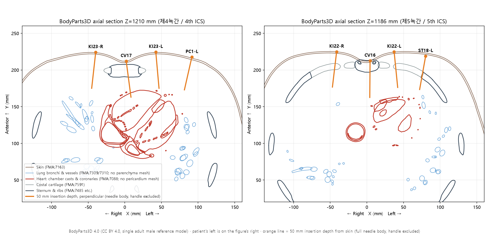
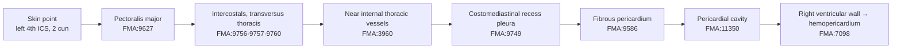
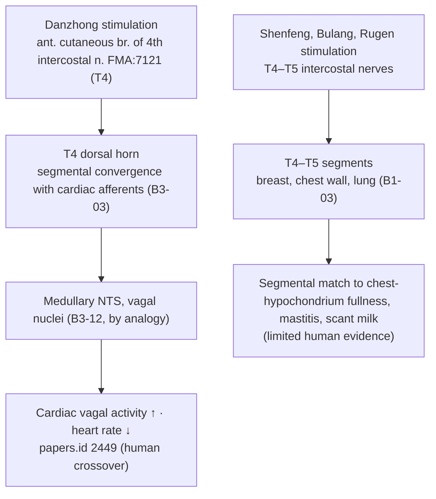

# Intrapericardial Needle Injury from Chest Acupuncture: Textual Investigation and Risk Assessment for a Needle with 50 mm Insertion Depth

> **Incident**: While three needles were being inserted into the chest, one went in deep and caused a small myocardial tear inside the pericardium (hemopericardium)
> **Needle condition**: needle body (針身) length 50 mm excluding the handle (針柄), i.e., a maximum insertion depth of 50 mm. All depths are insertion depths measured from the skin point
> **Category**: Topic-based acupoint investigation and hypothesis testing (Tier 3) · **Framework**: v2.7 (incl. 2.7.10) · **Scoring**: ARI v3.0 (provisional weights 0.40/0.35/0.25, dual scoring)
> **Anatomical basis**: FMA (Foundational Model of Anatomy) 5.1.0 local index + geometric measurement on BodyParts3D 4.0 meshes (FMA-ID based, CC BY 4.0)
> **Four core classics**: Zhongguo Zhenjiu Xuewei Tongjian (《中國針灸穴位通鑑》), Conception Vessel (任脈), Kidney Meridian (足少陰腎經) and Stomach Meridian (足陽明胃經) chapters · Zhenjiu Shuxue Tongkao (《針灸腧穴通考》), corresponding chapters · Zhongguo Zhenjiu Zhengzhi Tongjian (《中國針灸證治通鑑》), Part II "Acupuncture contraindications (針灸禁忌)" and Part III "Gynecological and pediatric disorders (婦兒科病證)" · Zhongguo Zhenjiu Jingluo Tongjian (《中國針灸經絡通鑑》), Part I "Evolution of meridian theory (經絡學說的演變)" and Part III Pericardium Meridian (手厥陰) chapter (supplementary: Dongui Bogam (《東醫寶鑑》), Acupuncture chapter)
> **Date**: 2026-10-27 · Integrated Biomedical Master DB v3.0 synchronized for six points

---

## Summary of conclusions

1. **The points that best fit the incident are the left parasternal Kidney Meridian points — Shenfeng (神封, KI23), Bulang (步廊, KI22), Lingxu (靈墟, KI24) — and Danzhong (膻中, CV17) when a sternal foramen is present.** In all four, the perpendicular needle path reaches the anterior wall of the **right ventricle** (BodyParts3D measurement). The right ventricular free wall is thin (about 3–5 mm), so even a fine needle can tear it and cause hemopericardium. This matches "a small myocardial tear inside the pericardium".
2. **The typical "three needles on the chest" combination is Danzhong (膻中, CV17) plus bilateral Rugen (乳根, ST18).** In 《中國針灸證治通鑑》, prescriptions for insufficient lactation (乳少) and acute mastitis (乳癰) combine Danzhong (膻中), Rugen (乳根) and Shaoze (少澤, SI1). If this was the combination, the deep needle was most likely (a) a perpendicular Danzhong (膻中) needle passing through a sternal foramen, or (b) a medially angled left Rugen (乳根) needle (the cardiac apex lies under left Rugen).
3. **Risk of a needle with 50 mm insertion depth (50 mm body, handle excluded)**: fully inserted, 50 mm is **2.7–4.3 times** the standard upper depth for chest points (5–8 fen = 11.5–18.4 mm). In the BodyParts3D reference model a 50 mm perpendicular insertion stops just short of the heart (left Lingxu (靈墟) 52.1 mm, left Shenfeng (神封) 56.5 mm, left Bulang (步廊) 57.2 mm), but this model places structures about 30% deeper than an MRI-measured cohort. After correcting for that ratio, all three points **reach the right ventricle at 36–40 mm**. Danzhong (膻中) with a sternal foramen (prevalence 4.3–10.5%) reaches the right ventricle at 46.8 mm even without correction, and at about 33 mm after correction. **In other words, at risk grade I points the heart is reached with only 65–80% (33–40 mm) of the 50 mm needle body inserted** (Section 4-3, insertion-depth scenarios).
4. **Where classical warnings and modern anatomy diverge**: The classics listed Danzhong (膻中) and Jiuwei (鳩尾, CV15) as needle-prohibited points (禁針穴) but never prohibited left Bulang (步廊) or Shenfeng (神封). The general part of 《中國針灸證治通鑑》 points this out and comments that, to avoid injuring the heart, "it is rather left Bulang (步廊) and Shenfeng (神封) that should be forbidden from deep needling". The FMA and 3D results support this comment. However, the same passage's claim that Danzhong (膻中) is safe "because the sternum lies beneath it" ignores the sternal foramen variant and needs correction.
5. **ARI v3.0 (five points, dual scoring)**: Danzhong (膻中, CV17) 78.75 ± 1.25 (B) SI 0 ⚠ · Shenfeng (神封, KI23, left) 75.0 ± 1.25 (B) SI 25 ⚠ · Bulang (步廊, KI22, left) 72.5 ± 1.25 (B, weight-sensitive) SI 25 ⚠ · Rugen (乳根, ST18, left) 71.25 ± 2.5 (B) SI 25 ⚠ · Jiuwei (鳩尾, CV15) 70.0 ± 1.25 (B, weight-sensitive) SI 0 ⚠. All five fall under **Gate 3 (⚠ safety caution)**.

> This report is an anatomical and textual risk analysis. It does not make a legal judgment about negligence or causation in the individual case. Confirming the actual needle path requires the patient's chest CT (sternal foramen, needle track) and the echocardiographic or surgical location of the tear (right ventricular anterior wall vs. left ventricular apex).

---

## 0. Incident and scope

| Item | Content |
| :--- | :--- |
| Incident | Three needles in the chest; one went deep and caused a small myocardial tear inside the pericardium (hemopericardium) |
| Needle condition | **Needle body (針身) length 50 mm, handle (針柄) excluded** → maximum insertion depth 50 mm (≈ 21.7 fen ≈ 2.2 cun; Han-dynasty 1 fen = 2.3 mm). The length in commercial needle sizes (e.g., 0.25 × 50 mm) usually denotes the body length without the handle |
| Insertion-depth scenarios | Worst case = the whole 50 mm body below the skin (inserted to the needle root). Because practitioners usually leave part of the body exposed, 30 and 40 mm insertions were also assessed (Section 4-3) |
| Why no single point was assumed | The incident record gives no point names → all chest and epigastric points over the cardiac projection were screened in 3D |
| Points measured in 3D (10 points, 18 sites) | Danzhong (膻中, CV17), Zhongting (中庭, CV16), Jiuwei (鳩尾, CV15), Juque (巨闕, CV14), Lingxu (靈墟, KI24), Shenfeng (神封, KI23), Bulang (步廊, KI22), Yingchuang (膺窗, ST16), Rugen (乳根, ST18), Tianchi (天池, PC1), Qimen (期門, LR14) (bilateral points on both sides) |
| Points dual-scored with ARI (5 points) | Danzhong (膻中, CV17), Jiuwei (鳩尾, CV15), Shenfeng (神封, KI23, left), Bulang (步廊, KI22, left), Rugen (乳根, ST18, left) — high cardiac reach in 3D or classical needling prohibition |
| Classical search | Full search of the four classics (point names, aliases, traditional/simplified forms), Dongui Bogam (《東醫寶鑑》) as supplement |
| External search | Integrated Biomedical Master DB v3.0 sync for six points (PubMed, OpenAlex, Crossref) + additional PubMed search (case reports, sternal foramen, safe depth) |

---

## 1. Textual screening (four classics, Chinese–English comparison)

### 1-1. General prohibition against piercing the heart

| Source | Original text | English |
| :--- | :--- | :--- |
| Dongui Bogam (《東醫寶鑑》), citing the Neijing (《內經》) | 刺中心一日死其動爲噫 | Piercing the heart kills within one day; its sign is belching (噫) |
| 《中國針灸穴位通鑑》, Bladder Meridian chapter (under Xinshu (心俞, BL15), quoting 《素問·刺禁論》) | 《素問·刺禁論》：刺中心一日死，其動為噫 | The same prohibition is repeatedly quoted under Xinshu (心俞) from the Zhenjiu Zisheng Jing (《針灸資生經》) onward |
| 《中國針灸證治通鑑》, Part III internal medicine (wind-stroke, 中風) | 一則不知刺禁（假令刺中心即死之類是也） | The first cause of sudden death after needling is ignorance of needling prohibitions, such as death from piercing the heart |

### 1-2. Point-by-point comparison

| Point | 《中國針灸穴位通鑑》 (location, needling) | 《針灸腧穴通考》 (collation, technique) | 《中國針灸證治通鑑》 (original → English) | 《中國針灸經絡通鑑》 (meridian collation) |
| :--- | :--- | :--- | :--- | :--- |
| **Danzhong (膻中, CV17)** | Zhen Jiu Jia Yi Jing (《針灸甲乙經》): "在玉堂下一寸六分陷者中", "刺入三分". Qianjin Yifang (《千金翼方》): "胸痹心痛灸亶中百壯，忌針". Taiping Shenghui Fang (《太平聖惠方》): "其穴禁不可針，針不幸令人死矣". From Song onward mostly "禁針" | Technique: transverse insertion (平刺). Mingtang (《明堂》) 3 fen / Shenghui Fang (《聖惠方》) prohibition, "may kill" / modern textbooks transverse 0.3–0.5 cun. Variant "鳩尾上一寸" (Qianjin) corrected to "二寸" | Part II contraindications: "膻中" in the Lingshu (《靈樞》) phrase "膻中者，心主之宮城也" was misread as a point name and Danzhong was listed as prohibited. **"In fact the sternum lies beneath Danzhong, so needling it does not injure the heart."** (其實，膻中穴下有胸骨，針刺此穴不會傷及心臟) | "心主" in "膻中者，心主之宮城也" originally meant the heart, not the pericardium. Reading it as pericardium and taking "膻中" as a point made Danzhong the front-mu point of the pericardium (Part I) |
| **Jiuwei (鳩尾, CV15)** | 《針灸甲乙經》: "在臆前蔽骨之下五分", "不可灸刺". 《聖惠方》: "此處是大難針，非是大好手方可下針…不幸令人死". Zhenfang Liuji (《針方六集》), Dou's method: "針頭向下施，禁不宜直入" | Technique: oblique downward 0.5–1 cun. **"勿直刺或向上斜刺，以免刺傷心、肺、肝臟"** (do not needle perpendicularly or upward, to avoid injuring heart, lung and liver). Xunjing Kaoxue Bian (《循經考穴編》): "此穴正當心之盡處". The 6th-edition textbook's "upward oblique" was corrected to "downward oblique" in the 7th | Same section: although listed as "not to be needled or moxibusted" from the Mingtang onward, many indications are recorded, so it was originally not prohibited. **"If the patient's heart is displaced, or the practitioner turns the needle tip upward after insertion, the heart may be injured."** (如果患者心臟異位，或醫者進針後針尖向上則有可能誤傷心臟) | Jiuwei (鳩尾) is the origin of the Conception Vessel connecting vessel (任脈之別, 尾翳). The course description does not extend indications beyond location collation |
| **Shenfeng (神封, KI23)** | 《針灸甲乙經》: "在靈墟下一寸六分陷者中…仰而取之", "刺入四分". Zhenjiuxue Jianbian (《針灸學簡編》): "適對肺臟（右）及心臟（左）", "不可直刺太深，以免刺傷心、肺" | Technique: oblique or transverse 0.5–0.8 cun. **"不宜深刺和直刺，以免刺傷心臟"** (avoid deep and perpendicular needling to prevent heart injury). No transcription errors noted | Same section: **"In fact, to avoid injuring the heart, it is rather left Bulang (步廊) and Shenfeng (神封) that should be forbidden from deep needling. Yet the old books never listed these two as prohibited."** (如為避免誤傷心臟，左側步廊、神封穴倒是應當禁深刺。但古醫書中並未將此二穴列為禁穴) | Kidney Meridian (足少陰) "其支者，從肺出絡心，注胸中" (Lingshu Jingmai (《靈樞·經脈》), cited in Parts II–III). A meridian link, not anatomical evidence (Rank 4 filter) |
| **Bulang (步廊, KI22)** | 《針灸甲乙經》: "在神封下一寸六分陷者中", "刺入四分". "一寸六分，指上下肋間隙之間的距離". 《針灸學簡編》: "深部適對肺臟（右）和心臟（左）" | Technique: "不宜深刺和直刺，以免刺傷心肺". Name collated: "步郎" (pre-Song) → "步廊" (Ming editions) | As above (mentioned with Shenfeng (神封)) | As above |
| **Rugen (乳根, ST18)** | 《針灸甲乙經》: "在乳下一寸六分陷者中", "刺入四分". Beiji Qianjin Yaofang (《備急千金要方》): "在兩乳下第一肋間宛宛中". Zhongguo Zhenjiuxue (《中國針灸學》): **"在前胸部第五肋間，乳房之直下心尖之部"** (5th intercostal space directly below the breast, at the cardiac apex) | Technique: oblique or transverse. Distinguished from the extra point Ruzhong (乳中) | Part III gynecology: no milk "少澤、合谷、膻中"; insufficient milk "膻中、乳根、少澤、內關、太衝"; mastitis "膻中、大陵、委中、少澤、俞府" → **Danzhong (膻中) and Rugen (乳根) are combined in the same chest prescriptions** | Not applicable |

> 《中國針灸證治通鑑》 was read with the Chinese original as the reference text and compared with the Korean translation. The Korean translation reads 膻中 as "jeonjung", whereas this report follows the standard reading "danjung" of the KJH Acupoint Alias DB (audit record 10-6).

---

## 2. Primary vs. secondary sources

| Point | Primary (first description) | Period | Secondary (quotations, commentary) | Judgment |
| :--- | :--- | :--- | :--- | :--- |
| Danzhong (膻中) | Huangdi Mingtang Jing (《黃帝明堂經》, preserved in the Jia Yi Jing (《甲乙經》) vol. 3): location, "刺入三分" | Han–Wei-Jin | Prohibition: Qianjin Yifang (《千金翼方》) "忌針" (Tang) → Shenghui Fang (《聖惠方》) "may kill" (Song) → Tongren (《銅人》), Zisheng Jing (《資生經》), Yixue Rumen (《醫學入門》), Dongui Bogam (《東醫寶鑑》) "禁不可鍼" | No prohibition in the first description, which gives 3 fen (6.9 mm). Prohibition accumulated from the Tang onward |
| Jiuwei (鳩尾) | Lingshu Jiuzhen Shier Yuan (《靈樞·九針十二原》) "膏之原，出於鳩尾" (name) + Mingtang location "臆前蔽骨下五分", "不可灸刺" | Han | Shenghui Fang "大難針…不幸令人死", Zhenfang Liuji "針頭向下，禁不宜直入" | Prohibition present from the primary source; the Zhengzhi Tongjian's view that it was not truly prohibited (many indications) is noted alongside |
| Shenfeng (神封), Bulang (步廊) | Mingtang: location, "刺入四分" | Han–Wei-Jin | Song "針入三分", modern textbooks "do not needle deeply" | No prohibition, only a depth limit (3–4 fen) |
| Rugen (乳根) | Mingtang: location, "刺入四分" | Han–Wei-Jin | Qianjin "第一肋間宛宛中", modern "心尖之部" | No prohibition |
| Heart-piercing rule | Suwen Cijin Lun (《素問·刺禁論》) "刺中心一日死" | Han | Zisheng Jing, Dongui Bogam, etc. | An organ-level, not point-level, prohibition |

---

## 3. Alias verification (KJH Acupoint Alias DB + four classics)

| Point | KJH aliases | Confirmation in classics | Risk of conflation and handling |
| :--- | :--- | :--- | :--- |
| Danzhong (膻中, CV17) | 上氣海, 元兒, 元見, 炎元, 胸堂, 亶中 | 5 aliases in the Xuewei Tongjian; "元見" is a graphic error for "元兒" | **"膻中" is also used in the Lingshu as the name of the region around the heart (pericardium)** → organ name and point name were mixed and produced the prohibition (Zhengzhi Tongjian, Jingluo Tongjian). Point and organ meanings analysed separately |
| Jiuwei (鳩尾, CV15) | 尾翳, 膏原, 𩩲骬, 髑骬 | Tongkao: 鳩尾 is both a bone name (xiphoid) and a point name; "曷曷, 干於" are graphic errors for "髑骬"; "神府, 龍頭" are different locations, not aliases | Bone "鳩尾骨" (xiphoid process) separated from point "鳩尾穴"; texts equating 神府 with Jiuwei (Qianjin Yifang) separated |
| Shenfeng (神封, KI23) | none | none | none |
| Bulang (步廊, KI22) | 步郞 | "步郎" before Song, "步廊" in Ming editions | Variant spelling of one point; no conflation |
| Rugen (乳根, ST18) | 薛息 | from the Qianjin | No conflation; distinct from extra point Ruzhong (乳中) (Tongkao) |

---

## 4. 3D coordinates and Layer 1–5 structure

### 4-1. Method (FMA · BodyParts3D)

- **Model**: BodyParts3D 4.0 (Database Center for Life Science, CC BY 4.0). A single adult male reference 3D model partitioned by FMA ID (height about 1.72 m, mm units). Meshes used: skin (FMA:7163), sternum (FMA:7485), body of sternum (FMA:7487), xiphoid process (FMA:7488), left and right ribs 1–10, costal cartilages 1–7 (FMA:7591 family), heart (FMA:7088), liver (FMA:7197), diaphragm (FMA:13295).
- **Coordinates**: X = left (+)/right (−) of the midline, Y = anteroposterior (anterior −), Z = height above the soles (superior +). In the framework's X (medio-lateral) · Y (proximo-distal) · Z (depth) system, the tables give "distance from midline" (X), "height" (Y) and "depth" (Z).
- **B-cun**: WHO 2008, distance between the midpoints of the clavicles = 8 B-cun → **1 B-cun = 19.2 mm**.
- **Skin points**: each intercostal space was located by cutting the inferior border of rib/costal cartilage n and the superior border of rib n+1 at the same X and taking the midpoint. Danzhong (膻中): midline at the 4th intercostal level; Jiuwei (鳩尾), Juque (巨闕): 1 and 2 B-cun below the xiphisternal junction (Z 1182.1 mm).
- **Definition of insertion depth**: every distance is measured along the needle path from the skin point. "Reached at 50 mm" therefore means the whole 50 mm needle body (handle excluded) is below the skin; handle length does not enter the calculation.
- **Insertion direction**: normal to the local 12 mm skin patch (perpendicular needling). Angled insertion was assessed with 600 random directions in each 30°, 45° and 60° cone around the normal. Intersections by the Möller–Trumbore ray–triangle algorithm.
- **Limitations (important)**: (1) BodyParts3D has **no pericardium mesh**, and the heart mesh consists mainly of chamber casts, papillary muscles and coronary vessels, with no epicardial surface. Measured values are "distance to the first cardiac structure (usually a ventricular cavity)"; the true pericardium lies shallower by the thickness of the right ventricular free wall (about 3–5 mm, B1-01). (2) **The lung mesh contains only bronchi and pulmonary vessels, with no parenchymal surface**, so pneumothorax risk could not be measured (blue circles in the figure). (3) A single reference model cannot reflect differences in body habitus, sex, respiration or posture → supplemented by calibration and a critical habitus factor (4-3).

### 4-2. Skin-point coordinates and perpendicular paths to 50 mm insertion depth (BodyParts3D raw values)

| Point | Distance from midline (mm) | Height Z (mm) | First bone, perpendicular (mm) | First costal cartilage (mm) | Heart, perpendicular (mm) | Skin → heart, shortest (mm) | Liver, perpendicular (mm) | Heart reached at 50 mm perpendicular insertion |
| :--- | ---: | ---: | ---: | ---: | ---: | ---: | ---: | :---: |
| Danzhong (膻中, CV17) | 1.9 | 1209.7 | 4.8 (sternum) | — | 46.8 (behind sternum) | 40.4 | — | Blocked by sternum. **Reaches if sternal foramen** |
| Zhongting (中庭, CV16) | 3.0 | 1183.1 | 0.7 (sternum) | — | — | 45.3 | — | No |
| Jiuwei (鳩尾, CV15) | 2.7 | 1160.0 | — | — | — | 57.7 | 24.3 | No (liver at 24.3 mm) |
| Juque (巨闕, CV14) | −2.7 | 1144.5 | — | — | — | 71.9 | 18.0 | No (liver at 18.0 mm) |
| Lingxu (靈墟, KI24) left | 38.9 | 1235.2 | — | 23.4 | 52.1 | 42.2 | — | No (2.1 mm short) |
| Lingxu (靈墟, KI24) right | −37.3 | 1233.2 | — | 22.8 | — | 60.5 | — | No |
| Shenfeng (神封, KI23) left | 39.2 | 1205.3 | — | — | 56.5 | 51.3 | — | No (6.5 mm short) |
| Shenfeng (神封, KI23) right | −39.8 | 1204.9 | — | — | — | 67.2 | — | No |
| Bulang (步廊, KI22) left | 35.8 | 1185.7 | — | 17.1 | 57.2 | 53.9 | — | No (7.2 mm short) |
| Bulang (步廊, KI22) right | −40.0 | 1184.5 | — | 17.0 | — | 72.4 | — | No |
| Yingchuang (膺窗, ST16) left | 79.7 | 1244.9 | — | — | 67.4 | 53.5 | — | No |
| Yingchuang (膺窗, ST16) right | −75.6 | 1239.3 | 33.1 | — | — | 78.3 | — | No |
| Rugen (乳根, ST18) left | 80.7 | 1167.6 | — | 19.6 | — | 59.0 | — | No (angled: see 4-3) |
| Rugen (乳根, ST18) right | −79.1 | 1167.5 | — | 19.2 | — | 95.5 | — | No |
| Tianchi (天池, PC1) left | 95.2 | 1207.6 | 37.6 | — | — | 56.7 | — | No |
| Tianchi (天池, PC1) right | −97.8 | 1205.3 | 36.2 | — | — | 96.1 | — | No |
| Qimen (期門, LR14) left | 75.3 | 1129.9 | — | — | — | 79.1 | 32.9 | No |
| Qimen (期門, LR14) right | −75.5 | 1134.2 | — | — | — | 110.0 | 33.1 | No |

- **Danzhong (膻中) path details**: skin → sternum 4.8 mm, sternum traversed 16.6 mm (oblique section), posterior sternal surface → heart 25.3 mm. With a sternal foramen the needle crosses the retrosternal space without bony resistance and reaches the right ventricle at 46.8 mm.
- **Cardiac structure first hit on the perpendicular path**: Danzhong (膻中), left Lingxu (靈墟), left Shenfeng (神封) → cavity of right ventricle (FMA:9291); left Bulang (步廊) → anterior papillary muscle of right ventricle (FMA:7260); left Yingchuang (膺窗) → cavity of left ventricle (FMA:9466). Each requires perforating the anterior wall of the right or left ventricle.
- **Angled insertion (uncorrected)**: the share of directions within a 30° cone in which the heart lies within 50 mm with no bone in the way was 21.5% at left Lingxu (靈墟) (45° cone 9.8%, 60° cone 7.2%; if costal cartilage also blocks, 12.8%, 6.8%, 4.8%). All other points were 0% before correction.

### 4-3. Habitus calibration and critical habitus factor k*

To align the single reference model with measured subjects, an **MRI study measuring the same condition (papers.id 2476, PMID 22741258, 10 adults)** was used as the calibration point. There, the dangerous depth for perpendicular needling at Jiuwei (鳩尾) was **16.99 ± 2.86 mm**, whereas the first organ (liver) on the same path in BodyParts3D was at 24.3 mm. The model thus places structures about 1.43 times deeper than the measured cohort; the calibration factor is **k_cal = 16.99 / 24.3 = 0.70** (± 1 SD range 0.58–0.82). Because there is only one calibration point, the **critical habitus factor k* = 50 / measured depth** is given as well ("a 50 mm insertion reaches the heart in anyone whose depths are k* times the model's or less"), with **k* = 50 mm (insertion depth) / measured depth**.

| Point | Model raw (mm) | Corrected (mm, k = 0.70) | Corrected range (mm, k = 0.58–0.82) | k* (perpendicular) | k* (any direction) | Verdict at 50 mm insertion (corrected) |
| :--- | ---: | ---: | :---: | ---: | ---: | :--- |
| Danzhong (膻中, CV17) with sternal foramen | 46.8 | 32.7 | 27.2–38.2 | **1.07** | 1.24 | **Reaches** — even in the reference model |
| Lingxu (靈墟, KI24) left | 52.1 | 36.4 | 30.3–42.6 | **0.96** | 1.19 | **Reaches** |
| Shenfeng (神封, KI23) left | 56.5 | 39.5 | 32.9–46.2 | **0.885** | 0.975 | **Reaches** |
| Bulang (步廊, KI22) left | 57.2 | 40.0 | 33.3–46.7 | **0.874** | 0.928 | **Reaches** |
| Yingchuang (膺窗, ST16) left | 67.4 | 47.1 | 39.2–55.1 | 0.742 | 0.935 | Borderline (reaches in thin patients) |
| Rugen (乳根, ST18) left (angled, shortest) | 59.0 | 41.3 | 34.3–48.2 | — | 0.847 | **Reaches if angled medially** |
| Tianchi (天池, PC1) left (angled, shortest) | 56.7 | 39.6 | 33.0–46.3 | — | 0.882 | Reaches if angled medially |
| Jiuwei (鳩尾, CV15) (30–45° cranial tilt) | 68.0–68.6 | 47.5–48.0 | 39.5–56.0 | — | — | **Borderline** — can reach when tilted upward |
| Juque (巨闕, CV14) (45–60° cranial tilt) | 81.7–87.5 | 57.1–61.2 | 47.5–71.5 | — | — | Mostly does not reach |
| Right Lingxu (靈墟, KI24) · right Shenfeng (神封, KI23) (shortest) | 60.5 · 67.2 | 42.3 · 47.0 | 35.2–49.4 · 39.1–54.9 | — | 0.826 · 0.744 | Borderline reach only when angled along the shortest line (toward the sternum and costal cartilages, so bony block is likely; 0% of paths within a 60° cone before correction) |
| Right Bulang (步廊) · Yingchuang (膺窗) · Rugen (乳根) · Tianchi (天池) (shortest) | 72.4–96.1 | 50.6–67.2 | — | — | 0.52–0.69 | Do not reach |

- Depths in this table are to the ventricular cavity, so **the pericardium is 3–5 mm shallower**. The corrected values therefore err toward underestimating the risk.
- Jiuwei (鳩尾) cranial-tilt details (model raw): 0° liver 24.3 mm · 15° liver 27.6 mm · 30° diaphragm 40.7 mm then heart 68.6 mm · 45° diaphragm 13.8 mm then heart 68.0 mm · 60° xiphoid 11.0 mm. The Tongkao's "no upward oblique needling" and the Zhengzhi Tongjian's "turning the tip upward may injure the heart" are geometrically confirmed.

#### Heart reach by insertion depth (how much of the 50 mm body actually went in)

In practice part of the needle body is often left outside the skin, so insertions of 30, 40 and 50 mm of the 50 mm body were judged separately. Symbols: **●** = reached at the corrected mean (k = 0.70) · **◐** = within the corrected range (k = 0.58–0.82), i.e., reached in thinner patients · **○** = not reached.

| Point (path) | Corrected depth to ventricular cavity (mm) | Estimated depth to pericardium (mm) | Share of 50 mm body needed | 30 mm inserted | 40 mm inserted | 50 mm inserted (full body) |
| :--- | :---: | :---: | :---: | :---: | :---: | :---: |
| Danzhong (膻中, CV17) (sternal foramen, perpendicular) | 32.7 | about 28–30 | 65% | ◐ | ● | ● |
| Lingxu (靈墟, KI24) left (perpendicular) | 36.4 | about 31–33 | 73% | ○ | ● | ● |
| Tianchi (天池, PC1) left (medially angled) | 39.6 | about 35–37 | 79% | ○ | ● | ● |
| Shenfeng (神封, KI23) left (perpendicular) | 39.5 | about 35–37 | 79% | ○ | ● | ● |
| Bulang (步廊, KI22) left (perpendicular) | 40.0 | about 35–37 | 80% | ○ | ● | ● |
| Rugen (乳根, ST18) left (medially angled) | 41.3 | about 36–38 | 83% | ○ | ◐ | ● |
| Lingxu (靈墟, KI24) right (shortest line) | 42.3 | about 37–39 | 85% | ○ | ◐ | ● |
| Yingchuang (膺窗, ST16) left (perpendicular) | 47.1 | about 42–44 | 94% | ○ | ◐ | ● |
| Shenfeng (神封, KI23) right (shortest line) | 47.0 | about 42–44 | 94% | ○ | ◐ | ● |
| Jiuwei (鳩尾, CV15) (tilted 30–45° upward) | 47.5–48.0 | about 43–45 | 95–96% | ○ | ◐ | ● |
| Juque (巨闕, CV14) (tilted 45–60° upward) | 57.1–61.2 | about 52–58 | 114–122% | ○ | ○ | ◐ |

- Estimated depth to pericardium = corrected depth to the ventricular cavity − right ventricular free wall thickness (3–5 mm, B1-01). Hemopericardium can start once the pericardium is pierced, so this is where the danger zone really begins.
- **Key point**: at risk grade I points (left Lingxu, Shenfeng, Bulang; Danzhong with a sternal foramen) the heart is reached with **only 65–80% (33–40 mm) of the 50 mm body inserted**. At 30 mm only Danzhong with a sternal foramen is reached, in thinner patients. A needle with a 50 mm body therefore cannot be considered safe merely because it is not fully inserted.
- At Jiuwei (鳩尾) the liver comes before the heart on a perpendicular path: MRI dangerous depth 16.99 mm (papers.id 2476) → risk of liver puncture from 30 mm insertion onward.

### 4-4. Layer 1–5 structure — left Shenfeng (神封) and Bulang (步廊) (most likely incident path)

| Layer | Structure (FMA) | Depth on left Shenfeng (神封) path (corrected) | Note |
| :---: | :--- | :--- | :--- |
| 1 Skin, subcutis | Anterior cutaneous branch of fourth intercostal nerve FMA:7121 (KI22: FMA:7288) | 0 to about 5 mm | Superficial sensation |
| 2 Superficial muscle | Pectoralis major FMA:9627 (medial/lateral pectoral nerves FMA:65293/65296) | about 5–15 mm | Textbook standard depth (5–8 fen = 11.5–18.4 mm) ends here |
| 3 Deep muscle | External/internal intercostal FMA:9756/9757, transversus thoracis FMA:9760 (common textbook only) | about 15–25 mm | Intercostal space → no bony block |
| 4 Neurovascular bundle | Fourth intercostal nerve FMA:8604, internal thoracic artery FMA:3960 and fourth anterior intercostal artery FMA:10655, endothoracic fascia FMA:9732 | about 20–28 mm | The internal thoracic artery descends about 1–2 cm lateral to the sternal border, close to the 2-cun points (B1-01) |
| 5 Deep organs | Parietal pleura, costomediastinal recess FMA:9747/9749, cardiac notch of left lung FMA:13157, **fibrous pericardium FMA:9586, pericardial cavity FMA:11350, right ventricle FMA:7098** | right ventricular cavity about 39.5 mm (model 56.5 mm) → pericardium about 35 mm | **A 50 mm needle passes more than 15 mm beyond the start of Layer 5** |

- **Neither textbook lists Layer 5** (Section 6). Their structures end at the intercostal muscles and transversus thoracis; the pleura and pericardium 1–2 cm deeper are absent. A 50 mm needle accident happens precisely in this "off-textbook layer".

---

## 5. Needling depth table (Needling Depth by Classical Source DB, 1 fen = 2.3 mm)

| Source / textbook | Danzhong (膻中, CV17) | Jiuwei (鳩尾, CV15) | Shenfeng (神封, KI23) | Bulang (步廊, KI22) | Rugen (乳根, ST18) |
| :--- | :---: | :---: | :---: | :---: | :---: |
| Zhen Jiu Jia Yi Jing (《針灸甲乙經》) | 3 fen = 6.9 mm | **0 = prohibited** | 4 fen = 9.2 mm | 4 fen = 9.2 mm | 4 fen = 9.2 mm |
| Huangdi Mingtang Jing (《黃帝明堂經》, ed. Huang Longxiang) | 3 fen = 6.9 mm | **0 = prohibited** | 4 fen = 9.2 mm | 4 fen = 9.2 mm | 4 fen = 9.2 mm |
| Dongui Bogam (《東醫寶鑑》) | **0 = prohibited** (Rumen) | **0 = prohibited** (Tongren) | 3 fen = 6.9 mm | 2 fen = 4.6 mm | 3 fen = 6.9 mm |
| Chimgu Gyeongheombang (《鍼灸經驗方》) | **0 = prohibited** | 3 fen = 6.9 mm | not stated | not stated | not stated |
| Zhenjiu Shuxue Tongkao (《針灸腧穴通考》) | not stated, transverse | 5–10 fen = 11.5–23.0 mm, oblique | 5–8 fen = 11.5–18.4 mm | 5–8 fen = 11.5–18.4 mm | not stated, oblique/transverse |
| Korean common textbooks (meridian & point / acupuncture) | 3–5 fen = 6.9–11.5 mm | 3–6 fen / 5–10 fen = 6.9–23.0 mm | 5–8 fen = 11.5–18.4 mm | 5–8 fen = 11.5–18.4 mm | 5–8 fen = 11.5–18.4 mm |
| **50 mm insertion as multiple of standard upper limit** | **4.3×** (11.5 mm) | **2.2×** (23.0 mm) / 2.9× MRI safe depth | **2.7×** (18.4 mm) | **2.7×** (18.4 mm) | **2.7×** (18.4 mm) |
| Layer reached (standard upper limit) | Layer 1–2 (presternal) | Layer 3–4 (linea alba, transversalis fascia) | Layer 2–3 | Layer 2–3 | Layer 2–3 |
| Layer reached (50 mm insertion) | With sternal foramen: **Layer 5 heart** | Liver (perpendicular), **heart (tilted upward)** | **Layer 5 heart** | **Layer 5 heart** | Layer 5 pleura and lung; heart if angled |

- '0' = needling prohibited; 'not stated' = no entry (distinguished from prohibition). An insertion depth of 50 mm (full body) = 21.7 fen, deeper than any source permits.

---

## 6. Textbook comparison and FMA mapping

| Point | Common textbook | Kim Jae-hyo textbook | FMA mapping (match level) | FMA entities (shared / common only / Kim only) | Segment union |
| :--- | :--- | :--- | :--- | :---: | :---: |
| Danzhong (膻中) | Sternalis / anterior cutaneous branch of 4th intercostal n. / perforating branches of internal thoracic a. and v. | Sternal membrane, fascia of the sternum / same / same | Sternalis FMA:9717 (exact), Sternal membrane FMA:76873 (exact), fascia of sternum (none), FMA:7121 (exact), FMA:70370 (exact), FMA:4729 (parent) | 3 / 1 / 1 | T4 |
| Jiuwei (鳩尾) | Linea alba, rectus sheath / anterior cutaneous branch of 6th intercostal n. / superior epigastric a. and v. | Linea alba, transversalis fascia / same / superficial and superior epigastric a. and v. | FMA:11336, 9587, 12265, 8859, 10646, 4731, 20734 (all exact) | 4 / 1 / 3 | T6 |
| Shenfeng (神封) | Pectoralis major, external/internal intercostals, transversus thoracis / intercostal n. / medial mammary and anterior intercostal branches of internal thoracic a. and v. | Pectoralis major, external/internal intercostals / 4th intercostal n., its anterior cutaneous branch, medial/lateral pectoral n. / 4th posterior intercostal a. and v., 4th intercostal branch of internal thoracic a. and v. | FMA:9627, 9756, 9757, 9760, 8604, 7121, 65293, 65296, 10655, 12287 (exact); mammary branch (parent) | 4 / 4 / 7 | T3–T7 |
| Bulang (步廊) | Same as Shenfeng (5th intercostal space) | 5th intercostal n. family | FMA:7288, 8605, 10656, 12288 etc. (exact) | 3 / 4 / 8 | T3–T7 |
| Rugen (乳根) | Pectoralis major, internal/external intercostals / intercostal n. / anterior intercostal branches | + rectus abdominis, pectoralis minor, external oblique / 5th intercostal n., lateral pectoral n. / + thoracoepigastric v. | FMA:9627, 13109, 9628, 13335, 8605, 13416 (exact) | 5 / 1 / 6 | T5 |

- **Common ground**: in all five points the superficial nerve (anterior cutaneous branch of the intercostal nerve) matches exactly in FMA in both textbooks.
- **Differences**: the common textbook uses generic names (intercostal nerve); the Kim textbook uses segment-specific names (fourth intercostal nerve) and pectoral nerves. In FMA these belong to the same family, so the difference is resolution, not contradiction. Transversus thoracis (FMA:9760) appears only in the common textbook; pectoralis minor and rectus abdominis only in the Kim textbook (Rugen).
- **Gap shared by both textbooks**: neither lists the pleura, pericardium or heart (Layer 5). This report fills Layer 5 from FMA: Pericardium FMA:9869, Fibrous pericardium FMA:9586 (subdivided into T5–T9 parts, contained in the middle mediastinal space FMA:85013), Pericardial cavity FMA:11350, Costomediastinal recess FMA:9747, Cardiac notch of left lung FMA:13157, Right ventricle FMA:7098, Anterior interventricular branch FMA:3862. FMA records cardiac innervation as the cardiac plexuses (FMA:6649/6650) and coronary plexuses (FMA:6651/6652) (B1 supplementary, not in the registry).

---

## 7. Spatial bifurcation analysis (Tri-Target)

| Point | Target 1 (classical text) | Target 2 (palpation term, anatomical) | Target 3 (WHO) | Pairwise Δ | Verdict |
| :--- | :--- | :--- | :--- | :---: | :--- |
| Danzhong (膻中) | Mingtang "玉堂下一寸六分，直兩乳間陷者中" → midline at 4th intercostal level | "陷者中", Zhouhou Fang (《肘後備急方》) "胸厭骨解間" → depression between sternebrae (level of 4th costal cartilage) | Midline, 4th intercostal level | ≤ 5 mm | **Target 1≡2≡3, single** |
| Jiuwei (鳩尾) | Jia Yi Jing "臆前蔽骨之下五分" → 0.5 cun below xiphoid tip (Z 1154.4 mm) | No palpation term (Shenghui Fang "陷者中" is later, Song) → **Target 2 cannot be set** | 1 B-cun below xiphisternal junction (Z 1162.9 mm) | 8.5 mm | **Target 1≡3, single** (Δ may exceed 10 mm in people with long or bifid xiphoid, 17.5%) |
| Shenfeng (神封) | Mingtang "靈墟下一寸六分陷者中，俠任脈兩旁各二寸" | "陷者中" → 4th intercostal depression (borders: 4th and 5th costal cartilages) | 4th intercostal space, 2 B-cun lateral | ≤ 5 mm | **Single** |
| Bulang (步廊) | Mingtang "神封下一寸六分陷者中" | "陷者中" → 5th intercostal depression (borders: 5th and 6th costal cartilages) | 5th intercostal space, 2 B-cun lateral | ≤ 5 mm | **Single** |
| Rugen (乳根) | Mingtang "乳下一寸六分陷者中" | Qianjin "兩乳下第一肋間宛宛中" → 5th intercostal space | 5th intercostal space, 4 B-cun lateral | ≤ 5 mm (male) | **Single** (in women the breast displaces the nipple → follow the intercostal space) |

- **Excluded from Targets (location notes)**: Danzhong "正對第五肋骨之端" (Zhenjiu Shisijing Xuewei Kaoding (《針灸十四經穴位考訂》)) and the 1957 Nanjing textbook "5th intercostal space in women" are modern variants and were excluded (about 24 mm from the 4th intercostal level in the model). "第六肋間" for Bulang and Rugen (Gaodeng Zhenjiuxue Jiangyi (《高等針灸學講義》)) was likewise excluded.
- None of the five points bifurcates, so one ARI was computed per point.

---

## 8. Reflex mechanism, B-Check and external search log

### 8-1. Mechanism summary (P_single)

### 8-2. B-Check (scorer A / B)

| Item | Danzhong (膻中) | Jiuwei (鳩尾) | Shenfeng (神封) L | Bulang (步廊) L | Rugen (乳根) L |
| :--- | :---: | :---: | :---: | :---: | :---: |
| ① Peripheral substrate (B1-01, B2-09, FMA exact) | 2 / 2 | 2 / 2 | 2 / 2 | 2 / 2 | 2 / 2 |
| ② Segmental match (FMA segment union ↔ target organ, B1-03, B3-03) | 2 / 2 (T4 ↔ heart T1–T5) | 1 / 1 (T6 ↔ heart and stomach mixed) | 2 / 2 (T4 ↔ breast, chest wall) | 2 / 2 (T5 ↔ chest wall, lung) | 2 / 2 (T5 ↔ breast) |
| ③ Afferent fibres, receptors (B3-06) | 1 / 1 | 1 / 1 | 1 / 1 | 1 / 1 | 1 / 1 |
| ④ Central pathway (B3-12, B3-05, by analogy) | 1 / 1 | 1 / 1 | 0 / 0 | 0 / 0 | 1 / 1 |
| ⑤ Efferent direction ↔ P_single | 1 / 1 | 1 / 1 | 1 / 1 | 1 / 1 | 1 / 1 |
| ⑥ Human translation (Layer A human studies) | 2 / 1 (id 2449) | 0 / 0 | 1 / 0 (id 2493) | 0 / 0 | 1 / 1 (id 2499, 2503) |
| **Total** | **9 / 8** | **6 / 6** | **7 / 6** | **6 / 6** | **8 / 8** |
| Verdict | Concordant (≥ 8) | Not concordant → hypothesis | Not concordant → hypothesis | Not concordant → hypothesis | Concordant (≥ 8) |

- Mechanistic evidence for Danzhong, papers.id 2449 (Kurono et al. 2011, 14 healthy men, crossover): epifascial stimulation at Danzhong (膻中) lowered heart rate and raised the high-frequency HRV component (cardiac vagal index), whereas the neighbouring Zhongting (中庭) had no effect. **A rare human demonstration of point specificity.**
- Cardiac injury risk is separate from the reflex mechanism; safety (SI) is scored separately in Section 10.

### 8-3. External API search log (Integrated Biomedical Master DB v3.0, 2026-10-27 13:49–13:50, trigger rank6)

| Point | PubMed (HTTP · fetched) | OpenAlex (HTTP · fetched) | Crossref (HTTP · fetched) | Candidates | Deduplicated | New | Merged into existing |
| :--- | :---: | :---: | :---: | ---: | ---: | ---: | ---: |
| CV17 Danzhong (膻中) | 200 · 16 | 200 · 24 | 200 · 1 | 41 | 14 | 27 | 5 |
| CV15 Jiuwei (鳩尾) | 200 · 6 | 200 · 8 | 200 · 0 | 14 | 6 | 8 | 2 |
| CV14 Juque (巨闕) | 200 · 8 | 200 · 10 | 200 · 0 | 18 | 3 | 12 | 0 (3 rejected: point not mentioned) |
| KI23 Shenfeng (神封) | 200 · 1 | 200 · 1 | 200 · 0 | 2 | 1 | 1 | 1 |
| KI22 Bulang (步廊) | 200 · 1 | 200 · 0 | 200 · 0 | 1 | 1 | 0 | 1 |
| ST18 Rugen (乳根) | 200 · 8 | 200 · 11 | 200 · 0 | 19 | 8 | 11 | 4 |

- All sources succeeded (validation passed). Queries: point code, pinyin and Chinese name × acupuncture/electroacupuncture × nerve/reflex/autonomic/mechanism, plus filters for 《中國針灸》 and 《針刺研究》. Shenfeng and Bulang have essentially no mechanistic papers (Gate 2 not applied because human clinical papers exist).
- **Additional PubMed search (not merged into DB; safety evidence)**: systematic review of acupuncture-related cardiac tamponade, 14 deaths among 26 cases (PMID 21093944); fatal tamponade through a congenital sternal foramen (PMID 7723561, 7623587); right ventricular perforation after sternal acupuncture (PMID 10807845); direct right ventricular penetration (PMID 24685234, 9338656, 30803795); coronary artery injury after substernal acupuncture (PMID 23549831); delayed fatal tamponade from cardiac puncture during acupuncture for mammary hyperplasia (PMID 36914399); sternal foramen prevalence on CT 4.3% (PMID 3989043), 8.44% (PMID 31907578), 10.5% (PMID 25023390), dried sterna 19.1% (PMID 38845617). Safety-related papers merged in the DB: Jiuwei MRI safe angle and depth (papers.id 2476), Jiuwei digital visible human (papers.id 2473, safe depth 1.0–1.5 cm), commentary on a massive intrapericardial hematoma after subxiphoid needling (papers.id 2478), pediatric CT skin-to-organ depth at chest points (papers.id 2504).

---

## 9. Indication separation (single-point P_single vs. combinations)

| Point | P_single (pre-Tang primary sources) | Derived from combinations (Zhengzhi Tongjian prescriptions) | Relevance to the incident |
| :--- | :--- | :--- | :--- |
| Danzhong (膻中) | Jia Yi Jing: cough with qi counterflow (咳逆上氣), panting and shortness of breath (唾喘短氣不得息), inability to speak (口不能言) · Qianjin Yifang: chest impediment with heart pain (胸痹心痛) | No milk: Shaoze (少澤), Hegu (合谷), Danzhong / insufficient milk: Danzhong, Rugen (乳根), Shaoze (+ Neiguan (內關), Taichong (太衝)) / mastitis: Danzhong, Daling (大陵), Weizhong (委中), Shaoze, Shufu (俞府) | Core point of the typical three-needle chest prescription for breast and lactation problems |
| Jiuwei (鳩尾) | Lingshu: abdominal skin pain and itching (腹皮痛, 癢搔) (Conception Vessel connecting vessel) · Jia Yi Jing: throat impediment, inability to swallow (喉痹食不下) · Qianjin: acute wringing heart pain near death (心痛暴絞急絕欲死), ox epilepsy (牛癇) | Song onward: epilepsy (五般癇) combinations; Xi Hong Fu (《席弘賦》) "鳩尾能治五般癇，若下湧泉人不死" | Epigastric needling for heart pain and epilepsy |
| Shenfeng (神封) | Jia Yi Jing: fullness of chest and hypochondrium with inability to breathe (胸脅榰滿不得息), cough with counterflow (咳逆), mastitis (乳癰), shivering aversion to cold (灑淅惡寒) | Mostly single-point entries | Left parasternal needling for chest fullness and mastitis |
| Bulang (步廊) | Jia Yi Jing: chest-hypochondrium fullness (胸脅榰滿), diaphragmatic obstruction (鬲逆不通), shortness of breath (呼吸少氣), panting with inability to raise the arms (喘息不得舉臂) | Mostly single-point entries | Dyspnea, chest fullness |
| Rugen (乳根) | Jia Yi Jing: fullness and pain below the chest (胸下滿痛), swelling of the breast region (膺腫), mastitis (乳癰), chills and fever (淒索寒熱), pain on pressure (痛不可按) | Insufficient milk: Danzhong, Rugen, Shaoze (Zhenjiuxue Jianbian "配膻中、合谷、少澤") | Chest partner of Danzhong in combinations |

- Indications added after the Song (asthma (哮喘), pleurisy (肋膜炎), angina (心絞痛), etc.) contain modern interpretation and were excluded from P_single. Extensions of indications from the meridian course (Kidney Meridian "從肺出絡心") were also excluded as Rank 4 noise.

---

## 10. ARI v3.0 profile and final conclusion

### 10-1. Sub-scores and rubric levels (scorer A / B)

| Point | S_orig ①②③④ (A) | S_orig ①②③④ (B) | S_clarity A/B | S_reflex A/B | SI A/B |
| :--- | :--- | :--- | :---: | :---: | :---: |
| Danzhong (膻中, CV17) | 100·100·75·75 = 87.5 | 75·100·75·75 = 81.25 | 75 / 75 | 75 / 75 | **0 / 0** |
| Jiuwei (鳩尾, CV15) | 75·75·75·100 = 81.25 | 75·75·75·75 = 75 | 75 / 75 | 50 / 50 | **0 / 0** |
| Shenfeng (神封, KI23) L | 75·100·100·100 = 93.75 | 75·100·100·75 = 87.5 | 75 / 75 | 50 / 50 | **25 / 25** |
| Bulang (步廊, KI22) L | 75·100·75·100 = 87.5 | 75·100·75·75 = 81.25 | 75 / 75 | 50 / 50 | **25 / 25** |
| Rugen (乳根, ST18) L | 100·100·100·75 = 93.75 | 75·100·75·75 = 81.25 | 50 / 50 | 75 / 75 | **25 / 25** |

**Rubric rationale**

- **S_orig**: ① For Danzhong and Rugen the Mingtang specifies both location and depth (3 and 4 fen) (A 100); B gave 75 for the uncertain dating of the Mingtang (late Han to Wei-Jin). Shenfeng and Bulang are located relative to neighbouring points (75). Jiuwei has "不可灸刺" instead of a depth (75). ② Later agreement on location is high for all five (Jiuwei alone "歷代文獻記載不一致", 75). ③ Danzhong's organ/point conflation resolved by the Jingluo Tongjian (75); Jiuwei's bone/point/神府 confusion resolved by the Tongkao (75); Bulang a variant spelling (75). ④ The Tongkao fully collates Jiuwei's "骬/骭" graphic error and Bulang's "郎/廊" (A 100); Danzhong the "鳩尾上一寸/二寸" variant (75).
- **S_clarity**: Danzhong, Jiuwei, Shenfeng and Bulang — the two textbooks agree on core structures in FMA and B1 confirms them, but there is no point-specific measurement (Danzhong, Shenfeng, Bulang) or the textbooks do not fully agree (Jiuwei: MRI measurement papers.id 2476 exists, but shared 4 / single 4) → 75. For Jiuwei scorer A initially gave 100 but it was adjudicated to 75 because the "two textbooks agree" condition was not met (≥ 15-point disagreement recorded). Rugen — muscle composition differs markedly (Kim adds rectus abdominis, pectoralis minor, external oblique) and was reconciled by inference → 50.
- **S_reflex**: Danzhong — one human crossover trial (papers.id 2449) + B-Check 9/8 → 75. Rugen — human clinical studies (papers.id 2499, 2503) + B-Check 8 → 75. Jiuwei, Shenfeng, Bulang — B-Check 6–7 → 50.
- **SI**: Danzhong and Jiuwei have prohibition ('0') entries in the needling depth DB and reported fatal or serious injuries (death through a sternal foramen; hemopericardium after subxiphoid needling) → **0**. Shenfeng, Bulang and Rugen (left) have no prohibition, but Layer 5 (pleura, lung; pericardium on the left) lies within 10 mm of the standard upper depth (18.4 mm) and habitus varies widely → **25**.

### 10-2. Final ARI v3.0 profiles

| Point | ARI-Core (mean ± half-range) | Grade | Gate | SI | Equal-weight sensitivity |
| :--- | :---: | :---: | :--- | :---: | :---: |
| Danzhong (膻中, CV17) | 78.75 ± 1.25 | B | Gate 3 ⚠ | 0 | 78.1 (B, unchanged) |
| Shenfeng (神封, KI23) L | 75.0 ± 1.25 | B | Gate 3 ⚠ | 25 | 71.9 (B, unchanged) |
| Bulang (步廊, KI22) L | 72.5 ± 1.25 | B | Gate 3 ⚠ | 25 | 69.8 (C, weight-sensitive) |
| Rugen (乳根, ST18) L | 71.25 ± 2.5 | B | Gate 3 ⚠ | 25 | 70.8 (B, unchanged) |
| Jiuwei (鳩尾, CV15) | 70.0 ± 1.25 | B | Gate 3 ⚠ | 0 | 67.7 (C, weight-sensitive) |

**Standard notation**

- Danzhong (膻中, CV17): `ARI v3.0 | ARI-Core 78.75 ± 1.25 (B) | ⚠ | SI 0 | provisional weights 0.40/0.35/0.25 | sensitivity (equal weights): 78.1 (B, grade unchanged)`
- Shenfeng (神封, KI23) L: `ARI v3.0 | ARI-Core 75.0 ± 1.25 (B) | ⚠ | SI 25 | provisional weights 0.40/0.35/0.25 | sensitivity (equal weights): 71.9 (B, grade unchanged)`
- Bulang (步廊, KI22) L: `ARI v3.0 | ARI-Core 72.5 ± 1.25 (B) | ⚠ | SI 25 | provisional weights 0.40/0.35/0.25 | sensitivity (equal weights): 69.8 (C, weight-sensitive)`
- Rugen (乳根, ST18) L: `ARI v3.0 | ARI-Core 71.25 ± 2.5 (B) | ⚠ | SI 25 | provisional weights 0.40/0.35/0.25 | sensitivity (equal weights): 70.8 (B, grade unchanged)`
- Jiuwei (鳩尾, CV15): `ARI v3.0 | ARI-Core 70.0 ± 1.25 (B) | ⚠ | SI 0 | provisional weights 0.40/0.35/0.25 | sensitivity (equal weights): 67.7 (C, weight-sensitive)`

### 10-3. Overall risk grading for 50 mm insertion depth (FMA · BodyParts3D geometry + calibration)

| Risk grade | Points | Basis at 50 mm insertion depth | Structure at risk |
| :---: | :--- | :--- | :--- |
| **I (very high)** | Left Shenfeng (神封, KI23), left Bulang (步廊, KI22), left Lingxu (靈墟, KI24) | Through the intercostal space with no bony block; right ventricle at corrected 36–40 mm → reached with only 73–80% of the 50 mm body inserted. k* 0.87–0.96 → reached with the full body inserted perpendicularly if the patient is only 4–13% thinner than the model | Right ventricular anterior wall, anterior papillary muscle |
| **I (conditional, very high)** | Danzhong (膻中, CV17) + sternal foramen | With a sternal foramen (4.3–10.5%, common in the lower third of the sternum at the 5th costal cartilage level) the right ventricle is at 46.8 mm even in the model, about 33 mm corrected (65% of the body). Without a foramen the sternum blocks | Right ventricle |
| **II (high)** | Left Rugen (乳根, ST18), left Tianchi (天池, PC1), Jiuwei (鳩尾, CV15) | Not reached perpendicularly. Rugen and Tianchi: corrected shortest about 40 mm when angled medially; the cardiac apex lies under Rugen (reference anatomy). Jiuwei: heart at corrected about 48 mm when tilted 30–45° upward; liver at about 17 mm perpendicularly | Left ventricular apex, inferior right ventricular wall, liver |
| **III (moderate)** | Left Yingchuang (膺窗, ST16), Juque (巨闕, CV14), Zhongting (中庭, CV16) | Heart reached only in thin patients (k ≤ 0.74); Juque reaches liver first | Left ventricle, liver |
| **IV (low cardiac risk; pneumothorax risk separate)** | Right parasternal and nipple-line points, Qimen (期門, LR14) | Right Lingxu and Shenfeng reach the heart borderline (corrected 42.3 and 47.0 mm) only when angled along the shortest line (toward the sternum and costal cartilages, bony block likely); others corrected ≥ 50.6 mm, not reached. Pneumothorax could not be assessed (no lung parenchyma mesh) | Lung (pneumothorax), liver |

### 10-4. Incident reconstruction hypotheses (in order of likelihood)

1. **Hypothesis 1 — Danzhong (膻中) + bilateral Rugen (乳根), with one needle driven deep along an unobstructed path**: a common three-needle combination for insufficient lactation and breast disorders. (a) Perpendicular Danzhong + sternal foramen → right ventricle, or (b) left Rugen deep and medial → apex (left ventricle) or inferior right ventricular wall. Same context as the Chinese forensic case (cardiac puncture during acupuncture for mammary hyperplasia, PMID 36914399).
2. **Hypothesis 2 — deep perpendicular needling at a left parasternal Kidney Meridian point (Shenfeng (神封), Bulang (步廊), Lingxu (靈墟))**: the most direct 3D match with the incident (small right ventricular tear). Exactly the place where the Zhengzhi Tongjian already proposed "forbid deep needling of left Bulang and Shenfeng".
3. **Hypothesis 3 — upward oblique needling at an epigastric point (Jiuwei (鳩尾), Juque (巨闕))**: lower priority because the incident says "chest", but applies if the epigastrium was described as chest. The route most strongly warned against in the classics, with a recent case (papers.id 2478).

**Differentiation**: chest CT (sternal foramen, needle track, hematoma location) → sternal foramen with retrosternal hematoma suggests Hypothesis 1(a); a left parasternal intercostal track suggests Hypothesis 2. A tear at the apex (left ventricle) on echocardiography or surgery suggests Hypothesis 1(b); a right ventricular anterior wall tear suggests 1(a) or 2.

### 10-5. Clinical safety recommendations (when using needles with a 50 mm body)

1. **Do not needle the left parasternal region (3rd–5th intercostal spaces, 2 cun lateral) or Danzhong (膻中) perpendicularly with a 50 mm-body needle.** Even without full insertion the heart is reached at 33–40 mm (Section 4-3). Use oblique or transverse insertion and stay within the subcutis and pectoralis major (within about 15 mm). Follow the Tongkao's "不宜深刺和直刺".
2. **Always needle Danzhong (膻中) transversely (平刺).** A sternal foramen cannot be palpated, so do not rely on "the sternum makes it safe" (presternal soft tissue was only 4.8 mm in the model).
3. **Needle Jiuwei (鳩尾) and Juque (巨闕) obliquely downward**, never with the tip upward; limit perpendicular depth to about 17 mm (MRI measurement).
4. For chest points, **choosing a needle whose body (handle excluded) is 25–30 mm or shorter** is the most reliable safeguard. A 50 mm-body needle is more than twice the permitted depth of any chest point in the literature, so depth must be controlled by feel alone. A 25 mm-body needle, even fully inserted, stays short of the corrected lower bound for Danzhong with a sternal foramen (27.2 mm).
5. Needle more shallowly in thin, elderly or female patients (posture changes can make the intercostal spaces under the breast shallower), and in patients with cardiomegaly or sternal and xiphoid variants.
6. If syncope, hypotension, chest pain or belching (the Neijing's "其動為噫") follows needling, suspect cardiac tamponade at once and transfer to emergency care.

### 10-6. Audit record

| Item | Content |
| :--- | :--- |
| Rank 0 | Skill-settings synchronization check across both IDEs: no drift (editor PC). Framework v2.7 applied |
| Classics | Four classics searched via MCP with original lines checked. The Korean translation of the Zhengzhi Tongjian reads 膻中 as "jeonjung", unlike the KJH DB standard "danjung" (translation spelling difference, no difference in meaning) |
| Limitation of a classical judgment | The Zhengzhi Tongjian's "the sternum beneath Danzhong prevents heart injury" ignores the sternal foramen variant (4.3–10.5%) → accepted in this report "only when no sternal foramen is present" |
| 3D model limitations | No pericardium, epicardium or lung parenchyma mesh; single male model. Only one calibration point (Jiuwei MRI) → both corrected values and critical habitus factor k* presented |
| Dual-scoring adjudication | Jiuwei S_clarity A 100 → 75 (two-textbook agreement not met). No other disagreement ≥ 15 points |
| Layer A | Six points synchronized. Case-report and sternal-foramen PubMed papers not merged into the DB (cited by PMID only) |
| ICC | Fewer than 10 cumulative points (5 in this report) → ICC not computed |

---

## Appendix A. FMA profile summary (FMA 5.1.0 local index)

| Point | Textbook structure → FMA entity (match level) | Nerve trunk | Segment |
| :--- | :--- | :--- | :---: |
| Danzhong (膻中) | Sternalis FMA:9717 (exact) · Sternal membrane FMA:76873 (exact) · fascia of sternum (none) · Anterior cutaneous branch of fourth intercostal nerve FMA:7121 (exact) · Perforating branch of internal thoracic artery FMA:70370 (exact) · Internal thoracic vein FMA:4729 (parent, branch not registered) | FMA:7121 → Fourth intercostal nerve FMA:8604 | T4 |
| Jiuwei (鳩尾) | Linea alba FMA:11336 · Rectus sheath FMA:9587 · Transversalis fascia FMA:12265 · Anterior cutaneous branch of sixth intercostal nerve FMA:8859 · Superior epigastric artery FMA:10646 · Superior epigastric vein FMA:4731 · Superficial epigastric artery FMA:20734 (all exact) | FMA:8859 → Sixth intercostal nerve FMA:8606 | T6 |
| Shenfeng (神封) | Pectoralis major FMA:9627 · External/Internal intercostal FMA:9756/9757 (exact+muscle) · Transversus thoracis FMA:9760 · Fourth intercostal nerve FMA:8604 · FMA:7121 · Medial/Lateral pectoral nerve FMA:65293/65296 · Fourth anterior intercostal artery FMA:10655 · Fourth posterior intercostal artery/vein FMA:12287/12529 (exact) · mammary branch → Internal thoracic artery FMA:3960 (parent) | Intercostal nerve FMA:6028 → Thoracic nerve FMA:5860 | T3–T7 |
| Bulang (步廊) | Same composition as Shenfeng at the 5th intercostal space: FMA:7288, 8605, 10656, 12288, 12530 (exact), FMA:4729 (parent) | FMA:7288 → Fifth intercostal nerve FMA:8605 | T3–T7 |
| Rugen (乳根) | FMA:9627 · Pectoralis minor FMA:13109 · Rectus abdominis FMA:9628 · External oblique FMA:13335 · FMA:9756/9757 · Fifth intercostal nerve FMA:8605 · Lateral pectoral nerve FMA:65296 · Thoracoepigastric vein FMA:13416 (exact) | FMA:8605 | T5 |
| Layer 5 (supplement) | Pericardium FMA:9869 · Fibrous pericardium FMA:9586 · Serous pericardium FMA:9582 · Pericardial cavity FMA:11350 · Costomediastinal recess FMA:9747 (left FMA:9749) · Cardiac notch of left lung FMA:13157 · Right ventricle FMA:7098 · Cavity of right ventricle FMA:9291 · Anterior papillary muscle of right ventricle FMA:7260 · Left ventricle FMA:7101 · Anterior interventricular branch of left coronary artery FMA:3862 · Endothoracic fascia FMA:9732 | Heart: superficial/deep cardiac plexus FMA:6649/6650 | Segment not recorded in FMA (cardiac sympathetic afferents T1–T5, B3-03) |

- All FMA citations are FMA 5.1.0 and not in the Layer B registry, hence cited as **B1 supplementary**.

## Appendix B. References

**Layer A (merged in the Integrated Biomedical Master DB v3.0, papers.id)**: 2449 Kurono Y et al., Auton Neurosci 2011 (doi:10.1016/j.autneu.2010.12.003, PMID 21216208) · 2476 Cheng WP, Dong SP, Zhongguo Zhen Jiu 2012 (PMID 22741258) · 2473 Meng XW et al., Zhongguo Zhen Jiu 2011 (PMID 22256646) · 2478 Lee SJ et al., Front Cardiovasc Med 2025 (doi:10.3389/fcvm.2025.1550391, PMID 40371066) · 2504 Ma YC et al., Evid Based Complement Alternat Med 2015 (doi:10.1155/2015/126028, PMID 26457105) · 2493 PMID 18822979 · 2499 PMID 25509728 · 2503 doi:10.1097/md.0000000000023808

**Additional PubMed search (not merged)**: Ernst E, Zhang J, Int J Cardiol 2011 (doi:10.1016/j.ijcard.2010.10.016) · Halvorsen TB et al., Lancet 1995 (doi:10.1016/s0140-6736(95)91004-2) · Wolochow MS, Lancet 1995 (doi:10.1016/s0140-6736(95)92814-6) · Kirchgatterer A et al., Chest 2000 (doi:10.1378/chest.117.5.1510) · Chun KJ et al., J Cardiothorac Surg 2014 (doi:10.1186/1749-8090-9-61) · Kim TH, Kang JW, rebuttal 2014 (doi:10.1186/s13019-014-0144-2) · Her AY et al., Yonsei Med J 2013 (doi:10.3349/ymj.2013.54.3.788) · Kataoka H, J Thorac Cardiovasc Surg 1997 (doi:10.1016/S0022-5223(97)70060-6) · Llamas Fuentes R et al., Med Clin 2019 (doi:10.1016/j.medcli.2019.01.003) · Tuokan Talafu et al., Fa Yi Xue Za Zhi 2022 (doi:10.12116/j.issn.1004-5619.2021.410606) · Xu T et al., Acupunct Med 2020 (doi:10.1177/0964528419901131) · Stark P, J Comput Assist Tomogr 1985 (doi:10.1097/00004728-198505000-00013) · Kuzucuoglu M, Albayrak I, Surg Radiol Anat 2020 (doi:10.1007/s00276-019-02416-3) · Babinski MA et al., Surg Radiol Anat 2015 (doi:10.1007/s00276-014-1339-x) · Lema AS, F1000Res 2023 (doi:10.12688/f1000research.133151.1) · Fokin AA, Chest Surg Clin N Am 2000 (PMID 10803333)

**Layer B registry**: B1-01 (Gray's Anatomy 42nd ed., chest wall, mediastinum, pericardium) · B1-03 (Moore 8th ed., dermatomes, thoracic surface anatomy) · B1-04 (Bergman's encyclopedia of variation, sternal variants) · B1-05 (WHO 2008 standard locations) · B2-07 (Lin 1997, PMID 9594291) · B2-09 (two Korean textbooks) · B2-10 (imaging-based safe-depth studies) · B3-03 (Foreman 1999) · B3-05 · B3-06 · B3-12 · B4-06 (STRICTA)

**3D data**: BodyParts3D, © The Database Center for Life Science, CC BY 4.0. FMA 5.1.0 (University of Washington Structural Informatics Group).

---

## Revision history

| Date | Content |
| :--- | :--- |
| 2026-10-27 | First edition (Tier 3, topic investigation). Four-classic comparison, FMA · BodyParts3D 50 mm needle-path geometry (10 points, 18 sites), MRI-based calibration and critical habitus factor, ARI v3.0 dual scoring for 5 points |
| 2026-10-27 (revision) | Needle condition clarified as **50 mm needle body (handle excluded) = maximum insertion depth 50 mm** (geometry was already measured as insertion depth from the skin, so no values changed). Added 30/40/50 mm insertion scenarios and estimated pericardial depths to Section 4-3. Corrected the shortest-line verdict for right Lingxu and Shenfeng to borderline reach (previously not reached); rechecked corrected values to one decimal (k = 0.6992). Figure captions and recommendations revised to body length. ARI scores unchanged |
