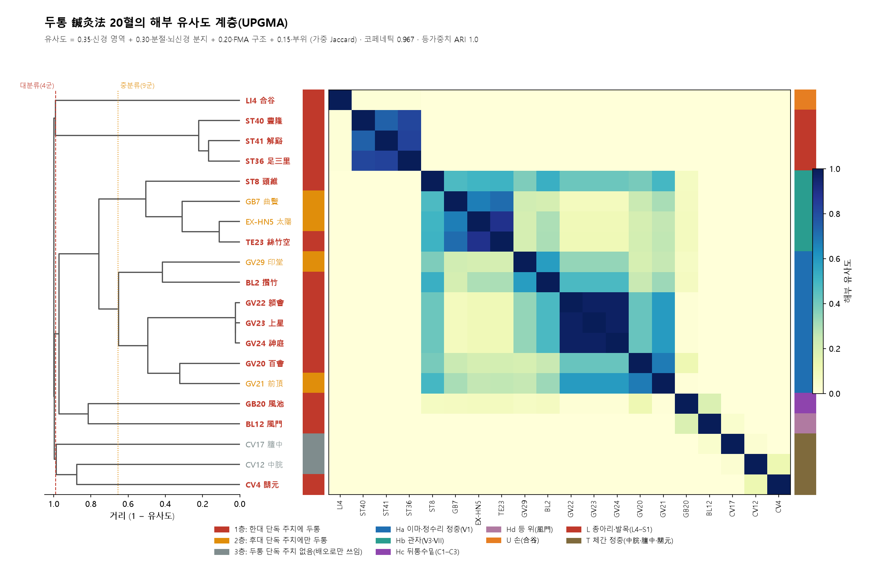
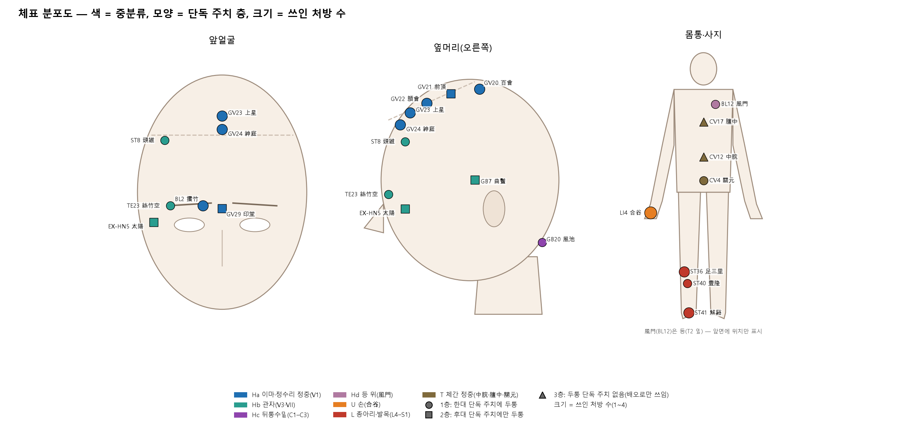
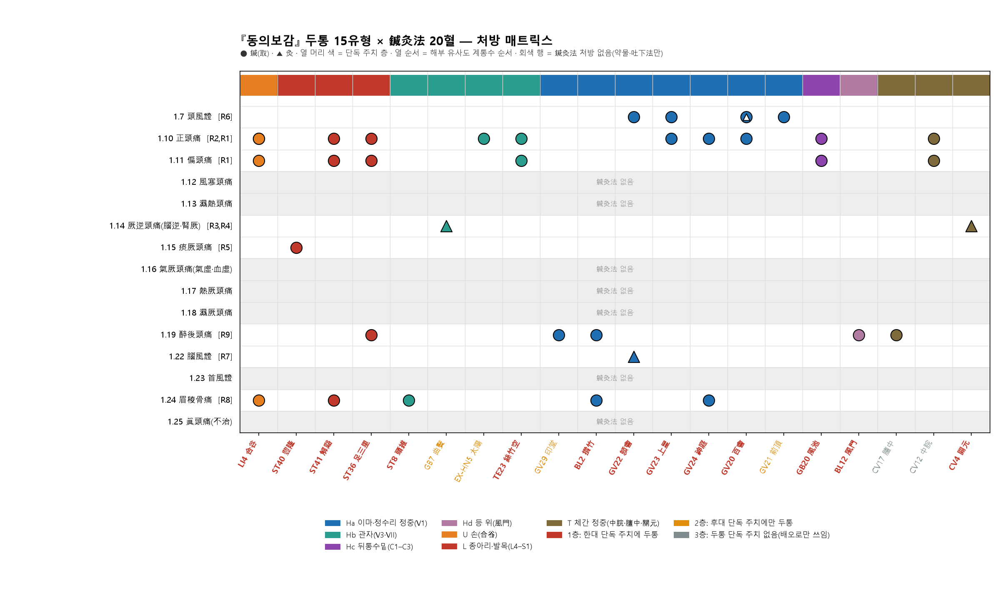
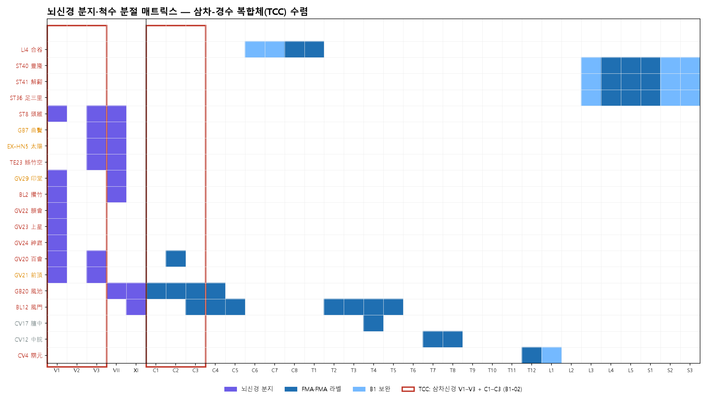
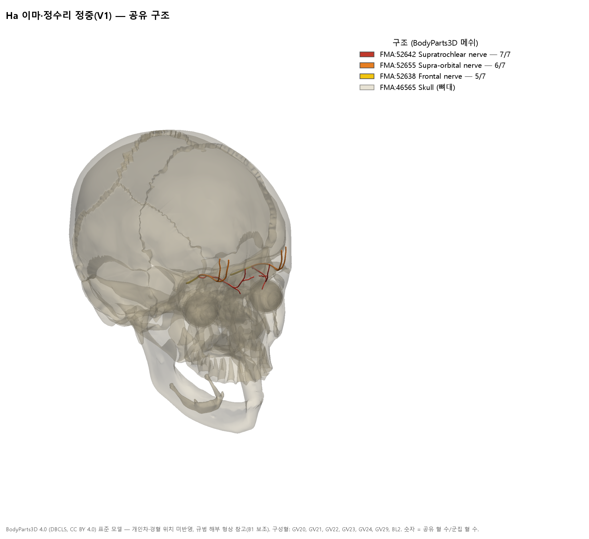
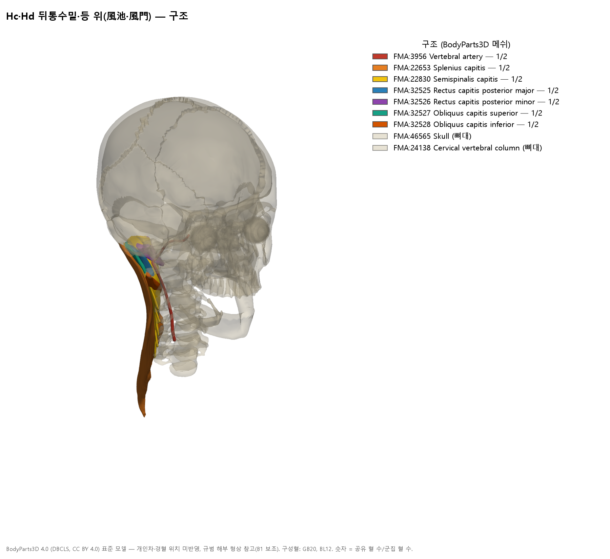
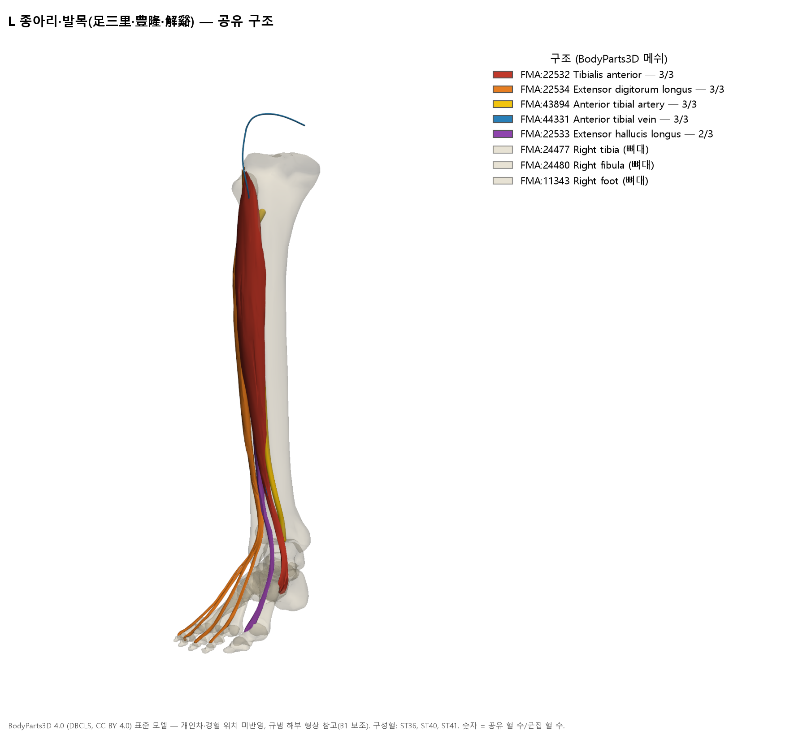

# [경혈해부] 『동의보감』 두통 침구해부 종합보고서 — 원문 재구성·단독 주치 층·해부 유사도 층위·삼차-경수 수렴

> **프레임워크**: v2.7 · **분류**: Category 4 증상별 침구해부 임상 매트릭스 · **판**: 전면 재분석판(2026-10-25). 구판 산출물 29건은 구판 보관본(내부)에 보관했고 12절에 감사 결과를 적었다.
> **적용 범위**: Rank 0~6. Rank 7 ARI는 **미산정**이다(20혈 처방 매트릭스이므로 개별 혈 ARI는 Category 1 보고서에서 산정).
> **1차 원문**: 『동의보감』 外形篇 卷之一 頭 1.7~1.25절과 1.33절 【鍼灸法】(L557·L563)
> **3대 원전**:
> - 《中国针灸证治通鉴》 「十九、头痛」(`中国针灸证治通鉴_16_…md` L580~954): 처방 출전 추적
> - 《针灸腧穴通考》 【适应症】: 경혈별 단독 주치 층 판정
> - 《中国针灸穴位通鉴》: 대조
>
> **해부 근거**: FMA 5.1.0(FMA 프로파일 조회), 2대 교재 대응표, B1 규범 해부(B1-01·B1-02·B1-03) · 3D: BodyParts3D 4.0(B1 보조)
> **Layer A**: 통합 DB(2026-10-25 상태) 연결 논문, PubMed 메타데이터 대조. 통합 DB 동기화(외부 검색)는 실행하지 않았다(**외부 검색 미완**).
> **데이터시트**: 동의보감 두통 침구해부 임상 매트릭스 분석 데이터북 (11시트) · 재현 스크립트: 내부 보관

---

## 0. 요약

1. 『동의보감』 頭 편의 두통 항목은 **15개 절**과 六經 분류(1.21) 하나로 이루어진다. 이 가운데 1.33 【鍼灸法】에 침구 처방이 있는 절은 **8개**(頭風·正頭痛·偏頭痛·厥逆·痰厥·醉後·腦風·眉稜骨痛)뿐이다. 나머지 7개 절(風寒·濕熱·氣厥·熱厥·濕厥·首風·眞頭痛)은 약물·吐法·下法만 쓰거나 不治로 다룬다. 구판의 16유형은 이 원문 구조와 맞지 않았다(12절).
2. 鍼灸法의 두통 처방은 9개이고 쓰인 경혈은 **20혈**이다. 거의 모두 《醫學綱目》을 거쳐 원대 《鍼灸集成》, 《鍼經摘英集》, 《丹溪心法》, 《鍼灸資生經》, 《普濟本事方》에서 왔다(《證治通鑑》에서 행 단위로 추적했다). 醉後頭痛 처방은 《鍼灸集成》의 "中脘…胆中"에서 中脘이 빠지고 胆中이 膻中으로 바뀐 형태다.
3. 《通考》 기준 단독 주치($P_{single}$) 층은 다음과 같다.
   - **1층 14혈**: 한대 단독 주치에 두통이 있다.
   - **2층 4혈**: 前頂·印堂·太陽·曲鬢. 후대 문헌에만 두통이 있다.
   - **3층 2혈**: 中脘·膻中. 어느 시대에도 두통 단독 주치가 없고 배오로만 쓰인다.
4. 해부 유사도 층위(UPGMA)는 **코페네틱 상관 0.967**이고 등가중치 ARI는 1.000이다.
   - **대분류 4군**: 머리·목 13혈, 손(合谷), 하지 3혈, 체간 정중 3혈
   - **중분류 9군**: 머리·목이 이마·정수리 정중(V1) 7혈, 관자(V3·VII) 4혈, 뒤통수밑(風池), 등 위(風門)로 나뉜다.
   - 머리 혈 11혈과 風門은 모두 **삼차-경수 복합체(TCC: V1–V3 + C1–C3)** 영역에 든다. 반면 원위·체간 7혈은 TCC와 겹치지 않는다(B1-02).
5. 처방 안의 해부 응집도는 頭風頭痛 0.61(정수리·앞머리 4혈), 正頭痛 0.22, 眉稜骨痛 0.14, 偏正頭痛·醉後頭痛 0.06 순이다. 『동의보감』 처방은 해부적으로 한 영역을 겨누는 '국소 혈'과 해부적으로 무관한 '원위·체간 혈'(合谷·解谿·足三里·中脘·膻中·關元)을 섞는 구조다.
6. Layer A는 혈위 수준 두통 근거가 거의 없다(경혈별 0~5편, 대부분 일반 종설). 침 치료 전체로 보면 PubMed에 따라 Cochrane 고찰이 편두통·긴장형 두통에서 효과를 보고하지만, 가짜침 대비 차이는 작다(DB 미병합). 혈위 특이성은 **가설**로 둔다.

---

## 1. 『동의보감』 두통 원문 구조 (Rank 1·3)

| 절 | 유형 | 정의 원문(첫 문장, `동의보감_030` 행) | 鍼灸法 |
| :-- | :-- | :-- | :-- |
| 1.7 | 頭風證 | 頭風之證素有痰飮或櫛沐取凉或久卧當風以致賊風入腦入項自頸以上耳目口鼻眉稜之間有麻痺不仁之處或頭重或頭暈或頭皮頑厚不自覺知或口舌不仁不知食味或… (L39) | R6 |
| 1.10 | 正頭痛 | 凡手之三陽從手走頭足之三陽從頭走足是手與足六陽之脉俱上于頭面也(靈樞)… (L189) | R2 (+R1) |
| 1.11 | 偏頭痛 | 偏頭痛者頭半邊痛者是也(丹心)… (L213) | R1 (+阿是穴) |
| 1.12 | 風寒頭痛 | 風寒傷上邪從外入客於經絡令人振寒頭痛或風寒之邪伏留陽經爲偏正頭痛宜三五七散芎辛湯芎芷香蘇散(方見寒門)… (L225) | 없음(약물·吐下法만) |
| 1.13 | 濕熱頭痛 | 心煩頭痛者病在膈中乃濕熱頭痛也宜清空膏小清空膏又用吐法(方見下)… (L239) | 없음(약물·吐下法만) |
| 1.14 | 厥逆頭痛 | 當有所犯大寒內至骨髓髓者以腦爲主腦逆故令頭痛齒亦痛乃厥逆頭痛也宜羌活附子湯 厥者逆也邪氣逆上陽經而作痛甚則發厥頭痛齒亦痛宜白附子散 厥頭痛卽… (L251) | R3 腎厥 · R4 齒亦痛 |
| 1.15 | 痰厥頭痛 | 頭痛每發時兩頰青黃眩運目不欲開懶於言語身體沈重兀兀欲吐此厥陰太陰合病名曰痰厥頭痛宜服局方玉壺丸及半夏白朮天麻湯(東垣)… (L269) | R5 |
| 1.16 | 氣厥頭痛 | 氣血虛而邪氣逆上爲頭痛 頭痛耳鳴九竅不利兩大陽穴痛甚乃氣虛頭痛也宜順氣和中湯黃芪益氣湯 血虛頭痛自魚尾上攻而爲痛宜當歸補血湯加味四物湯眉尖後… (L299) | 없음(약물·吐下法만) |
| 1.17 | 熱厥頭痛 | 治頭痛煩熱雖冬天大寒猶喜風寒其痛暫止略來煖處或見烟火則其痛復作宜清上瀉火湯防風散(東垣)… (L333) | 없음(약물·吐下法만) |
| 1.18 | 濕厥頭痛 | 冒雨傷濕頭重眩痛遇陰雨則甚宜芎辛湯(方見上)… (L345) | 없음(약물·吐下法만) |
| 1.19 | 眞頭痛 / 醉後頭痛 | 詳見下不治類 **醉後頭痛** 詳見內傷門… (L353) | R9 (醉後) |
| 1.21 | 頭痛當分六經 | 凡頭痛皆以風藥治之者高巓之上惟風可到故總其大體而言之也然亦有三陽三陰之異焉 太陽頭痛惡風寒脉浮緊宜羌活獨活麻黃川芎之類 少陽頭痛往來寒熱脉弦… (L357) | 없음(약물·吐下法만) |
| 1.22 | 腦風證 | 風氣循風府項背怯寒腦戶(穴名穴名)… (L367) | R7 |
| 1.23 | 首風證 | 新沐中風則爲首風其證頭面多汗惡風當先風一日則病甚頭痛不可出內至其風日則病少愈(內經)… (L379) | 없음(약물·吐下法만) |
| 1.24 | 眉稜骨痛 | 眉心並眉梁骨痛者痰也二陳湯(方見痰飮)… (L391) | R8 |
| 1.25 | 頭痛不治難治證 | 眞頭痛者頭痛甚腦盡痛手足寒至節死不治(靈樞)… (L405) | 없음(약물·吐下法만) |

- 1.20절 번호는 원문에 없다(1.19 다음이 1.21). 醉後頭痛은 1.19절 안에서 "詳見內傷門"으로만 나오고, 鍼灸法에 처방이 있다.
- 1.14 厥逆頭痛에는 **腦逆**("髓者以腦爲主腦逆故令頭痛齒亦痛")과 **腎厥**("厥頭痛卽腎厥巓頂痛不可忍宜玉眞丸")이 모두 들어 있다. 구판처럼 '뇌역두통'·'신궐두통'을 따로 세울 근거가 없다.
- 1.16 氣厥頭痛 안에 氣虛頭痛("兩大陽穴痛甚")·血虛頭痛("自魚尾上攻")·氣血俱虛가 하위 기술로 있다.

## 2. 鍼灸法 처방과 출전 추적 (Rank 1·2·3)

| ID | 대상 | 방법 | 경혈 | 표기 | 3대 원전 추적 | 응집도 | TCC | 1층 |
| :-- | :-- | :-- | :-- | :-: | :-- | :-: | :-: | :-: |
| R1 | 偏正頭痛 | 取(鍼) | 絲竹空·風池·合谷·中脘·解谿·足三里 | 綱目 | 《针灸集成》 偏正头风：中脘、风池、三里、合谷、丝竹空、解溪 — 证治通鉴_16 L746 | 0.062 | 2/6 | 5/6 |
| R2 | 正頭痛 | 取(鍼) | 百會·上星·神庭·太陽·合谷 | 綱目 | 《针灸集成》 正头风大痛及脑痛：神庭、合谷、太阳、上星、百会 — 证治通鉴_16 L734 | 0.223 | 4/5 | 4/5 |
| R3 | 腎厥頭痛 | 灸 百壯 | 關元 | 資生 | 《普济本事方》 肾厥…更灸关元穴百壮 — 证治通鉴_16 L618 | — | 0/1 | 1/1 |
| R4 | 厥逆頭痛 齒亦痛 | 灸 七壯 | 曲鬢 | 資生 | 3대 원전 미검출(《资生经》 원서 미대조) | — | 1/1 | 0/1 |
| R5 | 痰厥頭痛 | 取(鍼) | 豊隆 | 綱目 | 《针经摘英集》 治风痰头痛，刺足阳明经丰隆 — 证治通鉴_16 L658 | — | 0/1 | 1/1 |
| R6 | 頭風頭痛 | 鍼 百會 / 灸 顖會·前頂·上星·百會 | 百會·顖會·前頂·上星 | 丹心 | 《丹溪心法·头风》 宜灸囟会、百会、前顶、上星 — 证治通鉴_16 L718 | 0.612 | 4/4 | 3/4 |
| R7 | 腦痛·腦旋·腦瀉·腦熱·腦冷 | 灸 | 顖會 | 資生 | 《针灸资生经·脑痛·脑风》 凡脑痛、脑旋、脑泻先宜灸囟会 — 证治通鉴_16 L632 | — | 1/1 | 1/1 |
| R8 | 眉稜骨痛 | 取(鍼) | 攢竹·合谷·神庭·頭維·解谿 | 綱目 | 《医学纲目·头风痛》 眉攒内痛：解溪 / 眉间痛：攒竹·头维 / 眉棱骨痛：攒竹·合谷·神庭 — 证治通鉴_16 L794–796 | 0.142 | 3/5 | 5/5 |
| R9 | 醉後頭痛 | 取(鍼) | 印堂·攢竹·足三里·風門·膻中 | 綱目 | 《针灸集成》 醉头风痛：中脘、风门、三里、印堂、攒竹、胆中 — 证治通鉴_14 L1265 (동의보감은 中脘 누락, 胆中→膻中) | 0.062 | 3/5 | 3/5 |

*응집도 = 처방 구성혈 쌍의 평균 해부 유사도(1혈 처방은 —). TCC = 삼차신경 V1–V3 또는 C1–C3 분지를 가진 혈 수. 1층 = 단독 주치 1층 혈 수.*

나머지 鍼灸法 기록:
- **R10** "一老婦久患頭痛…手足有血絡皆紫黑…刺出血如墨汁後刺受病之經": 《綱目》 표기이나 3대 원전에서는 찾지 못했다.
- **R11** "偏頭痛及正頭痛取阿是穴": 阿是穴 처방이다.
- **眩暈 처방 2건**(神庭·上星·顖會·前頂·後頂·腦空·風池·陽谷·大都·至陰·金門·申脉·足三里 / 百會·上星·風池·豊隆)은 두통 처방이 아니므로 매트릭스에서 뺐다. xlsx `2_鍼灸法_처방`에 참고로 실었다.

**Rank 3·4 판정**
- **太陽**: 《通考》 太阳(EX-HN5) 名實考(`针灸腧穴通考_25_…md` L309~L323)에 따르면, 《千金》 주석 이래 "瞳子窌，一名太阳"이었고 원·명초 《鍼灸集成》은 太陽과 瞳子髎를 같은 혈로 썼다. 正頭痛 처방(R2)의 太陽은 《鍼灸集成》에서 왔으므로 경외기혈 太陽으로 표기하되, 해부는 瞳子髎(GB1) FMA 프로파일로 대신했다.
- **醉後頭痛(R9)**: 출전 《鍼灸集成》은 "中脘、风门、三里、印堂、攒竹、胆中"이다(`证治通鉴_14` L1265). 『동의보감』은 中脘을 빠뜨리고 "胆中"을 "膻中"으로 적었다. 胆中이 膻中의 이체 표기인지 오기인지는 3대 원전에서 판정할 수 없어 『동의보감』 표기를 따랐다.
- **正頭痛 = 腎厥**: 《鍼灸集成》은 "端的正头风十死，又名肾厥头痛"이라고 적는다(L738). 『동의보감』은 正頭痛(1.10)과 腎厥(1.14)을 다른 절에 두었다.

## 3. 경혈별 두통 단독 주치 층 (Rank 3·4, 10대 요소 ⑨)

증상군: H1 頭痛·頭風·腦痛·頂上痛 / H2 偏頭·頭角 / H3 眉稜·眉頭 / H4 頭重·眩 / H5 項強. 1층은 한대(《黃帝明堂經》·《黃帝內經明堂》) 단독 주치에 H1~H3 중 하나 이상이 있는 혈이다. 후대 조문 가운데 《通考》 按語가 오록·경맥병후 전재로 지목한 것은 뺐다(전 조문은 xlsx `4_두통_근거조문`).

| 층 | 코드 | 혈명 | 한대 단독 | 후대 단독 | 대표 근거(《通考》 행·출전·적중어) |
| :-: | :-- | :-- | :-- | :-- | :-- |
| 1층 | GV20 | 백회 百會 | H1·H4 | H1·H4 | L797 《黄帝明堂经》 “顶上痛/头重”; L803 《太平圣惠方·针经》 “头风/头重” |
| 1층 | GV23 | 상성 上星 | H1·H4 | H1·H4 | L1511 《黄帝明堂经》 “头痛/眩”; L1513 《太平圣惠方·针经》 “头风/头痛” |
| 1층 | GV24 | 신정 神庭 | H1·H4 | H1·H4 | L1737 《黄帝明堂经》 “头痛/眩”; L1743 《铜人腧穴针灸图经》卷中 “头风/眩” |
| 1층 | GV22 | 신회 顖會 | H1·H4 | H1·H4 | L1281 《黄帝明堂经》 “头痛/眩”; L1287 《太平圣惠方·针经》 “头风” |
| 1층 | TE23 | 사죽공 絲竹空 | H1·H4 | H1·H4 | L4003 《黄帝明堂经》 “头痛/眩”; L4011 《铜人腧穴针灸图经》卷中 “头痛/眩” |
| 1층 | GB20 | 풍지 風池 | H1·H5 | H1·H2·H4·H5 | L3295 《黄帝明堂经》 “头痛/颈项痛”; L3303 《铜人腧穴针灸图经》卷中 “头痛/眩/颈项痛” |
| 1층 | BL2 | 찬죽 攢竹 | H1·H3·H4·H5 | H1·H3·H4 | L613 《黄帝明堂经》 “头痛/眉头/眩/项强”; L631 《循经考穴编》上 “头风/眉棱” |
| 1층 | ST8 | 두유 頭維 | H1 | H1·H4 | L1595 《黄帝明堂经》 “头痛”; L1603 《窦太师针经》 “头风” |
| 1층 | BL12 | 풍문 風門 | H1·H4 | H1·H4·H5 | L2223 《黄帝明堂经》 “头痛/眩”; L2227 《太平圣惠方·针经》 “项强” |
| 1층 | LI4 | 합곡 合谷 | H1 | H1·H5 | L793 《黄帝明堂经》 “头痛”; L799 《铜人腧穴针灸图经》卷下 “头痛” |
| 1층 | ST41 | 해계 解谿 | H1·H4 | H1·H3·H4 | L1689 《黄帝明堂经》 “头眩痛/眩”; L1695 《铜人腧穴针灸图经》卷下 “头痛/头风/眩” |
| 1층 | ST36 | 족삼리 足三里 | H1 | — | L341 《黄帝明堂经》 “头痛” |
| 1층 | ST40 | 풍륭 豊隆 | H1 | H1·H4 | L1471 《黄帝明堂经》 “头痛”; L1477 《铜人腧穴针灸图经》卷下 “头痛” |
| 1층 | CV4 | 관원 關元 | H1·H4 | — | L773 《黄帝明堂经》 “头眩痛/眩” |
| 2층 | GV21 | 전정 前頂 | H4 | H1·H4 | L1105 《黄帝明堂经》 “眩”; L1107 《铜人腧穴针灸图经》 “头风/眩” |
| 2층 | GV29 | 인당 印堂 | — | H1·H4 | L2627 《窦太师针经》 “头重” |
| 2층 | EX-HN5 | 태양 太陽 | — | H1·H2·H4 | L343 《太平圣惠方·针经》 “头痛/眩” |
| 2층 | GB7 | 곡빈 曲鬢 | — | H1·H5 | L1335 《太平圣惠方·明堂》 “项急” |
| 3층 | CV12 | 중완 中脘 | — | — | 두통 조문 없음 |
| 3층 | CV17 | 전중 膻中 | — | — | 두통 조문 없음 |

- **百會**는 『동의보감』 두통 처방에 가장 많이 쓰였다(R2·R6). 그런데 한대 주치에는 "顶上痛，风头重"만 있고 "頭痛"이라는 말은 송대 《太平聖惠方》 "头风"부터 나온다. 이 보고서는 "顶上痛"을 H1로 계산했다.
- **中脘·膻中**은 두통 단독 주치가 전혀 없고 偏正頭痛·醉後頭痛 처방에서만 쓰였다. **關元**은 한대 주치 "头眩痛"이 있으나, 腎厥頭痛 灸法의 출전은 《普濟本事方》이다.
- **曲鬢**은 『동의보감』 R4("厥逆頭痛齒亦痛 灸曲鬢")의 근거가 될 단독 주치가 송대 "颈项急强…引牙齿痛"(《聖惠方》)뿐이다. 4~7판 교재의 "头痛连齿"는 『동의보감』·《資生經》 계통 처방이 교재 주치로 옮겨진 것으로 보인다(작성 시 판단).

## 4. 해부 유사도 방법 (Rank 5 · FMA 5-1절)

- **입력**: 20혈마다 FMA 프로파일 조회를 실행했다.
  - 印堂(GV29)은 2대 교재 데이터셋에 없어 B1 수작업 대응을 썼다(B1-01·B1-03): 눈살근 FMA:46769, 눈썹주름근 46794, 도르래위신경 52642, 도르래아래신경 52693, 도르래위동맥 50025·정맥 50898, 코등동맥 50000.
  - 太陽은 瞳子髎(GB1) 프로파일로 대신했다(2절).
- **특징과 가중치**(잠정):
  - N 신경 영역 0.35
  - G 분절 + 뇌신경 분지 0.30: V1·V2·V3·VII·XI를 분절과 같은 축에 둔다.
  - S FMA 구조 0.20
  - R 부위·구획 0.15
- **분지·분절 대응**:
  - V1: 눈신경·이마신경·눈확위·도르래위·도르래아래
  - V2: 광대관자
  - V3: 아래턱신경·귓바퀴관자
  - 상부 경신경: 뒤통수밑신경 C1, 큰뒤통수 C2, 작은뒤통수 C2–C3 (B1-01·B1-02)
  - 그 밖에 FMA 분절이 없는 말초신경은 B1 대표 분절로 보완했다.
  - 다분절 근육(FMA 고유 분절 5개 이상)은 신경·분절 특징에서 뺐다.
- **군집과 안정성**: UPGMA(거리 = 1 − 유사도)로 군집했다. 코페네틱 상관은 **0.967**, 실루엣 최적 k는 6이다. 등가중치에서도 같은 k로 군집이 일치했다(**ARI 1.000**).

## 5. 층위 결과 — 대분류 4 · 중분류 9 · 소분류 12 (10대 요소 ④⑥)

*그림 2. 계통수(왼쪽)와 그 순서로 정렬한 유사도 행렬. 왼쪽 띠는 단독 주치 층, 오른쪽 띠는 중분류다.*

| 코드 | 혈명 | 주치 층 | 대분류(4) | 중분류(9) | 소분류(12) | 뇌신경 분지 | TCC | 분절 | 가장 가까운 3혈 |
| :-- | :-- | :-: | :-- | :-- | :-- | :-- | :-- | :-- | :-- |
| LI4 | 合谷 | 1층 | U 손(合谷) | U 손(合谷) | 合谷 단독 | — | — | C6,C7,C8,T1 | ST36(0.01); ST40(0.01); ST41(0.01) |
| ST40 | 豊隆 | 1층 | L 하지(足三里·豊隆·解谿) | L 하지 | L 하지(足三里·豊隆·解谿) | — | — | L3,L4,L5,S1,S2,S3,S4 | ST36(0.82); ST41(0.74); LI4(0.01) |
| ST41 | 解谿 | 1층 | L 하지(足三里·豊隆·解谿) | L 하지 | L 하지(足三里·豊隆·解谿) | — | — | L3,L4,L5,S1,S2,S3,S4 | ST36(0.83); ST40(0.74); LI4(0.01) |
| ST36 | 足三里 | 1층 | L 하지(足三里·豊隆·解谿) | L 하지 | L 하지(足三里·豊隆·解谿) | — | — | L3,L4,L5,S1,S2,S3,S4 | ST41(0.83); ST40(0.82); LI4(0.01) |
| ST8 | 頭維 | 1층 | H 머리·목 | Hb 관자(V3·VII) | 頭維 단독 | V1,V3,VII | V1,V3 | — | BL2(0.52); TE23(0.51); EX-HN5(0.50) |
| GB7 | 曲鬢 | 2층 | H 머리·목 | Hb 관자(V3·VII) | Hb1 관자(太陽·絲竹空·曲鬢) | V3,VII | V3 | — | TE23(0.71); EX-HN5(0.67); ST8(0.47) |
| EX-HN5 | 太陽 | 2층 | H 머리·목 | Hb 관자(V3·VII) | Hb1 관자(太陽·絲竹空·曲鬢) | V3,VII | V3 | — | TE23(0.89); GB7(0.67); ST8(0.50) |
| TE23 | 絲竹空 | 1층 | H 머리·목 | Hb 관자(V3·VII) | Hb1 관자(太陽·絲竹空·曲鬢) | V3,VII | V3 | — | EX-HN5(0.89); GB7(0.71); ST8(0.51) |
| GV29 | 印堂 | 2층 | H 머리·목 | Ha 이마·정수리 정중(V1) | Ha3 미간·눈썹(印堂·攢竹) | V1,VII | V1 | — | BL2(0.58); ST8(0.38); GV23(0.34) |
| BL2 | 攢竹 | 1층 | H 머리·목 | Ha 이마·정수리 정중(V1) | Ha3 미간·눈썹(印堂·攢竹) | V1,VII | V1 | — | GV29(0.58); ST8(0.52); GV23(0.48) |
| GV22 | 顖會 | 1층 | H 머리·목 | Ha 이마·정수리 정중(V1) | Ha2 앞머리 정중(上星·神庭·顖會) | V1 | V1 | — | GV23(0.97); GV24(0.97); GV21(0.59) |
| GV23 | 上星 | 1층 | H 머리·목 | Ha 이마·정수리 정중(V1) | Ha2 앞머리 정중(上星·神庭·顖會) | V1 | V1 | — | GV24(0.97); GV22(0.97); GV21(0.59) |
| GV24 | 神庭 | 1층 | H 머리·목 | Ha 이마·정수리 정중(V1) | Ha2 앞머리 정중(上星·神庭·顖會) | V1 | V1 | — | GV23(0.97); GV22(0.97); GV21(0.59) |
| GV20 | 百會 | 1층 | H 머리·목 | Ha 이마·정수리 정중(V1) | Ha1 정수리(百會·前頂) | V1,V3 | V1,V3,C2 | C2 | GV21(0.68); GV24(0.42); GV23(0.42) |
| GV21 | 前頂 | 2층 | H 머리·목 | Ha 이마·정수리 정중(V1) | Ha1 정수리(百會·前頂) | V1,V3 | V1,V3 | — | GV20(0.68); GV24(0.59); GV23(0.59) |
| GB20 | 風池 | 1층 | H 머리·목 | Hc 뒤통수밑(風池) | 風池 단독 | VII,XI | C1,C2,C3 | C1,C2,C3,C4 | BL12(0.18); GV20(0.12); TE23(0.08) |
| BL12 | 風門 | 1층 | H 머리·목 | Hd 등 위(風門) | 風門 단독 | XI | C3 | C3,C4,C5,T2,T3,T4,T5 | GB20(0.18); CV17(0.04); GV20(0.00) |
| CV17 | 膻中 | 3층 | T 체간 정중 | T 膻中 | 膻中 단독 | — | — | T4 | BL12(0.04); CV12(0.03); GV20(0.00) |
| CV12 | 中脘 | 3층 | T 체간 정중 | T 中脘 | 中脘 단독 | — | — | T7,T8 | CV4(0.12); CV17(0.03); GV20(0.00) |
| CV4 | 關元 | 1층 | T 체간 정중 | T 關元 | 關元 단독 | — | — | T12,L1 | CV12(0.12); GV20(0.00); GV23(0.00) |

*그림 4. 체표 분포 모식도(B1-05 정위의 상대 위치만, 축척 아님). 색은 중분류, 모양은 단독 주치 층(● 1층 ■ 2층 ▲ 3층), 크기는 그 혈을 쓴 처방 수다.*

**해석**
- **Ha2 앞머리 정중(上星·神庭·顖會)**은 서로 유사도가 0.97로 사실상 같은 해부 단위다(도르래위·눈확위신경 V1, 이마힘살·머리덮개널힘줄). 『동의보감』 頭風 灸法(R6)이 이 단위와 정수리(Ha1 百會·前頂)를 함께 쓰므로 R6의 응집도가 가장 높다(0.61).
- **Hb 관자(太陽·絲竹空·曲鬢·頭維)**는 귓바퀴관자신경(V3)·얼굴신경 관자가지(VII)·얕은관자동정맥·관자근을 공유한다. 偏頭痛 계열 처방의 국소 혈이 여기에 속한다.
- **Hc 風池**는 뒤통수밑근 4개, 척추동맥, 큰뒤통수신경(C2)·뒤통수밑신경(C1)을 가진 유일한 혈이다. 머리 혈 가운데 상부 경수(C1–C3) 축을 담당한다.
- **원위·체간 혈**(合谷·足三里·豊隆·解谿·中脘·膻中·關元)은 머리 혈과의 유사도가 0~0.12다. 『동의보감』 처방 안에서 이 혈들은 국소 해부가 아니라 원격 작용(《靈樞·官針》 遠道刺 계통)을 맡는다. 이 가운데 合谷·足三里·豊隆·解谿는 한대 단독 주치에 두통이 있지만, 中脘·膻中은 그렇지 않다.

## 6. 처방 매트릭스 — 유형 × 경혈 (10대 요소 ⑨)

*그림 1. 행은 『동의보감』 두통 절, 열은 20혈(그림 2 계통수 순서)이다. ● 鍼(取), ▲ 灸, 열 머리 색은 중분류, 열 이름 색은 단독 주치 층이다. 회색 행은 鍼灸法 처방이 없는 절이다. 偏正頭痛 처방(R1)은 1.10 正頭痛과 1.11 偏頭痛 행에 함께 표시했다.*

- 국소 혈만으로 이루어진 처방은 頭風頭痛(R6)·腦痛(R7)·厥逆 齒痛(R4)이다. 원위 단독 처방은 痰厥(R5 豊隆)·腎厥(R3 關元 灸)이다. 나머지 4개 처방(R1·R2·R8·R9)은 국소 + 원위 혼합이다.
- 灸法은 정수리·앞머리 정중(顖會·前頂·上星·百會)과 曲鬢·關元에 몰려 있다. 앞머리 정중의 灸法은 《資生經》(腦痛·腦旋 등 "先宜灸囟會")과 《丹溪心法》(頭風 經年不愈) 계통이다.

## 7. 삼차-경수 복합체(TCC) 수렴 — B-Check ② 관점 (Rank 6, 10대 요소 ⑧)

*그림 3. 행은 20혈(계통수 순서)이다. 보라는 뇌신경 분지, 진한 파랑은 FMA 분절, 옅은 파랑은 B1 보완 분절이다. 빨간 상자 두 개가 TCC(V1–V3, C1–C3)다.*

두개 내 통증 감수 구조(경막·경막 혈관)의 구심 섬유는 주로 V1(앞·가운데 머리뼈우묵)과 C1–C3(뒤머리뼈우묵)로 들어가, 삼차신경 척수핵 꼬리아핵과 C1–C3 후각, 곧 삼차-경수 복합체에서 수렴한다(B1-02 규범 신경해부). 이 수렴 때문에 두피·목의 체성 구심과 두개 내 통증이 같은 2차 뉴런을 공유한다. 이것을 분절 정합(B-Check ②)의 두통판 기준으로 삼았다.

| 층위 | 혈 수 | TCC 분지 | 판정 |
| :-- | :-: | :-- | :-- |
| Ha 이마·정수리 정중 | 7 | V1 7/7(百會·前頂은 V3·C2 추가) | 분절 정합 **높음**: 앞머리뼈우묵 경막과 같은 V1 |
| Hb 관자 | 4 | V3 4/4, 頭維 V1 | 정합 있음: V3(귓바퀴관자)는 가운데 머리뼈우묵 경막 일부와 같은 분지 |
| Hc 風池 | 1 | C1·C2·C3 | 정합 **높음**: 뒤머리뼈우묵 경막과 같은 상부 경수 |
| Hd 風門 | 1 | C3(+T2–T5) | 경계 |
| U 合谷 · L 하지 · T 체간 | 7 | 없음 | 정합 **없음**: 원격 작용은 분절로 설명되지 않는다. 미만성 유해억제조절(B3-08) 같은 비분절 기전이 후보다 |

- 이 판정은 규범 해부(B1)의 분절 겹침만 본 것이다. 경혈 자극이 실제로 TCC 2차 뉴런을 조절한다는 인체 근거(B-Check ③~⑥)는 이 보고서에서 채점하지 않았다.
- V2 열은 비어 있다. 太陽·絲竹空 부위에 흔히 기술되는 광대관자신경(V2)이 2대 교재 대응표에서 V3·VII로만 잡혔기 때문이다(교재 기재 범위의 한계).

## 8. Layer A · Layer B

| 코드 | DB 연결(active) | 두통 관련 | 비고 |
| :-- | :-: | :-: | :-- |
| GV20 百會 | 61 | 2 | papers.id 795 1975 |
| GV23 上星 | 9 | 0 | — |
| GV24 神庭 | 12 | 1 | papers.id 795 |
| GV22 顖會 | 0 | 0 | — |
| GV21 前頂 | 4 | 0 | — |
| GV29 印堂 | 0 | 0 | — |
| EX-HN5 太陽 | 0 | 0 | — |
| TE23 絲竹空 | 2 | 0 | — |
| GB20 風池 | 8 | 1 | papers.id 795 |
| GB7 曲鬢 | 0 | 0 | — |
| BL2 攢竹 | 36 | 5 | papers.id 795 1983 1985 1998 2007 |
| ST8 頭維 | 0 | 0 | — |
| BL12 風門 | 6 | 1 | papers.id 795 |
| LI4 合谷 | 118 | 5 | papers.id 97 2297 2304 2308 795 |
| ST41 解谿 | 4 | 0 | — |
| ST36 足三里 | 171 | 2 | papers.id 97 795 |
| ST40 豊隆 | 5 | 1 | papers.id 795 |
| CV12 中脘 | 26 | 1 | papers.id 795 |
| CV17 膻中 | 13 | 1 | papers.id 795 |
| CV4 關元 | 45 | 1 | papers.id 795 |

- 통합 DB의 혈위 연결 논문 가운데 두통 관련은 경혈별 0~5편이다. papers.id 795(2009 일반 종설)가 대부분 혈에 공통으로 걸린다. 攢竹의 5편 중 3편은 삼차신경통·안구 통증 연구다(papers.id 1983·1985·1998).
- **DB 미병합 — PubMed 확인**:
  - 편두통 예방 Cochrane 고찰(22 RCT, 4,985명): 가짜침 대비 두통 빈도 SMD −0.18로 효과가 작다(PMID 27351677, [DOI](https://doi.org/10.1002/14651858.CD001218.pub3)).
  - 긴장형 두통 Cochrane 고찰(12 RCT): 가짜침 대비 50% 이상 반응률 51% 대 43%였다(PMID 27092807, [DOI](https://doi.org/10.1002/14651858.CD007587.pub2)).

  두 고찰 모두 혈위가 시험마다 달라, 『동의보감』 처방 혈의 특이 효과를 직접 보여 주지 않는다. 진침과 가짜침의 차이가 작다는 점은 B4-04(Vickers 2018 IPD, 두통 포함 만성통증)·B4-05(혈위 특이성 논쟁)와 같은 방향이다.
- **Layer B**: 등록부에 두통·TCC 전용 항목은 없다. TCC 수렴은 B1-02, 원격 작용 후보는 B3-08(DNIC, 마취 쥐)로 유추 수준(1점 상한)이다.

## 9. 3D 해부 이미지 (BodyParts3D 4.0, B1 보조)

군집 안에서 2혈 이상(2혈 군집은 1혈 이상)이 공유하는 FMA 구조 가운데 메쉬가 있는 것만 그렸다. BodyParts3D에는 관자 부위 연부조직(관자근·얕은관자동맥·귓바퀴관자신경 등) 메쉬가 없어 Hb 관자 3D는 그리지 못했다.

*그림 5-1. Ha 이마·정수리 정중(7혈): 도르래위신경 7/7, 눈확위신경 6/7, 이마신경 5/7(모두 V1). 머리뼈는 반투명이다.*

*그림 5-2. 風池·風門: 그려진 구조(척추동맥·머리널판근·머리반가시근·큰/작은뒤머리곧은근·위/아래머리빗근)는 모두 風池의 구조다(風門 구조는 메쉬 없음).*

*그림 5-3. 足三里·豊隆·解谿: 앞정강근·긴발가락폄근·긴엄지폄근·앞정강동정맥.*

## 10. 종합 결론

1. 『동의보감』 두통 鍼灸法은 15개 절 가운데 8개 절에 9개 처방, 20혈로 구성된다. 처방은 《醫學綱目》이 원대 《鍼灸集成》 등을 옮긴 것이다. 따라서 『동의보감』 고유의 침구 판단이라기보다 원·명 처방집의 선별 수록으로 읽어야 한다.
2. 20혈 가운데 14혈은 한대 단독 주치에 두통이 있다. 4혈(前頂·印堂·太陽·曲鬢)은 후대 문헌에서야 두통이 붙는다. 中脘·膻中은 두통 단독 주치가 전혀 없는 배오 혈이다.
3. 해부적으로 보면 머리 혈은 이마·정수리(V1), 관자(V3·VII), 뒤통수밑(C1–C3)의 세 축으로 갈리고, 셋 모두 삼차-경수 복합체로 수렴한다. 원위·체간 혈은 이 축과 해부적으로 무관하다. 그러므로 『동의보감』 두통 처방은 **'TCC 영역 국소 혈 + 분절과 무관한 원위 혈'**의 혼합 구조다.
4. 혈위 특이 효과의 인체 근거는 약하다(Cochrane: 가짜침 대비 작은 효과). 위 해부 층위는 처방 구조를 설명하는 틀일 뿐, 효과 판정은 **가설**로 둔다.

**한계**
- 증상군 대조는 정규식에 의존한다(예: "头眩痛"을 두통으로 계산).
- 太陽은 瞳子髎로 대신했고, 印堂은 B1 수작업 대응이라 교재 기반 다른 혈과 기재 밀도가 다르다.
- 가중치는 잠정값이다(등가중치 민감도는 통과).
- 《醫學綱目》·《鍼灸資生經》 원서는 직접 대조하지 않았다(《證治通鑑》 인용으로만 확인). 특히 R4(曲鬢 灸)와 R10(血絡 刺血)의 출전은 찾지 못했다.

## 11. 산출물·재현

| 파일 | 내용 |
| :-- | :-- |
| 종합보고서(한국어·영어) | 이 보고서 |
| 동의보감 두통 침구해부 임상 매트릭스 데이터북 | 1 두통 유형 · 2 鍼灸法 처방 · 3 단독 주치 층 · 4 근거 조문 · 5 FMA 해부 특징 · 6 유사도 행렬 · 7 층위 · 8 Layer A · 9 구판 감사(인용) · 10 구판 감사(유형·경혈) · 11 방법 |
| 그림 Fig1~Fig5 | 그림 7종 × 2개 언어 |
| 분석 스크립트(내부) | 단독 주치 파싱(Rank 1~4) → 유사도·층위·TCC → 그림·3D 렌더링 → 데이터북 작성 · 구판 감사. 단독 주치 파싱은 영추경맥 수태음시동병 매트릭스의 파싱 결과를 쓴다 |
| 구판 보관본(내부) | 구판 산출물 29건(HTML 대시보드·9×36 격자 그림·xlsx 2종·zip) — 수정 없이 보관 |

## 12. 구판(2026-10-24 이전) 감사

**유형 체계.** 구판 16유형을 원문 절과 대조한 결과는 다음과 같다(xlsx `10_구판감사_유형·경혈`).
- 원문 절과 그대로 일치하는 유형은 6개다: 편두통·궐역·담궐·기궐·진두통·두풍증. 습열두통도 이름은 1.13과 같다.
- 열두통·습두통은 원문 절 이름이 각각 熱厥頭痛·濕厥頭痛이다.
- 뇌역·신궐·혈궐·기허·혈허는 별도 절이 아니라 1.14·1.16 안의 하위 기술이다. 풍두통은 해당 절이 없다.
- 반대로 원문의 正頭痛(1.10)·六經(1.21)·腦風(1.22)·首風(1.23)·眉稜骨痛(1.24)이 빠져 있었다.
- 구판 궐역두통의 "손발 冷" 서술은 1.14에 없고, 1.14의 정의는 "大寒內至骨髓…頭痛齒亦痛"이다.

**경혈.** 구판 41혈(중복 제외) 가운데 『동의보감』 頭 편 鍼灸法에 실제로 나오는 혈은 13혈이다.
- **구판에만 있는 28혈**: 風府·湧泉·太衝·腎兪·水溝·十宣·率谷·角孫·懸顱·懸釐·通天·天柱·崑崙·氣海·膈兪·三陰交·血海·內庭·曲池·陰陵泉·大椎·水分·內關·外關·命門·脾兪·胃兪·懸鍾. 원문에 없는 혈이다.
- **원문에 있는데 구판에 없던 7혈**: 顖會·神庭·印堂·解谿·曲鬢·風門·膻中.

**원전 인용.** 구판 xlsx 2종과 HTML 2종의 《書名》 "인용문" 24건을 3대 원전과 『동의보감』 정제본(간체 정규화)에서 대조했다.
- **일치 2건**
- **부분 9건**: 4자 조각 60% 이상 일치. 축약·변형이거나 다른 문장의 짜깁기일 가능성이 있다.
- **미검출 13건**

부분·미검출 22건은 직접 인용으로 쓸 수 없어 신판에서는 모두 버렸다. 예를 들어 "《明堂經》 '主偏頭痛 熱病'"은 絲竹空의 한대 주치에 없다.

| 판정 | 서명 | 구판 인용문 | 최고 일치 문헌(4자 조각 일치율) |
| :-: | :-- | :-- | :-- |
| 일치 | 《明堂經》 | 風到腦中寒 | 중국침구혈위통감(中国针灸穴位通鉴) |
| 일치 | 《扁鵲心書》 | 患頭風兼頭暈者 刺風府穴 | 중국침구증치통감(中国针灸证治通鉴) |
| 부분 | 《素問·刺熱》 | 病始頭首者 先取項太陽(天柱) | 중국침구증치통감(中国针灸证治通鉴) (78%) |
| 부분 | 《明堂經》 | 主偏頭痛 熱病 | 중국침구혈위통감(中国针灸穴位通鉴) (67%) |
| 부분 | 《靈樞·雜病》 | 厥頭痛 取足少陰·厥陰 | 동의보감 (67%) |
| 부분 | 《明堂經》 | 主風頭痛 眉頭痛 | 침구수혈통고(针灸腧穴通考) (75%) |
| 부분 | 《素問·臟氣法時論》 | 厥陰氣逆則頭痛 | 동의보감 (75%) |
| 부분 | 《靈樞·海論》 | 髓海不足 則腦轉耳鳴 脛酸眩冒 | 동의보감 (100%) |
| 부분 | 《針灸治療學》 | 血虛頭痛 取上星·血海·足三里·三陰交 | 중국침구증치통감(中国针灸证治通鉴) (67%) |
| 부분 | 《針灸聚英》 | 濕寒濕熱下定 | 중국침구혈위통감(中国针灸穴位通鉴) (67%) |
| 부분 | 《靈樞·官針》 | 遠道刺者 病在上 取之下 刺腑也 | 중국침구증치통감(中国针灸证治通鉴) (90%) |
| 미검출 | 《明堂經》 | 主頭項惡風, 風眩目痛 | 중국침구증치통감(中国针灸证治通鉴) (50%) |
| 미검출 | 《千金要方》 | 主頭風, 頭重風勞 | 중국침구혈위통감(中国针灸穴位通鉴) (50%) |
| 미검출 | 《千金要方》 | 偏頭痛 刺絲竹空 瀉血 | 중국침구혈위통감(中国针灸穴位通鉴) (50%) |
| 미검출 | 《銅人經》 | 主腦痛 |  (0%) |
| 미검출 | 《明堂經》 | 主厥頭痛 足暴淸 | 중국침구증치통감(中国针灸证治通鉴) (50%) |
| 미검출 | 《明堂經》 | 風頭痛如破 足寒如水 欲嘔 崑崙主之 | 중국침구혈위통감(中国针灸穴位通鉴) (58%) |
| 미검출 | 《靈樞·邪氣臟腑病形》 | 邪在胃脘 取足三里 | 중국침구혈위통감(中国针灸穴位通鉴) (40%) |
| 미검출 | 《針灸治療學》 | 血虛頭痛 補三陰交·膈俞 | 중국침구증치통감(中国针灸证治通鉴) (57%) |
| 미검출 | 《明堂經》 | 腎虛 骨髓煩疼 烙腎俞·關元 | 중국침구증치통감(中国针灸证治通鉴) (25%) |
| 미검출 | 《靈樞·厥病》 | 眞頭痛頭痛甚 手足寒至節 不可治 | 중국침구혈위통감(中国针灸穴位通鉴) (36%) |
| 미검출 | 《勉學堂針灸集成》 | 食積 針中脘·三里 | 중국침구혈위통감(中国针灸穴位通鉴) (50%) |
| 미검출 | 《明堂經》 | 主傷寒余熱 目赤痛 瀉曲池 | 침구수혈통고(针灸腧穴通考) (38%) |
| 미검출 | 《素問·刺熱》 | 病始於頭首 先刺項太陽 出血 | 중국침구증치통감(中国针灸证治通鉴) (44%) |

## 13. 작성 기록

- Rank 0: 스킬 설정 동기화 점검 결과는 드리프트 없음이었다(2026-10-24 점검과 같음). 정본 v2.7을 적용했다.
- 작성: Claude Code, 2026-10-25.
