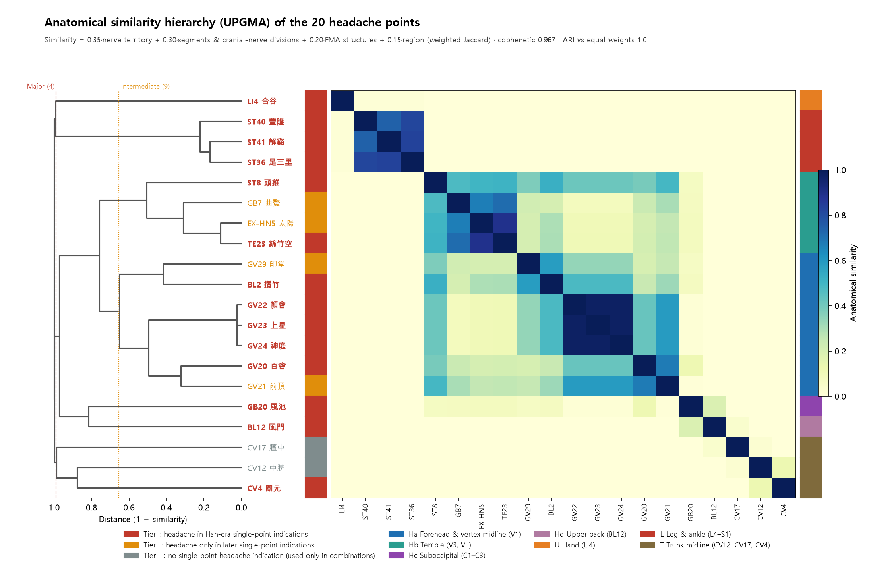
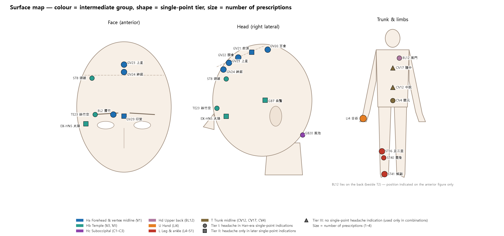
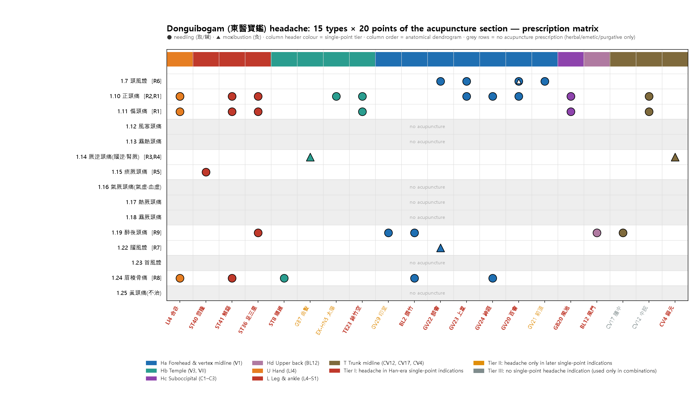
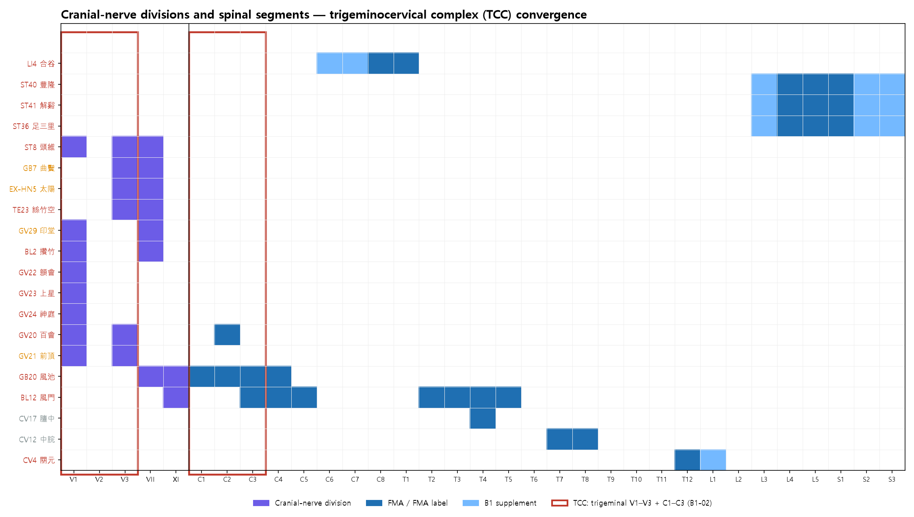
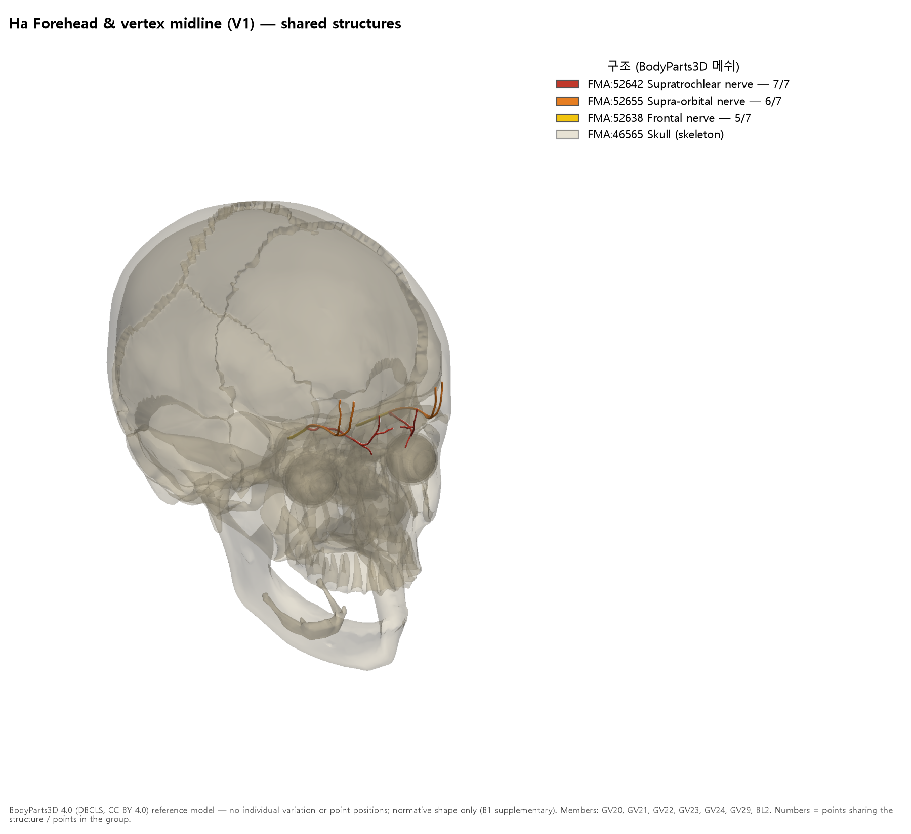
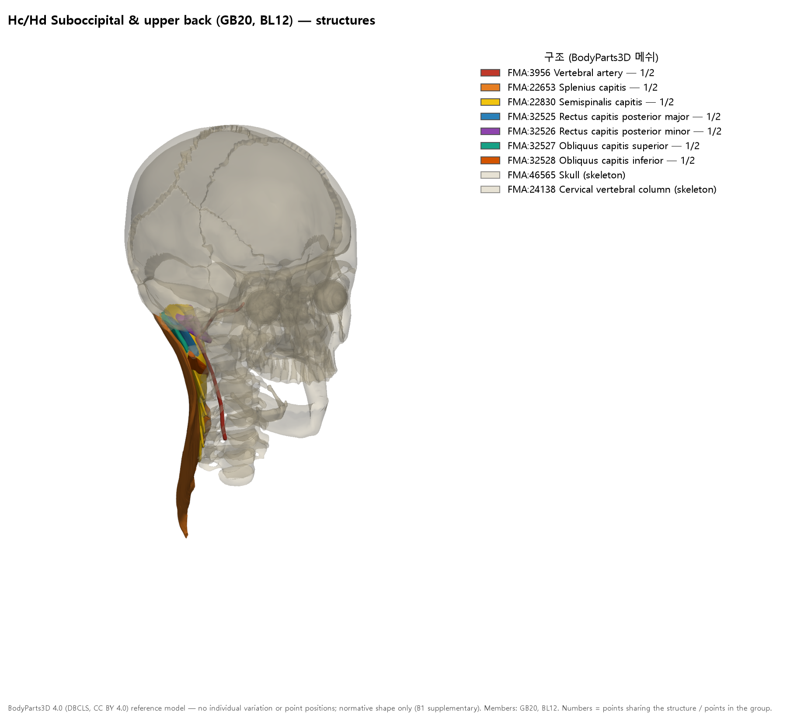
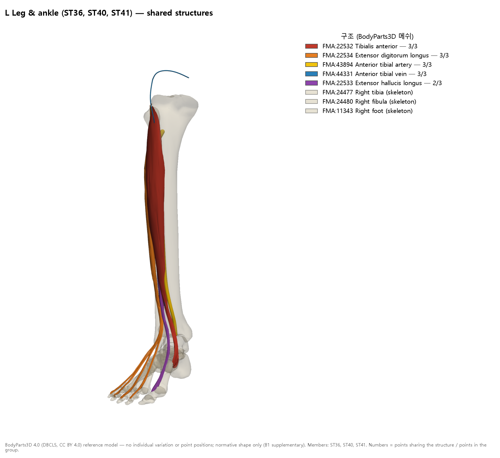

# [Acupoint Anatomy] Headache in Donguibogam (《東醫寶鑑》) — Comprehensive Acupuncture-Anatomy Report: Reconstruction of the Original Text, Single-Point Indication Tiers, Anatomical Similarity Strata and Trigeminocervical Convergence

> **Framework**: v2.7 · **Classification**: Category 4 symptom-based acupuncture-anatomy clinical matrix · **Edition**: full re-analysis (2026-10-25). The 29 outputs of the old edition are archived in `_구판_20261024/`, and the audit results are given in Section 12.
> **Scope**: Ranks 0–6. Rank 7 ARI is **not scored** (a 20-point prescription matrix — ARI for individual points is scored in the Category 1 reports).
> **Primary text**: Donguibogam (《東醫寶鑑》), Chapter on External Form (外形篇), vol. 1, Head (頭) (`01_도서_번역_및_원전/동의보감/동의보감_030_外形篇一_頭.md`), Sections 1.7–1.25 and Section 1.33 【鍼灸法】 (acupuncture and moxibustion methods) (L557, L563)
> **Three Primary Classics**:
> - *Zhongguo Zhenjiu Zhengzhi Tongjian* (《中國針灸證治通鑑》), 「十九、頭痛」 (`中国针灸证治通鉴_16_…md` L580–954): tracing the sources of the prescriptions
> - *Zhenjiu Shuxue Tongkao* (《針灸腧穴通考》), 【適應症】 (indications): adjudication of the single-point indication tier of each point
> - *Zhongguo Zhenjiu Xuewei Tongjian* (《中國針灸穴位通鑑》): collation
>
> **Anatomical basis**: FMA 5.1.0 (`fma_query.py profile`), two-textbook mapping table, B1 normative anatomy (B1-01, B1-02, B1-03) · 3D: BodyParts3D 4.0 (B1 supplementary)
> **Layer A**: papers linked in the integrated DB (state as of 2026-10-25), collated with PubMed metadata. `sync_master_db.py` was not run (**external search incomplete**).
> **Datasheet**: [`동의보감_두통_해부임상_매트릭스.xlsx`](동의보감_두통_해부임상_매트릭스.xlsx) (11 sheets) · Reproduction scripts: `scripts/`
> **Note on script**: Classical quotations and TCM terms are given in Traditional Chinese (繁體字). Quotations from Donguibogam are reproduced as they stand in the source. The *Tongkao* (《通考》) and *Zhengzhi Tongjian* (《證治通鑑》) files are simplified-script editions, so the file names and line numbers in `code` refer to those files as they are named on disk; the form "胆中" is kept as written because its relation to 膻中 is at issue (Section 2). The old-edition quotations audited in Section 12 are reproduced unaltered as evidence.

---

## 0. Summary

1. The headache entries of the Head (頭) chapter of Donguibogam consist of **15 sections** plus one section on classification by the six channels (六經) (1.21). Of these, only **8 sections** have acupuncture-moxibustion prescriptions in 1.33 【鍼灸法】: Wind-headache (頭風), Central headache (正頭痛), Hemicranial headache (偏頭痛), Reverting-counterflow headache (厥逆), Phlegm-reversal headache (痰厥), Headache after drinking (醉後), Brain-wind (腦風) and Brow-ridge pain (眉稜骨痛). The remaining 7 sections (風寒·濕熱·氣厥·熱厥·濕厥·首風·眞頭痛) use only drugs, emetic (吐法) or purgative (下法) methods, or treat the condition as incurable (不治). The 16 types of the old edition did not match this structure of the original text (Section 12).
2. The 鍼灸法 section contains 9 headache prescriptions using **20 points**. Nearly all were taken, via *Yixue Gangmu* (《醫學綱目》), from the Yuan-era *Zhenjiu Jicheng* (《鍼灸集成》), *Zhenjing Zhaiying Ji* (《鍼經摘英集》), *Danxi Xinfa* (《丹溪心法》), *Zhenjiu Zisheng Jing* (《鍼灸資生經》) and *Puji Benshi Fang* (《普濟本事方》) (traced line by line in the 《證治通鑑》). The prescription for headache after drinking (醉後頭痛) is the *Zhenjiu Jicheng* (《鍼灸集成》) formula "中脘…胆中" with 中脘 dropped and 胆中 changed to 膻中.
3. Single-point indication ($P_{single}$) tiers according to the *Tongkao* (《通考》):
   - **Tier I, 14 points**: headache appears among the Han-era single-point indications.
   - **Tier II, 4 points**: Qianding (前頂), Yintang (印堂), Taiyang (太陽), Qubin (曲鬢). Headache appears only in later literature.
   - **Tier III, 2 points**: Zhongwan (中脘), Danzhong (膻中). No headache single-point indication in any period; used only as combination (配伍) points.
4. The anatomical similarity strata (UPGMA) have a **cophenetic correlation of 0.967**, and the equal-weight ARI is 1.000.
   - **4 major groups**: head and neck 13 points, hand (合谷), lower limb 3 points, trunk midline 3 points
   - **9 intermediate groups**: head and neck splits into forehead–vertex midline (V1) 7 points, temple (V3·VII) 4 points, suboccipital (風池) and upper back (風門).
   - All 11 head points and Fengmen (風門) lie within the territory of the **trigeminocervical complex (TCC: V1–V3 + C1–C3)**. By contrast, the 7 distal and trunk points do not overlap with the TCC (B1-02).
5. Anatomical cohesion within prescriptions: Wind-headache (頭風頭痛) 0.61 (4 vertex and anterior-head points), Central headache (正頭痛) 0.22, Brow-ridge pain (眉稜骨痛) 0.14, Hemicranial and central headache (偏正頭痛) and Headache after drinking (醉後頭痛) 0.06. Donguibogam prescriptions combine "local points" aimed at one anatomical region with "distal and trunk points" anatomically unrelated to it (合谷·解谿·足三里·中脘·膻中·關元).
6. Layer A has almost no point-level evidence for headache (0–5 papers per point, mostly general reviews). For acupuncture as a whole, PubMed shows Cochrane reviews reporting effects in migraine and tension-type headache, but the difference from sham acupuncture is small (not merged into the DB). Point specificity is kept as a **hypothesis**.

---

## 1. Structure of the Headache Text in Donguibogam (Ranks 1, 3)

| Section | Type | Defining text (first sentence; line in `동의보감_030`) | 鍼灸法 |
| :-- | :-- | :-- | :-- |
| 1.7 | Wind-headache pattern (頭風證) | 頭風之證素有痰飮或櫛沐取凉或久卧當風以致賊風入腦入項自頸以上耳目口鼻眉稜之間有麻痺不仁之處或頭重或頭暈或頭皮頑厚不自覺知或口舌不仁不知食味或… (L39) | R6 |
| 1.10 | Central headache (正頭痛) | 凡手之三陽從手走頭足之三陽從頭走足是手與足六陽之脉俱上于頭面也(靈樞)… (L189) | R2 (+R1) |
| 1.11 | Hemicranial headache (偏頭痛) | 偏頭痛者頭半邊痛者是也(丹心)… (L213) | R1 (+阿是穴) |
| 1.12 | Wind-cold headache (風寒頭痛) | 風寒傷上邪從外入客於經絡令人振寒頭痛或風寒之邪伏留陽經爲偏正頭痛宜三五七散芎辛湯芎芷香蘇散(方見寒門)… (L225) | None (drugs, emetic and purgative methods only) |
| 1.13 | Damp-heat headache (濕熱頭痛) | 心煩頭痛者病在膈中乃濕熱頭痛也宜清空膏小清空膏又用吐法(方見下)… (L239) | None (drugs, emetic and purgative methods only) |
| 1.14 | Reverting-counterflow headache (厥逆頭痛) | 當有所犯大寒內至骨髓髓者以腦爲主腦逆故令頭痛齒亦痛乃厥逆頭痛也宜羌活附子湯 厥者逆也邪氣逆上陽經而作痛甚則發厥頭痛齒亦痛宜白附子散 厥頭痛卽… (L251) | R3 kidney reversal (腎厥) · R4 with toothache (齒亦痛) |
| 1.15 | Phlegm-reversal headache (痰厥頭痛) | 頭痛每發時兩頰青黃眩運目不欲開懶於言語身體沈重兀兀欲吐此厥陰太陰合病名曰痰厥頭痛宜服局方玉壺丸及半夏白朮天麻湯(東垣)… (L269) | R5 |
| 1.16 | Qi-reversal headache (氣厥頭痛) | 氣血虛而邪氣逆上爲頭痛 頭痛耳鳴九竅不利兩大陽穴痛甚乃氣虛頭痛也宜順氣和中湯黃芪益氣湯 血虛頭痛自魚尾上攻而爲痛宜當歸補血湯加味四物湯眉尖後… (L299) | None (drugs, emetic and purgative methods only) |
| 1.17 | Heat-reversal headache (熱厥頭痛) | 治頭痛煩熱雖冬天大寒猶喜風寒其痛暫止略來煖處或見烟火則其痛復作宜清上瀉火湯防風散(東垣)… (L333) | None (drugs, emetic and purgative methods only) |
| 1.18 | Damp-reversal headache (濕厥頭痛) | 冒雨傷濕頭重眩痛遇陰雨則甚宜芎辛湯(方見上)… (L345) | None (drugs, emetic and purgative methods only) |
| 1.19 | True headache (眞頭痛) / Headache after drinking (醉後頭痛) | 詳見下不治類 **醉後頭痛** 詳見內傷門… (L353) | R9 (醉後) |
| 1.21 | Headache to be differentiated by the six channels (頭痛當分六經) | 凡頭痛皆以風藥治之者高巓之上惟風可到故總其大體而言之也然亦有三陽三陰之異焉 太陽頭痛惡風寒脉浮緊宜羌活獨活麻黃川芎之類 少陽頭痛往來寒熱脉弦… (L357) | None (drugs, emetic and purgative methods only) |
| 1.22 | Brain-wind pattern (腦風證) | 風氣循風府項背怯寒腦戶(穴名穴名)… (L367) | R7 |
| 1.23 | Head-wind pattern (首風證) | 新沐中風則爲首風其證頭面多汗惡風當先風一日則病甚頭痛不可出內至其風日則病少愈(內經)… (L379) | None (drugs, emetic and purgative methods only) |
| 1.24 | Brow-ridge pain (眉稜骨痛) | 眉心並眉梁骨痛者痰也二陳湯(方見痰飮)… (L391) | R8 |
| 1.25 | Incurable and intractable headache patterns (頭痛不治難治證) | 眞頭痛者頭痛甚腦盡痛手足寒至節死不治(靈樞)… (L405) | None (drugs, emetic and purgative methods only) |

- Section number 1.20 does not exist in the original text (1.19 is followed by 1.21). Headache after drinking (醉後頭痛) appears within Section 1.19 only as "詳見內傷門", yet the 鍼灸法 section has a prescription for it.
- Section 1.14, Reverting-counterflow headache (厥逆頭痛), contains both **brain counterflow (腦逆)** ("髓者以腦爲主腦逆故令頭痛齒亦痛") and **kidney reversal (腎厥)** ("厥頭痛卽腎厥巓頂痛不可忍宜玉眞丸"). There is no basis for setting up "brain-counterflow headache" and "kidney-reversal headache" as separate types, as the old edition did.
- Section 1.16, Qi-reversal headache (氣厥頭痛), contains qi-deficiency headache (氣虛頭痛, "兩大陽穴痛甚"), blood-deficiency headache (血虛頭痛, "自魚尾上攻") and combined qi-blood deficiency (氣血俱虛) as subordinate descriptions.

## 2. 鍼灸法 Prescriptions and Source Tracing (Ranks 1, 2, 3)

| ID | Indication | Method | Points | Attribution | Tracing in the Three Primary Classics | Cohesion | TCC | Tier I |
| :-- | :-- | :-- | :-- | :-: | :-- | :-: | :-: | :-: |
| R1 | Hemicranial and central headache (偏正頭痛) | needling (取, 鍼) | 絲竹空·風池·合谷·中脘·解谿·足三里 | 綱目 | 《鍼灸集成》 偏正頭風：中脘、風池、三里、合谷、絲竹空、解溪 — 证治通鉴_16 L746 | 0.062 | 2/6 | 5/6 |
| R2 | Central headache (正頭痛) | needling (取, 鍼) | 百會·上星·神庭·太陽·合谷 | 綱目 | 《鍼灸集成》 正頭風大痛及腦痛：神庭、合谷、太陽、上星、百會 — 证治通鉴_16 L734 | 0.223 | 4/5 | 4/5 |
| R3 | Kidney-reversal headache (腎厥頭痛) | moxibustion (灸), 100 cones (百壯) | 關元 | 資生 | 《普濟本事方》 腎厥…更灸關元穴百壯 — 证治通鉴_16 L618 | — | 0/1 | 1/1 |
| R4 | Reverting-counterflow headache with toothache (厥逆頭痛 齒亦痛) | moxibustion (灸), 7 cones (七壯) | 曲鬢 | 資生 | Not found in the Three Primary Classics (original 《資生經》 not collated) | — | 1/1 | 0/1 |
| R5 | Phlegm-reversal headache (痰厥頭痛) | needling (取, 鍼) | 豊隆 | 綱目 | 《鍼經摘英集》 治風痰頭痛，刺足陽明經豐隆 — 证治通鉴_16 L658 | — | 0/1 | 1/1 |
| R6 | Wind-headache (頭風頭痛) | needle (鍼) 百會 / moxibustion (灸) 顖會·前頂·上星·百會 | 百會·顖會·前頂·上星 | 丹心 | 《丹溪心法·頭風》 宜灸囟會、百會、前頂、上星 — 证治通鉴_16 L718 | 0.612 | 4/4 | 3/4 |
| R7 | Brain pain, brain spinning, brain draining, brain heat, brain cold (腦痛·腦旋·腦瀉·腦熱·腦冷) | moxibustion (灸) | 顖會 | 資生 | 《鍼灸資生經·腦痛·腦風》 凡腦痛、腦旋、腦瀉先宜灸囟會 — 证治通鉴_16 L632 | — | 1/1 | 1/1 |
| R8 | Brow-ridge pain (眉稜骨痛) | needling (取, 鍼) | 攢竹·合谷·神庭·頭維·解谿 | 綱目 | 《醫學綱目·頭風痛》 眉攢內痛：解溪 / 眉間痛：攢竹·頭維 / 眉棱骨痛：攢竹·合谷·神庭 — 证治通鉴_16 L794–796 | 0.142 | 3/5 | 5/5 |
| R9 | Headache after drinking (醉後頭痛) | needling (取, 鍼) | 印堂·攢竹·足三里·風門·膻中 | 綱目 | 《鍼灸集成》 醉頭風痛：中脘、風門、三里、印堂、攢竹、胆中 — 证治通鉴_14 L1265 (Donguibogam omits 中脘; 胆中→膻中) | 0.062 | 3/5 | 3/5 |

*Cohesion = mean anatomical similarity over all pairs of constituent points (— for single-point prescriptions). TCC = number of points with branches of trigeminal V1–V3 or C1–C3. Tier I = number of single-point indication Tier I points. Attribution: 綱目 = 《醫學綱目》, 資生 = 《鍼灸資生經》, 丹心 = 《丹溪心法》.*

Other 鍼灸法 entries:
- **R10** "一老婦久患頭痛…手足有血絡皆紫黑…刺出血如墨汁後刺受病之經": attributed to 《綱目》, but not found in the Three Primary Classics.
- **R11** "偏頭痛及正頭痛取阿是穴": an Ashi point (阿是穴) prescription.
- **The 2 prescriptions for dizziness (眩暈)** (神庭·上星·顖會·前頂·後頂·腦空·風池·陽谷·大都·至陰·金門·申脉·足三里 / 百會·上星·風池·豊隆) are not headache prescriptions and were excluded from the matrix. They are listed for reference in the xlsx sheet `2_鍼灸法_처방`.

**Rank 3 and 4 adjudications**
- **Taiyang (太陽)**: according to the name–reality study (名實考) of 太陽 (EX-HN5) in the *Tongkao* (《通考》) (`针灸腧穴通考_25_…md` L309–L323), since the annotations to the 《千金》 the reading was "瞳子窌，一名太陽", and the Yuan–early Ming *Zhenjiu Jicheng* (《鍼灸集成》) used 太陽 and 瞳子髎 as the same point. Because 太陽 in the Central headache prescription (R2) comes from the 《鍼灸集成》, it is labelled as the extra point (經外奇穴) Taiyang, but its anatomy is represented by the FMA profile of Tongziliao (瞳子髎, GB1).
- **Headache after drinking (醉後頭痛, R9)**: the source, the 《鍼灸集成》, reads "中脘、風門、三里、印堂、攢竹、胆中" (`证治通鉴_14` L1265). Donguibogam omits 中脘 and writes "膻中" for "胆中". Whether 胆中 is a variant writing of 膻中 or a copying error cannot be decided from the Three Primary Classics, so the Donguibogam form is followed.
- **Central headache (正頭痛) = kidney reversal (腎厥)**: the 《鍼灸集成》 states "端的正頭風十死，又名腎厥頭痛" (L738). Donguibogam places Central headache (1.10) and kidney reversal (1.14) in different sections.

## 3. Single-Point Headache Indication Tier of Each Point (Ranks 3, 4; Ten Core Elements ⑨)

Symptom groups: H1 頭痛·頭風·腦痛·頂上痛 (headache, head-wind, brain pain, pain at the vertex) / H2 偏頭·頭角 (one side of the head, corner of the head) / H3 眉稜·眉頭 (brow ridge, medial end of the eyebrow) / H4 頭重·眩 (heavy head, dizziness) / H5 項強 (stiff nape). Tier I comprises points whose Han-era (《黃帝明堂經》, 《黃帝內經明堂》) single-point indications contain at least one of H1–H3. Later entries identified by the commentary (按語) of the 《通考》 as transcription errors or copies of meridian disease patterns were excluded (all entries are in the xlsx sheet `4_두통_근거조문`).

| Tier | Code | Point | Han-era single-point | Later single-point | Key evidence (《通考》 line, source, matched terms) |
| :-: | :-- | :-- | :-- | :-- | :-- |
| I | GV20 | Baihui (百會) | H1·H4 | H1·H4 | L797 《黃帝明堂經》 “頂上痛/頭重”; L803 《太平聖惠方·針經》 “頭風/頭重” |
| I | GV23 | Shangxing (上星) | H1·H4 | H1·H4 | L1511 《黃帝明堂經》 “頭痛/眩”; L1513 《太平聖惠方·針經》 “頭風/頭痛” |
| I | GV24 | Shenting (神庭) | H1·H4 | H1·H4 | L1737 《黃帝明堂經》 “頭痛/眩”; L1743 《銅人腧穴鍼灸圖經》卷中 “頭風/眩” |
| I | GV22 | Xinhui (顖會) | H1·H4 | H1·H4 | L1281 《黃帝明堂經》 “頭痛/眩”; L1287 《太平聖惠方·針經》 “頭風” |
| I | TE23 | Sizhukong (絲竹空) | H1·H4 | H1·H4 | L4003 《黃帝明堂經》 “頭痛/眩”; L4011 《銅人腧穴鍼灸圖經》卷中 “頭痛/眩” |
| I | GB20 | Fengchi (風池) | H1·H5 | H1·H2·H4·H5 | L3295 《黃帝明堂經》 “頭痛/頸項痛”; L3303 《銅人腧穴鍼灸圖經》卷中 “頭痛/眩/頸項痛” |
| I | BL2 | Cuanzhu (攢竹) | H1·H3·H4·H5 | H1·H3·H4 | L613 《黃帝明堂經》 “頭痛/眉頭/眩/項強”; L631 《循經考穴編》上 “頭風/眉棱” |
| I | ST8 | Touwei (頭維) | H1 | H1·H4 | L1595 《黃帝明堂經》 “頭痛”; L1603 《竇太師針經》 “頭風” |
| I | BL12 | Fengmen (風門) | H1·H4 | H1·H4·H5 | L2223 《黃帝明堂經》 “頭痛/眩”; L2227 《太平聖惠方·針經》 “項強” |
| I | LI4 | Hegu (合谷) | H1 | H1·H5 | L793 《黃帝明堂經》 “頭痛”; L799 《銅人腧穴鍼灸圖經》卷下 “頭痛” |
| I | ST41 | Jiexi (解谿) | H1·H4 | H1·H3·H4 | L1689 《黃帝明堂經》 “頭眩痛/眩”; L1695 《銅人腧穴鍼灸圖經》卷下 “頭痛/頭風/眩” |
| I | ST36 | Zusanli (足三里) | H1 | — | L341 《黃帝明堂經》 “頭痛” |
| I | ST40 | Fenglong (豊隆) | H1 | H1·H4 | L1471 《黃帝明堂經》 “頭痛”; L1477 《銅人腧穴鍼灸圖經》卷下 “頭痛” |
| I | CV4 | Guanyuan (關元) | H1·H4 | — | L773 《黃帝明堂經》 “頭眩痛/眩” |
| II | GV21 | Qianding (前頂) | H4 | H1·H4 | L1105 《黃帝明堂經》 “眩”; L1107 《銅人腧穴鍼灸圖經》 “頭風/眩” |
| II | GV29 | Yintang (印堂) | — | H1·H4 | L2627 《竇太師針經》 “頭重” |
| II | EX-HN5 | Taiyang (太陽) | — | H1·H2·H4 | L343 《太平聖惠方·針經》 “頭痛/眩” |
| II | GB7 | Qubin (曲鬢) | — | H1·H5 | L1335 《太平聖惠方·明堂》 “項急” |
| III | CV12 | Zhongwan (中脘) | — | — | No headache entry |
| III | CV17 | Danzhong (膻中) | — | — | No headache entry |

- **Baihui (百會)** is the point used most often in Donguibogam headache prescriptions (R2, R6). Yet its Han-era indications contain only "頂上痛，風頭重"; the word "頭痛" appears only from the Song-era 《太平聖惠方》 "頭風". This report counts "頂上痛" as H1.
- **Zhongwan (中脘) and Danzhong (膻中)** have no headache single-point indication at all and are used only in the prescriptions for Hemicranial and central headache (偏正頭痛) and Headache after drinking (醉後頭痛). **Guanyuan (關元)** has the Han-era indication "頭眩痛", but the source of the moxibustion method for Kidney-reversal headache (腎厥頭痛) is the 《普濟本事方》.
- For **Qubin (曲鬢)**, the only single-point indication that could underlie Donguibogam R4 ("厥逆頭痛齒亦痛 灸曲鬢") is the Song-era "頸項急強…引牙齒痛" (《聖惠方》). The "頭痛連齒" in the 4th–7th edition textbooks appears to be a prescription of the Donguibogam / 《資生經》 lineage transferred into textbook indications (the author's judgement).

## 4. Anatomical Similarity Method (Rank 5 · FMA Section 5-1)

- **Input**: `fma_query.py profile --json` was run for each of the 20 points.
  - Yintang (印堂, GV29) is absent from the two-textbook dataset, so a manual B1 mapping was used (B1-01, B1-03): procerus FMA:46769, corrugator supercilii 46794, supratrochlear nerve 52642, infratrochlear nerve 52693, supratrochlear artery 50025 and vein 50898, dorsal nasal artery 50000.
  - Taiyang (太陽) is represented by the profile of Tongziliao (瞳子髎, GB1) (Section 2).
- **Features and weights** (provisional):
  - N nerve territory 0.35
  - G segment + cranial nerve branch 0.30: V1, V2, V3, VII and XI are placed on the same axis as the spinal segments.
  - S FMA structure 0.20
  - R region/compartment 0.15
- **Branch and segment mapping**:
  - V1: ophthalmic nerve, frontal nerve, supraorbital, supratrochlear, infratrochlear
  - V2: zygomaticotemporal
  - V3: mandibular nerve, auriculotemporal
  - Upper cervical nerves: suboccipital nerve C1, greater occipital C2, lesser occipital C2–C3 (B1-01, B1-02)
  - Other peripheral nerves without FMA segments were supplemented with B1 representative segments.
  - Multisegmental muscles (five or more FMA-native segments) were excluded from the nerve and segment features.
- **Clustering and stability**: clustering by UPGMA (distance = 1 − similarity). The cophenetic correlation is **0.967** and the silhouette-optimal k is 6. Under equal weights the clusters at the same k were identical (**ARI 1.000**).

## 5. Stratification Results — 4 Major · 9 Intermediate · 12 Sub-groups (Ten Core Elements ④⑥)

*Figure 2. Dendrogram (left) and similarity matrix ordered by the dendrogram. The left strip shows the single-point indication tier, the right strip the intermediate group.*

| Code | Point | Indication tier | Major group (4) | Intermediate group (9) | Sub-group (12) | Cranial nerve branches | TCC | Segments | Three nearest points |
| :-- | :-- | :-: | :-- | :-- | :-- | :-- | :-- | :-- | :-- |
| LI4 | 合谷 | I | U Hand (合谷) | U Hand (合谷) | 合谷 (singleton) | — | — | C6,C7,C8,T1 | ST36(0.01); ST40(0.01); ST41(0.01) |
| ST40 | 豊隆 | I | L Lower limb (足三里·豊隆·解谿) | L Lower limb | L Lower limb (足三里·豊隆·解谿) | — | — | L3,L4,L5,S1,S2,S3,S4 | ST36(0.82); ST41(0.74); LI4(0.01) |
| ST41 | 解谿 | I | L Lower limb (足三里·豊隆·解谿) | L Lower limb | L Lower limb (足三里·豊隆·解谿) | — | — | L3,L4,L5,S1,S2,S3,S4 | ST36(0.83); ST40(0.74); LI4(0.01) |
| ST36 | 足三里 | I | L Lower limb (足三里·豊隆·解谿) | L Lower limb | L Lower limb (足三里·豊隆·解谿) | — | — | L3,L4,L5,S1,S2,S3,S4 | ST41(0.83); ST40(0.82); LI4(0.01) |
| ST8 | 頭維 | I | H Head and neck | Hb Temple (V3·VII) | 頭維 (singleton) | V1,V3,VII | V1,V3 | — | BL2(0.52); TE23(0.51); EX-HN5(0.50) |
| GB7 | 曲鬢 | II | H Head and neck | Hb Temple (V3·VII) | Hb1 Temple (太陽·絲竹空·曲鬢) | V3,VII | V3 | — | TE23(0.71); EX-HN5(0.67); ST8(0.47) |
| EX-HN5 | 太陽 | II | H Head and neck | Hb Temple (V3·VII) | Hb1 Temple (太陽·絲竹空·曲鬢) | V3,VII | V3 | — | TE23(0.89); GB7(0.67); ST8(0.50) |
| TE23 | 絲竹空 | I | H Head and neck | Hb Temple (V3·VII) | Hb1 Temple (太陽·絲竹空·曲鬢) | V3,VII | V3 | — | EX-HN5(0.89); GB7(0.71); ST8(0.51) |
| GV29 | 印堂 | II | H Head and neck | Ha Forehead–vertex midline (V1) | Ha3 Glabella and eyebrow (印堂·攢竹) | V1,VII | V1 | — | BL2(0.58); ST8(0.38); GV23(0.34) |
| BL2 | 攢竹 | I | H Head and neck | Ha Forehead–vertex midline (V1) | Ha3 Glabella and eyebrow (印堂·攢竹) | V1,VII | V1 | — | GV29(0.58); ST8(0.52); GV23(0.48) |
| GV22 | 顖會 | I | H Head and neck | Ha Forehead–vertex midline (V1) | Ha2 Anterior-head midline (上星·神庭·顖會) | V1 | V1 | — | GV23(0.97); GV24(0.97); GV21(0.59) |
| GV23 | 上星 | I | H Head and neck | Ha Forehead–vertex midline (V1) | Ha2 Anterior-head midline (上星·神庭·顖會) | V1 | V1 | — | GV24(0.97); GV22(0.97); GV21(0.59) |
| GV24 | 神庭 | I | H Head and neck | Ha Forehead–vertex midline (V1) | Ha2 Anterior-head midline (上星·神庭·顖會) | V1 | V1 | — | GV23(0.97); GV22(0.97); GV21(0.59) |
| GV20 | 百會 | I | H Head and neck | Ha Forehead–vertex midline (V1) | Ha1 Vertex (百會·前頂) | V1,V3 | V1,V3,C2 | C2 | GV21(0.68); GV24(0.42); GV23(0.42) |
| GV21 | 前頂 | II | H Head and neck | Ha Forehead–vertex midline (V1) | Ha1 Vertex (百會·前頂) | V1,V3 | V1,V3 | — | GV20(0.68); GV24(0.59); GV23(0.59) |
| GB20 | 風池 | I | H Head and neck | Hc Suboccipital (風池) | 風池 (singleton) | VII,XI | C1,C2,C3 | C1,C2,C3,C4 | BL12(0.18); GV20(0.12); TE23(0.08) |
| BL12 | 風門 | I | H Head and neck | Hd Upper back (風門) | 風門 (singleton) | XI | C3 | C3,C4,C5,T2,T3,T4,T5 | GB20(0.18); CV17(0.04); GV20(0.00) |
| CV17 | 膻中 | III | T Trunk midline | T 膻中 | 膻中 (singleton) | — | — | T4 | BL12(0.04); CV12(0.03); GV20(0.00) |
| CV12 | 中脘 | III | T Trunk midline | T 中脘 | 中脘 (singleton) | — | — | T7,T8 | CV4(0.12); CV17(0.03); GV20(0.00) |
| CV4 | 關元 | I | T Trunk midline | T 關元 | 關元 (singleton) | — | — | T12,L1 | CV12(0.12); GV20(0.00); GV23(0.00) |

*Figure 4. Schematic body-surface map (relative positions of the B1-05 locations only; not to scale). Colour indicates the intermediate group, shape the single-point indication tier (● Tier I, ■ Tier II, ▲ Tier III), and size the number of prescriptions using the point.*

**Interpretation**
- **Ha2 anterior-head midline (上星·神庭·顖會)**: the mutual similarity of 0.97 makes these points practically a single anatomical unit (supratrochlear and supraorbital nerves V1, frontal belly, galea aponeurotica). Because the Donguibogam moxibustion method for Wind-headache (頭風, R6) uses this unit together with the vertex (Ha1 百會·前頂), R6 has the highest cohesion (0.61).
- **Hb temple (太陽·絲竹空·曲鬢·頭維)** shares the auriculotemporal nerve (V3), the temporal branches of the facial nerve (VII), the superficial temporal artery and vein, and temporalis. The local points of the hemicranial-headache (偏頭痛) series of prescriptions belong here.
- **Hc Fengchi (風池)** is the only point with the four suboccipital muscles, the vertebral artery, and the greater occipital nerve (C2) and suboccipital nerve (C1). Among the head points it represents the upper cervical (C1–C3) axis.
- **Distal and trunk points** (合谷·足三里·豊隆·解谿·中脘·膻中·關元) have similarities of 0–0.12 to the head points. Within Donguibogam prescriptions these points serve not local anatomy but remote action (the distant needling (遠道刺) lineage of 《靈樞·官針》). Of these, Hegu (合谷), Zusanli (足三里), Fenglong (豊隆) and Jiexi (解谿) have headache among their Han-era single-point indications, whereas Zhongwan (中脘) and Danzhong (膻中) do not.

## 6. Prescription Matrix — Type × Point (Ten Core Elements ⑨)

*Figure 1. Rows are the headache sections of Donguibogam; columns are the 20 points (in the dendrogram order of Figure 2). ● needling (鍼, 取), ▲ moxibustion (灸); the colour of the column header indicates the intermediate group, and the colour of the column label the single-point indication tier. Grey rows are sections without a 鍼灸法 prescription. The prescription for Hemicranial and central headache (偏正頭痛, R1) is shown in both the 1.10 Central headache (正頭痛) and the 1.11 Hemicranial headache (偏頭痛) rows.*

- Prescriptions consisting only of local points are Wind-headache (頭風頭痛, R6), brain pain (腦痛, R7) and reverting counterflow with toothache (厥逆 齒痛, R4). Prescriptions consisting only of a distal point are Phlegm reversal (痰厥, R5 豊隆) and Kidney reversal (腎厥, R3 moxibustion at 關元). The remaining 4 prescriptions (R1, R2, R8, R9) are local + distal mixtures.
- Moxibustion is concentrated on the vertex and anterior-head midline (顖會·前頂·上星·百會) and on Qubin (曲鬢) and Guanyuan (關元). Moxibustion of the anterior-head midline belongs to the lineages of the 《資生經》 (brain pain, brain spinning, etc., "先宜灸囟會") and the 《丹溪心法》 (head-wind not healed for years, 頭風 經年不愈).

## 7. Convergence on the Trigeminocervical Complex (TCC) — B-Check ② Perspective (Rank 6, Ten Core Elements ⑧)

*Figure 3. Rows are the 20 points (in dendrogram order). Purple = cranial nerve branch, dark blue = FMA segment, light blue = B1-supplemented segment. The two red boxes mark the TCC (V1–V3, C1–C3).*

Afferent fibres from intracranial pain-sensitive structures (dura mater and dural vessels) enter mainly via V1 (anterior and middle cranial fossae) and C1–C3 (posterior cranial fossa) and converge on the subnucleus caudalis of the spinal trigeminal nucleus and the C1–C3 dorsal horns, i.e. the trigeminocervical complex (B1-02, normative neuroanatomy). Because of this convergence, somatic afferents from the scalp and neck share the same second-order neurons with intracranial pain. This is taken as the headache version of the segmental-concordance criterion (B-Check ②).

| Stratum | Points | TCC branches | Verdict |
| :-- | :-: | :-- | :-- |
| Ha Forehead–vertex midline | 7 | V1 7/7 (百會·前頂 additionally V3·C2) | Segmental concordance **high**: the same V1 as the dura of the anterior cranial fossa |
| Hb Temple | 4 | V3 4/4, 頭維 V1 | Concordant: V3 (auriculotemporal) is the same branch as part of the dura of the middle cranial fossa |
| Hc 風池 | 1 | C1·C2·C3 | Concordance **high**: the same upper cervical segments as the dura of the posterior cranial fossa |
| Hd 風門 | 1 | C3 (+T2–T5) | Borderline |
| U 合谷 · L lower limb · T trunk | 7 | None | **No** concordance: remote action is not explained by segments. Non-segmental mechanisms such as diffuse noxious inhibitory controls (DNIC, B3-08) are candidates |

- This verdict considers only segmental overlap in normative anatomy (B1). Human evidence that stimulation of the points actually modulates second-order TCC neurons (B-Check ③–⑥) was not scored in this report.
- The V2 column is empty. The zygomaticotemporal nerve (V2), commonly described at the Taiyang (太陽) and Sizhukong (絲竹空) sites, was captured only as V3 and VII in the two-textbook mapping table (a limitation of what the textbooks record).

## 8. Layer A · Layer B

| Code | DB links (active) | Headache-related | Remarks |
| :-- | :-: | :-: | :-- |
| GV20 百會 | 61 | 2 | papers.id 795 1975 |
| GV23 上星 | 9 | 0 | — |
| GV24 神庭 | 12 | 1 | papers.id 795 |
| GV22 顖會 | 0 | 0 | — |
| GV21 前頂 | 4 | 0 | — |
| GV29 印堂 | 0 | 0 | — |
| EX-HN5 太陽 | 0 | 0 | — |
| TE23 絲竹空 | 2 | 0 | — |
| GB20 風池 | 8 | 1 | papers.id 795 |
| GB7 曲鬢 | 0 | 0 | — |
| BL2 攢竹 | 36 | 5 | papers.id 795 1983 1985 1998 2007 |
| ST8 頭維 | 0 | 0 | — |
| BL12 風門 | 6 | 1 | papers.id 795 |
| LI4 合谷 | 118 | 5 | papers.id 97 2297 2304 2308 795 |
| ST41 解谿 | 4 | 0 | — |
| ST36 足三里 | 171 | 2 | papers.id 97 795 |
| ST40 豊隆 | 5 | 1 | papers.id 795 |
| CV12 中脘 | 26 | 1 | papers.id 795 |
| CV17 膻中 | 13 | 1 | papers.id 795 |
| CV4 關元 | 45 | 1 | papers.id 795 |

- Among the papers linked to points in the integrated DB, 0–5 per point are headache-related. papers.id 795 (a 2009 general review) is linked to most of the points. Of the 5 papers for Cuanzhu (攢竹), 3 are studies of trigeminal neuralgia and ocular pain (papers.id 1983, 1985, 1998).
- **Not merged into the DB — checked in PubMed**:
  - Cochrane review of acupuncture for migraine prophylaxis (22 RCTs, 4,985 participants): the effect on headache frequency versus sham acupuncture was small, SMD −0.18 (PMID 27351677, [DOI](https://doi.org/10.1002/14651858.CD001218.pub3)).
  - Cochrane review for tension-type headache (12 RCTs): responder rates (≥ 50% reduction) versus sham were 51% vs 43% (PMID 27092807, [DOI](https://doi.org/10.1002/14651858.CD007587.pub2)).

  Both reviews used different points from trial to trial, so they do not directly demonstrate a specific effect of the points in the Donguibogam prescriptions. The small difference between verum and sham acupuncture is consistent with B4-04 (Vickers 2018 IPD, chronic pain including headache) and B4-05 (the point-specificity debate).
- **Layer B**: the registry has no entry specific to headache or the TCC. TCC convergence rests on B1-02, and the candidate remote-action mechanism on B3-08 (DNIC, anaesthetised rats), at the level of inference (capped at 1 point).

## 9. 3D Anatomical Images (BodyParts3D 4.0, B1 Supplementary)

Only FMA structures that have meshes and are shared by two or more points within a cluster (one or more for two-point clusters) were drawn. BodyParts3D has no meshes for the soft tissues of the temporal region (temporalis, superficial temporal artery, auriculotemporal nerve, etc.), so no 3D image of the Hb temple group could be drawn.

*Figure 5-1. Ha forehead–vertex midline (7 points): supratrochlear nerve 7/7, supraorbital nerve 6/7, frontal nerve 5/7 (all V1). The skull is translucent.*

*Figure 5-2. Fengchi (風池) and Fengmen (風門): all structures drawn (vertebral artery, splenius capitis, semispinalis capitis, rectus capitis posterior major and minor, obliquus capitis superior and inferior) belong to Fengchi (風池) (the structures of Fengmen (風門) have no meshes).*

*Figure 5-3. Zusanli (足三里), Fenglong (豊隆) and Jiexi (解谿): tibialis anterior, extensor digitorum longus, extensor hallucis longus, and anterior tibial artery and veins.*

## 10. Overall Conclusions

1. The headache 鍼灸法 of Donguibogam consists of 9 prescriptions in 8 of the 15 sections, using 20 points. The prescriptions are those that *Yixue Gangmu* (《醫學綱目》) took over from the Yuan-era 《鍼灸集成》 and other works. They should therefore be read as a selective compilation from Yuan–Ming prescription collections rather than as acupuncture judgements original to Donguibogam.
2. Of the 20 points, 14 have headache among their Han-era single-point indications. Four points (前頂·印堂·太陽·曲鬢) acquire headache only in later literature. Zhongwan (中脘) and Danzhong (膻中) are combination points with no headache single-point indication at all.
3. Anatomically, the head points divide into three axes — forehead–vertex (V1), temple (V3·VII) and suboccipital (C1–C3) — all of which converge on the trigeminocervical complex. The distal and trunk points are anatomically unrelated to these axes. The headache prescriptions of Donguibogam are therefore a mixed structure of **"local points in the TCC territory + distal points unrelated to the segments"**.
4. Human evidence for point-specific effects is weak (Cochrane: small effect versus sham). The anatomical strata above are only a framework for explaining the structure of the prescriptions; efficacy is kept as a **hypothesis**.

**Limitations**
- Symptom-group matching depends on regular expressions (e.g. "頭眩痛" is counted as headache).
- Taiyang (太陽) is represented by Tongziliao (瞳子髎), and Yintang (印堂) uses a manual B1 mapping, so their density of recorded structures differs from that of the other, textbook-based points.
- The weights are provisional (the equal-weight sensitivity check was passed).
- The original 《醫學綱目》 and 《鍼灸資生經》 were not collated directly (confirmed only through quotations in the 《證治通鑑》). In particular, the sources of R4 (moxibustion at 曲鬢) and R10 (bloodletting of the blood collaterals, 血絡 刺血) were not found.

## 11. Outputs and Reproduction

| File | Contents |
| :-- | :-- |
| `동의보감_두통_침구해부_종합보고서.md`·`.html` / `_en.md`·`_en.html` | This report (Korean and English) |
| `동의보감_두통_해부임상_매트릭스.xlsx` | 1 headache types · 2 鍼灸法 prescriptions · 3 single-point indication tiers · 4 evidence entries · 5 FMA anatomical features · 6 similarity matrix · 7 strata · 8 Layer A · 9 old-edition audit (quotations) · 10 old-edition audit (types and points) · 11 methods |
| `Fig1`~`Fig5_*_ko.png` / `_en.png` | 7 figures × 2 languages |
| `scripts/` | `headache_indications.py` (Ranks 1–4) → `hd_similarity.py` (similarity, strata, TCC) → `hd_figures.py`·`hd_render3d.py` (figures) → `hd_matrix.py` (xlsx) · `audit_old.py` (old-edition audit). Single-point indication parsing uses the output (`indications.json`) of `../영추경맥_수태음시동병_매트릭스/scripts/extract_indications.py` |
| `_구판_20261024/` | The 29 old-edition outputs (HTML dashboard, 9×36 grid figure, 2 xlsx files, zip) — archived without modification |

## 12. Audit of the Old Edition (before 2026-10-24)

**Type system.** The 16 types of the old edition were collated with the sections of the original text (xlsx `10_구판감사_유형·경혈`).
- Six types match original sections as they stand: Hemicranial headache (偏頭痛), Reverting counterflow (厥逆), Phlegm reversal (痰厥), Qi reversal (氣厥), True headache (眞頭痛) and Wind-headache pattern (頭風證). Damp-heat headache (濕熱頭痛) also has the same name as 1.13.
- The original section names for Heat headache (熱頭痛) and Damp headache (濕頭痛) are Heat-reversal headache (熱厥頭痛) and Damp-reversal headache (濕厥頭痛) respectively.
- Brain counterflow (腦逆), Kidney reversal (腎厥), Blood reversal (血厥), Qi deficiency (氣虛) and Blood deficiency (血虛) are not separate sections but subordinate descriptions within 1.14 and 1.16. Wind headache (風頭痛) has no corresponding section.
- Conversely, Central headache (正頭痛, 1.10), the six channels (六經, 1.21), Brain-wind (腦風, 1.22), Head-wind (首風, 1.23) and Brow-ridge pain (眉稜骨痛, 1.24) of the original text were missing.
- The old edition's description of Reverting-counterflow headache as "cold (冷) hands and feet" is not in 1.14; the definition in 1.14 is "大寒內至骨髓…頭痛齒亦痛".

**Points.** Of the 41 points of the old edition (duplicates removed), 13 actually appear in the 鍼灸法 section of the Head chapter of Donguibogam.
- **28 points found only in the old edition**: Fengfu (風府), Yongquan (湧泉), Taichong (太衝), Shenshu (腎兪), Shuigou (水溝), Shixuan (十宣), Shuaigu (率谷), Jiaosun (角孫), Xuanlu (懸顱), Xuanli (懸釐), Tongtian (通天), Tianzhu (天柱), Kunlun (崑崙), Qihai (氣海), Geshu (膈兪), Sanyinjiao (三陰交), Xuehai (血海), Neiting (內庭), Quchi (曲池), Yinlingquan (陰陵泉), Dazhui (大椎), Shuifen (水分), Neiguan (內關), Waiguan (外關), Mingmen (命門), Pishu (脾兪), Weishu (胃兪), Xuanzhong (懸鍾). These points are not in the original text.
- **7 points in the original text but absent from the old edition**: Xinhui (顖會), Shenting (神庭), Yintang (印堂), Jiexi (解谿), Qubin (曲鬢), Fengmen (風門), Danzhong (膻中).

**Classical quotations.** The 24 "quotations" attributed to 《book titles》 in the 2 xlsx and 2 HTML files of the old edition were collated against the Three Primary Classics and the cleaned Donguibogam text (normalised to simplified script).
- **Exact match: 2**
- **Partial: 9**: 60% or more of 4-character fragments match. These may be abridged or altered, or spliced together from different sentences.
- **Not found: 13**

The 22 partial or not-found quotations cannot be used as direct quotations and were all discarded in the new edition. For example, "《明堂經》 '主偏頭痛 熱病'" is not among the Han-era indications of Sizhukong (絲竹空).

| Verdict | Title | Old-edition quotation | Best-matching text (4-character fragment match rate) |
| :-: | :-- | :-- | :-- |
| Exact match | 《明堂經》 | 風到腦中寒 | *Zhongguo Zhenjiu Xuewei Tongjian* (中国针灸穴位通鉴) |
| Exact match | 《扁鵲心書》 | 患頭風兼頭暈者 刺風府穴 | *Zhongguo Zhenjiu Zhengzhi Tongjian* (中国针灸证治通鉴) |
| Partial | 《素問·刺熱》 | 病始頭首者 先取項太陽(天柱) | *Zhongguo Zhenjiu Zhengzhi Tongjian* (中国针灸证治通鉴) (78%) |
| Partial | 《明堂經》 | 主偏頭痛 熱病 | *Zhongguo Zhenjiu Xuewei Tongjian* (中国针灸穴位通鉴) (67%) |
| Partial | 《靈樞·雜病》 | 厥頭痛 取足少陰·厥陰 | Donguibogam (67%) |
| Partial | 《明堂經》 | 主風頭痛 眉頭痛 | *Zhenjiu Shuxue Tongkao* (针灸腧穴通考) (75%) |
| Partial | 《素問·臟氣法時論》 | 厥陰氣逆則頭痛 | Donguibogam (75%) |
| Partial | 《靈樞·海論》 | 髓海不足 則腦轉耳鳴 脛酸眩冒 | Donguibogam (100%) |
| Partial | 《針灸治療學》 | 血虛頭痛 取上星·血海·足三里·三陰交 | *Zhongguo Zhenjiu Zhengzhi Tongjian* (中国针灸证治通鉴) (67%) |
| Partial | 《針灸聚英》 | 濕寒濕熱下定 | *Zhongguo Zhenjiu Xuewei Tongjian* (中国针灸穴位通鉴) (67%) |
| Partial | 《靈樞·官針》 | 遠道刺者 病在上 取之下 刺腑也 | *Zhongguo Zhenjiu Zhengzhi Tongjian* (中国针灸证治通鉴) (90%) |
| Not found | 《明堂經》 | 主頭項惡風, 風眩目痛 | *Zhongguo Zhenjiu Zhengzhi Tongjian* (中国针灸证治通鉴) (50%) |
| Not found | 《千金要方》 | 主頭風, 頭重風勞 | *Zhongguo Zhenjiu Xuewei Tongjian* (中国针灸穴位通鉴) (50%) |
| Not found | 《千金要方》 | 偏頭痛 刺絲竹空 瀉血 | *Zhongguo Zhenjiu Xuewei Tongjian* (中国针灸穴位通鉴) (50%) |
| Not found | 《銅人經》 | 主腦痛 |  (0%) |
| Not found | 《明堂經》 | 主厥頭痛 足暴淸 | *Zhongguo Zhenjiu Zhengzhi Tongjian* (中国针灸证治通鉴) (50%) |
| Not found | 《明堂經》 | 風頭痛如破 足寒如水 欲嘔 崑崙主之 | *Zhongguo Zhenjiu Xuewei Tongjian* (中国针灸穴位通鉴) (58%) |
| Not found | 《靈樞·邪氣臟腑病形》 | 邪在胃脘 取足三里 | *Zhongguo Zhenjiu Xuewei Tongjian* (中国针灸穴位通鉴) (40%) |
| Not found | 《針灸治療學》 | 血虛頭痛 補三陰交·膈俞 | *Zhongguo Zhenjiu Zhengzhi Tongjian* (中国针灸证治通鉴) (57%) |
| Not found | 《明堂經》 | 腎虛 骨髓煩疼 烙腎俞·關元 | *Zhongguo Zhenjiu Zhengzhi Tongjian* (中国针灸证治通鉴) (25%) |
| Not found | 《靈樞·厥病》 | 眞頭痛頭痛甚 手足寒至節 不可治 | *Zhongguo Zhenjiu Xuewei Tongjian* (中国针灸穴位通鉴) (36%) |
| Not found | 《勉學堂針灸集成》 | 食積 針中脘·三里 | *Zhongguo Zhenjiu Xuewei Tongjian* (中国针灸穴位通鉴) (50%) |
| Not found | 《明堂經》 | 主傷寒余熱 目赤痛 瀉曲池 | *Zhenjiu Shuxue Tongkao* (针灸腧穴通考) (38%) |
| Not found | 《素問·刺熱》 | 病始於頭首 先刺項太陽 出血 | *Zhongguo Zhenjiu Zhengzhi Tongjian* (中国针灸证治通鉴) (44%) |

## 13. Record of Preparation

- Rank 0: `sync_skill_settings.py --check` reported no drift (the same as the 2026-10-24 check). The canonical v2.7 was applied.
- Author: Claude Code, 2026-10-25.
