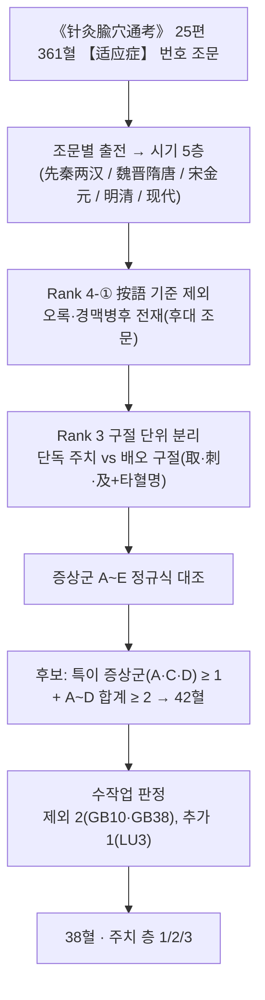
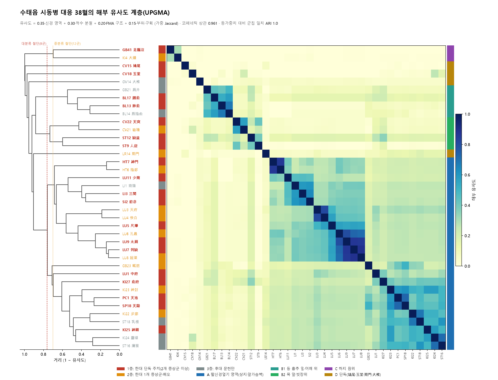
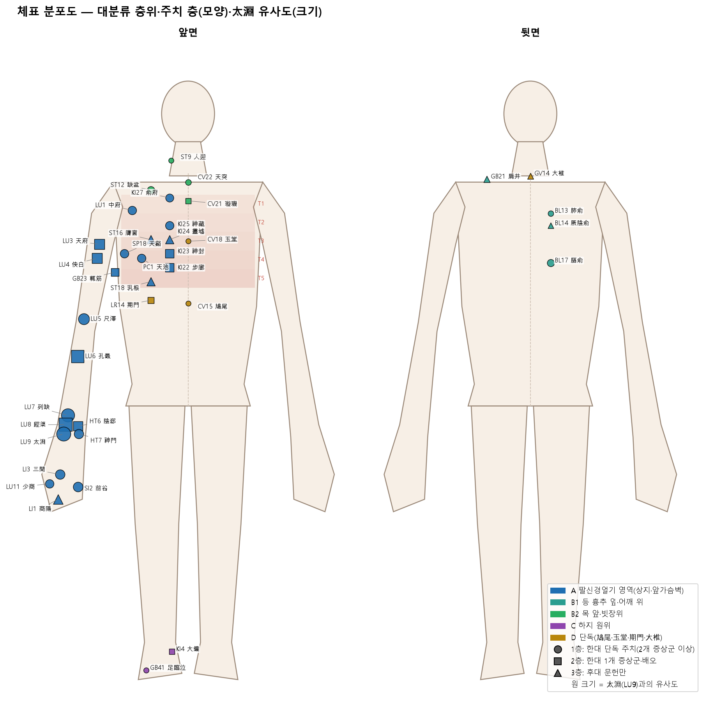
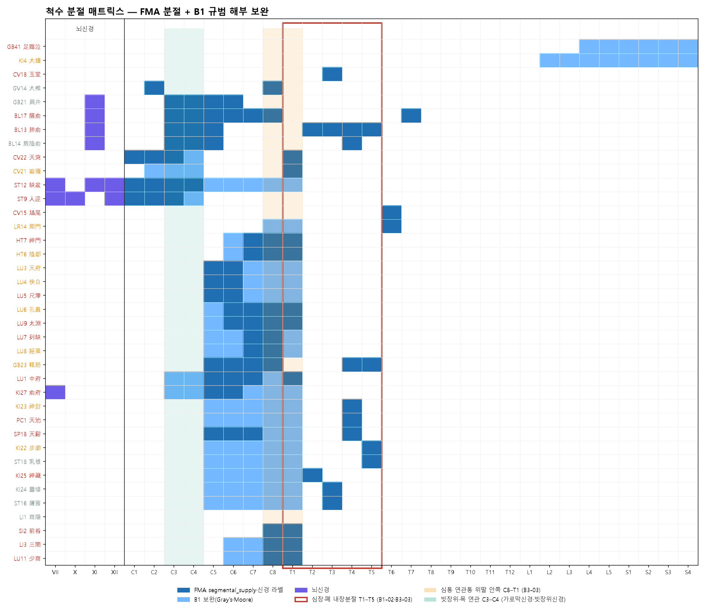
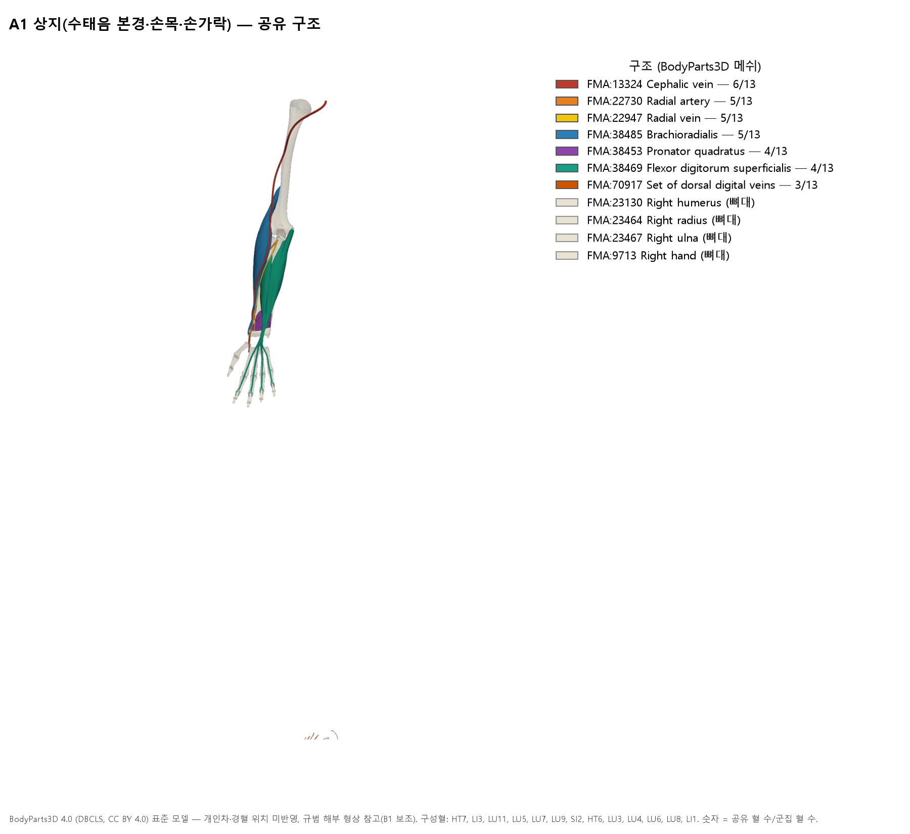
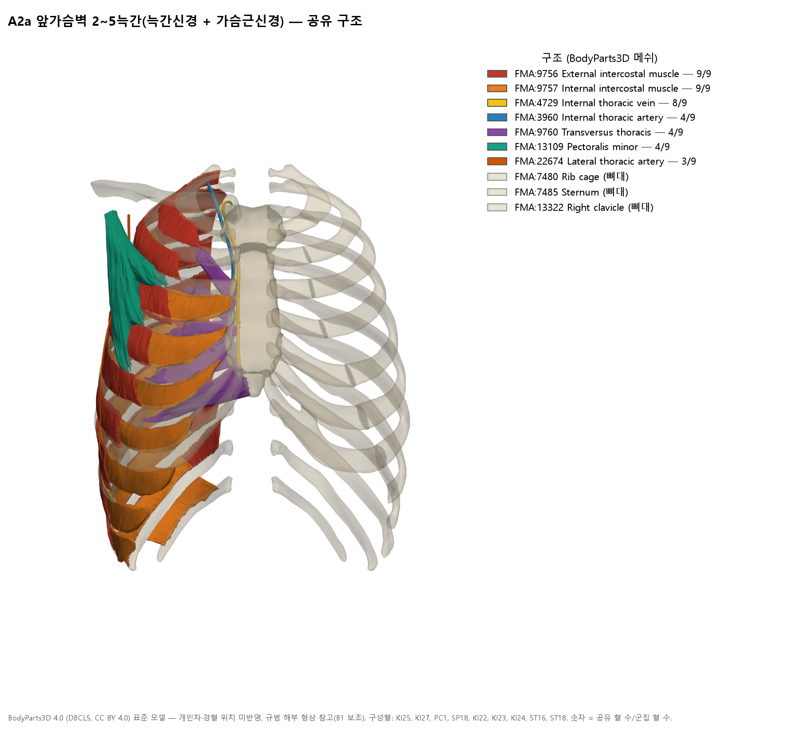
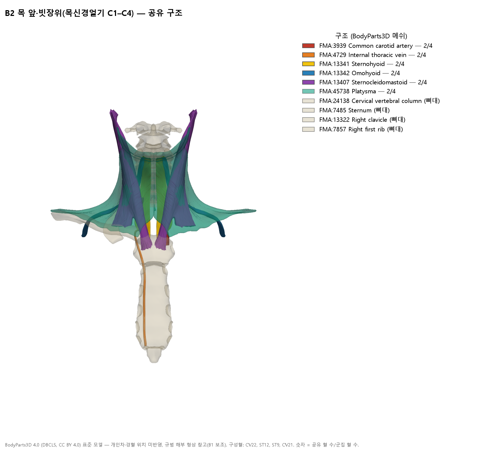
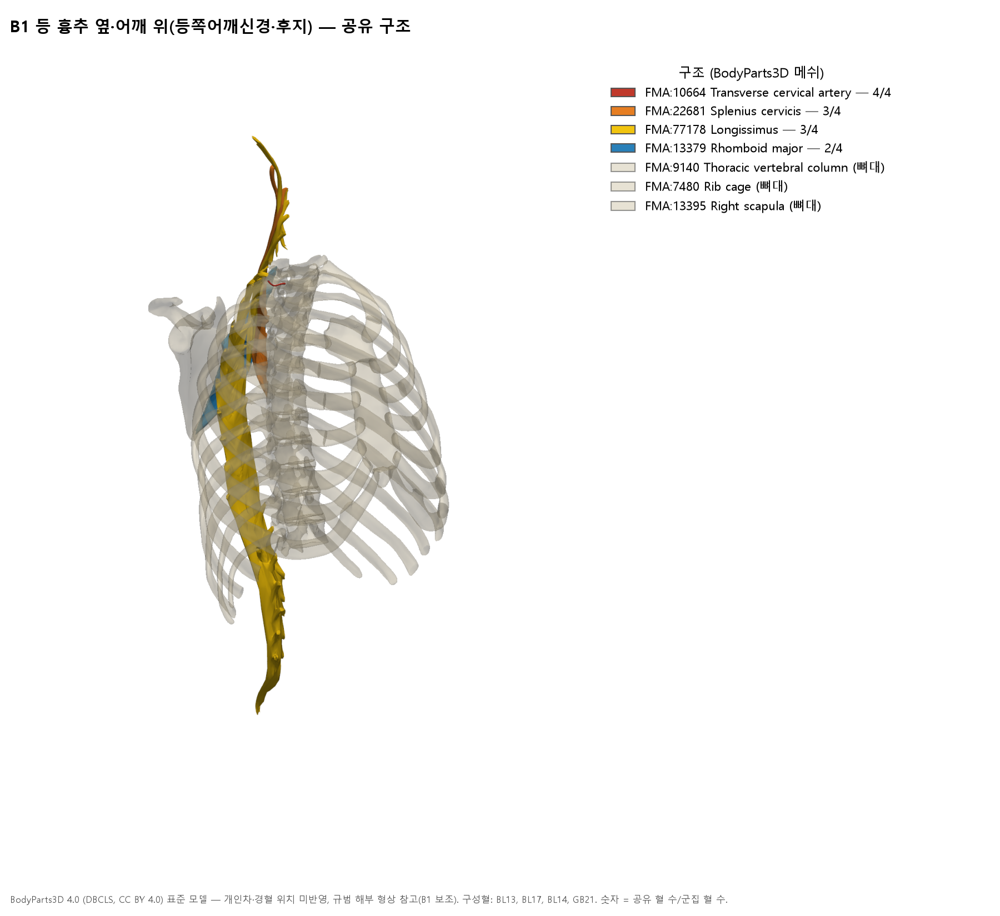

# [경혈해부] 《靈樞·經脈》 수태음폐경 시동병(是動病) 대응 경혈의 해부학적 유사성 층위 — 침구해부 종합보고서

> **프레임워크**: v2.7 · **분류**: Category 4 증상별 침구해부 임상 매트릭스 · **적용 범위**: Rank 0~6(FMA 연동), Rank 7 ARI는 **미산정**(38혈 주제 매트릭스 — 개별 혈 ARI는 Category 1 보고서에서 산정)
> **3대 원전**: 《针灸腧穴通考》 25편 361혈 【适应症】 전수 파싱(주 자료) · 《中国针灸穴位通鉴》·《中国针灸证治通鉴》 대조(시동병 원문·是動 처방)
> **해부 근거**: FMA 5.1.0 로컬 색인(`fma_query.py profile`, 2대 교재 대응표 `02_Master_Datasets/FMA/acupoint_fma_mapping.json`) + B1 규범 해부(B1-01·B1-02·B1-03) 분절 보완 · 3D 형상: BodyParts3D 4.0(B1 보조)
> **Layer A**: `02_Master_Datasets/경혈_생의학_신경반사_마스터DB.json`(2026-10-24 상태, `acupoint_inverted_index`) + PubMed 메타데이터 대조. 이번 분석에서는 `sync_master_db.py`를 실행하지 않았다(38혈 일괄 동기화는 별도 작업).
> **데이터시트**: [`영추경맥_수태음시동병_해부임상_매트릭스.xlsx`](영추경맥_수태음시동병_해부임상_매트릭스.xlsx) (10시트) · 재현 스크립트: `scripts/` 폴더

---

## 0. 요약

1. 《灵枢·经脉》 수태음 시동병은 "**肺胀满膨膨而喘咳，缺盆中痛，甚则交两手而瞀，此为臂厥**"이다. 그 원형인 《阴阳十一脉灸经》은 "**心滂滂如痛，缺盆痛，甚则交两手而战**"으로 적었다. 황룡상은 이 증상군을 관상동맥 심교통(心痹)의 맥구(脈口) 병후로 해석한다(《通考》 手太阴肺经 概说; papers.id 1506). 이 보고서는 두 층을 함께 써서 증상군 A~E를 정의했다.
2. 《通考》 361혈의 주치 조문 전체에서 시동병 증상군에 대응하는 경혈 **38혈**을 추출했다. 다만 순환 근거·오록 2혈(浮白 GB10, 陽輔 GB38)은 제외했다.
   - **1층 20혈**: 한대(《明堂經》) 단독 주치에 증상군 2개 이상이 있는 혈
   - **2층 11혈**: 한대 증상군 1개, 또는 배오 처방의 구성혈
   - **3층 7혈**: 후대 문헌에만 나오는 혈
   - 네 증상군(A~D)이 한대 단독 주치에 모두 있는 혈은 **太淵(LU9) 하나**뿐이다.
3. FMA 구조·신경 영역·척수 분절·부위로 해부 유사도를 계산했다. UPGMA 계층 군집은 **코페네틱 상관 0.961**이고, 가중치를 등가중치로 바꿔도 군집이 같았다(ARI 1.000). 층위는 대분류 8군 → 중분류 12군 → 소분류 16군의 3단이다.
4. **유사도가 가장 높은 층위는 '수태음 본경 사슬(天府~太淵)'**이다. 太淵과의 유사도 순위는 列缺 0.87 > 經渠 0.86 > 孔最 0.80 > 尺澤 0.55 > 俠白 0.43 > 天府 0.40 순이다. 그다음 층위는 손가락(商陽·前谷·三間·少商, 0.37~0.39), 손목 자쪽(神門·陰郄, 0.35), 앞가슴벽 2~5늑간(0.25~0.27) 순이다. 목 앞·등·하지·정중선 혈은 太淵과 해부적으로 거의 겹치지 않는다(≤ 0.17).
5. 분절로 보면 시동병 대응 혈은 세 축으로 모인다.
   - **팔신경얼기 C5–T1 축**: 상지 13혈과 앞가슴벽 12혈
   - **목신경얼기 C1–C4 축**: 목 앞·빗장위 4혈
   - **흉추 후지·등쪽어깨신경 축**: 등 4혈

   이 가운데 심장·폐 내장분절 **T2–T5와 직접 겹치는 것은 앞가슴벽 늑간 혈(A2a)과 肺俞뿐**이다. 상지 혈은 C8–T1을 통해 경계에서만 닿는다(B1-02·B3-03).
6. Layer A는 해석에 상충합니다. 太淵 전침 심근허혈 동물실험 4편은 모두 太淵을 '폐경 대조군'으로 썼고, 그중 3편에서 심경혈(神門·通里)이나 內關의 효과가 더 컸다. 따라서 "수태음 시동병 = 심통"이라는 해석은 문헌사적으로는 지지되지만, 폐경혈의 효과로 뒷받침하기는 어려워 **가설**로 둔다.

---

## 1. 시동병 원문의 층차 (Rank 1~3)

| 층 | 문헌 | 원문 | 근거 위치 |
| :-- | :-- | :-- | :-- |
| 원형 | 《阴阳十一脉灸经》 | 臂巨阴脉……是动则病：**心滂滂如痛，缺盆痛，甚则交两手而战**，此为臂厥 | `침구수혈통고(针灸腧穴通考)/针灸腧穴通考_03_上_手太阴肺经穴.md` L19 |
| 개작 | 《灵枢·经脉》 | 是动则病**肺胀满膨膨而喘咳，缺盆中痛，甚则交两手而瞀**，此为臂厥 | 같은 파일 L31, 표 2-1(L39); 《동의보감》 침구편도 같은 문장 인용 |
| 경혈 주치 | 《黄帝明堂经》 | 经渠：心痛欲呕，胸中彭彭然，甚则交两手務。咳上气喘。 / 太渊：心痛胀满彭彭，臂厥。胸痛，缺盆中相引痛。喘不得息。 / 尺泽：心膨膨痛。 | 같은 파일 표 2-1(L39) |
| 처방 | 《黄帝明堂经》(《甲乙》 권8·9) | 胸中膨膨然，甚则交两手而瞀，暴瘅内逆，**刺经渠及天府**，此谓之大输 | `针灸腧穴通考_02_上_序·凡例·总论-2.md` L1027; `中国针灸证治通鉴_03_…_古代针灸方选解.md` L264; `中国针灸穴位通鉴_07_手太阴肺经(1).md` L716 |

- **황룡상의 판정**(《通考》 L19~L39): 시동병은 손목 맥구의 맥진 병후다. 수태음 시동병은 "**冠心病心绞痛症状**"을 기술한 것이다. 心滂滂如痛은 심통과 심계, 缺盆痛은 심통이 흉골위패임·인후로 뻗는 것("心痛引喉"), 交两手而战은 한전·공포 속에 두 손을 가슴에 모으는 것으로 읽는다. 《灵枢》가 心을 肺로 바꾸면서 하나로 이어진 증상군이 독립된 증상 3개처럼 갈라졌다. 반면 한대 《明堂经》의 수태음혈 주치에는 아직 "肺胀满膨膨"이라는 문구가 없다. 같은 저자의 논문 「心经、肺经'是动'病新解」(papers.id 1506, 中国中医基础医学杂志 2005;11(11):814)도 같은 논지다.
- **天府의 按語**(`…_03_…md` L981): "胸中膨膨然，甚则交两手而瞀系手太阴经'是动'病，**可见于心绞痛发作**".
- **Rank 3 처리**: 개작층(《灵枢》 A~D군)과 원형층(《阴阳十一脉》 E군 心痛·心膨膨)을 따로 표시해 매트릭스에 함께 둔다. 원천 자료는 《阴阳十一脉》이고, 《灵枢》는 2차 개작이다.

## 2. 추출 방법 (Rank 1~4)

| 증상군 | 시동병 문구 | 대조식(간체 원문 기준) | 비고 |
| :-: | :-- | :-- | :-- |
| A | 肺胀满膨膨 | 肺胀 · 胸/心 + 膨膨·彭彭·滂滂 · 胀满彭彭 · 胸(中)满 · 胸胀 | 복부 "两肋积气膨膨然"(不容) 같은 비흉부 문맥은 제외 |
| B | 喘咳 | 喘 · 咳 · 欬 · 上气 | 가장 넓은 군. 단독으로는 후보가 되지 않음 |
| C | 缺盆中痛 | 缺盆(中)…痛 | 足少阳 경맥병후에도 같은 문구가 있음(4절) |
| D | 交两手而瞀·臂厥 | 交两手 · 而瞀/而務/如瞀 · 臂厥(肘臂厥痛 제외) | 杨上善: "两手逆冷故交之以望暖" |
| E | (원형) 心滂滂如痛 | 心痛 · 心膨膨 | 《阴阳十一脉》 층. 후보 판정에는 쓰지 않고 표시만 함 |

**주치 층 정의**
- **1층**: 한대(《黄帝明堂经》·《黄帝内经明堂》·《灵》·《素》) **단독 주치**에 A~D 중 2개 이상이 있고, 그중 특이 증상군(A·C·D)이 1개 이상인 혈
- **2층**: 한대 단독 주치에는 1개 증상군만 있고 후대에 보강된 혈, 또는 시동병 처방의 배오 구성혈
- **3층**: 후대 문헌에만 있는 혈

## 3. 추출 결과 — 38혈 주치 층 (10대 요소 ①②⑨)

증상군 표기: A 肺胀满·膨膨, B 喘咳, C 缺盆中痛, D 交两手而瞀·臂厥, E 心痛(원형층). 적중어는 《通考》 원문(간체) 그대로 적었다. 제외 2혈을 포함한 전체 근거 조문 290행은 xlsx `3_근거조문` 시트에 있다.

| 층 | 코드 | 혈명 | 한대 단독 증상군 | 전 시기 단독 | 배오 구절 | 대표 근거(《通考》 행·출전·적중어) |
| :-: | :-- | :-- | :-- | :-- | :-- | :-- |
| 1층 | BL13 | 폐수 肺俞 | AB | AB | — | L2413 《黄帝明堂经》 “胸满/肺胀/咳/上气/喘” |
| 1층 | BL17 | 격수 膈俞 | ABE | ABE | — | L3139 《黄帝明堂经》 “胸满/咳/上气/心痛” |
| 1층 | CV15 | 구미 鳩尾 | AB | ABE | — | L1265 《黄帝明堂经》 “胸满/喘/咳” |
| 1층 | CV18 | 옥당 玉堂 | AB | AB | — | L1791 《黄帝明堂经》 “胸中满/喘/上气” |
| 1층 | CV22 | 천돌 天突 | ABE | ABE | — | L2311 《黄帝明堂经》 “胸满/咳/上气/喘/心痛” |
| 1층 | GB41 | 족임읍 足臨泣 | ABCE | ABCE | — | L3379 《黄帝明堂经》 “胸中满/喘/缺盆中痛/心痛” |
| 1층 | HT7 | 신문 神門 | ABE | ABE | — | L1299 《黄帝明堂经》 “胸满/上气/喘/心痛” |
| 1층 | KI25 | 신장 神藏 | AB | AB | — | L4217 《黄帝明堂经》 “胸满/咳/喘” |
| 1층 | KI27 | 수부 俞府 | AB | AB | — | L4447 《黄帝明堂经》 “胸满/咳/上气/喘” |
| 1층 | LI3 | 삼간 三間 | AB | AB | — | L573 《黄帝明堂经》 “胸满/喘” |
| 1층 | LU1 | 중부 中府 | AB | AB | — | L405 《黄帝内经明堂》 “胸满/肺胀/咳/喘” |
| 1층 | LU11 | 소상 少商 | AB | AB | — | L2839 《黄帝内经明堂》 “肺胀/上气/咳/喘” |
| 1층 | LU5 | 척택 尺澤 | ABE | ABE | — | L1321 《黄帝内经明堂》 “心膨膨/胸满/咳/上气/喘” |
| 1층 | LU7 | 열결 列缺 | BD | BD | — | L1805 《黄帝内经明堂》 “咳/交两手/而瞀” |
| 1층 | LU9 | 태연 太淵 | ABCDE | ABCDE | — | L2325 《黄帝内经明堂》 “胸满/心痛胀满彭彭/喘/咳/缺盆中相引痛/臂厥/心痛” |
| 1층 | PC1 | 천지 天池 | AB | AB | — | L191 《黄帝明堂经》 “胸满/上气” |
| 1층 | SI2 | 전곡 前谷 | AB | AB | — | L385 《黄帝明堂经》 “胸满/咳” |
| 1층 | SP18 | 천계 天谿 | AB | AB | — | L3209 《黄帝明堂经》 “胸中满/咳/上气” |
| 1층 | ST12 | 결분 缺盆 | ABC | ABC | — | L2251 《黄帝明堂经》 “胸中满/咳/缺盆中满痛/缺盆中痛” |
| 1층 | ST9 | 인영 人迎 | AB | AB | — | L1775 《黄帝明堂经》 “胸满/喘” |
| 2층 | CV21 | 선기 璇璣 | A | AB | — | L2111 《黄帝明堂经》 “胸满” |
| 2층 | GB23 | 첩근 輒筋 | B | AB | — | L103 《黄帝明堂经》 “喘” |
| 2층 | HT6 | 음극 陰郄 | BE | ABE | — | L1103 《黄帝明堂经》 “咳/心痛” |
| 2층 | KI22 | 보랑 步廊 | B | AB | — | L3903 《黄帝明堂经》 “喘” |
| 2층 | KI23 | 신봉 神封 | B | AB | — | L4019 《黄帝明堂经》 “咳” |
| 2층 | KI4 | 대종 大鐘 | B | AB | — | L1031 《黄帝明堂经》 “咳/喘” |
| 2층 | LR14 | 기문 期門 | B | AB | — | L2771 《黄帝明堂经》 “咳/喘” |
| 2층 | LU3 | 천부 天府 | B | B | — | L979 《黄帝内经明堂》 “咳/上气/喘” |
| 2층 | LU4 | 협백 俠白 | BE | ABE | — | L1157 《黄帝内经明堂》 “咳/心痛” |
| 2층 | LU6 | 공최 孔最 | D | BD | — | L1557 《黄帝内经明堂》 “臂厥” |
| 2층 | LU8 | 경거 經渠 | BE | ABE | ABD | L2099 《黄帝内经明堂》 “胸中彭彭/咳/上气/喘/交两手/心痛” |
| 3층 | BL14 | 궐음수 厥陰俞 | — | ABE | — | L2657 《铜人腧穴针灸图经》卷中 “心痛”; L2663 1957年南京《针灸学》 “胸满/咳/心痛” |
| 3층 | GB21 | 견정 肩井 | — | BC | — | L3659 《针方六集》卷五 “缺盆中痛”; L3661 《循经考穴编》下 “咳” |
| 3층 | GV14 | 대추 大椎 | — | AB | — | L2129 《针方六集》卷五 “咳”; L2131 《循经考穴编》下 “咳” |
| 3층 | KI24 | 영허 靈墟 | — | AB | — | L4123 《铜人腧穴针灸图经》卷中 “胸满/咳”; L4133 1957年南京《针灸学》 “咳” |
| 3층 | LI1 | 상양 商陽 | — | BC | — | L227 《外台秘要》卷三十九 “喘”; L231 《铜人腧穴针灸图经》卷下 “喘/咳/缺盆痛” |
| 3층 | ST16 | 응창 膺窗 | — | AB | — | L2777 1957年南京《针灸学》 “胸满/喘/咳”; L2779 2版《针灸学讲义》 “咳/喘” |
| 3층 | ST18 | 유근 乳根 | — | AB | — | L3027 《窦太师针经》 “咳/喘”; L3029 《针方六集》卷五 “咳/喘” |

- 혈명 한자는 번체로 통일했다. 조문 인용은 원전 파일의 간체를 그대로 두었다.
- 1층의 A군 적중은 대부분 "胸满·胸中满"이다. 즉 흉부 일반 증상이므로, 시동병 고유 문구("膨膨·彭彭")를 가진 혈은 따로 본다. 太淵·尺澤·經渠(배오 구절)·中府·少商·肺俞가 여기에 해당한다(肺胀 또는 膨膨 적중).

## 4. Rank 4 판정 기록 — 제외·주의·추가

| 혈 | 판정 | 근거 |
| :-- | :-- | :-- |
| 浮白 GB10 | **제외(오록)** | 《外台》 卷39 단계부터 浮白 아래에 天容의 부위·주치가 잘못 들어갔다. 《铜人》은 天容 주치만 옮겼다(《通考》 浮白 按, `针灸腧穴通考_18_下_足少阳胆经穴-1.md` L1811) |
| 陽輔 GB38 | **제외(순환 근거)** | 缺盆中痛은 高武 《聚英》이 "母子補瀉" 원칙으로 足少阳 경맥병후를 陽輔에 옮겨 적은 것이고(按 L2779), 1957년 교재 이후 교재가 이를 이어받았다. 한대 단독 주치는 B(喘)뿐이다 |
| 經渠 LU8 | 2층(배오) | 한대 단독 주치는 "咳，上气，喘…心痛欲呕"(B·E)이다. 시동병 핵심 구절(胸中彭彭·交两手務)은 "先取天府，此谓之大输"라는 **經渠+天府 처방 구절**이다(L2099). 《外台》 조문은 按語가 "辑录有误"로 지목해 후대 층에서 제외했다(L2107) |
| 天府 LU3 | **추가**(2층, 배오) | 시동병 "大输" 처방(脉口 經渠 + 标脉 天府)의 구성혈이다. 天府 자체의 한대 주치는 B뿐이다(L979) |
| 列缺 LU7 | 1층 유지 · 주의 | 《内经明堂》의 "寒厥交两手而瞀"(D)는 《灵枢》 수태음 **경맥**병후와 가깝고 **낙맥**병후와는 다르다는 文献分析이 있다(L1859). 또 《甲乙》 전본이 "刺经渠" 3자를 빠뜨려 經渠 주치가 列缺로 섞였다는 지적도 있다(L2107 按). 따라서 D군이 經渠에서 왔을 가능성을 배제하지 못한다 |
| 足臨泣 GB41 | 1층 유지 · 동명이증 | 한대 주치에 "缺盆中痛"·"胸中满"이 있다. 그러나 按語는 이를 **足少阳 경맥병후**로 분류한다(L3379). 문구는 같아도 수태음 시동병과 병증 계통이 다르다(Rank 4 병증 통합 편향 방지) |
| 缺盆 ST12 | 1층 유지 · 국소 | 缺盆中痛은 혈 자체가 있는 부위의 국소 증상이다. 시동병의 '연관통'과는 기전이 다를 수 있다 |
| 太淵 LU9 · 尺澤 LU5 | 후대 조문 일부 제외 | 《聚英》의 "肺胀彭彭…"은 "录自手太阴经病候"(L2341)이고, 尺澤은 "列手太阴经经脉病候于合穴"(L1343)이다. 경맥병후를 이론적으로 귀속한 것이므로 후대 층에서 제외했다. 한대 층은 영향을 받지 않는다 |

## 5. 해부 유사도 방법 (Rank 5 · FMA 5-1절)

- **입력**: 38혈마다 `fma_query.py profile <코드> --json`을 실행해 2대 교재(공통교재·김재효) 해부구조의 FMA 대응을 얻었다. 대응 수준은 `exact`·`exact+…`·`exact(set)`·`parent(branch_of)`만 쓰고, `fuzzy`·`set(검토)`·`none`은 뺐다.
- **특징 4종**과 가중 Jaccard 유사도(잠정 가중치):
  - **N 신경 영역(0.35)**: 신경 구조 + 근육 지배신경 + 가지→줄기 사슬. "Thoracic nerve" 같은 일반 클래스 라벨은 뺐다.
  - **G 척수 분절(0.30)**: FMA `segmental_supply`와 서수 라벨(예: "Fourth intercostal nerve" → T4). FMA에 분절이 없는 신경 55종은 **B1 규범 분절**로 보완했다(B1-01 Gray's 42e·B1-03 Moore 8e — 예: 안쪽가슴근신경 C8–T1, 노신경 C5–T1).
  - **S FMA 구조(0.20)**
  - **R 부위·구획(0.15)**: `contained_in`, `is_a` 상위 클래스, WHO 표준 정위(B1-05)의 거친 부위
- **다분절 근육 제외**: 근육 하나가 FMA 고유 분절 5개 이상을 끌어오면(척추세움근·뭇갈래근·가슴가로근·배바깥빗근 등 13혈 18구조, 8종) 그 근육의 신경·분절은 특징에서 뺐다. 래퍼 5-1절 `acupoints_by_segment`의 "다분절 척추근 제외" 규칙을 같은 취지로 적용한 것이다.
- **군집과 안정성**:
  - UPGMA(average linkage), 거리 = 1 − 유사도. 코페네틱 상관은 **0.961**이다.
  - 실루엣 최적 k는 8이다. 등가중치(0.25×4)로 다시 계산해도 같은 k에서 군집이 일치한다(**ARI 1.000**).
  - 太淵 기준 유사도 순위는 등가중치에서도 상위 7위(수태음 본경 사슬)까지 같다. 8~12위는 손가락·손목 자쪽 혈끼리만 순서가 바뀐다(7절 표의 '등가중치' 열).

## 6. 층위 결과 — 대분류 8 · 중분류 12 · 소분류 16 (10대 요소 ④⑥)

*그림 1. 계통수(왼쪽)와 계통수 순서로 정렬한 유사도 행렬(오른쪽). 왼쪽 띠는 주치 층(빨강 1층·주황 2층·회색 3층), 오른쪽 띠는 대분류다. 빨간 점선은 대분류(8군), 주황 점선은 중분류(12군) 절단 높이다.*

| 대분류(8군) | 중분류(12군) | 소분류(16군) | 구성혈 |
| :-- | :-- | :-- | :-- |
| **A 팔신경얼기 영역**(24혈, C5–T1, 상지·앞가슴벽) | A1 상지(13) | A1a 수태음 본경 사슬 | 天府·俠白·尺澤·孔最·列缺·經渠·太淵 |
| | | A1b 손목 자쪽 | 陰郄·神門 |
| | | A1c 손가락 | 少商·三間·前谷·商陽 |
| | A2 앞가슴벽(9) | A2a 2~5늑간 | 神藏·靈墟·神封·步廊·膺窗·乳根·天池·天谿 |
| | | A2b 빗장 아래 | 俞府 |
| | 中府(단독, 앞가슴벽 바깥) | — | 中府 |
| | 輒筋(단독, 옆가슴) | — | 輒筋 |
| **B1 등 흉추 옆·어깨 위**(4혈) | 같음 | 같음 | 肺俞·厥陰俞·膈俞·肩井 — 등쪽어깨신경·더부신경·C3–C5 전지, 흉추 후지 |
| **B2 목 앞·빗장위**(4혈, C1–C4 목신경얼기) | B2a 흉골위패임·흉골자루 | 같음 | 天突·璇璣 |
| | B2b 목 앞·빗장위 | 같음 | 缺盆·人迎 — 뇌신경 VII·X·XII |
| **C 하지 원위**(2혈) | 같음 | 足臨泣 / 大鐘 | L4–S2, 서로 유사도 0.30 |
| **D 단독**(4혈) | 각각 단독 | 각각 단독 | 鳩尾(T6) · 玉堂(T3) · 期門(T6–L1) · 大椎(C8) |

*그림 3. 체표 분포 모식도(B1-05 정위의 상대 위치만 반영, 축척 아님). 색은 대분류, 모양은 주치 층(● 1층, ■ 2층, ▲ 3층), 크기는 太淵과의 유사도다. 앞가슴의 붉은 띠는 T1~T5 피절의 근사 범위다(B1-03).*

**해석**
- **가장 단단한 층위는 A1a(군집 내 평균 유사도 0.58)**다. 太淵·列缺·經渠는 노동맥·노정맥, 腕橈骨筋, 노신경 얕은가지·아래팔가쪽피부신경을 공유하고, 서로의 유사도가 0.86~0.88이다. 이곳은 시동병이 처음 기술된 **맥구(寸口)** 자리이며, 황룡상이 말한 "经脉穴"(손목의 맥구혈)과 정확히 겹친다.
- **A2a 앞가슴벽(0.52)**은 늑간근·속가슴동정맥·작은가슴근과 늑간신경(T2~T5)·가슴근신경을 공유한다. 1층의 앞가슴 혈(神藏·天池·天谿)이 모두 여기에 속한다.
- **B2 목 앞·빗장위**는 목신경얼기(C1~C4)와 목뿔아래근육·목빗근·온목동맥을 공유한다. 缺盆·人迎·天突은 "缺盆中痛"이 실제로 느껴지는 해부 영역이다.
- 1층 20혈은 대분류 8군 중 **6군에 흩어져 있다**. 따라서 시동병 대응 혈은 하나의 해부 영역으로 수렴하지 않는다. 특정 증상(胸满·喘)은 여러 부위 혈의 주치에 겹쳐 나타나는데, 이것은 Rank 4가 경계하는 "병증 중심 통합 편향"이 생기기 쉬운 지점이다.

## 7. 太淵(LU9) 기준 해부 유사도 순위

太淵을 기준점으로 삼은 이유는 두 가지다. 한대 단독 주치에 A~D 네 군이 모두 있는 **유일한 혈**이고, 시동병 맥진 부위(寸口)다. '1층 중심성'(太淵을 뺀 1층 19혈과의 평균 유사도)과 38×38 전체 행렬은 xlsx `7_太淵기준_순위`·`5_유사도행렬` 시트에 있다.

| 순위 | 코드 | 혈명 | 주치 층 | 太淵 유사도 | 등가중치 | 부위 | 척수 분절 | 가장 가까운 3혈 |
| :-: | :-- | :-- | :-: | :-: | :-: | :-- | :-- | :-- |
| 1 | LU9 | 태연 太淵 | 1층 | 1.0 | 1.0 | 손목 노쪽 | C5, C6, C7, C8, T1 | LU7(0.87); LU8(0.86); LU6(0.80) |
| 2 | LU7 | 열결 列缺 | 1층 | 0.865 | 0.819 | 손목 노쪽 | C5, C6, C7, C8, T1 | LU8(0.88); LU9(0.87); LU6(0.73) |
| 3 | LU8 | 경거 經渠 | 2층 | 0.857 | 0.808 | 손목 노쪽 | C5, C6, C7, C8, T1 | LU7(0.88); LU9(0.86); LU6(0.71) |
| 4 | LU6 | 공최 孔最 | 2층 | 0.798 | 0.773 | 아래팔 앞 | C5, C6, C7, C8, T1 | LU9(0.80); LU7(0.73); LU8(0.71) |
| 5 | LU5 | 척택 尺澤 | 1층 | 0.554 | 0.508 | 팔오금 | C5, C6, C7, C8, T1 | LU6(0.57); LU4(0.57); LU7(0.56) |
| 6 | LU4 | 협백 俠白 | 2층 | 0.426 | 0.37 | 위팔 앞 | C5, C6, C7, C8, T1 | LU3(0.81); LU5(0.57); LU6(0.43) |
| 7 | LU3 | 천부 天府 | 2층 | 0.401 | 0.349 | 위팔 앞 | C5, C6, C7, C8, T1 | LU4(0.81); LU5(0.50); LU6(0.41) |
| 8 | LI1 | 상양 商陽 | 3층 | 0.393 | 0.331 | 손가락 | C5, C6, C7, C8, T1 | SI2(0.61); LI3(0.59); LU11(0.46) |
| 9 | SI2 | 전곡 前谷 | 1층 | 0.39 | 0.339 | 손가락 | C5, C6, C7, C8, T1 | LI3(0.64); LI1(0.61); LU11(0.45) |
| 10 | LI3 | 삼간 三間 | 1층 | 0.372 | 0.314 | 손 | C5, C6, C7, C8, T1 | SI2(0.64); LI1(0.59); LU11(0.46) |
| 11 | HT7 | 신문 神門 | 1층 | 0.354 | 0.332 | 손목 자쪽 | C6, C7, C8, T1 | HT6(0.86); LU11(0.40); LU6(0.39) |
| 12 | HT6 | 음극 陰郄 | 2층 | 0.348 | 0.321 | 손목 자쪽 | C6, C7, C8, T1 | HT7(0.86); LU6(0.40); LU11(0.36) |
| 13 | ST16 | 응창 膺窗 | 3층 | 0.27 | 0.242 | 흉벽 앞 | C5, C6, C7, C8, T1, T3 | KI24(0.72); ST18(0.61); SP18(0.51) |
| 14 | SP18 | 천계 天谿 | 1층 | 0.267 | 0.237 | 흉벽 전외측 | C5, C6, C7, C8, T1, T4 | PC1(0.73); KI23(0.61); ST16(0.51) |
| 15 | LU11 | 소상 少商 | 1층 | 0.265 | 0.218 | 손가락 | C6, C7, C8, T1 | LI3(0.46); LI1(0.46); SI2(0.45) |
| 16 | PC1 | 천지 天池 | 1층 | 0.263 | 0.23 | 흉벽 전외측 | C5, C6, C7, C8, T1, T4 | SP18(0.73); KI23(0.59); ST16(0.49) |
| 17 | LU1 | 중부 中府 | 1층 | 0.262 | 0.237 | 흉벽 전외측 | C3, C4, C5, C6, C7, C8, T1 | KI27(0.38); SP18(0.34); LU3(0.33) |
| 18 | ST18 | 유근 乳根 | 3층 | 0.257 | 0.22 | 흉벽 앞 | C5, C6, C7, C8, T1, T5 | KI22(0.69); ST16(0.61); KI25(0.49) |
| 19 | KI25 | 신장 神藏 | 1층 | 0.256 | 0.218 | 흉벽 앞(흉골 옆) | C5, C6, C7, C8, T1, T2 | KI24(0.58); KI23(0.58); KI22(0.51) |
| 20 | KI23 | 신봉 神封 | 2층 | 0.256 | 0.218 | 흉벽 앞(흉골 옆) | C5, C6, C7, C8, T1, T4 | SP18(0.61); PC1(0.59); KI25(0.58) |
| 21 | KI24 | 영허 靈墟 | 3층 | 0.256 | 0.218 | 흉벽 앞(흉골 옆) | C5, C6, C7, C8, T1, T3 | ST16(0.72); KI25(0.58); KI23(0.58) |
| 22 | KI22 | 보랑 步廊 | 2층 | 0.25 | 0.208 | 흉벽 앞(흉골 옆) | C5, C6, C7, C8, T1, T5 | ST18(0.69); KI25(0.51); KI24(0.51) |
| 23 | KI27 | 수부 俞府 | 1층 | 0.221 | 0.189 | 흉벽 앞(흉골 옆) | C3, C4, C5, C6, C7, C8, T1 + CN VII | ST16(0.41); ST18(0.41); KI25(0.40) |
| 24 | GB23 | 첩근 輒筋 | 2층 | 0.183 | 0.163 | 흉벽 외측 | C5, C6, C7, C8, T4, T5 | SP18(0.51); PC1(0.41); KI22(0.34) |
| 25 | ST12 | 결분 缺盆 | 1층 | 0.167 | 0.139 | 빗장위오목 | C1, C2, C3, C4, C5, C6, C7, C8, T1 + CN VII,CN XI,CN XII | ST9(0.40); KI27(0.35); LU1(0.27) |
| 26 | BL17 | 격수 膈俞 | 1층 | 0.15 | 0.125 | 등(흉추 옆) | C3, C4, C5, C6, C7, C8, T7 + CN XI | BL14(0.58); BL13(0.53); GB21(0.44) |
| 27 | GB21 | 견정 肩井 | 3층 | 0.086 | 0.071 | 어깨 위 | C3, C4, C5, C6 + CN XI | BL14(0.49); BL17(0.44); BL13(0.42) |
| 28 | GV14 | 대추 大椎 | 3층 | 0.058 | 0.055 | 등 정중(C7) | C2, C8 | ST12(0.07); ST9(0.06); LU11(0.06) |
| 29 | LR14 | 기문 期門 | 2층 | 0.057 | 0.054 | 흉벽 앞(하부) | C8, T1, T6, T8, T9, T10, T11, T12, L1 | ST18(0.18); KI25(0.15); KI24(0.15) |
| 30 | CV22 | 천돌 天突 | 1층 | 0.039 | 0.037 | 목 앞(흉골위패임) | C1, C2, C3, C4, T1 | CV21(0.57); ST9(0.42); ST12(0.25) |
| 31 | CV21 | 선기 璇璣 | 2층 | 0.037 | 0.031 | 앞 정중(흉골) | C2, C3, C4, T1 | CV22(0.57); ST9(0.24); CV18(0.21) |
| 32 | BL14 | 궐음수 厥陰俞 | 3층 | 0.037 | 0.031 | 등(흉추 옆) | C3, C4, C5, T4 + CN XI | BL13(0.69); BL17(0.58); GB21(0.49) |
| 33 | BL13 | 폐수 肺俞 | 1층 | 0.027 | 0.023 | 등(흉추 옆) | C3, C4, C5, T2, T3, T4, T5 + CN XI | BL14(0.69); BL17(0.53); GB21(0.42) |
| 34 | GB41 | 족임읍 足臨泣 | 1층 | 0.007 | 0.011 | 발등 | L4, L5, S1, S2, S3, S4 | KI4(0.30); GV14(0.01); LU8(0.01) |
| 35 | KI4 | 대종 大鐘 | 2층 | 0.005 | 0.009 | 발목 안쪽 | L2, L3, L4, L5, S1, S2, S3, S4 | GB41(0.30); SI2(0.02); LU11(0.01) |
| 36 | CV15 | 구미 鳩尾 | 1층 | 0.0 | 0.0 | 앞 정중(명치) | T6 | LR14(0.07); CV18(0.02); CV21(0.02) |
| 37 | CV18 | 옥당 玉堂 | 1층 | 0.0 | 0.0 | 앞 정중(흉골) | T3 | KI24(0.26); CV21(0.21); ST16(0.16) |
| 38 | ST9 | 인영 人迎 | 1층 | 0.0 | 0.0 | 목 앞 | C1, C2, C3, C4 + CN VII,CN X,CN XII | CV22(0.42); ST12(0.40); CV21(0.24) |

## 8. 분절 정합과 반사 기전 (Rank 6 · B-Check ② 관점, 10대 요소 ⑧)

*그림 2. 경혈별 척수 분절(진한 파랑 = FMA, 옅은 파랑 = B1 보완)과 뇌신경(보라). 빨간 상자는 심장·폐 내장분절 T1–T5(B1-02·B3-03), 주황 띠는 심통 연관통이 나타나는 위팔 안쪽 C8–T1(B3-03), 초록 띠는 빗장위·목 연관 C3–C4다.*

| 소분류 | 혈 수 | 구성혈 | T1–T5 포함 | C8–T1 포함 | C3–C4 포함 | 미주신경 | 군집 내 평균 유사도 |
| :-- | :-: | :-- | :-: | :-: | :-: | :-: | :-: |
| C1 발등(足臨泣) | 1 | GB41 | 0/1 | 0/1 | 0/1 | 0/1 |  |
| C2 발목 안쪽(大鐘) | 1 | KI4 | 0/1 | 0/1 | 0/1 | 0/1 |  |
| B1 등 흉추 옆·어깨 위 | 4 | BL13, BL17, BL14, GB21 | 2/4 | 1/4 | 4/4 | 0/4 | 0.525 |
| B2a 흉골위패임·흉골자루 | 2 | CV22, CV21 | 2/2 | 2/2 | 2/2 | 0/2 | 0.571 |
| B2b 목 앞·빗장위 | 2 | ST12, ST9 | 1/2 | 1/2 | 2/2 | 1/2 | 0.399 |
| A1b 손목 자쪽(陰郄·神門) | 2 | HT7, HT6 | 2/2 | 2/2 | 0/2 | 0/2 | 0.863 |
| A1c 손가락(少商·三間·前谷·商陽) | 4 | LI3, LU11, SI2, LI1 | 4/4 | 4/4 | 0/4 | 0/4 | 0.536 |
| A1a 수태음 본경 사슬(天府~太淵) | 7 | LU5, LU7, LU9, LU3, LU4, LU6, LU8 | 7/7 | 7/7 | 0/7 | 0/7 | 0.584 |
| A2a 앞가슴벽 2~5늑간 | 8 | KI25, PC1, SP18, KI22, KI23, KI24, ST16, ST18 | 8/8 | 8/8 | 0/8 | 0/8 | 0.522 |
| A2b 빗장 아래(俞府) | 1 | KI27 | 1/1 | 1/1 | 1/1 | 0/1 |  |
| A2c 앞가슴벽 바깥(中府) | 1 | LU1 | 1/1 | 1/1 | 1/1 | 0/1 |  |
| A2d 옆가슴(輒筋) | 1 | GB23 | 1/1 | 1/1 | 0/1 | 0/1 |  |
| D 갈비활(期門) | 1 | LR14 | 1/1 | 1/1 | 0/1 | 0/1 |  |
| D C7 극돌기(大椎) | 1 | GV14 | 0/1 | 1/1 | 0/1 | 0/1 |  |
| D 흉골 정중(玉堂) | 1 | CV18 | 1/1 | 0/1 | 0/1 | 0/1 |  |
| D 명치(鳩尾) | 1 | CV15 | 0/1 | 0/1 | 0/1 | 0/1 |  |

**판정**(B-Check ② 분절 정합 기준. 기전 확정이 아니라 분절 겹침만 본다)
- **A2a 앞가슴벽 2~5늑간**: 8/8이 T2–T5 늑간신경 분절을 가져 심장·폐 내장분절과 **직접 겹친다**(B1-02; 연관통 Head zone B3-01). 분절 정합이 가장 높은 층위다.
- **B1 등**: 肺俞만 T2–T5 후지를 갖는다. 厥陰俞는 T4(FMA), 膈俞는 T7이다. 肺俞의 분절 정합은 높지만, 군집의 공통 특징은 등쪽어깨신경·더부신경(C3–C5)이다.
- **A1 상지(太淵 계열)**: T1 경계에서만 겹친다(정중·자신경, 안쪽피부신경 C8–T1). 이는 심통의 **위팔 안쪽 연관통**(C8–T1, B3-03)과 같은 분절이다. 그러나 太淵·列缺 자체는 노신경·근피신경(C5–C7) 비중이 크므로, 분절만으로 시동병의 심폐 증상을 설명하기에는 근거가 약하다(B-Check ② 1점 수준).
- **B2 목 앞·빗장위**: C3–C4(빗장위신경·가로막신경 분절)는 가로막·심막 자극의 빗장위 연관통 분절과 같다(B1-01). "缺盆中痛"이 이 분절의 연관통일 가능성은 있지만, 등록부에 직접 근거가 없어 **가설**로 둔다.

**Layer A**(통합 DB, 2026-10-24 기준 — `acupoint_inverted_index` 연결 논문의 제목·초록·키워드 대조)

| 코드 | DB 연결(active) | 심장 관련 | 호흡 관련 |
| :-- | :-: | :-: | :-: |
| BL13 | 9 | 0 | 3 |
| CV22 | 7 | 1 | 1 |
| LI3 | 2 | 0 | 1 |
| LU1 | 5 | 0 | 1 |
| LU11 | 12 | 1 | 2 |
| LU5 | 8 | 1 | 1 |
| LU9 | 27 | 5 | 9 |
| ST12 | 12 | 1 | 2 |
| ST9 | 18 | 1 | 0 |
| LR14 | 3 | 0 | 1 |
| LU3 | 27 | 2 | 3 |
| LU6 | 36 | 0 | 12 |
| GV14 | 21 | 1 | 2 |

심장·호흡 관련 연결 논문이 0편인 혈(25혈): BL17, CV15, CV18, GB41, HT7, KI25, KI27, LU7, PC1, SI2, SP18, CV21, GB23, HT6, KI22, KI23, KI4, LU4, LU8, BL14, GB21, KI24, LI1, ST16, ST18

- **太淵 심근허혈 실험**(모두 동물, DB 병합분)에서 太淵은 '폐경' 비교군으로 쓰였다.
  - papers.id 2238(PMID 29231479, 쥐): 內關이 太淵보다 우세했고, **太淵 효과는 "不明显"**이었다.
  - papers.id 2236(PMID 33068354, 쥐): 太淵+列缺보다 神門+通里의 효과가 더 컸다.
  - papers.id 2244(PMID 39579035, 생쥐): HT7–HT5가 LU9–LU8보다 β1-AR 조절 효과가 컸다.
  - papers.id 2241(PMID 29560633, 쥐): 심경·폐경 모두 HCN2를 개선했고, 심경이 더 뚜렷했다.

  정리하면 太淵에 일부 심근 보호 효과가 있으나 심경혈보다 약하다. 이는 "수태음 시동병 = 심통"을 **폐경혈 효과로 뒷받침하는 근거가 약함**을 뜻한다(B-Check ⑤ 상충 → 가설).
- **호흡**: 太淵 단독 전침이 급성 폐손상 쥐의 폐기능을 개선했다(papers.id 2240, PMID 35880273, 동물). 孔最 천식 연구 12편 가운데 3편은 쥐 실험이다(papers.id 1682~1684). 사람 연구는 太淵·孔最·膻中·肺俞 배오의 흉강경 수술 후 폐합병증 RCT 1편이다(papers.id 1807, PMID 40953233 — 배오이므로 단독 효능으로 읽지 않음).
- **외부 검색**: 이번 보고서는 38혈 일괄 `sync_master_db.py`를 실행하지 않았다(**외부 검색 미완**). 위 PMID는 PubMed 메타데이터로 서지·자극 혈위만 확인했다.

## 9. 3D 해부 이미지 — 층위별 공유 구조 (BodyParts3D 4.0, B1 보조)

각 군집에서 구성혈 절반 이상(최소 2혈)이 공유하는 FMA 구조 가운데 메쉬가 있는 것을 최대 7개까지, 뼈대를 반투명 배경으로 그렸다. BodyParts3D는 단일 표준 모델이다. 개인차와 경혈 위치는 반영하지 않으므로 **규범 형상 참고**로만 쓴다. A1c 손가락 군집은 공유 메쉬가 1개뿐이어서 그리지 않았다.

*그림 4-1. A1 상지(13혈): 노쪽피부정맥 6/13, 노동맥·노정맥·腕橈骨筋 5/13, 네모엎침근·얕은손가락굽힘근 4/13.*

*그림 4-2. A2 앞가슴벽(9혈, 俞府 포함): 바깥·속늑간근 9/9, 속가슴정맥 8/9, 속가슴동맥·가슴가로근·작은가슴근 4/9.*

*그림 4-3. B2 목 앞·빗장위(4혈): 온목동맥·속가슴정맥·복장목뿔근·어깨목뿔근·목빗근·넓은목근 각 2/4(넓은목근 반투명).*

*그림 4-4. B1 등 흉추 옆·어깨 위(4혈): 목가로동맥 4/4, 목널판근·가장긴근 3/4, 큰마름근 2/4(비스듬 앞쪽 시점).*

## 10. 종합 결론과 한계

**결론**
1. 수태음 시동병 증상군에 대응하는 주치를 가진 경혈은 원전상 38혈이다(1층 20 · 2층 11 · 3층 7). 시동병 문구 전체(A~D)를 한대 단독 주치로 가진 혈은 **太淵 하나**다. 經渠의 핵심 구절은 經渠+天府 처방(大輸)에 속한다.
2. 해부 유사도 층위의 정점은 **太淵·列缺·經渠·孔最(유사도 0.80~0.88)**다. 이 '수태음 본경 사슬'(A1a)은 노동맥·腕橈骨筋·노신경 얕은가지를 공유하는 손목 맥구 영역이다. 시동병이 원래 "맥구 병후"였다는 황룡상의 해석과 해부적으로 맞는다.
3. 심장·폐 내장분절(T2–T5)과 직접 겹치는 층위는 **앞가슴벽 늑간 혈(A2a)**과 肺俞다. 시동병의 "胸中满·膨膨"과 분절이 맞는 해부 기반은 손목 맥구가 아니라 흉벽에 있다.
4. "시동병 = 심통(心痹)"은 문헌사 근거(《阴阳十一脉》 원형, 《明堂》 主治)로는 지지된다. 그러나 Layer A의 폐경혈 동물실험이 이와 상충하므로(심경혈 우세) **가설(H)**로 남긴다.

**한계**
- 증상군 대조는 정규식에 의존한다. 동의어(예: "胸痹", "短气")와 문맥상 다른 뜻의 동일 문자를 완전히 걸러내지 못했다. 1·2층 31혈의 한대 조문은 xlsx `3_근거조문`에서 원문을 확인할 수 있다.
- 해부 특징은 2대 교재의 기재 범위에 의존한다(예: 正中線 혈 鳩尾·玉堂은 구조 수가 6~8개로 적어 단독군이 되었다). 가중치는 잠정값이다. 등가중치 민감도는 통과했지만 다른 특징 정의(예: 혈관 영역 분리)는 시험하지 않았다.
- B1 분절 보완은 교과서의 대표값이다. 개인 변이는 B1-04 범위에서 다를 수 있다.
- ARI는 산정하지 않았다. 太淵·列缺·經渠·孔最(A1a)와 天谿·天池(A2a)는 개별 Category 1 Tier 3 보고서가 있거나 필요하다. 太淵 v2.7 보고서(LU09)와 孔最 보고서(LU06)가 있으며, 이 보고서의 시동병 맥락은 다음 개정 때 반영할 대상이다.

## 11. 산출물·재현·감사 기록

| 파일 | 내용 |
| :-- | :-- |
| `영추경맥_수태음시동병_침구해부_종합보고서.md`·`.html` | 이 보고서(한국어) |
| `영추경맥_수태음시동병_침구해부_종합보고서_en.md`·`.html` | 영어판(번체자 병기) |
| `영추경맥_수태음시동병_해부임상_매트릭스.xlsx` | 1 시동병 층차 · 2 후보·주치 층 · 3 근거조문(290행) · 4 FMA 해부 특징 · 5 유사도 행렬 · 6 층위 · 7 太淵 기준 순위 · 8 분절 정합 · 9 Layer A · 10 방법·감사 |
| `Fig1`~`Fig4_*_ko.png` / `_en.png` | 그림 8종 × 2개 언어 |
| `scripts/` | `extract_indications.py`(Rank 1~4) → `anatomy_similarity.py`(FMA 유사도·층위) → `make_figures.py`·`render3d.py`(그림) → `build_matrix.py`(xlsx) |

- Rank 0: `sync_skill_settings.py --check` 결과는 드리프트 없음이었다(`.claude/CLAUDE.md` 변경 표시만 있음). 정본 v2.7을 적용했다.
- 재현: `python scripts/extract_indications.py` → (각 혈 `fma_query.py profile --json` 결과를 `fma/`에 저장) → `anatomy_similarity.py` → `make_figures.py <폴더> ko|en` → `render3d.py <폴더> ko|en` → `build_matrix.py <xlsx>`.
- 작성: Claude Code, 2026-10-24.
