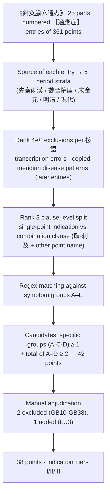
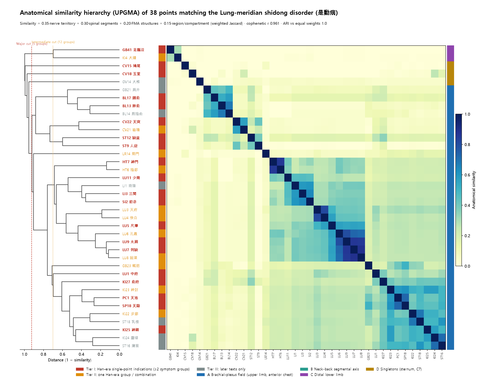
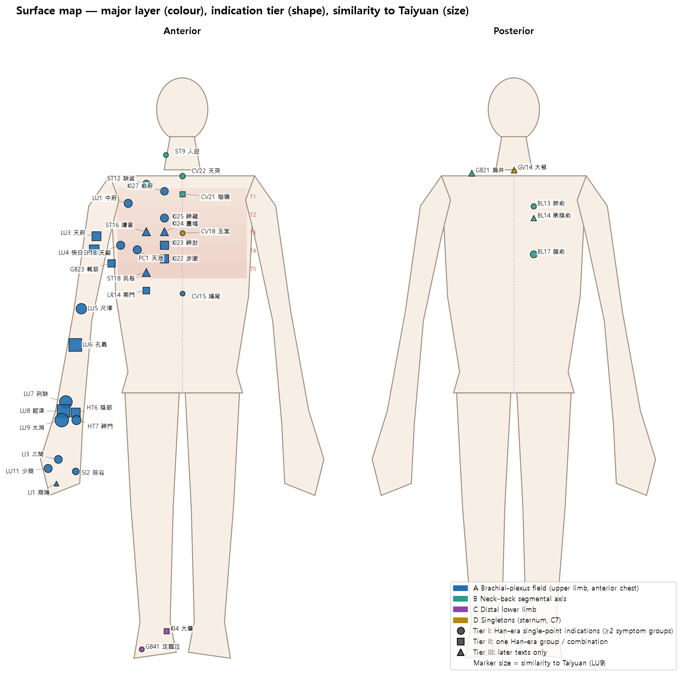
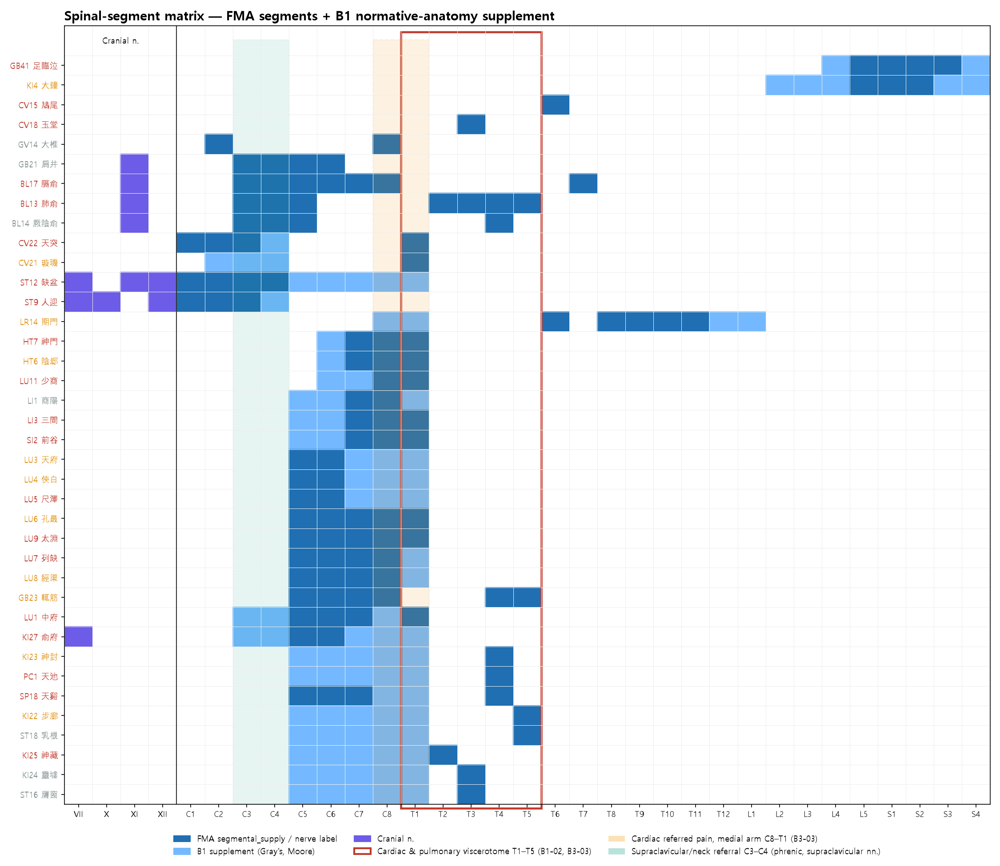
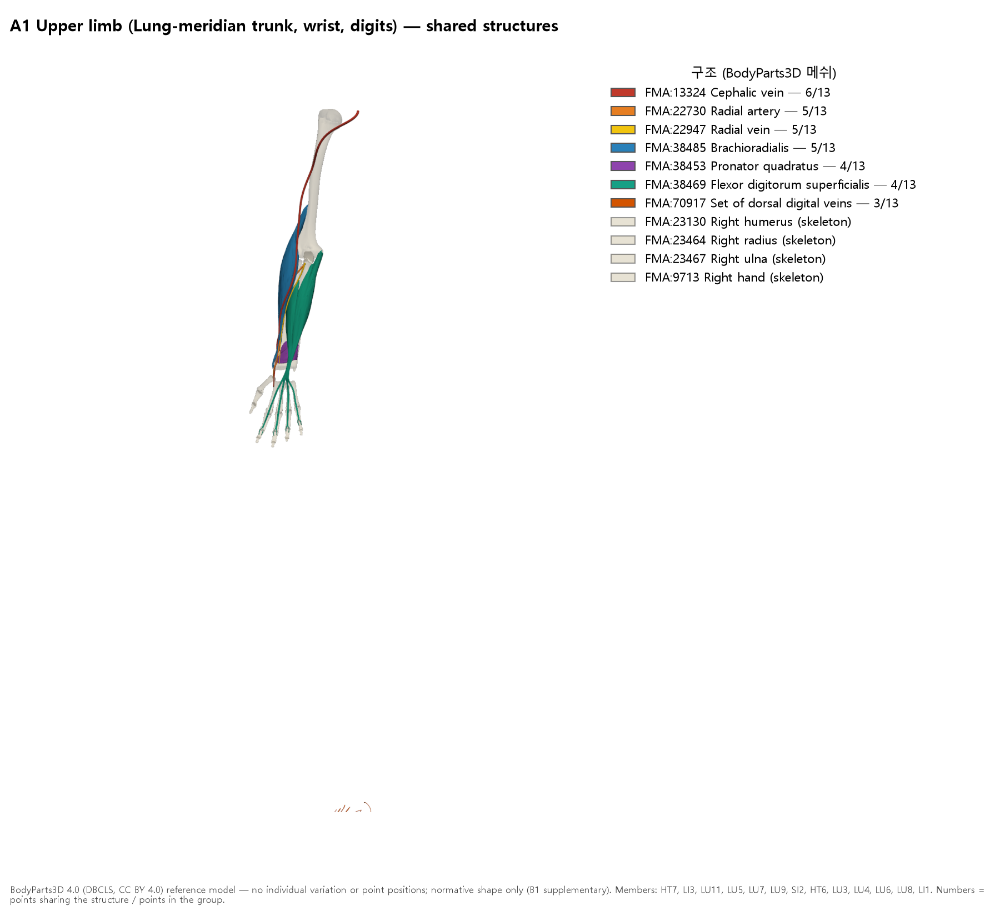
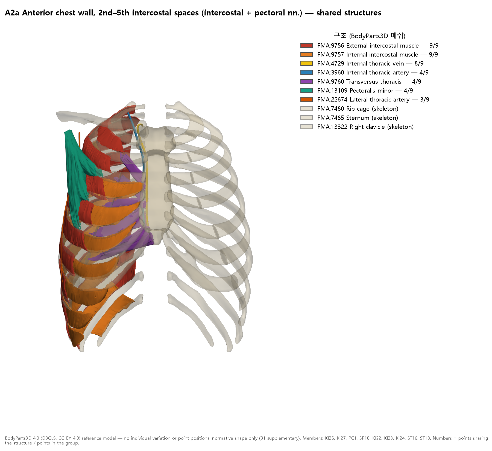
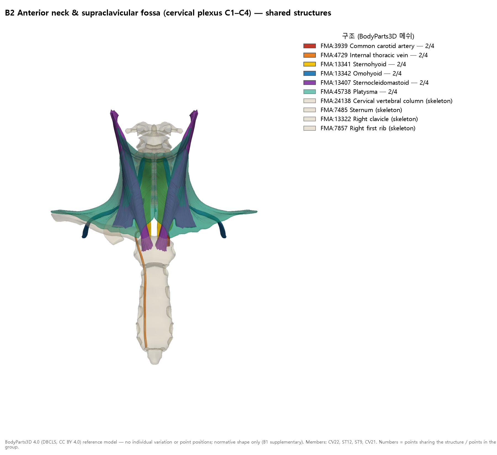
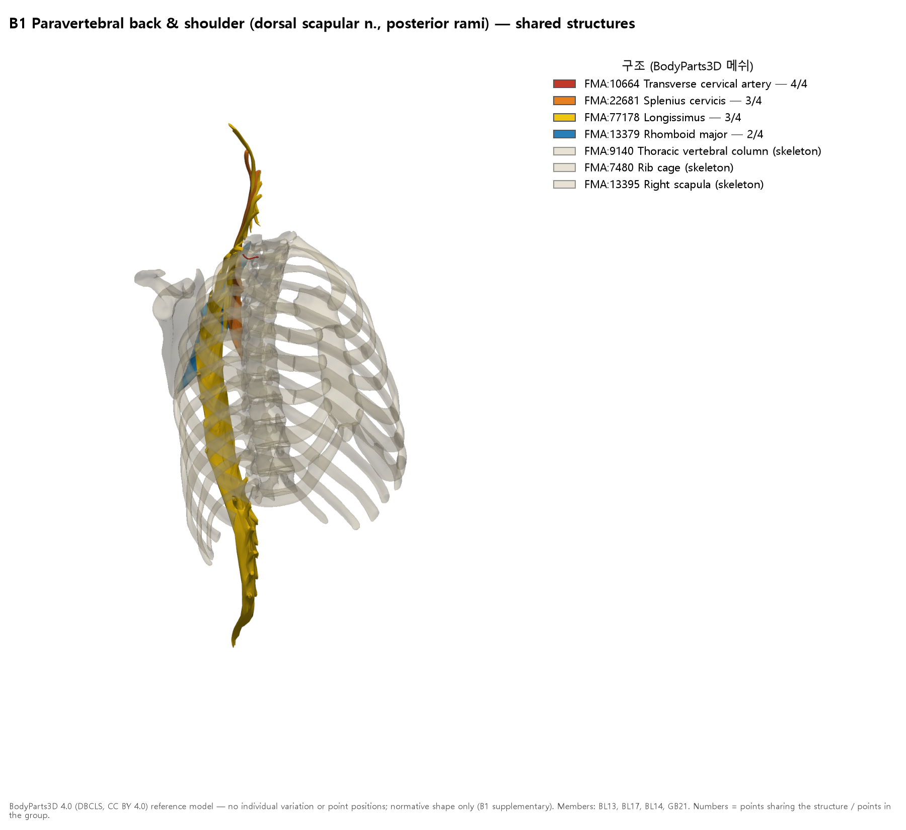

# [Acupoint Anatomy] Anatomical Similarity Strata of the Acupoints Corresponding to the Shidong Disorder (是動病) of the Lung Meridian of Hand-Taiyin (手太陰肺經) in 《靈樞·經脈》 — Comprehensive Acupuncture-Anatomy Report

> **Framework**: v2.7 · **Classification**: Category 4 symptom-based acupuncture-anatomy clinical matrix · **Scope**: Ranks 0–6 (FMA-linked); Rank 7 ARI **not scored** (a 38-point thematic matrix — ARI for individual points is scored in the Category 1 reports)
> **Three Primary Classics**: full parse of the 【適應症】 (indications) entries of the 361 points in the 25 parts of *Zhenjiu Shuxue Tongkao* (《針灸腧穴通考》) (primary source) · collated against *Zhongguo Zhenjiu Xuewei Tongjian* (《中國針灸穴位通鑑》) and *Zhongguo Zhenjiu Zhengzhi Tongjian* (《中國針灸證治通鑑》) (shidong original text and 是動 prescriptions)
> **Anatomical basis**: local index of FMA 5.1.0 (`fma_query.py profile`; two-textbook mapping table FMA Acupoint Anatomical Ontology Mapping Registry) + segmental supplementation from B1 normative anatomy (B1-01, B1-02, B1-03) · 3D shapes: BodyParts3D 4.0 (B1 supplementary)
> **Layer A**: Integrated Biomedical Master DB v3.0 (state as of 2026-10-24, `acupoint_inverted_index`) + collation with PubMed metadata. `sync_master_db.py` was not run for this analysis (batch synchronisation of the 38 points is a separate task).
> **Datasheet**: Lingshu Jingmai Lung Channel Shidong Clinical Acupuncture Anatomy Matrix Analysis Databook (10 sheets) · Reproduction scripts: `scripts/` folder
> **Note on script**: Classical quotations and TCM terms are given in Traditional Chinese (繁體字). The cited source files are simplified-script editions, so the file names and line numbers in `code` refer to those files as they are named on disk.

---

## 0. Summary

1. The shidong disorder (是動病) of the Hand-Taiyin meridian in 《靈樞·經脈》 reads "**肺脹滿膨膨而喘咳，缺盆中痛，甚則交兩手而瞀，此為臂厥**". Its prototype, *Yinyang Shiyi Mai Jiujing* (《陰陽十一脈灸經》), wrote "**心滂滂如痛，缺盆痛，甚則交兩手而戰**". Huang Longxiang (黃龍祥) interprets this symptom cluster as the pulse-opening (脈口) disease pattern of coronary angina (心痹) (*Tongkao* (《通考》), 手太陰肺經 概說; papers.id 1506). This report uses both layers together to define symptom groups A–E.
2. From the full set of indication entries for the 361 points in the *Tongkao*, **38 points** corresponding to the shidong symptom groups were extracted. Two points resting on circular evidence or a transcription error (Fubai (浮白, GB10), Yangfu (陽輔, GB38)) were excluded.
   - **Tier I, 20 points**: points whose Han-era (《明堂經》) single-point indications contain two or more symptom groups
   - **Tier II, 11 points**: one symptom group in the Han era, or a constituent point of a combination prescription
   - **Tier III, 7 points**: points that appear only in later literature
   - The only point whose Han-era single-point indications contain all four symptom groups (A–D) is **Taiyuan (太淵, LU9)**.
3. Anatomical similarity was computed from FMA structures, nerve territories, spinal segments and regions. UPGMA hierarchical clustering gave a **cophenetic correlation of 0.961**, and switching to equal weights left the clusters unchanged (ARI 1.000). The strata have three levels: 8 major groups → 12 intermediate groups → 16 sub-groups.
4. **The stratum with the highest similarity is the "Lung-meridian trunk chain (天府–太淵)"**. Similarity to Taiyuan (太淵) ranks Lieque (列缺) 0.87 > Jingqu (經渠) 0.86 > Kongzui (孔最) 0.80 > Chize (尺澤) 0.55 > Xiabai (俠白) 0.43 > Tianfu (天府) 0.40. The next strata are the digits (商陽·前谷·三間·少商, 0.37–0.39), the ulnar wrist (神門·陰郄, 0.35) and the anterior chest wall at intercostal spaces 2–5 (0.25–0.27). Points of the anterior neck, back, lower limb and midline barely overlap anatomically with Taiyuan (太淵) (≤ 0.17).
5. Segmentally, the points corresponding to the shidong disorder converge on three axes.
   - **Brachial plexus C5–T1 axis**: 13 upper-limb points and 12 anterior chest wall points
   - **Cervical plexus C1–C4 axis**: 4 anterior neck/supraclavicular points
   - **Thoracic dorsal rami / dorsal scapular nerve axis**: 4 back points

   Of these, **only the anterior chest wall intercostal points (A2a) and Feishu (肺俞) overlap directly with the cardiac and pulmonary visceral segments T2–T5**. The upper-limb points reach them only at the border, via C8–T1 (B1-02, B3-03).
6. Layer A conflicts with the interpretation. All four animal studies of Taiyuan (太淵) electroacupuncture in myocardial ischaemia used Taiyuan (太淵) as a "Lung-meridian control", and in three of them the heart-meridian points (神門·通里) or Neiguan (內關) had the larger effect. Hence the interpretation "Hand-Taiyin shidong disorder = cardiac pain" is supported by textual history but is hard to support with effects of Lung-meridian points, and it is kept as a **hypothesis**.

---

## 1. Textual Strata of the Shidong Original Text (Ranks 1–3)

| Stratum | Text | Original text | Evidence location |
| :-- | :-- | :-- | :-- |
| Prototype | 《陰陽十一脈灸經》 | 臂巨陰脈……是動則病：**心滂滂如痛，缺盆痛，甚則交兩手而戰**，此為臂厥 | `침구수혈통고(针灸腧穴通考)/针灸腧穴通考_03_上_手太阴肺经穴.md` L19 |
| Revision | 《靈樞·經脈》 | 是動則病**肺脹滿膨膨而喘咳，缺盆中痛，甚則交兩手而瞀**，此為臂厥 | Same file L31, Table 2-1 (L39); the acupuncture chapter of *Dongui Bogam* (《東醫寶鑑》) quotes the same sentence |
| Point indications | 《黃帝明堂經》 | 經渠：心痛欲嘔，胸中彭彭然，甚則交兩手務。咳上氣喘。 / 太淵：心痛脹滿彭彭，臂厥。胸痛，缺盆中相引痛。喘不得息。 / 尺澤：心膨膨痛。 | Same file, Table 2-1 (L39) |
| Prescription | 《黃帝明堂經》 (《甲乙》 vols. 8–9) | 胸中膨膨然，甚則交兩手而瞀，暴癉內逆，**刺經渠及天府**，此謂之大輸 | `针灸腧穴通考_02_上_序·凡例·总论-2.md` L1027; `中国针灸证治通鉴_03_…_古代针灸方选解.md` L264; `中国针灸穴位通鉴_07_手太阴肺经(1).md` L716 |

- **Huang Longxiang's (黃龍祥) verdict** (*Tongkao* L19–L39): the shidong disorder is a pulse-diagnosis disease pattern of the pulse opening (脈口) at the wrist. The Hand-Taiyin shidong disorder describes "**冠心病心絞痛症狀**" (symptoms of coronary angina). 心滂滂如痛 is read as cardiac pain and palpitation, 缺盆痛 as cardiac pain radiating to the suprasternal notch and throat ("心痛引喉"), and 交兩手而戰 as clasping both hands to the chest amid chills and fear. When the 《靈樞》 replaced 心 with 肺, a single connected symptom cluster split into what look like three independent symptoms. By contrast, the Han-era 《明堂經》 indications of the Hand-Taiyin points do not yet contain the phrase "肺脹滿膨膨". The same author's paper 「心經、肺經'是動'病新解」 (papers.id 1506, 中國中醫基礎醫學雜誌 2005;11(11):814) argues the same point.
- **Commentary (按語) on Tianfu (天府)** (`…_03_…md` L981): "胸中膨膨然，甚則交兩手而瞀係手太陰經'是動'病，**可見於心絞痛發作**".
- **Rank 3 handling**: the revised stratum (《靈樞》 groups A–D) and the prototype stratum (《陰陽十一脈》 group E, 心痛·心膨膨) are marked separately and kept together in the matrix. The primary source is the 《陰陽十一脈》; the 《靈樞》 is a secondary revision.

## 2. Extraction Method (Ranks 1–4)

| Symptom group | Shidong phrase | Matching pattern (based on the simplified-script source text) | Remarks |
| :-: | :-- | :-- | :-- |
| A | 肺脹滿膨膨 | 肺脹 · 胸/心 + 膨膨·彭彭·滂滂 · 脹滿彭彭 · 胸(中)滿 · 胸脹 | Non-thoracic contexts such as the abdominal "兩肋積氣膨膨然" (不容) are excluded |
| B | 喘咳 | 喘 · 咳 · 欬 · 上氣 | The broadest group. Does not make a point a candidate on its own |
| C | 缺盆中痛 | 缺盆(中)…痛 | The same phrase also occurs in the Foot-Shaoyang (足少陽) meridian disease pattern (Section 4) |
| D | 交兩手而瞀·臂厥 | 交兩手 · 而瞀/而務/如瞀 · 臂厥 (excluding 肘臂厥痛) | Yang Shangshan (楊上善): "兩手逆冷故交之以望暖" |
| E | (prototype) 心滂滂如痛 | 心痛 · 心膨膨 | 《陰陽十一脈》 stratum. Not used for candidate selection; marked only |

**Definition of indication tiers**
- **Tier I**: points whose Han-era (《黃帝明堂經》, 《黃帝內經明堂》, 《靈》, 《素》) **single-point indications** contain two or more of A–D, at least one of which is a specific group (A, C, D)
- **Tier II**: points whose Han-era single-point indications contain only one symptom group and were supplemented later, or constituent points of a combination in a shidong prescription
- **Tier III**: points that appear only in later literature

## 3. Extraction Results — Indication Tiers of the 38 Points (Ten Core Elements ①②⑨)

Symptom-group codes: A 肺脹滿·膨膨, B 喘咳, C 缺盆中痛, D 交兩手而瞀·臂厥, E 心痛 (prototype stratum). Matched terms reproduce the wording of the *Tongkao* (《通考》) original text. The 290 evidence entries in total, including those of the 2 excluded points, are in the xlsx sheet `3_근거조문`.

| Tier | Code | Point | Han-era single-point groups | All-era single-point | In combination clause | Key evidence (Tongkao line, source, matched terms) |
| :-: | :-- | :-- | :-- | :-- | :-- | :-- |
| I | BL13 | Fèishū (肺俞, BL13) | AB | AB | — | L2413 《黃帝明堂經》 “胸滿/肺脹/咳/上氣/喘” |
| I | BL17 | Géshū (膈俞, BL17) | ABE | ABE | — | L3139 《黃帝明堂經》 “胸滿/咳/上氣/心痛” |
| I | CV15 | Jiūwěi (鳩尾, CV15) | AB | ABE | — | L1265 《黃帝明堂經》 “胸滿/喘/咳” |
| I | CV18 | Yùtáng (玉堂, CV18) | AB | AB | — | L1791 《黃帝明堂經》 “胸中滿/喘/上氣” |
| I | CV22 | Tiāntū (天突, CV22) | ABE | ABE | — | L2311 《黃帝明堂經》 “胸滿/咳/上氣/喘/心痛” |
| I | GB41 | Zúlínqì (足臨泣, GB41) | ABCE | ABCE | — | L3379 《黃帝明堂經》 “胸中滿/喘/缺盆中痛/心痛” |
| I | HT7 | Shénmén (神門, HT7) | ABE | ABE | — | L1299 《黃帝明堂經》 “胸滿/上氣/喘/心痛” |
| I | KI25 | Shéncáng (神藏, KI25) | AB | AB | — | L4217 《黃帝明堂經》 “胸滿/咳/喘” |
| I | KI27 | Shūfǔ (俞府, KI27) | AB | AB | — | L4447 《黃帝明堂經》 “胸滿/咳/上氣/喘” |
| I | LI3 | Sānjiān (三間, LI3) | AB | AB | — | L573 《黃帝明堂經》 “胸滿/喘” |
| I | LU1 | Zhōngfǔ (中府, LU1) | AB | AB | — | L405 《黃帝內經明堂》 “胸滿/肺脹/咳/喘” |
| I | LU11 | Shàoshāng (少商, LU11) | AB | AB | — | L2839 《黃帝內經明堂》 “肺脹/上氣/咳/喘” |
| I | LU5 | Chǐzé (尺澤, LU5) | ABE | ABE | — | L1321 《黃帝內經明堂》 “心膨膨/胸滿/咳/上氣/喘” |
| I | LU7 | Lièquē (列缺, LU7) | BD | BD | — | L1805 《黃帝內經明堂》 “咳/交兩手/而瞀” |
| I | LU9 | Tàiyuān (太淵, LU9) | ABCDE | ABCDE | — | L2325 《黃帝內經明堂》 “胸滿/心痛脹滿彭彭/喘/咳/缺盆中相引痛/臂厥/心痛” |
| I | PC1 | Tiānchí (天池, PC1) | AB | AB | — | L191 《黃帝明堂經》 “胸滿/上氣” |
| I | SI2 | Qiángǔ (前谷, SI2) | AB | AB | — | L385 《黃帝明堂經》 “胸滿/咳” |
| I | SP18 | Tiānxī (天谿, SP18) | AB | AB | — | L3209 《黃帝明堂經》 “胸中滿/咳/上氣” |
| I | ST12 | Quēpén (缺盆, ST12) | ABC | ABC | — | L2251 《黃帝明堂經》 “胸中滿/咳/缺盆中滿痛/缺盆中痛” |
| I | ST9 | Rényíng (人迎, ST9) | AB | AB | — | L1775 《黃帝明堂經》 “胸滿/喘” |
| II | CV21 | Xuánjī (璇璣, CV21) | A | AB | — | L2111 《黃帝明堂經》 “胸滿” |
| II | GB23 | Zhéjīn (輒筋, GB23) | B | AB | — | L103 《黃帝明堂經》 “喘” |
| II | HT6 | Yīnxì (陰郄, HT6) | BE | ABE | — | L1103 《黃帝明堂經》 “咳/心痛” |
| II | KI22 | Bùláng (步廊, KI22) | B | AB | — | L3903 《黃帝明堂經》 “喘” |
| II | KI23 | Shénfēng (神封, KI23) | B | AB | — | L4019 《黃帝明堂經》 “咳” |
| II | KI4 | Dàzhōng (大鐘, KI4) | B | AB | — | L1031 《黃帝明堂經》 “咳/喘” |
| II | LR14 | Qīmén (期門, LR14) | B | AB | — | L2771 《黃帝明堂經》 “咳/喘” |
| II | LU3 | Tiānfǔ (天府, LU3) | B | B | — | L979 《黃帝內經明堂》 “咳/上氣/喘” |
| II | LU4 | Xiábái (俠白, LU4) | BE | ABE | — | L1157 《黃帝內經明堂》 “咳/心痛” |
| II | LU6 | Kǒngzuì (孔最, LU6) | D | BD | — | L1557 《黃帝內經明堂》 “臂厥” |
| II | LU8 | Jīngqú (經渠, LU8) | BE | ABE | ABD | L2099 《黃帝內經明堂》 “胸中彭彭/咳/上氣/喘/交兩手/心痛” |
| III | BL14 | Juéyīnshū (厥陰俞, BL14) | — | ABE | — | L2657 《銅人腧穴鍼灸圖經》卷中 “心痛”; L2663 1957年南京《鍼灸學》 “胸滿/咳/心痛” |
| III | GB21 | Jiānjǐng (肩井, GB21) | — | BC | — | L3659 《針方六集》卷五 “缺盆中痛”; L3661 《循經考穴編》下 “咳” |
| III | GV14 | Dàzhuī (大椎, GV14) | — | AB | — | L2129 《針方六集》卷五 “咳”; L2131 《循經考穴編》下 “咳” |
| III | KI24 | Língxū (靈墟, KI24) | — | AB | — | L4123 《銅人腧穴鍼灸圖經》卷中 “胸滿/咳”; L4133 1957年南京《鍼灸學》 “咳” |
| III | LI1 | Shāngyáng (商陽, LI1) | — | BC | — | L227 《外臺祕要》卷三十九 “喘”; L231 《銅人腧穴鍼灸圖經》卷下 “喘/咳/缺盆痛” |
| III | ST16 | Yīngchuāng (膺窗, ST16) | — | AB | — | L2777 1957年南京《鍼灸學》 “胸滿/喘/咳”; L2779 2版《鍼灸學講義》 “咳/喘” |
| III | ST18 | Rūgēn (乳根, ST18) | — | AB | — | L3027 《竇太師針經》 “咳/喘”; L3029 《針方六集》卷五 “咳/喘” |

- Point names are standardised in Traditional characters. (The Korean edition leaves quoted entries in the simplified script of the source files; in this English edition they are given in Traditional characters — see the Note on script.)
- In Tier I, most group-A matches are "胸滿·胸中滿", i.e. general chest symptoms, so points carrying the phrase specific to the shidong disorder ("膨膨·彭彭") are considered separately. These are Taiyuan (太淵), Chize (尺澤), Jingqu (經渠) (combination clause), Zhongfu (中府), Shaoshang (少商) and Feishu (肺俞) (matching 肺脹 or 膨膨).

## 4. Rank 4 Adjudication Record — Exclusions, Cautions, Additions

| Point | Verdict | Grounds |
| :-- | :-- | :-- |
| Fubai (浮白, GB10) | **Excluded (transcription error)** | From the *Waitai Miyao* (《外臺祕要》) vol. 39 onward, the location and indications of Tianrong (天容) were mistakenly entered under 浮白. The 《銅人》 copied only the 天容 indications (*Tongkao* commentary on 浮白, `针灸腧穴通考_18_下_足少阳胆经穴-1.md` L1811) |
| Yangfu (陽輔, GB38) | **Excluded (circular evidence)** | 缺盆中痛 was transferred to 陽輔 from the Foot-Shaoyang (足少陽) meridian disease pattern by Gao Wu (高武) in the *Zhenjiu Juying* (《針灸聚英》) on the "mother–child reinforcing and reducing" (母子補瀉) principle (commentary L2779), and textbooks from 1957 onward inherited it. The Han-era single-point indication is B (喘) only |
| Jingqu (經渠, LU8) | Tier II (combination) | The Han-era single-point indication is "咳，上氣，喘…心痛欲嘔" (B, E). The core shidong clause (胸中彭彭·交兩手務) belongs to the **經渠 + 天府 prescription clause** "先取天府，此謂之大輸" (L2099). The *Waitai* (《外臺》) entry, flagged by the commentary as "輯錄有誤" (mis-transcribed), was excluded from the later stratum (L2107) |
| Tianfu (天府, LU3) | **Added** (Tier II, combination) | A constituent point of the shidong "大輸" prescription (pulse opening (脈口) 經渠 + 標脈 天府). The Han-era indication of 天府 itself is B only (L979) |
| Lieque (列缺, LU7) | Retained in Tier I · caution | A textual analysis (文獻分析) notes that the 《內經明堂》 "寒厥交兩手而瞀" (D) is close to the Hand-Taiyin **meridian** disease pattern of the 《靈樞》 and differs from its **collateral** (絡脈) disease pattern (L1859). It is also pointed out that transmitted editions of the 《甲乙》 dropped the three characters "刺經渠", so that indications of 經渠 were mixed into 列缺 (commentary at L2107). The possibility that group D came from 經渠 therefore cannot be ruled out |
| Zulinqi (足臨泣, GB41) | Retained in Tier I · homonymous symptom | The Han-era indications contain "缺盆中痛" and "胸中滿", but the commentary classifies them as a **Foot-Shaoyang (足少陽) meridian disease pattern** (L3379). Although the wording is the same, the disease-pattern lineage differs from the Hand-Taiyin shidong disorder (guarding against the Rank 4 disease-pattern conflation bias) |
| Quepen (缺盆, ST12) | Retained in Tier I · local | 缺盆中痛 is a local symptom at the point's own site. Its mechanism may differ from the "referred pain" of the shidong disorder |
| Taiyuan (太淵, LU9) · Chize (尺澤, LU5) | Some later entries excluded | The *Juying* (《聚英》) "肺脹彭彭…" is "錄自手太陰經病候" (L2341), and for 尺澤 it is "列手太陰經經脈病候於合穴" (L1343). As theoretical assignments of meridian disease patterns, they were excluded from the later stratum. The Han-era stratum is unaffected |

## 5. Anatomical Similarity Method (Rank 5 · FMA Section 5-1)

- **Input**: for each of the 38 points, `fma_query.py profile <code> --json` was run to obtain FMA mappings of the anatomical structures in the two textbooks (the common textbook and Kim Jaehyo's textbook). Only the mapping levels `exact`, `exact+…`, `exact(set)` and `parent(branch_of)` were used; `fuzzy`, `set(검토)` and `none` were omitted.
- **Four feature types** and weighted Jaccard similarity (provisional weights):
  - **N nerve territory (0.35)**: nerve structures + nerves supplying muscles + branch→trunk chains. Generic class labels such as "Thoracic nerve" were omitted.
  - **G spinal segment (0.30)**: FMA `segmental_supply` and ordinal labels (e.g. "Fourth intercostal nerve" → T4). For the 55 nerves without segments in FMA, **B1 normative segments** were supplied (B1-01 Gray's 42e, B1-03 Moore 8e — e.g. medial pectoral nerve C8–T1, radial nerve C5–T1).
  - **S FMA structure (0.20)**
  - **R region/compartment (0.15)**: `contained_in`, `is_a` superclasses, and the coarse region from the WHO standard location (B1-05)
- **Exclusion of multisegmental muscles**: when a single muscle brought in five or more FMA-native segments (erector spinae, multifidus, transversus thoracis, external oblique, etc. — 18 structures of 8 kinds at 13 points), that muscle's nerves and segments were omitted from the features. This applies, in the same spirit, the "exclude multisegmental spinal muscles" rule of `acupoints_by_segment` in Section 5-1 of the wrapper.
- **Clustering and stability**:
  - UPGMA (average linkage), distance = 1 − similarity. The cophenetic correlation is **0.961**.
  - The silhouette-optimal k is 8. Recomputing with equal weights (0.25×4) gives identical clusters at the same k (**ARI 1.000**).
  - The similarity ranking relative to Taiyuan (太淵) is identical under equal weights down to rank 7 (the Lung-meridian trunk chain). At ranks 8–12 only the digit and ulnar-wrist points change order among themselves (the "Equal weights" column of the table in Section 7).

## 6. Stratification Results — 8 Major · 12 Intermediate · 16 Sub-groups (Ten Core Elements ④⑥)

*Figure 1. Dendrogram (left) and similarity matrix ordered by the dendrogram (right). The left strip shows the indication tier (red Tier I, orange Tier II, grey Tier III); the right strip shows the major group. The red dashed line marks the cut height for the major groups (8), the orange dashed line that for the intermediate groups (12).*

| Major group (8) | Intermediate group (12) | Sub-group (16) | Member points |
| :-- | :-- | :-- | :-- |
| **A Brachial plexus territory** (24 points, C5–T1, upper limb and anterior chest wall) | A1 Upper limb (13) | A1a Lung-meridian trunk chain | 天府·俠白·尺澤·孔最·列缺·經渠·太淵 |
| | | A1b Ulnar wrist | 陰郄·神門 |
| | | A1c Digits | 少商·三間·前谷·商陽 |
| | A2 Anterior chest wall (9) | A2a Intercostal spaces 2–5 | 神藏·靈墟·神封·步廊·膺窗·乳根·天池·天谿 |
| | | A2b Infraclavicular | 俞府 |
| | 中府 (singleton, lateral anterior chest wall) | — | 中府 |
| | 輒筋 (singleton, lateral chest) | — | 輒筋 |
| **B1 Back (paravertebral) and top of shoulder** (4 points) | Same | Same | 肺俞·厥陰俞·膈俞·肩井 — dorsal scapular nerve, accessory nerve, C3–C5 ventral rami; thoracic dorsal rami |
| **B2 Anterior neck and supraclavicular region** (4 points, C1–C4 cervical plexus) | B2a Suprasternal notch and manubrium | Same | 天突·璇璣 |
| | B2b Anterior neck and supraclavicular | Same | 缺盆·人迎 — cranial nerves VII, X, XII |
| **C Distal lower limb** (2 points) | Same | 足臨泣 / 大鐘 | L4–S2, mutual similarity 0.30 |
| **D Singletons** (4 points) | Each a singleton | Each a singleton | 鳩尾 (T6) · 玉堂 (T3) · 期門 (T6–L1) · 大椎 (C8) |

*Figure 3. Schematic body-surface map (reflecting only the relative positions of the B1-05 locations; not to scale). Colour indicates the major group, shape the indication tier (● Tier I, ■ Tier II, ▲ Tier III), and size the similarity to Taiyuan (太淵). The red band on the anterior chest is the approximate extent of the T1–T5 dermatomes (B1-03).*

**Interpretation**
- **The most cohesive stratum is A1a (mean within-cluster similarity 0.58)**. Taiyuan (太淵), Lieque (列缺) and Jingqu (經渠) share the radial artery and radial veins, brachioradialis, and the superficial branch of the radial nerve and lateral antebrachial cutaneous nerve, with mutual similarities of 0.86–0.88. This is the site of the **pulse opening (寸口)** where the shidong disorder was first described, and it coincides exactly with the "經脈穴" (pulse-opening points at the wrist) described by Huang Longxiang (黃龍祥).
- **A2a anterior chest wall (0.52)** shares the intercostal muscles, internal thoracic artery and vein, pectoralis minor, intercostal nerves (T2–T5) and pectoral nerves. All Tier I anterior chest points (神藏·天池·天谿) belong here.
- **B2 anterior neck and supraclavicular region** shares the cervical plexus (C1–C4), infrahyoid muscles, sternocleidomastoid and common carotid artery. Quepen (缺盆), Renying (人迎) and Tiantu (天突) lie in the anatomical region where "缺盆中痛" is actually felt.
- The 20 Tier I points are **scattered across 6 of the 8 major groups**. The points corresponding to the shidong disorder therefore do not converge on a single anatomical region. Particular symptoms (胸滿·喘) recur in the indications of points in many regions, and this is where the "disease-pattern-centred conflation bias" that Rank 4 guards against easily arises.

## 7. Anatomical Similarity Ranking Relative to Taiyuan (太淵, LU9)

Taiyuan (太淵) was chosen as the reference point for two reasons: it is the **only point** whose Han-era single-point indications contain all four groups A–D, and it is the pulse-diagnosis site (寸口) of the shidong disorder. "Tier I centrality" (mean similarity to the 19 Tier I points other than Taiyuan (太淵)) and the full 38×38 matrix are in the xlsx sheets `7_太淵기준_순위` and `5_유사도행렬`.

| Rank | Code | Point | Tier | Similarity to LU9 | Equal weights | Region | Spinal segments | Three nearest points |
| :-: | :-- | :-- | :-: | :-: | :-: | :-- | :-- | :-- |
| 1 | LU9 | Tàiyuān (太淵) | I | 1.0 | 1.0 | radial wrist | C5, C6, C7, C8, T1 | LU7(0.87); LU8(0.86); LU6(0.80) |
| 2 | LU7 | Lièquē (列缺) | I | 0.865 | 0.819 | radial wrist | C5, C6, C7, C8, T1 | LU8(0.88); LU9(0.87); LU6(0.73) |
| 3 | LU8 | Jīngqú (經渠) | II | 0.857 | 0.808 | radial wrist | C5, C6, C7, C8, T1 | LU7(0.88); LU9(0.86); LU6(0.71) |
| 4 | LU6 | Kǒngzuì (孔最) | II | 0.798 | 0.773 | anterior forearm | C5, C6, C7, C8, T1 | LU9(0.80); LU7(0.73); LU8(0.71) |
| 5 | LU5 | Chǐzé (尺澤) | I | 0.554 | 0.508 | cubital fossa | C5, C6, C7, C8, T1 | LU6(0.57); LU4(0.57); LU7(0.56) |
| 6 | LU4 | Xiábái (俠白) | II | 0.426 | 0.37 | anterior arm | C5, C6, C7, C8, T1 | LU3(0.81); LU5(0.57); LU6(0.43) |
| 7 | LU3 | Tiānfǔ (天府) | II | 0.401 | 0.349 | anterior arm | C5, C6, C7, C8, T1 | LU4(0.81); LU5(0.50); LU6(0.41) |
| 8 | LI1 | Shāngyáng (商陽) | III | 0.393 | 0.331 | digit | C5, C6, C7, C8, T1 | SI2(0.61); LI3(0.59); LU11(0.46) |
| 9 | SI2 | Qiángǔ (前谷) | I | 0.39 | 0.339 | digit | C5, C6, C7, C8, T1 | LI3(0.64); LI1(0.61); LU11(0.45) |
| 10 | LI3 | Sānjiān (三間) | I | 0.372 | 0.314 | hand | C5, C6, C7, C8, T1 | SI2(0.64); LI1(0.59); LU11(0.46) |
| 11 | HT7 | Shénmén (神門) | I | 0.354 | 0.332 | ulnar wrist | C6, C7, C8, T1 | HT6(0.86); LU11(0.40); LU6(0.39) |
| 12 | HT6 | Yīnxì (陰郄) | II | 0.348 | 0.321 | ulnar wrist | C6, C7, C8, T1 | HT7(0.86); LU6(0.40); LU11(0.36) |
| 13 | ST16 | Yīngchuāng (膺窗) | III | 0.27 | 0.242 | anterior chest wall | C5, C6, C7, C8, T1, T3 | KI24(0.72); ST18(0.61); SP18(0.51) |
| 14 | SP18 | Tiānxī (天谿) | I | 0.267 | 0.237 | anterolateral chest wall | C5, C6, C7, C8, T1, T4 | PC1(0.73); KI23(0.61); ST16(0.51) |
| 15 | LU11 | Shàoshāng (少商) | I | 0.265 | 0.218 | digit | C6, C7, C8, T1 | LI3(0.46); LI1(0.46); SI2(0.45) |
| 16 | PC1 | Tiānchí (天池) | I | 0.263 | 0.23 | anterolateral chest wall | C5, C6, C7, C8, T1, T4 | SP18(0.73); KI23(0.59); ST16(0.49) |
| 17 | LU1 | Zhōngfǔ (中府) | I | 0.262 | 0.237 | anterolateral chest wall | C3, C4, C5, C6, C7, C8, T1 | KI27(0.38); SP18(0.34); LU3(0.33) |
| 18 | ST18 | Rūgēn (乳根) | III | 0.257 | 0.22 | anterior chest wall | C5, C6, C7, C8, T1, T5 | KI22(0.69); ST16(0.61); KI25(0.49) |
| 19 | KI25 | Shéncáng (神藏) | I | 0.256 | 0.218 | parasternal chest wall | C5, C6, C7, C8, T1, T2 | KI24(0.58); KI23(0.58); KI22(0.51) |
| 20 | KI23 | Shénfēng (神封) | II | 0.256 | 0.218 | parasternal chest wall | C5, C6, C7, C8, T1, T4 | SP18(0.61); PC1(0.59); KI25(0.58) |
| 21 | KI24 | Língxū (靈墟) | III | 0.256 | 0.218 | parasternal chest wall | C5, C6, C7, C8, T1, T3 | ST16(0.72); KI25(0.58); KI23(0.58) |
| 22 | KI22 | Bùláng (步廊) | II | 0.25 | 0.208 | parasternal chest wall | C5, C6, C7, C8, T1, T5 | ST18(0.69); KI25(0.51); KI24(0.51) |
| 23 | KI27 | Shūfǔ (俞府) | I | 0.221 | 0.189 | parasternal chest wall | C3, C4, C5, C6, C7, C8, T1 + CN VII | ST16(0.41); ST18(0.41); KI25(0.40) |
| 24 | GB23 | Zhéjīn (輒筋) | II | 0.183 | 0.163 | lateral chest wall | C5, C6, C7, C8, T4, T5 | SP18(0.51); PC1(0.41); KI22(0.34) |
| 25 | ST12 | Quēpén (缺盆) | I | 0.167 | 0.139 | supraclavicular fossa | C1, C2, C3, C4, C5, C6, C7, C8, T1 + CN VII,CN XI,CN XII | ST9(0.40); KI27(0.35); LU1(0.27) |
| 26 | BL17 | Géshū (膈俞) | I | 0.15 | 0.125 | back (paravertebral) | C3, C4, C5, C6, C7, C8, T7 + CN XI | BL14(0.58); BL13(0.53); GB21(0.44) |
| 27 | GB21 | Jiānjǐng (肩井) | III | 0.086 | 0.071 | top of shoulder | C3, C4, C5, C6 + CN XI | BL14(0.49); BL17(0.44); BL13(0.42) |
| 28 | GV14 | Dàzhuī (大椎) | III | 0.058 | 0.055 | back midline (C7) | C2, C8 | ST12(0.07); ST9(0.06); LU11(0.06) |
| 29 | LR14 | Qīmén (期門) | II | 0.057 | 0.054 | anterior chest wall (lower) | C8, T1, T6, T8, T9, T10, T11, T12, L1 | ST18(0.18); KI25(0.15); KI24(0.15) |
| 30 | CV22 | Tiāntū (天突) | I | 0.039 | 0.037 | anterior neck (suprasternal notch) | C1, C2, C3, C4, T1 | CV21(0.57); ST9(0.42); ST12(0.25) |
| 31 | CV21 | Xuánjī (璇璣) | II | 0.037 | 0.031 | anterior midline (sternum) | C2, C3, C4, T1 | CV22(0.57); ST9(0.24); CV18(0.21) |
| 32 | BL14 | Juéyīnshū (厥陰俞) | III | 0.037 | 0.031 | back (paravertebral) | C3, C4, C5, T4 + CN XI | BL13(0.69); BL17(0.58); GB21(0.49) |
| 33 | BL13 | Fèishū (肺俞) | I | 0.027 | 0.023 | back (paravertebral) | C3, C4, C5, T2, T3, T4, T5 + CN XI | BL14(0.69); BL17(0.53); GB21(0.42) |
| 34 | GB41 | Zúlínqì (足臨泣) | I | 0.007 | 0.011 | dorsum of foot | L4, L5, S1, S2, S3, S4 | KI4(0.30); GV14(0.01); LU8(0.01) |
| 35 | KI4 | Dàzhōng (大鐘) | II | 0.005 | 0.009 | medial ankle | L2, L3, L4, L5, S1, S2, S3, S4 | GB41(0.30); SI2(0.02); LU11(0.01) |
| 36 | CV15 | Jiūwěi (鳩尾) | I | 0.0 | 0.0 | anterior midline (epigastric) | T6 | LR14(0.07); CV18(0.02); CV21(0.02) |
| 37 | CV18 | Yùtáng (玉堂) | I | 0.0 | 0.0 | anterior midline (sternum) | T3 | KI24(0.26); CV21(0.21); ST16(0.16) |
| 38 | ST9 | Rényíng (人迎) | I | 0.0 | 0.0 | anterior neck | C1, C2, C3, C4 + CN VII,CN X,CN XII | CV22(0.42); ST12(0.40); CV21(0.24) |

## 8. Segmental Concordance and Reflex Mechanisms (Rank 6 · B-Check ② Perspective, Ten Core Elements ⑧)

*Figure 2. Spinal segments by point (dark blue = FMA, light blue = B1 supplement) and cranial nerves (purple). The red box marks the cardiac and pulmonary visceral segments T1–T5 (B1-02, B3-03), the orange band the medial-arm segments C8–T1 where referred pain of angina appears (B3-03), and the green band the supraclavicular/neck referral segments C3–C4.*

| Sub-group | n | Members | Includes T1–T5 | Includes C8–T1 | Includes C3–C4 | Vagus | Mean within-group similarity |
| :-- | :-: | :-- | :-: | :-: | :-: | :-: | :-: |
| C1 Dorsum of foot (足臨泣) | 1 | GB41 | 0/1 | 0/1 | 0/1 | 0/1 |  |
| C2 Medial ankle (大鐘) | 1 | KI4 | 0/1 | 0/1 | 0/1 | 0/1 |  |
| B1 Back (paravertebral) and top of shoulder | 4 | BL13, BL17, BL14, GB21 | 2/4 | 1/4 | 4/4 | 0/4 | 0.525 |
| B2a Suprasternal notch and manubrium | 2 | CV22, CV21 | 2/2 | 2/2 | 2/2 | 0/2 | 0.571 |
| B2b Anterior neck and supraclavicular | 2 | ST12, ST9 | 1/2 | 1/2 | 2/2 | 1/2 | 0.399 |
| A1b Ulnar wrist (陰郄·神門) | 2 | HT7, HT6 | 2/2 | 2/2 | 0/2 | 0/2 | 0.863 |
| A1c Digits (少商·三間·前谷·商陽) | 4 | LI3, LU11, SI2, LI1 | 4/4 | 4/4 | 0/4 | 0/4 | 0.536 |
| A1a Lung-meridian trunk chain (天府–太淵) | 7 | LU5, LU7, LU9, LU3, LU4, LU6, LU8 | 7/7 | 7/7 | 0/7 | 0/7 | 0.584 |
| A2a Anterior chest wall, intercostal spaces 2–5 | 8 | KI25, PC1, SP18, KI22, KI23, KI24, ST16, ST18 | 8/8 | 8/8 | 0/8 | 0/8 | 0.522 |
| A2b Infraclavicular (俞府) | 1 | KI27 | 1/1 | 1/1 | 1/1 | 0/1 |  |
| A2c Lateral anterior chest wall (中府) | 1 | LU1 | 1/1 | 1/1 | 1/1 | 0/1 |  |
| A2d Lateral chest (輒筋) | 1 | GB23 | 1/1 | 1/1 | 0/1 | 0/1 |  |
| D Costal margin (期門) | 1 | LR14 | 1/1 | 1/1 | 0/1 | 0/1 |  |
| D C7 spinous process (大椎) | 1 | GV14 | 0/1 | 1/1 | 0/1 | 0/1 |  |
| D Sternal midline (玉堂) | 1 | CV18 | 1/1 | 0/1 | 0/1 | 0/1 |  |
| D Epigastrium (鳩尾) | 1 | CV15 | 0/1 | 0/1 | 0/1 | 0/1 |  |

**Verdict** (by the B-Check ② segmental-concordance criterion; only segmental overlap is assessed, not mechanistic confirmation)
- **A2a anterior chest wall, intercostal spaces 2–5**: 8/8 carry T2–T5 intercostal nerve segments and thus **overlap directly** with the cardiac and pulmonary visceral segments (B1-02; referred-pain Head zones B3-01). This is the stratum with the highest segmental concordance.
- **B1 back**: only Feishu (肺俞) carries T2–T5 dorsal rami; Jueyinshu (厥陰俞) is T4 (FMA) and Geshu (膈俞) T7. Feishu (肺俞) has high segmental concordance, but the shared feature of the cluster is the dorsal scapular nerve and accessory nerve (C3–C5).
- **A1 upper limb (Taiyuan (太淵) series)**: overlaps only at the T1 border (median and ulnar nerves, medial cutaneous nerves C8–T1). This is the same segment as the **medial-arm referred pain** of angina (C8–T1, B3-03). However, Taiyuan (太淵) and Lieque (列缺) themselves are weighted towards the radial and musculocutaneous nerves (C5–C7), so segmentation alone is weak evidence for explaining the cardiopulmonary symptoms of the shidong disorder (B-Check ② at the 1-point level).
- **B2 anterior neck and supraclavicular region**: C3–C4 (segments of the supraclavicular nerves and phrenic nerve) are the same segments as the supraclavicular referred pain from diaphragmatic and pericardial irritation (B1-01). "缺盆中痛" may be referred pain of these segments, but the registry has no direct evidence, so it is kept as a **hypothesis**.

**Layer A** (integrated DB, as of 2026-10-24 — title, abstract and keyword collation of papers linked in `acupoint_inverted_index`)

| Code | Linked papers (active) | Cardiac | Respiratory |
| :-- | :-: | :-: | :-: |
| BL13 | 9 | 0 | 3 |
| CV22 | 7 | 1 | 1 |
| LI3 | 2 | 0 | 1 |
| LU1 | 5 | 0 | 1 |
| LU11 | 12 | 1 | 2 |
| LU5 | 8 | 1 | 1 |
| LU9 | 27 | 5 | 9 |
| ST12 | 12 | 1 | 2 |
| ST9 | 18 | 1 | 0 |
| LR14 | 3 | 0 | 1 |
| LU3 | 27 | 2 | 3 |
| LU6 | 36 | 0 | 12 |
| GV14 | 21 | 1 | 2 |

Points with no linked cardiac or respiratory paper (25): BL17, CV15, CV18, GB41, HT7, KI25, KI27, LU7, PC1, SI2, SP18, CV21, GB23, HT6, KI22, KI23, KI4, LU4, LU8, BL14, GB21, KI24, LI1, ST16, ST18

- **Taiyuan (太淵) myocardial ischaemia experiments** (all animal, merged into the DB): Taiyuan (太淵) was used as the "Lung-meridian" comparison group.
  - papers.id 2238 (PMID 29231479, rat): Neiguan (內關) was superior to Taiyuan (太淵), and **the effect of Taiyuan (太淵) was "不明顯" (not evident)**.
  - papers.id 2236 (PMID 33068354, rat): Shenmen (神門) + Tongli (通里) had a larger effect than Taiyuan (太淵) + Lieque (列缺).
  - papers.id 2244 (PMID 39579035, mouse): HT7–HT5 had a larger β1-AR modulating effect than LU9–LU8.
  - papers.id 2241 (PMID 29560633, rat): both heart- and Lung-meridian points improved HCN2, the heart meridian more clearly.

  In sum, Taiyuan (太淵) has some cardioprotective effect, but weaker than the heart-meridian points. This means **the evidence for supporting "Hand-Taiyin shidong disorder = cardiac pain" with effects of Lung-meridian points is weak** (B-Check ⑤ conflict → hypothesis).
- **Respiratory**: Taiyuan (太淵) electroacupuncture alone improved lung function in rats with acute lung injury (papers.id 2240, PMID 35880273, animal). Of the 12 Kongzui (孔最) asthma studies, 3 are rat experiments (papers.id 1682–1684). The human evidence is one RCT of the combination 太淵·孔最·膻中·肺俞 for postoperative pulmonary complications after thoracoscopic surgery (papers.id 1807, PMID 40953233 — a combination, so not read as single-point efficacy).
- **External search**: this report did not run the 38-point batch `sync_master_db.py` (**external search incomplete**). For the PMIDs above, only the bibliographic data and stimulated points were checked against PubMed metadata.

## 9. 3D Anatomical Images — Shared Structures by Stratum (BodyParts3D 4.0, B1 Supplementary)

For each cluster, up to seven FMA structures with meshes that are shared by at least half of the member points (minimum 2 points) were drawn, with the skeleton as a translucent background. BodyParts3D is a single standard model; it does not reflect individual variation or acupoint locations and is used only as a **normative shape reference**. The A1c digits cluster had only one shared mesh and was not drawn.

*Figure 4-1. A1 upper limb (13 points): cephalic vein 6/13; radial artery, radial veins and brachioradialis 5/13; pronator quadratus and flexor digitorum superficialis 4/13.*

*Figure 4-2. A2 anterior chest wall (9 points, including Shufu (俞府)): external and internal intercostal muscles 9/9; internal thoracic vein 8/9; internal thoracic artery, transversus thoracis and pectoralis minor 4/9.*

*Figure 4-3. B2 anterior neck and supraclavicular region (4 points): common carotid artery, internal thoracic vein, sternohyoid, omohyoid, sternocleidomastoid and platysma, each 2/4 (platysma translucent).*

*Figure 4-4. B1 back (paravertebral) and top of shoulder (4 points): transverse cervical artery 4/4; splenius cervicis and longissimus 3/4; rhomboid major 2/4 (oblique anterior view).*

## 10. Overall Conclusions and Limitations

**Conclusions**
1. In the classical sources, 38 points have indications corresponding to the Hand-Taiyin shidong symptom groups (Tier I 20 · Tier II 11 · Tier III 7). The only point with the full shidong phrase (A–D) among its Han-era single-point indications is **Taiyuan (太淵)**. The core clause of Jingqu (經渠) belongs to the 經渠 + 天府 prescription (大輸).
2. The apex of the anatomical similarity strata is **Taiyuan (太淵), Lieque (列缺), Jingqu (經渠) and Kongzui (孔最) (similarity 0.80–0.88)**. This "Lung-meridian trunk chain" (A1a) is the wrist pulse-opening region sharing the radial artery, brachioradialis and superficial branch of the radial nerve. It is anatomically consistent with Huang Longxiang's (黃龍祥) interpretation that the shidong disorder was originally a "pulse-opening disease pattern (脈口病候)".
3. The strata overlapping directly with the cardiac and pulmonary visceral segments (T2–T5) are the **anterior chest wall intercostal points (A2a)** and Feishu (肺俞). The segmentally concordant anatomical substrate for the shidong "胸中滿·膨膨" lies in the chest wall, not the wrist pulse opening.
4. "Shidong disorder = cardiac pain (心痹)" is supported by textual-historical evidence (the 《陰陽十一脈》 prototype, the 《明堂》 indications). However, the Layer A animal experiments on Lung-meridian points conflict with it (heart-meridian points superior), so it remains a **hypothesis (H)**.

**Limitations**
- Symptom-group matching depends on regular expressions. Synonyms (e.g. "胸痹", "短氣") and identical characters with a different meaning in context were not fully filtered out. The Han-era entries of the 31 Tier I and II points can be checked in the original text in the xlsx sheet `3_근거조문`.
- Anatomical features depend on what the two textbooks record (e.g. the midline (正中線) points Jiuwei (鳩尾) and Yutang (玉堂) have few structures, 6–8, and became singletons). The weights are provisional. The equal-weight sensitivity check was passed, but other feature definitions (e.g. separating vascular territories) were not tested.
- The B1 segmental supplements are textbook representative values; individual variation may differ within the B1-04 range.
- ARI was not scored. Taiyuan (太淵), Lieque (列缺), Jingqu (經渠) and Kongzui (孔最) (A1a) and Tianxi (天谿) and Tianchi (天池) (A2a) have, or need, individual Category 1 Tier 3 reports. A Taiyuan (太淵) v2.7 report (LU09) and a Kongzui (孔最) report (LU06) exist, and the shidong context of this report is to be incorporated at their next revision.

## 11. Outputs, Reproduction and Audit Record

| File | Contents |
| :-- | :-- |
| `영추경맥_수태음시동병_침구해부_종합보고서.md`·`.html` | This report (Korean) |
| `영추경맥_수태음시동병_침구해부_종합보고서_en.md`·`.html` | English edition (with Traditional Chinese characters) |
| Lingshu Jingmai Lung Channel Shidong Clinical Anatomy Matrix Databook | 1 shidong textual strata · 2 candidates and indication tiers · 3 evidence entries (290 rows) · 4 FMA anatomical features · 5 similarity matrix · 6 strata · 7 ranking relative to 太淵 · 8 segmental concordance · 9 Layer A · 10 methods and audit |
| `Fig1`~`Fig4_*_ko.png` / `_en.png` | 8 figures × 2 languages |
| `scripts/` | `extract_indications.py` (Ranks 1–4) → `anatomy_similarity.py` (FMA similarity, strata) → `make_figures.py`·`render3d.py` (figures) → `build_matrix.py` (xlsx) |

- Rank 0: `sync_skill_settings.py --check` reported no drift (only a change flag on `.claude/CLAUDE.md`). The canonical v2.7 was applied.
- Reproduction: `python scripts/extract_indications.py` → (save each point's `fma_query.py profile --json` output to `fma/`) → `anatomy_similarity.py` → `make_figures.py <folder> ko|en` → `render3d.py <folder> ko|en` → `build_matrix.py <xlsx>`.
- Author: Claude Code, 2026-10-24.
