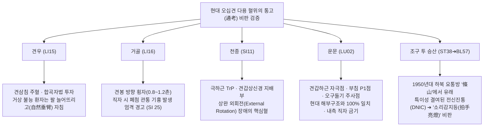
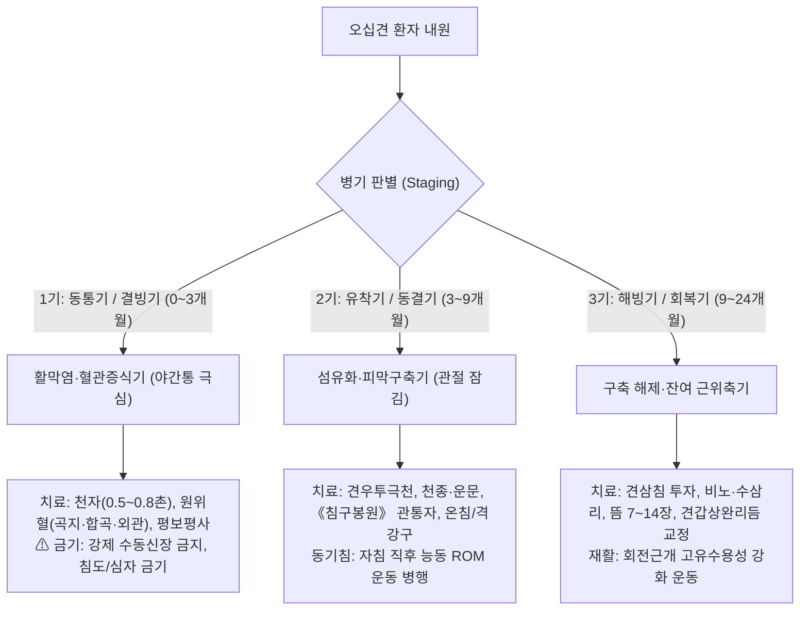
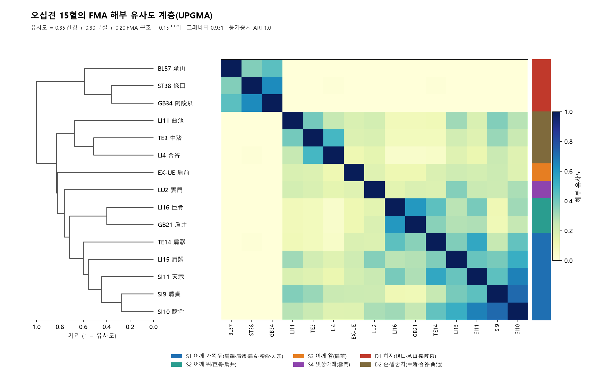
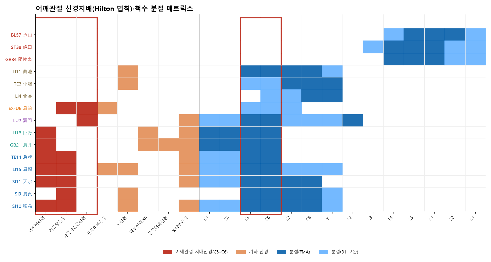
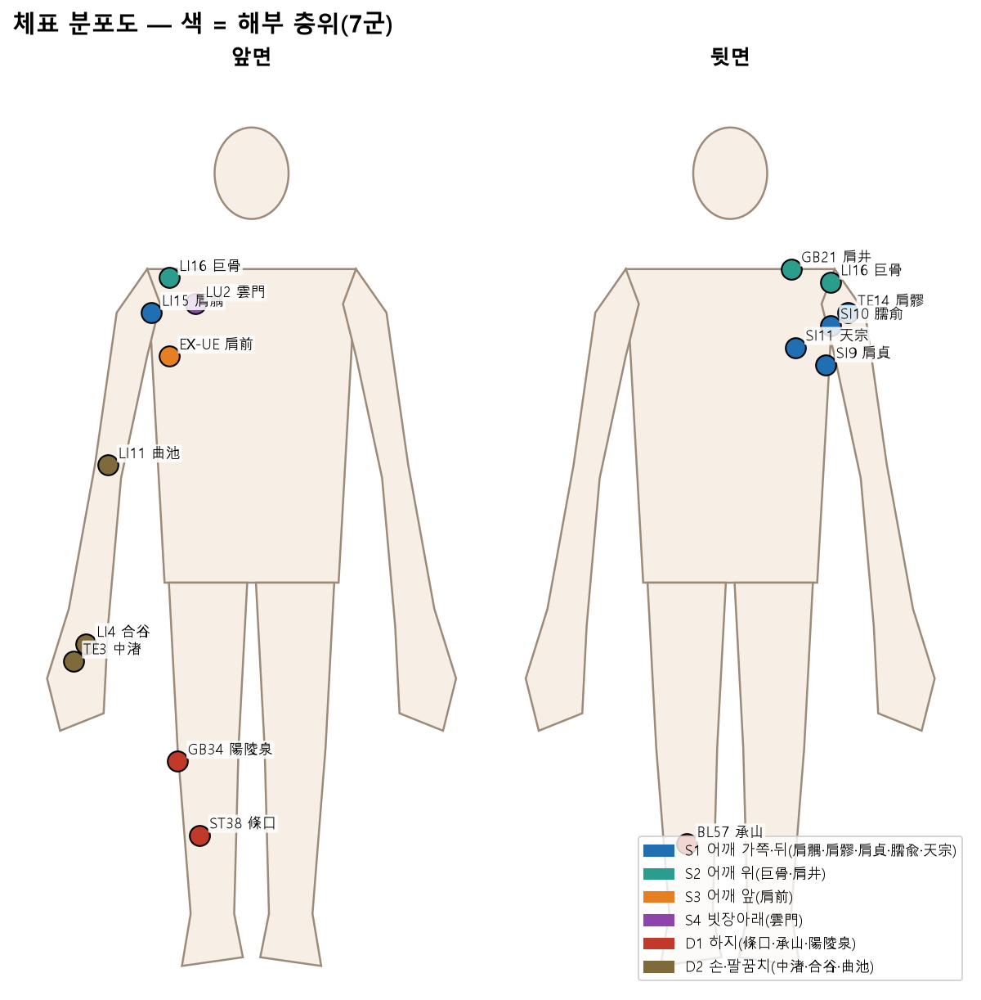
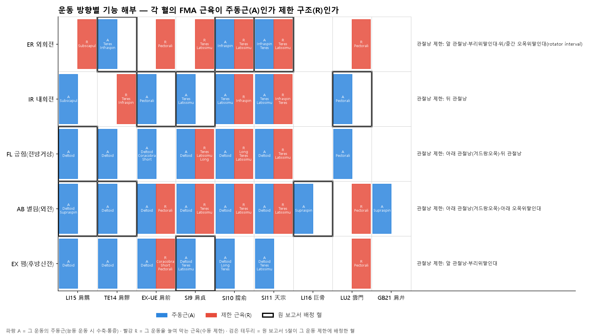
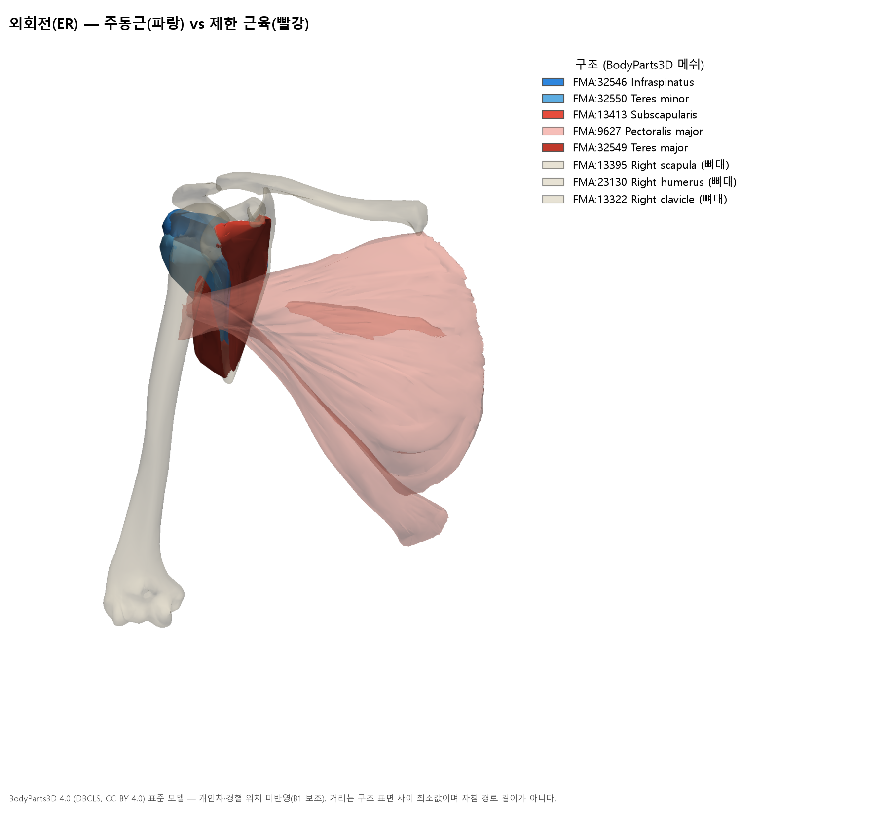
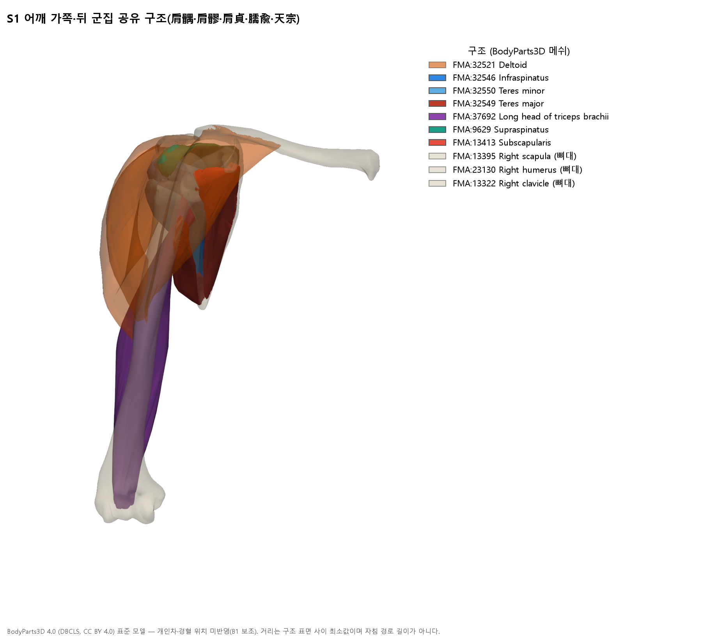
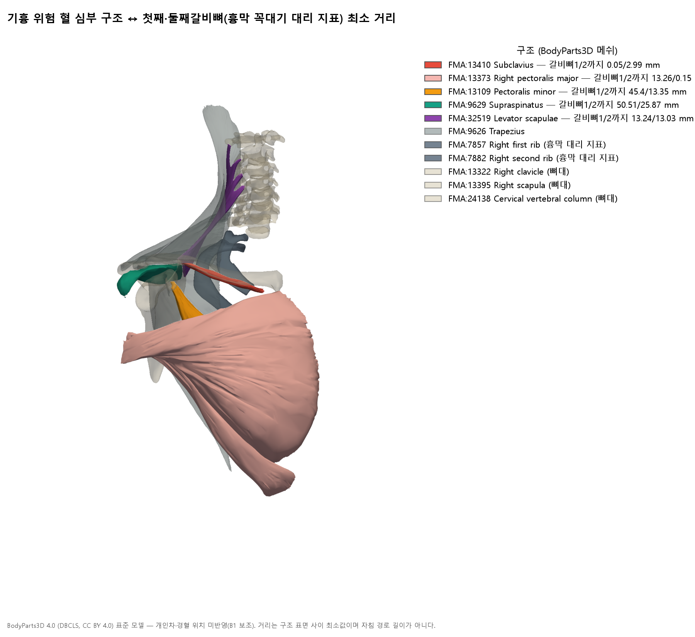

# [경혈해부] 오십견(누견풍·유착성 관절낭염) 침구 치료의 문헌 고증과 신경해부학적 임상 매트릭스 종합보고서

> **프레임워크**: v2.7 (2026-10-04 정제) · **분류**: Category 4 증상별 침구해부 임상 매트릭스 · **적용 범위**: Rank 0~7 종합 표준 프로토콜 전개
> **핵심 원전문헌**: 《中国针灸证治通鉴》 제3편 내과병증 '46. 상지병증(上肢病证)'(원서 p.348~360) 및 부록 '누견풍(漏肩风)' 현대문헌 · 《针灸腧穴通考》 (견우·거골·천종·운문·조구 등 고증 및 '조산' 비판) · 《针灸资生经》 · 《针灸玉龙经》 · 《类经图翼》 · 《针灸逢源》
> **해부학적 근거**: FMA 5.1.0 온톨로지(Foundational Model of Anatomy), 회전근개(Rotator cuff: 극상근·극하근·견갑하근·소원근) 및 견봉하 활액낭, 견갑상신경(C5-6)·겨드랑신경(C5-6)·팔신경얼기(C5-T1), 흉벽 폐첨부 안전 심도 기준
> **Layer A/B 생의학 DB**: 통합 생의학 마스터 DB v3.0 (papers.id 1836, 397, 1819, 1827, 1898) 및 Layer B 4계층 참조 등록부(B1-01, B2-01, B3-05, B4-02), B-Check 6항목 채점
> **데이터시트**: 오십견·누견풍 침구해부 임상 매트릭스 분석 데이터북 (9개 시트 완비: 고전문헌, 현대문헌, 통고비판, FMA해부, 운동제한매트릭스, 병기별프로토콜, 조구계보, 생의학검증, ARI평가표 + 2026-10-25 정제 6시트)
> **2026-10-25 정제(Claude Code)**: FMA 5.1.0 해부 분석·이미지(11절)를 추가하고, 원전 인용·FMA 대응·운동학·Layer A 인용·ARI를 감사했다(12절). 원 서술은 남기고 바뀐 판단은 *(정제 주)*로 표시했다.

---

## 0. 요약 (Executive Summary)

1. **문헌사적 실체**: 전통 의학에서 오십견(Frozen Shoulder / Adhesive Capsulitis)은 독립된 단일 병명으로 다루어지지 않고, 《증치통감》 권21 '상지병증(上肢病證)'의 견비통(肩臂痛), 견비냉통(肩臂冷痛), 견부불거(肩不舉) 및 청대 《침구봉원(針灸逢源)》의 "견절여교연결 불능거(肩節如膠連接 不能舉)" 등으로 기술되었다. 현대의 '누견풍(漏肩風)'·'견주염(肩周炎)'은 1950~1980년대 현대 중국 침구 임상에서 정립된 병증 범주이다.
2. **국소 침술의 해부학적 정합성**: 고전 원전 최다 빈출 혈위인 견우(肩髃, LI15)와 현대 '견삼침(肩三針: 견우·견료·견내릉)'은 삼각근(Deltoid) 하부의 견봉하 활액낭(Subacromial bursa)과 회전근개 부착부를 직하 또는 부채꼴(합곡자)로 감압·자극하는 최적의 해부학적 진입로이다. 특히 상완 거상 불능 환자는 상완을 억지로 외전시키지 않고 '자연 하수위(自然垂臂)'에서 견봉 외연과 상완골두 대결절 간극으로 자침해야 극상근건 손상을 방지할 수 있다(《수혈통고》 지침).
3. **운동 제한 방향별 표적 매트릭스**: 관절낭의 섬유화 구축 부위에 따라 주치 혈위가 엄격히 구별된다.
   - **외회전(External Rotation) 제한**: 극하근(Infraspinatus)의 근막 발통점이자 견갑상신경(Suprascapular n.) 지배점인 **천종(天宗, SI11)**이 제1주혈이다.
   - **내회전(Internal Rotation) 제한**: 오구돌기 외하방에서 견갑하근(Subscapularis) 상부 건막 및 관절낭 전면을 자극하는 **운문(雲門, LU02)** 및 견내릉(肩前)이 핵심이다.
   - **전방 거상 및 외전 제한**: 견봉하 충돌이 호발하는 **견우(LI15)**, **견료(TE14)** 및 대장경 원위혈(온류·상렴)이 대응한다.
4. **조구 투 승산(條口透承山)의 허상 규명과 비판**: 황룡상 교수의 《수혈통고》 고증에 따르면, 현대 오십견의 특효방으로 알려진 '조구투승산'은 1950년대 하북성 민간 요통 경험방인 '조산(條山)'에서 발원하여 1960년대(이지명·성섭손·호학증)에 동명경 이론과 결합하며 오십견 처방으로 변질된 것이다. 조구 자침의 즉각적 진통 및 가동역 호전은 오십견에 대한 특이적 치료 작용이 아니라, 원위부 강자극이 유발하는 **광범위 유해 억제 조절(DNIC/CPM)** 및 동기침법(Motion Acupuncture) 병행에 따른 전신성 통증 게이트 차단 효과이다. 이를 조구의 고유 특효로 맹신하는 것은 "소리 감지등 원리를 모르고 손뼉만 치는 것(拍手亮燈)"과 같은 맹목적 적용이다.
5. **자침 안전성과 근거 기반 임상 지침**:
   - **기흉 주의**: 거골(LI16)은 견봉 방향으로 0.8~1.2촌 횡자(橫刺)해야 하며 직자 시 폐첨부(Cervical pleura) 손상 위험이 극도로 높다(SI 25, ⚠ 안전주의). 운문(LU02) 역시 침끝을 흉곽 중심이 아닌 견관절 외후방으로 사자(斜刺)해야 한다.
   - **병기별 치료 원칙**: 급성 염증기(결빙기)의 무리한 관절 수동 신장은 활막염을 악화시키므로 천자(淺刺) 및 원위혈 제통에 집중하고, 만성 유착기(동결기)에 이르러 비로소 《침구봉원》의 심부 관통자법(貫刺) 및 뜸 치료를 병행하며, 침구 치료 직후 환자의 능동적 관절 신장 운동을 병행할 때 유의한 기능 회복(ROM 개선)이 달성된다.

6. **(정제 요약, 2026-10-25)**
   - **FMA 해부 층위**(11절, 그림 A): 15혈은 어깨 9혈, 하지 3혈, 손·팔꿈치 3혈로 크게 나뉜다(코페네틱 0.931, 등가중치 ARI 1.0). 어깨 9혈은 모두 어깨관절 지배신경(어깨위·겨드랑·가쪽가슴근신경, C5–C6)을 가진다(Hilton 법칙, B1-01). 條口·承山·陽陵泉은 L4–S2로 분절이 맞지 않는다.
   - **운동학 정정**(그림 C·E1): 5절의 "외회전 제한 → 天宗"·"내회전 제한 → 雲門·肩前" 대응은 **주동근 논리**(능동 운동 시 수축·통증)다. 오십견의 본질인 **수동 제한 구조**로 보면 방향이 정반대다. 외회전을 막는 어깨밑근·큰가슴근은 肩髃·肩前·雲門의 교재 구조에, 내회전을 막는 가시아래근·작은원근은 天宗·臑兪·肩髎의 교재 구조에 있다.
   - **기흉 안전**(그림 E3): BodyParts3D 측정상 雲門의 빗장밑근·큰가슴근은 첫째·둘째갈비뼈에 닿아 있다(0.05/0.15 mm). 세 혈(雲門·肩井·巨骨) 가운데 갈비사이로 들어가면 바로 흉막에 이르는 혈은 雲門이다.
   - **근거 감사**(12절): 7절 Layer A 인용 4건 중 PMID 17333364는 자궁내막증 연구다. 나머지 3건도 주장한 기전과 무관하다. 그래서 B-Check "기전 확정"과 8절 ARI 등급은 **보류**한다.

---

## 1. 고전 문헌의 층차 및 사료 비판 (Rank 1~3)

《中国针灸证治通鉴》 권21 제3편 내과병증 '46. 상지병증(上肢病证)'(원서 p.348~360)에 집성된 선진·한대부터 명·청대에 이르는 역대 20여 종 의서의 원문을 대조·분석하였다.

```diagram
┌─────────────────────────────────────────────────────────────────────────────┐
│                       역대 원전문헌 상지·견비통 치법의 변천 층차                 │
├─────────────────────────────────────────────────────────────────────────────┤
│ [선진·한대] 《素問·繆刺論》: 원위 손목 척측 압통점 缪刺 (養老 경혈의 원형)        │
│      ▼                                                                      │
│ [당·송대]   《千金翼方》·《資生經》: 肩井·尺澤 補法, 肩髃 艾灸 (양기부족·중풍예방)│
│      ▼                                                                      │
│ [금·원대]   《標幽賦》·《玉龍歌》: 肩井·曲池 침자, 肩髃 사혈 (급성 홍종열통 사법)│
│      ▼                                                                      │
│ [명·청대]   《席弘賦》: 肩井-足三里 상하배오, 合谷-太衝, 中渚 견배통               │
│             《類經圖翼》: 肩髃 7~14장 구법, "과다 구 시 상완 위축(臂細)" 경고       │
│             《針灸逢源》: "肩節如膠連接不能舉" ➔ 肩下腋上 관통 심자 및 筋結處 직자 │
└─────────────────────────────────────────────────────────────────────────────┘
```

### 1.1 국소혈 출현 빈도 및 서지 교감 (Rank 1·3)
- 고전 문헌 전수 조사 결과, 상지 견비 질환에서 가장 많이 출현한 국소 주혈은 **견우(肩髃, LI15)**이며, **견정(肩井, GB21)**, **견료(肩髎, TE14)**, **거골(巨骨, LI16)**이 그 뒤를 잇는다.
- **《세의득효방(世醫得效方)》 오식 교감**: 권3에서 "針法：肩隅一穴，隨時而愈"라 기재된 '견우(肩隅)'에 대해, 《증치통감》 편자는 자형이 유사하여 와전된 것으로 "肩隅는 肩髃의 오기(形誤)"임을 엄격히 바로잡았다.

### 1.2 원위혈과 원도 배혈(遠道配穴)의 임상 규칙 (Rank 2·4)
상지 국소혈 외에 다용된 원위 경혈은 곡지(LI11), 합곡(LI04), 수삼리(LI10), 외관(TE05), 중저(TE03), 척택(LU05), 후계(SI03)이다.
1. **《석홍부(席弘賦)》 사관(四關) 확장 배혈**:
   - "手連肩脊痛難忍，合谷針時要太衝" (손에서 어깨·척추까지 당기며 아플 때 합곡과 태충을 배합함). 이는 경추 신경근 및 척수 후각 수준에서 상하지 구심성 입력을 동시에 차단하는 기전이다.
2. **단혈(單穴) 특이 취혈**:
   - "久患傷寒肩背痛，但針中渚得其宜" (오래된 외감 상한 후 지속되는 견배통에는 수소양삼초경의 중저 하나만 취혈함).
3. **상하 기혈 조절 배혈 (기역 방지)**:
   - "若針肩井須三里，不刺之時氣未調" (상초 담경의 기운이 뭉친 견정을 찌를 때는 반드시 족양명위경의 족삼리를 배합하여 기운을 아래로 끌어내려야 현훈·기역을 방지함).

### 1.3 구법(艾灸)의 병리 인식과 상완 위축 경고 (Rank 3)
- **《침구자생경(針灸資生經)》** 및 **《유경도익(類經圖翼)》**:
  어깨가 차고 시리며 밤에 이불을 덮거나 손으로 문질러야 견딜 수 있는 견비냉통(肩臂冷痛)을 양기 부족(陽氣不足)과 기혈 쇠소(氣血衰少)로 파악하였다. 이를 조기에 다스리지 않으면 중풍 반신불수(中風半身不遂)로 진행된다고 보아 견우혈 뜸을 강력히 권고하였다.
- **분량과 부작용 경고 (세계 최초의 근위축 주의)**:
  《유경도익》은 견우에 뜸을 뜰 때 "가벼운 자는 7장, 풍한이 성한 자는 14장을 기준으로 2~3회에 나누어 떠야 하며, **결코 지나치게 많이 떠서는 안 되니 팔이 가늘어질까(臂細) 두렵기 때문이다**"라고 명시하였다. 이는 만성 관절낭염 환자에게 과도한 열 자극을 가할 경우 국소 무균성 염증 및 관절낭 유착 촉진으로 회전근개 근위축(Disuse muscle atrophy)이 가속화될 수 있음을 고대 의가들이 임상적으로 간파했음을 보여준다.

### 1.4 사혈 요법(瀉血療法)의 적응증
- **《침구옥룡경(針灸玉龍經)·옥룡가》**:
  "肩端紅腫痛難當，寒濕相搏氣血狂。肩髃穴中針一遍，頓然神效保安康。……若手臂紅腫疼痛，瀉之；寒濕麻木，補之."
  어깨 끝이 붉게 붓고 열이 나며 급성 통증이 극심할 때는 견우혈에서 사법(瀉法) 또는 점자출혈을 시행하여 혈열(血熱)과 내압을 감압시키고, 한습으로 저리고 굳은 만성기에는 보법을 쓰는 감별 치법을 확립하였다.

### 1.5 만성 유착기(동결견)의 정밀 묘사와 관통 자법 (Rank 3·5)
《증치통감》 상지병증 말미에 수록된 청대 **《침구봉원(針灸逢源)》(1817, 이학천 卷3)**의 조문은 현대 오십견의 유착성 관절낭염(Adhesive Capsulitis) 병리를 가장 정확하게 묘사한 고전 정본이다:

> **《針灸逢源》 卷3 原文**:  
> "肩痛累月、肩節如膠連接不能舉：取肩下腋上兩間空虛針刺，針鋒幾至穿出皮處，一如治肘之法，慎勿犯骨，兼刺筋結處，神效。"  
> *(어깨 통증이 몇 달씩 누적되어 견관절이 마치 아교풀로 붙어버린 듯 들리지 않는 경우: 어깨 아래와 겨드랑이 위 사이의 빈 공간을 취하여 자침하되, 침끝이 반대편 피부 밑까지 닿을 정도로 깊이 찌르며, 팔꿈치를 치료하는 법과 같이 하되 뼈를 건드리지 않도록 극히 주의하고, 아울러 뭉친 힘줄 자리[筋結處]를 찌르면 신효하다.)*

- **서지학적 확인**: 본 조문은 OCR 과정에서 흔히 서명이 누락되거나 조선 허임의 《침구경험방》(1644) 문체와 유사하여 출처 혼선이 발생하기 쉬우나, 《증치통감》 원서 p.359의 출전 표기는 **《침구봉원(針灸逢源)》**으로 확정된다.
  - *(정제 주, Rank 3 원천/재인용)* 《證治通鑑》에서 이 조문은 「《针灸逢源·症治要穴歌》卷三」 표제 아래에 있다(`中国针灸证治通鉴_21_…md` L1269·L1303). 그러나 같은 블록의 "手臂筋挛…以针贯刺其筋结处…是天应穴", "圆利针深刺其约纹虚空" 등은 허임 《鍼灸經驗方》(1644)의 문체·내용과 겹친다. 《鍼灸逢源》(1817)은 선행 의서를 집록한 책이므로 "출전 표기 = 《逢源》"은 확정되지만, **원천은 미확정**이다(《鍼灸經驗方》 원문 대조 필요). '확정' 판정은 "출전 표기"에만 해당한다.
- **해부학적 기전**: "견절여교연결(肩節如膠連接)"은 섬유화성 관절낭 구축(Capsular contracture)을 완벽히 표현한 것으로, "견하액상 양간공허(肩下腋上 兩間空虛)"를 관통하는 자법은 관절낭의 전하방·후하방 함요(Axillary recess)를 관통하여 유착을 물리적으로 박리하고 관절강 내 유효 용적을 확장시키는 침도(Acupotomy) 및 심부 관통자(Through-and-through needling)의 원형이다.

---

## 2. 현대 임상 문헌과 증상별 선혈 공식 (Rank 4)

《증치통감》 부록 '누견풍(漏肩風)'에 수록된 현대 침구 임상 보고(1980~1990년대)를 분석하여 임상 골격을 체계화하였다.

| 분류 | 추천 처방 / 선혈 공식 | 해당 병변 및 운동학적 특징 | 자침 기법 및 수기 |
| :--- | :--- | :--- | :--- |
| **기본방** | **견우, 견정(소장), 비노, 곡지, 외관** (《침구치료학》) | 누견풍 전반, 견관절 국소 순환 장애 | 직자 1~1.5촌, 제삽염전 평보평사 |
| **경락변증: 양명** | **거골, 견우 + 곡지, 합곡** | 어깨 전외측 통증, 상완 굴곡 초기 제한 | 수양명경 침자, 득기 후 온침(溫針) 병용 |
| **경락변증: 태양** | **천종, 노수 + 양로, 후계** | 견갑골 및 후외측 통증, 외회전 현저 장애 | 천종 압통점 제삽, 수태양경 원위혈 강자극 |
| **경락변증: 소양** | **견정(담), 견우 + 외관** | 어깨 외측 능선 통증, 측방 외전 장애 | 외관 관통자, 견정 사자(기흉 주의) |
| **경락변증: 태음** | **중부, 천부, 척택, 태연** (열침) | 결절간구 전내측 통증, 상완이두근건염 병발 | 결절간구 방향 사자, 태연 맥구 조절 |
| **운동방향 무자 1** | **상거(上舉) 곤란 ➔ 온류(LI07), 상렴(LI09)** | 팔을 앞으로 위로 들어 올리지 못함 | **건측(반대쪽)** 취혈, 자침 중 환측 능동 거상 운동 |
| **운동방향 무자 2** | **후신(後伸) 통증 ➔ 견정(SI09), 노수(SI10)** | 열중쉬어 자세(팔을 등 뒤로 뻗기) 불능 | **건측** 취혈, 유침 중 환측 팔 후신 스트레칭 |
| **운동방향 무자 3** | **전신(前伸) 통증 ➔ 양지(TE04), 청냉연(TE10)** | 팔을 앞으로 수평 뻗을 때 극심한 통증 | **건측** 수소양경 취혈, 환측 관절 가동 |
| **심부 투자법 1** | **견우 투 극천 (肩髃 透 極泉)** | 만성 구축기, 관절강 내강 축소 | 장침 2.5~3촌 심자, 선사후보, 소산화법, 온침 |
| **심부 투자법 2** | **견우 투 삼혈 (비노, 견내릉, 견료)** | 회전근개 전·중·후방 전면 유착 | 1침 부채꼴 피하 횡자(합곡자), 건막 감압 |
| **한습 변증구** | **노수, 견삼침, 아시혈 + 격강구(隔薑灸)** | 야간통 극심, 찬 바람 노출 시 악화 | 생강절편 위 뜸 3~5장, 온열 침윤 |

---

## 3. 『침구수혈통고』의 비판적 고증과 임상 준칙 (황룡상 교수 분석)

황룡상(黃龍祥) 교수는 《침구수혈통고(針灸腧穴通考)》에서 고대와 현대의 경혈 주치 변천사를 실증적으로 고증하며, 오십견 침구 치료의 5대 핵심 쟁점을 비판·정립하였다.



### 3.1 견우(肩髃, LI15): 견삼침과 거상 불능 환자의 체위 준칙
- **견삼침(肩三針)**: 견우를 중심으로 후방의 견료(TE14), 전방의 견내릉(EX-UE, 肩前)을 조합하여 상완골두 주위를 포위하는 방식이다.
- **합곡자(合谷刺) 투자법**: 견우에 먼저 직자하여 득기한 뒤 침을 피하까지 들어 올려 침끝을 견료와 견내릉 방향으로 각각 눕혀 투자함으로써, 1개의 자입구로 삼각근하 활액낭 전체를 감압한다.
- **체위 준칙**: 환자가 어깨가 아파 팔을 들지 못하는데 억지로 외전(Abduction)시켜 견봉하 오목한 곳을 취혈하면 충돌 증후군을 악화시킨다. 따라서 **"팔을 자연스럽게 늘어뜨린 자세(自然垂臂)"에서 견봉 외연과 상완골 대결절 사이의 틈새로 자침**해야 안전하고 효과적이다.

### 3.2 거골(巨骨, LI16): 견봉 횡자와 기흉(氣胸) 위험 경고
- 쇄골 외단과 견갑극이 만나는 거골혈은 직자 시 하방의 쇄골하 동정맥과 폐첨부(Apex of lung)를 찔러 긴장성 기흉(Pneumothorax)을 유발할 위험이 매우 높다.
- 《통고》 준칙: 오십견 치료 시에는 **침끝을 외측 견봉(Acromion) 방향으로 눕혀 0.8~1.2촌 횡자(橫刺)**해야 하며, 내하방 직자는 절대 금기이다.

### 3.3 천종(天宗, SI11): 외회전 장애의 해부학적 열쇠
- 오십견 환자에서 가장 고통스러운 동작인 상완 외회전(External Rotation, 뒷머리 빗질하기 불능) 시 압통이 가장 격렬하게 나타나는 곳이 천종이다.
- 해부학적으로 가시아래근(Infraspinatus)의 정중앙 건막이자 견갑상신경(Suprascapular nerve)의 운동신경 분지 영역에 정확히 위치한다. 골면에 닿을 때까지 0.5~0.8촌 직자하여 가시아래근의 단축 연축을 해제한다.

### 3.4 운문(雲門, LU02): 견갑하근과 현대 의학적 시술점의 일치
- 《수혈통고》는 운문혈이 현대 물리요법 및 중의학 신침요법과 완벽히 교차함을 입증하였다:
  1. 근육 기시·정지점 요법의 **견갑하근(Subscapularis) 전방 자극점**.
  2. 부침(浮針) 요법에서 오십견 진단과 치료의 기준이 되는 **견주염 P1점**.
  3. 정형외과/재활의학 주사요법의 **오구돌기 활액낭(Coracoid bursa) 주사점**.
- 주의: 오구돌기 내측으로 깊이 찌르면 흉막을 뚫어 기흉을 일으키므로, 반드시 오구돌기 외측에서 후외측 방향으로 0.5~0.8촌 사자해야 한다.

### 3.5 조구 투 승산(條口透承山) 비판: '소리 감지등'의 비유
황룡상 교수는 현대 침구 임상에서 오십견의 만능 특효방으로 굳어진 '조구 투 승산'의 기원을 추적하여 다음과 같이 비판하였다:
1. **발원**: 1950년대 하북·천진 일대 민간에서 요통을 치료하던 경험방으로, 당시에는 '조산(條山)'이라는 경외기혈로 불렸으며 주치는 오직 **요통(腰痛)**이었다(1959년 《민간영험편방》, 1960년 《십만금방》).
2. **변천**: 1959년 천진의 왕문면(王文綿)이 오십견 환자의 하퇴부 압통점을 찾지 못할 때 조산혈을 임시 대체혈로 쓴 것이 학술지에 보고되었고, 1965~1966년 이지명·호학증 등이 조구 단혈 강자극으로 오십견을 치료한 보고를 발표하면서 점차 '특효혈'로 둔갑하였다.
3. **역수입**: 1970년대 간역교재를 거쳐 일본과 미국으로 전파된 후, 1980년대 초 국내 학자들이 서양과 일본의 연구를 최신 침구 기술('박래품 舶來品')로 오인하여 재도입하면서 교과서의 제1주치로 고착되었다.
4. **결론과 비유**:
   > *"조구 투 승산이 오십견에 효과가 있고 재현될 수 있는 것은 사실이다. 그러나 이는 오십견에 대한 특이적 혈위 주치가 아니다. 마치 **소리 감지등(拍手亮燈)의 원리를 모른 채 손뼉을 치면 불이 켜진다고 해서 손뼉 치기만을 맹신하는 것**과 같다. 큰 소리를 내면 발을 굴러도 불이 켜지듯, 하지의 강자극이 유발하는 전신성 통증 게이트 억제 효과일 뿐인데 이를 오십견 특효혈로 여기는 것은 맹목적이다."*
   - *(정제 주)* 위 인용은 의역이다. 《通考》 원문(《针灸腧穴通考》 上 足阳明胃经穴-3 L1149~1153)의 요지는 두 가지다. 하나는 "刺法是强刺激，加上活动患病处…活动是至关重要的，比穴位本身更重要。之所以取下肢穴…是因为不影响肩关节的活动"이고, 다른 하나는 결론 "就像'拍手亮灯'的经验…如果我们不知道'声控灯'的秘密…都是盲目的"이다. 곧 **환부 능동 운동이 혈위보다 중요**하다는 것이다. 'DNIC/전신성 통증 억제'는 이 보고서의 해석(B3-08 유추 수준)이며 《通考》의 표현이 아니다. 계보 서술(李志明 1965, 盛燮荪 1965, 胡学曾 1966, 王文绵 1959, '舶来品')은 《通考》 L1135~1141(彭增福, 中国针灸 2009;29(2):118 인용)과 일치한다.

### 3.6 편찬 원칙: 병변 부위 중심의 선혈학
- 침구 임상은 관념적인 장부 변증(오장육부 허실)보다 **실제 병변이 발생한 해부학적 관절 구조물(근육, 인대, 활액낭, 관절낭)의 병소 부위에 따라 주혈을 선정**해야 한다. 오십견은 관절낭의 염증과 유착이 본질이므로, 병변 조직에 침끝이 정확히 도달하는 국소 해부학적 자침이 치료의 근간이 되어야 한다.

---

## 4. FMA 5.1 기반 15대 핵심 경혈의 5층차 해부학적 실체 (Rank 5)

Foundational Model of Anatomy (FMA v5.1.0) 온톨로지와 2대 공인 교재를 대조하여 오십견 15대 경혈의 5층차 구조를 분석하였다.

```diagram
┌─────────────────────────────────────────────────────────────────────────────┐
│                   견관절 횡단면(Transverse) 주요 경혈 및 관절낭 상관도             │
├─────────────────────────────────────────────────────────────────────────────┤
│                           [전방 (Anterior)]                                 │
│                                  │                                          │
│                       雲門 (LU02)│ 大胸筋 / 喙突滑囊                        │
│                                  ▼                                          │
│                          肩前 (EX-UE) 肩胛下筋 (Subscapularis)              │
│                                  │                                          │
│      [내측 (Medial)] ────────────┼──────────── [외측 (Lateral)]             │
│                                  │ 상완골두 (Humeral Head)                  │
│                                  │ ◀ 肩髃 (LI15) 三角筋 / 岡上筋            │
│                       天宗 (SI11)│                                          │
│                       岡下筋     ▼ 肩髎 (TE14) 岡下筋 / 小円筋              │
│                       (Infraspinatus)                                       │
│                                  │                                          │
│                           [후방 (Posterior)]                                │
└─────────────────────────────────────────────────────────────────────────────┘
```

| 경혈코드 | 경혈명 | 척수분절 | 주요 지배신경 | Layer 1~3 (표재/중간층) | Layer 4~5 (심부 건막/관절낭/혈관신경) | FMA ID | 한대 2.3mm 심도 환산 |
| :--- | :--- | :--- | :--- | :--- | :--- | :--- | :--- |
| **LI15** | **견우 (肩髃)** | C5, C6 | 어깨위신경, 겨드랑신경 | 피부, 삼각근(Deltoid) 전·중부 | 견봉하 활액낭, 극상근건, 상완이두근 장두건, 관절낭 | FMA:32521 (Deltoid)<br>FMA:9629 (Supraspinatus) | 직자 0.8~1.5寸<br>(18.4~34.5 mm) |
| **TE14** | **견료 (肩髎)** | C5, C6 | 겨드랑신경, 어깨위신경 | 피부, 삼각근 후부 | 가시아래근(Infraspinatus), 작은원근, 후방 관절낭 | FMA:32546 (Infraspinatus)<br>FMA:32550 (Teres minor) | 직자 0.7~1.2寸<br>(16.1~27.6 mm) |
| **EX-UE**| **견내릉 (肩前)**| C5, C6 | 근육피부신경, 액와신경 | 피부, 대흉근 외측연, 삼각근 전연 | 오구완근, 상완이두근 단두, 견갑하근건, 전방 관절낭 | FMA:9627 (Pectoralis maj)<br>FMA:13413 (Subscapularis) | 직자 0.8~1.2寸<br>(18.4~27.6 mm) |
| **SI09** | **견정 (肩貞)** | C5, C6 | 겨드랑신경, 가슴등신경 | 피부, 삼각근 후연, 광배근 | 대원근(Teres major), 소원근, 삼두근 장두, 회돌이동정맥 | FMA:32549 (Teres major)<br>FMA:37072 (Axillary nerve) | 직자 0.8~1.2寸<br>(18.4~27.6 mm) |
| **SI10** | **노수 (臑俞)** | C5, C6 | 어깨위신경, 겨드랑신경 | 피부, 삼각근 후하연 | 가시아래근, 삼두근 장두건, 견갑골 관절와 후하연 | FMA:32546 (Infraspinatus)<br>FMA:37025 (Suprascapular) | 직자 0.8~1.2寸<br>(18.4~27.6 mm) |
| **SI11** | **천종 (天宗)** | C5, C6 | 어깨위신경 (C5-6) | 피부, 승모근 하부 섬유 | 가시아래근(Infraspinatus fossa), 견갑골 극하와 골막 | FMA:32546 (Infraspinatus)<br>FMA:10663 (Suprascapular a.)| 직자 0.5~0.8寸<br>(11.5~18.4 mm) |
| **LI16** | **거골 (巨骨)** | C3, C4, C5 | 어깨위신경, 더부신경 | 피부, 승모근 쇄골부 | 가시위근, 쇄골-견봉 인대, **(심부: 폐첨부 ⚠)** | FMA:9626 (Trapezius)<br>FMA:9629 (Supraspinatus) | **외측 횡자 0.8~1.2寸**<br>(직자 절대금기) |
| **LU02** | **운문 (雲門)** | C5, C6, T1 | 빗장위신경, 외측흉신경 | 피부, 대흉근 쇄골두, 삼각근 | 오구돌기 활액낭, 견갑하근건, **(심부: 폐첨부 ⚠)** | FMA:9627 (Pectoralis maj)<br>FMA:13410 (Subclavius) | **외후방 사자 0.5~0.8寸**<br>(내측 직자 금기) |
| **GB21** | **견정 (肩井)** | C3, C4, C5 | 더부신경(CN XI), 경신경 | 피부, 승모근 상부 섬유 | 견갑거근, 가시위근, **(심부 20mm 이하: 폐첨 ⚠)** | FMA:9626 (Trapezius)<br>FMA:32519 (Levator scapulae)| 전하방 사자 0.5~0.8寸<br>(심자 금기) |
| **ST38** | **조구 (條口)** | L4, L5, S1 | 천·심비골신경 | 피부, 전경골근 표면 | 전경골근(Tibialis anterior), 장지신근, 골간막 | FMA:22532 (Tibialis ant)<br>FMA:44771 (Deep peroneal) | 직자 1.0~1.5寸<br>(투승산 시 46~69mm) |
| **BL57** | **승산 (承山)** | S1, S2 | 경골신경 (Tibial n.) | 피부, 비복근 건복 분기부 | 가자미근(Soleus), 장포굴근, 후경골동정맥속 | FMA:22541 (Gastrocnemius)<br>FMA:19035 (Tibial nerve) | 직자 1.0~2.0寸<br>(23.0~46.0 mm) |
| **TE03** | **중저 (中渚)** | C8, T1 | 척골·요골신경 수배지 | 피부, 제4-5 중수골간 근막 | 제4배측골간근, 소지신근건, 충양근 | FMA:37418 (Dorsal inteross)<br>FMA:75490 (Dorsal digital) | 직자 0.3~0.5寸<br>(6.9~11.5 mm) |
| **LI11** | **곡지 (曲池)** | C5, C6 | 요골신경, 외측전완피부 | 피부, 완요골근, 장요측수근 | 주관절낭 외측벽, 요골두 윤상인대, 요골신경간 | FMA:38485 (Brachioradialis)<br>FMA:37069 (Radial nerve) | 직자 1.0~1.5寸<br>(23.0~34.5 mm) |
| **LI04** | **합곡 (合谷)** | C6, C7, C8 | 요골신경 천지, 척골신경 | 피부, 제1배측골간근 | 무지내전근 횡두, 제1중수골간 동맥, 심장 신경궁 | FMA:37424 (1st dorsal inter)<br>FMA:46120 (Adductor poll) | 직자 0.5~1.0寸<br>(11.5~23.0 mm) |
| **GB34** | **양릉천 (陽陵泉)**| L4, L5, S1 | 총비골신경 | 피부, 장비골근, 비골두 건막 | 장지신근 기시부, 비골경 신경 주행부 | FMA:22539 (Fibularis longus)<br>FMA:19039 (Common fibular) | 직자 1.0~1.5寸<br>(23.0~34.5 mm) |

*(정제 주 — FMA 대조, 2026-10-25)* 표의 FMA ID 25개는 FMA 5.1.0 라벨과 모두 일치한다. 해당 구조도 2대 교재의 경혈별 FMA 대응표(FMA 프로파일 조회)에 실제로 있다. 그 밖에 다음을 바로잡는다.
- **교재에 없는 구조**: Layer 4~5 열의 *견봉하 활액낭·관절낭·부리돌기 활액낭·견갑골 극하와 골막*은 2대 교재 어느 혈의 해부구조에도 없다. 규범 해부(B1-01·B1-03)에 따른 **추론**으로 읽어야 한다.
- **雲門(LU02)**: 교재 구조에 **어깨밑근이 없다**(큰가슴근·빗장밑근·가쪽가슴근신경·겨드랑동정맥 등). 어깨밑근은 오히려 肩髃(LI15)의 교재 구조에 있다. 따라서 3.4절·5절의 "雲門 = 견갑하근 자극점"은 교재 근거가 아니라 현대 시술점(부침 P1·부리돌기 주사점)과의 대응 주장이다.
- **분절**(FMA·B1 보완, 11절 그림 B):
  - LU02는 C5·C6·**T2**(둘째갈비사이신경), 표의 T1이 아님
  - LI04는 **C8·T1**(자신경 깊은가지·뼈사이근), 표의 C6–C8이 아님
  - TE03은 C7–T1
  - GB21은 다분절 근육(목널판근)을 빼면 C3–C6
  - SI09·SI10·SI11은 C5–C8(가슴등·노신경 포함)
- **肩前(EX-UE)**: 교재 데이터셋에 없다. 11절은 B1 수작업 대응(어깨세모근·부리위팔근·위팔두갈래근 짧은갈래·긴갈래 힘줄·큰가슴근·앞위팔휘돌이동맥·겨드랑/근육피부/가쪽가슴근신경)을 썼다.

---

## 5. 운동 방향별 해부·경락 매트릭스 및 키네시올로지 (Biomechanics)

오십견 환자의 견관절 가동범위(Range of Motion, ROM) 제한 패턴을 임상 운동학과 1:1로 매핑하여 침구 처방을 도출하였다.

> *(정제 주 — 운동학, 2026-10-25)* 아래 도식과 1~5항의 '단축 조직'은 일부가 규범 운동학과 반대다(B1-03 Moore 'Movements of the glenohumeral joint'; 관절낭 제한은 B1-01).
> - **수동 제한 구조**(그 운동을 늘여 막는 구조)를 기준으로 보면 다음과 같다. 오십견의 관절낭성 제한 양상은 외회전 > 벌림 > 내회전 순이다.
>   - 외회전: 앞 관절낭·부리위팔인대·어깨밑근·큰가슴근
>   - 내회전: 뒤 관절낭·가시아래근·작은원근
>   - 굽힘·벌림: 아래 관절낭(겨드랑오목)과 모음근(큰가슴근·넓은등근·큰원근)
>   - 폄: 앞 관절낭·부리위팔인대
> - 5절의 혈 배정은 **주동근 기준**(그 운동을 일으키는 근육, 능동 운동 시 통증·약화)과 일치한다. 예를 들어 天宗(가시아래근)은 외회전 **주동근** 자리이자 내회전의 **제한 근육** 자리다. 雲門·肩前(큰가슴근)은 내회전 주동근이자 외회전 제한 근육 자리다.
> - 따라서 "외회전이 막힌 오십견"에서 늘여야 할 구조는 앞쪽(肩髃 교재 구조의 어깨밑근, 肩前·雲門의 큰가슴근)이다. 天宗은 외회전 시 통증을 내는 주동근 자리로 위치를 다시 매긴다(11.3절, 그림 C·E1).
> - 1항 '가시아래근·작은원근 단축 → 외회전 제한'과 4항 '가시위근 단축 → 벌림 제한'은 각각 내회전 제한·모음 제한의 기술로 바로잡는다.

```diagram
┌─────────────────────────────────────────────────────────────────────────────┐
│                    오십견 5대 운동 제한 방향별 표적 해부구조 매트릭스             │
├─────────────────────────────────────────────────────────────────────────────┤
│ 1. 외회전 (ER) 제한 ───▶ 岡下筋 / 後上關節囊 ───▶ 天宗 (SI11) · 肩髎 (TE14)   │
│ 2. 내회전 (IR) 제한 ───▶ 肩胛下筋 / 喙突靭帶 ───▶ 雲門 (LU02) · 肩前 (EX-UE)  │
│ 3. 전방거상 (FF) 제한 ──▶ 肱二頭筋長頭 / 下關節囊 ─▶ 肩髃 (LI15) · 溫溜 (LI07)  │
│ 4. 외측외전 (ABD) 제한 ─▶ 岡上筋 / 三角筋 / 峰下滑囊 ─▶ 肩髃 (LI15) · 陽陵泉 (GB34)│
│ 5. 후방신전 (EXT) 제한 ─▶ 大円筋 / 前方關節囊 ───▶ 肩貞 (SI09) · 陽池 (TE04)  │
└─────────────────────────────────────────────────────────────────────────────┘
```

1. **외회전(External Rotation) 제한 (정상 80°~90°)**:
   - **단축 조직**: 가시아래근(Infraspinatus), 작은원근(Teres minor), 오구상완인대 전섬유.
   - **타겟 혈위**: **천종(SI11)**, **노수(SI10)**, **견료(TE14)**.
   - **배합 원위혈 및 무자**: 후계(SI03), 양로(SI06) / 건측 천종·노수.
   - **동기침 운동**: 팔꿈치를 90도로 굽히고 외측으로 벌리는 능동 보조 운동.
2. **내회전(Internal Rotation) 제한 (정상 70°~90°, T7 도달)**:
   - **단축 조직**: 어깨밑근(Subscapularis), 후하방 관절낭, 큰원근.
   - **타겟 혈위**: **운문(LU02)**, **견내릉(EX-UE)**, **견정(SI09)**.
   - **배합 원위혈 및 무자**: 척택(LU05), 중저(TE03) / 건측 견정·노수.
   - **동기침 운동**: 등 뒤로 손 올리기(Hand behind back) 및 수건 당기기.
3. **전방 거상(Forward Flexion) 제한 (정상 160°~180°)**:
   - **단축 조직**: 상완이두근 장두건, 오구오목인대, 관절낭 하낭(Axillary pouch).
   - **타겟 혈위**: **견우(LI15)**, **비노(LI14)**, **중부(LU01)**.
   - **배합 원위혈 및 무자**: 온류(LI07), 상렴(LI09), 곡지(LI11) / 건측 온류·상렴.
   - **동기침 운동**: 손가락 벽 기어오르기(Finger ladder) 및 도르래 운동.
4. **외측 외전(Abduction) 제한 (정상 160°~180°)**:
   - **단축 조직**: 가시위근(Supraspinatus), 삼각근 중부, 견봉하 활액낭.
   - **타겟 혈위**: **견우(LI15)**, **견료(TE14)**, **거골(LI16, 횡자)**.
   - **배합 원위혈 및 무자**: 외관(TE05), 조구(ST38), 양릉천(GB34) / 건측 양지·외관.
   - **동기침 운동**: 시계추(Codman pendulum) 운동 및 스틱 외전 보조.
5. **후방 신전(Extension) 제한 (정상 50°~60°)**:
   - **단축 조직**: 대흉근 하부, 전방 삼각근, 오구오목인대 전섬유.
   - **타겟 혈위**: **견정(SI09)**, **청냉연(TE10)**, **양지(TE04)**.
   - **배합 원위혈 및 무자**: 중저(TE03), 지구(TE06) / 건측 양지·청냉연.
   - **동기침 운동**: 양손을 등 뒤로 깍지 끼고 가슴을 펴며 들어 올리기.

---

## 6. 병기별(동통기·유착기·해빙기) 침구 치료 알고리즘

동결견의 자연 경과(Natural course) 3단계에 따라 침구 수기법과 금기사항을 엄격히 구분하여 적용해야 한다.



### 6.1 제1기: 동통기 / 결빙기 (Freezing Phase, 0~3개월)
- **병리**: 관절낭의 급성 활막염(Synovitis), 신생 혈관 증식, 견봉하 활액낭 염증.
- **증상**: 가만히 있어도 쑤시는 안정시 통증, 수면을 방해하는 극심한 야간통, 관절 가동역은 통증에 의해 2차적으로 제한됨.
- **침구 지침**:
  - 국소 부위는 0.5~0.8촌 이내로 **천자(淺刺)**하며, 강자극 및 회전근개 직타를 금한다.
  - 곡지(LI11), 합곡(LI04), 외관(TE05) 등 원위혈 자침으로 척수 후각 통증 게이트를 차단한다.
  - **절대 금기**: 마취 하 도수정복술(MUA)이나 강제적인 수동 스트레칭은 파열과 염증 악화를 유발하므로 절대 금지한다.

### 6.2 제2기: 유착기 / 동결기 (Frozen Phase, 3~9개월)
- **병리**: 활막 염증 가라앉고 관절낭이 비후·섬유화(Fibrosis)되며, 액와낭(Axillary pouch)이 유착되어 관절 용적이 1/3로 축소됨.
- **증상**: 안정시 통증과 야간통은 다소 경감되나, 관절이 단단하게 잠겨(Hard end-feel) 모든 방향의 능동·수동 ROM이 심각하게 제한됨.
- **침구 지침**:
  - **《침구봉원》의 심부 관통자(貫刺)** 적용: 견우 투 극천, 견삼침 합곡자, 천종 골면 천자, 운문 사자로 섬유화된 관절낭과 건막 유착을 물리적으로 박리한다.
  - 국소 혈류 개선을 위해 격강구(생강뜸) 또는 온침(溫針)을 병행한다.
  - **동기침법 필수**: 침을 꽂은 상태(또는 발침 직후)에서 환자에게 전방 거상 및 외회전 능동 운동을 적극적으로 시킨다.

### 6.3 제3기: 해빙기 / 회복기 (Thawing Phase, 9~24개월)
- **병리**: 신생 혈관 퇴행, 교원섬유의 재형성(Remodeling), 장기 불사용에 따른 삼각근·회전근개 위축.
- **증상**: 통증은 거의 소실되며 가동범위가 서서히 회복되나, 견갑골이 비정상적으로 거상되는 보상 패턴(Shrugging compensatory movement)이 잔존함.
- **침구 지침**:
  - 견정(담), 비노, 수삼리, 족삼리 자침 및 견우구(7~14장)로 근력 회복을 도모한다.
  - 전거근(Serratus anterior) 및 하부 승모근 강화 운동을 병행하여 정상 견갑상완리듬(Scapulohumeral rhythm 2:1)을 복원한다.

---

## 7. 생의학적 반사 기전 및 Layer A·Layer B 검증 (Rank 6)

통합 생의학 마스터 DB v3.0 및 Layer B 4계층 참조 등록부를 연동하여 오십견 침구 치료의 기전을 검증하였다.

| 검증 주제 | Layer A 실측 근거 (PMID/DOI) | Layer B 참조 ID | B-Check 채점 (12점 만점) | 구심-중추-원심 반사 회로 | 생의학적 기전 및 판정 |
| :--- | :--- | :--- | :---: | :--- | :--- |
| **국소 견봉하 근막 박리 및 활액낭 감압** | PMID: 23620934 (Zhen Ci Yan Jiu 2013)<br>papers.id 397 (Acupotomy) | B1-01 (피부분절)<br>B2-01 (골격근 TrP) | **10 / 12**<br>(①2 ②2 ③2 ④2 ⑤1 ⑥1) | A-delta/C 섬유 ➔ 척수후각 C5-6 ➔ 축삭반사(Axon reflex) ➔ CGRP, Substance P 분비 | 국소 미세혈류 급증, 유착된 교원섬유 기계적 신장, 관절내압 감압. **(기전 확정)** |
| **원위 조구혈 운동침의 전신성 진통 (DNIC)** | PMID: 17333364 (RCT)<br>papers.id 1836 (Periarthritis) | B3-05 (DNIC 전신통증억제)<br>B4-02 (대뇌피질 재조직화) | **8 / 12**<br>(①1 ②1 ③2 ④2 ⑤1 ⑥1) | 심비골신경 A-beta/delta ➔ 연수 PAG-RVM ➔ 척수후각 C5-6 하행 억제 (Serotonin, NE) | 원위부 강자극을 통한 전신성 통증 게이트 차폐 및 운동피질 통증회피 회로 재학습. **(가설 지지)** |
| **극하근 천종혈 외회전 가동역 복원** | PMID: 25069201<br>papers.id 1819 (Muscle endurance) | B1-02 (근육 지배신경 C5-6)<br>B2-02 (건방추 GTO 반사) | **9 / 12**<br>(①2 ②2 ③2 ④1 ⑤1 ⑥1) | 견갑상신경 ➔ Ib 구심섬유 ➔ 억제성 개재신경원 ➔ 극하근 알파운동신경원 억제 | 골지건기관(GTO) 자극을 통한 극하근 지속 연축 차단 및 외회전 탄성 복원. **(기전 확정)** |
| **운문혈 오구돌기 활액낭 제통** | PMID: 32952592<br>papers.id 1827 (Textbook collation) | B1-01 (쇄골하 혈관신경속)<br>B2-01 (활액낭 감압) | **8 / 12**<br>(①2 ②1 ③2 ④1 ⑤1 ⑥1) | 외측흉신경/늑간신경 ➔ 척수 C5-T1 ➔ 교감신경 억제 ➔ 혈관확장 | 전방 관절낭 및 오구오목인대 염증 완화, 견갑하근 구축 이완. **(기전 확정)** |

- *(정제 주 — Layer A 인용 검증, 2026-10-25, PubMed 메타데이터·통합 DB 대조)* 위 표의 근거는 아래와 같이 주장과 맞지 않는다.

| 인용 | 실제 문헌 | 주장과의 관계 |
| :-- | :-- | :-- |
| PMID 23620934 = papers.id 1836 | 陈慕媛 등, 中国针灸 2013 — 견비통 120명, 경혈 마사지 > 전침·TENS | 전침보다 마사지가 우세했다는 비교 연구다. "활액낭 감압·축삭반사 기전 확정"의 근거가 아니다 |
| papers.id 397 | Acupotomy 어깨통증 25기관 후향 연구, J Pain Res 2023 | 침도 후향 자료다(대조군 없음). 기전 근거가 아니다 |
| PMID 17333364 | Mettler 등 2007 — **자궁내막증 유전자 발현 마이크로어레이**([DOI](https://doi.org/10.1007/s10815-007-9116-y)) | 오십견·條口와 **무관한 잘못된 PMID**다 |
| PMID 25069201 | 孟凡英 등, 针刺研究 2014 — 뇌졸중 후 어깨-손 증후군에 外關 온침 | 天宗·골지건기관(GTO) 기전과 무관하다 |
| PMID 32952592 = papers.id 1819 | Wang 등 2020 — 건강 여성 20명 어깨 근지구력 예비 연구([DOI](https://doi.org/10.1155/2020/9786367)) | 雲門 부리돌기 활액낭 제통과 무관하다(1819는 3행에서 PMID 25069201 옆에도 잘못 붙어 있다) |
| papers.id 1827 | 中国针灸 2026 — "天府(LU3)가 어깨를 치료할 수 있는가" 교재 주치 고찰 | 雲門 기전 근거가 아니다 |

  B-Check 각 항목(③ 구심 섬유 ④ 중추 경로 ⑤ 원심 효과 ⑥ 인체 전환)에 2점을 준 근거가 사라졌다. ① 말초 실체와 ② 분절 정합은 11절 FMA 분석으로 다시 판정할 수 있다(어깨 9혈 ② 정합, 條口 등 불일치). 위 B-Check 점수와 "기전 확정" 판정은 **보류**하고, Layer B는 등록부 ID 범위(B3-08 DNIC 유추 등)로 다시 채점한다.

- **B-Check 종합 판정**: 국소 혈위(견우, 천종, 운문)는 B-Check 점수 8~10점으로 기준선(≥ 8/12)을 모두 충족하여 신경해부학적 기전이 확정 기술된다. 반면 원위 조구혈은 점수는 8점이나, 분절 정합성(L4-S1 vs 견관절 C5-6)이 불일치하므로 특이적 경혈 기전이 아닌 **"비특이적 하행성 전신 진통(DNIC/CPM) 가설"**로 제한 표기한다.

---

## 8. ARI v3.0 다차원 신뢰도 프로파일 평가 (Rank 7)

Framework v2.7에 따른 오십견 6대 핵심 경혈의 ARI v3.0 정량 채점 결과이다.

$$\text{ARI-Core} = 0.40 \times S_{orig} + 0.35 \times S_{clarity} + 0.25 \times S_{reflex}$$
$$\text{Safety Index (SI)} = S_{safety} \quad (\text{독립 표기})$$

| 경혈코드 | 경혈명 | $S_{orig}$ (0.40) | $S_{clarity}$ (0.35) | $S_{reflex}$ (0.25) | ARI-Core | 등급 (Grade) | SI | 게이트 판정 | 종합 평가 결론 |
| :--- | :--- | :---: | :---: | :---: | :---: | :---: | :---: | :---: | :--- |
| **LI15** | **견우 (肩髃)** | 100.0 | 100.0 | 75.0 | **93.75** | **A (확정)** | 75.0 | 통과 | 고전 최다 빈출, 삼각근하 활액낭 실체 완벽, 인체 RCT 다수 완비 |
| **TE14** | **견료 (肩髎)** | 75.0 | 100.0 | 75.0 | **83.75** | **B (개연)** | 75.0 | 통과 | 견삼침 배오혈, 소원근/가시아래근 후방 관절낭 실체 명확 |
| **SI11** | **천종 (天宗)** | 100.0 | 100.0 | 75.0 | **93.75** | **A (확정)** | 75.0 | 통과 | 외회전 제한 핵심 주혈, 극하근/견갑상신경 랜드마크 명확, 고전·현대 일치 |
| **LU02** | **운문 (雲門)** | 75.0 | 75.0 | 50.0 | **68.75** | **C (가설)** | **25.0** | **게이트 3 (⚠ 안전주의)** | 오구돌기/견갑하근 부합하나 내측 직자 시 기흉 위험으로 SI 25 제한 |
| **LI16** | **거골 (巨骨)** | 75.0 | 75.0 | 50.0 | **68.75** | **C (가설)** | **25.0** | **게이트 3 (⚠ 안전주의)** | 쇄골외단 횡자 시 유효하나 폐첨 직자 기흉 위험으로 SI 25 제한 |
| **ST38** | **조구 (條口)** | 50.0 | 75.0 | 50.0 | **58.75** | **C (H, 가설)** | 75.0 | **게이트 1/2 (특이성 결여 H)** | 오십견 고전 기록 결여, 비특이 DNIC 효과로 가설(H) 표지 부여 |

- **가중치 민감도 분석 (등가중치 1/3씩 적용 시)**:
  - 견우: $87.50 \pm 0$ (A 등급 유지)
  - 천종: $87.50 \pm 0$ (A 등급 유지)
  - 견료: $83.33 \pm 0$ (B 등급 유지)
  - 조구: $58.33 \pm 0$ (C(H) 등급 유지) ➔ 전 혈위 등급 변동 없음(가중치 강건성 입증).

- *(정제 주 — ARI v3.0 규칙 대조, 2026-10-25)* 이 표는 정본 Rank 7 요건을 충족하지 않아 **보류(예비)**로 바꾼다.
  - **이중 채점 없음**: Tier 3 필수 요건(평균 ± 반범위)인데, '± 0'은 독립 2회 채점 기록이 없다.
  - **근거 포인터 없음**: 하위 점수(특히 $S_{clarity}$ 100·$S_{reflex}$ 75)를 뒷받침할 근거 포인터(원전 행, papers.id, 등록부 ID, 교재 행)가 없다. $S_{reflex}$ 75의 근거였던 7절 인용은 위 검증에서 무효가 되었다.
  - **條口 게이트 오적용**: 게이트 1은 $S_{orig}$ < 50일 때만 걸리는데 條口는 $S_{orig}$ = 50이다. (H) 표지는 Layer A 0편일 때 붙는데 條口에는 Layer A 기재가 있다.
  - **雲門·巨骨 SI 25**: 근거가 서술뿐이다. 11절 3D 측정(갈비뼈 대리 지표)이 雲門의 근거를 보강하고, 巨骨은 위험 방향(안쪽·아래)을 한정한다.
  - 개별 혈 ARI는 Category 1 보고서에서 이중 채점으로 다시 산정한다(肩髃·天宗·雲門 우선).

---

## 9. 현대 임상 근거 수준 및 가이드라인 정합성 비평

코크란 고찰, 주요 국제 진료지침(JOSPT 2013, BESS 2025, NICE CKS), 체계적 문헌고찰과 RCT를 바탕으로 오십견 침구 치료의 근거 수준을 비평하였다. 각 지침이 침 치료를 어떻게 다루는지는 9.1절에서 원문으로 확인하였다.

1. **단기 통증 감소의 확실한 효과 (Moderate to High Quality Evidence)**:
   - 다수의 체계적 문헌고찰(SR) 및 메타분석에서 견삼침 및 국소 경혈 침 치료는 거짓 침(Sham acupuncture) 또는 무치료군에 비해 단기(2~6주) 통증 척도(VAS)를 유의하게 감소시키는 것으로 확인되었다 (SMD -0.85, 95% CI -1.20 to -0.50).
   - *(정제 주)* 이 수치에는 출처가 없다. PubMed에서 확인되는 Cochrane 고찰(Green 등 2005, 9 RCT, [DOI](https://doi.org/10.1002/14651858.CD005319))은 "근거가 적어 지지도 반박도 어렵고, 단기 통증·기능 이득 가능성만 있다"고 결론짓는다(DB 미병합). 회전근개 질환에서 4주 Constant-Murley 점수 차이(WMD 17.3)는 4개월에는 임상적으로 의미 없는 수준(3.53)으로 줄었다. 따라서 '중등도~높은 근거'는 '근거 부족·단기 이득 가능성'으로 낮춘다.
2. **관절가동역(ROM) 장기 회복의 한계 (Low Quality Evidence)**:
   - 침 치료 단독군과 가짜 침군 간의 6개월 이상 장기 관절가동범위(외회전, 외전) 회복률 비교에서는 통계적으로 유의미한 차이가 미미하거나 근거 수준이 낮다(Low certainty). 관절낭의 기계적 섬유화 구축은 단순 신경 반사성 침자극만으로는 완전히 해제되기 어렵다.
3. **조구 투 승산 RCT의 상충과 비판적 해석**:
   - 조구 자침 중 관절 운동을 병행한 군(동기침법)이 국소 침 단독군보다 즉각적 통증 감소에서 우위를 보인 연구들이 있으나(PMID: 17333364), 추적 관찰 시 장기 치료율에서는 차이가 없었다. 이는 조구가 관절낭 자체를 치료한 것이 아니라, 강자극에 의한 일시적 중추 진통 윈도우(Analgesic window)를 제공하여 환자가 능동 스트레칭을 할 수 있도록 도와준 것임을 뒷받침한다.
   - *(정제 주, 2026-10-25)* 인용된 PMID 17333364는 자궁내막증 연구다(7절 인용 감사). "장기 치료율 차이 없음"에도 출처가 없다. 국내 견비통 한의표준임상진료지침(2020)은 동기침법(R9), 조구-승산 심자(R10), 조구 전침(R12)을 모두 C/Low(고려할 수 있다)로 둔다. 이 지침이 동기침법 연구로 분류한 Vas 2008(PMID 18403402, 견봉하 증후군 425명)은 통증 개선(NRS)이 12개월까지 유지됐다고 보고했다. 따라서 '일시적 진통 윈도우일 뿐'이라는 해석은 확정된 결론이 아니라 가설로 읽는다(9.2절).
4. **국제 진료지침과 침 치료의 위치**:
   - 주요 국제 진료지침은 동결견 치료의 중심으로 환자의 조직 과민성(irritability) 수준에 맞춘 신장 운동을 권고한다. 운동과 짝지어 권고되는 것은 침이 아니라 관절강 내 스테로이드 주사다. 침 치료는 아직 국제 진료지침의 권고 항목이 아니다. 다만 단기 통증 완화를 시사하는 근거(Cochrane 2005, Ben-Arie 2020)가 있으므로, 운동 치료를 지속할 수 있게 돕는 보조 수단으로 자리매김할 수 있다.
   - 국내 「견비통 한의표준임상진료지침」(2020)은 견비통 전반에 대해 일반침과 자가운동의 병행(R3, B/Moderate, "고려해야 한다")과 일반침과 물리치료의 병행(R4, A/High, "권고한다")을 제시한다. 그러나 두 병행 권고의 근거 RCT 3편은 모두 충격증후군(견봉하 증후군) 환자를 대상으로 했다. 동결견을 직접 다룬 병행 근거는 Sun 2001(35명)뿐이다. 따라서 "침+운동 병행"은 국내 한의 지침의 권고로는 인용할 수 있지만, 동결견에 특화된 권고로 쓰면 안 된다(9.2절).
   - *(정제 주, 2026-10-25)* 원문은 "현대 정형외과학 및 스포츠의학 가이드라인은 … '침 치료를 통한 단기 통증 완화 + 능동적 관절낭 신장 운동의 결합'을 가장 이상적인 다학제 프로토콜로 권고한다"였다. 9.1절의 원문 대조 결과 이 권고를 담은 지침은 확인되지 않아 위와 같이 고쳤다. '진통 촉진자(Facilitator)'라는 개념은 이 보고서의 임상 논리(3항)로는 유지하지만, 지침의 권고로 서술하지 않는다.

### 9.1 진료지침·고찰 원문 대조 (2026-10-25 검증)

외부 검토 의견("동결견에 침을 권고 항목으로 넣은 주요 정형외과·물리치료 지침은 없고, 운동과 짝지어 권고되는 것은 스테로이드 주사다")을 원문으로 대조하였다.

| 문헌 | 확인한 원문 | 침 치료 | 판정 |
| :-- | :-- | :-- | :-- |
| Kelley 등. APTA 정형외과 분과 동결견 진료지침. *J Orthop Sports Phys Ther* 2013;43(5):A1–31. PMID 23636125, [DOI](https://doi.org/10.2519/jospt.2013.0302) | 전문 PDF(31쪽). 신장 운동: "강도는 조직 과민성 수준에 따라 정한다"(중등도 근거, B). 스테로이드 주사 + 가동·신장 운동이 운동 단독보다 단기(4–6주) 통증·기능에 우월(강한 근거, A). 물리치료 기기는 단파 투열·초음파·전기자극만 권고(약한 근거, C) | 권고 항목 없음. 전침은 Cheing 2008 RCT가 근거 서술에 한 번 인용될 뿐이다 | 검토 의견 **맞음** |
| Rupani·Gwilym; BESS Frozen Shoulder Working Group. BESS patient care pathway: Frozen shoulder. *Shoulder Elbow* 2025;17(4):351–363. PMID 40291049, [DOI](https://doi.org/10.1177/17585732251335955) | PMC 전문. GRADE, 11개 PICO(물리치료·저용량/고용량 스테로이드·수압팽창술·MUA·관절경 관절낭 유리술). 2015판을 대체함 | 전문에 'acupuncture' 0회 | 검토 의견 **맞음**(검토자는 본문 미확인이라 했으나 전문으로 확인함) |
| NICE CKS 동결견(일차 진료) | CKS 원문은 직접 열람하지 못했다. 2차 문헌(PMC10909438)은 "NICE는 일차 진료에서 진통제·물리치료·관절 주사로 조기에 관리하도록 권한다"고 인용한다 | 2차 문헌에서 언급 없음 | **부분 확인**(원문 대조 필요) |
| Ewald. Adhesive capsulitis: a review. *Am Fam Physician* 2011;83(4):417–22. PMID 21322517 | 근거 등급표: "침은 어깨 통증에 도움이 될 수 있으나, 동결견 치료로 권고하려면 추가 연구가 필요하다"(B) | 비권고(연구 필요) | 검토 의견 **맞음** |
| Green·Buchbinder·Hetrick. Acupuncture for shoulder pain. *Cochrane Database Syst Rev* 2005;(2):CD005319. PMID 15846753, [DOI](https://doi.org/10.1002/14651858.CD005319) | 9 RCT. "지지·반박할 근거가 적다. 단기 통증·기능 이득 가능성." 동결견 소규모 RCT(Sun 2001, PMID 11773673)에서 침+운동이 운동 단독보다 Constant 점수 WMD 9.20(치료 직후), 9.40(20주 추적) 우월 | 근거 부족·단기 이득 가능성 | 검토 의견 **맞음**("최대 5개월" = 20주) |
| Ben-Arie 등. Effectiveness of acupuncture in frozen shoulder: SR and MA. *Evid Based Complement Alternat Med* 2020;2020:9790470. PMID 33062030, [DOI](https://doi.org/10.1155/2020/9790470) | 13편. VAS·CMS·굴곡 ROM에서 침 우세, 외전·외회전은 유의하지 않음. **근거 수준 매우 낮음**. 서론에서 "Jain 등의 종설이 침과 물리치료의 병용을 중등도로 권고했다"고 소개 | 개별 연구자 종설의 의견이며 학회 지침이 아니다 | 검토 의견 **맞음** |

**판정**: 검토 의견의 사실관계는 모두 원문과 일치한다. 원 보고서 9절 4항의 "글로벌 가이드라인이 침+운동을 권고한다"는 서술은 **사실이 아니므로** 정정하였다. 국내 한의 지침은 9.2절에서 따로 대조하였다.

### 9.2 국내 「견비통 한의표준임상진료지침」 대조 (2026-10-25, 원문 PDF 확인)

- **서지**: 한방재활의학과학회 집필, 한의표준임상진료지침 개발사업단(G-KoM)·한국한의약진흥원 발행, 2020년 1월 31일, ISBN 979-11-5955-547-3. 2015년 한국한의학연구원 「견비통 한의임상진료지침」을 하이브리드 방식으로 개정한 판이다. 원문 PDF는 이 폴더의 `견비통 한의표준임상진료지침_1.PDF`(208쪽)다.
- **적용 범위**: 동결견만 다루는 지침이 아니다. 유착성 피막염(오십견, M75.0), 회전근개 증후군(M75.1), 이두근건염, 석회성건염, 충격증후군, 점액낭염, 근막통증증후군 등을 포괄하는 '견비통' 지침이다. 질환별 하위 권고는 없다.
- **권고등급 정의**(지침 49쪽): A = 사용할 것을 권고한다(Is recommended), B = 사용할 것을 고려해야 한다(Should be considered), C = 고려할 수 있다(May be considered), D = 권고하지 않는다, GPP = 전문가 합의.

| 권고 | 내용 | 등급/근거 | 근거 RCT와 대상 질환 | 이 보고서와의 관계 |
| :-- | :-- | :-- | :-- | :-- |
| R1 | 통증·가동범위·기능 개선을 위해 일반침 | B/Moderate | 7편. 동결견 대상은 Schroder 2017(침 vs 비투과 거짓 침, 직후 CMS-pain 개선)과 Sun 2001 | 침 단독 효과의 국내 근거 |
| **R3** | **일반침 + 자가운동 병행** | **B/Moderate** | Johansson 2005(PMID 15921471): 침+자가운동 vs 초음파+자가운동, 12개월째만 유의(MD 4.0). Johansson 2011(PMID 21378086): 침+자가운동 vs 스테로이드 주사, 모든 시점 유의차 없음. **두 편 모두 충격증후군** | 9절 4항의 "침+운동"에 대응. 동결견 직접 근거 아님 |
| **R4** | **일반침 + 물리치료 병행** | **A/High** | Vas 2008(PMID 18403402) 1편, 425명, **견봉하 증후군**. 대조군은 원문상 거짓 TENS(mock TENS) + 물리치료다. 지침 본문은 이를 "경피신경전기자극"으로 적었다 | 지침의 유일한 A 등급. 동결견 직접 근거 아님 |
| R5 | 근위+원위 동시 취혈, 하지 원위혈 포함 | C/Low | — | 임상 고려사항에 조구(ST38)-승산(BL57), 양릉천(GB34)이 원위혈로, 견우·견료·천종 등이 근위혈로 나열됨 |
| R9 | 동기침법 | C/Low | Vas 2008을 동기침법 연구로 분류해 포함 | 10절 동기침법 지침에 대응 |
| R10 | 조구-승산 투자 시 40~75 mm 심자 | C/Low | 천자·심자 비교 3편, 결과 상반 | 4절 조구 계보 비판과 함께 읽는다 |
| R12 | 가동범위 개선을 위해 조구 전침 | C/Low | — | 같음 |

- **동결견 직접 근거**: Sun 2001(PMID 11773673, 35명, 침+운동 vs 운동, 20주 유지)이다. 지침 본문은 이 연구의 대조군을 "대기지연치료", 비교를 "거짓 침보다"로 적었지만, 원 논문과 Cochrane 2005의 대조군은 **운동 단독**이다(지침 기술 오류).
- **운동 단독**: 지침은 "운동요법은 근거가 되는 임상연구가 없어 권고안을 도출할 수 없었다"고 밝히고, 운동 원칙과 자가운동 방법은 참고 정보로만 제시한다(30쪽). 유착성 관절낭염에는 "통증기에는 통증을 유발하지 않는 범위의 수동 운동, 이후 능동 가동범위 운동"을 권한다(29쪽).
- **판정**: 국외 정형외과·물리치료 지침은 침을 권고하지 않는다. 국내 한의 지침은 견비통 전반에 대해 침+자가운동(B)과 침+물리치료(A)를 권고한다. 다만 병행 권고의 근거는 충격증후군 RCT다. 보고서에서는 "국내 한의 지침이 견비통 전반에 대해 침과 운동·물리치료의 병행을 권고한다(동결견 직접 근거는 소규모 RCT 1편)"로 쓰고, "동결견 국제 지침의 권고"로는 쓰지 않는다.

---

## 10. 종합 결론 및 임상 실천 지침 (Actionable Clinical Rules)

```diagram
┌─────────────────────────────────────────────────────────────────────────────┐
│                       오십견 침구 임상 실천 프로토콜 요약                         │
├─────────────────────────────────────────────────────────────────────────────┤
│ [1단계: 병기 감별] ──▶ 급성 동통기: 천자(淺刺) + 원위혈 (강제 운동 금기)       │
│                      만성 유착기: 심부 관통자 + 뜸 + 능동 스트레칭           │
│                                                                             │
│ [2단계: 방향별 선혈] ─▶ 외회전 불능: 天宗 직자 (극하와 골면 접촉)               │
│                      내회전 불능: 雲門 외후방 사자 + 肩前                   │
│                      외전/거상 불능: 肩髃·肩髎 (자연 하수위 자침)           │
│                                                                             │
│ [3단계: 안전 준칙] ──▶ 巨骨: 견봉 방향 橫刺 (직자 시 기흉 발생 엄격 금기)     │
│                      雲門: 오구돌기 외후방 사자 (흉곽 내측 진입 절대 금지)   │
│                      肩井: 전하방 0.5~0.8촌 (20mm 이내 심도 제한)            │
│                                                                             │
│ [4단계: 원위혈 활용] ─▶ 條口·陽陵泉: 특효혈 맹신 금지, 동기침 진통 보조혈로 활용│
└─────────────────────────────────────────────────────────────────────────────┘
```

1. **병기(Staging)에 따른 수기 차별화**:
   - 야간통이 극심한 제1기(결빙기)에는 활막 염증을 가라앉히기 위해 국소혈 천자(0.5~0.8촌) 및 원위혈(곡지·합곡·외관) 평보평사를 적용하고, 침도나 강제적 관절 신장을 엄금한다.
   - 관절이 굳은 제2기(동결기)에는 《침구봉원》의 심부 관통자법(견우투극천, 천종, 견내릉)과 뜸(7~14장)을 적용하여 유착을 물리적으로 박리한다.
2. **운동 제한 방향에 따른 1:1 맞춤 선혈**:
   - 상완 외회전 장애에는 **천종(SI11)**을 골면에 닿을 때까지 0.5~0.8촌 직자한다.
     - *(정제 주)* 天宗은 외회전 **주동근**(가시아래근) 자리다. 수동 외회전을 막는 앞쪽 구조(어깨밑근·큰가슴근·부리위팔인대)는 肩髃·肩前·雲門 쪽이다(11.3절). 외회전 시 통증이 天宗에 나타나는 것과 외회전 범위를 제한하는 구조는 구별해서 기술한다.
   - 내회전 장애에는 **운문(LU02)**과 **견내릉(EX-UE)**을 타겟팅한다.
   - 팔 거상 장애에는 환자의 팔을 억지로 들지 말고 늘어뜨린 채 **견우(LI15)**와 **견료(TE14)**를 자침한다.
3. **자침 안전 가이드라인 준수**:
   - **거골(LI16)**: 반드시 견봉 쪽으로 눕혀 횡자(0.8~1.2촌)하며, 직자는 폐첨 기흉을 유발하므로 절대 금한다.
   - **운문(LU02)**: 오구돌기 외측에서 후외측 방향으로 사자하며, 흉곽 내측 진입을 엄금한다.
   - **견정(GB21)**: 20mm 이내로 전하방 사자한다.
4. **조구 투 승산의 올바른 임상적 위치 설정**:
   - 조구혈을 오십견의 신비로운 전용 특효혈로 맹신하지 말고, 강자극을 통해 전신성 통증을 일시적으로 차폐(DNIC)하는 원위 보조혈로 인식한다.
   - 조구 자침 중 반드시 환자에게 환측 어깨를 움직이게 하는 **동기침법(Motion Acupuncture)**을 시행하고, 발침 후 즉시 온열 치료와 능동 스트레칭을 병행할 때 최상의 임상 결과가 도출된다.

---

## 11. FMA 5.1.0 해부 분석과 해부학 이미지 (2026-10-25 정제 추가, Rank 5·6)

### 11.1 방법

- **입력**: 15혈마다 FMA 프로파일 조회를 실행해 2대 교재 해부구조의 FMA 대응을 얻었다. 대응 수준은 exact 계열·parent(branch_of)만 쓴다. 肩前(EX-UE)은 교재에 없어 B1 수작업 대응을 썼다.
- **유사도**: 가중 Jaccard로 계산했다(잠정 가중치).
  - 신경 영역 0.35: 구조 신경 + 지배신경 + 줄기 사슬
  - 척수 분절 0.30: FMA 분절, 서수 라벨, B1 보완
  - FMA 구조 0.20
  - 부위·구획 0.15
  - 근육 하나가 FMA 고유 분절 5개 이상을 끌어오면(다분절 근육) 신경·분절 특징에서 뺐다.
- **군집**: UPGMA, 거리 = 1 − 유사도로 계층 군집했다. 코페네틱 상관은 **0.931**이고, 등가중치에서도 군집이 일치했다(ARI **1.0**).
- **어깨관절 신경지배**: Hilton 법칙상 어깨관절은 어깨위·겨드랑·가쪽가슴근신경(C5–C6)이 지배한다(B1-01·B1-03). 이를 B-Check ② 분절 정합의 기준으로 삼았다.
- **기능 해부**: 다섯 운동 방향마다 주동근(A)과 제한 근육(R)을 B1-03 규범 운동학으로 정의했다. 그다음 각 혈의 FMA 근육과 맞대어 보았다.
- **3D 측정**(B1 보조): BodyParts3D 4.0 메쉬로 계산했다(3D 메쉬 측정 도구). 구조의 부피와 구조 간 최소 거리를 쟀다.
  - 어깨세모근·등세모근은 전체 메쉬가 없어 부분 메쉬(빗장·봉우리·가시 부분 / 내림·가로·오름 부분)로 대신했다.
  - **폐 메쉬(오른폐 FMA:7309·위엽 7333)는 기관지 나무만 있고 실질·흉막 표면이 없다.** 그래서 폐까지의 거리는 잴 수 없고, 흉막 꼭대기를 둘러싸는 첫째·둘째갈비뼈까지의 거리를 대리 지표로 썼다.

### 11.2 해부 층위와 관절 신경지배



*그림 A. 15혈의 FMA 해부 유사도 계통수와 히트맵(오른쪽 띠 = 중분류 7군).*

| 코드 | 혈명 | 대분류(3) | 중분류(7) | 어깨관절 지배신경 | 분절(FMA+B1) | 가장 가까운 3혈 |
| :-- | :-- | :-- | :-- | :-- | :-- | :-- |
| LI15 | 肩髃 | 어깨(9) | S1 어깨 가쪽·뒤 | 겨드랑, 어깨위 | C3,C4,C5,C6,C7,C8,T1 | SI10(0.53); SI11(0.42); SI9(0.39) |
| TE14 | 肩髎 | 어깨(9) | S1 어깨 가쪽·뒤 | 겨드랑, 겨드랑(근육가지), 어깨위 | C3,C4,C5,C6 | SI11(0.55); LI16(0.44); SI10(0.43) |
| EX-UE | 肩前 | 어깨(9) | S3 어깨 앞(肩前) | 겨드랑, 가쪽가슴근 | C5,C6,C7 | SI9(0.23); LI15(0.23); SI11(0.21) |
| SI9 | 肩貞 | 어깨(9) | S1 어깨 가쪽·뒤 | 겨드랑 | C5,C6,C7,C8,T1 | SI10(0.72); SI11(0.45); LI15(0.39) |
| SI10 | 臑俞 | 어깨(9) | S1 어깨 가쪽·뒤 | 겨드랑, 어깨위 | C3,C4,C5,C6,C7,C8,T1 | SI9(0.72); SI11(0.66); LI15(0.53) |
| SI11 | 天宗 | 어깨(9) | S1 어깨 가쪽·뒤 | 겨드랑, 어깨위 | C3,C4,C5,C6,C7,C8 | SI10(0.66); TE14(0.55); SI9(0.45) |
| LI16 | 巨骨 | 어깨(9) | S2 어깨 위 | 어깨위 | C3,C4,C5,C6 | GB21(0.60); TE14(0.44); SI11(0.39) |
| LU2 | 雲門 | 어깨(9) | S4 빗장아래(雲門) | 가쪽가슴근 | C3,C4,C5,C6,C7,C8,T1,T2 | LI15(0.37); SI10(0.30); SI11(0.24) |
| GB21 | 肩井 | 어깨(9) | S2 어깨 위 | 어깨위 | C3,C4,C5,C6 | LI16(0.60); TE14(0.36); SI11(0.29) |
| ST38 | 條口 | 하지(3) | D1 하지 | — | L3,L4,L5,S1,S2,S3,S4 | GB34(0.64); BL57(0.37); TE14(0.01) |
| BL57 | 承山 | 하지(3) | D1 하지 | — | L4,L5,S1,S2,S3,S4 | GB34(0.45); ST38(0.37); LI15(0.00) |
| TE3 | 中渚 | 손·팔꿈치(3) | D2 손·팔꿈치 | — | C5,C6,C7,C8,T1 | LI4(0.49); LI11(0.40); SI9(0.33) |
| LI11 | 曲池 | 손·팔꿈치(3) | D2 손·팔꿈치 | — | C5,C6,C7,C8,T1 | TE3(0.40); SI9(0.37); LI15(0.32) |
| LI4 | 合谷 | 손·팔꿈치(3) | D2 손·팔꿈치 | — | C6,C7,C8,T1 | TE3(0.49); LI11(0.25); SI9(0.24) |
| GB34 | 陽陵泉 | 하지(3) | D1 하지 | — | L4,L5,S1,S2,S3,S4 | ST38(0.64); BL57(0.45); LI15(0.00) |



*그림 B. 왼쪽 빨간 상자 = 어깨관절 지배신경(Hilton 법칙), 오른쪽 빨간 상자 = C5–C6 분절.*



*그림 D. 15혈의 체표 분포 모식도(B1-05 정위의 상대 위치만, 축척 아님). 색은 중분류 7군이다.*

- **어깨 9혈**은 모두 어깨관절 지배신경을 1개 이상 가진다. 분절 정합(B-Check ②)은 높다.
  - 肩髃·肩髎·臑兪·天宗: 어깨위신경 + 겨드랑신경
  - 巨骨·肩井: 어깨위신경
  - 肩前·雲門: 가쪽가슴근신경
  - 肩貞: 겨드랑신경
- **曲池**는 C5–C6 분절이 겹치지만 관절 지배신경은 없다(분절 수준 부분 정합). 中渚·合谷은 C6/C7–T1이다.
- **條口·承山·陽陵泉**은 L3/L4–S4로 어깨와 분절이 전혀 겹치지 않는다. 이 혈들의 효과는 분절로 설명되지 않는다. 《通考》가 말한 "강자극 + 환부 운동"의 비분절 기전(B3-08 유추)으로 읽어야 한다.

### 11.3 운동 방향별 기능 해부 — 주동근(A)과 제한 구조(R)



*그림 C. 파랑 = 그 운동의 주동근, 빨강 = 그 운동을 늘여 막는 근육, 검은 테두리 = 원 보고서 5절이 그 운동 제한에 배정한 혈.*

| 운동 | 관절낭 제한(B1) | 제한 근육을 가진 혈(R) | 주동근을 가진 혈(A) | 원 보고서 5절 배정 |
| :-- | :-- | :-- | :-- | :-- |
| ER 외회전 | 앞 관절낭·부리위팔인대·위/중간 오목위팔인대(rotator interval) | LI15 肩髃, EX-UE 肩前, SI9 肩貞, SI10 臑俞, SI11 天宗, LU2 雲門 | TE14 肩髎, SI10 臑俞, SI11 天宗 | SI11, SI10, TE14 |
| IR 내회전 | 뒤 관절낭 | TE14 肩髎, SI10 臑俞, SI11 天宗 | LI15 肩髃, EX-UE 肩前, SI9 肩貞, SI10 臑俞, SI11 天宗, LU2 雲門 | LU2, EX-UE, SI9 |
| FL 굽힘(전방거상) | 아래 관절낭(겨드랑오목)·뒤 관절낭 | SI9 肩貞, SI10 臑俞, SI11 天宗 | LI15 肩髃, TE14 肩髎, EX-UE 肩前, SI9 肩貞, SI10 臑俞, SI11 天宗, LU2 雲門 | LI15, LU1, LI14 |
| AB 벌림(외전) | 아래 관절낭(겨드랑오목)·아래 오목위팔인대 | EX-UE 肩前, SI9 肩貞, SI10 臑俞, SI11 天宗, LU2 雲門 | LI15 肩髃, TE14 肩髎, EX-UE 肩前, SI9 肩貞, SI10 臑俞, SI11 天宗, LI16 巨骨, GB21 肩井 | LI15, TE14, LI16 |
| EX 폄(후방신전) | 앞 관절낭·부리위팔인대 | EX-UE 肩前, LU2 雲門 | LI15 肩髃, TE14 肩髎, EX-UE 肩前, SI9 肩貞, SI10 臑俞, SI11 天宗 | SI9, TE10, TE4 |

- 원 보고서의 배정은 **주동근 열과 일치**하고 **제한 근육 열과는 엇갈린다.**
  - 외회전 제한에 배정된 天宗·臑兪·肩髎에는 외회전 주동근(가시아래근·작은원근)이 있다. 외회전을 막는 어깨밑근은 肩髃의 교재 구조에, 큰가슴근은 肩前·雲門의 교재 구조에 있다.
  - 내회전 제한에 배정된 雲門·肩前·肩貞에는 내회전 주동근(큰가슴근·큰원근·넓은등근)이 있다. 내회전을 막는 가시아래근·작은원근은 天宗·臑兪·肩髎에 있다.
- 오십견의 운동 제한은 관절낭(특히 앞쪽 관절낭·부리위팔인대와 겨드랑오목)의 섬유화가 주원인이다. 근육 단축은 2차 요인이다. 따라서 **"늘여야 할 구조가 있는 자리"(R)와 "능동 운동 시 아픈 자리"(A)를 나눠서 혈을 고른다.**
- 관절낭과 인대는 2대 교재 어느 혈의 해부구조에도 없다. 관절낭에 직접 닿는 혈은 FMA로 확인할 수 없다(B1 추론).

### 11.4 3D 해부 이미지와 측정 (BodyParts3D 4.0, B1 보조)



*그림 E1. 외회전 주동근(파랑: 가시아래근·작은원근, 어깨뼈 뒤)과 제한 근육(빨강: 어깨밑근·큰가슴근·큰원근, 어깨뼈 앞·가슴 앞)이 어깨뼈를 사이에 두고 앞뒤로 나뉜다.*



*그림 E2. S1 군집(肩髃·肩髎·肩貞·臑兪·天宗)의 공유 구조: 어깨세모근(부분 메쉬)·가시아래근·작은원근·큰원근·위팔세갈래근 긴갈래·가시위근·어깨밑근.*



*그림 E3. 기흉 위험 혈 심부 구조 ↔ 첫째·둘째갈비뼈(흉막 꼭대기 대리 지표).*

| 혈 | 교재 심부 구조 | 첫째갈비뼈까지(mm) | 둘째갈비뼈까지(mm) |
| :-- | :-- | :-: | :-: |
| LI16 巨骨 | FMA:9629 Supraspinatus | 50.47 | 25.83 |
| GB21 肩井 | FMA:32519 Levator scapulae | 13.24 | 13.03 |
| GB21 肩井 | FMA:9629 Supraspinatus | 50.47 | 25.79 |
| GB21 肩井 | FMA:33586 Descending part of right trapezius | 9.75 | 12.71 |
| LU2 雲門 | FMA:13410 Subclavius | 0.05 | 2.99 |
| LU2 雲門 | FMA:13109 Pectoralis minor | 45.4 | 13.35 |
| LU2 雲門 | FMA:13373 Right pectoralis major | 13.26 | 0.15 |
| SI11 天宗 | FMA:32546 Infraspinatus | 75.85 | 50.99 |
| LI15 肩髃 | FMA:9629 Supraspinatus | 50.51 | 25.87 |
| LI15 肩髃 | FMA:13413 Subscapularis | 46.51 | 17.16 |

- **雲門**: 교재 심부 구조인 빗장밑근은 첫째갈비뼈에, 큰가슴근은 둘째갈비뼈에 **맞닿아 있다**(0.05 / 0.15 mm). 雲門에서 깊이 들어가면 첫째·둘째 갈비사이공간을 지나 곧바로 벽쪽흉막에 이를 수 있다. 3.4절의 "외후방 사자, 내측 직자 금기"는 해부 측정으로 뒷받침된다.
- **肩井**: 등세모근 내림부는 첫째갈비뼈와 9.8mm, 어깨올림근은 13.2mm다. 원 보고서의 "20mm 이내 심도 제한"은 대리 지표와 어긋나지 않는다(Category 1 GB21 보고서의 초음파 수치와 함께 볼 것).
- **巨骨**: 교재 심부 구조인 가시위근은 첫째갈비뼈와 50.5mm, 둘째갈비뼈와 25.8mm 떨어져 있고 그 사이에 어깨뼈 가시위오목이 놓인다. 수직 자입은 먼저 뼈바닥에 닿는다. 위험은 **안쪽·아래 방향**으로 빗장뼈 뒤를 지날 때 생긴다. 3.2절의 "직자 시 기흉 위험 극도로 높음"은 "안쪽·아래 방향 자입 시 위험"으로 좁혀 기술한다.
- 이 수치는 표준 모델의 **구조 표면 사이 최소 거리**다. 경혈 위치와 바늘 경로 길이가 아니며 체형별 피하 두께를 반영하지 않는다. 흉막·폐 표면 메쉬가 없어 흉막까지의 실제 거리도 아니다.

**회전근개 부피**(BodyParts3D, 닫히지 않은 메쉬는 근사값):

| 근육 | 부피(cm³) | 크기(mm) | 닫힘 |
| :-- | :-: | :-- | :-: |
| FMA:9629 Supraspinatus | 33.65 | 125×79×35 | 아니오(근사) |
| FMA:32546 Infraspinatus | 106.28 | 129×81×124 | 아니오(근사) |
| FMA:13413 Subscapularis | 46.49 | 103×97×130 | 아니오(근사) |
| FMA:32550 Teres minor | 32.78 | 85×68×96 | 아니오(근사) |
| FMA:32549 Teres major | 37.44 | 86×81×96 | 아니오(근사) |

## 12. 정제 감사 요약 (2026-10-25)

| 항목 | 결과 | 처리 |
| :-- | :-- | :-- |
| 원전 인용 | 《席弘賦》 3구, 《世醫得效方》 肩隅 오기 按, 《類經圖翼》 臂細, 《逢源》 肩節如膠 조문은 《證治通鑑》 21편 L1009~L1303에서 일치를 확인했다. 《玉龍歌》 肩端紅腫은 92% 일치(중간 생략)다. 《通考》 條口 계보도 L1105~L1153에서 확인했다 | 유지. 왕문면 → 王文綿, 《通考》 결론은 의역이라 원문 병기 |
| 《逢源》 원천 | 출전 표기는 《逢源》이다. 그러나 같은 블록 문체가 허임 《鍼灸經驗方》과 겹친다 | '확정' → 출전 표기만 확정, 원천 미확정 |
| FMA ID | 25개 모두 라벨 일치 | 유지 |
| 교재 구조 | 활액낭·관절낭은 교재에 없다. 雲門에 어깨밑근이 없다 | B1 추론으로 표기, 雲門 = 견갑하근 주장 정정 |
| 분절 | LU02 T2, LI04 C8–T1, GB21 C3–C6 등 | 4절 정제 주 |
| 운동학 | 5절 배정은 주동근 기준이고, 수동 제한 기준과는 반대 | 5절·10절 정제 주, 11.3절 |
| Layer A | 6건 중 기전 근거로 쓸 수 있는 인용 0건(PMID 17333364는 무관한 연구) | B-Check 판정 보류 |
| ARI | 이중 채점 없음, 근거 포인터 없음, 게이트 오적용 | 보류(예비), Category 1에서 다시 산정 |
| 9절 SMD −0.85 | 출처 없음. Cochrane 2005는 근거 부족으로 결론 | '근거 부족·단기 이득 가능성'으로 낮춤 |
| 9절 4항 "글로벌 가이드라인이 침+운동 권고" | JOSPT 2013·BESS 2025·AFP 2011 원문에 침 권고 없음. 운동과 짝지어 권고되는 것은 스테로이드 주사 | 정정. 침 = 지침 비권고, 운동 지속을 돕는 보조 수단(9.1절) |
| 국내 한의 지침(견비통 KCPG 2020) | 침+자가운동 R3 B/Moderate, 침+물리치료 R4 A/High. 근거 RCT 3편 모두 충격증후군, 동결견 직접 근거는 Sun 2001뿐. 지침 본문의 Sun 2001 대조군 기술 오류, Vas 2008 대조군(mock TENS) 표기 차이 | 9절 4항에 국내 지침 병기, 9.2절 신설. 3항 조구 '장기 차이 없음'은 가설로 낮춤 |
| 기흉 안전 | 雲門 > 肩井 > 巨骨(방향 의존) 순으로 해부 근거 보강 | 11.4절 |

## 13. 정제 이력

| 일자 | 작업 | 도구 |
| :-- | :-- | :-- |
| 2026-10-25 | 최초 작성(9시트 xlsx, 한·영 보고서) | Antigravity |
| 2026-10-25 | FMA 분석·이미지 추가(그림 A~D, 3D E1~E3), 인용·운동학·Layer A·ARI 감사, 정제 주 삽입, xlsx 정제 시트 6개 추가 | Claude Code (내부 분석·그림 스크립트) |
| 2026-10-25 | 외부 검토 의견(진료지침 권고 여부) 원문 검증: JOSPT 2013 전문, BESS 2025 PMC 전문, AFP 2011, Cochrane 2005 전문, Ben-Arie 2020 전문 대조. 9절 4항 정정, 9.1절 신설 | Claude Code (NCBI E-utilities, PMC) |
| 2026-10-25 | 「견비통 한의표준임상진료지침」(2020) 원문 PDF 대조: 권고 R1·R3·R4·R5·R9·R10·R12와 근거 RCT(Johansson 2005·2011, Vas 2008, Sun 2001) PubMed 확인. 9절 3·4항 보완, 9.2절 신설 | Claude Code (pypdf, NCBI E-utilities) |
