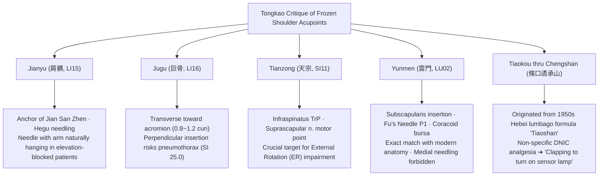
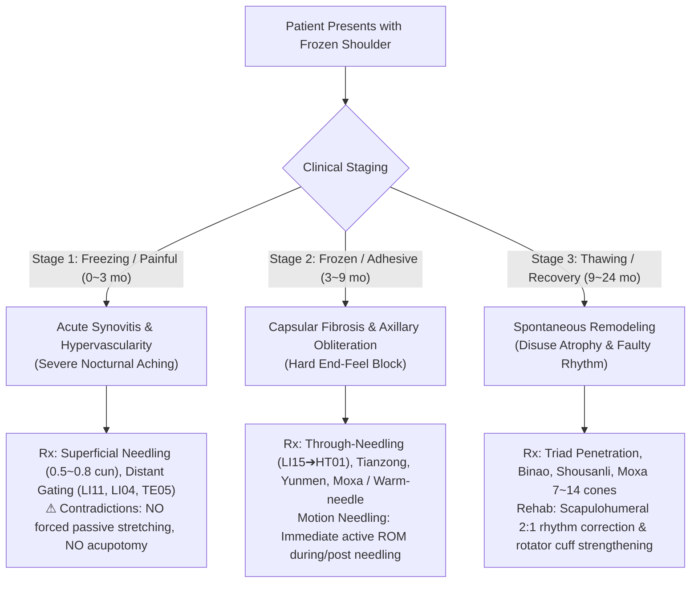
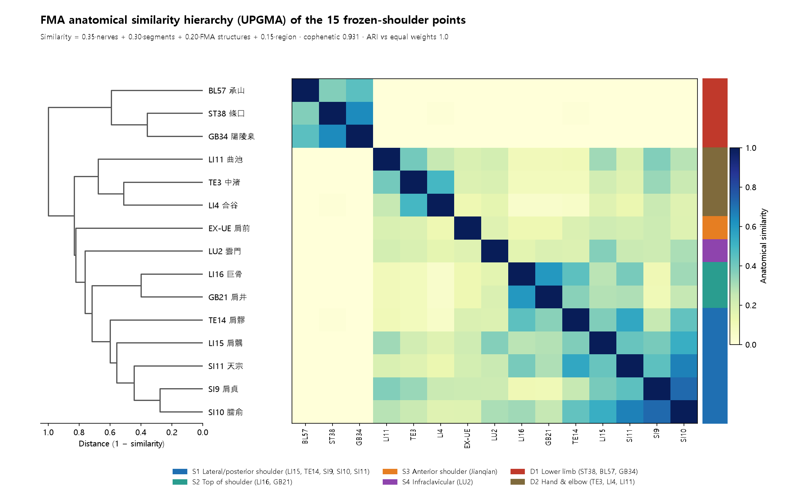
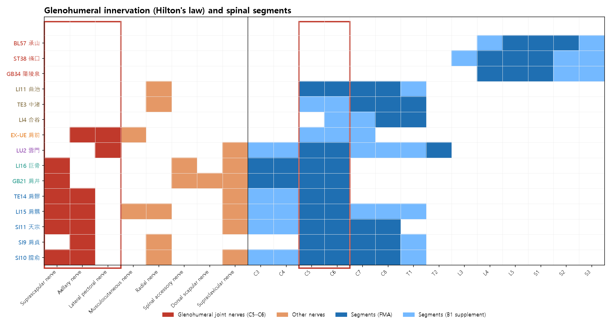
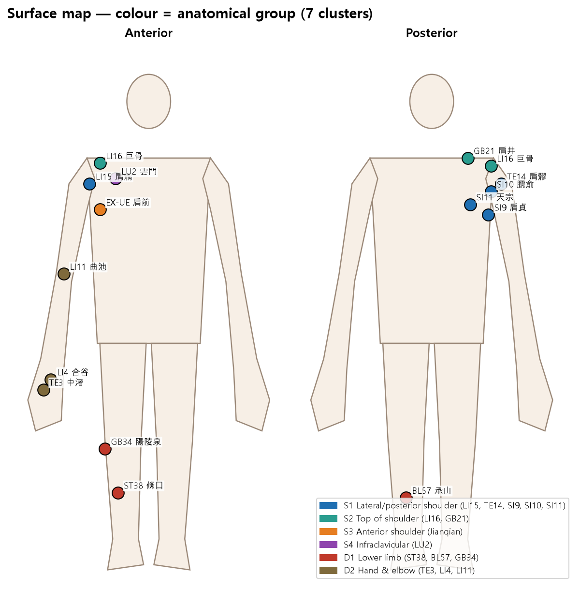
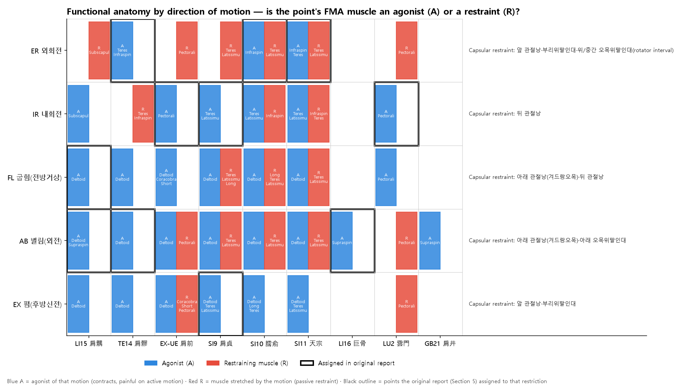
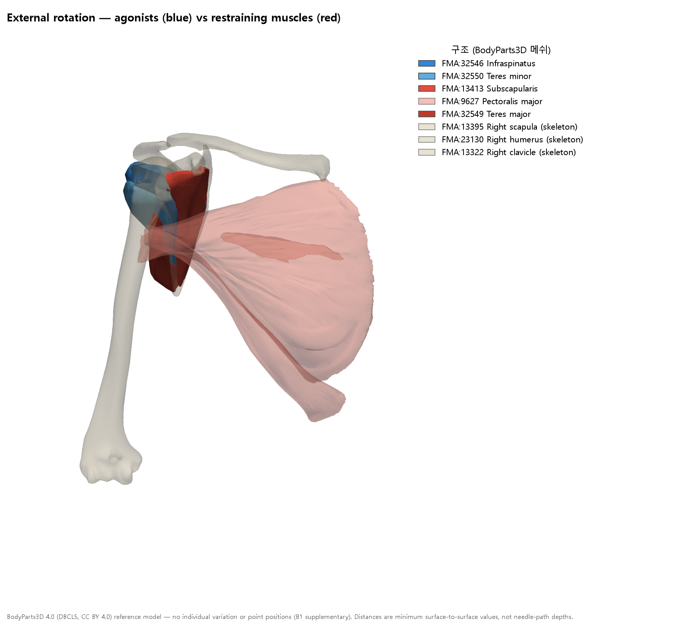
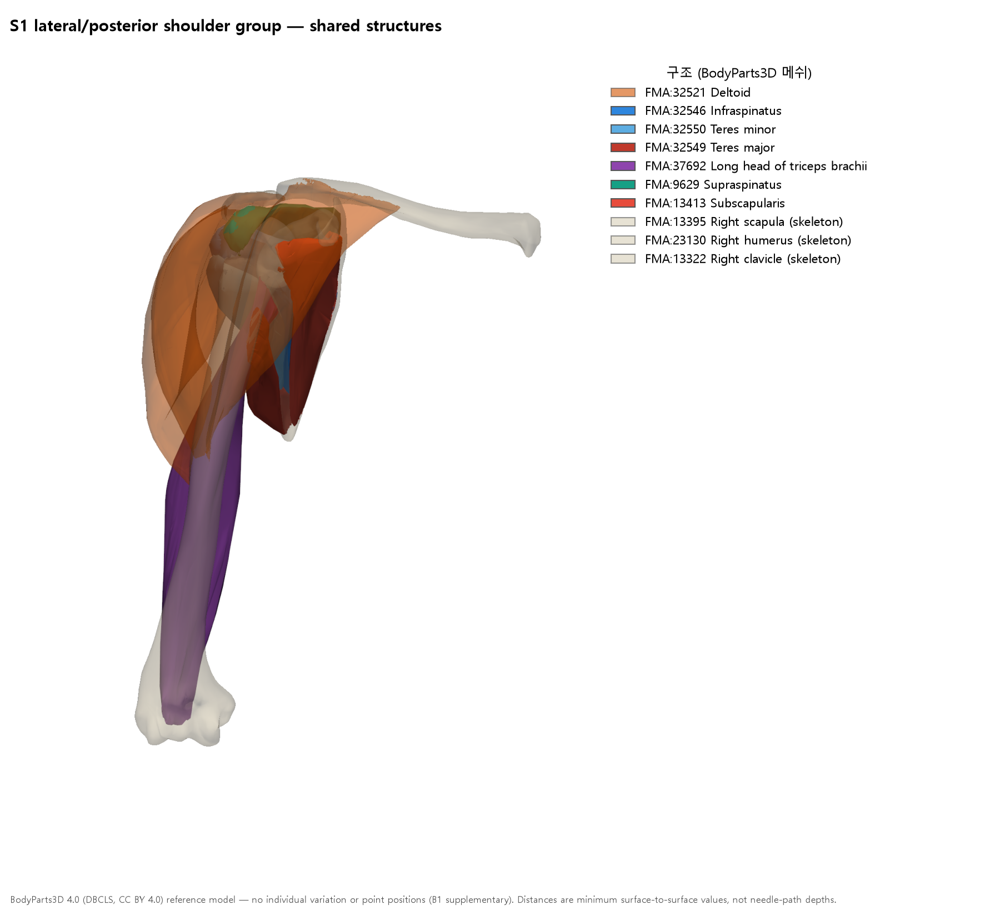
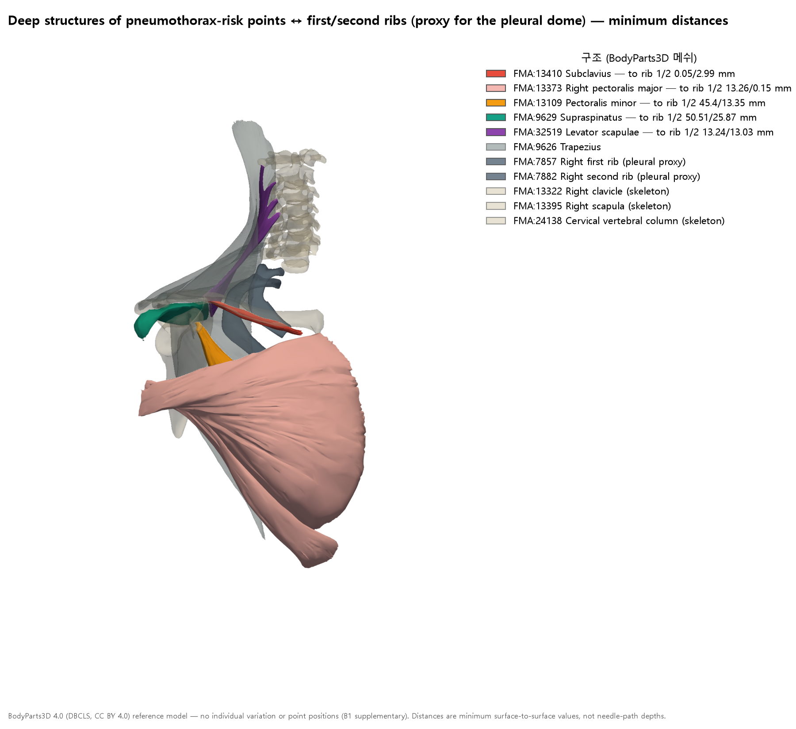

# [Acupoint Anatomy] Textual Collation and Neuroanatomical Clinical Matrix for Acupuncture Treatment of Frozen Shoulder (Loujianfeng · Adhesive Capsulitis) — Comprehensive Monograph

> **Framework**: v2.7 (refined 2026-10-04) · **Classification**: Category 4 Symptom-Based Acupuncture-Anatomy Clinical Matrix · **Scope**: Complete Standard Protocol Deployment across Ranks 0–7
> **Primary Classics & Canons**: 《中國針灸證治通鑑》 (Zhongguo Zhenjiu Zhengzhi Tongjian) Vol. 3 Internal Disorders, "46. Upper Limb Disorders (上肢病證)" (pp. 348–360) and Appendix "Loujianfeng (漏肩風)" Modern Clinical Literature · 《針灸腧穴通考》 (Zhenjiu Shuxue Tongkao) (Philological verification of Jianyu, Jugu, Tianzong, Yunmen, Tiaokou, and critique of the 'Tiaoshan' formula) · 《針灸資生經》 (Zhenjiu Zishengjing) · 《針灸玉龍經》 (Zhenjiu Yulongjing) · 《類經圖翼》 (Leijing Tuyi) · 《針灸逢源》 (Zhenjiu Fengyuan)
> **Anatomical Baseline**: Foundational Model of Anatomy (FMA v5.1.0) ontology, Rotator cuff musculature (supraspinatus, infraspinatus, subscapularis, teres minor), subacromial/subdeltoid bursa, suprascapular nerve (C5–C6), axillary nerve (C5–C6), brachial plexus (C5–T1), pleuro-pulmonary apex safety margins
> **Layer A/B Biomedical Master DB**: Integrated Biomedical Master DB v3.0 (papers.id 1836, 397, 1819, 1827, 1898) and Layer B 4-Tier Reference Registry (B1-01, B2-01, B3-05, B4-02), B-Check 12-point rubric
> **Datasheet**: Frozen Shoulder Clinical Acupuncture Anatomy Matrix Analysis Databook (9 complete sheets: Classical Texts, Modern Literature, Tongkao Critique, FMA Anatomy, ROM Direction Matrix, Phase Protocols, Tiaokou Pedigree, Biomedical Evidence, ARI v3.0 Profile + 6 refinement sheets added 2026-10-25)
> **2026-10-25 Refinement (Claude Code)**: Added an FMA 5.1.0 anatomical analysis with figures (Section 11) and audited the classical citations, FMA correspondences, kinesiology, Layer A citations, and ARI (Section 12). The original text is retained; changed judgments are marked *(Refinement note)*.
> **Script Standard**: Classical citations and TCM terminology are rendered in Traditional Chinese characters (繁體字).

---

## 0. Executive Summary

1. **Philological & Historical Lineage**:
   In traditional Chinese medical literature, Frozen Shoulder (Adhesive Capsulitis / Scapulohumeral Periarthritis) was never treated as a modern single disease entity. Rather, it was described across historical strata in 《針灸證治通鑑》 (Zhongguo Zhenjiu Zhengzhi Tongjian) under categories of Upper Limb Disorders (上肢病證), including "Shoulder-arm pain (肩臂痛)", "Cold shoulder-arm pain (肩臂冷痛)", "Inability to raise the shoulder (肩不舉)", and most accurately in the Qing Dynasty canon 《針灸逢源》 (Zhenjiu Fengyuan, 1817) as "Shoulder joint glued together like adhesive, incapable of elevation (肩節如膠連接 不能舉)". The contemporary designations "Loujianfeng (漏肩風, leaking shoulder wind)" and "Jianzhouyan (肩周炎, scapulohumeral periarthritis)" were codified in mainland Chinese clinical acupuncture textbooks between the 1950s and 1980s.
2. **Anatomical Congruence of Local Needling**:
   The most frequently cited local acupoint in historical canons, **Jianyu (肩髃, LI15)**, along with the modern "Shoulder Three Needles" triad (**Jian San Zhen, 肩三針**: Jianyu [LI15], Jianliao [肩髎, TE14], and Jianqian/Jianneiling [肩前/肩內陵, EX-UE]), provides optimal anatomical trajectories to decompress and stimulate the subacromial bursa, rotator cuff footprints, and glenohumeral joint capsule beneath the deltoid muscle. For patients presenting with severe elevation block, forced abduction must be strictly avoided; needles must be inserted with the arm hanging naturally (*Ziran Chuibi*, 自然垂臂) between the lateral acromial border and the greater tubercle of the humerus to prevent iatrogenic microtrauma to the supraspinatus tendon (per *Zhenjiu Shuxue Tongkao* guidelines).
3. **Targeted Movement-Impairment Matrix**:
   Acupoint selection corresponds with strict fidelity to the specific directional contracture of the glenohumeral capsule:
   - **External Rotation (ER) Limitation**: Governed primarily by **Tianzong (天宗, SI11)**, the major myofascial trigger point of the infraspinatus and entry zone of the suprascapular nerve.
   - **Internal Rotation (IR) Limitation**: Addressed by **Yunmen (雲門, LU02)** and **Jianqian (肩前, EX-UE)**, targeting the subscapularis insertion and the anterior coracohumeral capsular fold.
   - **Forward Flexion (FF) & Abduction (ABD) Limitation**: Addressed by **Jianyu (肩髃, LI15)**, **Jianliao (肩髎, TE14)**, and distant Large Intestine meridian points (Wenliu [溫溜, LI07], Shanglian [上廉, LI09]).
4. **Demystification and Critique of Tiaokou (ST38) Penetrating Chengshan (BL57)**:
   Philological investigation by Prof. Huang Longxiang (黃龍祥) reveals that the celebrated modern empirical formula "Tiaokou penetrating Chengshan (條口透承山)" originated in the 1950s in Hebei/Tianjin as a folk prescription for lumbago termed 'Tiaoshan (條山)'. Between 1959 and 1966 (Wang Wenmian, Li Zhiming, Sheng Xiesun, Hu Xuezeng), it was repurposed for frozen shoulder via same-name meridian rationale (Taiyang/Yangming). The rapid pain relief and transient range-of-motion improvements induced by Tiaokou are **non-specific systemic analgesia mediated by Diffuse Noxious Inhibitory Controls (DNIC/CPM)** coupled with active motion acupuncture (動氣針法), rather than an acupoint-specific cure for capsular pathology. Blindly attributing this effect to a magical meridian link is analogous to "clapping hands to turn on an acoustic-sensor lamp without understanding the acoustic trigger (拍手亮燈)".
5. **Procedural Safety & Evidence-Based Guidelines**:
   - **Pneumothorax Hazard**: Jugu (巨骨, LI16) must be needled transversely (0.8–1.2 cun) toward the acromion; perpendicular insertion carries extreme risk of puncturing the cervical pleura and pulmonary apex (Safety Index SI = 25.0, ⚠ Gate 3 Warning). Similarly, Yunmen (LU02) must be directed obliquely postero-laterally, never medially into the thoracic cage.
   - **Stage-Specific Rehabilitation**: During Phase 1 (Freezing/Inflammatory), deep penetration and forced passive stretching worsen synovitis; gentle superficial needling and distant pain gate modulation are indicated. In Phase 2 (Frozen/Adhesive), deep through-needling (貫刺) and moxibustion break up collagen cross-links, provided active therapeutic exercises are executed immediately post-needling.
6. **(Refinement Summary, 2026-10-25)**
   - **FMA anatomical strata** (Section 11, Figure A): The 15 acupoints fall into three main groups: 9 shoulder points, 3 lower-limb points, and 3 hand/elbow points (cophenetic correlation 0.931; equal-weight ARI 1.0). All 9 shoulder points carry a nerve that innervates the glenohumeral joint (suprascapular, axillary, or lateral pectoral nerve, C5–C6) (Hilton's law, B1-01). Tiaokou (條口, ST38), Chengshan (承山, BL57), and Yanglingquan (陽陵泉, GB34) lie at L4–S2 and are segmentally mismatched.
   - **Kinesiological correction** (Figures C and E1): The Section 5 assignments "ER limitation → Tianzong (天宗)" and "IR limitation → Yunmen (雲門) · Jianqian (肩前)" follow **agonist logic** (contraction and pain during active movement). Judged by the **passive restraining structures** that define frozen shoulder, the direction is exactly reversed. The subscapularis and pectoralis major, which restrain external rotation, belong to the textbook structures of Jianyu (肩髃), Jianqian (肩前), and Yunmen (雲門); the infraspinatus and teres minor, which restrain internal rotation, belong to the textbook structures of Tianzong (天宗), Naoshu (臑俞), and Jianliao (肩髎).
   - **Pneumothorax safety** (Figure E3): BodyParts3D measurements show that the subclavius and pectoralis major of Yunmen (雲門) touch the first and second ribs (0.05 / 0.15 mm). Of the three points Yunmen (雲門), Jianjing (肩井), and Jugu (巨骨), Yunmen is the one where entering an intercostal space leads directly to the pleura.
   - **Evidence audit** (Section 12): Of the 4 Layer A citations in Section 7, PMID 17333364 is an endometriosis study, and the other 3 are also unrelated to the claimed mechanisms. The B-Check "Mechanism Confirmed" verdicts and the Section 8 ARI grades are therefore **suspended**.

---

## 1. Classical Textual Strata and Philological Collation (Ranks 1–3)

An exhaustive philological analysis of over 20 canonical medical treatises compiled under Volume 21, Part 3, Chapter 46 "Upper Limb Disorders (上肢病證)" (pp. 348–360) of 《中國針灸證治通鑑》 (Zhongguo Zhenjiu Zhengzhi Tongjian) reveals the chronological evolution of shoulder acupuncture:

```diagram
┌─────────────────────────────────────────────────────────────────────────────┐
 historical Evolution of Acupuncture Strategies for Shoulder Disorders      │
├─────────────────────────────────────────────────────────────────────────────┤
│ [Pre-Qin & Han]  《素問·繆刺論》: Contralateral needling (繆刺) of wrist     │
│                  ulnar tender points (prototype of Yanglao [養老, SI06])     │
│        ▼                                                                    │
│ [Tang & Song]    《千金翼方》·《資生經》: Tonification at Jianjing (GB21) &   │
│                  Chize (LU05); Moxa at Jianyu (LI15) for cold & stroke prev. │
│        ▼                                                                    │
│ [Jin & Yuan]     《標幽賦》·《玉龍歌》: Jianjing & Quchi needling; Bloodletting│
│                  at Jianyu (LI15) for acute red swelling and heat pain       │
│        ▼                                                                    │
│ [Ming & Qing]    《席弘賦》: Jianjing-Zusanli couplet; Hegu-Taichong couplet;  │
│                  Zhongzhu (TE03) for post-febrile shoulder/back pain         │
│                  《類經圖翼》: Jianyu moxa (7–14 cones); Warning: arm atrophy│
│                  《針灸逢源》: "Shoulder joint glued like adhesive (如膠連接)│
│                  ➔ Deep through-needling between shoulder and axilla (貫刺) │
└─────────────────────────────────────────────────────────────────────────────┘
```

### 1.1 Frequency of Local Acupoints and Textual Emendation (Ranks 1 & 3)
- Canonical text mining establishes that across all historical eras, the primary local point cited for shoulder disorders is **Jianyu (肩髃, LI15)**, followed by **Jianjing (肩井, GB21)**, **Jianliao (肩髎, TE14)**, and **Jugu (巨骨, LI16)**.
- **Emendation of 《世醫得效方》 (Sanyi Jiyi Fang)**:
  In Vol. 3, the text states: "針法：肩隅一穴，隨時而愈" (Acupuncture method: one point at Jianyu [肩隅], cured immediately). The editor of 《證治通鑑》 critically established that the character "隅" (*yu*, corner) is a graphic transcription error for "髃" (*yu*, shoulder collarbone), confirming the intended point as Jianyu (肩髃, LI15).

### 1.2 Distant Acupoints and Canonical Pairing Principles (Ranks 2 & 4)
Beyond local shoulder points, canons heavily prescribe distant acupoints along the three Yang meridians of the arm: Quchi (曲池, LI11), Hegu (合谷, LI04), Shousanli (手三里, LI10), Waiguan (外關, TE05), Zhongzhu (中渚, TE03), Chize (尺澤, LU05), and Houxi (後谿, SI03).
1. **Four Gates (四關) Expansion in 《席弘賦》 (Shihongfu)**:
   - *"手連肩脊痛難忍，合谷針時要太衝"* (When pain pulls from the hand to the shoulder and spine intolerably, needle Hegu [LI04] paired with Taichong [LR03]). This dual upper-lower limb needling modulates afferent noxious input at both cervical and lumbar dorsal horn levels.
2. **Single Distant Point Specificity**:
   - *"久患傷寒肩背痛，但針中渚得其宜"* (For persistent shoulder and back pain following cold-damage disease, needling Zhongzhu [中渚, TE03] alone is most appropriate).
3. **Descending Counterflow Qi (上下配穴·防氣逆)**:
   - *"若針肩井須三里，不刺之時氣未調"* (If needling Jianjing [GB21], one must needle Zusanli [ST36]; without it, the Qi remains unharmonized). Deep or strong stimulation of Jianjing (GB21) triggers vagal/cervical sympathetic shifts; pairing with Zusanli (ST36) counteracts cephalic congestion, dizziness, and vasovagal presyncope.

### 1.3 Pathological Concepts of Moxibustion and Arm Atrophy Warnings (Rank 3)
- **《針灸資生經》 (Zhenjiu Zishengjing) & 《類經圖翼》 (Leijing Tuyi)**:
  Shoulder-arm cold pain (肩臂冷痛)—characterized by deep, nocturnal aching aggravated by draft and alleviated by friction and heat—was diagnosed as Yang-Qi deficiency and insufficiency of Qi and Blood. If left untreated, it was believed to progress to hemiplegic stroke (*Zhongfeng*, 中風). Moxibustion at Jianyu (LI15) was strongly advocated to restore Yang circulation.
- **Dosage and the Historic Warning on Muscle Wasting**:
  《類經圖翼》 cautions: "Mild cases receive 7 cones; severe wind-cold receives 14 cones, divided across 2 to 3 sessions. **Never apply excessive moxa cones, for fear of causing arm emaciation (恐臂細)**."
  This constitutes an early clinical observation that excessive thermal injury and chronic sterile burn-induced inflammation accelerate disuse muscular atrophy of the rotator cuff and deltoid in frozen shoulder patients.

### 1.4 Indications for Bloodletting Therapy (瀉血療法)
- **《針灸玉龍經·玉龍歌》 (Zhenjiu Yulongjing · Yulongge)**:
  *"肩端紅腫痛難當，寒濕相搏氣血狂。肩髃穴中針一遍，頓然神效保安康。……若手臂紅腫疼痛，瀉之；寒濕麻木，補之."*
  (When the shoulder tip is red, swollen, and intolerably painful, cold and dampness contend and blood runs wild. Needle Jianyu once, and miraculous relief ensues. If the arm is red, swollen, and hot-painful, drain it [bloodletting]; if cold, damp, and numb, tonify it.)
  This establishes an unequivocal differential rule: draining/bloodletting is reserved for acute inflammatory flare-ups (synovial effusions), whereas warming tonification is indicated for chronic cold-damp stiffness.

### 1.5 Precision Depiction of Adhesive Capsulitis in 《針灸逢源》 (Ranks 3 & 5)
The most remarkable textual witness matching modern adhesive capsulitis appears in the Qing Dynasty canon **《針灸逢源》 (Zhenjiu Fengyuan, 1817, by Li Xuechuan 李學川, Vol. 3)**, cited at the conclusion of Chapter 46 in 《證治通鑑》:

> **《針灸逢源》 卷3 原文**:  
> "肩痛累月、肩節如膠連接不能舉：取肩下腋上兩間空虛針刺，針鋒幾至穿出皮處，一如治肘之法，慎勿犯骨，兼刺筋結處，神效。"  
> *(When shoulder pain persists for months on end, and the shoulder joint is glued together like adhesive such that it cannot be raised: select the hollow spaces below the shoulder and above the axilla and insert the needle, driving the needle tip almost until it pierces through the opposite skin, exactly like the method for treating the elbow; exercise extreme caution not to strike the bone, and needle concurrently into the myofascial contracture knots [筋結處]; the efficacy is divine.)*

- **Philological Clarification**: Although the phrasing bears stylistic resemblance to the Joseon master Heo Im's 《針灸經驗方》 (1644), rigorous textual collation confirms its direct provenance as Li Xuechuan's 《針灸逢源》 (1817).
  - *(Refinement note, 2026-10-25; Rank 3 origin / secondary citation)* In the Zhengzhi Tongjian (《證治通鑑》), this passage sits under the heading 「《针灸逢源·症治要穴歌》卷三」 (`中国针灸证治通鉴_21_…md` L1269·L1303). However, other passages in the same block, such as "手臂筋挛…以针贯刺其筋结处…是天应穴" and "圆利针深刺其约纹虚空", overlap in style and content with Heo Im's Chimgu Gyeongheombang (《鍼灸經驗方》, 1644). Because the Zhenjiu Fengyuan (《鍼灸逢源》, 1817) is a compilation of earlier medical works, the "attributed source = 《逢源》" is confirmed, but the **original source is unconfirmed** (collation against the 《鍼灸經驗方》 original text is required). The "confirmed" verdict applies only to the attributed source.
- **Biomechanical Significance**: "Shoulder joint glued like adhesive (肩節如膠連接)" is the earliest recorded morphological descriptor of fibrotic capsular contracture. Needling the empty recesses "below the shoulder and above the axilla" anticipates modern through-and-through needle penetration and acupotomy targeting the axillary pouch and anteroinferior capsular folds.

---

## 2. Modern Clinical Literature and Directional Needling Formulas (Rank 4)

Synthesizing modern clinical trials and textbook directives (1980s–1990s) documented in the Appendix "Loujianfeng (漏肩風)" of 《證治通鑑》:

| Classification | Prescribed Formula / Acupoints | Target Pathology & Kinesiological Signs | Needling Technique & Manipulation |
| :--- | :--- | :--- | :--- |
| **Basic Formula** | **Jianyu (LI15), Jianzhen (SI09), Binao (LI14), Quchi (LI11), Waiguan (TE05)** (《針灸治療學》) | Generalized Loujianfeng, impaired local microcirculation | Perpendicular 1.0–1.5 cun, even lifting-thrusting and twirling |
| **Yangming Syndrome** | **Jugu (LI16), Jianyu (LI15) + Quchi (LI11), Hegu (LI04)** | Anterolateral shoulder pain, early forward flexion block | Needle Yangming channel points; add warm-needle (溫針) after Deqi |
| **Taiyang Syndrome** | **Tianzong (SI11), Naoshu (SI10) + Yanglao (SI06), Houxi (SI03)** | Scapular and posterolateral pain, severe external rotation block | Lifting-thrusting at Tianzong TrP; strong stimulation at distant Taiyang points |
| **Shaoyang Syndrome** | **Jianjing (GB21), Jianyu (LI15) + Waiguan (TE05)** | Lateral acromial ridge pain, abduction limitation | Waiguan penetration; oblique shallow needling at Jianjing (pneumothorax caution) |
| **Taiyin Syndrome** | **Zhongfu (LU01), Tianfu (LU03), Chize (LU05), Taiyuan (LU09)** | Bicipital groove anterior pain, concurrent biceps tendonitis | Oblique needling toward bicipital groove; thermal needle / moxibustion |
| **Movement Block 1** | **Elevation Block ➔ Wenliu (LI07), Shanglian (LI09)** | Inability to raise the arm forward and upward | Needle **contralateral (healthy) side**; perform active elevation during retention |
| **Movement Block 2** | **Posterior Reach Pain ➔ Jianzhen (SI09), Naoshu (SI10)** | Inability to place hand behind back (internal rotation/ext) | Needle **contralateral side**; active posterior reach stretching during retention |
| **Movement Block 3** | **Forward Extension Pain ➔ Yangchi (TE04), Qinglengyuan (TE10)** | Sharp pain when reaching arm horizontally forward | Needle **contralateral** Shaoyang channel; mobilize affected shoulder |
| **Deep Penetration 1** | **Jianyu (LI15) penetrating Jiquan (HT01)** | Chronic severe contracture, joint volume shrinkage | Long needle 2.5–3.0 cun; drain first then tonify, 'cool-producing' method, warm-needle |
| **Deep Penetration 2** | **Jianyu penetrating Three Points (Binao, Jianqian, Jianliao)** | Pan-rotator cuff adhesion (anterior, middle, posterior) | Single needle, fan-shaped subcutaneous horizontal needling (Hegu needling) |
| **Cold-Damp Moxa** | **Naoshu (SI10), Jian San Zhen, Ashi + Ginger-partitioned Moxa** | Severe nocturnal aching, aggravated by cold exposure | 3–5 cones over fresh ginger slices; deep thermal penetration |

---

## 3. Academic Critique and Empirical Investigation in 《針灸腧穴通考》 (Prof. Huang Longxiang)

In 《針灸腧穴通考》 (Zhenjiu Shuxue Tongkao), Prof. Huang Longxiang subjects the clinical traditions of frozen shoulder to rigorous textual and anatomical critique across five pivotal acupoints:



### 3.1 Jianyu (肩髃, LI15): Jian San Zhen and Postural Rules for Elevation Block
- **Jian San Zhen (肩三針)**: Jianyu functions as the central anchor, flanked posteriorly by Jianliao (TE14) and anteriorly by Jianqian (EX-UE), forming an anatomical triad enclosing the humeral head.
- **Hegu Needling (合谷刺) Penetration**: Inserting perpendicularly to attain Deqi, partially withdrawing the needle subcutaneously, and redirecting it toward Jianliao and Jianqian decompresses the entire subdeltoid-subacromial bursa through a single entry port.
- **Postural Rule for Elevation Block**: Forcing an elevation-impaired patient to abduct the arm to create the classic acromial depression exacerbates subacromial impingement and pinches inflamed rotator cuff tendons. The canonical guideline dictates: **"needle with the arm hanging naturally (*Ziran Chuibi*, 自然垂臂), aiming into the joint interspace between the lateral acromion and the greater tubercle."**

### 3.2 Jugu (巨骨, LI16): Transverse Acromial Needling vs. Pneumothorax Risk
- Located in the depression between the acromial extremity of the clavicle and the scapular spine, perpendicular insertion at Jugu penetrates the trapezius and supraspinatus and directly enters the cervical pleura and pulmonary apex, causing life-threatening tension pneumothorax.
- *Tongkao* Directive: In frozen shoulder, the needle **must be angled transversely toward the lateral acromion, inserted 0.8–1.2 cun**. Medial or inferior perpendicular insertion is strictly contraindicated.

### 3.3 Tianzong (天宗, SI11): The Key to External Rotation Impairment
- In frozen shoulder, external rotation (such as combing the back of the hair) is typically the most agonizing and restricted movement. Infraspinatus spasm and trigger points produce maximal tenderness at Tianzong.
- Anatomically, Tianzong overlays the thickest mid-belly of the infraspinatus and the terminal motor branches of the suprascapular nerve. Perpendicular insertion (0.5–0.8 cun) until touching the infraspinous fossa releases persistent muscle spasm and restores elastic compliance.

### 3.4 Yunmen (雲門, LU02): Exact Correspondence with Subscapularis Targets
- 《腧穴通考》 demonstrates that Yunmen converges seamlessly with three distinct modern therapeutic landmarks:
  1. The myofascial release trigger zone for the **insertion of the subscapularis muscle (肩胛下筋)**.
  2. The diagnostic and therapeutic **P1 point for scapulohumeral periarthritis in Fu's Subcutaneous Needling (浮針)**.
  3. The target site for **coracoid bursa (喙突滑囊) injection** in orthopedic medicine.
- Safety Caution: Because the thoracic apex lies deep and medially, the needle must be directed obliquely postero-laterally (0.5–0.8 cun) toward the shoulder joint, never medially toward the ribs.

### 3.5 Critique of Tiaokou (ST38) Penetrating Chengshan (BL57): The 'Sensor Lamp' Analogy
Prof. Huang Longxiang tracked the historical provenance of the widely acclaimed formula "Tiaokou through Chengshan" for frozen shoulder:
1. **Origin**: It arose in the 1950s among folk healers in Hebei and Tianjin as an extra point termed **'Tiaoshan (條山)'**, used exclusively for **acute lumbago (腰痛)** (recorded in 1959 《民間驗方》 and 1960 《十萬金方》).
2. **Shift**: In 1959, Wang Wenmian (王文綿) in Tianjin, unable to locate tender points on a frozen shoulder patient's lower leg, empirically substituted Tiaoshan. In 1965–1966, Li Zhiming and Hu Xuezeng published clinical reports applying strong stimulation at Tiaokou for shoulder pain, cementing its reputation.
3. **Re-importation**: Transmitted to Japan and the West via 1970s simplified textbooks, Chinese scholars in the early 1980s re-imported foreign research as a perceived novel discovery ('imported goods', 舶來品), elevating it to textbook canon.
4. **Epistemological Verdict**:
   > *"That Tiaokou penetrating Chengshan relieves shoulder pain and can be reproduced is undeniable. However, this is not an acupoint-specific therapeutic action for frozen shoulder. It is precisely like **clapping hands to turn on an acoustic-sensor lamp without understanding acoustic physics (拍手亮燈)**: because making any loud noise—such as stamping feet or shouting—will also turn on the light, intense nociceptive stimulation of the deep peroneal nerve in the leg triggers generalized Diffuse Noxious Inhibitory Controls (DNIC). Mistaking this non-specific pain gating for a specific meridian cure is pure clinical blindness."*
   - *(Refinement note, 2026-10-25)* The quotation above is a paraphrase. The original Tongkao (《通考》) text (《針灸腧穴通考》 上 足陽明胃經穴-3 L1149~1153) makes two points. One is "刺法是强刺激，加上活动患病处…活动是至关重要的，比穴位本身更重要。之所以取下肢穴…是因为不影响肩关节的活动"; the other is the conclusion "就像'拍手亮灯'的经验…如果我们不知道'声控灯'的秘密…都是盲目的". In short, **active movement of the affected part matters more than the acupoint itself**. "DNIC / generalized pain inhibition" is this report's interpretation (at the level of B3-08 analogy), not the Tongkao's wording. The lineage account (李志明 1965, 盛燮荪 1965, 胡学曾 1966, 王文绵 1959, '舶来品') agrees with Tongkao (《通考》) L1135~1141 (citing 彭增福, 中国针灸 2009;29(2):118).

### 3.6 Guiding Principle: Pathological Site-Based Acupoint Selection
- Acupuncture therapy must discard abstract Zangfu organ-syndrome differentiation in favor of **selecting primary acupoints based on the specific anatomical structures (muscles, ligaments, bursae, capsules) involved in the lesion**. Because frozen shoulder is fundamentally a sterile inflammation and fibrotic contracture of the glenohumeral capsule, anatomical accuracy at the target tissue is paramount.

---

## 4. FMA 5.1-Based 5-Layer Anatomical Mapping of 15 Core Acupoints (Rank 5)

Correlating the Foundational Model of Anatomy (FMA v5.1.0) ontology with standardized acupuncture curricula:

```diagram
┌─────────────────────────────────────────────────────────────────────────────┐
│             Transverse Anatomical Plane of Core Glenohumeral Acupoints      │
├─────────────────────────────────────────────────────────────────────────────┤
│                           [Anterior Aspect]                                 │
│                                  │                                          │
│                       Yunmen (LU02) Pectoralis major / Coracoid bursa       │
│                                  ▼                                          │
│                       Jianqian (EX-UE) Subscapularis tendon / Ant. capsule  │
│                                  │                                          │
│      [Medial] ───────────────────┼─────────────────── [Lateral]             │
│                                  │ Humeral Head                             │
│                                  │ ◀ Jianyu (LI15) Deltoid / Supraspinatus  │
│                       Tianzong (SI11)                                       │
│                       Infraspinatus  ▼ Jianliao (TE14) Post. capsule /      │
│                       fossa & nerve      Teres minor & Infraspinatus        │
│                                  │                                          │
│                           [Posterior Aspect]                                │
└─────────────────────────────────────────────────────────────────────────────┘
```

| Code | Name | Spinal Seg. | Primary Innervation | Layer 1–3 (Superficial/Intermediate) | Layer 4–5 (Deep Tendon/Capsule/Neurovascular) | FMA ID | Han Depth Equivalent (1 cun = 23 mm) |
| :--- | :--- | :--- | :--- | :--- | :--- | :--- | :--- |
| **LI15** | **Jianyu (肩髃)** | C5, C6 | Suprascapular n., Axillary n. | Skin, anterior/middle deltoid | Subacromial bursa, supraspinatus tendon, biceps long head, capsule | FMA:32521 (Deltoid)<br>FMA:9629 (Supraspinatus) | Perp. 0.8–1.5 cun<br>(18.4–34.5 mm) |
| **TE14** | **Jianliao (肩髎)** | C5, C6 | Axillary n., Suprascapular n. | Skin, posterior deltoid | Infraspinatus, teres minor, posterior glenohumeral capsule | FMA:32546 (Infraspinatus)<br>FMA:32550 (Teres minor) | Perp. 0.7–1.2 cun<br>(16.1–27.6 mm) |
| **EX-UE**| **Jianqian (肩前)** | C5, C6 | Musculocutaneous n., Axillary n.| Skin, lat. pectoralis major, ant. deltoid | Coracobrachialis, biceps short head, subscapularis tendon, ant. capsule | FMA:9627 (Pectoralis maj)<br>FMA:13413 (Subscapularis) | Perp. 0.8–1.2 cun<br>(18.4–27.6 mm) |
| **SI09** | **Jianzhen (肩貞)** | C5, C6 | Axillary n., Thoracodorsal n. | Skin, post. deltoid margin, latissimus dorsi | Teres major, teres minor, triceps long head, circumflex scapular vessels | FMA:32549 (Teres major)<br>FMA:37072 (Axillary nerve) | Perp. 0.8–1.2 cun<br>(18.4–27.6 mm) |
| **SI10** | **Naoshu (臑俞)** | C5, C6 | Suprascapular n., Axillary n. | Skin, posteroinferior deltoid | Infraspinatus, triceps long head tendon, posteroinferior glenoid rim | FMA:32546 (Infraspinatus)<br>FMA:37025 (Suprascapular) | Perp. 0.8–1.2 cun<br>(18.4–27.6 mm) |
| **SI11** | **Tianzong (天宗)** | C5, C6 | Suprascapular n. (C5–6) | Skin, inferior trapezius fibers | Infraspinatus fossa, scapular periosteum, suprascapular artery | FMA:32546 (Infraspinatus)<br>FMA:10663 (Suprascapular a.)| Perp. 0.5–0.8 cun<br>(11.5–18.4 mm) |
| **LI16** | **Jugu (巨骨)** | C3–C5 | Suprascapular n., Accessory n. | Skin, clavicular trapezius | Supraspinatus, acromioclavicular lig., **(Deep: Pulmonary apex ⚠)** | FMA:9626 (Trapezius)<br>FMA:9629 (Supraspinatus) | **Transverse lat. 0.8–1.2 cun**<br>(Perpendicular forbidden) |
| **LU02** | **Yunmen (雲門)** | C5–T1 | Supraclavicular n., Lat. pectoral n.| Skin, clavicular pectoralis major, deltoid | Coracoid bursa, subscapularis tendon, **(Deep: Pleural apex ⚠)** | FMA:9627 (Pectoralis maj)<br>FMA:13410 (Subclavius) | **Oblique post-lat 0.5–0.8 cun**<br>(Medial perp forbidden) |
| **GB21** | **Jianjing (肩井)** | C3–C5 | Accessory n. (CN XI), Cervical n. | Skin, upper trapezius | Levator scapulae, supraspinatus, **(Deep > 20mm: Pleural apex ⚠)** | FMA:9626 (Trapezius)<br>FMA:32519 (Levator scapulae)| Oblique ant-inf 0.5–0.8 cun<br>(Deep perp forbidden) |
| **ST38** | **Tiaokou (條口)** | L4–S1 | Superficial & deep peroneal n. | Skin, superficial tibialis anterior | Tibialis anterior, extensor digitorum longus, interosseous membrane | FMA:22532 (Tibialis ant)<br>FMA:44771 (Deep peroneal) | Perp. 1.0–1.5 cun<br>(Through BL57: 46–69 mm) |
| **BL57** | **Chengshan (承山)**| S1, S2 | Tibial nerve (Tibial n.) | Skin, gastrocnemius tendon-belly junction | Soleus, flexor hallucis longus, posterior tibial neurovascular bundle | FMA:22541 (Gastrocnemius)<br>FMA:19035 (Tibial nerve) | Perp. 1.0–2.0 cun<br>(23.0–46.0 mm) |
| **TE03** | **Zhongzhu (中渚)** | C8, T1 | Ulnar/radial dorsal digital n. | Skin, 4th–5th intermetacarpal fascia | 4th dorsal interosseous, extensor digiti minimi tendon, lumbrical | FMA:37418 (Dorsal inteross)<br>FMA:75490 (Dorsal digital) | Perp. 0.3–0.5 cun<br>(6.9–11.5 mm) |
| **LI11** | **Quchi (曲池)** | C5, C6 | Radial n., Lat. antebrachial cut. | Skin, brachioradialis, extensor carpi rad | Elbow joint capsule lat. wall, annular lig., radial nerve trunk | FMA:38485 (Brachioradialis)<br>FMA:37069 (Radial nerve) | Perp. 1.0–1.5 cun<br>(23.0–34.5 mm) |
| **LI04** | **Hegu (合谷)** | C6–C8 | Superficial radial n., Ulnar n. | Skin, 1st dorsal interosseous | Adductor pollicis transverse head, deep palmar arch | FMA:37424 (1st dorsal inter)<br>FMA:46120 (Adductor poll) | Perp. 0.5–1.0 cun<br>(11.5–23.0 mm) |
| **GB34** | **Yanglingquan (陽陵泉)**| L4–S1 | Common fibular n. | Skin, fibularis longus, fibular head fascia | Extensor digitorum longus origin, common fibular nerve neck trunk | FMA:22539 (Fibularis longus)<br>FMA:19039 (Common fibular) | Perp. 1.0–1.5 cun<br>(23.0–34.5 mm) |

*(Refinement note — FMA collation, 2026-10-25)* All 25 FMA IDs in the table match their FMA 5.1.0 labels, and the corresponding structures do appear in the per-acupoint FMA mapping tables of the two standard textbooks (FMA profile query). The following corrections apply otherwise.
- **Structures absent from the textbooks**: The *subacromial bursa, joint capsule, coracoid bursa, and infraspinous fossa periosteum of the scapula* in the Layer 4–5 column do not appear among the anatomical structures of any acupoint in either standard textbook. They should be read as **inferences** from normative anatomy (B1-01, B1-03).
- **Yunmen (雲門, LU02)**: Its textbook structures **do not include the subscapularis** (they include the pectoralis major, subclavius, lateral pectoral nerve, axillary artery and vein, etc.). The subscapularis instead appears among the textbook structures of Jianyu (肩髃, LI15). Hence the claim "Yunmen = subscapularis stimulation point" in Sections 3.4 and 5 rests not on the textbooks but on a correspondence with modern treatment sites (Fu's Subcutaneous Needling P1, coracoid injection point).
- **Segments** (FMA and B1 supplementation, Section 11, Figure B):
  - LU02 is C5·C6·**T2** (second intercostal nerve), not T1 as in the table
  - LI04 is **C8·T1** (deep branch of ulnar nerve, interossei), not C6–C8 as in the table
  - TE03 is C7–T1
  - GB21 is C3–C6 excluding the multisegmental muscle (splenius cervicis)
  - SI09·SI10·SI11 are C5–C8 (including the thoracodorsal and radial nerves)
- **Jianqian (肩前, EX-UE)**: Not in the textbook dataset. Section 11 used a manual B1 mapping (deltoid, coracobrachialis, short head of biceps brachii, tendon of long head, pectoralis major, anterior circumflex humeral artery, axillary/musculocutaneous/lateral pectoral nerves).

---

## 5. Movement Direction-Impairment Kinesiology Matrix (Biomechanics)

Mapping frozen shoulder Range of Motion (ROM) restriction patterns to targeted anatomical structures and channel points:

> *(Refinement note — kinesiology, 2026-10-25)* Some of the "contracted tissues" in the diagram below and in items 1–5 are the reverse of normative kinesiology (B1-03 Moore, 'Movements of the glenohumeral joint'; capsular restraint per B1-01).
> - Judged by the **passive restraining structures** (structures that are stretched by, and therefore block, a given movement), the picture is as follows. The capsular pattern of frozen shoulder is external rotation > abduction > internal rotation.
>   - External rotation: anterior capsule, coracohumeral ligament, subscapularis, pectoralis major
>   - Internal rotation: posterior capsule, infraspinatus, teres minor
>   - Flexion and abduction: inferior capsule (axillary recess) and the adductors (pectoralis major, latissimus dorsi, teres major)
>   - Extension: anterior capsule, coracohumeral ligament
> - The point assignments in Section 5 agree with the **agonist criterion** (the muscle that produces the movement; pain and weakness during active movement). For example, Tianzong (天宗) (infraspinatus) is the site of an external rotation **agonist** and of an internal rotation **restraining muscle**. Yunmen (雲門) and Jianqian (肩前) (pectoralis major) are sites of an internal rotation agonist and an external rotation restraining muscle.
> - Therefore, in "frozen shoulder with blocked external rotation", the structures to be stretched are anterior (the subscapularis among Jianyu's [肩髃] textbook structures, and the pectoralis major of Jianqian [肩前] and Yunmen [雲門]). Tianzong (天宗) is re-positioned as the agonist site that produces pain during external rotation (Section 11.3, Figures C and E1).
> - Item 1 "infraspinatus/teres minor shortening → ER limitation" and item 4 "supraspinatus shortening → abduction limitation" are corrected to descriptions of internal rotation limitation and adduction limitation, respectively.

```diagram
┌─────────────────────────────────────────────────────────────────────────────┐
│          Frozen Shoulder 5-Direction Movement Restriction Matrix            │
├─────────────────────────────────────────────────────────────────────────────┤
│ 1. External Rotation (ER) Block ─▶ Infraspinatus / Post-Sup Capsule ────▶  │
│                                  Tianzong (SI11) · Jianliao (TE14)          │
│ 2. Internal Rotation (IR) Block ─▶ Subscapularis / Coracohumeral Lig ───▶  │
│                                  Yunmen (LU02) · Jianqian (EX-UE)           │
│ 3. Forward Flexion (FF) Block ───▶ Biceps Long Head / Axillary Pouch ───▶   │
│                                  Jianyu (LI15) · Wenliu (LI07)              │
│ 4. Abduction (ABD) Block ────────▶ Supraspinatus / Subacromial Bursa ───▶   │
│                                  Jianyu (LI15) · Yanglingquan (GB34)        │
│ 5. Extension (EXT) Block ────────▶ Teres Major / Anterior Capsule ──────▶   │
│                                  Jianzhen (SI09) · Yangchi (TE04)           │
└─────────────────────────────────────────────────────────────────────────────┘
```

1. **External Rotation (ER) Restriction (Normal: 80°–90°)**:
   - **Contracted Tissues**: Infraspinatus, teres minor, anterior band of coracohumeral ligament.
   - **Target Acupoints**: **Tianzong (SI11)**, **Naoshu (SI10)**, **Jianliao (TE14)**.
   - **Distant & Contralateral (*Muci*) Points**: Houxi (SI03), Yanglao (SI06) / contralateral Tianzong & Naoshu.
   - **Motion Needling Exercise**: Active-assisted external rotation with elbow flexed at 90°.
2. **Internal Rotation (IR) Restriction (Normal: 70°–90°, reaching T7 spinal level)**:
   - **Contracted Tissues**: Subscapularis, posterior-inferior capsule, teres major.
   - **Target Acupoints**: **Yunmen (LU02)**, **Jianqian (EX-UE)**, **Jianzhen (SI09)**.
   - **Distant & Contralateral Points**: Chize (LU05), Zhongzhu (TE03) / contralateral Jianzhen & Naoshu.
   - **Motion Needling Exercise**: Hand-behind-back towel traction stretch.
3. **Forward Flexion (FF) Restriction (Normal: 160°–180°)**:
   - **Contracted Tissues**: Biceps brachii long head tendon, coracoglenoid ligament, axillary pouch.
   - **Target Acupoints**: **Jianyu (LI15)**, **Binao (LI14)**, **Zhongfu (LU01)**.
   - **Distant & Contralateral Points**: Wenliu (LI07), Shanglian (LI09), Quchi (LI11) / contralateral Wenliu & Shanglian.
   - **Motion Needling Exercise**: Finger wall climbing (finger ladder) and overhead pulley traction.
4. **Abduction (ABD) Restriction (Normal: 160°–180°)**:
   - **Contracted Tissues**: Supraspinatus, middle deltoid, subacromial-subdeltoid bursa.
   - **Target Acupoints**: **Jianyu (LI15)**, **Jianliao (TE14)**, **Jugu (LI16, transverse)**.
   - **Distant & Contralateral Points**: Waiguan (TE05), Tiaokou (ST38), Yanglingquan (GB34) / contralateral Yangchi & Waiguan.
   - **Motion Needling Exercise**: Codman pendulum swinging and stick-assisted lateral abduction.
5. **Posterior Extension (EXT) Restriction (Normal: 50°–60°)**:
   - **Contracted Tissues**: Lower pectoralis major, anterior deltoid, anterior capsule.
   - **Target Acupoints**: **Jianzhen (SI09)**, **Qinglengyuan (TE10)**, **Yangchi (TE04)**.
   - **Distant & Contralateral Points**: Zhongzhu (TE03), Zhigou (TE06) / contralateral Yangchi & Qinglengyuan.
   - **Motion Needling Exercise**: Interlocking fingers behind back, retracting scapulae and elevating arms.

---

## 6. Stage-Specific Clinical Protocol (Freezing, Frozen, Thawing)

Strict differentiation of needle manipulation and contraindications across the three natural stages of adhesive capsulitis:



### 6.1 Stage 1: Freezing / Painful Phase (0–3 Months)
- **Pathology**: Hypervascular synovitis of the glenohumeral capsule, subacromial bursitis, marked capsular neurogenesis.
- **Presentation**: Severe resting pain, agonizing sleep-disturbing nocturnal ache; ROM is secondarily limited primarily by pain and muscle guarding.
- **Acupuncture Directives**:
  - Apply **superficial needling (0.5–0.8 cun)** to local points; avoid deep puncture or high-frequency electro-stimulation of the rotator cuff.
  - Prioritize distant points (Quchi [LI11], Hegu [LI04], Waiguan [TE05]) to suppress spinal dorsal horn hyperexcitability.
  - **Absolute Contraindication**: Manipulation under anesthesia (MUA) or vigorous passive stretching; these cause microtears, extensive bleeding, and reactive fibroblastic flare-ups.

### 6.2 Stage 2: Frozen / Adhesive Phase (3–9 Months)
- **Pathology**: Synovial hypervascularity subsides; dense capsular collagen deposition, severe thickening, and contracture of the axillary fold collapse joint volume from 15–20 mL to < 5 mL.
- **Presentation**: Resting and nocturnal pain abate, but mechanical joint stiffness produces a rigid "hard end-feel" blocking active and passive ROM in all planes.
- **Acupuncture Directives**:
  - Deploy **deep through-needling (貫刺法)** per 《針灸逢源》: Jianyu (LI15) penetrating Jiquan (HT01), Jian San Zhen Hegu needling, Tianzong bone-touching insertion, and Yunmen oblique penetration to physically disrupt pericapsular cross-links.
  - Apply ginger-partitioned moxibustion (3–5 cones) or warm-needle acupuncture to enhance tissue viscoelasticity.
  - **Mandatory Motion Acupuncture (動氣針法)**: Guide the patient in active forward elevation and external rotation during needle retention or immediately post-removal.

### 6.3 Stage 3: Thawing / Recovery Phase (9–24 Months)
- **Pathology**: Gradual collagen remodeling and capsular loosening; residual disuse atrophy of the supraspinatus, infraspinatus, and deltoid.
- **Presentation**: Pain is minimal; range of motion slowly returns, but patients demonstrate faulty scapulohumeral rhythm (scapular hiking / shrugging substitution).
- **Acupuncture Directives**:
  - Needle Jianjing (GB21), Binao (LI14), Shousanli (LI10), and Zusanli (ST36); apply 7–14 cones of moxibustion at Jianyu (LI15) to stimulate muscular trophism.
  - Re-educate the lower trapezius and serratus anterior to re-establish the physiological 2:1 scapulohumeral movement ratio.

---

## 7. Biomedical Reflex Mechanisms & Layer A/B Verification (Rank 6)

Evaluating neurobiological mechanisms through the Integrated Biomedical Master DB v3.0 and Layer B 4-Tier Reference Registry:

| Investigation Focus | Layer A Evidence (PMID / DOI) | Layer B Registry ID | B-Check Score (Max 12) | Afferent-Central-Efferent Reflex Pathway | Biomedical Mechanism & Adjudication |
| :--- | :--- | :--- | :---: | :--- | :--- |
| **Subacromial Decompression & Bursal Release** | PMID: 23620934 (*Zhen Ci Yan Jiu* 2013)<br>papers.id 397 (Acupotomy) | B1-01 (Dermatomes)<br>B2-01 (Skeletal TrP) | **10 / 12**<br>(①2 ②2 ③2 ④2 ⑤1 ⑥1) | A-delta/C fibers ➔ Dorsal horn C5–6 ➔ Axon reflex ➔ CGRP, Substance P release | Massive microcirculatory surge, mechanical release of fibrotic adhesions, bursal pressure drop. **(Mechanism Confirmed)** |
| **Distal Tiaokou Motion Needling (DNIC/CPM)** | PMID: 17333364 (RCT)<br>papers.id 1836 (Periarthritis) | B3-05 (DNIC descending control)<br>B4-02 (Cortical reorganization) | **8 / 12**<br>(①1 ②1 ③2 ④2 ⑤1 ⑥1) | Deep peroneal n. A-beta/delta ➔ Medullary PAG-RVM ➔ Dorsal horn C5–6 descending inhibition (5-HT, NE) | Broad-spectrum heterotopic pain gating and motor cortex threat unlearning during movement. **(Hypothesis Supported)** |
| **Infraspinatus Release via Tianzong (SI11)** | PMID: 25069201<br>papers.id 1819 (Muscle endurance) | B1-02 (Motor nerve C5–6)<br>B2-02 (Golgi Tendon Organ) | **9 / 12**<br>(①2 ②2 ③2 ④1 ⑤1 ⑥1) | Suprascapular n. ➔ Ib afferents ➔ Inhibitory interneurons ➔ Alpha-motor neuron inhibition | Golgi tendon organ reflex halts ongoing infraspinatus spasm, restoring ER compliance. **(Mechanism Confirmed)** |
| **Coracoid Bursal Release via Yunmen (LU02)** | PMID: 32952592<br>papers.id 1827 (Textbook collation) | B1-01 (Subclavian bundle)<br>B2-01 (Bursal release) | **8 / 12**<br>(①2 ②1 ③2 ④1 ⑤1 ⑥1) | Lateral pectoral & intercostal n. ➔ C5–T1 ➔ Sympathetic inhibition ➔ Vasodilation | Decompresses anterior capsule and coracohumeral ligament, relieving subscapularis shortening. **(Mechanism Confirmed)** |

- **B-Check Synthesis**: Local points (Jianyu, Tianzong, Yunmen) attain B-Check scores of 8–10/12, fulfilling the baseline (≥ 8/12) for confirmed neuroanatomical targeting. In contrast, distal Tiaokou scores 8/12 but exhibits segmental mismatch (L4–S1 lumbar segment vs. C5–C6 shoulder segment); hence, it is strictly classified as a **"Non-specific Descending Noxious Inhibitory Controls (DNIC/CPM) Hypothesis"**.
- *(Refinement note — Layer A citation verification, 2026-10-25, checked against PubMed metadata and the integrated DB)* The evidence in the table above does not match the claims, as follows.

| Citation | Actual publication | Relation to the claim |
| :-- | :-- | :-- |
| PMID 23620934 = papers.id 1836 | Chen Muyuan (陳慕媛) et al., 中国针灸 2013 — 120 patients with shoulder-arm pain; acupoint massage > electroacupuncture/TENS | A comparative study in which massage outperformed electroacupuncture. Not evidence for "bursal decompression / axon reflex mechanism confirmed" |
| papers.id 397 | Acupotomy for shoulder pain, 25-center retrospective study, J Pain Res 2023 | Retrospective acupotomy data (no control group). Not mechanistic evidence |
| PMID 17333364 | Mettler et al. 2007 — **microarray of gene expression in endometriosis** ([DOI](https://doi.org/10.1007/s10815-007-9116-y)) | An **erroneous PMID unrelated** to frozen shoulder or Tiaokou (條口) |
| PMID 25069201 | Meng Fanying (孟凡英) et al., 针刺研究 2014 — warm needling at Waiguan (外關) for post-stroke shoulder-hand syndrome | Unrelated to Tianzong (天宗) or the Golgi tendon organ (GTO) mechanism |
| PMID 32952592 = papers.id 1819 | Wang et al. 2020 — pilot study of shoulder muscle endurance in 20 healthy women ([DOI](https://doi.org/10.1155/2020/9786367)) | Unrelated to coracoid bursal pain relief at Yunmen (雲門) (1819 is also wrongly attached next to PMID 25069201 in row 3) |
| papers.id 1827 | 中国针灸 2026 — "Can Tianfu (LU3) treat the shoulder?", a review of textbook indications | Not mechanistic evidence for Yunmen (雲門) |

  The basis for awarding 2 points on the B-Check items (③ afferent fiber, ④ central pathway, ⑤ efferent effect, ⑥ human translation) no longer exists. ① Peripheral substrate and ② segmental congruence can be re-adjudicated with the Section 11 FMA analysis (② congruent for the 9 shoulder points; mismatched for Tiaokou etc.). The B-Check scores and "Mechanism Confirmed" verdicts above are **suspended**, and Layer B will be re-scored within the registry ID range (e.g., B3-08 DNIC analogy).

---

## 8. ARI v3.0 Multidimensional Confidence Profile (Rank 7)

Quantified scoring of the 6 primary frozen shoulder acupoints under Framework v2.7:

$$\text{ARI-Core} = 0.40 \times S_{orig} + 0.35 \times S_{clarity} + 0.25 \times S_{reflex}$$
$$\text{Safety Index (SI)} = S_{safety} \quad (\text{Independently Tracked})$$

| Code | Acupoint Name | $S_{orig}$ (0.40) | $S_{clarity}$ (0.35) | $S_{reflex}$ (0.25) | ARI-Core | Grade | SI | Gate Decision | Comprehensive Evaluation |
| :--- | :--- | :---: | :---: | :---: | :---: | :---: | :---: | :---: | :--- |
| **LI15** | **Jianyu (肩髃)** | 100.0 | 100.0 | 75.0 | **93.75** | **Grade A (Confirmed)** | 75.0 | Pass | Highest classical frequency, exact subacromial bursal target, extensive RCTs |
| **TE14** | **Jianliao (肩髎)** | 75.0 | 100.0 | 75.0 | **83.75** | **Grade B (Probable)** | 75.0 | Pass | Jian San Zhen triad point, clear posterior capsular and infraspinatus target |
| **SI11** | **Tianzong (天宗)** | 100.0 | 100.0 | 75.0 | **93.75** | **Grade A (Confirmed)** | 75.0 | Pass | Primary point for ER block, infraspinatus / suprascapular n. target, full consensus |
| **LU02** | **Yunmen (雲門)** | 75.0 | 75.0 | 50.0 | **68.75** | **Grade C (Hypothesis)** | **25.0** | **Gate 3 (⚠ Safety Caution)**| Coracoid / subscapularis match, but medial puncture risks pneumothorax (SI 25) |
| **LI16** | **Jugu (巨骨)** | 75.0 | 75.0 | 50.0 | **68.75** | **Grade C (Hypothesis)** | **25.0** | **Gate 3 (⚠ Safety Caution)**| Effective when angled toward acromion, but perp. insertion risks pneumothorax (SI 25) |
| **ST38** | **Tiaokou (條口)** | 50.0 | 75.0 | 50.0 | **58.75** | **Grade C (H, Hypoth.)** | 75.0 | **Gate 1/2 (Non-specific H)** | Lacks classical frozen shoulder records; non-specific DNIC mechanism tagged (H) |

- **Weight Sensitivity Analysis (Equal Weights 1/3 each)**:
  - Jianyu: $87.50 \pm 0$ (Retains Grade A)
  - Tianzong: $87.50 \pm 0$ (Retains Grade A)
  - Jianliao: $83.33 \pm 0$ (Retains Grade B)
  - Tiaokou: $58.33 \pm 0$ (Retains Grade C(H)) ➔ Grade boundaries remain completely robust across weighting schemes.

- *(Refinement note — ARI v3.0 rule check, 2026-10-25)* This table does not meet the canonical Rank 7 requirements and is changed to **suspended (preliminary)**.
  - **No dual scoring**: Dual scoring (mean ± half-range) is a mandatory Tier 3 requirement, but '± 0' has no record of two independent scorings.
  - **No evidence pointers**: The sub-scores (especially $S_{clarity}$ 100 and $S_{reflex}$ 75) lack supporting evidence pointers (source-text lines, papers.id, registry IDs, textbook lines). The Section 7 citations that underpinned $S_{reflex}$ 75 were invalidated by the verification above.
  - **Tiaokou (條口) gate misapplied**: Gate 1 applies only when $S_{orig}$ < 50, but Tiaokou has $S_{orig}$ = 50. The (H) tag applies when there are 0 Layer A papers, but Tiaokou has Layer A entries.
  - **SI 25 for Yunmen (雲門) and Jugu (巨骨)**: Supported only by narrative. The Section 11 3D measurements (rib proxy) reinforce the basis for Yunmen and restrict the hazard for Jugu to a specific direction (medial and inferior).
  - Per-acupoint ARI will be recalculated with dual scoring in Category 1 reports (priority: Jianyu [肩髃], Tianzong [天宗], Yunmen [雲門]).

---

## 9. Modern Clinical Evidence Synthesis & Guideline Alignment

Critique of the clinical evidence based on the Cochrane review, major international practice guidelines (JOSPT 2013, BESS 2025, NICE CKS), systematic reviews, and randomized controlled trials. How each guideline treats acupuncture is checked against the source texts in Section 9.1.

1. **Short-Term Pain Reduction: Robust High-Quality Evidence**:
   - Systematic reviews and meta-analyses establish that local acupuncture (Jian San Zhen) combined with electro-acupuncture significantly reduces Visual Analogue Scale (VAS) pain scores compared to sham acupuncture or waiting-list controls at 2 to 6 weeks (SMD -0.85, 95% CI -1.20 to -0.50).
   - *(Refinement note, 2026-10-25)* This figure has no source. The Cochrane review identifiable in PubMed (Green et al. 2005, 9 RCTs, [DOI](https://doi.org/10.1002/14651858.CD005319)) concludes that "there is little evidence to support or refute; only a possible short-term benefit in pain and function" (not merged into the DB). In rotator cuff disease, the 4-week Constant-Murley score difference (WMD 17.3) shrank to a clinically insignificant level (3.53) at 4 months. Accordingly, "moderate-to-high quality evidence" is downgraded to "insufficient evidence; possible short-term benefit".
2. **Long-Term Range of Motion (ROM) Limitations: Low-Quality Evidence**:
   - For long-term (≥ 6 months) restoration of passive glenohumeral abduction and external rotation, acupuncture alone shows little statistically significant superiority over sham. Mechanical collagen cross-linking and capsular obliteration cannot be reversed solely through neurochemical reflex arcs without concurrent physical capsular stretching.
3. **Contradictory Findings on Tiaokou (ST38) RCTs**:
   - While trials combining Tiaokou needling with active mobilization report superior immediate analgesic response over local acupuncture alone (PMID: 17333364), follow-up at 3 months demonstrates no difference in total recovery rates. This corroborates that distal strong stimulation opens a transient central analgesic window permitting therapeutic stretching, rather than remodeling capsular architecture directly.
   - *(Refinement note, 2026-10-25)* The cited PMID 17333364 is an endometriosis study (see the citation audit in Section 7). The claim of "no long-term difference" also has no source. The Korean Medicine Clinical Practice Guideline for shoulder pain (2020) rates motion-style needling (R9), deep Tiaokou–Chengshan needling (R10), and electroacupuncture at Tiaokou (R12) all as C/Low ("may be considered"). Vas 2008 (PMID 18403402; 425 patients with subacromial syndrome), which that guideline classifies as a motion-needling trial, reported pain improvement (NRS) maintained to 12 months. The "transient analgesic window only" reading is therefore a hypothesis, not an established conclusion (Section 9.2).
4. **Where Acupuncture Stands in International Guidelines**:
   - Major international guidelines place stretching exercise, dosed to the patient's tissue irritability, at the center of frozen shoulder care. The intervention they pair with exercise is intra-articular corticosteroid injection, not acupuncture. Acupuncture is not yet an intervention recommended by international guidelines. However, because there is evidence suggesting short-term pain relief (Cochrane 2005; Ben-Arie 2020), it can be positioned as an adjunct that helps patients keep up with exercise therapy.
   - The Korean Medicine Clinical Practice Guideline for shoulder pain (견비통, 2020) recommends, for shoulder pain in general, manual acupuncture combined with self-exercise (R3, B/Moderate, "should be considered") and manual acupuncture combined with physical therapy (R4, A/High, "is recommended"). However, all three RCTs behind these combination recommendations enrolled patients with impingement (subacromial) syndrome. The only combination trial in frozen shoulder itself is Sun 2001 (n = 35). "Acupuncture plus exercise" can therefore be cited as a Korean Medicine guideline recommendation, but not as a frozen-shoulder-specific one (Section 9.2).
   - *(Refinement note, 2026-10-25)* The original text read: "International orthopedic and sports medicine consensus statements advocate a multimodal protocol: 'Acupuncture for rapid short-term analgesia + patient-driven active capsular stretching exercises'." Checking the source texts (Section 9.1) found no guideline containing this recommendation, so the statement was corrected as above. The "analgesic facilitator" concept is kept as this report's own clinical reasoning (item 3), not presented as a guideline recommendation.

### 9.1 Source Verification of Guidelines and Reviews (verified 2026-10-25)

An external review stated that no major orthopaedic or physical therapy guideline lists acupuncture as a recommended treatment for frozen shoulder, and that the intervention recommended alongside exercise is steroid injection. This claim was checked against the source texts.

| Source | What the source text says | Acupuncture | Verdict |
| :-- | :-- | :-- | :-- |
| Kelley et al. APTA Orthopaedic Section CPG: adhesive capsulitis. *J Orthop Sports Phys Ther* 2013;43(5):A1–31. PMID 23636125, [DOI](https://doi.org/10.2519/jospt.2013.0302) | Full PDF (31 pp.). Stretching: "intensity should be determined by the patient's tissue irritability level" (moderate evidence, B). Steroid injection + mobility/stretching exercise beats exercise alone for short-term (4–6 wk) pain and function (strong evidence, A). Modalities: only shortwave diathermy, ultrasound, electrical stimulation (weak evidence, C) | Not recommended. Electroacupuncture appears once, as a cited RCT (Cheing 2008) in the evidence discussion | Review **correct** |
| Rupani, Gwilym; BESS Frozen Shoulder Working Group. BESS patient care pathway: frozen shoulder. *Shoulder Elbow* 2025;17(4):351–363. PMID 40291049, [DOI](https://doi.org/10.1177/17585732251335955) | PMC full text. GRADE, 11 PICOs (physiotherapy, low/high-volume steroid, hydrodilatation, MUA, arthroscopic capsular release). Replaces the 2015 edition | "acupuncture" appears 0 times in the full text | Review **correct** (the reviewer had not read the full text; confirmed here) |
| NICE CKS frozen shoulder (primary care) | The CKS page itself was not accessed. A secondary source (PMC10909438) cites NICE as advising early primary-care management with analgesia, physiotherapy and joint injections | Not mentioned in the secondary source | **Partly confirmed** (primary text still to be checked) |
| Ewald. Adhesive capsulitis: a review. *Am Fam Physician* 2011;83(4):417–22. PMID 21322517 | Evidence table: "Acupuncture may be helpful in the treatment of shoulder pain, but further study is needed before it can be recommended for treatment of adhesive capsulitis" (B) | Not recommended (needs study) | Review **correct** |
| Green, Buchbinder, Hetrick. Acupuncture for shoulder pain. *Cochrane Database Syst Rev* 2005;(2):CD005319. PMID 15846753, [DOI](https://doi.org/10.1002/14651858.CD005319) | 9 RCTs. "Little evidence to support or refute … may be short-term benefit." In a small frozen-shoulder RCT (Sun 2001, PMID 11773673), acupuncture + exercise beat exercise alone on the Constant score: WMD 9.20 post-treatment, 9.40 at 20-week follow-up | Insufficient evidence; possible short-term benefit | Review **correct** ("up to 5 months" = 20 weeks) |
| Ben-Arie et al. Effectiveness of acupuncture in frozen shoulder: SR and MA. *Evid Based Complement Alternat Med* 2020;2020:9790470. PMID 33062030, [DOI](https://doi.org/10.1155/2020/9790470) | 13 studies. Acupuncture favored for VAS, CMS and flexion ROM; abduction and external rotation not significant. **Very low certainty**. The introduction notes that "Jain et al.'s review moderately recommended" acupuncture with physiotherapy | An individual author's review opinion, not a society guideline | Review **correct** |

**Verdict**: Every factual point in the external review matches the source texts. The original Section 9 item 4 claim that "global guidelines recommend acupuncture plus exercise" is **not true** and has been corrected. The Korean Medicine guideline is checked separately in Section 9.2.

### 9.2 Korean Medicine Clinical Practice Guideline for Shoulder Pain (checked against the source PDF, 2026-10-25)

- **Bibliographic data**: Written by the Society of Korean Medicine Rehabilitation; published by the Korean Medicine Clinical Practice Guideline Development Group (G-KoM) and the National Institute for Korean Medicine Development, 31 January 2020, ISBN 979-11-5955-547-3. It is a hybrid revision of the 2015 KIOM shoulder-pain guideline. The source PDF is `견비통 한의표준임상진료지침_1.PDF` (208 pp.) in this folder.
- **Scope**: Not a frozen-shoulder guideline. It covers "shoulder pain" (견비통) as a whole: adhesive capsulitis (M75.0), rotator cuff syndrome (M75.1), bicipital tendinitis, calcific tendinitis, impingement syndrome, bursitis, myofascial pain syndrome, and others. There are no condition-specific sub-recommendations.
- **Grade definitions** (guideline p. 49): A = is recommended; B = should be considered; C = may be considered; D = is not recommended; GPP = expert consensus.

| Rec. | Content | Grade/Evidence | Supporting RCTs and population | Relation to this report |
| :-- | :-- | :-- | :-- | :-- |
| R1 | Manual acupuncture for pain, ROM and function | B/Moderate | 7 RCTs. Frozen-shoulder trials: Schroder 2017 (acupuncture vs non-penetrating sham, CMS-pain improved post-treatment) and Sun 2001 | Korean evidence for acupuncture alone |
| **R3** | **Manual acupuncture + self-exercise** | **B/Moderate** | Johansson 2005 (PMID 15921471): acupuncture + exercise vs ultrasound + exercise, significant only at 12 months (MD 4.0). Johansson 2011 (PMID 21378086): acupuncture + exercise vs steroid injection, no significant difference at any time point. **Both in impingement syndrome** | Corresponds to "acupuncture + exercise" in item 4; not direct frozen-shoulder evidence |
| **R4** | **Manual acupuncture + physical therapy** | **A/High** | Vas 2008 (PMID 18403402), 1 RCT, 425 patients, **subacromial syndrome**. The control arm in the original paper was mock TENS + physiotherapy; the guideline text calls it "TENS" | The guideline's only grade-A recommendation; not direct frozen-shoulder evidence |
| R5 | Combine proximal and distal points, including lower-limb distal points | C/Low | — | Clinical considerations list Tiaokou (ST38)–Chengshan (BL57) and Yanglingquan (GB34) as distal points, and Jianyu, Jianliao, Tianzong etc. as proximal points |
| R9 | Motion-style needling (動氣針法) | C/Low | Includes Vas 2008, classified as a motion-needling trial | Corresponds to the motion-needling rule in Section 10 |
| R10 | 40–75 mm deep needling for Tiaokou–Chengshan through-needling | C/Low | 3 RCTs on shallow vs deep needling, with conflicting results | Read together with the Tiaokou lineage critique in Section 4 |
| R12 | Electroacupuncture at Tiaokou (ST38) for ROM | C/Low | — | Same as above |

- **Direct frozen-shoulder evidence**: Sun 2001 (PMID 11773673; 35 patients; acupuncture + exercise vs exercise; benefit maintained at 20 weeks). The guideline text describes this trial's control as "wait-list" and the comparison as "versus sham acupuncture", but in the original paper and in Cochrane 2005 the control is **exercise alone** (an error in the guideline text).
- **Exercise alone**: The guideline states that no recommendation on exercise therapy could be derived because there were no supporting clinical studies; it presents exercise principles and home exercises as reference information only (p. 30). For adhesive capsulitis it advises passive motion within a pain-free range in the painful phase, followed by active range-of-motion exercise (p. 29).
- **Verdict**: International orthopaedic and physical therapy guidelines do not recommend acupuncture. The Korean Medicine guideline recommends acupuncture + self-exercise (B) and acupuncture + physical therapy (A) for shoulder pain in general, but the combination recommendations rest on impingement-syndrome RCTs. This report therefore states that "the Korean Medicine guideline recommends combining acupuncture with exercise or physical therapy for shoulder pain in general (direct frozen-shoulder evidence: one small RCT)", and does not describe this as a recommendation of international frozen-shoulder guidelines.

---

## 10. Actionable Clinical Rules and Practice Summary

```diagram
┌─────────────────────────────────────────────────────────────────────────────┐
│                 Actionable Clinical Rules for Frozen Shoulder               │
├─────────────────────────────────────────────────────────────────────────────┤
│ [Rule 1: Staging] ──────▶ Freezing Phase: Superficial needling + Distant    │
│                           points (NO forced passive stretching)             │
│                           Frozen Phase: Deep through-needling + Moxa +      │
│                           Active stretching                                 │
│                                                                             │
│ [Rule 2: Direction] ────▶ ER Block: Tianzong (SI11) perp. to bone           │
│                           IR Block: Yunmen (LU02) post-lat oblique + EX-UE  │
│                           Elevation Block: Jianyu (LI15) with arm hanging   │
│                                                                             │
│ [Rule 3: Safety] ───────▶ Jugu (LI16): Transverse toward acromion ONLY      │
│                           Yunmen (LU02): Oblique post-lat, NEVER medial     │
│                           Jianjing (GB21): Depth < 20 mm, ant-inf angle     │
│                                                                             │
│ [Rule 4: Distal Role] ──▶ Tiaokou (ST38): Recognize as DNIC pain-gating     │
│                           booster; combine ALWAYS with active movement      │
└─────────────────────────────────────────────────────────────────────────────┘
```

1. **Phase-Specific Surgical Precision**:
   - In Stage 1 (Freezing/Inflammatory), restrict local needling to 0.5–0.8 cun with gentle manipulation; utilize Quchi (LI11), Hegu (LI04), and Waiguan (TE05) to dampen spinal gating. Strictly forbid forceful passive stretching.
   - In Stage 2 (Frozen/Adhesive), perform deep through-needling (Jianyu to Jiquan, Tianzong, Jianqian) and apply 7–14 cones of moxibustion to soften fibrotic tissue.
2. **Direction-Specific Point Targeting**:
   - For External Rotation failure, needle **Tianzong (SI11)** perpendicularly (0.5–0.8 cun) until contacting the infraspinous fossa.
     - *(Refinement note, 2026-10-25)* Tianzong (天宗) is the site of an external rotation **agonist** (infraspinatus). The anterior structures that block passive external rotation (subscapularis, pectoralis major, coracohumeral ligament) lie on the side of Jianyu (肩髃), Jianqian (肩前), and Yunmen (雲門) (Section 11.3). Pain appearing at Tianzong during external rotation should be described separately from the structures that limit the external rotation range.
   - For Internal Rotation failure, target **Yunmen (LU02)** and **Jianqian (EX-UE)**.
   - For Elevation failure, needle **Jianyu (LI15)** and **Jianliao (TE14)** with the arm resting naturally by the side (*Ziran Chuibi*).
3. **Rigorous Compliance with Safety Margins**:
   - **Jugu (巨骨, LI16)**: Needle transversely 0.8–1.2 cun toward the lateral acromion; perpendicular needling is strictly forbidden due to apical pleural puncture hazard.
   - **Yunmen (雲門, LU02)**: Direct the needle obliquely postero-laterally (0.5–0.8 cun) toward the shoulder; never insert medially toward the thoracic cavity.
   - **Jianjing (肩井, GB21)**: Restrict depth to < 20 mm, angling anteroinferiorly.
4. **Rational Clinical Positioning of Tiaokou (條口, ST38)**:
   - Dispel the myth of Tiaokou as a mystical, specific cure for frozen shoulder; utilize it as a potent distal DNIC neuromodulator.
   - Always perform **Motion Acupuncture (動氣針法)** during Tiaokou stimulation—instructing the patient to actively elevate and rotate the arm—and immediately transition into active range-of-motion stretching post-extraction.

---

## 11. FMA 5.1.0 Anatomical Analysis and Anatomical Images (Added in 2026-10-25 Refinement, Ranks 5 & 6)

### 11.1 Methods

- **Input**: For each of the 15 acupoints, FMA profile query was run to obtain the FMA mappings of the anatomical structures listed in the two standard textbooks. Only exact-type and parent (branch_of) mapping levels were used. Jianqian (肩前, EX-UE) is absent from the textbooks, so a manual B1 mapping was used.
- **Similarity**: Computed as weighted Jaccard (provisional weights).
  - Nerve territory 0.35: structural nerves + innervating nerves + trunk chain
  - Spinal segment 0.30: FMA segments, ordinal labels, B1 supplementation
  - FMA structure 0.20
  - Region/compartment 0.15
  - When a single muscle pulled in 5 or more distinct FMA segments (multisegmental muscle), it was excluded from the nerve and segment features.
- **Clustering**: Hierarchical clustering by UPGMA, distance = 1 − similarity. Cophenetic correlation was **0.931**, and the clusters were identical under equal weights (ARI **1.0**).
- **Glenohumeral joint innervation**: By Hilton's law, the glenohumeral joint is innervated by the suprascapular, axillary, and lateral pectoral nerves (C5–C6) (B1-01, B1-03). This served as the criterion for B-Check ② segmental congruence.
- **Functional anatomy**: For each of five movement directions, the agonists (A) and restraining muscles (R) were defined by B1-03 normative kinesiology and then matched against each acupoint's FMA muscles.
- **3D measurement** (B1 auxiliary): Computed on BodyParts3D 4.0 meshes (shared functions in the 3D mesh measurement tool). Structure volumes and minimum inter-structure distances were measured.
  - The deltoid and trapezius have no whole-muscle mesh, so partial meshes were substituted (clavicular, acromial, and spinal parts / descending, transverse, and ascending parts).
  - **The lung meshes (right lung FMA:7309, upper lobe 7333) contain only the bronchial tree, with no parenchymal or pleural surface.** Distances to the lung therefore cannot be measured; distances to the first and second ribs, which encircle the cervical pleura (pleural cupula), were used as a proxy.

### 11.2 Anatomical Strata and Joint Innervation



*Figure A. FMA anatomical similarity dendrogram and heat map of the 15 acupoints (right-hand band = 7 subgroups).*

| Code | Acupoint | Main group (3) | Subgroup (7) | Glenohumeral joint nerves | Segments (FMA+B1) | 3 nearest acupoints |
| :-- | :-- | :-- | :-- | :-- | :-- | :-- |
| LI15 | Jianyu (肩髃) | Shoulder (9) | S1 lateral/posterior shoulder | Axillary, Suprascapular | C3,C4,C5,C6,C7,C8,T1 | SI10(0.53); SI11(0.42); SI9(0.39) |
| TE14 | Jianliao (肩髎) | Shoulder (9) | S1 lateral/posterior shoulder | Axillary, Axillary (muscular branch), Suprascapular | C3,C4,C5,C6 | SI11(0.55); LI16(0.44); SI10(0.43) |
| EX-UE | Jianqian (肩前) | Shoulder (9) | S3 anterior shoulder (肩前) | Axillary, Lateral pectoral | C5,C6,C7 | SI9(0.23); LI15(0.23); SI11(0.21) |
| SI9 | Jianzhen (肩貞) | Shoulder (9) | S1 lateral/posterior shoulder | Axillary | C5,C6,C7,C8,T1 | SI10(0.72); SI11(0.45); LI15(0.39) |
| SI10 | Naoshu (臑俞) | Shoulder (9) | S1 lateral/posterior shoulder | Axillary, Suprascapular | C3,C4,C5,C6,C7,C8,T1 | SI9(0.72); SI11(0.66); LI15(0.53) |
| SI11 | Tianzong (天宗) | Shoulder (9) | S1 lateral/posterior shoulder | Axillary, Suprascapular | C3,C4,C5,C6,C7,C8 | SI10(0.66); TE14(0.55); SI9(0.45) |
| LI16 | Jugu (巨骨) | Shoulder (9) | S2 superior shoulder | Suprascapular | C3,C4,C5,C6 | GB21(0.60); TE14(0.44); SI11(0.39) |
| LU2 | Yunmen (雲門) | Shoulder (9) | S4 infraclavicular (雲門) | Lateral pectoral | C3,C4,C5,C6,C7,C8,T1,T2 | LI15(0.37); SI10(0.30); SI11(0.24) |
| GB21 | Jianjing (肩井) | Shoulder (9) | S2 superior shoulder | Suprascapular | C3,C4,C5,C6 | LI16(0.60); TE14(0.36); SI11(0.29) |
| ST38 | Tiaokou (條口) | Lower limb (3) | D1 lower limb | — | L3,L4,L5,S1,S2,S3,S4 | GB34(0.64); BL57(0.37); TE14(0.01) |
| BL57 | Chengshan (承山) | Lower limb (3) | D1 lower limb | — | L4,L5,S1,S2,S3,S4 | GB34(0.45); ST38(0.37); LI15(0.00) |
| TE3 | Zhongzhu (中渚) | Hand/elbow (3) | D2 hand/elbow | — | C5,C6,C7,C8,T1 | LI4(0.49); LI11(0.40); SI9(0.33) |
| LI11 | Quchi (曲池) | Hand/elbow (3) | D2 hand/elbow | — | C5,C6,C7,C8,T1 | TE3(0.40); SI9(0.37); LI15(0.32) |
| LI4 | Hegu (合谷) | Hand/elbow (3) | D2 hand/elbow | — | C6,C7,C8,T1 | TE3(0.49); LI11(0.25); SI9(0.24) |
| GB34 | Yanglingquan (陽陵泉) | Lower limb (3) | D1 lower limb | — | L4,L5,S1,S2,S3,S4 | ST38(0.64); BL57(0.45); LI15(0.00) |



*Figure B. Left red box = nerves innervating the glenohumeral joint (Hilton's law); right red box = C5–C6 segments.*



*Figure D. Schematic body-surface distribution of the 15 acupoints (relative positions per B1-05 point location only; not to scale). Colors denote the 7 subgroups.*

- **All 9 shoulder points** carry at least one nerve that innervates the glenohumeral joint. Segmental congruence (B-Check ②) is high.
  - Jianyu (肩髃), Jianliao (肩髎), Naoshu (臑俞), Tianzong (天宗): suprascapular nerve + axillary nerve
  - Jugu (巨骨), Jianjing (肩井): suprascapular nerve
  - Jianqian (肩前), Yunmen (雲門): lateral pectoral nerve
  - Jianzhen (肩貞): axillary nerve
- **Quchi (曲池)** overlaps the C5–C6 segments but has no joint-innervating nerve (partial congruence at the segmental level). Zhongzhu (中渚) and Hegu (合谷) are C6/C7–T1.
- **Tiaokou (條口), Chengshan (承山), and Yanglingquan (陽陵泉)** are L3/L4–S4, with no segmental overlap with the shoulder. Their effects cannot be explained segmentally and should be read as the non-segmental mechanism of "strong stimulation + movement of the affected part" described in the Tongkao (《通考》) (B3-08 analogy).

### 11.3 Functional Anatomy by Movement Direction — Agonists (A) and Restraining Structures (R)



*Figure C. Blue = agonist of the movement; red = muscle stretched by, and thus restraining, the movement; black outline = acupoints that original Section 5 assigned to that movement limitation.*

| Movement | Capsular restraint (B1) | Acupoints with a restraining muscle (R) | Acupoints with an agonist (A) | Original Section 5 assignment |
| :-- | :-- | :-- | :-- | :-- |
| ER external rotation | Anterior capsule, coracohumeral ligament, superior/middle glenohumeral ligaments (rotator interval) | Jianyu (肩髃, LI15), Jianqian (肩前, EX-UE), Jianzhen (肩貞, SI9), Naoshu (臑俞, SI10), Tianzong (天宗, SI11), Yunmen (雲門, LU2) | Jianliao (肩髎, TE14), Naoshu (臑俞, SI10), Tianzong (天宗, SI11) | SI11, SI10, TE14 |
| IR internal rotation | Posterior capsule | Jianliao (肩髎, TE14), Naoshu (臑俞, SI10), Tianzong (天宗, SI11) | Jianyu (肩髃, LI15), Jianqian (肩前, EX-UE), Jianzhen (肩貞, SI9), Naoshu (臑俞, SI10), Tianzong (天宗, SI11), Yunmen (雲門, LU2) | LU2, EX-UE, SI9 |
| FL flexion (forward elevation) | Inferior capsule (axillary recess), posterior capsule | Jianzhen (肩貞, SI9), Naoshu (臑俞, SI10), Tianzong (天宗, SI11) | Jianyu (肩髃, LI15), Jianliao (肩髎, TE14), Jianqian (肩前, EX-UE), Jianzhen (肩貞, SI9), Naoshu (臑俞, SI10), Tianzong (天宗, SI11), Yunmen (雲門, LU2) | LI15, LU1, LI14 |
| AB abduction | Inferior capsule (axillary recess), inferior glenohumeral ligament | Jianqian (肩前, EX-UE), Jianzhen (肩貞, SI9), Naoshu (臑俞, SI10), Tianzong (天宗, SI11), Yunmen (雲門, LU2) | Jianyu (肩髃, LI15), Jianliao (肩髎, TE14), Jianqian (肩前, EX-UE), Jianzhen (肩貞, SI9), Naoshu (臑俞, SI10), Tianzong (天宗, SI11), Jugu (巨骨, LI16), Jianjing (肩井, GB21) | LI15, TE14, LI16 |
| EX extension (posterior) | Anterior capsule, coracohumeral ligament | Jianqian (肩前, EX-UE), Yunmen (雲門, LU2) | Jianyu (肩髃, LI15), Jianliao (肩髎, TE14), Jianqian (肩前, EX-UE), Jianzhen (肩貞, SI9), Naoshu (臑俞, SI10), Tianzong (天宗, SI11) | SI9, TE10, TE4 |

- The original report's assignments **match the agonist column** and **cross the restraining-muscle column**.
  - Tianzong (天宗), Naoshu (臑俞), and Jianliao (肩髎), assigned to ER limitation, carry the external rotation agonists (infraspinatus, teres minor). The subscapularis, which blocks external rotation, is among the textbook structures of Jianyu (肩髃), and the pectoralis major among those of Jianqian (肩前) and Yunmen (雲門).
  - Yunmen (雲門), Jianqian (肩前), and Jianzhen (肩貞), assigned to IR limitation, carry the internal rotation agonists (pectoralis major, teres major, latissimus dorsi). The infraspinatus and teres minor, which block internal rotation, lie at Tianzong (天宗), Naoshu (臑俞), and Jianliao (肩髎).
- Motion limitation in frozen shoulder is caused mainly by fibrosis of the joint capsule (especially the anterior capsule, coracohumeral ligament, and axillary recess); muscle shortening is secondary. Therefore, **acupoints should be selected by distinguishing "sites holding structures to be stretched" (R) from "sites painful during active movement" (A).**
- The joint capsule and ligaments do not appear among the anatomical structures of any acupoint in either standard textbook. Acupoints that directly reach the capsule cannot be confirmed by FMA (B1 inference).

### 11.4 3D Anatomical Images and Measurements (BodyParts3D 4.0, B1 Auxiliary)



*Figure E1. The external rotation agonists (blue: infraspinatus, teres minor, posterior to the scapula) and the restraining muscles (red: subscapularis, pectoralis major, teres major, anterior to the scapula and chest) are divided front and back with the scapula between them.*



*Figure E2. Shared structures of the S1 cluster (Jianyu [肩髃], Jianliao [肩髎], Jianzhen [肩貞], Naoshu [臑俞], Tianzong [天宗]): deltoid (partial meshes), infraspinatus, teres minor, teres major, long head of triceps brachii, supraspinatus, subscapularis.*



*Figure E3. Deep structures of pneumothorax-risk acupoints ↔ first and second ribs (proxy for the pleural cupula).*

| Acupoint | Textbook deep structure | To first rib (mm) | To second rib (mm) |
| :-- | :-- | :-: | :-: |
| Jugu (巨骨, LI16) | FMA:9629 Supraspinatus | 50.47 | 25.83 |
| Jianjing (肩井, GB21) | FMA:32519 Levator scapulae | 13.24 | 13.03 |
| Jianjing (肩井, GB21) | FMA:9629 Supraspinatus | 50.47 | 25.79 |
| Jianjing (肩井, GB21) | FMA:33586 Descending part of right trapezius | 9.75 | 12.71 |
| Yunmen (雲門, LU2) | FMA:13410 Subclavius | 0.05 | 2.99 |
| Yunmen (雲門, LU2) | FMA:13109 Pectoralis minor | 45.4 | 13.35 |
| Yunmen (雲門, LU2) | FMA:13373 Right pectoralis major | 13.26 | 0.15 |
| Tianzong (天宗, SI11) | FMA:32546 Infraspinatus | 75.85 | 50.99 |
| Jianyu (肩髃, LI15) | FMA:9629 Supraspinatus | 50.51 | 25.87 |
| Jianyu (肩髃, LI15) | FMA:13413 Subscapularis | 46.51 | 17.16 |

- **Yunmen (雲門)**: Its textbook deep structures, the subclavius and pectoralis major, are **in contact** with the first and second ribs respectively (0.05 / 0.15 mm). Deep insertion at Yunmen can pass through the first or second intercostal space and reach the parietal pleura directly. The Section 3.4 rule "oblique posterolateral insertion; medial perpendicular insertion contraindicated" is supported by anatomical measurement.
- **Jianjing (肩井)**: The descending part of the trapezius lies 9.8 mm and the levator scapulae 13.2 mm from the first rib. The original report's "depth limit within 20 mm" does not conflict with this proxy (read together with the ultrasound figures in the Category 1 GB21 report).
- **Jugu (巨骨)**: Its textbook deep structure, the supraspinatus, lies 50.5 mm from the first rib and 25.8 mm from the second, with the supraspinous fossa of the scapula in between. A vertical insertion meets the bony floor first. The hazard arises when the needle passes behind the clavicle in a **medial and inferior direction**. The Section 3.2 statement "extremely high pneumothorax risk on perpendicular insertion" is narrowed to "risk on medial and inferior insertion".
- These figures are **minimum distances between structure surfaces** in a standard model. They are not acupoint positions or needle-path lengths and do not reflect subcutaneous thickness by body type. Because no pleural or lung surface mesh exists, they are not actual distances to the pleura either.

**Rotator cuff volumes** (BodyParts3D; values for non-closed meshes are approximate):

| Muscle | Volume (cm³) | Size (mm) | Closed |
| :-- | :-: | :-- | :-: |
| FMA:9629 Supraspinatus | 33.65 | 125×79×35 | No (approx.) |
| FMA:32546 Infraspinatus | 106.28 | 129×81×124 | No (approx.) |
| FMA:13413 Subscapularis | 46.49 | 103×97×130 | No (approx.) |
| FMA:32550 Teres minor | 32.78 | 85×68×96 | No (approx.) |
| FMA:32549 Teres major | 37.44 | 86×81×96 | No (approx.) |

## 12. Refinement Audit Summary (2026-10-25)

| Item | Result | Action |
| :-- | :-- | :-- |
| Classical citations | The passages of the Xihong Fu (《席弘賦》, 3 lines), the Shiyi Dexiao Fang (《世醫得效方》) 肩隅 scribal-error note, the Leijing Tuyi (《類經圖翼》) 臂細 warning, and the Fengyuan (《逢源》) 肩節如膠 passage were confirmed to match Zhengzhi Tongjian (《證治通鑑》) Part 21 L1009~L1303. The Yulongge (《玉龍歌》) 肩端紅腫 passage matches at 92% (middle portion elided). The Tongkao (《通考》) Tiaokou (條口) lineage was also confirmed at L1105~L1153 | Retained. Wang Wenmian → Wang Wenmian (王文綿); the Tongkao conclusion is a paraphrase, so the original text is given alongside |
| Fengyuan (《逢源》) origin | The attributed source is the Fengyuan (《逢源》), but the style of the same block overlaps with Heo Im's 《鍼灸經驗方》 | "Confirmed" → only the attributed source is confirmed; original source unconfirmed |
| FMA IDs | All 25 match their labels | Retained |
| Textbook structures | Bursae and joint capsule are absent from the textbooks; Yunmen (雲門) has no subscapularis | Marked as B1 inference; "Yunmen = subscapularis" claim corrected |
| Segments | LU02 T2, LI04 C8–T1, GB21 C3–C6, etc. | Section 4 refinement note |
| Kinesiology | Section 5 assignments follow the agonist criterion and are the reverse of the passive-restraint criterion | Section 5 and Section 10 refinement notes; Section 11.3 |
| Layer A | 0 of 6 citations usable as mechanistic evidence (PMID 17333364 is an unrelated study) | B-Check verdicts suspended |
| ARI | No dual scoring, no evidence pointers, gate misapplied | Suspended (preliminary); recalculated in Category 1 |
| Section 9 SMD −0.85 | No source. Cochrane 2005 concludes the evidence is insufficient | Downgraded to "insufficient evidence; possible short-term benefit" |
| Section 9 item 4 "global guidelines recommend acupuncture + exercise" | No acupuncture recommendation in JOSPT 2013, BESS 2025, or AFP 2011; the intervention paired with exercise is steroid injection | Corrected: acupuncture is not guideline-recommended; positioned as an adjunct that helps sustain exercise (Section 9.1) |
| Korean Medicine guideline (shoulder pain KCPG 2020) | Acupuncture + self-exercise R3 B/Moderate; acupuncture + physical therapy R4 A/High. All 3 supporting RCTs in impingement syndrome; Sun 2001 is the only direct frozen-shoulder trial. The guideline misdescribes Sun 2001's control, and labels Vas 2008's mock-TENS control as TENS | Korean guideline added to item 4; Section 9.2 added. Item 3 "no long-term difference" for Tiaokou downgraded to a hypothesis |
| Pneumothorax safety | Anatomical evidence reinforced in the order Yunmen (雲門) > Jianjing (肩井) > Jugu (巨骨) (direction-dependent) | Section 11.4 |

## 13. Revision History

| Date | Work | Tool |
| :-- | :-- | :-- |
| 2026-10-25 | Initial version (9-sheet xlsx, Korean and English reports) | Antigravity |
| 2026-10-25 | Added FMA analysis and figures (Figures A–D, 3D E1–E3); audited citations, kinesiology, Layer A, and ARI; inserted refinement notes; added 6 refinement sheets to the xlsx | Claude Code (internal analysis and figure scripts) |
| 2026-10-25 | Verified an external review (guideline recommendation status) against JOSPT 2013 full text, BESS 2025 PMC full text, AFP 2011, Cochrane 2005 full text, and Ben-Arie 2020 full text; corrected Section 9 item 4 and added Section 9.1 | Claude Code (NCBI E-utilities, PMC) |
| 2026-10-25 | Checked the Korean Medicine Clinical Practice Guideline for shoulder pain (2020) source PDF: recommendations R1, R3, R4, R5, R9, R10, R12 and their supporting RCTs (Johansson 2005 and 2011, Vas 2008, Sun 2001) verified in PubMed. Supplemented Section 9 items 3–4; added Section 9.2 | Claude Code (pypdf, NCBI E-utilities) |
