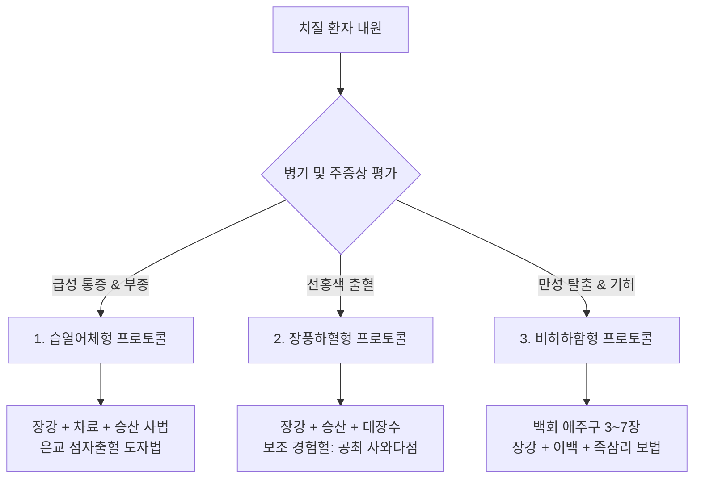

# 치질(치핵) 침구치료지침 보고서
### 해부생리학적 기전 및 문헌고증 기반 임상 프로토콜

**원광대학교 한의과대학 경혈학교실 · 2026-11-01**

---

## 1. 요약 (Executive Summary)

치질(치핵, Hemorrhoids)은 항문관 점막하의 정상 혈관·결합조직 복합체인 '항문 쿠션(anal cushion)'이 울혈·비후되고 지지조직이 이완되면서 **항문곧창자정맥얼기(anorectal venous plexus, FMA:18933)**가 하방으로 탈출(prolapse)하고 출혈·통증을 유발하는 다빈도 항문직장 질환입니다.

본 보고서는 **[경혈해부(Acupoint Anatomy)] 분석 프레임워크(v2.7)**, FMA 5.1.0 온톨로지, 4대 침구 원전(《中国针灸证治通鉴》·《针灸腧穴通考》) 및 현대 임상문헌·신경반사 연구를 종합하여 치질에 대한 침구 치료 지침을 체계화하였습니다. 아울러 임상에서 흔히 치질 출혈에 다용되는 **공최(LU6)**에 대해, 전통 한의학 고전에는 치질 주치가 전무하며 20세기 초 일본 **사와다 겐(澤田健)의 독창적 경험혈**에서 유래된 문헌사적 실체를 명확히 규명하여 반영하였습니다.

- **핵심 배오 원리**: 치질의 전통 정통 배오는 **'국소 천골혈(장강 GV1, 차료 BL32) + 하지 원위혈(승산 BL57) + 전신 승제혈(백회 GV20)'**의 3원 체계입니다.
- **공최(LU6)의 문헌사적 실체 교정**:
  - 《영추》·《갑을경》·《천금방》·《자생경》·《대성》 등 청대 이전 한·중 고전문헌에 공최의 치질 주치는 전무함.
  - 치질에 공최를 쓴 것은 1930년대 일본 **사와다 겐(澤田健)**의 《침구진수(鍼灸眞髓)》에서 '독창혈(척택 하 3횡지)'로 제창한 경험혈에서 유래함.
  - 현대 교재에서 이를 "폐경의 극혈(郄穴)이라 급성 출혈을 지혈한다"거나 "폐-대장 표리(肺-大腸 表裏)"로 해석하는 것은 근현대에 사와다의 경험방을 한의학 이론으로 사후 합리화(가탁)한 설명임(조은별·김재효, 2021). 따라서 고전 정통 혈위와 근현대 경험혈을 엄밀히 분리하여 적용해야 함.
- **신경해부학적 기전**:
  1. **국소 근육·혈류 조절**: 장강(GV1)은 음부신경(S2-S4) 분지인 하직장신경(FMA:21865)과 항문올림근(FMA:19087)을 표적으로 하여 외항문괄약근 경련을 완화하고 국소 정맥 울혈을 개선합니다.
  2. **체성-내장 반사(S2 분절 수렴)**: 승산(BL57, 정강신경 L5-S2)은 천골 척수 분절(S2)에서 항문·직장의 내장 및 체성 신경과 수렴(convergence)하여, 하지 원위부 자극을 통해 골반저 괄약근 긴장도를 반사적으로 조절합니다.
  3. **골반저 지지근 승제**: 백회(GV20) 구법(뜸)은 뇌간-척수 하행성 경로를 통해 이완된 거항근의 기저 긴장도를 회복시켜 치핵 탈출을 정복합니다.
- **병기별 치료 지침**:
  - **급성 염증·동통기**: 장강(GV1) + 승산(BL57) + 차료(BL32) 사법(瀉法), 상순계대 은교(GV28) 도자법(挑刺法).
  - **급성 출혈기 (장풍하혈)**: 장강(GV1) + 승산(BL57) + 대장수(BL25) [근현대 경험혈 병용 시 공최(LU6) 고려].
  - **만성 탈출기 (기허하함)**: 백회(GV20, 애주구 3~7장) + 장강(GV1) + 이백(EX-UE2) + 족삼리(ST36).
- **시술 안전 심도**: 장강(GV1)은 미골 앞면을 따라 **상향 사자 0.8~1.0촌 (18.4~23.0 mm)**하며, 직장 천공 위험이 있는 **수직 직자(直刺)는 절대 금기**입니다.

---

## 2. 배경 및 목적

치질(Hemorrhoids)은 성인의 50% 이상이 일생 중 한 번 이상 경험하는 가장 흔한 항문 양성 질환입니다. 양방 치료는 좌욕, 식이요법, 소염진통제 등 보존적 요법과 결찰술, 치핵절제술 등의 외과적 수술로 나뉩니다. 그러나 수술적 처치는 수술 후 극심한 배변 통증, 항문 협착, 괄약근 손상에 따른 변실금 등의 합병증 위험이 존재합니다.

한의학에서 치질은 《내경》, 《상한론》, 《천금방》의 "오치(五痔)", "장풍하혈(腸風下血)", "치루(痔漏)"의 범주로 다루어져 왔습니다. 침구 치료는 침습적 수술 없이도 **급성 통증 완화, 출혈 조기 억제, 탈출된 치핵의 정복 및 재발 방지**에 우수한 임상 효과를 발휘합니다. 본 보고서는 이러한 침구 치료를 과학적 해부구조와 신경반사 모델로 규명함과 동시에, 문헌고증을 통해 근거의 기원을 정밀히 감별하여 표준 진료 지침을 제공하는 데 목적이 있습니다.

---

## 3. 치질의 해부병태생리학적 표적

```
[항문관 횡단면 해부학적 구조 및 치핵 발생 부위]

                     직장 점막 (내치핵: 자율신경, 무통성 출혈)
                         │
        ─── 치상선 (Pectinate Line) ───  ← 상직장정맥(간문맥계)
                         │
                     항문관 피부 (외치핵: 음부신경, 극심한 통증)
                         │
                 항문 쿠션 (Anal Cushion)
            ┌────────────┴────────────┐
   [항문곧창자정맥얼기]            [Parks 인대 / Treitz 근육]
   (Rectal Venous Plexus)         (울혈 시 결합조직 파열 → 탈출)
            │                                  │
    내·외항문괄약근 연축               외항문괄약근 / 거항근
  (배변 시 항문내압 상승)            (음부신경 S2-S4 지배)
```

1. **항문 쿠션(Anal Cushion)의 병태**:
   - 우전(11시), 우후(7시), 좌외측(3시) 3개 부위에 발달한 점막하 혈관성 결합조직망입니다.
   - 변비, 복압 상승, 임신, 장시간 배변 등으로 정맥얼기가 울혈되고 근섬유망(Treitz 근육)이 단열되면 치핵이 형성됩니다.
2. **이원적 신경 지배와 임상 양상**:
   - **치상선 상방 (내치핵)**: 하장간막신경총(교감) 및 골반내장신경(S2-S4, 부교감)의 지배를 받아 통각이 둔감하며, 배변 시 선홍색 분출성 출혈과 배변 후 탈출이 주증상입니다.
   - **치상선 하방 (외치핵)**: 음부신경의 가지인 **하직장신경(inferior rectal nerve, FMA:21865)**이 지배하여 체성 통각이 극도로 발달되어 있으며, 혈전 형성 시 격렬한 작열통·박동통을 초래합니다.
3. **내·외항문괄약근 복합체**:
   - 내항문괄약근(불수의근): 교감신경에 의해 수축, 부교감신경에 의해 이완.
   - 외항문괄약근(수의근): 하직장신경(S2-S4)에 의해 지배. 치질 환자에서는 통증과 염증으로 인해 괄약근 경련(spasm)이 발생하고, 이로 인해 항문 내압이 상승하여 정맥 환류가 더욱 악화되는 악순환(Vicious cycle)이 형성됩니다.

---

## 4. 고전문헌 선혈 규율 및 공최(LU6)의 문헌사적 비판

### 1) 《증치통감》 고전문헌의 정통 선혈 규율
《中国针灸证治通鉴》 제26편 〈치루(痔漏)〉 및 《针灸腧穴通考》(하)에 수록된 역대 40여 종의 의서를 전수 분석한 결과, 고전 한의학의 정통 치질 치료혈은 다음과 같이 수렴됩니다:
- **국소 취혈**: **장강(GV1)** — 독맥의 락혈. 《천금익방》 "五痔便血失屎，灸回气(长强)百壮", 《옥룡가》 "纵饶大痛呻吟者，一刺长强绝病根". 항문 국소 사혈 및 외과적 처치 전통.
- **하지 원위혈**: **승산(BL57)** — 족태양방광경. 《영광부》 "承山筋转并九痔", 《침구취영》 "长强承山，灸痔最妙".
- **천골 분절혈**: **차료(BL32)** 및 팔료혈, **요수(GV2)**, **대장수(BL25)** — 골반강 및 하부 직장의 신경·혈관 조절.
- **전신 승제혈**: **백회(GV20)** — 《천금방》, 《침구대성》. 탈항구치(脱肛久痔)에 구법(뜸) 다용.
- **상지 기혈**: **이백(EX-UE2)** — 《의학강목》. 완횡문 상 4촌, 탈항·치질 요혈.

### 2) 공최(LU6) "극혈 작용"의 실체 규명: 사와다 겐(澤田健)의 독창혈과 사후 가탁 비판

현대 침구학 교재와 임상가들 사이에서 *"공최는 수태음폐경의 극혈(郄穴)이므로 급성 출혈을 멎게 하고, 폐-대장 표리(肺-大腸 表裏) 관계에 의해 치질 출혈을 치료한다"*는 설명이 널리 통용되고 있습니다. 그러나 조은별·김재효(2021)의 실증적 문헌고찰에 따르면, 이는 **한의학 고전문헌에 근거한 정통 이론이 아닙니다**.

```
[공최(LU6) 치질 주치의 문헌사적 변천 층차]

  [고전 문헌 (청대 이전 한·중 전적)]
  《내경》, 《갑을경》, 《천금방》, 《외대비요》, 《자생경》, 《침구대성》 등
  → 치질(痔) 주치 기록 전무 (해수, 천식, 실음, 인후통, 각혈 등 호흡기 질환만 수록)
                     │
                     ▼
  [1930년대 일본: 사와다 겐 (澤田健) 제창]
  시로타 분시(代田文誌)의 《침구진수(鍼灸眞髓)》(1941)
  → 사와다 겐의 "독창혈(獨創穴)"로서 치질의 진단·뜸 치료 특효혈로 최초 제시
     (취혈 위치도 WHO 표준 완횡문 상 7촌이 아닌 '척택 하 3횡지'로 취혈)
                     │
                     ▼
  [1950~60년대 이후 한·중 근현대 교재 편입 및 사후 이론화]
  1958년 《침구학강의》, 1963년 《실용중국침구경혈학》 등
  → 사와다 겐의 경험방이 교재로 수입되면서,
     "폐경 극혈(郄穴)의 지혈 작용" 및 "폐-대장 표리 관계"라는 한의학 이론을
     사후에 덧붙여 합리화(가탁·유비)함
```

1. **고전문헌의 부재**:
   - 《황제내경》, 《침구갑을경》, 《비급천금요방》, 《천금익방》, 《외대비요》, 《침구자생경》, 《십사경발휘》, 《침구취영》, 《침구대성》, 《의종금감》 등 청대 이전 한의학 표준 문헌 어디에도 공최(LU6)를 치질이나 변혈에 사용한 기록은 단 한 건도 없습니다.
2. **실제 출전: 사와다 겐(澤田健, 1877~1938)**:
   - 20세기 초 사와다 겐의 임상 구술을 제자 시로타 분시(代田文誌)가 정리한 **《침구진수(鍼灸眞髓)》(1941)**에서 공최는 사와다의 '독창혈(獨創穴)'로 소개되며 치질의 뜸 치료 명혈로 처음 등장하였습니다.
   - 당시 사와다의 취혈 위치는 영추 골도법이나 현행 WHO 표준(완횡문 상 7촌/12촌)과 달리, 팔꿈치에 훨씬 가까운 **"척택(LU5) 아래 3횡지(약 3촌)"** 지점이었습니다.
3. **이론적 사후 가탁(假托)의 비판**:
   - 1950년대 이후 중의학·한의학 교재에 사와다류의 치질 처방이 유입되자, 학자들은 이를 설명하기 위해 고전의 "극혈주통(郄穴主痛)·극혈주혈(郄穴主血)" 명제와 "폐-대장 표리" 개념을 사후에 결부시켰습니다.
   - 따라서 **"공최의 극혈 작용에 의한 치질 치료"는 한의학 고유의 문헌적 근거가 아니라, 근현대 일본 사와다 겐의 독창적 경험방이 사후 합리화된 층차**임을 명확히 인식해야 합니다. 임상 시 정통 고전 배오(장강·승산·차료)를 1선으로 삼고, 공최는 보조적 경험혈로 감별하여 적용하는 것이 타당합니다.

---

## 5. [경혈해부] 신경해부학 및 생의학적 반사 기전

### 1) 천골 분절(S2~S4) 중심의 국소 신경·근육성 조절
- **장강(GV1)**:
  - **FMA 실체**: 항문미골인대(Anococcygeal body, FMA:20273), 항문올림근(Levator ani, FMA:19087), 외항문괄약근.
  - **신경 주행**: 하직장신경(Inferior rectal nerve, FMA:21865) → 음부신경(Pudendal nerve, FMA:19037) → 천골신경총(**S2, S3, S4**).
  - **생리 기전**: 침 자극이 하직장신경 감각 섬유를 통해 척수로 들어가 반사적으로 외항문괄약근의 과도한 수축성 경련을 차단하고 항문관 내압을 감소시킴으로써, 항문곧창자정맥얼기(FMA:18933)의 혈류 정체를 즉각 해소합니다.

### 2) 승산(BL57)의 체성-내장 반사 및 S2 분절 수렴 회로
- **승산(BL57)**:
  - **FMA 실체**: 장딴지근(Gastrocnemius, FMA:22541), 가자미근(Soleus, FMA:22542).
  - **신경 주행**: 정강신경(Tibial nerve, FMA:19035) → 좌골신경(Sciatic nerve, FMA:19034) → 천골신경총(**L5, S1, S2**).
- **척수 분절 수렴(Spinal Convergence)**:
  - 승산의 주 지배 분절인 **S2**는 장강(GV1) 및 골반내장신경(Pelvic splanchnic nerves)의 구심로와 동일 척수 분절에서 시냅스를 형성합니다.
  - 정강신경 자극 신호는 척수 후각 교양질에서 관문조절기전(Gate control)을 발동하여 항문부 통각 전도를 차단하고, 원심성 자율신경 섬유를 통해 하부 직장벽의 혈관 운동을 조절합니다.

### 3) 백회(GV20) 구법의 승제(升提) 및 거항근 수축 반사
- 두정부(삼차신경 안신경 분지 및 대후두신경 C2)의 온열 자극(뜸)은 뇌간 망상체와 척수 하행성 경로를 자극하여, 음부신경을 통해 항문올림근(Levator ani: 두덩꼬리근, 엉덩꼬리근)의 기저 장력을 회복시킵니다. 이를 통해 중력에 의해 탈출된 치핵 조직을 골반강 내로 정복(reduction)시키는 작용을 합니다.

---

## 6. 임상 병기별·변증별 침구 치료 프로토콜



### 1) 급성 염증·동통기 (혈전성 외치핵, 감돈 치핵)
- **주증상**: 항문 부위의 격렬한 박동통, 결절성 종창, 작열감, 배변 불가.
- **선혈**: **장강(GV1) + 승산(BL57) + 차료(BL32) + 은교(GV28)**
- **시술 방법**:
  - 장강: 45° 상향 사자 20mm, 제삽염전 사법.
  - 승산: 직자 30mm, 득기 후 강자극 2분.
  - 은교: 윗입술 안쪽 상순계대의 백색 결절을 멸균 삼릉침으로 찔러 미량 방혈(도자법).
  - 유침 시간: 20~30분, 매일 1회, 3~5회 연속 시술.

### 2) 급성 출혈기 (장풍하혈)
- **주증상**: 배변 전후 선홍색 피가 뚝뚝 떨어지거나 분출성으로 출혈, 빈혈 동반.
- **선혈**: **장강(GV1) + 승산(BL57) + 대장수(BL25)** (보조 경험혈: **공최 LU6**)
- **시술 방법**:
  - 대장수: 척추 외측 1.5촌, 직자 25mm 후 평보평사, 온침 병용.
  - 공최(보조혈): 사와다 켄의 원형(척택 하 3횡지 부근 압통점) 또는 표준 공최혈에서 직자 15mm 자극.
  - 장강·승산: 염전보사로 국소 정맥압 감압.

### 3) 만성 탈출기 (내치핵 3~4도, 기허하함)
- **주증상**: 배변 시 치핵이 탈출하여 손으로 밀어 넣어야 하거나 상시 탈출 상태, 무력감.
- **선혈**: **백회(GV20, 뜸) + 장강(GV1) + 이백(EX-UE2) + 족삼리(ST36)**
- **시술 방법**:
  - 백회: 소맥립대(밀알 크기) 직접구 또는 애조구(간접뜸) 3~7장. 온기가 정수리를 통해 전신으로 퍼지도록 유도.
  - 이백: 완횡문 상 4촌 양측 2혈, 직자 15mm, 보법.
  - 장강 및 족삼리: 염전보법, 30분 유침. 격일 1회, 총 10~15회 치료.

---

## 7. 핵심 혈위별 정위, 자침 깊이 및 안전 지침

한대 골도분촌 기준 **1푼 = 2.3 mm** 환산 공식 및 해부학적 구조물 기준 안전 규정입니다.

| 경혈명 | 코드 | 취혈 체위 및 랜드마크 | 자침 방향 및 표준 깊이 | 환산 심도 (mm) | 해부학적 안전 주의사항 |
| :--- | :---: | :--- | :--- | :---: | :--- |
| **장강 (長强)** | GV01 | 슬흉위 또는 측와위. 미골단(尾骨端)과 항문 연결선의 중점. | 미골 앞면을 따라 **상방 사자 40~60°** (0.8~1.0촌) | **18.4 ~ 23.0 mm** | **[절대 금기] 수직 직자 금지.** 직자 시 직장 벽을 관통하여 천공 및 감염 유발. |
| **차료 (次髎)** | BL32 | 복와위. 제2후천골공(S2 foramen). | 전내하방으로 **약 45° 사자** (1.0~1.5촌) | **23.0 ~ 34.5 mm** | 천골공 내 침 진입 시 회음부로 방사되는 득기감 확인. 과도한 심자 방지. |
| **승산 (承山)** | BL57 | 복와위 또는 족관절 배굴. 비복근 두 갈래 힘줄 이행부 오목한 곳. | 근육간극을 향해 **수직 직자** (1.0~2.0촌) | **23.0 ~ 46.0 mm** | 심부 정강신경(Tibial n.) 본간 손상 주의, 득기 후 완만 조작. |
| **이백 (二白)** | EX-UE2 | 전완 장측. 완횡문 상 4촌, 요측수근굴근건 양측 2혈. | 힘줄을 피해 **수직 직자** (0.5~1.0촌) | **11.5 ~ 23.0 mm** | 심부 정중신경(Median n.) 찌름 주의(전기 통하는 전격통 시 즉시 발침). |
| **백회 (百會)** | GV20 | 정좌위, 턱을 가볍게 당긴 자세. 두정부 전발제 상 5촌. | 모상건막하층을 따라 **후방 평자** (0.5~0.8촌) | **11.5 ~ 18.4 mm** | 골막 아래 관통 금지, 뜸 시술 시 두발 화상 주의. |
| **공최 (孔最)**<br>*(보조경험혈)* | LU06 | 전완 회외위. 표준(완횡문 상 7촌) 또는 사와다점(척택 하 3횡지). | 요골 내측연을 향해 **수직 직자** (0.5~1.0촌) | **11.5 ~ 23.0 mm** | 사와다 겐의 경험혈임을 인지하고 적용. 요골동맥 주행 주의. |

---

## 8. 안전 관리 및 이상반응 대책

1. **국소 감염 방지 (Aseptic Technique)**:
   - 항문 주위(장강, 회음)는 대장균 등 상재균이 풍부하므로, 시술 전 포비돈 아이오딘 또는 클로르헥시딘으로 2회 이상 철저히 소독합니다.
   - 일회용 멸균 침만을 사용하며, 발침 후 멸균 거즈로 1분 이상 압박 소독합니다.
2. **외과적 응급 상황의 감별 및 전원**:
   - 대량 활동성 동맥 출혈로 인한 혈색소(Hb) 급격 저하 시 즉시 전원 조치합니다.
   - 치핵의 완전 괴사, 화농성 항문주위농양(Perianal abscess), 치루(Fistula) 합병증 의심 시 외과적 수술을 우선합니다.
3. **훈세(熏洗) 및 보존요법의 병행**:
   - 고전문헌(《傳信方》, 《資生經》)에 기록된 괴화(槐花), 고삼(苦蔘), 황백(黃柏) 전탕 훈세(좌욕)를 병행하면 항문 쿠션 부종 완화와 자침 효과가 현저히 상승합니다.

---

## 9. 결론

본 지침은 [경혈해부] 프레임워크를 기반으로 고전 침구의 치질 치료 경험을 **S2-S4 천골 신경 분절 수렴, 체성-내장 반사, 거항근 지지력 회복 모델**로 과학화한 임상 프로토콜입니다. 

아울러 공최(LU6)의 "극혈 지혈 및 표리 작용"이 고전 문헌에 근거한 것이 아니라 20세기 초 사와다 겐(澤田健)의 경험방이 근현대에 사후 이론화된 것임을 고증함으로써 학술적 엄밀성을 확보하였습니다.

장강(GV1)과 승산(BL57)의 상하 배오를 핵심축으로 하고 만성 탈출기에 백회(GV20) 구법을 결합하는 침구 치료는 치질 환자의 수술률을 낮추고 재발을 방지하는 안전하고 효과적인 한의 치료 대안이 될 것입니다.

---

## 10. 참고문헌

1. 조은별, 김청수, 남연경, 권오상, 양승범, 김재효. 〈공최(LU6)를 활용한 치질치료의 근거에 대한 문헌고찰 (A Literature Review on the Evidence that Hemorrhoids Were Included in the Efficacy of LU6)〉. 《Korean Journal of Acupuncture》, 2021; 38(4): 235-244.
2. 황룡상·황유민 편저, 《针灸腧穴通考》(하), 인민위생출판사, 2011, 长强, 承山, 百会 항목.
3. 등양월·맹명비 총주편, 《中国针灸证治通鉴》(제26편 외과병증: 치루), 청도출판사, 2004.
4. 황룡상, 《中国针灸学术史大纲》, 화하출판사, 2001.
5. 시로타 분시(代田文誌). 《침구진수(鍼灸眞髓)》. 도쿄: 춘추사, 1941.
6. FMA(Foundational Model of Anatomy) Ontology v5.1.0, University of Washington.
7. The American Society of Colon and Rectal Surgeons (ASCRS). Clinical Practice Guidelines for the Management of Hemorrhoids. *Dis Colon Rectum*, 2018; 61(3): 284-292.
