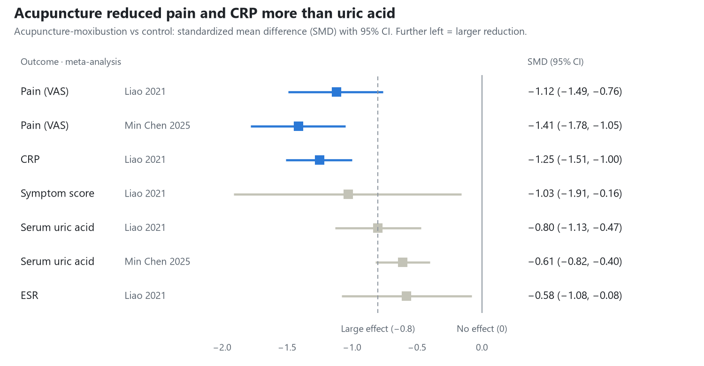
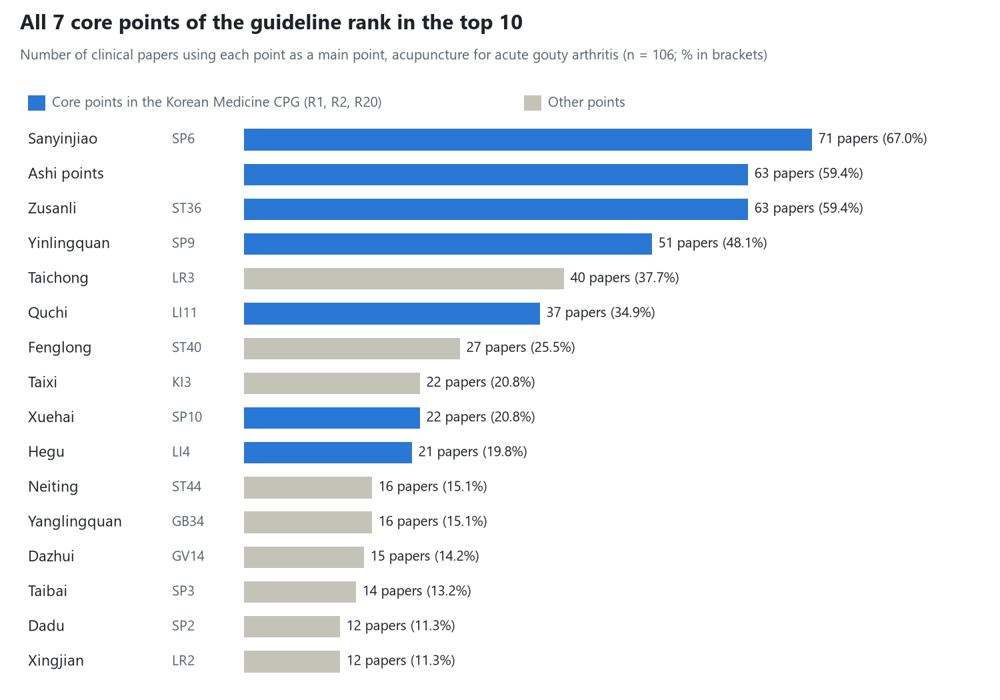

# Acupuncture and Moxibustion Treatment Guideline for Gout

2026-10-28 · Kim Jae-hyo

## Summary

For acute gout, first consider standard acupuncture, thermal stimulation of the needle (warm needling, fire needling) and pricking-collateral bloodletting. All three carry a grade B recommendation in the Korean Medicine guideline. Acupuncture-moxibustion markedly reduces pain and inflammation (VAS SMD −1.1 to −1.4). For lowering uric acid, it is an adjunct to urate-lowering therapy (ULT), not a replacement.

- **Acute phase**: Bleed the most swollen area (±cupping, once every 2–3 days, 2–7 sessions). Needle the core points SP6, ST36, SP9 and LI11 plus Ashi points (30-minute retention, daily). Add fire needling when pain dominates, and electroacupuncture (2 Hz, 30 minutes) when inflammation and uric acid are both high.
- **Intercritical and chronic phases**: Needle points that tonify the spleen and kidney (BL20, BL23, KI3, CV4) with warm needling or moxibustion, 2–3 times a week for 4–8 weeks. The guideline gives moxibustion and bloodletting for chronic gout a grade C recommendation.
- **Pattern differentiation**: Damp-heat accumulation and stasis-heat respond best to reducing techniques and bloodletting (cure rate 84.9% with fire-needle bloodletting). Spleen deficiency and liver-kidney deficiency patterns need tonifying techniques and moxibustion as well (cure rate with bloodletting alone 27.3% for liver-kidney yin deficiency).
- **Safety**: Adverse events with acupuncture-moxibustion were about one-seventh of those with conventional drugs (RR 0.14). Bloodletting requires disinfection and screening for coagulation disorders; bee venom therapy requires a test dose.
- **Quality of evidence**: Every acupuncture recommendation in the guideline is Low or Very low certainty, and every meta-analysis in the folder was rated critically low. Doses and session counts are customary values, not proven optima.

## Background and methods

This report uses the recommendations of the 2022 Korean Medicine Clinical Practice Guideline for Gout as its framework. It fills in practical treatment details from 68 Chinese publications in the source folder (after removing 4 duplicate pairs).

- **Reference guideline**: Korean Medicine Clinical Practice Guideline for Gout (Korean Medicine Innovative Technology Development Project Group; principal investigator Song Ho-sueb; 2022). It gives 21 recommendations for acute gout and 3 for chronic gout (R1–R24), each with a GRADE certainty level and a grade of A–D or GPP (good practice point).
- **Supporting literature**: Chinese journal articles and master's theses, 1996–2026. These include RCTs and clinical observations, systematic reviews and (network) meta-analyses, acupoint data-mining studies, narrative reviews, animal studies and case reports.
- **Methods**: From each paper's abstract, methods and results, we extracted study design, sample size, disease stage and TCM pattern, intervention (technique, points, dose, frequency), control, outcomes and adverse events. Each finding was checked for whether it agrees with a guideline recommendation or adds detail the guideline lacks.
- **Notation**: Guideline recommendations are written as "R number, grade/certainty". Content from the folder literature is not a guideline recommendation and is labelled **supporting evidence**.

## Acupuncture-moxibustion recommendations in the Korean Medicine guideline

The highest grade for any acupuncture-moxibustion recommendation is B. It was given to standard acupuncture, thermal needle stimulation (warm needling, fire needling) and bloodletting for acute gout. There is no grade A, and all certainty levels are Low or Very low. Grade B means "should be considered" and grade C means "may be considered".

### Acute gout

| Treatment | Alone | With other Korean medicine | With conventional drugs | Treatment details in the guideline |
| --- | --- | --- | --- | --- |
| Standard acupuncture | R1, B/Very low | R9, B/Very low | R14, B/Low | SP6, SP10, ST36, LI11, LI4 + Ashi points; 30-min retention |
| Thermal stimulation (warm needling, fire needling) | R2, B/Low | R10, B/Low | R15, B/Low | Ashi points, SP6, ST36, LI11, SP9; warm needling with 30-min retention |
| Pricking-collateral bloodletting (±cupping) | R6, B/Low | R13, B/Low | R18, C/Very low | Most swollen area; once every 2–3 days, 2–7 sessions |
| Electroacupuncture | R3, C/Low | R11, C/Very low | R16, C/Low | ST36, SP6 + Ashi points; 2 Hz, 30 min |
| Moxibustion | R5, C/Low | — | R17, C/Low | Scarring moxibustion takes 30–40 days for the scab to fall off; caution over joints |
| Acupotomy | R4, C/Very low | R12, C/Very low | — | Painful area; avoid nearby nerves and vessels |
| Pharmacopuncture (incl. bee venom) | R8, GPP | — | — | Affected area and surrounding points; skin test before bee venom |
| Any acupuncture + other Korean medicine + conventional drugs | — | — | R20, C/Low | Ashi points, SP6, SP10, ST36, LI11, LI4, TE5; 30-min retention |
| Bloodletting + other Korean medicine + conventional drugs | — | — | R21, C/Very low | Same as R6 |

### Chronic gout

- **R22 (C/Very low)**: Moxibustion or herbal medicine alone may be considered.
- **R23 (C/Low)**: Moxibustion and bloodletting may be considered. Moxibustion at ST36, SP10, CV4 (Guanyuan) and GV4 (Mingmen); bloodletting with cupping at the painful area and Ashi points.
- **R24 (C/Low)**: Herbal medicine combined with conventional drugs (not an acupuncture intervention).

### Point selection by pattern and site (guideline chapter "Treatment")

- **Wind-heat-damp type (acute phase)**: Dispel wind, clear heat and remove dampness. GV14 (Dazhui), GV12 (Shenzhu), LI11 (Quchi).
- **Phlegm-stasis obstruction type (chronic phase)**: Dispel stasis, transform phlegm, boost the kidney and nourish the heart. BL17 (Geshu), SP10 (Xuehai), BL20 (Pishu), PC6 (Neiguan), BL28 (Pangguangshu).
- **Acute attack**: Bleed the painful spot, then add surrounding points and points along the affected channel. Big toe: SP1 (Yinbai), SP3 (Taibai), LR2 (Xingjian). Ankle: BL60 (Kunlun), SP5 (Shangqiu), ST41 (Jiexi). Knee: ST36, SP9, GB34, Xiyan (EX-LE5).
- **Pattern-based additional points (RCT cited in the guideline, fire needling)**: Damp-heat: ST44, SP8, SP3. Stasis-heat: LR2, SP10, SP6. Phlegm-turbidity: LR4, SP9, ST36.
- **Asymptomatic hyperuricemia (pre-disease stage)**: The guideline only states that acupuncture, moxibustion, cupping and pharmacopuncture may be considered; it gives no graded recommendation.

## Analysis of the evidence in the folder

All 67 analysed publications reported acupuncture-moxibustion as better than or similar to conventional drugs. The clearest effects were on pain and inflammation; the effect on uric acid was moderate. The 67 exclude 4 duplicate pairs and 1 paper on knee osteoarthritis.

| Study design | Papers | Notes |
| --- | --- | --- |
| RCT / controlled clinical trial | 26 | 3 non-randomized (e.g. allocation by order of visit); 4 master's theses |
| Narrative review / theory | 21 | Summaries of treatment principles and point-selection experience |
| Case report / case series / expert experience | 10 | e.g. fire-needle bloodletting 105 cases, three-edged needle bloodletting 54 cases |
| Systematic review / (network) meta-analysis / overview | 5 | |
| Acupoint data mining | 2 | Analyses of 118 and 38 papers |
| Animal study | 2 | Rat model of acute gout |
| Retrospective cohort (five-movement six-qi theory) | 1 | Master's thesis |

*Figure 1. Sources: Liao 2021 (40 RCTs, 2,893 patients; control = conventional drugs) and Min Chen 2025 (acupuncture subgroup; control = usual care or no treatment).*

Other results from the meta-analyses:

- **Total effective rate**: Acupuncture-moxibustion was higher than conventional drugs, RR 1.13 (1.08–1.17). In technique subgroups, bloodletting, electroacupuncture, fire needling, moxibustion, standard acupuncture and warm needling were significant; acupotomy was not.
- **Technique ranking (acute gout, 23 RCTs)**: Odds ratios for total effective rate vs conventional drugs were 1.18 for electroacupuncture, 1.17 for warm needling and 1.13 for fire needling. Electroacupuncture ranked first for lowering uric acid and fire needling ranked first for pain relief (SMD −1.40).
- **Adverse events and recurrence**: Adverse events RR 0.14 (0.07–0.28) and OR 0.12 (0.08–0.18); recurrence OR 0.20 (0.14–0.28), all lower than with conventional drugs.
- **Individual RCTs**: Adding acupuncture to conventional drugs raised the total effective rate by 10–30 percentage points, e.g. 93.3% vs 82.7% in 150 patients with acute gout. A heat-clearing herbal formula plus acupuncture and bloodletting matched colchicine plus benzbromarone in efficacy (91.4% vs 88.6%, P>0.05) with fewer adverse events (2 vs 11).

## Acupuncture-moxibustion guideline by stage and pattern

The guideline and the folder literature share one structure. In the acute phase, local bloodletting plus needling of core lower-limb points quickly relieves pain and swelling. In the intercritical and chronic phases, warm needling and moxibustion plus points that tonify the spleen and kidney reduce recurrence. Uric acid lowering is the job of ULT; acupuncture-moxibustion is an adjunct.

### 1. Acute attack (days 0–7)

- **Goals**: Reduce pain, swelling and heat; lower inflammatory markers (CRP, ESR).
- **First choice (guideline grade B)**: Bloodletting of the swollen area (±cupping) plus standard acupuncture. Warm needling and fire needling share the same grade B.
- **Core points**: SP6 (Sanyinjiao), ST36 (Zusanli), SP9 (Yinlingquan), LI11 (Quchi) + Ashi points. Add local points for the affected joint (see "Commonly used points and combination rules").
- **Typical course**: Acupuncture once daily (30-min retention) plus bloodletting once every 2–3 days, for 5–14 days.
- **Supporting evidence**: In a network meta-analysis (23 RCTs, 1,684 patients), electroacupuncture ranked first for total effective rate and fire needling first for pain (VAS). Consider fire needling or fire-needle bloodletting when pain dominates, and electroacupuncture when inflammation and uric acid are both high.

### 2. Intercritical phase (between attacks)

- **Goals**: Fewer recurrences; maintain adherence to ULT.
- **Guideline**: No separate recommendation (only acute and chronic are distinguished).
- **Supporting evidence**: Bloodletting at Ashi points every 2 days plus abdominal acupuncture (CV12, CV4, ST24, ST26) for 15 days gave serum uric acid of 424 vs 567 μmol/L (control: benzbromarone). Intradermal needle embedding plus aerobic exercise gave 6-month recurrence of 3/29 vs 10/29.

### 3. Chronic phase (tophi, joint deformity)

- **Goals**: Relieve chronic pain, improve joint function, reduce recurrence.
- **Guideline (C)**: Moxibustion and bloodletting (R23). Moxibustion at ST36, SP10, CV4 and GV4.
- **Supporting evidence**: Two RCTs needled BL20 (Pishu), BL23 (Shenshu), GV14 (Dazhui), KI3 (Taixi), ST36, SP6 and Ashi points 3–7 times a week for 8 weeks. Added to febuxostat, 1-month recurrence was 8.22% vs 19.72%. One report bleeds tophi first by pricking with a three-edged needle.

### Treatment principles and points by pattern

| Pattern | Main stage | Treatment principle | Main techniques | Points to add | Evidence |
| --- | --- | --- | --- | --- | --- |
| Wind-heat-damp / damp-heat accumulation (湿热蕴结) | Acute | Clear heat, drain dampness, activate blood, stop pain | Bloodletting, fire-needle bloodletting, reducing method | GV14, GV12, LI11; ST44, SP8, SP3; GB40, SP2 | Guideline pattern differentiation; fire-needle bloodletting 105 cases |
| Stasis-heat obstruction (瘀热) | Acute–subacute | Clear heat, activate blood | Bloodletting, fire needling | LR2, SP10, SP6, BL17 (Geshu) | RCT cited in the guideline; fire-needle bloodletting 105 cases |
| Phlegm-turbidity / spleen deficiency with dampness (脾虚湿阻) | Intercritical–chronic | Strengthen the spleen, transform dampness and phlegm | Standard acupuncture, warm needling | ST40, SP9, ST36, LR4, BL20 (Pishu) | RCT in elderly patients with spleen deficiency and dampness (96 patients) |
| Phlegm-stasis obstruction (痰瘀痹阻) | Chronic | Dispel stasis, transform phlegm | Bloodletting with cupping, moxibustion, acupotomy | BL17, SP10, BL20, PC6, BL28 | Guideline pattern differentiation |
| Wind-cold-damp bi (风寒湿痹) | Intercritical–chronic | Warm the channels, dispel cold and dampness | Warm needling, moxibustion | ST40, LI11, SP10, SP9 + local warm needling | Wind-cold-damp RCT (88 patients) |
| Spleen-kidney yang deficiency / liver-kidney deficiency | Chronic | Warm the kidney, strengthen the spleen, tonify liver and kidney | Tonifying needling, moxibustion | BL20, BL23, CV12, CV4, CV6, KI3, SP6 | Master's-thesis RCT, spleen-kidney yang deficiency (57 patients); 2 RCTs in chronic gout |

In the 105-case fire-needle bloodletting series, cure rates differed sharply by pattern (P<0.01): damp-heat accumulation 84.9%, stasis-heat 60.0%, phlegm-turbidity 50.0%, liver-kidney yin deficiency 27.3%. Bloodletting with reducing technique works well for excess and heat patterns; deficiency patterns need tonifying technique and moxibustion as well.

## Treatment details by technique

The values below follow the guideline's clinical considerations; gaps are filled with the values most often used in the folder literature. Almost no study compared doses, so these are customary values, not proven optima.

| Technique | Points | Stimulation / dose | Frequency / duration | Evidence |
| --- | --- | --- | --- | --- |
| Standard acupuncture | SP6, ST36, SP9, LI11, LI4, SP10 + surround needling of Ashi points (3–4 needles angled 15–45° toward the centre of the painful spot) | 0.25–0.35 × 40 mm; reducing method in acute phase, tonifying or even method in chronic phase; 30-min retention | Acute: once daily for 7–14 days. Chronic: 3–5 times a week for 4–8 weeks | Guideline R1, R14 (B) |
| Pricking-collateral bloodletting (刺络放血) | Most swollen area, Ashi points, distended superficial veins | Prick with a three-edged or lancet needle, then cup for 5–10 min. 3–20 mL per session; varies widely between papers | Once every 2–3 days, 2–7 sessions | Guideline R6, R13 (B) |
| Warm needling | Ashi points, SP6, ST36, LI11, SP9; knee: GB34, medial and lateral Xiyan | 2 cm moxa stick on the needle handle, 15–20 min; 30-min retention | From 1–2 times a week to daily | Guideline R2, R15 (B) |
| Fire needling / fire-needle bloodletting | Ashi points + LR2 (Xingjian), LR3 (Taichong), ST44 (Neiting), ST43 (Xiangu) | Prick 0.3–1 cun deep, 1–3 needles per point; thick needles on the foot, fine needles above the ankle | From once a week to every 2 days, 3–5 sessions | Guideline R2 (B); first for VAS in the network meta-analysis |
| Electroacupuncture | ST36, SP6 + Ashi points | Guideline: 2 Hz for 30 min. Papers also use 2/15 Hz dense-disperse wave and 100–150 Hz | From daily to twice a week | Guideline R3 (C); first for total effective rate in the network meta-analysis |
| Moxibustion | Acute: suspended moxibustion over the affected area. Chronic: ST36, SP10, CV4, GV4, CV12 | 3 rounds of suspended moxibustion or moxa cones; avoid scarring moxibustion over joints | Chronic: 2–3 times a week | Guideline R5, R17, R23 (C) |
| Acupotomy | Painful area, around tophi | Avoid nerves and vessels; in frail patients wait until recovery | Rarely | Guideline R4 (C); not significant in the meta-analysis subgroup |
| Bee sting / bee venom pharmacopuncture | GB34 (Yanglingquan), LR3 (Taichong) + surround needling of the affected area | Always after a test dose; increase gradually from a small amount | Twice a week for 20 sessions, then once a month | Guideline R8 (GPP); 1 controlled trial |
| Floating needle (Fu's subcutaneous needling) | 6–10 cm away from the tender point | Insert subcutaneously at 15–25°, sweep, then leave the soft cannula in place for 24 h | Every 2 days, 10 sessions | 1 RCT (87 patients) |
| Intradermal / embedded needle | ST36, GB34, SP6, LI11; BL15 (Xinshu), BL19 (Danshu) | Leave in place for 2–3 days | Recurrence prevention in the intercritical phase | 1 RCT; expert experience |

### Choosing between techniques

- **Adding bloodletting increases the effect.** In gouty knee arthritis, bloodletting alone gave 60.0% and bloodletting plus warm needling 86.67%. Acupuncture plus bloodletting also beat conventional drugs (95% vs 85%).
- **Heat plus electrical stimulation scored highest.** In a four-arm trial in acute gout, total effective rates were electro-warm needling 100% > warm needling 87.5% > electroacupuncture 77.3% > standard acupuncture 50%. The arms were small (16–24 patients each).
- **In animals, bloodletting acted fastest.** In rats with acute gout, bloodletting at ST36 and SP9 reduced joint swelling by day 2, more than acupuncture or electroacupuncture; moxibustion took effect from day 3.
- **Floating needle raised the cure rate.** Total effective rates were similar (95.6% vs 90.5%), but the cure rate was 57.8% vs 21.4% compared with standard acupuncture.

## Commonly used points and combination rules

The core of the prescription is SP6 (Sanyinjiao), ST36 (Zusanli) and SP9 (Yinlingquan) plus Ashi points. Local points for the affected joint and points for the pattern are added to these.

*Figure 2. Source: Liu 2017, Acupuncture Research: 106 of 118 papers that reported main points; top 16 points.*

### Most-used meridians

Half of all main points (50.5%) came from the spleen and stomach meridians. The spleen meridian passes the first metatarsophalangeal joint, the most common site of gout. The three yin and three yang leg meridians, which begin or end in the foot, took the top places.

| Rank | Meridian | Main points used | Liu 2017 frequency (630 uses in total) | Long 2018 frequency |
| --- | --- | --- | --- | --- |
| 1 | Spleen (Foot Taiyin) | Sanyinjiao, Yinlingquan, Xuehai, Taibai, Dadu, Gongsun, Yinbai, Shangqiu, Diji | 193 (30.6%) | 38 |
| 2 | Stomach (Foot Yangming) | Zusanli, Fenglong, Neiting, Xiangu, Tianshu, Jiexi, Liangqiu, Shangjuxu, Xiajuxu, Dubi, Lidui | 125 (19.8%) | 34 |
| 3 | Liver (Foot Jueyin) | Taichong, Xingjian, Dadun, Zhongfeng, Ligou | 60 (9.5%) | 10 |
| 4 | Large intestine (Hand Yangming) | Quchi, Hegu | 58 (9.2%) | 17 |
| 5 | Gallbladder (Foot Shaoyang) | Yanglingquan, Qiuxu, Fengshi, Xuanzhong, Diwuhui, Huantiao, Zulinqi | 30 (4.8%) | 5 |
| 6 | Kidney (Foot Shaoyin) | Taixi, Zhaohai, Dazhong, Zhubin | 29 (4.6%) | 10 |
| 7 | Bladder (Foot Taiyang) | Shenshu, Kunlun, Geshu, Weizhong, Dazhu, Pishu, Shenmai, Pangguangshu, Chengshan, Danshu, Ganshu, Sanjiaoshu, Zhongliao | 28 (4.4%) | 15 |

Ashi points, which belong to no meridian, were used 63 times (10.0%). Liu 2017 counted 67 main points in 106 papers; Long 2018 counted 38 papers. Long's meridian table has assignment errors (for example, Dazhui listed under the large intestine meridian), so it is used only as supporting data.

### Most-used acupoints

The rank follows the bar chart above (Liu 2017). The two right-hand columns show where another data-mining study and the guideline confirm the same point.

| Rank | Point | Meridian | Special point category | Role in the prescription | Long 2018 frequency (38 papers) | Korean Medicine guideline |
| --- | --- | --- | --- | --- | --- | --- |
| 1 | SP6 (Sanyinjiao) | Spleen | Crossing point of the three leg yin meridians | Core point; strengthens the spleen, drains dampness | 14 | Core point: R1, R2, R3, R11, R14–R16, R20 |
| 2 | Ashi points | Extra | — | Local surround needling; bloodletting site | 17 | Core point: R2, R3, R11, R14–R16, R20; adjunct in R1 |
| 3 | ST36 (Zusanli) | Stomach | He-sea point; lower he-sea point of the stomach | Core point; strengthens the spleen, transforms dampness, supports healthy qi | 16 | Core point: R1, R2, R3, R11, R14–R16, R20; chronic moxibustion R23 |
| 4 | SP9 (Yinlingquan) | Spleen | He-sea point | Core point; drains dampness | 14 | Core point: R2, R15 |
| 5 | LR3 (Taichong) | Liver | Yuan-source and shu-stream point | Local point for the big toe; soothes the liver | 6 | — |
| 6 | LI11 (Quchi) | Large intestine | He-sea point | Clears heat; local point for the elbow | 9 | Core point: R1, R2, R15, R20; wind-heat-damp type |
| 7 | ST40 (Fenglong) | Stomach | Luo-connecting point | Transforms phlegm, dispels dampness | 5 | — |
| 8 | KI3 (Taixi) | Kidney | Yuan-source and shu-stream point | Tonifies the kidney; local point for the medial ankle | 7 | — |
| 9 | SP10 (Xuehai) | Spleen | — | Activates blood, resolves stasis | — | Core point: R1, R20; chronic moxibustion R23; phlegm-stasis type |
| 10 | LI4 (Hegu) | Large intestine | Yuan-source point | Relieves pain, clears heat; local point for the wrist | 4 | Core point: R1, R20 |
| 11 | ST44 (Neiting) | Stomach | Ying-spring point | Clears heat; added for damp-heat | 3 | Added for damp-heat (RCT cited in the guideline) |
| 12 | GB34 (Yanglingquan) | Gallbladder | He-sea point; influential point of the sinews | Relaxes the sinews; local point for the knee | 3 | Point for the knee |
| 13 | GV14 (Dazhui) | Governor vessel | Meeting point of the yang meridians | Clears heat, frees yang | — | Wind-heat-damp type |
| 14 | SP3 (Taibai) | Spleen | Yuan-source and shu-stream point | Local point for the big toe | 2 | Point for the big toe; added for damp-heat |
| 15 | SP2 (Dadu) | Spleen | Ying-spring point | Local point for the big toe | — | — |
| 16 | LR2 (Xingjian) | Liver | Ying-spring point | Local point for the big toe; clears liver heat | 2 | Point for the big toe; added for stasis-heat |

Long 2018 also used SP4 (Gongsun), BL23 (Shenshu) and ST35 (Dubi) 4 times each. The pair used together most often was ST36–SP6 (33.3%), followed by SP9–SP6 (26.7%).

### Combination rules

1. **3–4 main points**: SP6, ST36 and SP9, plus LI11 (Quchi). The association rule "Ashi points + ST36 → SP6" had 84.2% confidence, and ST36–SP6 was also the core point pair in the other data-mining study (confidence >0.9).
2. **Surround needling of Ashi points**: Insert 3–4 needles obliquely toward the centre of the painful spot, or use the same spot for bloodletting.
3. **2–3 local points**: Choose from the table below by affected site. The meridians used, in order, were spleen > stomach > liver.
4. **Pattern-based points**: Follow the table in "Acupuncture-moxibustion guideline by stage and pattern".
5. **Choosing bloodletting sites (supporting evidence)**: Pair the yuan-source point, the luo-connecting point and the back-shu points of the meridian that crosses the affected site. For example, the foot taiyin type uses SP3 (Taibai) + ST40 (Fenglong) + BL20 and BL21; the foot shaoyang type uses GB40 (Qiuxu) + LR5 (Ligou) + BL19 and BL18.
6. **Accompanying symptoms**: For anxiety or insomnia, add Sishencong (EX-HN1), GV20 (Baihui) and PC6 (Neiguan). In the RCT that did this, SAS and SDS scores also improved.

### Local points by site

| Affected site | Guideline (bleed, then needle along the channel) | Additional points in the folder literature |
| --- | --- | --- |
| First metatarsophalangeal joint of the big toe | SP1 (Yinbai), SP3 (Taibai), LR2 (Xingjian) | SP2 (Dadu), LR3 (Taichong), ST44 (Neiting) |
| Dorsum and arch of the foot | — | SP3 (Taibai), SP4 (Gongsun), ST43 (Xiangu) |
| Lateral ankle | BL60 (Kunlun), SP5 (Shangqiu), ST41 (Jiexi) | GB40 (Qiuxu), BL62 (Shenmai) |
| Medial ankle | — | KI6 (Zhaohai), SP5 (Shangqiu), LR4 (Zhongfeng), KI3 (Taixi) |
| Heel | — | KI3 (Taixi) threaded through to BL60 (Kunlun) |
| Knee | ST36, SP9, GB34 (Yanglingquan), Xiyan (EX-LE5) | Heding (EX-LE2), SP10 (Xuehai), GB33 (Xiyangguan) |
| Wrist | LI4 (Hegu), TE3 (Zhongzhu), PC6 (Neiguan), TE4 (Yangchi), PC7 (Daling) | TE5 (Waiguan) |
| Elbow | LI10 (Shousanli), LI11 (Quchi), HT3 (Shaohai), LU5 (Chize) | LI4 (Hegu) |

## Safety, precautions and limitations of the evidence

Acupuncture-moxibustion caused clearly fewer adverse events than conventional drugs (meta-analyses: RR 0.14, OR 0.12). Because the evidence is of low quality, however, it must not replace urate-lowering therapy.

### Treatment precautions

- **Bloodletting and fire-needle bloodletting**: Check the site for wounds or skin disease and disinfect thoroughly. Coagulation disorders such as haemophilia are a contraindication. Ask whether the patient takes anticoagulants. Ruptured tophi carry a high risk of infection.
- **Warm needling and fire needling**: If a burn blister forms, disinfect it to prevent infection. With fire needling, take care to avoid heat damage to tissue and nerves. In diabetes or peripheral neuropathy, sensation is reduced, so take extra care to prevent burns.
- **Moxibustion (scarring)**: The scab takes 30–40 days to fall off. Do not use it over moving joints.
- **Bee sting and bee venom pharmacopuncture**: Take a history and give a test dose. Do not treat if local redness exceeds 5 cm or a systemic reaction occurs.
- **Acupotomy**: Take care of nerves and vessels around the painful area. In very frail patients, treat only after recovery.
- **Referral**: Prioritize conventional-medicine co-management for reduced kidney function, urinary stones, or arthritis with fever (to rule out septic arthritis). In patients on ULT, acupuncture-moxibustion is an add-on treatment.

### Limitations of the evidence

- **Certainty of evidence**: All acupuncture recommendations in the guideline are Low or Very low. An overview of 23 systematic reviews and meta-analyses rated every one "critically low" on AMSTAR 2, and none of 103 outcomes reached high certainty.
- **Study design**: Formal blinding and allocation concealment were almost absent, and some trials allocated by order of visit. Most were single-centre Chinese studies with 30–75 patients per arm.
- **Outcomes**: The main outcome was usually a composite category such as "total effective rate". Follow-up was usually short (1–6 months), so evidence on recurrence and tophus reduction is weak.
- **Co-interventions**: Many trials combined acupuncture with herbal medicine, topical agents or conventional drugs, making it hard to isolate the effect of acupuncture. In some RCTs both arms received acupuncture or bloodletting, so they do not show the effect of acupuncture.
- **Uric acid**: The uric-acid-lowering effect of acupuncture alone showed very high heterogeneity between studies (I² = 91%) and is not reliable. In a network meta-analysis of complementary therapies, acupuncture also ranked last for lowering uric acid (SUCRA 29.7%).
- **Folder materials**: Each of the 4 duplicate pairs was counted once. One paper on knee osteoarthritis was excluded. A paper whose original filename named Sun Jing was in fact a paper by Zhang Chendi.

## References

The reference guideline and the folder publications cited for figures or treatment methods. All are PDFs in the source folder, with filenames in the form "year_journal_first author_title". Chinese titles are kept as published, with an English translation in brackets.

1. Song Ho-sueb (principal investigator). 한의표준임상진료지침 통풍 [Korean Medicine Clinical Practice Guideline for Gout]. Korean Medicine Innovative Technology Development Project Group. 2022.
2. Liao Jiaxin (廖家鑫). 针灸治疗痛风性关节炎的Meta分析 [Acupuncture-moxibustion for gouty arthritis: a meta-analysis]. 湖南中医杂志 (Hunan Journal of Traditional Chinese Medicine). 2021.
3. Li Zhihui (李智惠). 针灸治疗痛风性关节炎预后及安全性的Meta分析 [Prognosis and safety of acupuncture-moxibustion for gouty arthritis: a meta-analysis]. 中国临床研究 (Chinese Journal of Clinical Research). 2022.
4. Zhang Jinhuan (张金焕). 不同针灸疗法治疗急性痛风性关节炎的有效率和对血尿酸及疼痛影响的网状Meta分析 [Effective rate and effects on serum uric acid and pain of different acupuncture-moxibustion therapies for acute gouty arthritis: a network meta-analysis]. 中国全科医学 (Chinese General Practice). 2021.
5. Min Chen. Efficacy of complementary and alternative medicine in hyperuricemia and gout: A systematic review and meta-analysis. Clinical Traditional Medicine and Pharmacology. 2025.
6. Liang Jiaqing (梁家青). 针灸疗法治疗痛风性关节炎的系统评价再评价 [Acupuncture-moxibustion for gouty arthritis: an overview of systematic reviews]. 中国民族民间医药 (Chinese Journal of Ethnomedicine and Ethnopharmacy). 2024.
7. Liu Xiangling (刘湘玲). 针灸治疗急性痛风性关节炎的选穴特点探析 [Characteristics of acupoint selection in acupuncture-moxibustion for acute gouty arthritis]. 针刺研究 (Acupuncture Research). 2017.
8. Long Tianlei (龙天雷). 基于中医传承辅助平台的针灸治疗痛风选穴规律研究 [Acupoint selection patterns in acupuncture-moxibustion for gout based on the TCM Inheritance Support Platform]. 长春中医药大学学报 (Journal of Changchun University of Chinese Medicine). 2018.
9. Lin Huiya (林惠雅). 痛风性关节炎急性发作的不同针灸疗法对症状缓解及治疗效果的影响分析 [Effects of different acupuncture-moxibustion therapies on symptom relief and outcomes in acute gouty arthritis]. 中国医药指南 (Guide of China Medicine). 2025.
10. Chen Zhenfeng (陈振锋). 针灸治疗急性痛风性关节炎的临床疗效观察 [Clinical efficacy of acupuncture-moxibustion for acute gouty arthritis]. 中国医学创新 (Medical Innovation of China). 2019.
11. Luo Tao (罗涛). 针刺联合三氧自血疗法治疗老年急性痛风湿热蕴结证疗效、安全性及复发影响因素 [Acupuncture plus ozone autohemotherapy for acute gout of damp-heat accumulation pattern in older adults: efficacy, safety and factors affecting recurrence]. 现代中西医结合杂志 (Modern Journal of Integrated Traditional Chinese and Western Medicine). 2026.
12. Wang Zeyu (王泽宇). 针灸联合蠲痹汤对湿热瘀阻型痛风的疗效及部分机制的研究 [Efficacy and mechanisms of acupuncture-moxibustion plus Juanbi Decoction for gout of damp-heat and stasis obstruction pattern]. 中医临床研究 (Clinical Journal of Chinese Medicine). 2022.
13. Wu Huixin (吴慧心). 清热泻浊祛瘀汤联合针刺治疗痛风急性发作35例 [Qingre Xiezhuo Quyu Decoction plus acupuncture for 35 cases of acute gout]. 中国中医药现代远程教育 (Chinese Medicine Modern Distance Education of China). 2015.
14. Yang Yanjie (杨艳杰). 针刺联合药物治疗痛风的临床观察 [Clinical observation of acupuncture plus drugs for gout]. 中国实用医药 (China Practical Medicine). 2010.
15. Yan Bin (闫滨). 针灸配合放血疗法治疗痛风性关节炎临床观察 [Clinical observation of acupuncture-moxibustion with bloodletting for gouty arthritis]. 昆明医学院学报 (Journal of Kunming Medical College). 2009.
16. Hu Yi (胡翌). 刺络放血联合温针灸治疗痛风性膝关节炎的效果及对患者膝关节疼痛的影响 [Pricking-collateral bloodletting plus warm needling for gouty knee arthritis and its effect on knee pain]. 中医临床研究 (Clinical Journal of Chinese Medicine). 2019.
17. Li Changsheng (李昌生). 浮针疗法治疗急性痛风性关节炎疗效观察 [Floating needle therapy for acute gouty arthritis]. 辽宁中医杂志 (Liaoning Journal of Traditional Chinese Medicine). 2005.
18. Wen Shaodun (文绍敦). 火针放血治疗痛风105例疗效观察 [Fire-needle bloodletting for 105 cases of gout]. 中国针灸 (Chinese Acupuncture & Moxibustion). 1996.
19. Zhang Wanyu (张婉瑜). 原络背俞赞刺法刺血治疗急性痛风性关节炎的辨治思路 [Pattern-based approach to yuan-luo-back-shu bloodletting for acute gouty arthritis]. 广州中医药大学学报 (Journal of Guangzhou University of Traditional Chinese Medicine). 2026.
20. Pan Jiahui (潘佳慧). 符文彬教授整合思维“一针二灸三巩固”模式治疗急性痛风性关节炎临床经验 [Professor Fu Wenbin's integrated "needle, moxibustion, consolidation" model for acute gouty arthritis]. 中国中医急症 (Journal of Emergency in Traditional Chinese Medicine). 2019.
21. Feng Liqiang (冯利强). 腹针配合刺血疗法治疗间歇性痛风 [Abdominal acupuncture with bloodletting for intercritical gout]. 长春中医药大学学报 (Journal of Changchun University of Chinese Medicine). 2018.
22. Jia Jimin (贾吉民). 埋针与运动结合治疗痛风的探索性研究 [Exploratory study of needle embedding combined with exercise for gout]. Master's thesis, Northwest Normal University. 2019.
23. Liu Yingshuo (刘映铄). 防己黄芪汤化裁联合针灸治疗慢性痛风的临床研究 [Modified Fangji Huangqi Decoction plus acupuncture-moxibustion for chronic gout]. 辽宁中医杂志 (Liaoning Journal of Traditional Chinese Medicine). 2026.
24. Ding Yuanquan (丁原全). 中药补虚祛瘀方联合针刺治疗痛风临床疗效观察 [Buxu Quyu herbal formula plus acupuncture for gout]. 辽宁中医药大学学报 (Journal of Liaoning University of Traditional Chinese Medicine). 2023.
25. Ma Yue (马玥). 针灸治疗脾肾阳虚型痛风的临床疗效观察 [Clinical efficacy of acupuncture-moxibustion for gout of spleen-kidney yang deficiency pattern]. Master's thesis, Guangxi University of Chinese Medicine. 2019.
26. Zhang Panke (张攀科). 针药并用治疗脾虚湿阻型老年痛风的疗效观察及对血清嘌呤能受体和趋化因子CC基序配体2水平的影响 [Acupuncture plus herbal medicine for gout of spleen deficiency with dampness pattern in older adults, and effects on serum purinergic receptor and CCL2]. 上海针灸杂志 (Shanghai Journal of Acupuncture and Moxibustion). 2023.
27. Zhang Yongjian (张永健). 薏苡仁汤加味联合针刺对高尿酸血症伴痛风患者（风寒湿痹型）体液免疫、微炎状态和血清DKK1、PICP、RANKL水平影响 [Modified Yiyiren Decoction plus acupuncture in hyperuricemia with gout (wind-cold-damp bi pattern): humoral immunity, micro-inflammation and serum DKK1, PICP and RANKL]. 辽宁中医药大学学报 (Journal of Liaoning University of Traditional Chinese Medicine). 2023.
28. Li Weidong (李卫东). 蜂针对穴刺围刺配合中药外敷治疗痛风临床观察 [Bee-sting acupuncture at paired points with surround needling and topical herbs for gout]. 上海针灸杂志 (Shanghai Journal of Acupuncture and Moxibustion). 2008.
29. Chen Xinhua (陈新华). 不同针灸疗法对急性痛风性关节炎模型大鼠炎症因子的影响 [Effects of different acupuncture-moxibustion therapies on inflammatory cytokines in rats with acute gouty arthritis]. 中国老年学杂志 (Chinese Journal of Gerontology). 2019.
