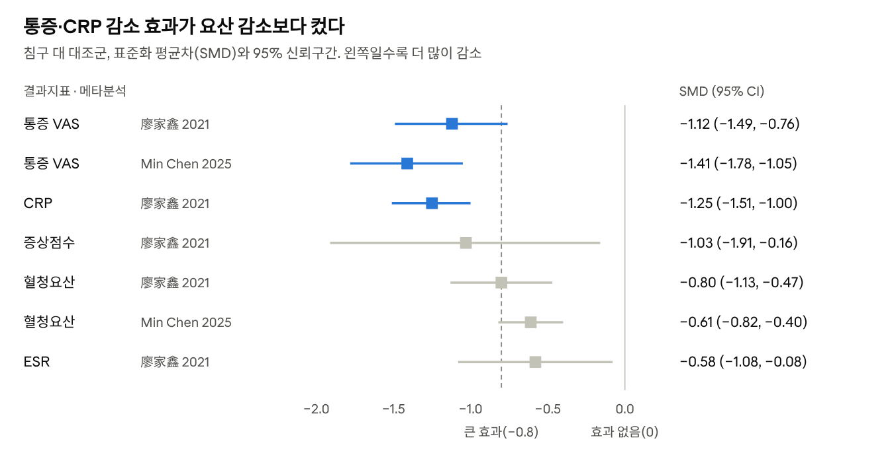
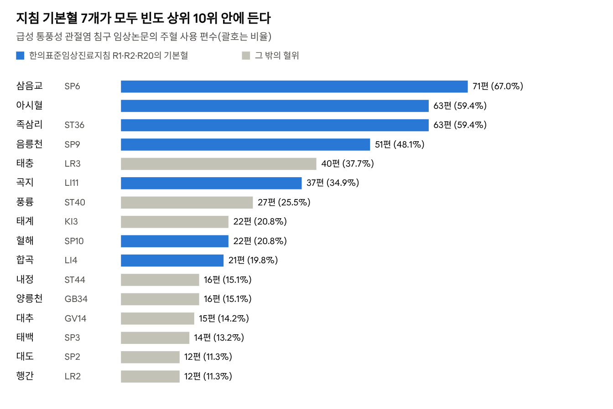

# 통풍 침구치료지침 보고서

2026-10-28 · 김재효

## 요약

급성 통풍에는 일반 침, 온침·화침, 자락을 우선 고려한다. 세 치료 모두 지침 등급 B다. 침구는 통증·염증을 크게 줄이지만(VAS SMD −1.1\~−1.4), 요산 강하는 요산저하제(ULT)를 돕는 병행 치료로 쓴다.

- **급성기**: 종창 부위를 자락하고(±부항, 2–3일에 1회, 2–7회), 기본혈 SP6·ST36·SP9·LI11 + 아시혈에 침을 놓는다(유침 30분, 매일). 통증이 주소면 화침, 염증·요산이 함께 높으면 전침(2 Hz, 30분)을 더한다.
- **간헐기·만성기**: 비신을 보하는 혈(BL20·BL23·KI3·CV4) 침과 온침·뜸을 주 2–3회, 4–8주 시술한다. 지침은 만성기 뜸·자락을 등급 C로 권고한다.
- **변증**: 습열온결·어열은 사법과 방혈에 가장 잘 들었다(화침방혈 치유율 84.9%). 비허·간신 허증은 보법과 뜸을 함께 쓴다(간신음허의 방혈 단독 치유율 27.3%).
- **안전성**: 침구의 이상반응은 양방 약물의 약 1/7이었다(RR 0.14). 자락은 소독과 응고장애 확인이, 봉침은 시험자극이 필수다.
- **근거 수준**: 지침의 모든 침구 권고가 Low 또는 Very low이고, 폴더 문헌의 메타분석도 모두 질이 「매우 낮음」이다. 자극량과 횟수는 최적치가 아니라 관행치다.

## 배경과 방법

이 보고서는 2022년 한의표준임상진료지침(통풍)의 권고를 뼈대로 삼고, 폴더에 있는 중국 문헌 68편(중복 4쌍 제외)으로 실제 시술 방법을 보완한 침구치료지침이다.

- **기준 지침**: 한의표준임상진료지침 통풍(한의약혁신기술개발사업단, 연구책임자 송호섭, 2022). 급성 통풍 21개·만성 통풍 3개 권고(R1–R24)를 GRADE 근거수준과 A–D·GPP 권고등급으로 제시한다.
- **보완 문헌**: 1996–2026년 중국 학술지 논문과 석사학위논문. RCT·임상관찰, 체계적 문헌고찰·(네트워크)메타분석, 선혈(選穴) 데이터마이닝, 종설, 동물실험, 증례로 구성된다.
- **방법**: 각 문헌의 초록·방법·결과에서 연구설계, 대상 수, 병기·변증, 중재(기법·혈위·자극량·횟수), 대조군, 결과지표, 이상반응을 추출했다. 지침 권고와 일치하는지, 지침에 없는 세부를 더해 주는지를 기준으로 정리했다.
- **권고 표기**: 지침 권고는 "R번호, 권고등급/근거수준"으로 적었다. 폴더 문헌에서 나온 내용은 지침 권고가 아니라 **보완 근거**로 따로 표시했다.

## 한의표준임상진료지침의 침구 권고

침구 권고 가운데 가장 높은 등급은 B이며, 급성기의 일반 침·온열자극(온침·화침)·자락에 부여됐다. A 등급은 없고, 근거수준은 모두 Low 또는 Very low다. B는 "고려해야 한다", C는 "고려할 수 있다"는 뜻이다.

### 급성 통풍

| 치료 | 단독 | 한의 복합 | 양방 약물 병행 | 지침의 시술 기준 |
| --- | --- | --- | --- | --- |
| 일반 침 | R1, B/Very low | R9, B/Very low | R14, B/Low | SP6·SP10·ST36·LI11·LI4 + 아시혈, 유침 30분 |
| 온열자극(온침·화침) | R2, B/Low | R10, B/Low | R15, B/Low | 아시혈·SP6·ST36·LI11·SP9, 온침 유침 30분 |
| 자락(±부항) | R6, B/Low | R13, B/Low | R18, C/Very low | 종창이 가장 뚜렷한 부위, 2–3일에 1회, 2–7회 |
| 전침 | R3, C/Low | R11, C/Very low | R16, C/Low | ST36·SP6 + 아시혈, 2 Hz, 30분 |
| 뜸 | R5, C/Low | — | R17, C/Low | 화농구는 가피 탈락까지 30–40일, 관절 부위 주의 |
| 침도 | R4, C/Very low | R12, C/Very low | — | 통증 부위, 주변 신경·혈관 주의 |
| 약침(봉약침 포함) | R8, GPP | — | — | 환부·주위 경혈, 봉약침은 피부반응 검사 |
| 각종 침 + 타 한방 + 양방 | — | — | R20, C/Low | 아시혈·SP6·SP10·ST36·LI11·LI4·TE5, 유침 30분 |
| 자락 + 타 한방 + 양방 | — | — | R21, C/Very low | R6과 같음 |

### 만성 통풍

- **R22 (C/Very low)**: 뜸 또는 한약 단독 치료를 고려할 수 있다.
- **R23 (C/Low)**: 뜸과 자락을 고려할 수 있다. 뜸은 ST36·SP10·관원(CV4)·명문(GV4), 자락관법은 통증 부위와 아시혈에 한다.
- **R24 (C/Low)**: 한약과 양방 약물의 병행이다(침구 외 중재).

### 변증·부위별 취혈(지침 「치료」 장)

- **풍열습형(급성기)**: 거풍청열제습. 대추(GV14)·신주(GV12)·곡지(LI11).
- **담어비조형(만성기)**: 거어화담·익신양심. 격수(BL17)·혈해(SP10)·비수(BL20)·내관(PC6)·방광수(BL28).
- **급성 발작**: 아픈 곳을 사혈하고 주위 경혈과 순경취혈을 더한다. 무지(拇趾)는 은백(SP1)·태백(SP3)·행간(LR2), 발목은 곤륜(BL60)·상구(SP5)·해계(ST41), 무릎은 ST36·SP9·GB34·슬안(EX-LE5)을 쓴다.
- **변증 가혈(지침 수록 RCT, 화침)**: 습열은 ST44·SP8·SP3, 어열은 LR2·SP10·SP6, 담탁은 LR4·SP9·ST36을 더한다.
- **무증상성 고요산혈증(미병)**: 침·뜸·부항·약침을 고려할 수 있다고만 서술하며, 등급이 붙은 권고는 없다.

## 폴더 내 연구 근거 분석

분석한 67편은 모두 침구가 양방 약물보다 낫거나 비슷하다고 보고했다. 효과가 가장 뚜렷한 곳은 통증과 염증 감소이고, 요산 감소는 중간 정도다. 67편은 중복 4쌍과 무릎 골관절염 논문 1편을 뺀 수다.

| 연구 설계 | 편수 | 비고 |
| --- | --- | --- |
| RCT·대조 임상시험 | 26 | 3편은 비무작위(내원 순서 배정 등), 석사논문 4편 |
| 종설·이론 | 21 | 치법·선혈 경험 정리 |
| 증례·증례군·전문가 경험 | 10 | 화침방혈 105례, 삼릉침 방혈 54례 등 |
| 체계적 문헌고찰·(네트워크)메타분석·재평가 | 5 |  |
| 선혈 데이터마이닝 | 2 | 118편·38편 분석 |
| 동물실험 | 2 | 급성 통풍 랫 모델 |
| 후향 코호트(운기학설) | 1 | 석사논문 |

*그림 1. 출처: 폴더 문헌: 廖家鑫 2021(40 RCT, 2,893명, 대조 = 양방 약물), Min Chen 2025(침 하위분석, 대조 = 통상치료·무처치)*

메타분석의 다른 결과는 다음과 같다.

- **총유효율**: 침구가 양방 약물보다 RR 1.13(1.08–1.17) 높았다. 기법별 하위분석에서 자혈·전침·화침·뜸·일반 침·온침은 유의했고, 침도는 유의하지 않았다.
- **기법 순위(급성 통풍, 23 RCT)**: 양방 약물 대비 총유효율 OR은 전침 1.18, 온침 1.17, 화침 1.13이었다. 요산 감소는 전침, 통증 감소는 화침(SMD −1.40)이 1위였다.
- **이상반응과 재발**: 이상반응은 RR 0.14(0.07–0.28)·OR 0.12(0.08–0.18), 재발은 OR 0.20(0.14–0.28)으로 양방 약물보다 낮았다.
- **개별 RCT**: 양방 약물에 침을 더하면 총유효율이 10–30%p 올랐다. 예를 들어 급성 통풍 150명에서 93.3% vs 82.7%였다. 청열방에 침·자혈을 더한 군은 콜히친+벤즈브로마론 군과 효과는 비슷했지만(91.4% vs 88.6%, P>0.05) 이상반응은 2건 vs 11건으로 적었다.

## 병기·변증별 침구치료지침

급성기는 「국소 자락 + 하지 기본혈 침」으로 통증·종창을 빨리 가라앉히고, 간헐기·만성기는 「온침·뜸 + 비신(脾腎) 보익혈」으로 재발을 줄이는 것이 지침과 폴더 문헌의 공통 구조다. 요산 강하는 요산저하제(ULT)가 맡고, 침구는 병행 치료로 둔다.

### 1. 급성 발작기(발작 0–7일)

- **목표**: 통증·종창·열감 감소, 염증지표(CRP·ESR) 감소.
- **1차 선택(지침 B)**: 종창 부위 자락(±부항) + 일반 침. 온침·화침도 같은 B 등급이다.
- **기본혈**: 삼음교(SP6)·족삼리(ST36)·음릉천(SP9)·곡지(LI11) + 아시혈. 환부에 따라 국소혈을 더한다(「상용 혈위와 배혈」 참조).
- **보통의 진행**: 매일 침 1회(유침 30분) + 자락 2–3일에 1회, 5–14일.
- **보완 근거**: 네트워크 메타분석(23 RCT, 1,684명)에서 총유효율은 전침, 통증(VAS)은 화침이 1위였다. 통증이 주소인 환자는 화침·화침방혈, 염증·요산이 함께 높은 환자는 전침을 고려한다.

### 2. 간헐기(무증상 기간)

- **목표**: 재발 감소, ULT 순응 유지.
- **지침**: 간헐기를 따로 권고하지 않는다(급성·만성만 구분).
- **보완 근거**: 아시혈 자혈 2일 1회 + 복침(중완·관원·활육문·외릉) 15일에 혈청요산 424 vs 567 μmol/L(벤즈브로마론 대조)이었다. 피내침(매침)+유산소 운동은 6개월 재발 3/29 vs 10/29였다.

### 3. 만성기(통풍결절·관절 변형)

- **목표**: 만성 통증·관절기능 개선, 재발 감소.
- **지침(C)**: 뜸·자락(R23). 뜸은 ST36·SP10·관원(CV4)·명문(GV4).
- **보완 근거**: 비수(BL20)·신수(BL23)·대추(GV14)·태계(KI3)·ST36·SP6·아시혈을 주 3회–7회, 8주 시술한 2건의 RCT가 있다. 페북소스타트에 더했을 때 1개월 재발은 8.22% vs 19.72%였다. 통풍결절은 삼릉침 점자 방혈을 먼저 한다는 보고도 있다.

### 변증별 치법과 배혈

| 변증 | 주 병기 | 치법 | 주된 기법 | 가하는 혈위 | 근거 |
| --- | --- | --- | --- | --- | --- |
| 풍열습·습열온결(湿热蕴结) | 급성 | 청열이습, 활혈지통 | 자락, 화침방혈, 사법 | GV14·GV12·LI11, ST44·SP8·SP3, GB40·SP2 | 지침 변증논치, 화침방혈 105례 |
| 어열조체(瘀热) | 급성–아급성 | 청열활혈 | 자락, 화침 | LR2·SP10·SP6·격수(BL17) | 지침 수록 RCT, 화침방혈 105례 |
| 담탁·비허습조(脾虚湿阻) | 간헐–만성 | 건비화습, 화담 | 일반 침, 온침 | ST40·SP9·ST36·LR4·비수(BL20) | 노인 비허습조 RCT(96명) |
| 담어비조(痰瘀痹阻) | 만성 | 거어화담 | 자락관법, 뜸, 침도 | BL17·SP10·BL20·PC6·BL28 | 지침 변증논치 |
| 풍한습비(风寒湿痹) | 간헐–만성 | 온경산한, 거습 | 온침, 뜸 | ST40·LI11·SP10·SP9 + 국소 온침 | 풍한습비 RCT(88명) |
| 비신양허·간신휴허 | 만성 | 온신건비, 보간신 | 침 보법, 뜸 | BL20·BL23·CV12·CV4·CV6·KI3·SP6 | 비신양허 석사논문 RCT(57명), 만성 통풍 RCT 2건 |

화침방혈 105례의 치유율은 습열온결 84.9%, 어열 60.0%, 담탁 50.0%, 간신음허 27.3%로 변증에 따라 크게 달랐다(P<0.01). 사법(瀉法) 위주의 방혈은 실증·열증에 잘 듣고, 허증에는 보법과 뜸을 함께 써야 함을 보여준다.

## 치료법별 시술 지침

아래 기준은 지침의 임상적 고려사항을 기본으로 하고, 빈칸은 폴더 문헌에서 가장 자주 쓰인 값으로 채웠다. 자극량을 비교한 연구는 거의 없으므로 표의 수치는 최적치가 아니라 관행치다.

| 기법 | 혈위 | 자극·용량 | 횟수·기간 | 근거 |
| --- | --- | --- | --- | --- |
| 일반 침 | SP6·ST36·SP9·LI11·LI4·SP10 + 아시혈 위자(圍刺, 통점 중심으로 15–45° 3–4침) | 0.25–0.35×40 mm, 급성기 사법·만성기 보법 또는 평보평사, 유침 30분 | 급성 매일 1회 7–14일, 만성 주 3–5회 4–8주 | 지침 R1·R14 (B) |
| 자락(刺絡放血) | 종창이 가장 뚜렷한 곳, 아시혈, 노장된 천정맥 | 삼릉침·채혈침 점자 후 부항 5–10분. 회당 3–20 mL, 문헌마다 크게 다름 | 2–3일에 1회, 2–7회 | 지침 R6·R13 (B) |
| 온침(온침구) | 아시혈·SP6·ST36·LI11·SP9, 무릎은 GB34·내외슬안 | 침병에 애주 2 cm, 15–20분, 유침 30분 | 주 1–2회에서 매일까지 | 지침 R2·R15 (B) |
| 화침·화침방혈 | 아시혈 + 행간(LR2)·태충(LR3)·내정(ST44)·함곡(ST43) | 점자 0.3–1촌, 혈당 1–3침. 발에는 굵은 침, 발목 위는 가는 침 | 주 1회에서 2일 1회, 3–5회 | 지침 R2 (B), 네트워크 메타분석 VAS 1위 |
| 전침 | ST36·SP6 + 아시혈 | 지침 2 Hz 30분. 문헌에는 2/15 Hz 소밀파, 100–150 Hz도 있음 | 매일에서 주 2회 | 지침 R3 (C), 네트워크 메타분석 총유효율 1위 |
| 뜸 | 급성: 환부 현구(懸灸). 만성: ST36·SP10·CV4·GV4·CV12 | 현구 3장 또는 애주 구. 화농구는 관절 부위 피함 | 만성 주 2–3회 | 지침 R5·R17·R23 (C) |
| 침도 | 통증 부위, 결절 주위 | 신경·혈관 주의, 허약한 환자는 회복 후에 | 드물게 | 지침 R4 (C). 메타분석 아군에서는 유의하지 않음 |
| 봉침·봉약침 | 양릉천(GB34)·태충(LR3) + 환부 위자 | 반드시 시험자극 후, 소량에서 점차 늘림 | 주 2회 20회, 이후 월 1회 | 지침 R8 (GPP), 대조 임상시험 1건 |
| 부침(浮針) | 압통점에서 6–10 cm 떨어진 곳 | 피하 15–25° 자입하고 소산(掃散) 후 연관을 24시간 유치 | 2일 1회, 10회 | RCT 1건(87명) |
| 피내침·매침 | ST36·GB34·SP6·LI11, 심수(BL15)·담수(BL19) | 2–3일 유치 | 간헐기 재발 예방 | RCT 1건, 전문가 경험 |

### 기법을 두고 고를 때

- **자락을 더하면 효과가 커진다.** 무릎 통풍에서 자락만 한 군은 60.0%, 자락에 온침을 더한 군은 86.67%였다. 자락에 침을 더한 군도 양방 약물군보다 높았다(95% vs 85%).
- **온열과 전기를 함께 쓸 때 가장 높았다.** 급성 통풍 4군 비교에서 총유효율은 전기온침 100% > 온침 87.5% > 전침 77.3% > 일반 침 50%였다. 다만 군당 16–24명으로 작다.
- **동물실험은 자혈이 가장 빨랐다.** 급성 통풍 랫에서 ST36·SP9 자혈은 2일째 관절 종창을 줄여 침·전침보다 컸고, 뜸은 3일째부터 효과가 나타났다.
- **부침은 치유율을 높였다.** 총유효율은 비슷했지만(95.6% vs 90.5%) 치유율은 57.8% vs 21.4%로 일반 침보다 높았다.

## 상용 혈위와 배혈 규칙

처방의 중심은 삼음교(SP6)·족삼리(ST36)·음릉천(SP9)에 아시혈을 더한 것이다. 여기에 아픈 관절의 국소혈과 변증에 따른 혈을 더한다.

*그림 2. 출처: 刘湘玲 2017, 《针刺研究》: 논문 118편 중 주혈을 밝힌 106편, 상위 16혈*

### 다빈도 경맥

주혈의 절반(50.5%)을 족태음비경과 족양명위경에서 골랐다. 통풍이 가장 흔한 제1중족지관절을 비경이 지나기 때문이다. 발에서 시작하거나 끝나는 족삼음·족삼양경이 상위를 차지했다.

| 순위 | 경맥 | 주로 쓴 혈위 | 刘湘玲 2017 빈도(총 630회) | 龙天雷 2018 빈도 |
| --- | --- | --- | --- | --- |
| 1 | 족태음비경 | 삼음교·음릉천·혈해·태백·대도·공손·은백·상구·지기 | 193회 (30.6%) | 38회 |
| 2 | 족양명위경 | 족삼리·풍륭·내정·함곡·천추·해계·양구·상거허·하거허·독비·여태 | 125회 (19.8%) | 34회 |
| 3 | 족궐음간경 | 태충·행간·대돈·중봉·려구 | 60회 (9.5%) | 10회 |
| 4 | 수양명대장경 | 곡지·합곡 | 58회 (9.2%) | 17회 |
| 5 | 족소양담경 | 양릉천·구허·풍시·현종·지오회·환도·족임읍 | 30회 (4.8%) | 5회 |
| 6 | 족소음신경 | 태계·조해·대종·축빈 | 29회 (4.6%) | 10회 |
| 7 | 족태양방광경 | 신수·곤륜·격수·위중·대저·비수·신맥·방광수·승산·담수·간수·삼초수·중료 | 28회 (4.4%) | 15회 |

경맥에 속하지 않는 아시혈은 63회(10.0%)였다. 刘湘玲 2017은 논문 106편에 나온 주혈 67개를, 龙天雷 2018은 논문 38편을 집계했다. 龙天雷의 경맥표는 대추를 대장경에 넣는 등 귀경 오류가 있어 보조 자료로만 썼다.

### 다빈도 경혈

순위는 위 막대그래프(刘湘玲 2017)의 순서이고, 오른쪽 두 열은 다른 데이터마이닝과 지침에서 같은 혈을 확인한 것이다.

| 순위 | 경혈 | 경맥 | 특정혈 | 처방에서의 역할 | 龙天雷 2018 빈도(38편) | 한의표준임상진료지침 |
| --- | --- | --- | --- | --- | --- | --- |
| 1 | 삼음교(SP6) | 비경 | 족삼음 교회혈 | 기본혈, 건비이습 | 14회 | 기본혈: R1·R2·R3·R11·R14–R16·R20 |
| 2 | 아시혈 | 경외 | — | 국소 위자, 자락 부위 | 17회 | 기본혈: R2·R3·R11·R14–R16·R20, R1은 병용 |
| 3 | 족삼리(ST36) | 위경 | 합혈, 위의 하합혈 | 기본혈, 건비화습·부정 | 16회 | 기본혈: R1·R2·R3·R11·R14–R16·R20, 만성기 뜸 R23 |
| 4 | 음릉천(SP9) | 비경 | 합혈 | 기본혈, 이습 | 14회 | 기본혈: R2·R15 |
| 5 | 태충(LR3) | 간경 | 원혈·수혈 | 엄지 국소혈, 소간이기 | 6회 | — |
| 6 | 곡지(LI11) | 대장경 | 합혈 | 청열, 팔꿈치 국소혈 | 9회 | 기본혈: R1·R2·R15·R20, 풍열습형 |
| 7 | 풍륭(ST40) | 위경 | 락혈 | 화담거습 | 5회 | — |
| 8 | 태계(KI3) | 신경 | 원혈·수혈 | 보신, 발목 안쪽 국소혈 | 7회 | — |
| 9 | 혈해(SP10) | 비경 | — | 활혈화어 | — | 기본혈: R1·R20, 만성기 뜸 R23, 담어비조형 |
| 10 | 합곡(LI4) | 대장경 | 원혈 | 진통·청열, 손목 국소혈 | 4회 | 기본혈: R1·R20 |
| 11 | 내정(ST44) | 위경 | 형혈 | 청열, 습열 가혈 | 3회 | 습열 가혈(지침 수록 RCT) |
| 12 | 양릉천(GB34) | 담경 | 합혈·근회 | 서근, 무릎 국소혈 | 3회 | 무릎 부위 취혈 |
| 13 | 대추(GV14) | 독맥 | 제양경의 회 | 청열·통양 | — | 풍열습형 |
| 14 | 태백(SP3) | 비경 | 원혈·수혈 | 엄지 국소혈 | 2회 | 엄지 부위 취혈, 습열 가혈 |
| 15 | 대도(SP2) | 비경 | 형혈 | 엄지 국소혈 | — | — |
| 16 | 행간(LR2) | 간경 | 형혈 | 엄지 국소혈, 청간열 | 2회 | 엄지 부위 취혈, 어열 가혈 |

龙天雷 2018에서는 공손(SP4)·신수(BL23)·독비(ST35)도 각각 4회 썼다. 가장 자주 함께 쓴 혈은 족삼리–삼음교(33.3%)였고, 다음은 음릉천–삼음교(26.7%)였다.

### 배혈 규칙

1. **주혈 3–4개**: SP6·ST36·SP9에 곡지(LI11)를 더한다. 「아시혈 + ST36 → SP6」 조합의 신뢰도는 84.2%였고, ST36–SP6은 다른 데이터마이닝에서도 핵심 대혈(對穴, 신뢰도 >0.9)이었다.
2. **아시혈 위자**: 통점 중심을 향해 3–4침을 사자하거나, 같은 자리를 자락 부위로 쓴다.
3. **국소혈 2–3개**: 아래 표에서 환부에 맞는 혈을 고른다. 쓰인 경맥은 비경>위경>간경 순이었다.
4. **변증 가혈**: 「병기·변증별 침구치료지침」의 표를 따른다.
5. **자락 부위 고르기(보완 근거)**: 환부를 지나는 경맥의 원혈 + 락혈 + 배수혈을 쌍으로 쓴다. 예를 들어 족태음형은 태백(SP3) + 풍륭(ST40) + 비수·위수, 족소양형은 구허(GB40) + 려구(LR5) + 담수·간수다.
6. **동반 증상**: 불안·불면이 있으면 사신총·백회(GV20)·내관(PC6)을 더한다. 이렇게 한 RCT에서 SAS·SDS 점수가 함께 좋아졌다.

### 부위별 국소혈

| 환부 | 지침(사혈 후 순경취혈) | 폴더 문헌에서 더 쓴 혈 |
| --- | --- | --- |
| 엄지 제1중족지관절 | 은백(SP1)·태백(SP3)·행간(LR2) | 대도(SP2)·태충(LR3)·내정(ST44) |
| 발등·족궁 | — | 태백(SP3)·공손(SP4)·함곡(ST43) |
| 발목 바깥쪽 | 곤륜(BL60)·상구(SP5)·해계(ST41) | 구허(GB40)·신맥(BL62) |
| 발목 안쪽 | — | 조해(KI6)·상구(SP5)·중봉(LR4)·태계(KI3) |
| 발뒷꿈치 | — | 태계(KI3)에서 곤륜(BL60)으로 투자 |
| 무릎 | ST36·SP9·양릉천(GB34)·슬안(EX-LE5) | 학정(EX-LE2)·혈해(SP10)·슬양관(GB33) |
| 손목 | 합곡(LI4)·중저(TE3)·내관(PC6)·양지(TE4)·대릉(PC7) | 외관(TE5) |
| 팔꿈치 | 수삼리(LI10)·곡지(LI11)·소해(HT3)·천택(LU5) | 합곡(LI4) |

## 안전성·주의사항과 근거의 한계

침구는 양방 약물보다 이상반응이 뚜렷하게 적었다(메타분석 RR 0.14, OR 0.12). 하지만 근거의 질이 낮아, 요산저하제를 대신하는 치료로 쓰면 안 된다.

### 시술 주의사항

- **자락·화침방혈**: 시술 부위에 상처나 피부병이 없는지 확인하고 충분히 소독한다. 혈우병 등 응고장애는 금기다. 항응고제를 복용하는지 확인한다. 통풍결절이 터진 부위는 감염 위험이 크다.
- **온침·화침**: 화상으로 물집이 생기면 소독해 감염을 막는다. 화침은 열자극에 의한 조직·신경 손상에 주의한다. 당뇨·말초신경병증이 있으면 감각이 둔해 화상을 더 조심한다.
- **뜸(화농구)**: 가피가 떨어지기까지 30–40일이 걸린다. 관절이 움직이는 부위에는 쓰지 않는다.
- **봉침·봉약침**: 병력을 듣고 시험자극을 한다. 국소 발적이 5 cm를 넘거나 전신 반응이 있으면 시술하지 않는다.
- **침도**: 통증 부위 주변의 신경·혈관에 주의한다. 몸이 매우 허약한 환자는 회복한 뒤 시술한다.
- **협진**: 신장기능 저하, 요로결석, 발열을 동반한 관절염(화농성 관절염 감별)은 양방 협진을 우선한다. ULT를 복용 중이면 침구는 더해서 쓰는 치료다.

### 근거의 한계

- **근거수준**: 지침의 침구 권고는 모두 Low 또는 Very low다. SR·MA 23편을 재평가한 연구에서 AMSTAR 2 평가는 모두 「매우 낮음」이었고, 103개 결과 가운데 높음 등급은 하나도 없었다.
- **연구 설계**: 정식 눈가림과 배정 은폐가 거의 없고, 내원 순서로 배정한 시험도 있다. 대부분 단일 기관의 중국 연구이고 군당 30–75명 수준이다.
- **결과지표**: 주요 지표가 대부분 「총유효율」 같은 복합 범주다. 추적은 보통 1–6개월로 짧아 재발·결절 감소에 대한 근거는 약하다.
- **혼합중재**: 침과 한약·외용제·양방 약물을 함께 쓴 설계가 많아 침만의 효과를 떼어 보기 어렵다. 몇몇 RCT는 두 군 모두 침·자락을 받아 침의 효과를 보여주지 않는다.
- **요산**: 침 단독의 요산 강하 효과는 연구 간 이질성이 매우 커서(I²=91%) 믿기 어렵다. CAM 네트워크 메타분석에서도 침의 요산 강하 순위는 최하위였다(SUCRA 29.7%).
- **폴더 자료**: 중복본 4쌍은 하나만 셈다. 무릎 골관절염 논문 1편은 분석에서 뺐다. 원래 파일명이 孙晶인 논문은 실제로는 张晨迪의 논문이었다.

## 참고문헌

기준 지침과, 본문에 수치나 시술법을 인용한 폴더 문헌이다. 모두 폴더 안의 PDF이고, 파일명은 「연도\_저널명\_대표저자\_제목」이다.

1. 송호섭(연구책임자). 한의표준임상진료지침 통풍. 한의약혁신기술개발사업단. 2022.
2. 廖家鑫. 针灸治疗痛风性关节炎的Meta分析. 湖南中医杂志. 2021.
3. 李智惠. 针灸治疗痛风性关节炎预后及安全性的Meta分析. 中国临床研究. 2022.
4. 张金焕. 不同针灸疗法治疗急性痛风性关节炎的有效率和对血尿酸及疼痛影响的网状Meta分析. 中国全科医学. 2021.
5. Min Chen. Efficacy of complementary and alternative medicine in hyperuricemia and gout: A systematic review and meta-analysis. Clinical Traditional Medicine and Pharmacology. 2025.
6. 梁家青. 针灸疗法治疗痛风性关节炎的系统评价再评价. 中国民族民间医药. 2024.
7. 刘湘玲. 针灸治疗急性痛风性关节炎的选穴特点探析. 针刺研究. 2017.
8. 龙天雷. 基于中医传承辅助平台的针灸治疗痛风选穴规律研究. 长春中医药大学学报. 2018.
9. 林惠雅. 痛风性关节炎急性发作的不同针灸疗法对症状缓解及治疗效果的影响分析. 中国医药指南. 2025.
10. 陈振锋. 针灸治疗急性痛风性关节炎的临床疗效观察. 中国医学创新. 2019.
11. 罗涛. 针刺联合三氧自血疗法治疗老年急性痛风湿热蕴结证疗效、安全性及复发影响因素. 现代中西医结合杂志. 2026.
12. 王泽宇. 针灸联合蠲痹汤对湿热瘀阻型痛风的疗效及部分机制的研究. 中医临床研究. 2022.
13. 吴慧心. 清热泻浊祛瘀汤联合针刺治疗痛风急性发作35例. 中国中医药现代远程教育. 2015.
14. 杨艳杰. 针刺联合药物治疗痛风的临床观察. 中国实用医药. 2010.
15. 闫滨. 针灸配合放血疗法治疗痛风性关节炎临床观察. 昆明医学院学报. 2009.
16. 胡翌. 刺络放血联合温针灸治疗痛风性膝关节炎的效果及对患者膝关节疼痛的影响. 中医临床研究. 2019.
17. 李昌生. 浮针疗法治疗急性痛风性关节炎疗效观察. 辽宁中医杂志. 2005.
18. 文绍敦. 火针放血治疗痛风105例疗效观察. 中国针灸. 1996.
19. 张婉瑜. 原络背俞赞刺法刺血治疗急性痛风性关节炎的辨治思路. 广州中医药大学学报. 2026.
20. 潘佳慧. 符文彬教授整合思维“一针二灸三巩固”模式治疗急性痛风性关节炎临床经验. 中国中医急症. 2019.
21. 冯利强. 腹针配合刺血疗法治疗间歇性痛风. 长春中医药大学学报. 2018.
22. 贾吉民. 埋针与运动结合治疗痛风的探索性研究. 西北师范大学硕士学位论文. 2019.
23. 刘映铄. 防己黄芪汤化裁联合针灸治疗慢性痛风的临床研究. 辽宁中医杂志. 2026.
24. 丁原全. 中药补虚祛瘀方联合针刺治疗痛风临床疗效观察. 辽宁中医药大学学报. 2023.
25. 马玥. 针灸治疗脾肾阳虚型痛风的临床疗效观察. 广西中医药大学硕士学位论文. 2019.
26. 张攀科. 针药并用治疗脾虚湿阻型老年痛风的疗效观察及对血清嘌呤能受体和趋化因子CC基序配体2水平的影响. 上海针灸杂志. 2023.
27. 张永健. 薏苡仁汤加味联合针刺对高尿酸血症伴痛风患者（风寒湿痹型）体液免疫、微炎状态和血清DKK1、PICP、RANKL水平影响. 辽宁中医药大学学报. 2023.
28. 李卫东. 蜂针对穴刺围刺配合中药外敷治疗痛风临床观察. 上海针灸杂志. 2008.
29. 陈新华. 不同针灸疗法对急性痛风性关节炎模型大鼠炎症因子的影响. 中国老年学杂志. 2019.
