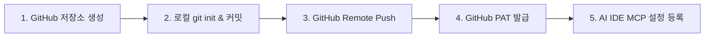

# 🚀 경혈해부 (Acupoint Anatomy) GitHub 개인 저장소 연동 가이드

본 문서는 `acupoint_anatomy` 폴더를 GitHub 개인 저장소(Private/Public)로 생성하고, 원격 MCP 스트리밍 서버(`remote_server.py`)와 연동하기 위한 단계별 매뉴얼입니다.

---

## 📌 전체 작업 흐름 (Overview)



---

## 1단계: GitHub에서 개인 저장소 생성

1. [GitHub (https://github.com)](https://github.com)에 로그인합니다.
2. 우측 상단의 **`+`** 아이콘 클릭 ➔ **`New repository`** 선택.
3. 저장소 정보 입력:
   - **Repository name**: `acupoint_anatomy`
   - **Description**: `Acupoint Anatomy & Substrate Identification MCP Server (Framework v2.7 & ARI v3.0)`
   - **Visibility**: `Private` (대외비 연구자료 권장) 또는 `Public`
   - **Initialize this repository with**: **아무것도 체크하지 마십시오** (README, .gitignore, license 모두 체크 해제).
4. **`Create repository`** 버튼 클릭.

---

## 2단계: 로컬 저장소 초기화 및 첫 커밋 (Windows PowerShell)

PowerShell 또는 터미널을 열고 아래 명령어를 순차적으로 실행합니다:

```powershell
# 1. acupoint_anatomy 디렉토리로 이동
cd "d:\도서 번역\acupoint_anatomy"

# 2. Git 초기화
git init -b main

# 3. 모든 파일 스테이징 (.gitignore에 의해 임시파일 및 캐시 제외)
git add .

# 4. 초기 커밋 생성
git commit -m "feat: Initial release of Acupoint Anatomy MCP Server (Framework v2.7, ARI v3.0, Dual-Layer B-Check)"

# 5. 원격 저장소 연결 (본인의 GitHub ID로 변경)
# 예시: git remote add origin https://github.com/jaehyokim-sketch/acupoint_anatomy.git
git remote add origin https://github.com/jaehyokim-sketch/acupoint_anatomy.git

# 6. main 브랜치로 Push
git push -u origin main
```

> 💡 **파일 용량 참고**:
> `data/경혈_생의학_신경반사_마스터DB.json` 파일은 약 5.3 MB로, GitHub의 단일 파일 크기 제한(100 MB) 이내이므로 별도의 Git LFS 설정 없이 일반 git push로 정상 업로드됩니다.

---

## 3단계: GitHub Personal Access Token (PAT) 생성

저장소가 **Private**인 경우, 원격 MCP 스트리밍 서버가 GitHub API를 통해 데이터를 읽어오려면 PAT(토큰)이 필요합니다.

1. GitHub 우측 상단 프로필 클릭 ➔ **`Settings`**.
2. 좌측 최하단 **`Developer settings`** 클릭.
3. **`Personal access tokens`** ➔ **`Tokens (classic)`** 선택.
4. **`Generate new token`** ➔ **`Generate new token (classic)`** 클릭.
5. 토큰 설정:
   - **Note**: `Acupoint-Anatomy-MCP-Token`
   - **Expiration**: `No expiration` 또는 원하는 유효기간 설정
   - **Select scopes**: **`repo`** (Full control of private repositories) 체크 ✅
6. 최하단 **`Generate token`** 클릭.
7. 생성된 토큰(`ghp_xxxxxxxxxxxxxxxxxxxx`)을 복사하여 안전한 곳에 보관합니다.

---

## 4단계: 원격 스트리밍 MCP 서버 작동 테스트

로컬 터미널에서 `remote_server.py`가 GitHub 저장소와 정상 통신하는지 검증합니다:

```powershell
# 환경변수 설정 테스트
$env:GITHUB_TOKEN = "ghp_xxxxxxxxxxxxxxxxxxxx"

# 경혈 프로필 조회 도구 테스트 (예: ST36 족삼리)
python mcp_server/remote_server.py --repo jaehyokim-sketch/acupoint_anatomy --branch main --token ghp_xxxxxxxxxxxxxxxxxxxx
```

정상 실행 시 JSON-RPC 프로토콜 대기 상태로 진입합니다 (`Ctrl + C`로 종료).

---

## 5단계: 향후 데이터 갱신 시 Push 방법

새로운 논문이 동기화되거나 프레임워크가 업데이트되었을 때:

```powershell
cd "d:\도서 번역\acupoint_anatomy"

# 1. 갱신된 파일 확인
git status

# 2. 커밋 및 Push
git add .
git commit -m "update: Sync Layer A biomedical database & refine ARI v3.0 scores"
git push origin main
```

원격 MCP 스트리밍 서버는 메모리 캐시 만료(기본 10분) 후 또는 IDE 재시작 시 GitHub의 최신 커밋 내용을 실시간으로 즉시 반영합니다.
