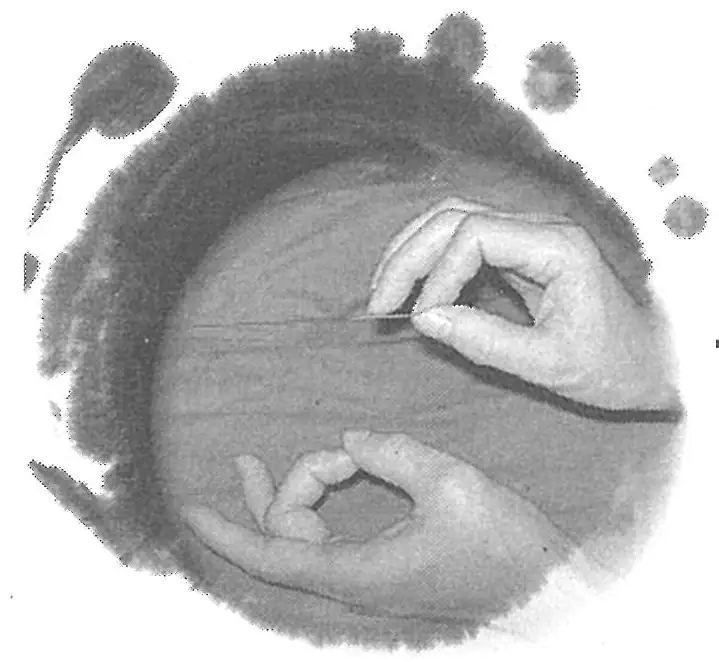
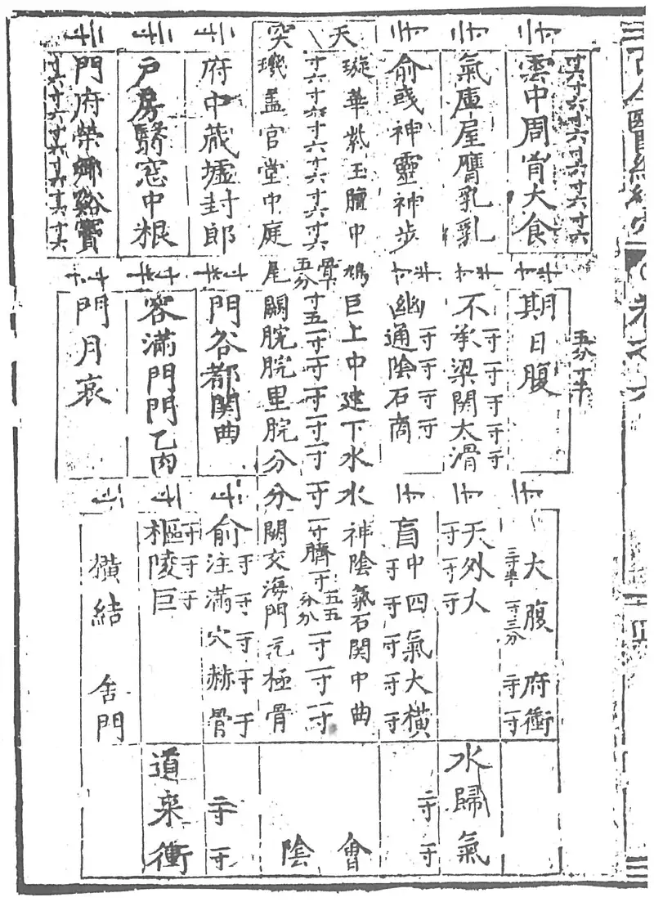
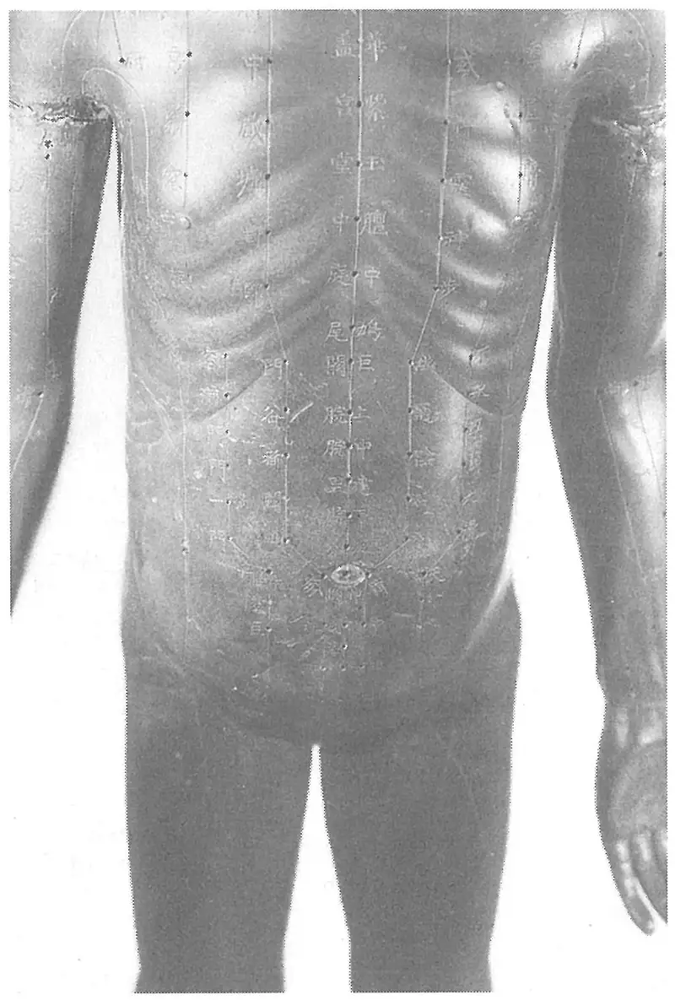
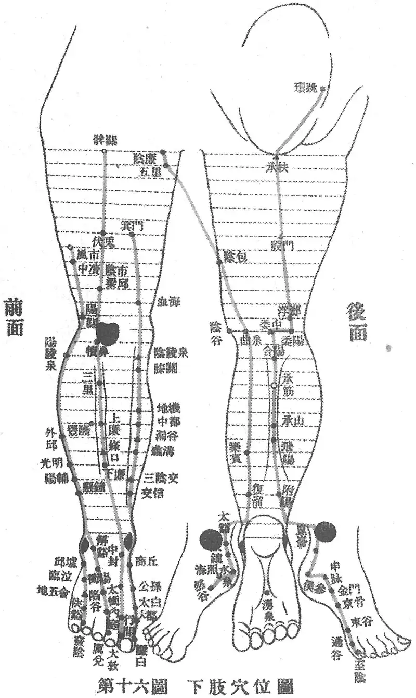
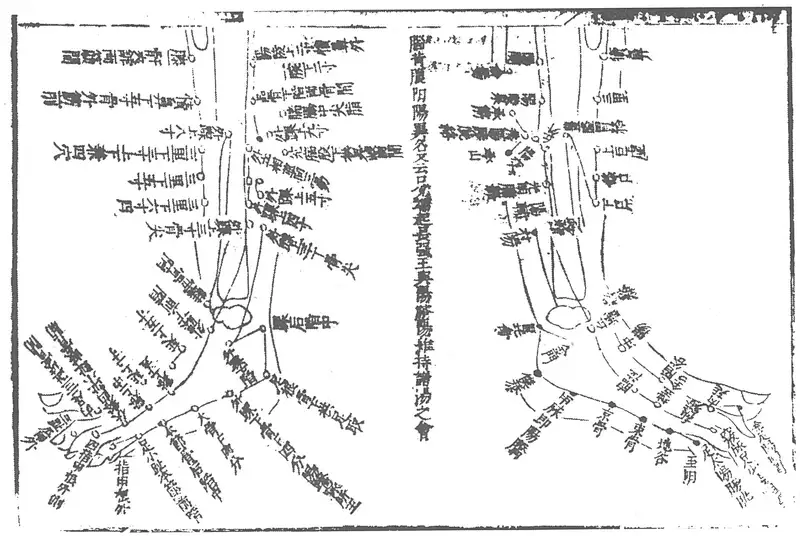
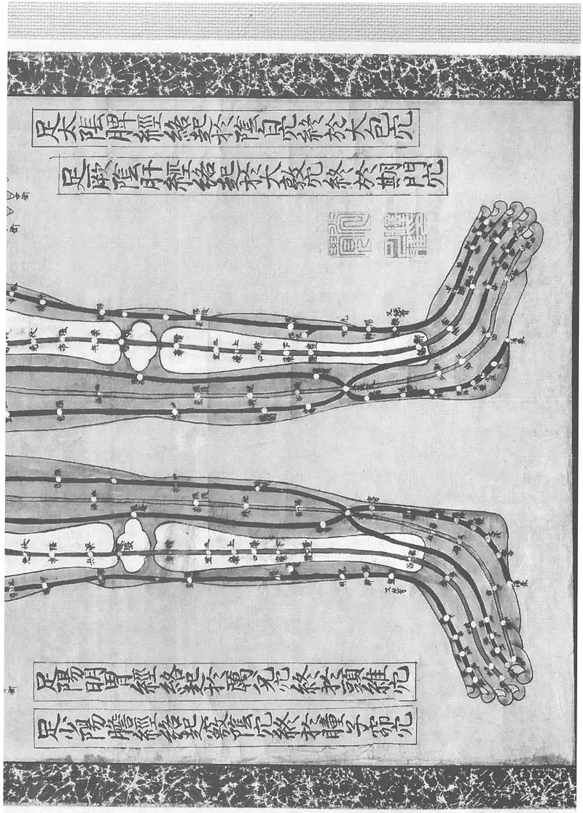
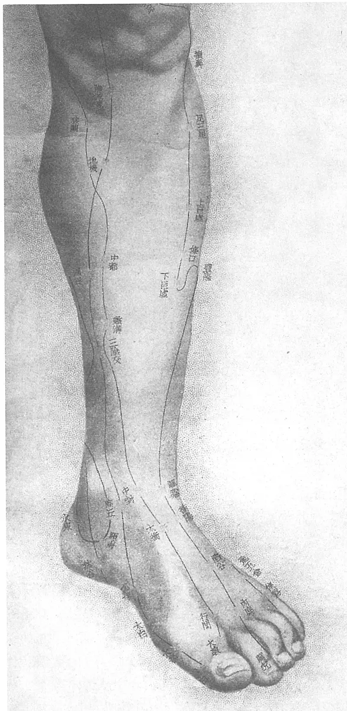
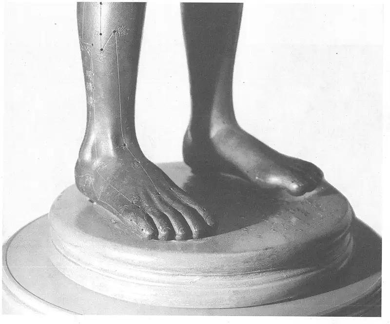

# 《针灸腧穴通考》(上册) — 序·凡例·总论 (1/2)

> 분할본 1/25. 원서: 黄龙祥·黄幼民 编著, 《针灸腧穴通考——〈中华针灸穴典〉研究》(上册), 人民卫生出版社, 2011. 원서 스캔 OCR 판독본을 챗봇 검색용으로 나눈 것이며, 본문과 쪽 표시 〔p.PDF쪽 (인쇄 쪽)〕는 원본 그대로이다.

# 针灸腧穴通考

——《中华针灸穴典》研究 · 黄龙祥 黄幼民 编著 · 人民卫生出版社 2011 · 원문 열람판

> 이 자료는 중국 황용상(黃龍祥)·황유민(黃幼民) 선생의 저서 『针灸腧穴通考』(人民衛生出版社, 2011) 원문을 개인 학습 목적으로 전자책으로 옮긴 자료입니다. 일체의 상업적 이용과 배포를 금합니다.
>
> 원문은 원서 스캔을 AI로 판독(OCR)한 것이며, 원서 구매를 권장합니다.
>
> 판독 과정에서 글자 오류가 있을 수 있음을 알려 둡니다. 번역은 필요한 대목에만 원문 옆에 붙여 나갑니다.

# 일러두기 (원문 열람판) 

1. 본문은 원서 원문(간체 중국어)을 그대로 옮겼다. 본문의 □ 는 원서가 빠진 글자를 표시한 것이다.

2. 쪽 표시는 「p.115 (인쇄 95)」처럼 PDF의 실제 쪽과 원서에 인쇄된 쪽을 함께 적었다. 원서 목차의 쪽 번호는 인쇄 쪽이다.

3. 유니코드에 없는 글자 3자는 원서에서 잘라 낸 글자 그림으로 넣었다. 그림에 마우스를 올리면 짜임(예: 月+甚)이 보인다.

4. 蹻 계열 글자는 원서 자형대로 足+乔(𫏋)로 적었다. 검색할 때는 蹻·蹺로 쳐도 찾는다.

5. 그림 493점은 원서에서 잘라 화면용으로 줄여 넣었다.

6. 출판사 표지 그림·저자 사진·판권면은 화면에서 뺐다(원고에는 그대로 있다).

7. 번역은 필요한 혈자리·대목만 원문 옆에 붙여 나간다.

〔p.1〕

国家科学技术学术著作出版基金资助出版

针灸腧穴通考

——《中华针灸穴典》研究（上册）

◎黄龙祥　黄幼民　编著

◎协编　李素云　岗卫娟　谭源生　徐青燕

人民卫生出版社

〔p.2〕

〔p.3〕

黄龙祥　男，安徽桐城人。中国中医科学院首席研究员。国家中医药管理局“针灸理论与方法学”重点研究室主任；《世界针灸》杂志主编；“中华人民共和国针灸穴典”专项首席科学家。

命运让这个酷爱数学的人走上了中医针灸之路。

从1983年起用10年的时间研究针灸文献——《针灸名著集成》、中国针灸四大通鉴、《针灸古典聚珍》等；接着又用10年时间研究针灸学术史，所著《中国针灸学术史大纲》、《中国针灸史图鉴》成了他的第一张学术名片；从2003年始探索中医针灸的理论与方法。前面的20年其实是为走这条充满未知与挑战的探索之路所做的准备。

近30年的学术研究之路，他倾情倾力研究最多的还是针灸腧穴——他眼中的针灸学大厦的地基。

当他完成第一部代表作《中国针灸学术史大纲》时曾说：“如有幸再出一本佳作的话，将会用十年磨一剑。”2011年距《中国针灸学术史大纲》问世整10年，他把这第二剑指向了最让他牵挂的针灸腧穴——针灸学的“明堂”。之前完成的《黄帝明堂经辑校》、《黄帝针灸甲乙经》（新校本）、《实验针灸表面解剖学》……都是他一步步走向这座“明堂”宝库途中留下的一串串坚实的脚印。

多年来，他究古今之变，察中外之殊，只想为构筑中国针灸学的理论大厦搭建“脚手架”！

黄幼民　女，河南洛阳人。北京中医药大学副教授，北京中医药大学图书馆参考咨询部主任。

从中医针灸文献与教学，到针灸临床，再回到中医文献，走了一圈。

〔p.4〕

从1983年至2000年先后在甘肃中医学院、北京针灸骨伤学院执教《腧穴学》及点穴示教、《针灸文献检索》等课程。

1983年成为由甘肃省卫生厅正式认定的郑魁山先生第一个传承弟子；1989年师从郭效宗先生1年学习“郭氏针灸有效点”；1998年跟从贺普仁先生随诊半年学习“贺氏三通法”。

1983年至1988年在甘肃中医学院跟随郑魁山先生出专家门诊；1996年至1998年在望京医院针灸科出门诊。

1987年她协助郑魁山先生完成了《针灸大全》的点校，在针灸文献整理方面留下了第一个脚印。近年来与黄龙祥合作完成《元代珍稀针灸三种》、《实验针灸表面解剖学》、国家标准《腧穴定位图》和《腧穴名称与定位挂图》等，显示出她在针灸腧穴相关技术上的不可替代性。

几十年来，无论是在身后还是身旁，她都是黄龙祥精神与技术的支撑。她曾说：如果我不能成为一棵大树，就甘愿让出更多的雨露与阳光，成就身边的树长成栋梁，去支撑针灸学的大厦。

〔p.5〕

# 序——针灸学进步的三块阶石 

本书最初的目标：考古今文献之源流，断百家众说之是非，为《中华人民共和国针灸穴典》提供翔实的数据及背景资料。在获得2009年度科技部“优秀科学技术著作出版基金”资助之后，在系统分析中华人民共和国建国60年来针灸学发展的历程之后，在与一个个国内外针灸专家深度访谈和对一个个诊所实地考察之后，我们在原目标基础上，又另立了三个更高的目标：

——为重新认识与评价“新穴”提供新的视角与研究路径；

——为探寻针灸学与现代解剖学真正的结合点先投一块“问路石”；

——为“重构针灸腧穴学”的理想迈出第一步。

一次次地打量着这一级比一级高、一级比一级陡的三级台阶，我毅然踏上了艰难攀登的“三重”之路。

## 重看“新穴” 

重看，第一种含义是“回看”，第二种含义是“看重”，标题中的“重看”包含了这两种含义——重看之后而看重。

大凡研究腧穴，一般多注重经穴，我却从一开始就注意对经外奇穴的研究，获得许多启示，也发现许多问题。近年来又特别注重对新穴的研究，花费大量时间收集20世纪六七十年代“新医疗法”类的书籍与论文，发现在这大多一针针扎出来的经验中有不少当年研究者本人还没有意识到的意义——第一，有助于穴位概念的理解；第二，用作刺法研究的“脚手架”——主要指毫针“得气”的针法。从本书所述大量实例与分析中可以得到两点启示：第一，穴位既可以从同一点以不同角度、深度向不同方向针刺，对不同的部位产生不同的效应；也可以从不同的体表部位通过不同的角度、深度和方向刺向同一点或同一组织结构，而对相同的部位产生相同的效应。由此可引发我们对“穴位”概念的重新审视，并将对针灸临床产生深刻的影响（详见本书总论“腧穴的概念”节）。第二，分布在传统经穴（如环跳穴）周围的那一个个新穴以及相关的刺法，实际上已经大致勾勒出关于该穴区毫针刺法的针刺方向、深度的立体边界，并提供了针感与针效关系的第一手资料，这也是新穴的最大价值所在。

通过本书的编纂可知：在腧穴的定位、主治、刺灸法三方面中，前两方面的变化不大（而且多是不自觉的、无意识的），而刺法发生了巨变（而且是自觉的、有意识的改变），只是人们还没有意识到，刺法的这种变化正是受到了新穴的深刻影响——新穴已经在重构针灸腧穴学上扮演了重要角色。

〔p.6〕

新穴的大量发现还有助于我们正确理解穴位的动态性与变异性。由于决定腧穴位置的相关脏腑位置，肌肉、肌腱的形态，神经、血管的分布走行等，都存在一定的变异；同时，机体的状态与反应性也存在着差异，因此腧穴的位置也会在一定范围内发生变异。认识到这一点，我们就能获得认识上的突破：不少新穴实际上就是经穴的动态变异点，或者同一穴在不同体位时的不同进针点！例如“阑尾”与“上巨虚”、“胆囊”与经穴“阳陵泉”实际上是同一穴的不同体表反应点；“新环跳”实际上就是俯卧位时的环跳，“中跳”是立位时的环跳，“臀中”是身材高大肥胖者的环跳穴，《常用经穴解剖学定位》所述之“环跳”则是小儿及偏瘦体型患者的环跳。

新穴对于理解经穴主治的重要意义在于：第一，新穴是现代对于古代腧穴主治经验一次最大规模的再检验和再发现；第二，将重叠于一个经穴的多重治疗作用分解开来，不仅便于临床应用，更便于实验研究，将为今后的针灸实验研究提供新的视角与思路，成为实验研究走出困境的新路径。

是否有人想过将现已命名的所有穴画在一张图上会是什么样？这张图的最大意义是什么？在对新穴存有偏见的人们眼中，这是一件毫无意义的事，而在我眼中，不仅有意义，而且意义重大——任何人都可以一目了然非常直观地看清穴点密集区，再借一分洞察力往深处看，可以看出这些穴点密集区，往往是针灸临床上的大穴、要穴；如果再具备现代解剖学的眼光，还可以看出：在这些最密集的大穴、要穴下面往往有特殊的、复杂的结构。此图还有一个重要的附加功能：发现当代奇穴专书中同穴重出的错误！此图早已印在我心中，借此出版之机，我将把它分解在本书中——于每一穴下，将该穴与其相关穴或刺激点画在同一幅图上，如果存在的话。

顺便说一句，重看新穴，要看出更多的门道来，除了前面提到的方法外，还需要一双能够透过表象看到本质的“火眼金睛”。例如，将所有穴绘于同一幅图上，我们不难发现，“腰痛点”与“精灵威灵”是同一穴，“腰痛点”的尺侧点与“外劳宫”也相同，然而三者的主治病症大不相同。这种方法只能带我们走这么远，接下来再往远处走，由这个发现引出更多、更大的发现，就需要更丰富的专业知识和敏锐的观察能力。这个问题的答案详见本书“腰痛点”穴下，并可参见“条口”穴。

## 重拾解剖 

在中医，针灸学是最先与现代解剖学结合的，然而一个多世纪过去了，却依然是“两张皮”，解剖学不但没有成为构建现代针灸学理论体系的“脚手架”，有时反而在某些方面误导了针灸学的前进方向。

在制定针灸腧穴定位的国家标准时，我发现有些穴位的定位，传统针灸术语描述都相同，而现代解剖学术语的表述却相差很大，甚至大到一掌之阔（见本书“曲泉”穴）；制定国际标准时，最初统计，中、日、韩定位有分歧的穴位有92个，经三国专家的现场核实，真正存在分歧的仅12穴，其余80个穴皆属现代解剖学术语的表达出了问题；在研究现代针灸学教材时，发现有些穴位下的层次解剖内容与穴位的部位全然不合，这种各说各事的错误，几十年来竟无人察觉（见本书“天府”、“侠白”等穴）。在本书的总论及各论的相关穴下，读者将会读到一个个这方面的典型实例，这些实例能向人们揭示这样一个事实：虽然一版接一版的针灸学教材穴位下的解剖学内容有增有减，但针灸专业的教师和学生全不留心。另外，编写教材解剖学内容的人好像也从不关心相关的针灸内容，不然的话，只要任何一方稍加留意，这种不可思议的错误也不可能被一版又一版教材一次又一次地重复！在比其他人更清楚、更多地见证了现有的解剖学这双“鞋”不合针灸腧穴这双“脚”之后，我不但没有抛弃解剖学，反而更加坚定地向她走去。

〔p.7〕

对新中国成立60年来针灸学发展历程的系统研究表明：如果没有解剖学的知识背景，不仅不会发现那么多新穴，不会有刺法的巨变，也不会催生这么多新的疗法、发现传统经穴新的主治。仍以环跳穴为例（见本书“环跳”穴），即可真切感受到现代解剖学在不知不觉中对针灸学所产生的深刻影响：

没有解剖学的知识背景，第一，环跳穴定位的现代诠释不可能完成；第二，环跳穴也不会成为针灸治疗坐骨神经痛的第一要穴；第三，环跳穴的刺法不会发生这样大的变化；第四，在环跳穴的周围也不会发现那么多新穴，更不会明白这些新穴与环跳穴的关系。

当然，解剖学在针灸学中的成功应用，也必将对其本身的发展产生巨大的推动作用（见本书总论及各论的相关穴下）。

那么，为什么经过一百多年的努力，针灸学与解剖学却依然是“磨而不合”？解剖学究竟能不能以及如何才能真正进入针灸学，或者说针灸学究竟是否需要，以及需要什么样的解剖学呢？二者通过什么样的结合才能对双方都产生巨大的推动作用？大家依然可从本书“环跳”穴下读到我的解题方案和具体做法。

需要说明的是，关于针灸作用机制，现阶段仍多从神经联系的角度阐述，然而，针灸还有一些神经观点不能解释的东西，例如时下在国内外影响很大的诊疗软组织损伤的各种骨骼肌针刺疗法，便与肌肉的解剖关系更密切；在实验研究方面，肌肉损伤与疾病的相关性，以及针刺后肌肉结构的恢复与治疗效果相关性的国内外研究，已获得明确的研究结果。同时“骨骼肌链”说也是解释针感远距离传导的代表学说之一。此外，还有科学家更将研究的目光瞄向了结缔组织，从生物力学的角度研究针感与针效的机制。我们应当密切注意有关研究的新进展，以便对针灸穴位作用机制的阐述做出及时的修订和完善。

## 重修“明堂” 

明堂，有两层含义：第一，是特指《黄帝明堂经》（简称《明堂》）这部针灸腧穴经典，第二是泛指针灸腧穴。“明堂”的第一层意思，重点在于“重读”，包括辑、校、补、注及临床应用等；其第二层意思的重点在于“重修”，或“重建”。

基于对《明堂》以及古今针灸腧穴文献的长年研究，我深知，而且随着研究的深入越来越坚信：《明堂》具有非常特殊的文献价值和研究价值，没有任何一部腧穴书能像《明堂》那样，为现代解剖学提供如此详细、完整和有用的信息。如果把其他腧穴文献比作方书的话，那么《明堂》就相当于理论与实践融为一体的《伤寒论》！

由于没能意识到这一点，加之其他条件的限制，迄今我们还没有完全读懂《明堂》，以至于该书记载的极有价值的经穴诊疗经验，因不能正确理解而难以应用，古人发现的大量“珍珠”，如今仍被视为“鱼目”而无人问津。（有关这方面的典型实例详见本书总论及各论相关穴下的“文献分析”。）因此，很有必要为有可能读懂的他人或后人留存尽可能接近旧貌的研究资源。

23年前我完成《黄帝明堂经》辑校，为“重读明堂”打下了基础；3年前完成了对《明堂》腧穴定位部分的重读，重读的粗浅体会已写入《实验针灸表面解剖学》；重读《明堂》其他方面的最新体会，则集中于本书。读者可以从本书的总论与各论的相关穴下读到大量这样一次次“重读”而获得的一个个新发现。

〔p.8〕

关于重修针灸腧穴学的必要性与可行性在于以下几方面：

　　(1) 古代几千年才积累数百穴，而现代10年间所发现的新穴就达上千个；

　　(2) 刺法发生了很大的变化；

　　(3) 新的疗法大量涌现，越来越多的刺激点或刺激部位突破了传统的“穴位”概念，需要新的定义来统一，或分化。越来越多的新事实用传统的经络学说难以解释，呼唤新的理论。

关于针灸腧穴学新模式的建立，总的思路是：

第一，凡是针灸治疗中用不到的内容不写，凡是针灸治疗中关键支撑的内容要加强或新建；

第二，加强对与主治相应的针感规律的研究，充实刺灸操作方法，建立起“穴位”、“疗法”、“刺法”、“针感”、“主治”五位一体的腧穴主治表述方式；

第三，在解剖学基础方面，删除与临床实践关系不大的解剖学内容，增加与腧穴定位、主治、刺法密切相关的知识与技术介绍。

具体做法有以下几点：

第一，关于腧穴主治的描述分为两个层次，首先对每个穴给出一个明确的作用范围，而具体治疗病症放在“临床应用”中表述，将特定的病症与特定的疗法结合起来描述，因为腧穴的主治与相关的刺法是一个统一的整体，孤立地说没有意义，或者无确定意义。这样的表述方式在《黄帝明堂经》已有示例，唐代甄权《针经》更加具体化，应当作为新模式针灸腧穴学的一个发展目标树立起来。

第二，关于刺灸法，尽管针灸学界达成共识：描述针刺深度的数值是相对值概念，但是至今没有建立起明确的参照系——针刺深度的折量数值系统。例如你告诉学生内关穴针0.5寸，他根本不知道该针多深。只有告诉学生针0.5寸，同时告知内关穴处前臂厚度的折量寸——比如说2寸，才有意义。

刺灸法的研究，应特别注重对于穴位在一定的针刺深度、角度及刺激方式，出现的针感的性质、方向、轨迹的研究。这种穴位针感规律的研究，比经脉感传的研究要容易得多，也有意义得多。要想在穴位特异性的实验研究上取得明确的结果，必须首先要求刺法描述的确定性！

第三，确立穴位定位解剖学基础、主治与刺法的解剖学基础。

第四，相关刺激点及相关疗法知识的介绍。

第五，腧穴、诊断、治疗三部分可合为一书，或由同一人主编。

关于穴位定义的新思考，详见本书总论“腧穴的概念”。

以上3个目标，第1个已基本理出一个框架，第2、第3目标只是迈出一小步，抛出一块“砖”而已——当然在必要的时候，我也可能会用3本专著的形式去展开。我知道或许倾毕生精力也不能最后登顶，但我会一步一个脚印地去攀登！作为我不断攀登记录的此书，我也想不断地编下去，无论成功与失败，皆有意义。

以往这样的大部头书，编者栏下往往要列上一个班、一个排的人名，我也完全有条件组织一个庞大的编写队伍。而此书的作者项下只列二人，本不是要贪功，而是为了追求全书统一的风格与水准，为了经得起时间的考验，也为了表达一种对读者高度负责的虔诚。

呈现给大家的实际上已经是3次大修之后的书稿，读者虽然看不到第一稿，但通过原序和原后记可以大致了解第一稿的概貌以及作者当时的心绪，故特将几年前为第一稿写成的序和后记收在附录中。我以为这是一种尊重历史的选择，也是一种对读者负责的表现。

〔p.9〕

感谢“国家科学技术学术著作出版基金”的资助，让我们下定“三修”的决心！

感谢国外朋友，特别是日本朋友在资料收集方面给予的大力支持！

感谢出版社对我们的耐心与信心！

黄龙祥　黄幼民

2010年7月17日

〔p.10〕

〔p.11〕

# 凡例 

## 一、本书的基本结构 

　1. 全书由总论和各论两部分构成，分为上下两册装订。

　2. 总论分3篇，重点探讨腧穴及穴典的历史沿革、腧穴研究的基本问题及《中华人民共和国针灸穴典》的编纂方法与体例，并将有关腧穴文献研究的基本问题及腧穴主治错误的考辨的研究成果，以附篇的形式予以展现。

　3. 各论分15篇，包括了十四正经的经穴各1篇及经外奇穴1篇。每篇下各穴一般由【提要索隐】、【名实考】、【定位】、【类属】、【适应症】、【操作】6项组成，后4项采用作者叙述配古代引文的表述形式。

　　(1)【提要索隐】部分是有关本穴的研究结论，其中“国标修订”，是指有实质内容的修订，文字修订不在其例。

　　(2)【名实考】是本书着力最多的部分，内容包括：穴名的考辨、穴名的解释、定位的演变、相关穴的考辨等。关于穴位出处的确定，至少要综合考虑两个要素：名称、定位；关于穴名的解释，早期文献（如《素问》、《灵枢》、《黄帝内经明堂》残卷、《太黄帝内经太素》杨上善注、《素问》王冰注等），因去古未远，参考价值较大，尽可能全地辑录。其他关于穴名解释的古代文献，完整收录的只清代《经穴解》一种，仅供参考。对古代文献有关穴名明显不合理的解释，则以按语形式注明。

关于穴位的名称，特别是别名，鲜有深入研究厘清者，久而久之，甲穴误为乙穴（如“天溪”误作“太溪”）；别名成了正名（如“中郄”变为“中都”）；一穴演为数穴（“阑门”一穴变为“阑门”、“蘭门”、“闢门”、“閣门”四穴），数穴混为一穴（如奇穴“迎香”混作经穴“迎香”，奇穴“关门”混作经穴“关门”等），讹传日甚，以至于滥。此次系统整理、深入考证，特提出以下原则：

① 因避讳原因形成的一穴多名的，予以收录；

② 对《内经》等早期文献中部位及具体的腧穴定位文字，后世注家注以具体穴名者，如教材将《内经》中的部位名如“髀枢中旁”、“髀厌分中”、“枢中”、“枢合中”等皆作为环跳穴的别名，凡如此类者皆详考而去之；

③ 凡异体字、通假字、古今字、繁简字以及不同国家和地区不同汉字等形成的穴名异写，皆不作别名；

④ 对因传抄错误导致一穴多名者，例如《针灸聚英》脱“日月”穴名，其别名“一名神光，一名胆募”遂误入“辄筋”穴下，后人不察，皆作为辄筋穴的别名，凡如此类者，盖不收录；

〔p.12〕

⑤ 对道家文献、按摩书、方书中的穴名异称，概不收录。

【名实考】这一项力求考竟源流，正本清源，故引用文献不受以下“采用文献原则与范围”的限制，但对于超出引用范围的偶尔出现的引用文献，皆详注出处，以便查核。

　　(3)【适应症】项下除了详细的腧穴文献考辨外，还附有“临床应用举例”，只辑录真正的针灸方和针灸医案。关于经穴主治，除上述采用文献的原则之外，特提出以下新增腧穴主治的条件：

① 在所有三支源头腧穴文献《黄帝明堂经》、甄权《针经》、窦太师（窦汉卿）针灸中有两支对其有所记载，并且有相关古代临床应用的记载者；

② 所有3支源头腧穴文献对其均有记载者；

③ 1支源头腧穴文献对其有记载，并且有大量古今临床应用记载者。

新增的病症前加“新增：”字样，排于【适应症】段的最后。除了包括正本中的全部主治症外，另设“备选适应症”一项。

　　(4)【操作】项下，除不宜直刺的穴位，一般只注明毫针直刺的范围。除少数不宜施灸穴下作专门注明外，凡未标注“不宜灸”之穴，皆可用灸。

　　(5) 在总论及各论各篇末，还提供延伸阅读的书目及文献题录。此部分只推荐能够启迪思路，或提供重要补充信息的相关文献。

采用这样的结构主要是为减少引文的大量重复，缩小篇幅。然而，对于经外奇穴来说，脉络简单，如套用经穴的编纂结构，反而会增加篇幅，同时也不便阅读。因此，经外奇穴部分的结构特分为【名实考】、【定位、主治与刺灸法】、【临床应用举例】3项。

## 二、采用文献原则与范围 

　1. 以腧穴文献为主，以治疗文献为辅

　2. 古代腧穴文献的选择

　　(1) 每一条文献均以源头文献为主要依据。宋代《铜人腧穴针灸图经》虽然总体上看不属源头文献，但因为一方面它是宋代正式颁布并实施的国家针灸学标准文本，另一方面因其中包含有对《黄帝明堂经》、甄权《针经》两支源头文献的选择与注解，至今仍有重要参考价值，故也全文引录；

　　(2) 对于从腧穴文献改编而成的文献（如《千金要方·孔穴主对法》、《针灸资生经》）以及错误极多且影响很小的汇编类文献（如《西方子明堂灸经》）不引录，以避繁杂。但这类文献中编者新增的内容仍被视为源头文献加以引录。

　　(3) 明代《针灸聚英》非源头文献，且错误很多，本不当引录，但对该书的错误影响及明以后针灸文献乃至现代针灸学教材者，皆一一明示，为的是引以为戒。

　　(4) 清代《勉学堂针灸集成》是非常特殊的文献，只用作考察明正统仿宋针灸铜人的参考，不在引文中出现。

　　(5) 对一般的类书不引用，但对保存有已佚文献或具重要版本价值者除外（如《外台秘要》、《医心方》等）。

　3. 古代针灸治疗文献的选择

　　(1) 以单穴方与加减方为主，以多穴方为辅。辑录针灸方时，保留原方中有关兼症加减用穴的内容。

〔p.13〕

　　(2) 各论各穴的“现代临床应用”以单穴方为主，或辅以1~2个穴位，有明确的治疗病症、操作方法、疗程、较多的病例数和客观的疗效分析。凡特殊刺灸法、强或超强刺激量、水针、针药合用等临床资料不收录。

　4. 针灸治疗歌赋的选择

　　(1) 直接以腧穴文献改编且传误较多者不录：如《百证赋》（见《针灸聚英》）；

　　(2) 根据其他针灸歌赋剪辑、改编者不录：如《玉龙赋》（见《针灸聚英》）、《胜玉歌》（见《针灸大成》）、《杂病穴法歌》（见《医学入门》）、《针灸歌》（见《针灸玉龙经》）；

　　(3) 同出一源者只录一种流传较广影响较大者：如《席弘赋》、《天元太乙歌》、《天星秘诀》，只录第一种；

　　(4) 同一病症选穴太多者（多于4穴）不录，如《治病十一证歌》；

　　(5) 来历不明、错误较多且流传不广者不录。

　　(6) 根据以上原则，本书采用针灸歌赋共9种：《标幽赋》、《通玄指要赋》（见《针经指南》）、《针灸玉龙歌》（见《针灸玉龙经》）、《琼瑶真人治病手法歌》（见《琼瑶神书》、《医经会元》）、《席弘赋》、《灵光赋》、《四总穴歌》、《千金十一穴歌》（以上见《针灸大全》）、《肘后歌》（见《针灸聚英》）。

　5. 现代腧穴文献的选择

　　(1) 只收录带有标准性质的文献。

　　(2) 收录《针灸十四经穴位考订》（实为新中国第一个经穴定位的标准）。

　　(3) 高等医药院校中医专业统编教材《针灸学》第1—7版及此套教材的前身1957年版《针灸学》、国际培训教材《中国针灸学》。第6版之后的《针灸学》教材套书名已改称“新世纪全国高等中医药院校规划教材”，但为行文及阅读方便，本书中仍称“第7版”。

　　(4) 1974年上海针灸学院编的《针灸学》虽不是统编教材，但对于刺法的记述极为详细，影响很大，特于各论腧穴的“操作”项下引录之。

## 三、引文出处的标注 

引文据源头文献，文献出处标明卷或篇，对不分卷古籍则只出书名，对其他同源文献也只出书名，不注篇卷。

## 四、引文用字的原则 

引用古今文献时，只将繁体字改为简体字，其他用字情况一般不改。早期文献中的“□”、“■”，均代表残字坏字，本书为统一起见，均统用“□”表示。

〔p.14〕

# 目录 

〔p.21 (인쇄 1)〕

# 总论 

“典”者，法也，范也，常也，即规范、标准的意思。在古代，“典”的这种意义也常用“经”表示，如魏相李悝编纂的《法经》，即是中国最早出现的较系统的法典。所谓法典，《中国大百科全书·法学》是这样定义的：“法典，就某一现行的部门法进行编纂而制定的比较系统的立法文件，现行法系统化的表现形式之一。为了便于查阅、适用法律规范和消除法规存在的某些缺陷，需要对现行法规（指成文法的规范性文件）进行整理，使之系统化。法规系统化的方法有两种，即法典编纂和法规汇编。”可见，法典是对现行各相关法律进行重编，以方便查核和参考的一种工具书。

在中医领域，尽管迄今尚未有中药的专项国家标准，但由于有西药药典的借鉴，早在1963年中国就有了中药的国家药典；而对针灸，尽管20年前就有了关于针灸腧穴的国家标准、国际标准，迄今却没有将这些相关针灸腧穴标准系统化的针灸腧穴典。

〔p.22 (인쇄 2)〕

〔p.23 (인쇄 3)〕

## 一、针灸腧穴及穴典的历史沿革 

### （一）腧穴的概念 

在传统针灸学范畴，“穴位”是以体表进针点为着眼点，不同的体表进针点就被视为不同的穴。中医与西医在许多问题上认识不一，但有一点是共同的，即认为针灸的作用与神经密切相关。而神经刺激或神经阻滞疗法，是以体内神经干或神经节为神经刺激的目标，可以从不同体表点进针刺向同一个目标，这些不同的体表点被视为同一个神经刺激单元，具有完全相同的功效。

现代针灸临床经常借鉴神经刺激或神经阻滞疗法扩大针灸的适应症，例如临床上单纯针刺蝶腭神经节治疗变应性鼻炎，常选用下关穴、“蝶腭”穴、颧髎穴三穴进针，刺向相同的目标——蝶腭神经节，可获得相同的临床疗效，这时针灸医生会很自然地将这三穴视为同一个穴，而不是三个不同的穴。可是，在其他的场合，我们又很习惯地将它们视为完全不同的三个穴。究竟该如何理解穴位的概念？通过一个大家熟悉的例子来说明，可能更容易理解：坐地铁一般有A、B、C、D四个出入口，你可以从这4个不同的入口坐同一条地铁线路去往同一个目标；你也可以从同一个入口坐不同的线路到达不同的目标。可见，在这个情景下，决定因素不是入口，而是方向与线路。这个实例与针刺的实例极为相近。当每个入口对应的是不同的线路时，不同的入口就是不同的穴。

因为宋代以前腧穴专书中描述的毫针刺法多为直刺，针尖、体表穴位点、针尖体内所及点三点一线，因而以往对于腧穴的定位多强调为进针点这个腧穴的体表投影。可见传统的“腧穴”概念仅适用于毫针直刺，如果考虑到其他针具与刺法，就必须引入新的概念。

随着金元时期透穴刺法的盛行，同一个穴位，因其所透之穴不同，而表现出不同的作用部位及主治病症，这在窦太师针灸中反映得非常突出，使得以往传统的“腧穴”概念受到越来越多的挑战。特别是在现代医学神经解剖学知识背景下，一些新兴的疗法更加注重针尖所及之组织层次与结构，越来越多的实践——传统的与现代的，中医的与西医的，使人们越来越意识到：以毫针透刺同一个穴位，其主治病症，或者说其作用部位，更多地取决于针尖所及的位置，而不是体表的进针点！从古至今的针灸文献和针灸教科书中所定义的“腧穴”概念不能涵盖的穴位比比皆是：

——“扬刺”、“齐刺”等多针刺法是《黄帝内经》（以下简称《内经》）中就记载的刺法。如果在一个经穴上应用这些刺法，那么算是一个穴，还是多个穴呢？

——“横三间寸”灸法是隋唐时期盛行的一种灸法。如果将其应用到针刺上，是一个穴还是三个穴呢？

〔p.24 (인쇄 4)〕

——八髎穴在《内经》中被看做一个穴，太渊与经渠、合谷与阳溪等在早期“经脉穴”概念中都属于同一个穴，而在《黄帝明堂经》中分化为两个穴、三个穴者，这样的例子不乏其数。

——头皮针穴位的概念是具有一定长度的线段，“穴区带疗法”穴位的概念是具有一定区域的穴区。

——环跳穴的取穴体位，除了古典文献记载的侧卧位外，临床也常用俯卧位。不同的体位，体表定位明显不同，但谁都不会将其视为两个不同的穴。

这里还有一个问题请大家思考：以百会穴为中心分别向四角刺（窦太师针灸明确记载了这一刺法），与从四角分别向中心（百会）刺有没有区别？按照习惯理解，前者是一个穴，后者则是四个穴。然而在宋代《太平圣惠方》中这四点被视为一个穴位整体——神聪四穴。从文献分析可以看出，所谓“神聪四穴”犹如百会穴的四颗“伴星”一样，作为一个整体用于临床的，而不是四颗或五颗独立的“星”（详见“四神聪”穴）。从理论上说，每个经穴都有一定范围的功能区，只是因其所处部位及结构的不同，这个区域的半径不同而已。

经验丰富的名老中医，常以一穴治众病——以一当十，充分把握进针的角度、方向、深度，将众穴集于一穴之下。比如，“廉泉”和“上廉泉”，二者在体表定位方面完全一致，只是施针者根据疾病的不同，采取不同的针刺方向；“天柱”与“上天柱”穴的关系也如此。现代的临床观察再次印证了古人和前人的经验。例如阑尾穴、胆囊穴位置的最初描述都是一个区间，而不是一个固定不变的点！这实际上是对古代“腧穴”概念的不自觉回归。老一辈针灸大家的这些宝贵的经验，都为我们重新思考“穴位”定义提供了珍贵的素材。

“穴位”的概念，正经历从平面到立体，从静态到动态的转变。用新的视角看经穴与奇穴：环跳与环中，秩边与内秩边，听宫与内听宫，下巨虚与阑尾点，阳陵泉与胆囊点等，都属于相同的穴。

然而，鉴于元代以前文献记载的腧穴主治主要是依据毫针直刺的经验，元代窦汉卿、明代凌云又根据透穴刺法的实践新增了相应的主治，但一方面新增的内容不多，且相关著作一直隐而不彰；另一方面凌云的针法又大多失传，因此传世的古代腧穴文献所记载的腧穴主治主要还是毫针直刺的经验总结。这样，在现阶段编纂针灸穴典，关于腧穴主治的内容仍主要基于毫针直刺和灸法。

### （二）腧穴的发现与发展 

在“气穴”、“气府”的腧穴概念尚未形成之前，古人的针灸部位较宽泛的，有刺灸脉者，有刺肉者，有刺筋者。例如：

病在脉，调之血；病在血，调之络；病在气，调之卫；病在肉，调之分肉；病在筋，调之筋；病在骨，调之骨。

（《素问·调经论》）

凡刺有九，以应九变。一曰输刺；输刺者，刺诸经荥输脏腧也。二曰远道刺；远道刺者，病在上，取之下，刺腑腧也。三曰经刺；经刺者，刺大经之结络经分也。四曰络刺；络刺者，刺小络之血脉也。五曰分刺；分刺者，刺分肉之间也。六曰大泻刺；大泻刺者，刺大脓以铍针也。七曰毛刺；毛刺者，刺浮痹皮肤也。八曰巨刺；巨刺者，左取右，右取左。

〔p.25 (인쇄 5)〕

九曰焠刺；焠刺者，刺燔针则取痹也。

（《灵枢·官针》）

正因为在早期，“大经”（指粗大的表浅络脉）、“小络”是常用的针灸部位，它们后来大多演变成相应的穴位。关于腧穴与脉、肉分的关系，《素问·气穴论》中有一段记载：

黄帝问曰：余闻气穴三百六十五以应一岁，未知其所，愿卒闻之。岐伯稽首再拜对曰：……凡三百六十五穴，针之所由行也。帝曰：余已知气穴之处，游针之居，愿闻孙络溪谷，亦有所应乎？岐伯曰：孙络三百六十五穴会，亦以应一岁，以溢奇邪，以通荣卫……。积寒留舍，荣卫不居，卷肉缩筋，肋肘不得伸，内为骨痹，外为不仁，命曰不足，大寒留于溪谷也。溪谷三百六十五穴会，亦应一岁。其小痹淫溢，循脉往来，微针所及，与法相同。

这里将“孙络”、“溪谷”皆谓之“穴会”，可见三者的关系非常密切，脉之现者、肉之陷者皆可为穴，乃至于骨孔亦常是腧穴之处，这从传世本《素问》犹可察其大略：

髓空，在脑后三分，在颅际锐骨之下，一在龂基下，一在项后中复骨下，一在脊骨上空在风府上。脊骨下空，在尻骨下空，数髓空在面夹鼻，或骨空在口下当两肩。两髆骨空，在髆中之阳。臂骨空，在臂阳，去踝四寸两骨空之间。股骨上空，在股阳，出上膝四寸；骭骨空，在辅骨之上端。股际骨空，在毛中动下。尻骨空，在髀骨之后，相去四寸。扁骨有渗理凑无髓孔，易髓无空。

（《素问·骨空论》）

足阳明脉气所发者六十八穴：额颅发际旁各三，面鼽骨空各一，大迎之骨空各一，人迎各一，缺盆外骨空各一，膺中骨间各一……

（《素问·气府论》）

然而，“骨空”，特别是有关“溪谷”学说的文献传世太少，其与腧穴的关系，多半只能从《内经》、《黄帝明堂经》所载之穴名去推测，故以下主要考察腧穴与脉的关系。

今天，我们从十五络穴犹可看出穴与脉的密切关系，十五络穴既是诊络之处，也是治疗部位，同时还是络脉的起始处，络穴的主治病症也即相应络脉的病候。同样，早期腕踝诊脉部位——脉口，后来演变为相应各经的代表穴——“经脉穴”，其名称与相应经脉名完全相同，其主治病症也即相应的经脉病候。由此可推测：早期用作诊脉部位的表浅动脉、络脉一般都演变为重要的腧穴。

早期的针刺治疗多为刺脉，这不仅在马王堆汉墓帛书及《内经》中有明确记载，还见于非医学古籍。如《史记·扁鹊仓公列传》谓“（病）在血脉，针石之所及也”；《论衡·顺鼓》曰“投一寸之针，布一丸之艾于血脉之蹊，笃病有瘳”。这种刺脉疗法还广泛见于现代的兽医、藏医的针灸实践。对照《内经》与中国第一部腧穴经典《黄帝明堂经》的相关内容，我们可以看出由脉到穴的演变过程。试举例说明如下：

同阴之脉令人腰痛，痛如小锤居其中，怫然肿，刺同阴之脉，在外踝上绝骨之端，为三痏。

会阴之脉令人腰痛，痛上漯漯然汗出，汗干令人欲饮，饮已欲走，刺直阳之脉上三痏，在𫏋上郄下五寸横居，视其盛者出血。

昌阳之脉令人腰痛，痛引膺，目䀮䀮然，甚则反折，舌卷不能言，刺内筋为二痏，在内踝上大筋前太阴后，上踝二寸所。

（《素问·刺腰痛》）

〔p.26 (인쇄 6)〕

邪客于足少阴之络，令人嗌痛不可纳食，无故善怒，气上走贲上，刺足下中央之脉各三痏。

（《素问·缪刺论》）

需特别注意的是，《素问·刺腰痛论》是由不同时期、不同来源的文献拼合而成的，对于考察针灸学术发展的脉络具有非常重要的价值。该篇记载的不少我们不熟悉的脉名如：“居阴之脉”（此从《黄帝内经太素》之说。传世本误作“厥阴之脉”）、“同阴之脉”、“阳维之脉”、“衡络之脉”、“会阴之脉”、“飞阳之脉”、“昌阳之脉”、“肉里之脉”等，以往都被想当然地视为与“十二经脉”、“十二络脉”同类的经络概念，其实该篇中这些脉名都是指具体的刺络部位名，相当于“腧穴”的概念。这样说的依据有二：其一，该篇凡取十二经脉之穴均作“取 ×× 于 ××”，而其余诸脉均作“刺 ×× 脉”，然后指出脉的部位；其二，称十二经脉只言三阴三阳名，而对其他脉则谓“×× 之脉”。故此类脉均为穴的概念，而不是“经脉”或“络脉”的概念。以上《素问》的第一条病症，在《黄帝明堂经》中系“阳辅”穴的主治；第二条病症在《黄帝明堂经》中为“承筋”穴的主治，第三条病症在《黄帝明堂经》中为“复溜”穴的主治，据此推测《黄帝明堂经》此三穴分别由“同阴脉”、“会阴脉”、“昌阳脉”演变而来。而且“复溜”穴又名“昌阳”，也反映了这种承袭关系。以上《素问》的第四条病症则为“涌泉”穴主治，可知“涌泉”穴系由足下中央之脉演化而来。不了解这一演变历史，则对于早期文献中腧穴证治便无法正确理解。

除十二原穴、十五络穴外，《黄帝明堂经》还有不少明显由脉演化而来的腧穴，如大迎、人迎、天府、天池、天容、天窗、天柱、大杼、瘈脉等穴名原本也是脉名。既是刺脉，其刺激部位就应当有一定的范围，而不是一个点。例如《灵枢·经脉》曰：“凡此十五络者，实则必见，虚则必下，视之不见，求之上下，人经不同，络脉异所别也。”又如“冲阳脉”指足背部脉动处，有相当的长度，由于它既是诊脉部位，又是针刺治疗部位，便渐渐演变为有确定部位的腧穴。但由于原冲阳脉的长度较长，故在其演变为腧穴时，不同时期不同医家的定位自然会有出入，遂有“足拇指后二寸”（《太平圣惠方》）、“三寸”（《龙门石刻药方》）、“四寸”（《千金要方》）、“五寸”（《灵枢》）等不同取法，而且还注明“摇足而得之”。也反映了这种由脉变穴的演变过程。其实这些不同的寸法并不矛盾，要之以脉动为准。同样，其他原穴虽源出于十二原，但二者的概念也有区别。这种脉、穴演变的痕迹直到宋代文献中仍可见到，如《太平圣惠方》卷一百曰：“凡妇人怀孕，不论月数，及坐产后未满百日，不宜灸之。若绝子，灸脐下二寸三寸间动脉中三壮。”又曰：“小儿秋深冷痢不止者，灸脐下二寸三寸间动脉中三壮。”这种定穴法，以今天的标准化定位来看，似不规范，但它却反映了这类腧穴的本来意义。其实，古代文献中所有记作“动脉中”或“脉中”的经穴，都可以此法定穴。

再如“颞颥”穴也是由刺脉部位演变为穴位的（见《脉经》、《千金要方》等书）。《黄帝明堂经》将此脉分作三穴，其上廉为“颔厌”，其中部为“悬颅”，下廉为“悬厘”。而主症很相似，均主治“热病偏头痛引目外眦急”。一脉分出三穴，主治自然相同。以今之腧穴概念目之是为三穴，而依古代腧穴观念，以上、中、下三穴总为一穴统称作“颞颥”可也。

耳后间青络脉，原本可用于诊察小儿痫病。早在《灵枢·论疾诊尺》中已指明：“婴儿病……耳间青脉起者，掣痛”；《灵枢·五邪》曰：“邪在肝，则两胁中痛，寒中，恶血在内，行善掣，节时脚肿……取耳间青脉以去其掣”。《千金要方·少小婴孺方》卷五载“候痫法”中也曰：“耳后完骨上有青络盛，卧不静是痫候，青脉刺之令血出。”《太平圣惠方·明堂》卷一百曰：“小儿惊痫者，先惊怖啼叫，后乃发也。灸顶上旋毛中三壮，及耳后青络脉，炷如小麦大”。而在《黄帝明堂经》中此络脉也分化为二穴，一为“瘈脉”，一为“颅息”，皆主治“小儿痫，瘛疭”。

〔p.27 (인쇄 7)〕

在早期文献中还可见到其他类与今之腧穴概念不同的腧穴。例如《黄帝明堂经》载会宗穴部位“在腕后三寸空中”，杨上善注曰：“空中一寸有上、中、下，总为会宗。”但上、中、下三空的主治各有侧重，其上空主皮毛，中空主肌肉，下空主羊痫、耳聋。说明腧穴除了具有体表的定位关系外，还有立体层次关系，这些都值得今后系统研究。

《黄帝明堂经》以后，腧穴定位更加精确，几寸几分言之甚明，一寸之地可分为二三穴。故早期用于刺脉、刺络之一脉便可能相应地演变为二穴、三穴，其主治病症也开始有所区别，成为完全不同的穴，后人便很难辨识其是否源出于同一脉或同一穴。由于不了解脉与穴的关系所造成的最大分歧，首当数十二脉口与十二“经脉穴”的混淆，其次为络脉与络穴的混淆。例如《黄帝明堂经》载委阳穴“在足太阳之前，少阳之后，出于腘中外廉两筋间，扶承下六寸，此足太阳之别络也。”汉代以下诸书对本穴部位记载多与《黄帝明堂经》相同，但由于后世医家不了解络穴与络脉的关系，故对本穴的定位出现了截然不同的两种观点。唐代王冰认为此穴与殷门穴同高（见《素问·刺腰痛》王冰注）。现存的针灸铜人、《明堂图》以及附有腧穴图的针灸古籍，如日本国立博物馆藏针灸铜人、中国历史博物馆藏针灸铜人、中国中医研究院针灸所藏明代铜人；明、清各类《明堂图》以及《针灸资生经》、《西方子明堂灸经》、《针灸聚英》、《针灸大成》、《类经图翼》、《针灸集成》等书附图，均将“委阳”标于约与“殷门”穴同高处，即取《黄帝明堂经》“扶承下六寸”之意，显然这是缘于没搞清络穴与络脉的关系。络穴位于络脉起处，特别是“脉出”处。

从以上考察可以得知，在《黄帝明堂经》对腧穴进行第一次系统的规范化研究之前，针灸治疗部位——“腧穴”的概念是很宽泛的——往往不局限于一个固定的点，因而其定位也比较笼统，随着规范化的不断深入，腧穴定位的描述越来越具体而精确。

所谓“阿是穴”实际上是为弥合穴位与部位之间的缝隙而提出的一种概念。其实，不仅在古代，还是现代，刺穴与刺部各有其适用范围，有着明确的边界，临床相互补充，而不是相互取代。

未来腧穴的发展不是发现越来越多的新穴、奇穴，而是发现同一穴位不同层次不同针刺方向的不同作用部位、不同作用性质及其与疗效间的关系，精确的针刺方向的研究将越来越受到重视。

### （三）腧穴的命名与分类 

在汉代以前，针灸治疗部位——腧穴，或者没有名称，或者同一个穴有多个名称，或者不同的穴有相同的名称，给针灸治疗经验的传承带来许多不便。至汉代第一部针灸腧穴经典《黄帝明堂经》编纂时，首次对针灸腧穴命名的混乱现象进行了规范化处理，对于该书收录的全部349个穴都确定了正式的名称，其命名原则主要是依据腧穴所处的部位及其形态特征、腧穴的主要治疗作用等。对于一穴多名现象，则根据统一的命名原则确定一个正式名称，其余则作为别名处理。如位于眉头的腧穴正名为“攒竹”（依其形态特征），别名为“圆柱”（形态特征）、“始光”、“夜光”、“明光”（腧穴的主要治疗作用）。又如：腰俞，一名背解，一名髓空，一名腰柱，一名腰户。然而，对于“异穴同名”现象，没有做出相应的规范化处理，这与该书的编纂体例有关。该书是关于针灸腧穴的定位、适应症、刺灸法的一次综合规范化研究，由于腧穴的名称与部位作为一个整体出现，异穴同名便不会造成误解。在宋代的针灸腧穴标准化的过程中，开始对“同名异穴”现象加以规范化处理。宋代医官在编《太平圣惠方》时处理方法是：在同名穴前增一人体部位名，以区别不同部位的同名穴。如将足部的“三里”、“上廉”穴改作“足三里”、“足上廉”（卷五十五）；将手部的“三里”称作“手三里”（卷一百）。这种改名方法是科学而实用的，但工作却不系统。之后，王惟一编《铜人腧穴针灸图经》时，同样注意了同名穴的命名问题，但仍然做得不彻底，而且还不尽统一。直到宋代医官在编纂《圣济总录》时，在确定“三里”、“上廉”、“下廉”三对同名穴改名的基础上，又完成了“窍阴”、“五里”、“临泣”三对同名穴的改名。

〔p.28 (인쇄 8)〕

关于腧穴的别名，明清以后急增。主要原因有以下三种。

第一，明清文献，特别是一些坊刻本中，出现大量的别字、错字，在穴名用字方面也不例外。如笔者经眼的一部约为万历初年的建阳刻本《医学纲目》，穴名异写及错误随处可见：

合谷—谷穀；前谷—前穀；阳谷—阳穀；陷谷—陷穀；率谷——率骨；腕骨—脘骨—腕谷；上脘—上管—上腕；阳陵泉—阳凌泉；关冲—关充；气街—气堦；翳风——醫风；列缺—例缺；外关—例关；五枢—五框；曲泉—白泉；伏兔—伏兑；髀關—髀開；攒竹—攒行；禾髎—香髎；龈交—断交；外丘—外立—外主；临泣—临江—临注；郄门—都门；玉枕—玉椀；气舍—气含；天容—天客；秉风—東风；次髎—欠髎；颔厌—领厌；漏谷—漏合。

像这类因误刻或用同音字替代所造成的穴名异写现象，在明清坊刻本中非常普遍，特别是同音字替代现象，例如《针灸便用》中之“上兴（星）”、“神亭（庭）”、“上完（脘）”、“中完（脘）”、“风（丰）隆”、“下连（廉）”、“脘（腕）骨”等写法，比比皆是。这种现象在现代针灸文献中也不乏其例，例如翻阅20世纪70年代的针灸书刊不难发现，“翳风”、“翳明”之“翳”，大多被写成了“医”。如果这些因误写，或同音简写字替代所形成的穴名异写都被当成腧穴的别名加以收录的话，那么这样的“别名”就将完全失去该穴命名含义。

关于因字形相近致误而成为别名的例子，从中国第一部针灸腧穴经典《黄帝明堂经》即可见到。例如“中郄，一名中都”，在古代中医文献中“郄”字误写作“都”者，不乏其例，误字流传日广，于是被当作别名。然而，阴差阳错，《针灸甲乙经》“中郄，一名中都”中前四字脱失，于是“中都”摇身一变成了正名，“中郄”沦为别名，传习日久，难以回改。

第二，将腧穴定位描述中的部位名称误解为穴名，特别是将《素问》、《灵枢》中的部位名误作穴名者，最为普遍。例如日本一部18世纪腧穴文献《穴法纪闻》于环跳穴下，将《内经》中的部位名如“髀枢中旁”、“髀厌分中”、“枢中”、“枢合中”等皆作为环跳穴的别名，中国针灸文献，特别在近现代针灸文献中类似现象更多。

第三，其他错误。例如“辄筋”穴：《针灸聚英》脱此穴全部内容，而将“日月”穴的所有文字误刻其下。之后，《针灸大成》从《铜人腧穴针灸图经》中补辑了“辄筋”穴的内容，但仍将《针灸聚英》该穴下误入的“日月”穴文字录入，这样使得“辄筋”、“日月”二穴的文字混杂，大误。现代中外针灸教材也不辨真伪，将原为“日月”穴的别名误归入“辄筋”穴下。中国针灸学教材中收录别名最多、错误也最多的是1957年江苏中医学校编纂出版的《针灸学》。

可能是中国针灸界及时意识到了1957年江苏中医学校的《针灸学》中文献来源的问题，在以后1961年出版的中医院校第1版针灸学教材《针灸学讲义》中，关于穴位的别名，没有再采用这份文献，因此现代中国针灸学教材没有再受此误导，但是其他一些针灸学书籍以及现行的针灸学工具书，由于不知1957年《针灸学》穴位别名的文献来源，仍大量引用这份别名最全、错误最多的文献，对于中国针灸界产生的负面影响，至今难以消除。

〔p.29 (인쇄 9)〕

关于穴位出处的确定，长期以来存在分歧。主要是由于忽略了三个关键问题：第一，忽略了对同穴异名的考察。提供给读者的应当是关于穴位的最早出处，而不是关于现行穴名的最早出处。例如足三里穴，早在《内经》中就有关于该穴名称、名称的含义、定位和取穴法的详细记载，且一直为现代为采用，但现代采用的“足三里”这个穴名却最早见于宋代的《太平圣惠方》。关于足三里穴的出处应当标注为《灵枢》、《素问》，而不应当标作宋代的《太平圣惠方》，或更晚的《圣济总录》。第二，忽略了对古代文献构成的考察。传世的针灸文献往往有复杂的基本构成——夹杂着不同时代整理者的改编。例如以往针灸文献整理采用的《外台秘要》为明刊本，其中有不少后人改动或增添的文字，不能将这些内容不加考辨地都当作唐代的文字加以引用。第三，以往穴位出处的标注只考虑穴名一个因素，而忽略了名实相应的基本要求，例如“百劳”穴名见于《针灸资生经》，但现代针灸教材采用的“百劳”的定位和主治却晚出自《针灸经验方》，如果还将“百劳”的出处张冠李戴地标注为《针灸资生经》，只能是误导读者。

关于腧穴的分类，根据功能及其所属的经脉，可用多种不同的分类法，而最基本的分类则是分为“经穴”与“非经穴”两大类。所谓“经穴”，是指归属14经脉的腧穴。然而腧穴归经却经历了一个十分漫长而复杂的演变过程。《内经》中已记有11条经脉肘膝以下的五输穴，并提到手三阳经、足三阳经、任脉、督脉及冲脉等9条经脉脉气所发的部分腧穴。中国最早的一部针灸腧穴专著《黄帝明堂经》共收录349个穴，其中也只有四肢肘膝以下的腧穴被归入相应经脉，其余腧穴皆按部分行排列，并仿《内经》之例，于大部分腧穴下注明“××× 脉气所发”字样，魏晋时《针灸甲乙经》沿用此例。到了六朝时期，《产经》一书始将四肢部所有腧穴归入相应经脉。如手阳明大肠经穴为“自商阳至臂臑十四穴”。隋唐时期，腧穴归经有了突破性的进展，首先由杨上善将《黄帝明堂经》所载349穴全部归入相应的经脉及奇经八脉，此后王焘、王冰二人也对腧穴归经进行了初步研究。而我们今天遵循的腧穴归经则出自北宋王惟一《铜人腧穴针灸图经》卷上[^1-1]。为什么腧穴归经会经历这么漫长的时期呢？因为归经方法一直没有一个统一的标准，而且这个规范至今也没能确立。须知将《黄帝明堂经》中头面躯干部腧穴全部归经是一项十分复杂、相当困难的工作，这是因为：①《黄帝明堂经》所载某些穴下并未注明“脉气所发”之经。②《黄帝明堂经》所载穴中有不少系两条或两条以上脉气所发的所谓“交会穴”。对于属于上述两种情况的腧穴归经，自然是仁者见仁，智者见智，难以一致，不仅不同时期不同医家对它们的归经不同，甚至同一部书中不同卷篇对同一腧穴的归经也不尽一致。

在考察腧穴归经的历史时，我一直在思考这样一个问题：为什么《素问·气府论》已经以腧穴为经脉脉气所发之处，而《内经》中只将四肢肘膝以下五输穴归入十一经脉，从不将其他穴称为“×× 经穴”？如果说《气府论》篇有可能是《内经》中的较晚期作品，还没有足够的时间影响当时的针灸归经，那么，为什么《内经》之后的《黄帝明堂经》也只将四肢肘膝以下的穴归于十二经？按常理，经脉的体表循行路线及《黄帝明堂经》349个腧穴的脉气所发之经一旦确立，腧穴归经应当是不成问题的事，可为什么腧穴归经的历程如此漫长？一种新的方法要想被人们所接受，它必定要具有旧方法所不具备的优点。客观地讲，将腧穴按十二经（或十四经）加以分类，不如《黄帝明堂经》按部位分行排穴便于记忆。如果腧穴归经能够反映出腧穴与经脉的联系，则非常便于临床选穴，即按经脉辨症，循经取穴。然而周身腧穴一般只是四肢肘膝以下的五输穴在主治上表现出与相应经脉病候的统一性，而其他腧穴多主治局部病症，并没有反映出与经脉的实际联系，这可能是《黄帝明堂经》腧穴长期没有被归经的一个重要原因。因为将腧穴归经后，同一条经之穴在主治上又不能反映出与相应经脉病候的统一性，那么这二者之间的联系就只是形式上的联系，无实际临床意义。以往人们多将不同历史时期的“循经取穴”都理解为按经络学说辨证后，循经取相应的宋以后确立的十四经穴，这种理解不仅没有针灸史学的依据，也缺乏针灸临床依据。

[^1-1]: 《铜人腧穴针灸图经》卷中、卷下及附篇“穴腧都数”采用的文献不同，故三者的腧穴归经也不尽同，我们今天沿用的乃该书卷上的腧穴归经。

〔p.30 (인쇄 10)〕

在进行腧穴定位标准化研究的过程中，有一个问题经常被问及：为什么《黄帝明堂经》之外的腧穴很难归入“十四经”，成为经穴？假如像今天的针灸腧穴标准化的模式一样，先分别进行腧穴名称、部位、主治等单项标准的制定，这样《黄帝明堂经》之外的腧穴归经是相当容易的，因为仅从腧穴命名上，看不出各家“明堂”腧穴有多大的不同。然而，中国古代的针灸经穴标准化始终是综合的，当把名称、部位、脉气所发、主治、刺灸法内容放在一起时，就会发现，《黄帝明堂经》与其他各家的腧穴有根本的区别，主要表现在前者有“脉气所发”项，后者没有；前者的腧穴主治与经络、藏象学说密切相关，而后者主要表现为一种局部或邻近的治疗作用；前者的刺灸法，随不同部位表现出明显的规律，而后者因所出不同而表现不同的特征。由于以上根本的不同，两个不同系统的腧穴放在一起显得格格不入，这是《黄帝明堂经》之外的腧穴很难归经的主要因素，而与是否保守、是否与时俱进没有多大关系。如果要想改变这种现状，在对于《黄帝明堂经》之外的腧穴归经之前，应当做相应的“改造”，使其长相与“黄帝明堂”相像，这时归经便水到渠成了。

### （四）腧穴定位、适应症、刺灸法的表述体例 

虽然由于大量汉以前的针灸腧穴文献的散佚，难以详细考察汉以前各家各派腧穴文献的不同体例与特点，然而从传世的《内经》所保存的一些零散针灸腧穴文献犹可考知《黄帝明堂经》之前的腧穴文献之大概，同时也可从总的方面考察《黄帝明堂经》一书究竟在针灸腧穴规范化方面做了哪些工作，取得哪些成就。试以“四总穴”之一的委中穴为例考察如下：

委中，腘中央，为合，委而取之，足太阳也。

（《灵枢·本输》）

委中者，屈而取之。膀胱病者，小腹偏肿而痛，以手按之，即欲小便而不得，肩上热，若脉陷，及足小指外廉及胫踝后皆热，若脉陷，取委中。

（《灵枢·邪气藏府病形》）

足太阳脉气所发者七十八穴……委中以下至足小指傍各六俞。

（《素问·气府论》）

云门、髃骨、委中、髓空，此八者，以泻四肢之热也。

（《素问·水热穴论》）

腰痛夹脊而痛，至头几几然，目䀮䀮欲僵仆，刺足太阳郄中出血。

（《素问·刺腰痛》）

厥，夹脊而痛者，至顶，头沉沉然，目䀮䀮然，腰脊强，取足太阳腘中血络。

（《灵枢·杂病》）

〔p.31 (인쇄 11)〕

衄血，取手太阳，不已，刺宛骨下，不已，刺腘中出血。

（《灵枢·杂病》）

足太阳脉令人腰痛，引项脊尻背如重状，刺其郄中太阳正经出血，春无见血。

（《素问·刺腰痛》）

足太阳之疟，令人腰痛头重，寒从背起，先寒后热熇熇暍暍然，热止汗出，难已，刺郄中出血。

（《素问·刺疟》）

风痉身反折，先取足太阳(及)腘中(及)血络出血。

（《灵枢·热病》）

入于委中，委中者，土也。在腘中央约文中动脉，足太阳脉之所入也，为合。刺入五分，留七呼，灸三壮。主热病夹脊痛；疟，头重，寒从背起，先寒后热，渴，渴止，乃出；腰痛，夹脊至头几几然，目䀮䀮；筋急身热，少腹坚肿时满小便难，尻股寒髀枢痛外引季胁内控八髎；遗溺，痔，篡痛，癫疾反折；衄血不止；风痉。

（《黄帝明堂经》）

通过以上对《黄帝明堂经》与《内经》相关条文的比较可得到如下信息：第一，《内经》（无论是《灵枢》，还是《素问》）在论述腧穴的名称、部位、归经、取穴法等内容时（应当出自腧穴专书或专篇），其穴名是统一的，均作“委中”。第二，当涉及病症的治疗时，除第3条（形式颇似《千金要方·孔穴主对法》，很可能仍是录自或改编自腧穴专书或专篇）名“委中”，其余各条或称“腘中”，或称“郄中”。这提示：在早期针灸部位——腧穴，可能直接以所在部位名之（如腘中、郄中之类），而没有专用的名称。第三，《黄帝明堂经》之前或之外的腧穴文献中，曾出现过对于腧穴名称的解释、详细的取穴方法等内容的描述，而这类文字大多已不见于《黄帝明堂经》，可能这些内容在当时分见于不同类型的腧穴文献（从唐代王冰注《素问》腧穴看，似更支持这种可能性），至初唐杨上善注《黄帝内经明堂》（《黄帝明堂经》的一种传本）时，重新对所有349个腧穴的名称加以注解，而对需要很高的技巧与丰富经验的取穴法内容则没能补注。第四，《黄帝明堂经》委中穴下整理的主治病症除“遗溺，痔，篡痛”（足太阳经病候）外，均见于《内经》，而且病症的排列组合也极相似，提示腧穴主治内容可能有相当一部分直接据汉以前的针灸治疗文献归纳总结而成[^2-1]。第五，《黄帝明堂经》对于腧穴的名称进行了规范化处理，按照该书的体例，如果有不同的穴名存在，确定一个作正式名称，其余则作为别名处理。但委中穴下并没有列出“腘中”，或“郄中”的别名。这有两种可能性：一是该书编者没有将“腘中”、“郄中”理解为穴名，而是理解为部位名称；二是有关穴名的整理范围可能只限于腧穴专书或专篇，而不包括针灸方这样的针灸治疗文献。

通考传世的针灸腧穴文献，在腧穴定位方面，最早的针灸腧穴经典《黄帝明堂经》的价值最高。其在定位方法与表述方面运用的表面解剖学知识最丰富、最准确，后世文献不但在这方面很少发展，而且由于表面解剖学经验的失传导致了后世出现不少误解。之所以后世在腧穴定位上，应用表面解剖学定位的情况反而不如前代，这可能与骨度折量法越来越多地应用于针灸定位有关。

在古代腧穴文献中，腧穴定位的体例往往是部位与取法是一体的，但可能有取穴专书或详于取穴的腧穴专著流传。这里再举一例：“黄帝曰：合各有名乎？岐伯答曰：胃合于三里，大肠合入于巨虚上廉，小肠合入于巨虚下廉，三焦合入于委阳，膀胱合入于委中央，胆合入于阳陵泉。黄帝曰：取之奈何？岐伯答曰：取之三里者，低跗；取之巨虚者，举足；取之委阳者，屈伸而索之；委中者，屈而取之；阳陵泉者，正竖膝予之齐下至委阳之阳取之；取诸外经者，揄申而从之”（《灵枢·邪气藏府病形》）；而在《素问》中仍可见相关穴的详细取穴法的记载：“所谓三里者，下膝三寸也。所谓跗之者，举膝分易见也。巨虚者，𫏋足骭独陷者。下廉者，陷下者也。”（《素问·针解》）此外，王冰注《素问》、《灸膏肓腧穴法》、《针经指南》载八法八穴均有详细的取穴法内容。为什么这些详于取穴的腧穴文献很少传世？可能与下列因素有关：第一种可能，古人对于技巧、技术层面的东西多私密而不轻易公开，多师徒间相传，非其人则不授之。不独是针灸术，像中国古代青铜铸造术、书法、木工工艺等技法也都很少有专著传世。第二，早期经典中的这类文字，由于后人无法理解而逐渐丢失。第三，像当代针灸腧穴的国家标准的情形一样：标准文本只有腧穴位置的描述，而关于腧穴定位的技法以注释本的形式出版。标准文本的发行量很大，且多次重印、再版，而注释本发行量小，且很少重印，这样若干年后，注释本就越来越少，以至于失传。

[^2-1]: 关于《黄帝明堂经》腧穴主治的出处，可参看笔者《黄帝明堂经》附二“《黄帝明堂经》与《内经》对照表”。

〔p.32 (인쇄 12)〕

在主治病症的表述上，《黄帝明堂经》采用了症状群组的表述方式，类似《伤寒论》的模式，体现了针灸辨症、循经、选穴的诊疗特点，因而最贴近针灸临床。后世医家中只有甄权《针经》、窦太师针灸在一定程度上体现出了这个特征。

在刺灸法的表述上，《黄帝明堂经》之后，甄权《针经》创用了一种新的模式，即根据不同的病症来确定治疗方法、治疗剂量、治疗时间（疗程）和术后护理（详见该书下篇“腧穴部位、主治与刺灸法的关系”）。可惜这一非常实用的关于刺灸法的表述模式，自唐以后没能得到继承与发展。

### （五）针灸穴典的形成与发展 

汉代以前的针灸文献，特别是内容较完整的针灸腧穴文献，几乎都散佚了。散佚的原因主要不在于战乱以及人为的因素，而主要在于中国第一部针灸腧穴正典《黄帝明堂经》在汉代诞生。正是这部经典统一了349个腧穴的名称、定位，归纳总结了腧穴的主治，并且创立了一种分经与分部相结合的腧穴分类方法，在针灸腧穴规范化方面做出了许多开创性的工作，对于汉以后，乃至于今天的针灸腧穴标准化研究都产生了十分深远的影响。可能该书编成后没能由国家权力机构颁布，因而其作为针灸腧穴“正典”的地位在隋唐时期才真正确立。它不仅成为当时中国针灸教育的法典，同时也是日本针灸考试的依据。之后，宋代政府先后两次组织制订相关针灸标准，第一次的成果编成《针经》、《明堂》二部（收录于《太平圣惠方》），第二次的研究更系统、更严谨，规格也更高，其成果不仅著于书，还刻于石，范于铜，其标准文本曰《铜人腧穴针灸图经》。明代针灸腧穴整理的规模最大，次数最多，但均非官修，也未能由政府颁布；清代的《医宗金鉴·刺灸心法要诀》虽出自官府，也冠以“金鉴”之名，但内容多改编自明代文献，反映自身水平的内容不多。

上述古代针灸规范化中，宋代的两次，特别是公元1027年颁布的《铜人腧穴针灸图经》真正是由政府组织、权威机构——医官院认定，由政府颁布并贯彻实施的国家标准。

在穴位标准化方面，宋代是一个分水岭，无论是穴位的名称、定位、主治、归经，在宋代都发生了明显的变化，并对宋以后产生了深远的影响。需要注意的是，有些变化是自觉的，有些则是不自觉的。

〔p.33 (인쇄 13)〕

新中国成立后，第一个关于经穴名称与定位的标准，为1955年出版的《针灸十四经穴位考订》，第一次系统的针灸腧穴标准化研究当属1957年江苏中医学校编纂出版的《针灸学》（以下称“1957年南京《针灸学》”），此书后来成为全国高等院校中医专业统编教材《针灸学》的蓝本，直到目前最新的第7版《针灸学》教材，在腧穴定位、主治方面都传承了该书的研究成果。

关于古今针灸穴典编纂简况见表1-1。

**表 1-1　古今针灸穴典编纂简况表**

| 名称 | 年代 | 依据 |
|---|---|---|
| 《黄帝明堂经》 | 汉代 | 汉以前针灸文献 |
| 《太平圣惠方·针经》 | 宋代　太平 | 以甄权《针经》为主体的宋以前腧穴文献 |
| 《铜人腧穴针灸图经》 | 宋代　天圣 | 《外台秘要·明堂》、《太平圣惠方·针经》、《太平圣惠方·明堂》、《千金要方·孔穴主对法》+少量来自当时医家的实践经验的总结 |
| 《医宗金鉴》 | 清代　乾隆 | 以《类经图翼》为主，参考《医学入门》、《针灸大成》 |
| 《针灸学》 | 现代　1957年 | 《针灸甲乙经》、《千金要方·孔穴主对法》、《千金翼方》、《外台秘要·明堂》、《铜人腧穴针灸图经》、《针灸大成》、《循经考穴编》+极少数来自当代医家的经验总结 |

备注：《太平圣惠方》第九十九卷《针经》，卷一百《明堂》同为宋人所辑，但在宋人眼中，《针经》的重要程度似高于《明堂》。宋代的针灸医学试卷答题多依据《针经》，甚至有些考题明确要求按《铜人腧穴针灸图经》解题者，答卷中仍依《针经》对答，可见《针经》在宋代的针灸教育中占有很重要的地位。王惟一引录《太平圣惠方·针经》的内容远远多于引用《太平圣惠方·明堂》的内容，而且多是直录原文。这也从另一方面证实了这一点。

对照现代1957年南京《针灸学》和宋代1026年《铜人腧穴针灸图经》这两部针灸腧穴主治的标准化文本，发现二者在研究内容和方法上都极其相似。如以经穴主治规范化为例，二者都是依据传世的腧穴文献，极少采用治疗文献中的针灸方；宋代王惟一依据的主要腧穴文献为《外台秘要·明堂》、《太平圣惠方·针经》、《太平圣惠方·明堂》、《千金要方·孔穴主对法》；1957年南京《针灸学》依据文献为《针灸甲乙经》、《千金要方·孔穴主对法》、《千金翼方》、《外台秘要·明堂》、《铜人腧穴针灸图经》、《针灸大成》、《循经考穴编》；在研究方法上都是从前代文献中筛选出腧穴主治，再翻译成当时的通用语言。相对而言，《铜人腧穴针灸图经》更偏于翻译，1957年南京《针灸学》更偏于筛选；这两腧穴标准化研究新增补的经穴主治都极少。宋代《铜人腧穴针灸图经》明确标注的新增经穴主治共计13条：

——头维……今附：治微风，眼睑瞤动不止，风泪出。

——目窗……今附：三度刺，目大明。

——天柱……今附：治颈项筋急不得回顾，头旋脑痛。

——风门……今附：若频刺，泄诸阳热气，背永不发痈疽。

——龈交……新附：治小儿面疮久不除。点烙亦佳。

——膻中……今附：疗膈气，呕吐涎沫，妇人乳汁少。

——气海……今附：气海者，是男子生气之海也。治脏气虚惫，真气不足，一切气疾久不瘥，悉皆灸之。

——天府……今附：刺鼻衄血不止。

——隐白……今附：妇人月事过时不止，刺之立愈。

〔p.34 (인쇄 14)〕

——外丘……今附：猘犬所伤毒不出，发寒热，速以三壮，又可灸所啮之处，立愈。

——大迎……今附：风痫面浮肿，目不得闭，唇吻瞤动不止，当针之顿愈。

——太溪……今附：痃癖寒热，咳嗽不嗜食，腹胁痛，瘦瘠，手足厥冷。

——委中……今附：委中者，血郄也。热病汗不出，足热厥逆满，膝不得屈伸，取其经血立愈。

1957年南京《针灸学》明确标注的共计3条：

——温溜……疗痫也有良效。

——太乙……今附：治胃肠病有效。

——滑肉门……今附：治胃肠病有效。

不难看出，后者甚至在新增经穴主治的标识体例上也与前者完全相同。

以1957年南京《针灸学》为基础，现代统编《针灸学》教材终于在1961年问世，经40余年至今，已经修订至第7版。统编教材虽可视为一种事实标准，但还达不到国家标准的高度，况且现行中医专业的《针灸学》教材与针灸专业《腧穴学》教材之间就存在着较大差异，均难以作为腧穴的准绳。

纵观历代穴典编纂，可看出如下特点：腧穴的定位、归经项较稳定，而主治项变化较大。就经穴与奇穴而言，经穴主治项变化很大，而奇穴主治变化很少；就经穴而言，常用穴（主要为五输穴、俞募穴等特定穴）主治变化大，而其他穴变化小。腧穴的主治所以变化很大，主要还不在于临床实践的发展，而在于文献传承的失误！因此，系统考察现存所有针灸文献，理清文献源流，考证传承过程中的错误，就成为我们今天编纂穴典的一项非常重要的任务。试举一例说明之：

暴喑气哽，取扶突与舌本出血。

（《灵枢》）

扶突主暴喑气哽与舌本出血。

（《黄帝明堂经》）

暴喑气哽，取扶突与舌本出血。喑不能言，刺脑户。

（《针灸甲乙经》）

舌本出血，喑不能言，刺脑户。

（《外台秘要》）

脑户：主治舌本出血。

（1984年《腧穴学》教材）

以上“暴喑气哽，取扶突与舌本出血”出自《灵枢·寒热病》，原本是取“扶突”、“舌本”（风府穴别名）二穴治疗“暴喑气哽”，《黄帝明堂经》编者将此条原文未作相应的处理，直接归于“扶突”穴主治，后人多将此理解为扶突穴治疗“暴喑气哽与舌本出血”两个病症。及至唐代王焘从《针灸甲乙经》辑录《黄帝明堂经》腧穴主治时，又误断句，将前半条主治文字与后一条文字相混，皆归于“脑户”穴主治，现代针灸《腧穴学》也传其误。类似这样的错误，如果不明文献的原始出处及其流传，根本无法发现。其他腧穴文献中以讹传讹的典型实例详见总论附二“古代针灸文献中腧穴主治错误类析”。通过对这些腧穴主治传承错误的分析，发现这样两个规律：第一，一个错误只要出现在宋代针灸腧穴国家标准《铜人腧穴针灸图经》中，就几乎无例外地被宋以后乃至于现代针灸学教材沿袭，充分说明标准巨大而深远的影响力；第二，现行两套中医院校针灸学统编教材中，用于针灸专业的《腧穴学》的传承的错误远远多于中医专业教材的《针灸学》。因此，我们这次穴典的编纂，对于历次具有标准性质的文献给予充分的重视，而对于《腧穴学》教材则不用作确定腧穴主治的文献依据。

〔p.35 (인쇄 15)〕

如果说中药物是中医方药治疗的基础，那么腧穴自然是针灸选穴处方的依据。换言之，腧穴之于针灸学，犹如中药之于中医学。然而二者的发展极不平衡，我国1963年就有了中药的国家标准——《中华人民共和国药典》（一部），以后又不断修订。然而针灸腧穴的“正典”的编纂到现代却出现了“停滞不前”的状态，显然不能适应国内外针灸学发展的需要，亟待改变。

现代针灸标准化的路径与古代不同。古代是直接推出综合性的针灸腧穴经典，而现代却分别制定腧穴名称、定位、主治的单个标准。1990年针灸学的第一个国家标准《经穴部位》颁布，并于1991年实施；同年《标准针灸腧穴名称》（Standard Acupuncture Nomenclature）的国际标准也正式颁布，2006年完成《经穴部位》的修订版——《腧穴名称与定位》，并新制定出腧穴主治的国家标准《腧穴主治》。至此，编撰针灸腧穴的综合性国家标准《中华人民共和国针灸穴典》的时机已基本成熟。

〔p.36 (인쇄 16)〕

## 二、腧穴研究的基本问题 

腧穴研究主要包括定位、主治和刺灸法三个方面。腧穴定位，在“尺量取穴”时期，除了不同的师承流派因素之外，主要受不同度量衡系统的影响；而普遍使用“折量取穴法”之后，腧穴定位的分歧则主要受不同的骨度折量系统的影响。腧穴主治，除去患者的体质因素及腧穴的配伍因素之外，主要受腧穴部位和刺激方法及刺激量的影响。

### （一）腧穴部位、主治与刺灸法的关系 

腧穴的主治特点和规律与其所处的部位密切相关，一定条件下的一定部位处的腧穴具有一定的主治范围，这也是腧穴主治特异性的基础。考察古今腧穴文献，发现各家所述腧穴主治每有分歧，其中一个重要因素就在于各家对于同一腧穴的定位不同。历史上，特别是宋以前，除了《黄帝明堂经》外，还有许多以“明堂”为名的腧穴专书流行。不同的针灸实践、不同的师承，使得这些针灸腧穴书所记载的腧穴定位，特别是常用穴，与《黄帝明堂经》有所不同。例如“三阴交”穴，《黄帝明堂经》原本定位在内踝上“八寸”，而自六朝以后渐渐演变为“内踝上三寸”，差之甚远，实际上已经是两个不同的穴。因此综合各家腧穴主治之说时一定要考察其腧穴定位，选择其中定位与《中华人民共和国针灸穴典》定位相同的各家腧穴主治文献作为确定基础主治的文献依据，不然的话就会在不知不觉中犯张冠李戴的错误。特别需要注意的是，这些诸家定位不同的腧穴在宋以前针灸文献中同时并存，甚至同时见于同一本古医籍的针灸方中。例如上述两种定位不同的“三阴交”穴均见于初唐《千金要方》所录之唐以前针灸方。

有时如果不了解腧穴定位的历史演变过程，就不能正确理解古代医籍中的针灸方。例如在《千金要方》卷八治脚气灸方中，可见到“膝两眼”与“犊鼻”出现在同一个处方中，而现行的犊鼻穴即“外膝眼”穴，以此律之，则方中“犊鼻”穴完全是多余的，其实不然[^3-1]。鉴于此，本书“附：临床应用举例”下所录之宋以前古医籍的针灸方，尽可能考明其腧穴定位，只收录定位与本书相同的腧穴处方。力求做到穴-治-方三位一体，用某家之穴，则采某家主治，引某家之方。例如关于背俞穴定位，宋以前5种腧穴文献各不相同，而今之背俞依《黄帝明堂经》定位，那么考察宋以前文献中背俞穴的主治与附方，只能依据《黄帝明堂经》以及与《黄帝明堂经》定位相同的诸种腧穴文献。只有这样，才能保证确定腧穴主治所采用的文献依据的针对性，以及与治疗文献之间的可比性，以往的研究大多忽略了这一点。

[^3-1]: 关于常用腧穴定位的历史演变过程及演变因素的分析详见《中国针灸学术史大纲》。

〔p.37 (인쇄 17)〕

一般而言，腧穴主治主要从针灸临床治疗经验中概括而成。例如第一部针灸腧穴经典《黄帝明堂经》便是系统总结汉以前各家针灸治疗经验而成。原始治疗文献中同一个腧穴用于不同病症的治疗时，其刺灸方法和刺激量往往是不同的，而当从这些针灸治疗文献中概括形成腧穴文献时，由于编纂体例上的考虑，在所辑录的腧穴主治病症下，往往不再保留原治疗文献（针灸方）中的刺灸法，而只是给出一通用的刺灸法。

然而，初唐针灸大家甄权在处理腧穴主治与刺灸法的关系时，既注意了一般，又考虑了特殊：

前顶一穴，在囟会上一寸五分骨陷中是穴。据甄权《针经》，一寸是穴，今依《素问》一寸五分为定。督脉气所发。主疗头风热痛，头肿风痫。针入二分，留七呼，泻五吸。大肿极，即以三棱针刺，绕四方一寸以下，其头痛肿立瘥……

（《太平圣惠方·针经》）

此例根据病的轻重，选择不同的针刺法。特别需要指出的是，目前国家标准关于“前顶”穴的定位与甄权不同，因此以上出于甄权《针经》的“前顶”穴主治不宜作为确定该穴主治的文献依据。道理很简单，因为甄权《针经》中的腧穴主治是以甄权特有的定穴法及刺灸法总结而成的，在这个特定条件下，腧穴部位、腧穴刺灸法、腧穴主治是一个不可分割的有机整体，不能单独提取。也就是说，如果腧穴主治采用甄权《针经》，那么腧穴部位、刺灸法也一定要用甄权之法，反之亦然。

囟会一穴……主疗鼻塞不闻香臭。宜灸之，日灸二七壮，至七日停。初灸之时即痛，五十壮已去即不痛，至七十即痛，痛即停灸。其鼻塞，灸至四日便当渐可，至七日即瘥。针入二分，留三呼，得气即泻。主疗头风痛，白屑起，多睡，针之弥佳。

（《太平圣惠方·针经》）

在此例中，分别注明了适宜灸的主治症和适宜针的主治症。

列缺二穴……主疗偏风，口㖞，半身不遂。针入三分，留三呼，泻五吸。灸亦得，日灸七壮。若患偏风，灸至一百。若患腕劳，灸至七七。

（《太平圣惠方·针经》）

在这一例中，分别注明了每一天的针灸量，然后对于相同的病症，根据不同的病因，注明灸疗的总剂量。

睛明二穴……主肤翳白膜覆童子，眼暗雀目，冷泪，瘜眼，视物不明，胬肉。针入一分半，留三呼补。不宜灸。雀目者，宜可久留十呼许，然后速出针。

（《太平圣惠方·针经》）

这一例，注明所述主治症只宜针，而且不同的病症，刺激量不同。

肩髃二穴……针入八分，留三呼，泻五吸。主疗偏风，半身不遂，热风，胗风，胸俯仰风，刺风，风虚，手不得向头，捉物不得，挽弓不开，臂细无力酸疼，臂冷而缓。患刺风者，百日刺筋，百日刺骨，方可得瘳。灸亦得，然不及针，还以平手取其穴，日灸七壮，增至二七壮，以瘥为度。若灸偏风不随，可至二百。若更多灸，恐手臂细。若刺风、瘫风、痱风等病，当其火艾，所以不畏细也。

（《太平圣惠方·针经》）

这一例所列主治症，针灸皆可，然针胜于灸，并且注明灸疗的剂量要逐日加大，不同的病症总灸量也不同。

〔p.38 (인쇄 18)〕

上管一穴……主心中热烦，贲豚，气胀满，不能食，霍乱心痛，不可眠卧，吐利，心风惊悸，不能食，心中闷，发哕，伏梁气状如覆杯。针入八分，得气先补而后泻之可为神验。若是风痫热痛，宜可泻之后补，可谓应其病。

（《太平圣惠方·针经》）

这一例中要求根据不同的病因采用不同的补泻方法。可以看出，上述甄权对于主治与刺灸法关系的表述更贴近临床实际。

从上述《太平圣惠方》引录的甄权《针经》关于针刺角度、方向与疗效关系的论述，可以看出：一个腧穴具有什么样的主治病症，除了与其所在的部位密切相关外，还在很大程度上取决于采用什么样的疗法和刺激量。例如同是“前顶”一穴同治头痛，病变程度不同，采用的针具针法也不同。因此，一穴之下平列三五个主治症，如果针不对症，虽选穴正确也难获疗效；一穴主治多症，而临床不注明特定主治症的特定针法，临床上也难以有效应用。如果我们对于每个穴的针具针法与主治病症的对应关系都能把握到这个程度，那么针灸的学与用就会上一个很高的台阶。然而在现阶段对于大多数穴位而言，要做主治的规范化，只能做到毫针直刺的层面，还达不到唐代甄权对同一穴下不同法对不同症的程度。这也应当成为今后针灸临床研究的一个方向。

现代针灸临床对于针刺方向、针刺深度与针刺效应的相关性有了更明确的认识：针刺角度不同，其作用明显不同。以翳风为例，浅刺法分：①直刺，主要治疗乳突疼痛、面瘫；②斜刺，主要治疗下颌病变、牙痛，进针后向下颌骨方向斜刺；深刺法分：①向对侧乳突方向直刺，主要治疗偏头痛、眩晕等；②针尖微微向上沿耳道方向刺入，主要治疗内耳疼痛；③针尖微微向下即指向咽部，主要治疗舌咽神经痛、失语、吞咽障碍。诸如此类，不胜枚举。

可见，如果我们不明确针刺方法，只是笼统地说某穴治某部位病症是没有意义的，这种争论永不休止，就像两个争论河面宽度的人不申明是涨潮还是落潮时的宽度一样。而在现阶段，我们还难以像甄权那样将腧穴主治的一般规律与特殊规律以及影响这些规律的刺灸因素都很好地考虑到——甄权只是总结其个人的经验，而我们考察的是古今各家，工作要复杂得多。因此，我们第一步只能降低难度，将重点放在腧穴主治的一般规律的总结上——主要针对毫针直刺条件下的腧穴主治。

### （二）腧穴定位与骨度系统 

《灵枢·骨度》记载了人体各部的长宽与尺度，且最晚在隋唐时期，杨上善等人已将“骨度”用于取穴标准而倡用“骨度折量取穴法”：

取一合七尺五寸人身量之，合有七十五分，则七尺六寸以上大人亦准为七十五分，七尺四寸以下乃至婴儿亦准七十五分，以此为定，分立经脉长短并取空穴。

（《黄帝内经太素·骨度》杨上善注）

这里以《骨度》篇中等人身长七尺五寸为准，即各种身长的人均分为七十五份，一寸即等于身长的七十五分之一，这就是“骨度折量法”的实质。腧穴定位从不同尺度的实际测量到统一标准的等比例折量，实现了腧穴定位从多坐标系向单坐标的等值转换，巧妙地解决了标准化的“鞋”与个体化的“脚”的契合难题，堪称中国古代针灸医学的一个伟大的创举——不仅对于中医学，而且对于当代医学的标准化研究也有很好的启迪意义。

但必须注意的是，《灵枢》的骨度与《黄帝明堂经》的取穴尺寸本不是同一体系。如对于腹部尺寸，《灵枢》骨度篇曰：“天枢以下至横骨长六寸半”，而《黄帝明堂经》下腹部第二侧行相应部位的腧穴间距尺寸累计达八寸。无独有偶，《黄帝内经太素·气府》中这段长度也为八寸。但腹部中行的任脉、第一侧行的肾经、第三侧行的脾经的相应区段腧穴尺寸累计分别为五寸、四寸半、五寸。这样，为理顺下腹部四条经穴的横向位置关系，千百年来让人们绞尽了脑汁。

〔p.39 (인쇄 19)〕

其实，这个问题很简单。《黄帝明堂经》所载腧穴不是同时或由同一医家发现的，不同部位的腧穴的度量尺度不一定相同。下腹部足阳明经穴定穴之“一寸”只相当于《灵枢·骨度》的“八分”，认识到这一点非常重要。古今医家对于腧穴定位的分歧，有不少正是由于不了解这一点所造成的（见图1-1）。在现存古今针灸铜人及相关铜人图、明堂图中，虽然早在中国第一具针灸铜人的点穴时，已经意识到腹部腧穴定位的折量值是相对的，然而正确、彻底地理解并按严格的比例关系在模型中反映出来的，只有韩国德寿宫针灸铜人（见图1-2）。

**图 1-1　《古今医统》腹部穴图**

按：此图又见于明代《医学统宗》、《针灸大成》及清代《循经考穴编》

**图 1-2　韩国德寿宫针灸铜人（腹部）**

历代医家似乎只有张介宾意识到这个问题的症结所在：

按少腹下尖自横骨上行，不可概用腹中分寸，当以太阴之冲门，起自横骨两端，以至阳明之气冲，少阴之横骨，至中行之曲骨穴，通计折量，始得其准。凡上至腹中，皆当以此类推。

（《类经图翼》卷七）

可惜张氏此处没有详解，明以后人多未理解，最终将下腹部各行之穴简单地按五寸裁剪。

〔p.40 (인쇄 20)〕

再如，《骨度》篇载“结喉以下至缺盆中长四寸”，而《黄帝明堂经》载天突穴“在颈结喉下五寸中央宛宛中”；《骨度》篇曰：“膝以下至外踝长一尺六寸”，而《黄帝明堂经》中相应部位间腧穴尺寸累计至少为一尺七寸：

三里，膝下三寸；巨虚上廉，三里下三寸，即膝下六寸；巨虚下廉，上廉下三寸，即膝下九寸；丰隆，外踝上八寸下廉䯒外廉。

若按“丰隆”穴与“巨虚下廉”穴平齐，九寸加上八寸则一尺七寸距离；若按《医心方》载杨上善注本《黄帝明堂经》之说，“丰隆”在“巨虚下廉”之下，则总长度超出一尺七寸。因此《黄帝明堂经》取下肢穴时，膝至外踝的基准尺度至少为一尺七寸，显然与《骨度》篇的尺度不同。后人不知其中变故，为将《黄帝明堂经》定穴尺寸牵就于《灵枢》骨度分寸，想出多种方法处理“丰隆”穴的定位，如：

——于下巨虚上一寸：见于1990年版国家标准《经穴部位》；

——定于上巨虚穴外侧：见于朱琏《新针灸学》（图1-3）、马继兴《针灸治疗刺激点解剖位置参考图》；

**图 1-3　《新针灸学》（腿部穴）**

〔p.41 (인쇄 21)〕

——上巨虚上外侧：见于《经穴指掌图》（图1-4）；

——下巨虚下一寸：见于正统铜人、丘濬《铜人图》（图1-5）等；

——下巨虚外上方：见于承淡安《人体经穴图》（图1-6）；

——条口穴内侧：见于明万历赵文炳重刊铜人图、韩国德寿宫铜人（图1-7）。

又如《太平圣惠方》曰“岐伯灸膀胱气攻冲两胁时脐下鸣，阴卵入腹，灸脐下六寸两旁各一寸六分”，若只知《黄帝明堂经》脐以下至横骨的尺寸为“五寸”，不知还有其他不同的规定，这条文献就无法理解。

为使《灵枢》骨度与《黄帝明堂经》实际定穴更加契合，后世医家不断有调整，现代针灸腧穴定位的常用骨度分寸系统，正是以《灵枢》骨度为基础，并吸纳后世医家的修订意见而确定的。

问曰：如后发际亦有项脚长者，其毛直至头骨，亦有无项脚者，毛齐至天牖穴，即无毛根，何而取穴也？答曰：其毛不可辄定，大约如此，若的的定，风府正相当，即是侧相去各二寸，此之定穴。

（《太平圣惠方》卷九十九）

凡灸发际，如是患人有发际整齐，依《明堂》所说易取其穴，如是患人先因疾患，后脱落尽发际，或性本额项无发，难凭取穴。今定患人两眉中心直上三寸为发际，后取大椎直上三寸为发际，以此为准。

（《太平圣惠方》卷一百）

岐伯《明堂经》云：以八寸为一尺，以八分为一寸。人缘有长短肥瘦不同，取穴不准。秦时扁鹊《明堂经》云：取男左女右手中指若一节为一寸。为缘人有身长手短，有身短手长，取穴不准。唐时孙思邈《明堂经》云：取患人男左女右手大拇指节横纹为一寸，以意消详，巧拙在人。亦有差互。今取男左女右手中指第二节，内度两横纹相去为一寸。自依此可法与人著灸疗病以来，其病多得获愈。此法有准，今以为定。

（《太平圣惠方》卷一百）

**图 1-4　《经穴指掌图》（腿部）**

〔p.42 (인쇄 22)〕

**图 1-5　丘濬《铜人图》（腿部穴）**

〔p.43 (인쇄 23)〕

**图 1-6　承淡安《人体经穴图》（腿部）**

〔p.44 (인쇄 24)〕

**图 1-7　韩国德寿宫铜人（腿部穴）**

顶去项发际长七寸五分/顶去额长四寸；

项发下至大椎长三寸五分；

髀枢下至膝中长一尺四寸；

髀枢下至腘中长一尺四寸；

（《铜人腧穴针灸图经·修明堂诀式》）

**按**：明正统石刻《铜人腧穴针灸图经·修明堂诀式》所载骨度与《灵枢》骨度篇的细微差异很多，以上所录为其中四项最重要的差异。第一项后发际至前额总计十一寸半，较《灵枢》差半寸，而后发际至大椎的骨度较《太平圣惠方》少半寸。这半寸之差，可能是《铜人腧穴针灸图经》将前后发际穴上移半寸的重要因素；大腿部这一尺度的改动幅度很大，牵涉穴位也很多。按理说，对于大腿部折量寸做了如此大的调整，那么对该部所有腧穴的折量定位，都应按新的折量系统调整置换，例如《黄帝明堂经》足少阳经穴“中渎”在膝上五寸是基于《灵枢》“髀枢下至膝中长一尺九寸”的规定，若按照《铜人腧穴针灸图经》的骨度系统，则该穴的折量寸应改为“膝上四寸”，其他大腿部穴的折量寸也都要做相应的调整。否则新折量系统或者形同虚设，或者在不知不觉改变大腿部所有腧穴的定位。这两种情况都不可能是《铜人腧穴针灸图经》编者的本意，唯一的可能便是编者根本没有意识到骨度的修订对于腧穴定位所产生的牵一发而动全身的巨大影响。事实上，历史上所有对骨度进行修订的人都没有意识到这一点。

又折量之法，世俗盗学妄传，自头部、背部、手足部，一概用“同身寸”量之，殊不知头部有头部之尺寸，腹部有腹部之尺寸，横直尺寸俱不同，各有其要，惟背部、手足部并用同身寸取之。学者于兹，不可不注意焉，故书此以正之。

〔p.45 (인쇄 25)〕

横寸以眼内眦角比至外眦角，为一寸。头部横寸并用此法。

神庭至曲差、曲差至本神、本神至头维，各一寸半。自神庭至头维共四寸半。

背部第二行夹脊，各寸半，除脊一寸，共折作四寸，分两旁。第三行夹脊各三寸，除脊一寸，共折作七寸，分两旁。

腹部中行心蔽骨下至脐共折作八寸。人若无心蔽骨者，取歧骨下至脐心，共折九寸取之。

（《神应经》）

**按**：以上“眼内眦角至外眦角为一寸”系该书新增，对于面部穴的折量提供了方便，应当增补。关于背部“除脊”说系从《针灸资生经》之说，对此明代高武《针灸聚英》有详考。

人身经脉十四，络脉十五，原穴十二，诚为一身枢要。纲维之大，不可以不熟会于胸中。至于取法，如《标幽赋》云：取五穴用一穴而必端，取三经用一经而可正。今世之医惟取中指中节，谓之同身寸，凡取诸穴悉根据之，其亦未之思耳。殊不知同身之义，随身之大小肥瘦长短，随处分折而取之，则自无此长彼短之弊，而庶几乎同身之义有准矣。若以中指为法，如瘦人指长而身小，则背腹之横寸岂不太阔耶；如肥人指短而身大，则背腹之横寸岂不太狭耶。古人所以特谓同身寸法者，盖必同其身体，随在而分析之，固无肥瘦长短之差讹也。如头部则以前眉中直上至后大杼骨共折一尺八寸，眼内角至外角为一寸，头部直横寸法悉依此准。如背部自大椎下至尾共折三尺，横寸第二行连脊分开各二寸，第三行连脊分开各三寸半，背部直横寸法悉依此准。如腹部天突至膻中折六寸，歧骨至脐折八寸，脐下至毛际折五寸，两乳对折八寸，腹部直横寸法悉依此准。如四肢尺寸，手肘内曲泽穴至经渠为一尺，足膝至踝尖为一尺六寸，踝尖至地为三寸，亦不独以中指为法也。何后世不论背腹，概以中指谓之同身，简而行简，讹而愈讹。愚故悉图背腹，总较尺寸，以备考取之便。倘考有未尽、法有未周，惟同志者订之，庶斯集之无遗憾也。

（《古今医统·取穴尺寸图说》卷六）

**按**：徐氏前臂肘至腕一尺之说，虽然也影响到中国20世纪50年代的个别针灸书籍，但对于日本、韩国针灸取穴的影响更大，一直到制定经穴定位国际标准之前，他们的针灸学教材仍依据一尺折量前臂之穴。这也造成，中、日、韩三国前臂穴的定位和文字表述虽同，实际定位不同的问题。

头面腹背手足，横用横尺寸，直用直尺寸，横法不可以准直，直法不可以准横。

诸穴有眉发、筋骨、约纹陷下、肉际者，即取之，不必度也。

（《针方六集》卷一）

**按**：这里明确指出，凡有体表标志可据者，直接依体表标志定穴，无需折量。这一观点也被现代针灸腧穴定位作为优先法则而采用。

在古代由于骨度因素引起的腧穴定位分歧，突出表现在腹部和腰背部，而对于近现代国内外针灸经穴定位影响最多的则是四肢部的骨度分歧（见表1-2）。

可见，对于四肢部的骨度折量，近现代文献多有分歧。其中影响较大的说法是：大腿部定为13寸，上臂和前臂定为10寸，20世纪四五十年代的针灸挂图和模型大多依此骨度定穴。可是人们忽略了一个重要问题：对于一个坐标系中的任一点都有一个对应的坐标值，当你改变坐标系时，要想保持原坐标系中的各点位置不变，一定要对原坐标系的各点的数值进行相应的调整。同样的道理，当你变换骨度系统时，一定要将原先腧穴定位的寸数进行相应的修正和置换，否则这些腧穴位置就会改变。四肢部的绝大多数腧穴是直接或间接依据《针灸甲乙经》定位的，也就是说这些穴本身是根据《针灸甲乙经》的骨度折量系统确定的。可是，当时人们没有意识到这个简单的道理，改变了四肢部绝大多数腧穴的位置而不自知。更有意思的是，随着时间的推移，人们渐渐忘记了这段历史，以至于后来在调整四肢部的骨度折量分寸时，中国、日本、韩国或者忘记调整真正受当时骨度系统影响的两个穴——髀关、箕门，或者只调整其一而遗漏另一，于是导致了三国在这两个穴定位上的严重分歧。详见各论髀关、箕门穴下的文献分析。

〔p.46 (인쇄 26)〕

**表 1-2　四肢部骨度对照表**

|  |  |  |  |
|---|---|---|---|
| 上肢部 | 上臂 | 腋前、腋后纹头至肘横纹9寸 | 常用骨度折量寸 |
|  |  | 肩髃穴至曲池穴10寸 | 《针灸十四经穴位考订》、承淡安《中国针灸学》等书 |
|  | 前臂 | 肘横纹（肘尖）至腕（背）横纹12寸 | 常用骨度折量寸 |
|  |  | 腋横纹至肘 | 明正统仿宋针灸铜人 |
|  |  | 肘内曲泽穴至经渠为1尺 | 明·徐春甫《古今医统》 |
|  |  | 曲池穴（曲肘横纹端）至阳溪穴（腕横纹端外侧）10寸 | 赵尔康《中华针灸学》，承淡安《中国针灸学》 |
|  |  | 尺泽穴（肘横纹处）至大陵穴（腕横纹处）10寸 | 赵尔康《中华针灸学》，承淡安《中国针灸学》 |
| 下肢部 | 大腿前面 | 耻骨联合上缘至髌底18寸 | 常用骨度折量寸 |
|  |  | 由髌骨中线至会阴平线13寸 膝窝以上至阴廉穴（耻骨结节下方）13寸 腹股沟内侧于股骨内上髁12寸 | 1951年朱琏《新针灸学》，1956年中医研究院编《针灸学》、《针灸学手册》 1959年池澄清《针灸孔穴及其疗法便览》 1952年马继兴《针灸治疗刺激点解剖位置参考图》 |
|  |  | 股骨内上髁至耻骨结节14寸 | 1959年《针灸学简编》 |
|  | 大腿后面 | 臀沟至腘横纹12寸 | 赵尔康《中华针灸学》、马继兴图、《针灸十四经穴位考订》、《针灸学简编》等图书及韩国、日本教材 |
|  |  | 臀沟至腘横纹13寸 | 1951年朱琏《新针灸学》，1956年中医研究院《针灸学》、《针灸学手册》，1959年池澄清《针灸孔穴及其疗法便览》 |
|  |  | 臀沟至腘横纹14寸 | 1990年版国家标准《经穴部位》 |
|  |  | 臀沟至腘横纹16寸 | 《医学纲目》等文献及日本教材 |
|  | 小腿 | 腘横纹（平髌尖）至外踝尖16寸 髌尖（膝中）至内踝尖15寸 | 常用骨度折量寸 |
|  |  | 三里穴（胫腓两骨之上端）至解溪穴（足关节前面中央）11寸 | 承淡安《中国针灸学》 |
|  |  | 髌中线（腘横纹）至外踝上缘14寸 | 王雪苔《针灸学手册》，1959年池澄清《针灸孔穴及其疗法便览》 |
|  |  | 犊鼻至平齐外踝上缘15寸 | 1959年《针灸学简编》 |
|  |  | 由髌骨中线（或腘窝横纹）至外踝上缘15寸 | 1956年中医研究院编《针灸学》 |
|  |  | 犊鼻至外踝中16寸 | 1960年上海《针灸学讲义》 |
|  |  | 腓骨小头至外踝14寸 | 1952年马继兴《针灸治疗刺激点解剖位置参考图》 |
|  |  | 腘横纹至内踝上缘13寸 | 王雪苔《针灸学手册》，1959年池澄清《针灸孔穴及其疗法便览》 |
|  |  | 由髌骨中线（或腘窝横纹）至内踝上缘14寸 | 1956年中医研究院编《针灸学》 |
|  |  | 内膝眼至内踝上缘14寸 | 1959年《针灸学简编》 |

〔p.47 (인쇄 27)〕

从这两个穴的典型实例可见，考察腧穴定位，如果忽略了对相应骨度系统的考察，就无法避免这种“阴差阳错”而不自知的错误，且因为不自知而得不到及时纠正，久而久之导致国际间的分歧之后，也难以找到有效的解决办法。

因此，在考察不同时期腧穴定位文献时，应当意识到：周身腧穴也不是在同一时期同一地域由同一人发现的，也就是说不同时期医家所描述的不同腧穴定位的计量尺度可能是不同的，如果不能将使用不同计量标准描述的尺度换算成可供比较的同一标准，并且在骨度与取穴间建立相对应的关系，那么必然会造成腧穴定位的混乱。因此在分析古代定位分歧较大的腧穴，特别是唐以前针灸文献时，一定不能忽视对骨度折量的不同理解这一重要因素。

### （三）折量标志点的古今异同 

有一个问题长期以来被学术界忽略：即骨度折量的起止点与取穴折量的起止点不完全一致。例如对于骨度折量，起止点“膝”均是指“膝中”，而取穴折量则是“膝上”（髌底之上）、“膝下”（髌尖之下）；同样，骨度折量的起止点“踝”均指踝的中心点（即现代定义的“内踝尖”、“外踝尖”），而取穴折量则以踝骨的边缘（上下及两旁）为起点。

古代争论最大、时间最长、对后世影响最大的莫过背部足太阳经穴距脊的横寸，究竟是“除脊”，还是“含脊”。

《千金》八窌在腰目下三寸，夹脊相去四寸（两边四穴故名八窌），其曰夹脊四寸，是除脊各寸半也。凡大杼下穴皆当除脊各寸半。

（《针灸资生经》卷一）

背部第二行夹脊，各寸半，除脊一寸，共折作四寸，分两旁。第三行夹脊各三寸，除脊一寸，共折作七寸，分两旁。

（《神应经》）

高武曰：太阳膀胱行背第二行，自大杼至白环俞十六穴，云第几椎下，两旁相去各一寸半；第三行自附分至秩边十四穴，云某椎下，两旁相去各三寸，当除去脊骨一寸外量取之。不然，不应太近椎也。曰旁者，指第二、第三行髎穴，皆在脊之旁也。按滑氏云：自大杼至白环诸穴，并第二行相去脊中各一寸五分，《歌》云：自从大杼至白环，相去脊中三寸间，夫既曰“脊中”，则自脊骨中间量取，而非骨外量取明矣。

（《针灸聚英》卷一）

今考《黄帝明堂经》载背第二、三行穴，皆言某椎下两旁，而不是“脊旁”，根本不存在“除脊”的问题，高武之辨极是。为免后人误解，高武还将足太阳背部穴的定位描述直接改作“去脊中”。之后徐春甫、马莳等人皆从之。

此外，古今针灸文献中关于腧穴定位经常遇到困惑的折量起止点还有目、脐、膝、踝等。如：

〔p.48 (인쇄 28)〕

三阴交：在内踝上除踝上三寸骨下陷中。

复溜：在内踝上，除踝二寸，踝后五分，与太溪相直。

悬钟：一名绝骨。虽曰外踝上除踝三寸，必以绝陇处为穴。

阳辅：在外踝上，除骨（踝）四寸，辅骨前，绝骨端如前三分，去丘墟七寸。

（《神应经》）

这里只强调了以踝为定穴标志的穴位，即在踝的上、下、两旁的穴位，折量时应以踝的边缘为折量起始点。而根据我们的研究，《黄帝明堂经》凡是以具有一定面积的体表标志（如膝、踝、脐、耳、目等）为折量点的，均以该标志的边缘作折量起始点，例如“膝上”是指髌底之上，“膝下”是指髌尖之下，而不是“膝中之上”或“膝中之下”；同样，“耳上”是指耳尖之上，“耳下”是指耳垂之下。

令人奇怪的是，尽管长期以来，人们在研究腧穴定位时，经常为此所困，却很少有人系统研究，提出完整的解决方案，只是就事论事，发一些零星的议论，很难引起人们的重视，致使这一问题迄今没有解决。更严重的是，有许多人根本还没意识到这个问题的存在，遇到由此引发的腧穴定位分歧，便莫名其妙，不知所以然。例如：1990年版国家标准《经穴部位》中风市、中渎穴表述的失误等皆因此而生，2006年修订版国家标准《腧穴名称与定位》纠正了这类错误，不少读者反而不能理解。

至于腹部穴横向定位的差异，今据《千金要方》录之于下：

幽门：去巨阙两边各半寸，一云一寸。（卷十三。按：日本藏宋本正作“一寸”。）

四满：夹丹田两旁相去三寸。（卷三、卷十六）

大赫：夹屈骨端三寸。（卷十九）

承满：夹巨阙相去五寸。（卷十八）

天枢：夹脐相去三寸。大法在脐旁一寸，合脐相去可三寸也。（卷十五）

归来：夹玉泉五寸。（卷三）

以上《千金要方》所载腹部穴横向定位与《黄帝明堂经》不同，出自隋唐其他腧穴文献（包括甄权之书）。分歧的原因除了各家的临床实践不同外，对于“去脐”、“合脐”折量的不同理解也是一个重要因素，《千金要方》为了避免读者误解，有的定位描述中不厌其烦地给出了“去脐”与“合脐”的两个折量寸。实际上，所谓“脐旁”都应当理解为“脐周旁”，即所谓“去脐”折量，不然的话，针灸医生遇到《千金要方》卷五所说“灸脐上下左右，去脐半寸”，便茫然不知所措了。《太平圣惠方》卷五十五、卷九十九、卷一百的针灸腧穴的内容主要录自唐代诸家医书，其“幽门”、“阴都”、“四满”等肾经穴均定于腹中行旁开一寸五分处，但王惟一在编《铜人腧穴针灸图经》时并没有采纳这一说法（尽管王氏采用了《太平圣惠方》其他许多内容），这是明智的做法，因为如果两个腧穴部位不同，主治也不同，而仅仅是穴名相同，实际上是同名异穴。况且，肾经穴部位一变，其他经穴也要随之改变（《太平圣惠方》没有对其他经穴的部位做相应调改，是因为该书内容录自不同医书，故时有前后矛盾之处。如此布穴也与经脉循行路线不合）。

### （四）标准体位与方位术语 

现代解剖学描述人体的方向都是基于标准解剖学姿势（身体直立，两眼平视前方，两足并拢，足尖向前，上肢下垂于躯干两侧，掌心向前），其“上”、“下”、“内”、“外”、“远侧”、“近侧”等方位术语，有确定不变的含义，不会产生任何歧义。而中医针灸取穴，一方面没有明确的标准取穴姿势，另一方面其“上”、“下”、“内”、“外”等方位术语，往往根据具体穴位不同的取穴姿势而有不同的含义。对于这些方位术语的误解，也是造成古今腧穴定位分歧的一个重要因素。

〔p.49 (인쇄 29)〕

与现代解剖学的标准解剖学姿势不同，针灸取穴的标准姿势描述的是人体自然状态的姿势。在传世文献中，最早是唐代杨上善对方位概念给出了明确定义：

杨上善曰：掌外将侧名曰外廉，次掌内将侧名曰内廉也。人之垂手，大指着身之侧名手内侧；小指之后名手外侧。臂有二骨，垂手之时内箱前骨名为上骨；外箱后骨名为下骨。手太阳脉行下骨下将侧之际，故曰下廉也。

（《黄帝内经太素·经脉连环》）

之后，明代《医学纲目》卷七对经脉循行的方位术语进行了总结：

【臑部】前廉：手阳明；后廉：手太阳；外廉：手太（少）阳；内廉：手少（厥）阴；内前廉：手太阴；内后廉：手少阴。

【臂部】上廉：手阳明；下廉：手太阳；外廉：手少阳；内廉：手厥阴；内上廉：手太阴；内下廉：手少阴。

孙永显指出：上肢在完全自然下垂时，前臂呈45°的由后外上方向前内下方的倾斜[^4-1]。准确地说，应是前臂下段，特别是手腕部有二三十度的内旋。在这种体位下，《内经》、《黄帝明堂经》以手指桡侧为“内侧”、手指尺侧为“外侧”，便得到了合理的解释。

### （五）腧穴主治的特点及其演变规律 

通过对古代针灸腧穴文献的系统考察，发现其对腧穴主治的描述多为症状，而不是具体的病。即使某些穴的主治中出现病名，也多伴随具有辨证意义的特异性症状。古代医家总是不断地从对不同病症的针灸治疗中概括、提炼出相关腧穴的特异性主治症。从以下《内经》有关委中穴的主治条文，可以很清楚地反映出腧穴主治的这一特点。

腰痛夹脊而痛，至头几几然，目䀮䀮欲僵仆，刺足太阳郄中出血。

（《素问·刺腰痛》）

厥，夹脊而痛者，至顶，头沉沉然，目䀮䀮然，腰脊强，取足太阳腘中血络。

（《灵枢·杂病》）

足太阳脉令人腰痛，引项脊尻背如重状，刺其郄中太阳正经出血，春无见血。

（《素问·刺腰痛》）

足太阳之疟，令人腰痛头重，寒从背起，先寒后热熇熇暍暍然，热止汗出，难已，刺郄中出血。

（《素问·刺疟》）

风痉身反折，先取足太阳及腘中及血络出血。

（《灵枢·热病》）

膀胱病者，小腹偏肿而痛，以手按之，即欲小便而不得，肩上热若脉陷，及足小指外廉及胫踝后皆热若脉陷，取委中央。

[^4-1]: 孙永显. 浅析我国古代经络腧穴研究的标准姿势[J]. 中医杂志，2003，44（5）：395-396.

〔p.50 (인쇄 30)〕

（《灵枢·邪气藏府病形》）

衄血，取手太阳，不已，刺宛骨下，不已，刺腘中出血。

（《灵枢·杂病》）

以上委中穴主治中，厥、腰痛、痉、疟虽属于不同的病，但都出现了项背、腰这些特定部位的病变，故同取足太阳委中穴治之。这与中医强调辨证论治的道理相同，但针灸临证更注重根据病变部位的特点辨病位取穴——明代医家概括为“看部取穴”。这一点在《内经》以及古代针灸方中反映得非常明显。另一方面，《内经》所述本穴主治中还包括膀胱病症和足太阳经病候“衄”。这反映了阳经下合穴主治的共性规律。

那么“委中”穴主治病症是如何演变的呢？古今有代表性的腧穴文献对于本穴主治的描述如下：

委中，主热病夹脊痛；疟，头重，寒从背起，先寒后热，渴，渴止，乃出；腰痛，夹脊至头几几然，目䀮䀮；筋急身热，少腹坚肿时满小便难，尻股寒髀枢痛外引季胁内控八髎；遗溺，痔，篡痛，癫疾反折；衄血不止；风痉。

（《黄帝明堂经》）

脚弱无力，腰尻重，曲脷中筋急，半身不遂。

（《太平圣惠方》）

委中二穴，土也。在腘中央约纹中动脉。足太阳脉之所入也，为合。治腰夹脊沉沉然，遗溺，腰重不能举体，风痹髀枢痛。今附：委中者血郄也。热病汗不出，足热，厥逆满，膝不得屈伸，取其经血，立愈。

（《铜人腧穴针灸图经》）

主凡腰脚重痛，于此刺出血，久固宿疹亦皆立已。

（《千金要方》卷三十）

治一切腰腿等症。

（《窦太师秘传》）

腰背委中求。

（《四总穴歌》）

主治腰脚肿痛，髀枢不利，膝不得曲伸，风湿痿痹，半身不遂，急性吐泻，心腹绞痛，大麻风，热病汗不出，遗溺。

（1957年南京《针灸学》）

主治腰背痛，下肢痿痹，腹痛，急性吐泻，小便不利，遗尿，丹毒。

（中医院校第7版教材《针灸学》）

以上《黄帝明堂经》载委中穴主治汇集了《内经》中关于委中穴的所有主治，并增加了一条足太阳经脉病候“篡痛，癫疾反折”；宋代两部官修针灸学经典已经从大量具体的病症中提炼出了基础症状——腰腿部症状。需要说明的是，在20世纪50年代第一次针灸学标准研究的成果——南京《针灸学》教材中的“急性吐泻，心腹绞痛”，系刮痧疗法适应症，不宜作为委中穴基础主治。而早在《千金要方》就出现抽象程度很高的“凡腰脚重痛于此刺出血”的概括，接下来到《窦太师秘传》的“治一切腰腿等症”，直到最后《四总穴歌》更为精练的概括——“腰背委中求”。整个提炼的过程颇似数学中的“提取公因式”，经过不断地“提取”，最后将不同病中共同的症状组合提取出来。由此不难看出：疾病症候群中症候越多，能够提取出的共性症候（症状）组合就越少，其概括程度也就越高。腧穴主治的演变呈现出“从简至繁”、“由博返约”的总规律。发展到最后成熟阶段，腧穴主治将主要以特定的主治范围加以表述，将经过古今临床检验疗效可靠的主治病症不断地填入这一特定范围内，以反映针灸主治标准化这种连续的动态过程。例如上述“委中”穴的适应症可表述为：主治腰背部、膀胱病症。常用于腰背痛，下肢痿痹；小腹痛，小便不利，遗尿。其中前一部分主治范围相对稳定，而后一部分具体的主治病症将随时间、实践不断变更。由于万变而不出其界，故既便于学习应用，又为临床新发现留下足够的发展空间。

〔p.51 (인쇄 31)〕

### （六）腧穴的特异性与针灸的特异性 

腧穴主治是否具有特异性，是一个争论了几十年的热点问题，如今更成为中外学术界普遍关注的焦点。肯定与否定的观点仍针锋相对，各有依据。之所以出现这一现象，关键的问题是人们忽略了在不同的刺激条件下，腧穴可以表现为局部效应、远端效应及全身效应，其中第三种效应就不具有特异性。

任何规律都有其一定的存在条件和存在范围，腧穴主治的特异性规律也不例外。对此，古人已有明确的论述：

其病并依穴针灸，或有不愈者何？答曰：一则不中穴；二则虽中穴，刺之不及其分；三则虽及其分，气不至出针；四则虽气至，不明补泻故。

（《针经摘英集》）

这里明确指出了，针灸效应的产生取决于穴位和刺激两个方面。严格地说，还应当包括机体的反应性这一因素。从穴位方面分析，取穴不准固然疗效不确；即使取穴正确，而“刺之不及其分”，也难以获得预期疗效。例如《黄帝明堂经》载会宗一穴分上、中、下三空，上空主皮毛，中空主肌肉，下空主耳聋、羊痫。从刺激方面来分析，《内经》中针有九种，各有所主；刺有“五刺”、“九刺”、“十二刺”，各有所宜。即使选择了适宜的针具与针法，如果治疗时机不适宜，也会明显影响疗效。就大多数针灸的适应症而言，不失时机地及早进行针刺治疗，可以达到事半功倍的效果。对于不同病症的治疗时机，《内经》中有大量的总则与细则的记载，现代针灸临床对于某些病症的治疗也积累了一定的经验。此外，临床上还有这样的情形：对于相同的症状，取相同的腧穴，或有效，或无效，例如合谷穴治牙痛很有效，但并非对所有原因引起的牙痛都有效，如对心肌梗死、心绞痛引起的牙痛就无效（对此种牙痛，古人取厥阴俞治疗）。因此，《黄帝明堂经》所归纳的腧穴主治形式多为一组组有内在联系、具有辨症诊断意义的症状组，而不是像现代针灸学教材那种一个个孤立病症的罗列。基于上述分析，《中华人民共和国针灸穴典》的腧穴主治的表述形式，或者像《黄帝明堂经》那样，采用具有辨症意义的症状组形式，或者只列出症状、疾病，但在病、症下注明特定的病因或分型。而从目前学科发展的现状来看，这两种形式都不能一步到位。前一种体例的困难在于，这一体例失传的时间太早、太长；后一种体例的完成，需要严格设计的一个穴、一个病的系统临床实验。

由于同一穴位，如果在不同的治疗时机，采用不同的针法、不同的针刺层次、不同的刺激量与刺激时间，会产生不同的治疗效应。因此，将腧穴表现为特异性调节作用的主治称为“基础主治”，并将其条件定义为：以普通针法，在适宜的治疗时机，以常规刺激量与刺激时间针灸单个穴位，针对一般敏感程度的人体所产生的治疗作用。

提出“基础主治”的概念，一方面可以更客观、更准确地总结腧穴主治的一般规律；另一方面，可以为处理好针灸治疗的标准化与个体化的关系提供理论依据。腧穴主治的标准化研究重在“言其常”，而在临床治疗上重在“通其变”。这一规律在历代针灸文献整理上也反映得很清楚，一般腧穴文献很少详注针灸方法和补泻手法，而针灸方中对于同一穴，则往往根据不同的病症，详细说明不同的刺激方法、手法等。

〔p.52 (인쇄 32)〕

经穴主治的经脉特异性，迄今尚未获得严格的实验证据。在临床上，腕踝针疗法从一个侧面印证了这种特异性，然而浮针疗法又对这种特异性提出新的挑战。只是在少数穴主治特异性研究上获得较多、较可靠的实验证据，例如足阳经合穴足三里与胃、大肠合穴上巨虚与阑尾、胆经合穴与胆的特异性联系等。

从第一部针灸腧穴经典《黄帝明堂经》涉及穴位主治的层次性，到元代《窦太师针经》、明代凌云针法提出穴位的方向性，强调针刺的角度与方向，穴位的立体概念逐渐形成。而现阶段的腧穴主治研究还难以在整体上达到这个层次——基本上还是穴位最常用的层次与方向——中层（肌层）毫针直刺的主治——基础主治。至于穴位的灸疗主治，唐以后就很少有专门研究，一般多将穴位的毫针针刺主治等同于灸法的主治。至于同一穴位的不同刺激形式的疗法的疗效究竟有没有差异，以及有什么样的差异，也是未来针灸学亟待研究的一个基本问题。

〔p.53 (인쇄 33)〕

