# 《针灸腧穴通考》(上册) — 序·凡例·总论 (2/2)

> 분할본 2/25. 원서: 黄龙祥·黄幼民 编著, 《针灸腧穴通考——〈中华针灸穴典〉研究》(上册), 人民卫生出版社, 2011. 원서 스캔 OCR 판독본을 챗봇 검색용으로 나눈 것이며, 본문과 쪽 표시 〔p.PDF쪽 (인쇄 쪽)〕는 원본 그대로이다.

## 三、《中华人民共和国针灸穴典》编纂方法与体例 

### （一）编纂方法 

从古今针灸穴典编纂，特别是最复杂的主治项标准化研究的方法来看，都是主要依据腧穴文献。再从基础较好的同类研究中药主治的标准文本——《中华人民共和国药典》（一部）来看，同样是主要依据古代本草文献确定中药主治。因此，此次腧穴主治标准化研究也以腧穴文献为主要依据。

然而，古代腧穴文献上百种，所记载的腧穴主治不仅详略不同，有时甚至相互抵牾。因此，要做出正确的选择，必须首先理清传世针灸文献的性质、种类和源流，鉴别出哪些是腧穴文献，哪些是针灸治疗文献；分清哪些是原始文献，哪些是间接文献，以及相互间的关系。

除了文献学方法之外，从腧穴的某个方面入手，积极探索采用当代科技手段进行实证性分析研究的可能性与有效性，也是十分必要的。

#### 1. 文献学方法 

##### (1) 文献的鉴别与选择 

文献的鉴别是最费时间，也是最费笔墨论述的问题，以下只列举主要研究结果，详细的考证过程见总论附一“古代针灸文献研究的基本问题”。

关于腧穴原始文献与间接文献的甄别，最简单、同时也是最费事的方法就是将现存所有腧穴文献在考明其成书年代的基础上，按年代次序排列，以考察其传承关系。系统考察的结果表明：其源头文献可以分为四大支：第一支《黄帝明堂经》，第二支宋代以前以甄权《针经》为主的诸家“明堂”；第三支金元《窦太师针经》；第四支明代高武《针灸聚英》。其中第四支主要剪辑自前代文献，且所据多系二三手间接引文，错误较多，对现代针灸学教材的负面影响很大。

当代针灸学腧穴主治的实践成分绝大部分系直接或间接来自前三支文献，而由于直接或间接地受到《针灸聚英》的强大干扰，使得当代总结的腧穴主治在一定程度上偏离了临床实践。我们今天编纂《中华人民共和国针灸穴典》的近期目标，就是要将以往错误的内容纠正过来，将丢失的内容捡拾起来。

与以往腧穴主治标准化研究有所不同的是，此次在文献的选择上，既包括古代文献，也包括现代文献，既考察腧穴文献，也考察针灸治疗文献。选择针灸治疗文献的意义在于：第一，可以考察腧穴文献中所记载的腧穴主治的临床实际应用情况；第二，可以作为增补与删汰腧穴主治的依据之一；第三，可以作为确定临床“常用穴”的重要依据。

〔p.54 (인쇄 34)〕

关于腧穴文献与针灸治疗文献的鉴别，如果是腧穴专书与针灸治疗专书，可一目了然，无需鉴别。难以鉴别的是一些根据腧穴文献改编的、在形式上类似针灸方的文献。例如《针灸甲乙经》，即根据《素问》、《灵枢》、《黄帝明堂经》三书分类合编而成，所录《明堂》文字本属于腧穴文献，然长期以来被人们视为针灸处方书。至于《千金要方》卷三十的“孔穴主对法”、王执中的《针灸资生经》等所集腧穴主治在形式上颇似针灸方，更是多被后人误作针灸治疗文献。

关于古代腧穴文献的采集、鉴别、理解、评价等问题，详见总论附一“古代针灸文献研究的基本问题”，这里主要说明现代腧穴文献的选择，重点分析有关腧穴主治文献的选择。

标准化研究必须考虑标准的继承性。因此古今针灸标准制订时都会对前一个标准文本给予高度重视。在2009年之前虽然还没有正式的腧穴主治行业标准或国家标准，但高等中医药院校的统编教材实际上发挥着标准的作用，是一种“事实标准”。在对现行三类针灸教材——中医专业《针灸学》、针灸专业《腧穴学》和国际针灸培训教材《中国针灸学》进行系统考察后发现，《中国针灸学》与《针灸学》一脉相承，故实际上现行的教材体系为两大类。经综合比较，决定以中医专业教材《针灸学》作为此次腧穴主治研究的平台。选择的主要依据如下：其一，所有7个版次的针灸学教材皆源出于1957年南京《针灸学》，该书体例严谨，所定腧穴主治皆有所据，新增之主治皆有标识，从而可以较容易地评价其得失；其二，这套教材在体例上、研究方法上与宋代针灸标准文本《铜人腧穴针灸图经》相近，有很好的继承性，错误较少，制定出的腧穴主治符合“从具体到一般”的腧穴主治演变的总规律；其三，稳定性很好，7个版次的针灸学教材和国际针灸培训教材《中国针灸学》在腧穴主治方面变化较小；其四，我国高校的统编针灸学教材在国际上的影响较大，以此为基础，也便于下一步腧穴主治国际标准的制定。

##### (2) 文献的综合利用 

循证医学重证据，而证据学、文献学研究注重“多重证据”，其目的都在于避免孤立研究问题所导致的研究结论的片面性。本次研究在方法学上特别注重多种方法的综合应用与多种文献的综合利用。基本思路为：考察单一经穴时，注意与相关经穴加以比较；考察腧穴主治时，既注重腧穴“主治”项下的内容，又注意考察与主治直接或间接相关的所有可能的方面，以最大限度地提高研究结论的可靠性。试举例分析如下：

**① 文字、图与模型**

欲通古今之变，先求文献之真。而多年史学研究的经验告诉我：有时历史真相很难单从文献求得，需要像大侦探破案那样从尽可能多的方面采集种类、性质尽可能全的证据。

如果只考文字，那么你会轻易地得出这样的结论：足太阳经穴委阳历代文献记载无分歧，皆与《内经》、《黄帝明堂经》的定位相同。可是当你锲而不舍地寻得一张张中国不同时代的明堂图、一个个针灸经穴铜人，再放在一起作比较，便十分惊讶地发现，对于委阳穴的定位，几乎很难找到完全相同的两套图或两个针灸铜人，其中正确理解《内经》原文本义的仅明代施沛《经穴指掌图》一图而已！

如果不是发现了明正统仿宋铜人，我们依然会与现代的大多数人一样想当然地理解宋代《铜人腧穴针灸图经》的经穴定位文本，依然会是谬之千里而浑然不觉。

再比如足阳明经髀关穴的定位，明代以前的文献均以体表解剖标志定位——“伏兔后交分中”，明代中期突然出现了折量定位的方法——“膝上一尺二寸”，明代以后的文献多从后者。那么，这“一尺二寸”是据何而来，又当如何理解呢？如果不是发现了明正统仿宋铜人，这仍然还是一个无法解开的谜团。

〔p.55 (인쇄 35)〕

以上实例充分说明文字是有局限性的，特别是对于人体这种不规则体的定点描述尤为困难，很容易产生不同的理解。因此本书在研究方法上，特别注重文字资料与相关的图、模型证据互相印证。

更多的实例分析，详见总论附一“古代针灸文献研究的基本问题”。

**② 奇穴与新穴**

奇穴的性质与经穴实际并无不同，正是由于奇穴没有“脉气所发”，没有归经，受经脉学说的影响少，对于客观地、完整地认识腧穴主治在今天成为一种重要的参照。因此，在研究经穴时，特别是确定一个经穴的刺法与主治，其相邻的奇穴——如果存在的话，往往是一个重要的参照。试以四总穴之一的“合谷”穴与相关奇穴、新穴的关系为例说明如下。

上合谷（鼻痛点）：在第1、2掌骨基底的前方凹陷处。此与古代合谷穴定位相当。主治同合谷穴，重在牙痛、鼻痛的治疗。直刺得气后，针退至皮下，再沿第2掌骨掌侧向尺侧斜刺1.5~2寸，针感可至上肢乃至面部。

虎边：合谷穴下，第2掌指关节后约1寸半。主治癫痫、癔病，精神分裂症。向后溪方向刺入2~3寸，针感（酸胀感）可放散到头部。

（《针灸经外奇穴图谱（续集）》）

**按**：上合谷（鼻痛点），相当于古代合谷穴处，与合谷穴实为一穴，主治也相同，用作“合谷穴之副穴”；虎边穴，与现代针灸教材合谷穴定位相当，但刺法不同。

1959年上海第一医学院第一附属医院通过临床实践也提示：靠近第1、2掌骨底交叉处取穴临床疗效较好。具体取穴法如下：“前臂旋前，肘关节半屈，手背面第1、2掌骨之间，在第2掌骨桡侧缘近侧1/3与远侧2/3交界处。进针方向：针尖偏向第2掌骨方向，与掌背侧面成80°角。此是上一医附一医院临床经验，其疗效胜于旧法。”（《常用经穴解剖学定位》）

再如承泣穴主治眼疾和面瘫。对不同的主治症，针刺方法如何呢？古代文献大多言“禁针”。1957年编《针灸学》时，虽经临床观察，补上具体的刺法，但仍很简略。至1974年上海《针灸学》才更为具体：“针尖沿眼眶下壁缓慢刺入，深1~1.5寸。治疗近视时，可横刺，透向内眦角处。感应：局部酸胀，有时流泪。”这样的刺法是如何总结出来的呢？今人有关新穴的实践为此提供了重要的依据：

健明：位于睛明穴下四分稍外处。针法：沿眶缘向眶尖刺1~1.5寸，针感麻木或触电感。禁灸。

（《针灸经外奇穴图谱（续集）》）

健明1：位于承泣穴与健明穴之间。针法：患者头后仰，紧贴眶下进针，针尖斜向内下刺1~1.5寸深。针感：眼后麻胀，维持时间长，时有放电感。

（《针灸经外奇穴图谱（续集）》）

健明2：位于胃经“承泣”穴与奇穴“球后”穴之间。针法：沿眶缘向眶尖刺1~1.5寸，针感麻木或触电感。禁灸。

（《针灸经外奇穴图谱（续集）》）

球后（睫状神经节刺激点）：位于承泣穴微外上方。针法：沿眶下缘进针，从外下斜向内上，朝视神经孔方向刺，可达4至5分深，得气时整个眼球有胀感。

（《针灸经外奇穴图谱》）

〔p.56 (인쇄 36)〕

眼轮匝肌点：刺法：睑部平刺0.5~0.8cm，眶部平刺1.0~1.5cm，切勿伤及眼球。适应症：面神经麻痹眼睑闭合障碍、眼睑痉挛。

（《实用神经干电刺激疗法》）

**按**：上述健明三穴与承泣穴虽然体表进针点不同，但针刺方向及深度相同，这样针尖到达的位置亦可相同，治疗的病症也相同。如此，可将承泣穴与上述健明三穴视为同一穴的不同进针点。

又，治疗面瘫是承泣穴的主治症之一，已知面瘫主要是由于面神经、面肌（特别是表情肌）的运动功能障碍，因此针承泣穴治面瘫，可采用眼轮匝肌点的刺法。

再如，与下关穴相关的新穴如下：

治鼻3：位于颧部，颧骨体与颧骨弓交界下缘处。主治：慢性鼻炎，过敏性鼻炎。针法：与皮肤表面垂直刺入2寸至2.5寸。

（《针灸经外奇穴图谱（续集）》）

蝶腭：位于颧骨部，颧骨弓下缘凹陷前一寸处。主治：三叉神经痛。针法：进针后向后上方斜刺二寸，针感局部烧灼、痛热。

（《针灸经外奇穴图谱（续集）》）

在1974年上海《针灸学》教材之前，关于下关穴的刺法还只有直刺一种，在针刺深度上，现代针灸教材较古代文献变化也不大，因而主治病症古今变化也不大，主要集中于口齿、耳病症。而下关穴恰好是上颌神经、下颌神经、翼腭神经节阻滞的穿刺点。基于现代神经解剖学知识，神经阻滞对于穿刺方向与深度的描述非常明确，由于针刺的方向与尝试超出了传统针刺的范畴，所治疗病症也不同。这些新方法很快被现代针灸临床医生所借鉴，在与下关穴相同或相近的体表部位，采用不同的刺法，以治疗不同的病症，并冠以不同的穴名——成为“新穴”。实际上是老穴新用，只是这些新的刺法与主治病症还没有被写入针灸学教材，显得理论的进展明显滞后于实践的发展。

如果说，奇穴的价值更多地在于客观、全面地认识经穴主治，那么新穴的价值更多地在于认识毫针刺法上。新穴，长期以来被人诟病，其实对于腧穴学的借鉴作用大于奇穴，因为它是现代人用现代针具对于现代人的病症治疗的直接经验的总结。

要充分发挥上述作用，还需要对奇穴和新穴进行系统的考证。有关古代奇穴文献的源流考证详见本书各论“经外奇穴”一章的概说。无论是古代，还是现代，特别是现代的奇穴专书，共同的问题都是缺乏考证，甚至是根据二次或三次文献间接汇集或选集，没有或很少考辨，错误最多的在于出处、定位及名实鉴别上。例如，与经穴肩髃相邻的奇穴髃前与肩俞，前肩髃与内肩髃，肩尖与巨骨，新穴年府与治瘫，这四组穴，根据其定位描述，并在实际人体上点取，实为4对相同的穴，之所以演变为4组不同的穴，皆因所出不同，穴名各异，后人皆不加考辨地直接引录。

在奇穴和新穴的问题上，之所以出现这么多错误，关键在于人们还没有意识到奇穴特别是新穴的价值，因而很少有人系统整理，认真研究，只是陈陈相因，以讹传讹。眼下亟须从文献与史学角度对奇穴进行真正意义上的整理研究。

**③ 相关穴之间综合考察例**

**例之一：日月穴定位**

关于日月穴的定位，在不同的《黄帝明堂经》传本中有两种不同说法。以下分析如何解决这种同一种书不同传本的分歧：

日月：期门下五分。（《千金要方》、《千金翼方》、《外台秘要》、《医心方》）

〔p.57 (인쇄 37)〕

日月：期门下一寸五分。（《针灸甲乙经》）

腹哀：在日月下一寸五分。（《针灸甲乙经》）

大横：在腹哀下三寸，直脐旁。（《针灸甲乙经》）

**按**：期门（平不容穴）至大横的距离为六寸，而大横在腹哀下三寸，则日月距期门的距离只能是一寸五分，而不能是五分。进一步的证据如：

期门：第二肋端，不容旁各一寸五分，上直两乳。（《针灸甲乙经》）

日月：在第三肋端，上直两乳。（《素问·气府论》王冰注）

虽然不同传本《黄帝明堂经》关于“日月”距“期门”的距离有“五分”、“一寸五分”两说，然而根据此二穴相距1个肋间这一明确的解剖标志，也可以判定后者更合理。

这一实例提示在确定单个腧穴部位时，须综合考察其相关腧穴的定位，不可孤立分析。

**例之二：承扶穴主治**

这次国家标准《腧穴主治》确定承扶穴的主治为：“承扶，主治局部和邻近部位病症。常用于痔疾，腰、骶、臀、股部痛，脱肛，便秘，小便难。”文献分析如下：

主腰脊尻臀股阴寒，大痛，虚则血动，实则并热痛，痔，篡痛，尻脽中肿，大便直出。阴胞有寒，小便不利。（《黄帝明堂经》）

五种痔疾，泻鲜血，大便难，小便不利。（《太平圣惠方》卷一百）

主治痔疾，阴尻相引痛，臀肿，小便不利。（1957年南京《针灸学》、1版《针灸学》）

主治痔疾，腰、骶、臀、股部痛。（2、3、5、6、7版《针灸学》）

主治腰脊臀痛，小便难，痔疾。（4版《针灸学》）

主治腰骶臀股部疼痛，下肢痿痹，大便难，痔疾。（《中国针灸学》）

**按**：久痔、便秘病人往往会伴有“脱肛”症状，即《黄帝明堂经》所说“大便直出”。同时便秘与痔之间也有因果关系（本经委阳穴主治痔，同时伴有“不得大小便”症状；又邻近穴长强主治“痔，大小便难”等均是此例），各版教材均未载“脱肛”症，且1版、4版之“小便不利”、《中国针灸学》之“大便难”症均未见于其他教材，欠妥，今补之。

这一实例同样提示，确定腧穴的主治，要注意考察分析相关的症候群及比较相关穴的主治。

**例之三：针灸方中病症加减用穴经验的利用例**

凡霍乱，灸之或虽未即瘥，终无死忧，不可逆灸，或但先腹痛，或先下后吐，当随病状灸之。

若先心痛及先吐者，灸巨阙七壮。

若先腹痛者，灸太仓二七壮。

若先下痢者，灸谷门二七壮，在脐旁二寸，一名大肠募。

若吐痢不禁，两手阴阳脉俱急数者，灸心蔽骨下三寸。又灸脐下三寸，各六七十壮。

若下不止者，灸大都七壮。

若泄利所伤，烦欲死者，灸慈宫二七壮。

若干呕者，灸间使各七壮。

若呕哕者，灸心主各七壮，在腕上约中。

若手足逆冷，灸三阴交各七壮。

转筋，灸涌泉六七壮。

此霍乱灸方见于《千金要方》卷二十、《千金翼方》卷二十七，据《医心方》引文出处，可知出于“葛氏方”，方中“随症加减”取穴的主治症均为相应穴的最主要的主治，现代针灸临床随症加减用穴也同样是用该穴最主要的主治。因此，古今针灸方中（包括古代腧穴文献）“随症加减”的取穴经验，不仅是增补腧穴主治的重要依据，同时也是判定腧穴主治重点的重要依据。以往腧穴主治的研究忽略了这类极有价值的资料，今后应当给予高度的重视。

〔p.58 (인쇄 38)〕

**例之四：禁穴信息利用例**

误伤禁穴救针法：

脑后哑门穴不可伤，伤即令人哑。宜针人中、天突二穴，可二分。

风府，针过度即令人哑，亦针人中、天突穴救之。

囟会一穴，只可针五分，过即令人头旋目暗，急针百会及风府二穴救之。

手心不可伤，伤即令人闷倒，眼直上。宜治前后心。又治神庭穴。

耳后宛处不可伤，伤即令人口颊㖞斜。宜治人中、承浆二穴。

（《圣济总录》卷一九四）

从以上“误伤禁穴救针法”的内容不难得出这样的判断：人中、天突二穴有突出的治哑作用；百会、风府二穴有突出的治疗头眩目暗作用；神庭穴有突出的治癫痫作用；人中、承浆二穴有突出的治疗口㖞作用。而最后核查的结果表明：这些主治正是这些穴的主治重点。这样从不同来源、不同类型、不同角度综合考察腧穴主治及其主治重点，最后得到的结论才更全面、更可靠。

以上实例提示，通过对腧穴“主治”之外的穴名、类属、禁忌、针灸方加减用穴等多方面的信息，从不同的层面综合考察，相互印证，可以有效提高腧穴主治研究结论的可靠度。有关这类综合考察多种文献的实例，详见本书各论具体腧穴主治的文献分析部分。

##### (3) “取精”与“补缺” 

“取精”，即根据前述筛选原则，将现存古今文献所载腧穴主治中的“基础主治”提炼出来，即“去粗取精”的工序；“补缺”，是指对于现行针灸学、腧穴学教材缺漏的腧穴“基础主治”加以增补。

“选择”的结果是否准确，取决于研究者对于古代文献理解的程度和现代医学知识掌握的程度。严格来说，对于古代文献所记载的腧穴主治的真正理解，有一个漫长的“再发现”、“重新认识”的过程。例如古代文献中对于针刺腧穴治疗“口噤不开”、“牙车急痛”等张口困难的症状早有大量明确的记载，然而现代人很少用针灸治疗因下颌关节功能紊乱所致的张口困难，因为在人们的传统观念中，这类骨外科病症多采用手术、手法治疗，不属于针灸的适应症。直到1971年的一天，上海第二医学院附属第九人民医院正在进行的一台针麻“颞颌关节成形术”的手术中所发生的令人惊讶的现象，才动摇了人们传统的认识：

一例右侧外伤性复发性颞颌关节纤维性强直、张口受限6余年的病人，住院时张口度仅2毫米。在行针刺麻醉过程中，当针至合谷、公孙穴时，病人突然开口松动。于是手术临时取消。后再次针刺以上二穴，20分钟后，张口度增到35毫米，当天正常进食，经过4次针刺治疗，痊愈出院。

［新中医药杂志，1974（12）：21］

此后，关于针灸治疗颞颌关节功能紊乱综合征的临床报道不断增多，如今针灸已经成为治疗该病症的一种常规选择。而正是由于对该病的认识不断深入，人们也才能真正理解古代文献所载腧穴主治中关于该病的典型症状的描述：

〔p.59 (인쇄 39)〕

上关穴治疗“牙车不开，口噤，嚼食鸣。”

（《太平圣惠方》卷九十九、卷一百）

如果研究者不熟悉“颞颌关节功能紊乱综合征”的典型症状，多半会以为上述上关穴主治中“嚼食鸣”之症乃不经之辞而删之。

另一方面，通过常年对古代腧穴文献的系统研究发现，古代关于针刺治疗“下颌关节脱位”也有大量详细的描述，而且可见在同一穴位中既主治张口困难，又能治下颌关节脱位，体现出针灸双向性调节的特点。早在《黄帝明堂经》中记载的治疗下颌关节脱位的穴位就有：下关、大迎、翳风、通谷。初唐针灸大师甄权《针经》中对治疗下颌关节脱臼有更为详细的记载：

听会穴：牙车急疼痛，不得嚼食，牙车脱臼相离二寸。

（转引自《太平圣惠方》卷九十九）

听会，主牙车急及脱臼相离二寸。侧卧张口乃得之。

（转引自《千金翼方》卷二十六）

下关，主牙车脱关，不得嚼食。侧卧开口取之。

（转引自《千金翼方》卷二十六）

针灸治疗下颌关节脱臼，不仅在古代文献上有明确记载，直到近代还可见到这类的医案。本来，根据针灸双向调节原理，即使古代文献中没有类似的记载，也应当能推知针灸具有这样的作用。对一天之内数次脱位的“习惯性下颌关节脱位”，恰恰是针灸治疗的优势。针灸治疗的意义不仅仅在于消除局部症状，而且可以调节关节与肌肉的功能，是一种标本兼治的疗法。然而现代临床上极少有用针灸治疗下颌关节脱位的报道。针灸教材除了1957年南京《针灸学》和1959年上海《常用经穴解剖学定位》之外，皆不再列入此主治症，其中重要的原因是如今这样的病症，人们极少会想到去针灸科就诊，久而久之，针灸医生不再有实践的机会，即使是针灸教材记载了这样的主治，临床上也不会应用。

又如：

厥阴俞二穴，理逆气呕逆，牙痛，留结胸闷。

（《太平圣惠方》卷九十九）

（厥阴俞）治逆气呕吐，心痛，留结，胸中烦闷。

（《铜人腧穴针灸图经》）

对于《太平圣惠方》原文“牙痛”，《铜人腧穴针灸图经》改作“心痛”。起初我也以为本穴主“牙痛”，与背俞穴主治常规不合，《铜人腧穴针灸图经》改得更合理。后知现代针灸临床多以此穴治疗冠心病心绞痛，才领悟到《太平圣惠方》上条原文所述的是一组心绞痛的症状，而不是三个孤立的症状，且三个症状都是心绞痛的常见症状。现代临床观察发现，许多心绞痛病人的疼痛部位不在典型的胸前区或胸骨后，常常表现为消化道症状或牙痛。有人统计在心绞痛误诊病例中，误诊为牙痛的占第2位。这个例子让我深切感受到古人临床观察之细密，记述之真实。厥阴俞，虽然也能治疗以胸前区疼痛为主诉的心绞痛，但更可能对以“牙痛、呕逆、胸闷”为主诉的心绞痛，疗效更为突出。这个例子说明，针灸宝库不乏珍宝，缺乏的是鉴宝人。

“选择”是一件极其困难的事，我们只能将已经认识到的“珍珠”拾起来，还有多少“珍珠”有待发掘，我们不知道。为了降低“选择”的风险，将“遗珠”的几率尽可能地降低，此次厘定腧穴主治的工作初期，特于各穴主治项下设“备考主治”一项，以容纳那些暂时不能纳入腧穴主治国家标准但极有可能是“珍珠”的主治。

〔p.60 (인쇄 40)〕

关于“补缺”之难，只要统计一下古今两次针灸标准化所增补的经穴主治症数目，便一目了然：宋代《铜人腧穴针灸图经》新增经穴主治共计13条；1957年南京《针灸学》新增经穴主治共3条。我们还注意到，有些针灸学教材中新增的经穴主治却又被下一版教材所删除。本次腧穴主治的研究在新增主治症方面也设立了非常严格的条件：

——在所有3支源头腧穴文献中有2支对其有所记载，并且有相关古代临床应用的记载；

——所有3支源头腧穴文献对其均有记载；

——1支源头腧穴文献有记载，并且有大量古今临床应用的记载。

历史的经验表明，“取精”与“补缺”是一项长期的工作，不可能在短期内，更不可能通过一次研究完成。对于这两个环节的长期性与复杂性，必须有足够的认识。

#### 2. 实验方法 

关于腧穴定位，早在1个多世纪前，就开始引入解剖学的语言描述腧穴的部位，然而随着针灸定位标准化研究的不断深入，发现越来越多的采用传统的大体解剖学方法无法解决的腧穴定位难题。要解决这些疑难问题，还需要表面解剖学、影像解剖学和人体测量学的实验研究的支撑。

##### (1) 表面解剖学实验方法 

关于表面解剖学对于针灸腧穴定位以及对于古典腧穴文献的理解的重要作用，从以下两个典型实例可以看得非常清楚：

箕门穴，在鱼腹上越筋间，动脉应手，阴市内。

（《黄帝明堂经》）

经系统考察得知，此处的“鱼腹”是指大腿呈扁平鱼腹状的股内侧肌群，“越筋”则是斜跨股内侧肌群的人体中最长的肌肉——缝匠肌（详见各论箕门穴）。据大体解剖学可知，缝匠肌从髂前上棘自外上向内下方斜行，约于上1/3与下2/3交界处与自内而外的长收肌交叉，这两条肌肉的两条边与底边腹股沟韧带形成一个三角形地带称作“股三角”，股动脉正从此三角形下行，在此区域的体表可触及股动脉搏动（越往上越明显），而一旦向下通过股三角的尖角（正所谓“越筋间”）后，由于缝匠肌的遮蔽，则难以在体表触及股动脉搏动。可见“股三角”的尖角处（越筋间）恰好是从体表能否触按到股动脉的分界点，“箕门”正位于此处，故从体表可感知“动脉应手”。

古人既然能如此精确地将“箕门”定于股三角的尖角处，那么一定掌握了在体表清楚显示或触诊股三角的技巧。经过无数次的实验之后，最后发现在我们已经掌握的方法中竟然是古人的方法最简单、最有效。这一实例提示：无论是对于古代针灸腧穴文献的理解，还是实际的针灸腧穴定位，都离不开表面解剖学的知识。

此外，在“股三角”上外侧还有一个较小的三角形凹陷，在这个三角形的尖角处也有一个重要的穴位——髀关，这也是中、日、韩三国定位有分歧的穴位。这一分歧的解决最终还是得益于对中国古代文献中表面解剖术语的破解：

髀关，在膝上，伏兔后交分中。

（《黄帝明堂经》）

这一定位描述很简单，只有6个字，但却很明确。关键问题是要准确理解原文中的“伏兔后交分中”。对于“伏兔”，由于后世文献有较为形象的描述，现代人很容易便找到相对应的现代解剖学术语——股直肌，而所谓“分”是指肌肉，《内经》、《黄帝明堂经》均可见“分肉”、“分中”一词。则“交分中”系指“两条肌肉相交叉处”（犹如《黄帝明堂经》筑宾穴下“腨分中”指小腿内侧两条肌肉之间一样）。而由现代解剖学可知股直肌近端（即“伏兔后”）内侧的缝匠肌与外侧的阔筋膜张肌相交，形成一个明显的三角形凹陷——即所谓“伏兔后交分中”（见图1-8）。

〔p.61 (인쇄 41)〕

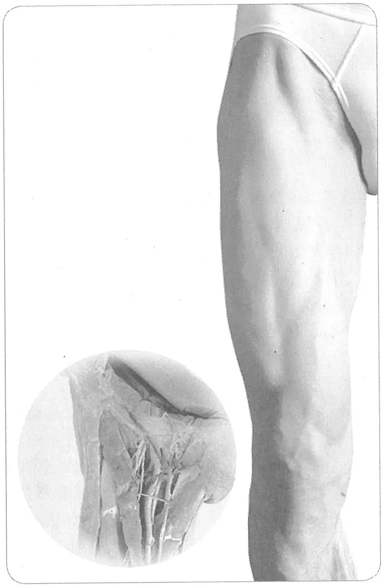

**图 1-8　大腿前部体表、肌肉合成图**

此时当我们回过头来看《黄帝明堂经》关于“髀关”穴的定位描述“伏兔后交分中”，不禁感慨其是何等的简练而精确！只是由于后人不识“交分中”之意而变生出许多分歧，又由于不明不同骨度系统下腧穴定位的差异，长期以来在“髀关”穴定位上得出许多似是而非的结论而不自知（详见各论髀关穴）。

应当清醒地认识到，将古代针灸明堂文献中腧穴定位的解剖标志术语准确理解之后再转换为现代语言，再转换为解剖学语言，再用图形表达，最后再从图形到人体，每一个环节的转换都非常的艰难，哪怕是一个很细小问题的解决往往会涉及许多知识，需要一次又一次地考察、实验。而在这诸多环节中，表面解剖学常常起着关键作用。例如：

曲泉，在辅骨下，大筋上，小筋下陷者中，屈膝得之。

（《黄帝明堂经》）

阴谷，在膝内辅骨后，大筋之下，小筋之上，按之应手，屈膝得之。

（《黄帝明堂经》）

古代文献对曲泉穴部位的描述并不复杂，曲泉与“阴谷”的位置关系，只是一“筋”之隔。按理说，只要阴谷穴定位正确了，此穴定位便不成问题。可是中外针灸腧穴标准或教材关于此穴定位的描述有非常大的分歧。如：

缝匠肌、股薄肌之间。

（日本教材《经络经穴概论》）

平膝中，缝匠肌前缘。

（日本《标准经穴学》）

胫骨内侧髁下缘，鹅足与腓肠肌之间。

（日本教参《针灸医学》）

〔p.62 (인쇄 42)〕

胫骨内侧髁后方与半膜肌腱之间。

（1957年南京《针灸学》、韩国针灸学教材等）

股骨内侧髁的后缘，半腱肌、半膜肌止端的前缘凹陷处。解剖：缝匠肌后缘、股薄肌腱后缘、半膜肌腱、腓肠肌内侧头。

（中国1990年版国家标准《经穴部位》及配套的编制说明）

股骨内侧髁后，半膜肌、半腱肌肌停止部前方，缝匠肌后缘。

（韩国《经穴学丛书》）

以上所引文献都是中、日、韩的国家标准或者国家统编教材（事实标准），都是出自代表国家水平的众多不同学科专家的多年研究结果。可是如果对解剖学非常熟悉，就不难发现上述定位涉及了膝内侧、后内侧的所有5条肌肉，涉及的距离和范围差不多有一掌大。在如此大的范围内取的穴都叫做“曲泉”，那么此穴实际上就名存实亡了；这样的标准也就形同虚设。这样一个看似简单的腧穴定位，这么多国家的这么多专家研究了这么长的时间依然存在这么大的分歧，如何解决？其实并不复杂，前提是必须有坚实的表面解剖学的基础知识与实践经验。

针灸腧穴是一个宝库，它使用的是笼统的非专业术语，如“两筋间”、“两骨间”、“分肉间”、“动脉中”，“锐肉端”、“锐骨下”之类，诸筋、骨、肉、脉等皆未有具体的名称，这就只能采取面授口传的方式传承，这种情形颇似《庄子·天道》中的轮扁斫轮所谓“得之于手而应于心，口不能言，有数存焉于其间”。正是由于“口不能言”，至今在中医药院校，腧穴定位的“点穴课”还没有教材，只能由老师手把手亲授——所谓“点穴”课是对以指点穴的形象概括。要改变这一现状，就必须在古人积累的丰富经验的基础之上，对于人体解剖结构的体表显示与定位的方法、技巧进行深入、系统的再研究，掌握规律，然后用规范、通用的语言加以描述，使之从经验层面上升为科学层面，真正成为一门学科。这也从另一方面说明，针灸点穴太需要表面解剖学的支持。

##### (2) 影像解剖学实验方法 

虽然在从体表确定腧穴部位方面古今医家积累了丰富的经验，这些经验同样需要实证的方法来验证。通过初步预实验，影像学技术在针灸腧穴定位方面，可以完成以下三方面的实证性研究：

判决性实验：人体骶髂部两侧有两个对称的像酒窝一样的凹陷，然而迄今仍未对人体这两个十分明显的体表标志的定位作出科学的描述。这两个凹陷正好是针灸学的两个重要的腧穴，对它们的部位，古代文献描述就不一致，现代文献也不统一，最新的国家标准《腧穴名称与定位》的定位描述为“横平第4腰椎棘突下，后正中线旁开约3.5寸凹陷中”，那么这两个凹陷是否真的横平第4腰椎棘突？是否就是旁开中线3.5寸？男女间有无差异？这些问题都是用传统的方法无法回答的，而影像学方法不仅可以为传统的腧穴定位经验提供科学检验的数据，同时也为解决那些仅用文献学方法无法解决的定位分歧，提供非常直观明确的客观证据，从而解决那些千年悬而未决的难题。

验证性实验：对于某些活动的肌性标志或皮纹与骨性标志的对应关系，如“腕掌侧远端横纹：与豌豆骨上缘、桡骨茎突尖下连线相平”，“腘横纹与髌尖相平”等，其他如胸部“云门”、“中府”与喙突、肋间的关系等，国内外专家意见多有分歧，这些都可以通过影像学方法得到非常直观、科学的验证。

研究性实验：对于针刺安全深度与适宜角度，也可以利用影像学方法加以研究。事实上西医介入治疗，借助X光或CT影像引导也是常规的方法。

〔p.63 (인쇄 43)〕

影像学是表面解剖学的补充与延伸，它拉近了解剖学与临床诊疗的距离。借助于影像学这一有效工具，开展腧穴定位的活体、动态解剖研究，其研究结果与表面解剖定位相互印证，相互补充，不仅为针灸标准化研究探索出一条新的途径，同时也必将有力促进表面解剖学，乃至整个解剖学的发展。

##### (3) 人体测量学实验方法 

针灸腧穴定位常用的方法“骨度折量系统”实际上就是人体测量学方法的最早与最广泛的应用。通过比较不难发现，人体测量学上的测点有不少与针灸骨度折量的基准点、基准穴完全相同。甚至某些人体测量学的测点的体表定位方法也与相关针灸腧穴的定位方法完全相同，例如人体测量学上的“肩峰点”与针灸“肩髃”穴的位置相同，二者的定位方法也相同。

在针灸腧穴定位的国际标准研究制定过程中，发现某些用于腧穴定位的体表标志，存在着明显种族差异，因此在制定针灸腧穴定位国际标准的文本时，必须首先搞清这种存在差异的结构及差异的程度，从而保证制定的国际标准具有广泛的地域间的适用性。

例如，前臂屈面正中心包经穴是以桡侧腕屈肌腱和掌长肌腱为标志定位的，而调查的结果发现，不同国家的人群中，掌长肌腱有不同比例的阙如；又如国际标准《针灸经穴定位》对于“章门”穴的定位描述为“在腹外侧区，当第11肋游离端的下际”，取穴方法的说明文字为“侧卧举臂，从腋前线的肋弓软骨缘下方向前触摸第11肋骨游离端，在其下际取穴”。然而人体测量的结果发现，中国人约有78%的人群第10肋也为“浮肋”[^5-1]，另有文献报道，不同人种中第10肋为“浮肋”的出现率在35%到70%之间[^6-2]。这样按照上述取穴方法触及的则可能是第10肋，而不是第11肋（详见各论章门、京门穴）。对于这种出现率很高的体表标志的种族间差异，在制定的针灸腧穴定位的国际标准文本中应当依据最新的人体测量结果，做出附加说明。应当看到，这些研究工作的本身也是推动解剖学发展的一项十分重要的基础性工作，因此其意义和价值不仅限于针灸学范畴上。

此外，针灸腧穴定位的基本方法之一——骨度折量，需要借助人体测量（包括X线测量）的方法加以调整，以更加适用于临床实际。例如膝以上的大腿部腧穴的折量以髌底为基准线，而膝以下的腧穴则以髌尖为基准点，因此就必须确定“髌尖”到“髌底”的折量长度，这就需要根据实测的结果加以折算。在新修订的国家标准《腧穴名称与定位》和新制定的国际标准《针灸经穴定位》文本中，都新增了这一折量分寸。

#### 3. 多学科方法的综合应用 

在上述文献学方法与实验方法中，都强调了综合应用多重证据的重要性。如以腧穴定位的解剖学方法为例，应当活体解剖与尸体解剖相结合，而重在活体解剖。活体解剖方法在具体运用时，也应表面解剖与影像解剖相结合，而重在表面解剖。再如文献学方法，从认识论角度，我们强调“以古人之心为心”——避免以今律古；从方法学角度来看，我们必须明确古人构建系统的方法，比如古人的腧穴定位大量应用表面解剖学知识，如果我们不意识到这一点，或虽有意识而不具备与此相关的知识，就无法理解古代腧穴文献，许多误解、许多分歧正由此而生。

[^5-1]: 中国解剖学会体质调查委员会. 中国人解剖学数值[M]. 北京：人民卫生出版社，2002.

[^6-2]: [英]威廉斯（Williams，P.L.），等. 格氏解剖学[M]. 杨琳，等译. 38版. 沈阳：辽宁教育出版社 1999：542.

〔p.64 (인쇄 44)〕

而某些具体问题，特别是一些复杂的疑难问题的解决，常常需要多种方法的综合运用。例如对于某些分歧较大的腧穴定位，我们将文献学考察与表面解剖学实验、影像解剖学验证结合起来，综合分析。试以股外侧足少阳胆经风市穴的定位为例说明如下：

**［解题思路］**

中渎、风市穴定位的解剖学描述是用髂胫束为标志的。那么这个术语转换是否与古典文献的描述等价？要解决这一难题，就要按以下步骤进行：

　　(1) 确定古典文献股外侧足少阳经穴位置与髂胫束的关系；

　　(2) 探寻体表显示或触诊髂胫束的技法；

　　(3) 采用尸体观察、人体测量学方法确定髂胫束的体表投影。

**［文本解析］**

中渎，在髀骨外膝上五寸分肉间陷者中。

风市，在膝外两筋间，平立舒下两手著腿，当中指头陷者宛宛中。

（《太平圣惠方》）

经文中的“分肉间”是指两块肌肉之间；“两筋间”或指两块肌肉之间，也可指两条肌腱之间。在大腿外侧部，两肌之间，或肌与腱之间，有两种可能：其一，为股外侧肌与股二头肌之间；其二，股外侧肌与髂胫束之间；如果是指前者，则与“平立舒下两手著腿，当中指头陷者宛宛中”所示不符。排除第一种可能性，就只能是股外侧肌与髂胫束之间。那么是在髂胫束前缘还是后缘呢？这需要通过实验来判定。

**［实验检验］**

　　(1) 表面解剖学实验

步骤一：立正姿势，于中指尖下作一标记。髂胫束在立正姿势下扪之颇为紧张，通常呈一凹槽；

步骤二：在体表显示出髂胫束的整体，沿其后缘画线，上述标记点在此线上；

步骤三：在体表显示出髂胫束的沟槽，此沟槽正好相当于髂胫束的后缘。

表面解剖学实验的结果证明古典文献中的“两筋间”是指髂胫束后缘与股外侧肌间的凹陷处。

　　(2) 髂胫束体表投影

鉴于大多数被检查者难以在体表显示出髂胫束的整体形态，而且相当多的人在体表也不易通过触按的方式清楚地确认髂胫束的边缘。因此，为了便于临床取穴，就有必要通过人体测量的方法得到髂胫束的体表投影数据。同时，也是对上述表面解剖学实验结果的很好的检验。以下试将王连璞等人对30具尸体（男24，女6），共59例下肢（男性左24例、右23例，女性左右各6例）的实际测量的结果[^7-1]归纳于下：髂胫束之膜性结构上界约平臀横纹或其上下10mm范围内，前后界分别位于髂前上棘和大转子尖与胫骨外侧髁结节前后缘连线所构成的区域内。

基于表面解剖学与尸体解剖学研究的双重证据，最终确定风市、中渎穴的定位表述如下：

风市：在股部，直立垂手，掌心贴于大腿时，中指尖所指凹陷中，髂胫束后缘。

中渎：在股部，腘横纹上7寸，髂胫束后缘。

[^7-1]: 王连璞，王琳，等. 髂胫束的应用解剖[J]. 解剖学杂志，2004（3）：314-316.

〔p.65 (인쇄 45)〕

### （二）编纂体例 

#### 1. 腧穴定位的规范化表述 

从针灸腧穴定位的历史演变来看，可以明显看出一个不断由相对简约到相对精确的演变过程，也就是说针灸腧穴定位规范化是一个连续的历史过程，并不是今天才开始的。在口传面授阶段，或者看图点穴等特定的语境下，使用“两筋间”、“两骨间”、“歧骨间”、“叉骨间”、“锐骨下”、“分肉间”、“交分中”、“腨分中”、“锐肉端”、“动脉中”、“约纹中”之类的语言，不失为一种简便的形式，然而作为一种标准文本，则要求说明诸筋、骨、肉、脉等具体的名称。另外，在口头教学或临床点穴时，诸如“通天，承光穴后一寸五分”、“承光，五处穴后一寸五分”这样以甲穴定乙穴，复以乙穴定丙穴的方式殊为便捷，然而却不符合标准定义的规范。这正如法律文本或具有法律效应的文本与一般文体之间的显著区别一样。但腧穴定位标准文本的严谨并不影响课堂教学的便捷——教学完全可以采用“以穴定穴”的点穴法。

##### (1) 粗略与精确 

在中国第一部针灸腧穴经典《黄帝明堂经》之前的更早期文献中，可见到不少较宽泛、动态的腧穴定位方法，例如背俞穴、十五络穴等。阑尾穴、胆囊穴定位的范围是对古代腧穴概念的回归。

从针灸发展的历史看，“刺脉”曾是针灸的重要治疗方法，而脉具有一定的长度而不是一个局限的点，这类“穴位”演变过程主要表现出两个方向：第一，由原本统视为一个“穴”演变为多个穴，这类典型的例子是古代与经脉同名的“经脉穴”，如“手太阴”穴后演变为“太渊”、“经渠”；“手阳明”穴演变为“合谷”、“阳溪”等[^8-1]。第二，是由原先相对宽泛的定位描述变为相对局限的定位描述，例如：鱼际穴，古代文献描述为“在手大指本节后内侧散脉中”，这不是一个局限部位而是一块面积相对较大的区域。至《循经考穴编》增加“约居横纹后一寸”加以限定，1990年版国家标准《经穴部位》则进一步明确表述为“在手拇指本节（第1掌指关节）后凹陷处，约当第1掌骨中点桡侧，赤白肉际处”。可见这类腧穴定位经历了一个从区域到点，描述由相对模糊到逐步精确的过程。

关于腧穴定位的日益精确化，最常见也最容易被理解的是古代许多以“如韭叶”、“陷容豆”、“陷容甲”描述的腧穴在后世都被代以具体的分寸。比如：

少商：在手大指内侧去爪甲如韭叶。

（《黄帝明堂经》）

古人很早也察觉到用“韭叶”比量定位过于粗略，故初唐杨上善注曰：“韭叶有大小，正取非大非小阔二分许量中度之人。若大小以意量之也”。今则统一定为“距爪甲角约一分”。

在制定经穴定位国际标准草案过程中，最初阶段统计结果表明中、日、韩三国定位有分歧的腧穴共有92个，而当三国专家对所有这92穴逐一讨论时却发现，其中相当一部分经穴的定位三国意见是一致的，只是文字表述不同，而这些不同的表述，大多也属于对经穴定位“粗略”与“精确”的不同理解。下面以分歧较大的“肩髃”穴为例加以说明：

肩髃：在肩部，三角肌上，臂外展，或向前平伸时，当肩峰前下方凹陷处。

（中国国家标准《经穴部位》）

[^8-1]: 黄龙祥.中国针灸学术史大纲[M].北京：华夏出版社，2001.

〔p.66 (인쇄 46)〕

上臂向外转90°，肩峰外端和肱骨头上缘的中央。

（日本《标准经穴学》）

肩峰前直下，肩峰前端下陷凹部，肩锁关节的前下方。

（日本统编教材《经络经穴概论》）

肩峰前直下，三角肌起始部前方凹陷处。

（韩国《经穴学图解》）

首先看中国1990年版国标定位描述“三角肌上”，可以理解为“在三角肌的表面上”（on the deltoid），也可以理解为“在三角肌的上方”（superior to the deltoid）。不论作何理解，都是一个面积较大的区域，而不是一个确定的点；“肩峰前下方”也不是一个确定的点。日本、韩国的表述同样存在这类描述不明确或不准确的问题。

其实，当上肢外展时肩部出现的两个凹陷，从肌性标志看，前一个由三角肌的前束与中束间形成，后一个由中束与后束间形成；从骨性标志看，前一个相当于肩峰的最外侧点，后一个相当于肩峰角（三角肌后束的起始处，肩峰前后缘的分界点）前。可见上述中、日、韩三国对于肩髃位置的描述，或者与实际定位不符，或者不是一个确定的点，不同知识背景的人可以基于文字表述作出种种不同的理解。因此，将肩髃穴部位的准确描述修订为“在肩部，肩峰外侧缘前端与肱骨大结节两骨间凹陷中”。

对于临床实践而言，腧穴是一个在一定区间的动态点，而对于学习与交流而言，需要一个确定的定位坐标系。这也是千百年来，经穴定位表述不断从相对“粗略”到相对“精确”的主要因素。

##### (2) 部位与取穴 

在古代针灸文献中，腧穴部位与取穴法的内容是合二为一的。虽然在我国现行统编教材《针灸学》系列中将腧穴定位分为“位置”（或作“穴位”）与“取穴”两个层次，但实际内容是“位置”下直接抄录古代文献原文（主要是《针灸甲乙经》文字）；“取穴”则是现代文字（多用解剖学术语）的表述。看不出二者之间不同的区别。而且由于某些腧穴古今定位不同，对于这种古今差异如不作任何说明，则令人难以适从。例如第一条肺经“天府”、“尺泽”下，“位置”项下抄录的《针灸甲乙经》文字与“取穴”下的现代表述不是同一位置。这提示，虽然学术界早就对于腧穴“定位”的基本要素进行思考，试图依照《灵枢》、《素问》之例，将腧穴“定位”解析为“位置”与“取穴”两个层次，但相应的学术研究没能跟上，对于这两个不同的层次没有给出明确的定位，致使后人的认识难以统一[^9-1]。直至1990年版国家标准《经穴部位》中仍然没有明确“部位”与“取穴法”二者的关系，以致在1990年版国家标准《经穴部位》中对于部分腧穴的描述只有“取穴法”的内容而没有具体“部位”的内容，比如：

髀关：在大腿前面，当髂前上棘与髌底外侧端的连线上，屈股时，平会阴，居缝匠肌外侧凹陷处。

少府：在手掌面，第4、5掌骨之间，握拳时，当小指尖处。

肩髃：在肩部，三角肌上，臂外展，或向前平伸时，当肩峰前下方凹陷处。

肩髎：在肩部，肩髃后方，当肩外展时，于肩峰后下方呈现的凹陷处。

听会：在面部，当耳屏间切迹的前方，下颌骨髁突的后缘，张口有凹陷处。

（1990年版国家标准《经穴部位》）

[^9-1]: 但对于经外穴，“位置”与“取穴”两个层次的关系处理得很好。

〔p.67 (인쇄 47)〕

细观上述关于腧穴定位介绍，实际上是在叙述如何取穴。那么部位和取穴法到底有何区别呢？从标准的要求而言，部位应当是必备的、唯一的，它以定义的形式来完成对腧穴位置的描述。部位一旦确定就不会随着体位的改变而改变。至于如何取穴，其方法并不是唯一固定的，临床工作者可以根据自身经验而有不同的取穴方法。总之，“部位”解决“where”的问题，犹如给一个唯一确定的地址（就像门牌号，中文习惯是由大到小描述，如“东城区东直门内南小街16号”），而取穴法则解决“how to locate”的问题（如何到达特定地址的途径与方法。往往可以因人因时，有多种途径与方法）。举例来说，“大椎”的“部位”表述：“第7颈椎棘突下凹陷中”，不论是坐、立、卧哪种体位，也不论是低头、抬头还是转头，它都在这个位置。而“取穴”则要求：坐位，低头，颈后显现的最高突起处为第7颈椎；如果不明显，不易与第1胸椎区别，则轻微转动被取穴者的头，能随头旋转而转动者为第7颈椎。

“部位”是对腧穴位置的一个科学定义，必须遵循定义的基本规则，不能采用“以穴定穴”这种以未知定义未知的形式，而且须用严谨的术语表述——不可采用“两骨间”、“两筋间”、“大筋旁”等俗语。上述所举之中、日、韩三国定位分歧的“肩髃”穴，之所以出现分歧，其中一个重要的因素就在于在“部位”的描述中没有使用规范的术语。“取穴”是对于定义的一种阐释，因而可用俗语解释，相当于中国针灸教学中的“点穴”文本，不受定义规则的限制，完全可以采用“以穴定穴”的简便形式。这也是此次国家标准修订之所以将“部位”与“取穴”内容分开表述的主要原因，这样既可以满足标准规范的要求，又可满足临床取穴的实际需要。

在分析古今文献中发现，腧穴定位项下除了“部位”与“取穴”外，还有关于相邻腧穴之间位置关系的说明，从第一部针灸腧穴经典《黄帝明堂经》在描述腧穴位置时就注重对相邻穴关系的描述，如：

天牖，在颈筋缺盆上，天容后，天柱前，完骨下，发际上。

水突，在颈大筋前，直人迎下，气舍上。

气舍，在颈直人迎，夹天突陷者中。

天鼎，在颈缺盆上，直扶突，气舍后一寸五分。

少府，在手小指本节后陷者中，直劳宫。

上述“天牖”例描述与相邻穴的关系时涉及了上下前后全部四邻的位置关系。那么在对腧穴“定位”时有必要提供这样的信息吗？

不妨做这样一个实验：如果在挂图上，特别是在模型上只标出腧穴点，要求受试者只依据标准文本标出相应的穴名，结果会如何？我曾经只用1990年版国家标准《经穴部位》在平面人体挂图上点穴，难度极大，特别是头部、肩部等部位的穴。而2001年我遇到更加困难的考验：根据《铜人腧穴针灸图经》文本辨识明正统针灸铜人（该铜人正是基于此文本定穴的）的腧穴。虽然我对明正统拓本《铜人腧穴针灸图经》和明正统铜人都研究多年，但却无法完成这原以为非常容易的任务。直到我发现了下面这个收录于《勉学堂针灸集成》中的文本，才轻松完成了这项工作：

颔厌，在悬颅上五分，与风池上下相对有二寸，风池微向外些。

这个文本与我们常见的古今腧穴文献的性质不同，它是直接对正统铜人腧穴部位目测的文字描述，因而特别注重相邻腧穴位置间关系的说明，而且注释得非常详细，非常直观。

我们知道古代针灸文献对于下腹部穴的定位分歧非常大。其中一个非常重要，或者说最重要的因素就在于最早的腧穴经典《黄帝明堂经》没有注明肾经穴、胃经穴、脾经穴与任脉穴的横向位置关系。

〔p.68 (인쇄 48)〕

那么，为什么缺乏相邻穴位置关系的信息，在人体上点穴会遇到困难呢？因为人体是一个不规则的三维结构，而古今对于腧穴位置的描述是二维的，这样在人体，特别是在头部、肩部等确定穴位就很困难。而对于挂图和模型来讲（模型尤为突出），所能表现的体表解剖标志非常有限，根据二维的位置描述定位更是非常困难。这种困难恐怕只有亲自在挂图和模型上点过穴（或者对点好的穴标注穴名）的人才能真正体会得到。

如果没有这种对相邻腧穴空间位置关系的说明，一方面难以在挂图与模型上定穴，另一方面还会造成新的分歧，例如“交信”与“复溜”位置谁在前谁在后的古代分歧，“丰隆”与“条口”横向关系的现代分歧，皆由此而生。因此，在对腧穴定位时提供必要的相邻穴位置关系的信息是有意义的，正如金元时期的临床大家窦汉卿在《标幽赋》中所说的：“取五穴用一穴而必端，取三经用一经而可正”。

在制定1990年版国家标准《经穴部位》时，由于没有自觉地认识到腧穴的“部位”、“取穴”及“相邻穴位置关系”三者之间的关系，因而在处理某些穴的定位时遇到了很大的难题，也导致了前后体例的不统一。如：

**示例一：关于相邻穴间关系的说明**

脑空，在头部，当枕外隆凸的上缘外侧，头正中线旁开2.25寸，平脑户。

风池，在项部，当枕骨之下，与风府相平，胸锁乳突肌与斜方肌上端之间的凹陷处。

外丘，在小腿外侧，当外踝尖上7寸，腓骨前缘，平阳交。

**按**：以上3穴的共同特点是标注所定义穴与相邻穴的位置关系，与其他穴的体例大不相同，也不符合标准定义的要求。

**示例二：关于取穴体位的标注**

天井，在臂外侧，屈肘，当肘尖直上1寸凹陷处。

清冷渊，在臂外侧，屈肘，当肘尖直上2寸，即天井上1寸。

**按**：作为部位来说，天井穴不论屈肘还是伸肘，它都位于鹰嘴窝凹陷中；而对于“取穴”而言，只有屈肘才能显现鹰嘴窝。由于没有明确天井与清冷渊二者“部位”与“取穴”的关系，在“清冷渊”中还出现了明显的失误。类似“屈肘”这类表述取穴体位的内容在1990年版国标中仅见于20余穴。

**示例三：既有“部位”又有“取穴”**

风市，在大腿外侧部的中线上，当腘横纹上7寸，或直立垂手时，中指尖处。

百会，在头部，当前发际正中直上5寸，或两耳尖连线的中点处。

**按**：这样将部位与取穴合写的形式，很不协调且容易造成误解。例如根据实测的结果，“风市”穴的部位描述与取穴不在同一位置（除去“部位”描述的失误造成的2寸误差外[^10-1]，实际还相差2寸）。

**示例四：只有“取穴”，无“部位”**

髀关，在大腿前面，当髂前上棘与髌底外侧端的连线上，屈股时，平会阴，居缝匠肌外侧凹陷处。

少府，在手掌面，第4、5掌骨之间，握拳时，当小指尖处。

劳宫，在手掌心，当第2、3掌骨之间偏于第3掌骨，握拳屈指时中指尖处。

肩髃，在肩部，三角肌上，臂外展，或向前平伸时，当肩峰前下方凹陷处。

[^10-1]: 古代文献“膝上7寸”是指髌底上7寸，若以腘横纹作起点，就应当调整为“9寸”。

〔p.69 (인쇄 49)〕

肩髎，在肩部，肩髃后方，当肩外展时，于肩峰后下方呈现凹陷处。

**按**：国家标准名曰《经穴部位》，如果缺失了“部位”的确定，自然说不通。

**示例五：“以穴定穴”表述存在的条件**

水突，在颈部，胸锁乳突肌的前缘，当人迎与气舍连线的中点。

上关，在耳前，下关直上，当颧弓的上缘凹陷处。

**按**：这种“以穴定穴”的表述形式不是标准文本，而是点穴文本。

对以上这些出现在1990年版国家标准《经穴部位》中的问题，2006年版国家标准《腧穴名称与定位》的解决办法是：将“部位”与“取穴”、“相邻腧穴位置关系的说明”分开，将后两项难以在标准文本中出现而又不可缺少的实用信息以“注文”的形式表述。例如：

肩髃，在肩胛区，肩峰外侧缘前端与肱骨大结节两骨间凹陷处。

注：屈臂外展，肩峰外侧缘前后端呈现两个凹陷，前一较深凹陷即本穴，后一凹陷为肩髎。

这样处理，既准确表述了该穴的位置，又提供了对临床与教学非常实用的关于如何取穴信息，很好地满足了科学性与实用性（可操作性）的双重要求，使这类近半个多世纪未能解决的难题终于得到满意的解决。

##### (3) 标准度量单位 

腧穴的标准度量，主要涉及腧穴定位的长度、宽度以及刺灸法中的针刺深度等。一般标准中所涉及的长度、宽度的计量都要求采用国际单位制，但是人体高矮胖瘦的差异很大，无法采用绝对的标准值描述针灸腧穴部位，最晚在隋唐时期，已有医家将“骨度”用于取穴标准而采用了“骨度折量取穴法”。

《千金要方·灸例》卷三十曰：“人有老少，体有长短，肤有肥瘦，皆须精思商量，准而折之，无得一概，致有差失。”意思是说人体体型差异很大，无法采用实际测量的方法确定腧穴的位置。因此自古以来针灸腧穴定位采用折量的方法。具体方法：将人体的高度定为75等份寸，再将人体一定区段的长度和宽度折合为一定的等份，一份即为“一寸”，谓之“骨度折量寸”。如不论个体高矮胖瘦的差异如何，其前臂的长度都折作12等份，即12寸。这里的“寸”是一个相对值，而不是绝对值。正如初唐杨上善所说：“取一合七尺五寸人身量之，合有七十五分，则七尺六寸以上大人亦准为七十五分，七尺四寸以下乃至婴儿亦准七十五分，以此为定，分立经脉长短并取孔穴。”（《黄帝内经太素·骨度》杨上善注）

针灸腧穴定位这种非常科学的方法已经被越来越多的国家所理解和接受，1987年世界卫生组织在韩国召开国际会议（相关的标准文件见本标准的“规范性引用文件”）确定针灸经穴计量单位（Standard Nomenclature of the Unit of Measurement），经过讨论一致决定：采用“寸”作为标准计量单位。具体规定如下：

B-cun 骨度分寸 bone proportional cun

F-cun 手指同身寸 finger cun

国际标准《经穴定位》正是采用上述标准计量单位定穴的，因此国家标准《腧穴名称与定位》也采用了这一计量单位。

明确将针刺深度以同身寸表述的是唐代的王冰：

（足）三里，在膝下同身寸之三寸，骱骨外廉两筋肉分间，足阳明脉之所入也，刺可入同身寸之一寸。

（《素问·气穴论》王冰注）

〔p.70 (인쇄 50)〕

**按**：这里“膝下同身寸之三寸”之“三寸”，无疑是指骨度折量分寸，而“刺可入同身寸之一寸”中之“一寸”是何寸？第2版《针灸学》统编教材提出“针刺深度以中指同身寸为标准”。这可能是当年在没有专用的针刺深度折量标准下的一种过渡。严格来说，按照折量的原理，这里的“一寸”应当是相当于小腿上段厚度的折量寸之“一寸”才合理，可是文献中未见关于人体不同横段厚度的折量寸的记载，如果直接套用骨度分寸，并不合理，因为人的高与胖瘦往往不成正比，那些瘦长型人骨度很长，而四肢很细，用超出常人的骨度寸量细于常人的四肢显然不合理。如采用中指寸，那些瘦长型人的中指寸会长于一般人，而其肌肉的丰度却小于一般人，这时如用中指寸就会出现较大的误差。解决这一问题最好的方法，对人体头、胸、腹、四肢等各部（四肢还应再分作若干段）的前后径及左右径进行实测，再根据与现有骨度折量系统中垂直长度的比例关系，换算成相应的折量寸，作为针刺深度的专用折量标准。在这一标准没有建立之前，相对而言，用拇指横寸作为针刺深度的同身寸可能更合理些。

#### 2. 腧穴主治的规范化表述 

##### (1) 功能与主治 

由于古代文献及现行针灸教材中对于经穴主治，特别是特定穴的主治病症的记载，有越来越多的趋势，且看不出明显的规律性，给学生的学习和针灸医生的临床应用都带来一定的困难。为改变这一状况，人们进行了多方面的探索。最初有人提出这样的想法：根据经穴主治，另设类似中药“功能”的表述，以执简驭繁。于是按照中医方药治疗“八法”，将经穴分为“温”、“清”、“消”、“补”、“汗”、“吐”、“下”、“和”八大类，并总结出诸如“活血化瘀”、“温中健脾”、“补肾益气”、“清热解毒”、“清肺止咳”等完全移植中药“功能”模式的针灸经穴“功能”。

然而，腧穴没有与中药“五味”、“四气”相对应的属性，腧穴具有的是主治针对特定部位症状这一特点，所以不具备完全套用中药功能模式的“腧穴功能”的可行性。下面再举一个“四总穴”——足三里穴的主治分析如下：

邪在肝，则两胁中痛，寒中，恶血在内，行善掣节，时脚肿，取之行间以引胁下，补三里以温胃中，取血脉以散恶血，取耳间青脉，以去其掣。

（《灵枢·五邪》）

邪在脾胃，则病肌肉痛。阳气有余，阴气不足，则热中善饥；阳气不足，阴气有余，则寒中肠鸣腹痛。阴阳俱有余，若俱不足，则有寒有热。皆调于三里。

（《灵枢·五邪》）

腹中常鸣，气上冲胸，喘不能久立，邪在大肠，刺肓之原、巨虚上廉、三里。饮食不下，膈塞不通，邪在胃脘，在上脘则刺抑而下之，在下脘则散而去之。

（《灵枢·四时气》）

胃病者，腹䐜胀，胃脘当心而痛，上支两胁，膈咽不通，食饮不下，取之三里也。

（《灵枢·邪气藏府病形》）

气在于肠胃者，取之足太阴、阳明，不下者取之三里。

（《灵枢·五乱》）

善呕，呕有苦，长太息，心中憺憺，恐人将捕之，邪在胆，逆在胃，胆液泄则口苦，胃气逆则呕苦，故曰呕胆。取三里以下胃气逆，则刺少阳血络以闭胆逆，却调其虚实以去其邪。

（《灵枢·四时气》）

〔p.71 (인쇄 51)〕

肠中不便，取三里，盛泻之，虚补之。

（《灵枢·四时气》）

小腹痛肿，不得小便，邪在三焦约，取之太阳大络，视其络脉与厥阴小络结而血者，肿上及胃脘，取三里。

（《灵枢·四时气》）

胃者水谷之海，其输上在气街，下至三里。

（《灵枢·海论》）

以上《内经》所述足三里穴主治，不论其具体的症状如何复杂，最后都落实到“胃中”、“胃”、“胃脘”、“脾胃”、“肠胃”、“肠中”这些特定的部位上，而且强调这些部位不论表现为哪种具体的症状，也不论引起这些症状的病机是“阳气有余，阴气不足”、“阳气不足，阴气有余”、“阴阳俱有余，若俱不足”、“有寒有热”，其针灸取穴“皆调于三里”。唯一一条出现“温胃中”，文前明确冠以“补三里”字样，与同段其他取穴表述不同，说明其“补”的作用在于手法而不在足三里穴本身。这一特点在《内经》、《黄帝明堂经》中反映得非常突出。不仅是像胃肠这类部位局限的病症取穴如此，即使像“热病”、“疟”等全身性病症的取穴，依然是要辨具体的部位：

头上五行行五者，以越诸阳之热逆也；大杼、膺俞、缺盆、背俞，此八者，以泻胸中之热也；气街、三里、巨虚上、下廉，此八者，以泻胃中之热也；云门、髃骨、委中、髓空，此八者，以泻四肢之热也；五脏俞旁五，此十者，以泻五脏之热也。

（《素问·水热穴论》）

热病始手臂痛者，刺手阳明、太阴而汗出止。热病始于头首者，刺项太阳而汗出止。热病始于足胫者，刺足阳明而汗出止。

（《素问·刺热》）

刺疟者，必先问其病之所先发者，先刺之。先头痛及重者，先刺头上及两额两眉间出血。先项背痛者，先刺之。先腰脊痛者，先刺郄中出血。先手臂痛者，先刺手少阴阳明十指间。先足胫酸痛者，先刺足阳明十指间出血。

（《素问·刺疟》）

腧穴主治的这个特点从根本上决定了它不能套用中药的“功能”模式，不能用“温中健脾”、“温胃散寒”、“补中益气”、“通腑利肠”等等来描述“足三里”穴的“功能”。

人们之所以不懈地试图增补腧穴主治的“功能”，其中一个重要原因恐怕在于想为当前流行的完全套用方药方解模式的针灸“方解”建立理论基础。如果没有与中药功能相对应的“腧穴功能”，那么现行的针灸方解就缺乏理论依据，也就难以形成如方药“理、法、方、药”那样环环相扣的辨证论治体系。于是人们总是想方设法地尝试着补上这一理论上的空缺。

据医史学界考证，中药的“方解”最早出现在宋代，而典型的针灸方解在《内经》就有明确记载：

邪在肝，则两胁中痛，寒中，恶血在内，行善掣节，时脚肿，取之行间以引胁下，补三里以温胃中，取血脉以散恶血，取耳间青脉，以去其掣。

善呕，呕有苦，长太息，心中憺憺，恐人将捕之，邪在胆，逆在胃，胆液泄则口苦，胃气逆则呕苦，故曰呕胆。取三里以下胃气逆，则刺少阳血络以闭胆逆，却调其虚实以去其邪。

〔p.72 (인쇄 52)〕

以上二方，明言取三里穴是针对靶点“胃”；取行间穴是针对靶点“胁下”；取耳间青脉（后演化为瘈脉、颅息二穴）以“去其掣”；取血络以“散恶血”。这说明古人对腧穴主治作用有高度概括，不然很难写出如此精辟的针灸方解来！只是这种概括主要着眼的是作用部位，其次是作用类型（大致相当于现代概括的腧穴“特殊作用”）。后者的概括要比前者困难得多，因此后世有关腧穴主治作用的概括以前者为主。

下面举例古代文献关于经穴主治作用部位特点的论述：

肚腹三里留，腰背委中求，头项寻列缺，面口合谷收。

（《四总穴歌》）

抑又闻心胸病，求掌后之大陵；肩背患，责肘前之三里。冷痹肾败，取足阳明之土；连脐腹痛，泻足少阴之水。脊间心后者，针中渚而立痊；胁下肋边者，刺阳陵而即止。头项痛，拟后溪以安然；腰脚疼，在委中而已矣。

（《通玄指要赋》）

头面之疾针至阴，腿脚有疾风府寻。心胸有病少府泻，脐腹有病曲泉针。肩背诸疾中渚下，腰膝强痛交信凭。胁肋腿叉后溪妙，股膝肿起泻太冲。

（《肘后歌》）

基于对经穴主治这一特点的认识，古代一些针灸腧穴专书开始出现以特定的部位或范围来概括经穴主治的苗头。以下是清代《循经考穴编》中的一些实例：

丝竹空：主目疾，主头风。又主一切头面眉目或肿赤或痒麻，及面掣眉跳，目内红痛。

**按**：此处“或肿赤或痒麻，及面掣眉跳，目内红痛”是对“一切头面眉目”的举例，以下同。

目窗：主一切目疾：青盲内障，宜先泻后补；暴赤肿疼，宜单泻之。

光明：一切目疾。

睛明：主一切目疾：眼红肿痛，迎风冷泪，内外翳障。

合谷：凡一切头面诸证及中风不语，口眼㖞斜，狂邪癫厥，头风目疾，无不治之。

丰隆：主哮喘气急，一切风痰壅盛。

隐白：一切脾病，皆能治之。

在现代针灸学教材中，对于某些腧穴主治的概括也在某种程度上不自觉地表现出这种以特定部位或范围概括腧穴主治的实例，例如：

目窗：主要对眼疾患，内眼有效。

（《新编针灸学》）

太阳：偏头痛，一切目疾。

（《中国针灸学》）

小骨空：一切目疾。

（《中国针灸学》）

可惜这一思路的火花没有及时地被有准备的头脑捕捉到，以至于经过几十年的苦苦探索，人们一直没有寻找到解决腧穴主治规范化表述的明确方向。

由此不难看出，腧穴主治的表述，其主要模式应该是以特定部位概括，或者在所概括的“部位”下列举最成熟、最常用的病症（例如上引《循经考穴编》之“目窗”、“睛明”穴例即是）。其中腧穴作用于特定部位的概括相对稳定，而对于特定区域具体的主治病症则随时间、实践的变化而不断变更，这将是腧穴主治表述的发展趋势。由于万变而不出其界，故既便于学习应用，又为临床新发现留下足够的发展空间。腧穴主治表述的次要模式是用“热病”、“水病”、“风病”这类类属病症概括。这种概括的难度要大得多，需要的时间也更长，至少在现阶段还难以实现。

〔p.73 (인쇄 53)〕

人们或许会问，既然腧穴主治可以用作用部位概括，是否仍然可以仿照中药“功能”的模式概括出相应的腧穴主治的“功能”呢？比如将“调节”、“调理”、“调和”、“调治”等字样与作用部位连接起来形成四个字或八个字的句式。研究的结果表明，这样处理，既无必要，也行不通。例如“足三里”穴，可以写成“调理脾胃”，但如果腧穴的主要作用部位少于或多于两个，又该如何表述？最大的困难还在于，不少腧穴（特别是阳经）的主治作用部位不是脏腑，而只是一般的体表部位，又当如何表述？能写出“调口和耳”、“调胸理背”这样的表述吗？与其这样“以辞害意”，何不采用古人直接表述的方法，直接写明腧穴的主要作用部位。例如足三里“主治胃脾病症”；合谷“主治口齿病症”等等。

在对腧穴主治进行规范化表述时，还有一点需要注意：一个腧穴临床应用的范围越广、使用频率越高，就越容易归纳出抽象程度高的主治。而对于那些很少使用的腧穴，如滑肉门、太乙二穴，几千年来就一条治疗文献（而且文字的可靠程度还很有疑问），就很难一步到位做出像委中穴那样的概括来。然而标准化工作又要求在体例上统一，处理的方法只能以注文加以说明。

如前所述，腧穴主治需要概括，以执简驭繁。但是不能完全套用中药“功能”的模式。应当说，此项工作的难度很大，此次研究只是一次示范性的研究，先迈出一小步，为今后的此类研究先开一个头而已。如果此项研究做好了，我们就能够写出像《内经》中那样对针灸临床有指导意义的针灸“方解”，针灸的辨症论治才能真正落到实处，并最终建立起符合针灸自身规律的诊疗体系，也才能从根本上改变针灸腧穴理论与临床相脱节的现状。

腧穴主治标准化研究除了表述形式的规范化之外，还有一个病症术语规范化的问题。在古今针灸腧穴、针灸治疗文献中，同一症状有多种描述的现象普遍存在，例如“不孕”，又作“断绪”、“绝子”、“绝嗣”、“绝孕”等。这是一个被长期忽略的问题，其中一个重要因素在于：目前还没有一个关于症状名词的标准。

鉴于此，本次的病症名规范化首先对古今针灸文献中同一症状不同表述的现象进行了系统的收集，录入数据库，然后综合参考相关的国家标准、行业标准、相关工具书和现行各版《针灸学》教材，确定其规范名词，从而为中医针灸症状名词术语规范化先行一步。这一问题的根本解决还需要等到制定出中医症状名词的行业标准或国家标准。

##### (2) 简约与详赅 

古代腧穴主治的归纳经历了一个从繁到简又从简到繁的过程，而现代腧穴主治的表述的总趋势是由繁到简。然而腧穴主治的繁与简并不是完全由症状的多少来决定的，而是由症状间关联程度的高低来决定。单一腧穴主治症越少，主治相同病症的腧穴就会越多，临床选穴的难度反而越大。这就好比诊脉法，从十二经脉上下遍诊法简约到独取寸口，表面上是简化了，实际上却是极端复杂化了。

其实，现代的腧穴主治表述形式可能便于课堂教学，而在临床实践中并不实用。道理很简单，如果将具有辨证意见的伴随症状全部删去，只提取出一个主症（比如“牙痛”），最终会发现这样筛选出的腧穴主治与唐代孙思邈归纳的“孔穴主对法”很相似，数十个腧穴对一个主治症，临证选穴时，反而不得要领，无所适从。相比之下，《黄帝明堂经》、甄权《针经》将具有诊断意义的一组症状一一列举的体例，更切合临床实际。

〔p.74 (인쇄 54)〕

##### (3) 腧穴主治的规范化与针灸的辨症论治 

腧穴主治规范化有两个前提：第一，搞清楚腧穴主治的特异性与非特异性规律；第二，针灸诊疗规范。如果腧穴主治没有特异性，也就无需规范化；如果腧穴主治的特异性仅表现为局部治疗作用，则不但无需主治规范化，甚至“穴位”也失去了根基；如果基于现行的针灸诊疗规范，那么腧穴主治的规范化研究也将失去其实践指导意义。上文提到，针灸腧穴主治的规范化表述之所以不能照搬中药主治的模式，是因为针灸辨症论治的特点与方药不同。简单地说，西药针对病，中药针对证，针灸针对部位。西药治病，病同则药物基本相同；中药治病，病同证不同，治亦不同；而针灸治病，凡相同部位内，无论什么病，什么症状，还是什么证型，皆可同穴治之。明代《针灸大成》把针灸选穴处方这一特点概括为“看部取穴”，即根据病症所在的部位选穴治疗。正由于针灸治疗的这一总特点，作为最早建立针灸诊疗体系的《针灸甲乙经》以及《千金要方·明堂》的针灸治疗篇主要按病症的部位分篇，而不是按疾病分类，更不是像现代按系统分篇，之后金元的《盘石金直刺秘传》、明代的《普济方·针灸》、《神应经》，直到近代日本吉田弘道《孔穴適用鍼灸萃要》（1919年）及中国承淡安《中国针灸学讲义》（1940年）等，对于病症的针灸治疗，都不是按疾病或系统分类，而是按头面部、颈项部、胸部、腹部、肩背部、腰部、上肢部、下肢部、全身、妇人、小儿这样排列的。应当说这样的病症治疗分类体现了针灸治疗“看部取穴”的“基因”特征，应当回归。还有一个十分顽强的事实是，最晚在唐代就已经完成了腧穴按经脉分类，但直到清代，《针灸甲乙经》按部位归类腧穴的体系依然与按经脉归类腧穴的体系并行于世，这并不是经过千百年的选择，人们还不能接受新体系，而实在是“看部取穴”的针灸学的“胎记”使然。

早期为了准确辨识病变部位（而不是病痛部位），在中医的四诊之中，针灸特别注重触诊，并且有其特有的经络、经穴触诊方法与内容。此外，针灸诊脉的部位与意义也与方药有明显不同：有病而脉不变者，用巨刺、缪刺法；标脉异常取局部穴，本脉异常取本输（指四肢肘膝以下穴），标本皆异常则上下同取；针灸过程中，脉至正常则止，脉未至正常，或守方继续治疗，或变更穴位别治。这些都是针灸与方药诊病的最重要的差异。针灸各种诊断方法最后都要落脚到“病变的部位”上。针灸也讲“同病异治”、“异病同治”，例如颈部病，不论是咽炎、气管炎、食管炎等，皆可同穴同方治之；相反，头痛一症，根据疼痛的具体部位不同而取不同穴治疗，这与中医内科各种诊断最后要落脚到“病变的证候”上有着根本的不同。总而言之，针灸的辨症论治有三：辨病、辨脉（与方药大不同）、辨经辨脏（针灸特有）。总的原则是“看部取穴”——根据病变的部位选穴处方。不难理解“辨经”是一种辨别病变部位的方法，也是针灸诊病特有的方法；而辨病是一种更深层次的辨位，因为临床上常见病变部位与病痛部位不一致的现象，这时只有找准病变的部位，才能正确选穴处方；辨脉的意义：一是根据特定部位脉象的变化判别真正病变部位而不被病痛部位的表象所干扰，二是根据脉象的虚实确定手法的补泻，三是根据治疗前后脉象的改变判定针灸的疗效。针灸辨病之部位强调的还是三维立体的定位，同一区域的病变还要辨在皮、在肉、在骨，并有相应的刺皮、刺肉、刺骨针法，因此，针灸的腧穴也是立体的，同一穴位，刺激的层次不同，主治也不同，故《黄帝明堂经》于前臂手少阳会宗穴下指出“上空主皮毛，中空主肌肉，下空主耳聋、羊痫”。

针灸选穴处方还有一个鲜明的特点——根据体表反应点或有效点选穴处方。这实际上是属于“看部取穴”的一种特例，或者说是辨别真正病变部位的一种有效方法。在新兴针灸疗法中，头皮针、耳针、腕踝针、浮针疗法体现出的针灸“看部取穴”特点较为直观。

〔p.75 (인쇄 55)〕

针灸也辨证，但主要辨脉证，辨气之逆顺，与方药之辨证有明显不同。针灸毫针诊疗的基本模式是：辨经（脏）定位、看部取穴、随症（证）配穴、察脉补泻。

例如头面（如鼻炎）、颈部（气管炎）、胸背（胸膜炎）、腹部（肠炎）、上肢（肩周炎）、下肢（膝关节炎）等这些不同部位的病，如果最后都辨为寒湿证，方药治疗都治以散寒除湿，可用基本相同的处方治疗，而针灸则需要根据病变的部位，采用不同的主穴治疗，不可能用相同的处方，而且针灸腧穴中也找不到专门散寒的穴和除湿的穴，二者的差异是显而易见的，只是半个世纪以来，我们有意或无意地对此“视而不见”，于是针灸学教材中一直沿用中医内科的辨证论治法，明知在临床上行不通，也硬着头皮套用。2008年我收到一个针灸治疗的临床指南征求意见稿，某病分为寒痰、热痰、风痰、痰湿等证型，而这些不同类型的痰证落实到取穴上，皆取丰隆一穴，不仅使得临床辨证分型形同虚设，而且极容易使人误解针灸治痰只此丰隆一穴而已。或许为了使这种生硬的“移植”更加顺理成章，针灸界不断有人想在腧穴——针灸治疗的落脚点加以修饰，从底层上抹去针灸与方药差异的“基因”记号，将中药主治的表述模式套用到针灸腧穴上，而在临床上有经验的针灸医生仍然按照针灸自身的诊法诊病论治，于是形成了针灸诊疗理论与临床实践严重脱节的现状。现在该是捅破这层“窗户纸”的时候了。对于一个病，如果按照方药的辨证论治体系分为若干证型，而最后落实到治疗上还是用同一方；或者对于同一部位病症，按疾病名称分篇，最后的针灸处方相同或基本相同，那么这样的理论框架对于针灸教育、临床有什么意义？我们不能在课堂上教一套，临床做另一套，或者干脆用方药诊疗的“鞋”来整削针灸这双“脚”。我们需要冷静地看看针灸医生，不论古代的还是现代的，在针灸学教材移植方药诊疗模式之前是如何选穴处方的。针灸的处方学独立为专门的学科比方药的处方学晚得多，而针灸方论出现的时间却比中药方论早得多，二者的特点也明显不同。而现行的针灸处方学完全照搬中药处方学，长此以往针灸特有的诊法和治疗理论都在不知不觉中消失了，如果最后一块基石——腧穴主治，再用中药主治模式去剪裁，那么针灸将完全失去其作为一门独立学科的意义。

甚至西方医学界也意识到现行的针灸诊疗程式与临床实践不合，更愿意使用中国“文革”前的针灸诊疗体系[^11-1]。

需要指出的是，针灸这套诊疗理论在临床主要指导毫针的诊疗，灸法、火针、三棱针以及大量现代发展起来的针法另有其理论指导。另外，针灸也有其长短，并不能包治百治。《内经》明确指出：“针所不为，灸之所宜”（《灵枢·官能》）；“刺急者，深内而久留之。刺缓者，浅内而疾发针，以去其热……诸小者，阴阳形气俱不足，勿取以针，而调以甘药也”（《灵枢·邪气藏府病形》）。可见，针灸、方药各有其优势，优势互补才能取得更好的疗效。这也是为什么古今针灸临床大家多注重针药合用的原因。现今针灸临床医生大多忽略了这一点，大多一针一法打天下，不注重不同针法的正确使用，更不注重针灸与方药的综合应用，后者也是影响针灸疗效的重要因素。

对特定病与特定疗法之间特效规律的深入研究在现今基本上还是空白。因此，在现阶段，腧穴主治的规范化研究主要还是针对毫针疗法而言。像初唐时期针灸大师甄权所做的基于临床常用针灸疗法的综合腧穴主治规范化研究的实践基础目前还不具备。

[^11-1]: Joseph F. Audette.针刺医学（第78章）[M].//疼痛医学原理与实践.北京：人民卫生出版社，2009：670-675.

〔p.76 (인쇄 56)〕

#### 3. 针灸刺激量的规范化表述 

现在教科书中的腧穴主治实际包括了不同刺法的内容，而给出的刺法往往只是毫针肌层的范围，而这种针刺条件下，无法像甄权、窦汉卿、凌云等历代针灸大师那样，总结出不同刺法（不同方向、角度、深度）、不同灸法（灸量与疗程）下的腧穴主治的“全景”，而只能着眼于常规刺法下的基础主治。

不论是针还是灸，其刺激强度与刺激量都是相对的，而且是动态的，需要因病因人因时而宜。一般而言，病越重对于针或灸的耐受度就越大，随着病情的好转，其对针或灸的耐受度也递减。例如从知热感度、热敏灸的实践来看皆是如此。又如古典文献所说“初灸之时即痛，五十壮已去即不痛，至七十即痛，痛即停灸”；“痛则灸至不痛，不痛须灸至痛”，皆不拘于壮数。再从电针刺激强度的经验看也是如此，有病的部位对电刺激的耐受度远比正常部位要高。

针灸治疗的刺激量须综合考察病人与病情两方面才能确定，因此在古代，针灸的刺激量多为一个相对的概念，而不是一个绝对值。

气至而去之者，言补泻气调而去之也。刺之而气不至，无问其数；刺之而气至，乃去之，勿复针。

（《灵枢·九针十二原》）

凡刺之道，气调而止……所谓气至而有效者，泻则益虚，虚者脉大如其故而不坚也。坚如其故者，适虽言故，病未去也；补则益实，实者脉大如其故而益坚也，夫如其故而不坚者，适虽言快，病未去也。故补则实，泻则虚，痛虽不随针，病必衰去。

（《灵枢·终始》）

可见，《灵枢》时代，是以“气至”、“气调”为标准来决定单次针刺的刺激量的。至今这一古法在日本的针灸中还被很好地继承着。

取天容者，无过一里，取廉泉者，血变而止。

（《灵枢·刺节真邪》）

故春刺散俞，及与分理，血出而止，甚者传气，间者环也。夏刺络俞，见血而止。

（《灵枢·诊要经终》）

可见，对于刺血的量，也是因人、因时、因病而异，或“血出而止”，或“血变而止”。而相对固定的只有一个针刺的深度。

对于灸法的量，《内经》中论述较少，而后世医籍则有专篇专论：

明堂本经多云针入六分，灸三壮，更无余论。曹氏灸法有百壮者，有五十壮者，《小品》诸方亦皆有此，仍须准病轻重以行之，不可胶柱守株。

凡新生儿七日以上，周年以还，不过七壮，炷如雀屎大。

（《千金要方》卷二十九）

视病轻重，重者处各三百壮，轻者以意。

（《千金翼方》卷二十六）

《小品》曰：复背灶烧，四肢则但除风邪而已。如巨阙、鸠尾虽是胸腹之穴，灸之不过四七，艾炷不须大作，只依竹箸头大，但令正当脉灸之。艾炷若大，复灸多，其人永无心力。如头上穴灸多令人失精神，臂脚穴灸多令人血脉枯竭，四肢细而无力。既复失精神，又加于细，即令人短寿。

（《太平圣惠方》卷九十九）

〔p.77 (인쇄 57)〕

现代灸法多为艾卷间接灸，其灸疗的时间难作硬性规定，而毫针刺法中的斜刺、平刺的方向与深度也难以（也不必）作硬性规定。因此，刺灸法的标准化实际上只要规定一个毫针直刺的安全深度即可，而且这个安全值也应当是一个相对值，不能为绝对值。关于这一点早在唐代王冰注《素问》时于每一腧穴针刺深度均强调是“同身寸”，但由于目前尚未建立专用于针灸深度的人体不同横段厚度的折量寸，可暂用拇指横寸作为针刺深度的同身寸。

〔p.78 (인쇄 58)〕

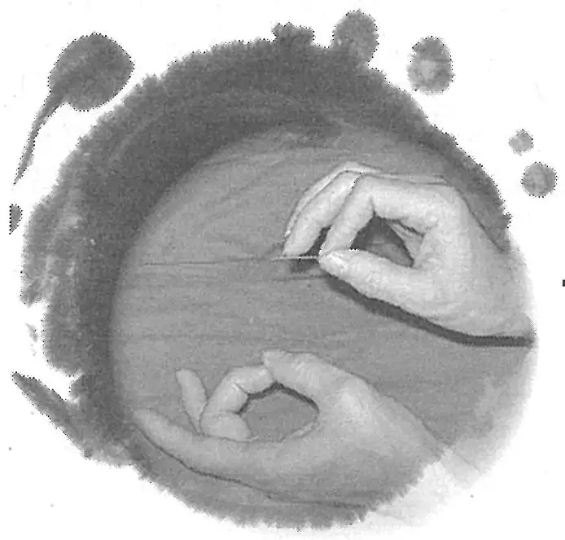

## 附一：古代针灸文献研究的基本问题 

依据文献确定腧穴主治，首先必须甄别文献的种类、性质，以确定其价值。而要判定文献的价值，又必须搞清其源流，然后才谈得上“去伪存真”的校勘、“忠实原文”的理解、“去粗取精”的鉴别。

### （一）文献的源流、种类、性质与价值 

#### 1. 原始文献与间接文献 

循证医学重证据。证据学上根据证据的来源分为原始证据和传来证据两种。针灸文献根据其来源也可分为原始文献与间接文献两大类。证据学上对事实的认定重原始证据，文献研究则重原始文献。因为间接文献，即经过传抄、转述、加工等手段而形成的第二手资料，事实经过中间环节之后会有被扭曲、失真、冗余、丢失等现象。关于文献研究注重原始文献的重要性从以下两个典型实例可以得到充分的体现：

例之一：

暴喑气哽，取扶突与舌本出血。

（《灵枢》）

扶突主暴喑气哽与舌本出血。

（《黄帝明堂经》）

暴喑气哽，取扶突与舌本出血。喑不能言，刺脑户。

（《针灸甲乙经》）

舌本出血，喑不能言，刺脑户。

（《外台秘要》）

在《灵枢·寒热病》中，“暴喑气哽，取扶突与舌本出血”原意本是取“扶突”、“舌本”（风府穴别名）二穴治疗“暴喑气哽”。《黄帝明堂经》编者对该条原文未作相应的处理，直接归于“扶突”穴主治下，致后人多把该条理解为扶突穴治疗“暴喑气哽”与“舌本出血”两个病症。及至唐代王焘从《针灸甲乙经》辑录《黄帝明堂经》腧穴主治时，又误断句，将该条前半条主治文字与后一条文字相混，皆归于“脑户”穴主治下。类似这样的错误，如果不明文献的原始出处及其流传演变，根本无从发现。

〔p.79 (인쇄 59)〕

例之二：

人年三十以上，若灸头不灸三里穴，令人气上眼暗，所以三里下气也。

（《千金翼方·针灸》卷二十八）

人年三十以上，若不灸三里，令人气上眼暗，所以三里下气也。

（《外台秘要·明堂》卷三十九）

三里：凡人年三十以上，不灸此穴则热气上冲，眼目无明。

（《杨氏家传针经图》）

《外台秘要》云：凡人过三十以上，能灸此穴，则热气下，眼目增明。

（《针方六集》）

一云小儿忌灸三里，三十外方可灸，不尔反生疾……。《外台秘要·明堂》云：人年三十以外，若不灸三里，令气上冲目，使眼无光，盖以三里能下气也。

（《类经图翼》）

《外台秘要》云：人年三十以后，宜灸三里，令气上冲，可无失明之患。故云“人过三旬后，针灸眼重光”。

（《循经考穴编》）

小儿忌灸，恐眼目不明，惟三十以外方可灸之，令眼目光明也。

（《医宗金鉴·刺灸心法要诀》）

唐以后这句话的引用频率非常高，但无一书是直接引自《千金翼方》，而皆直接或间接转引自《外台秘要》卷三十九。由于传世本《外台秘要》所录《千金翼方》此条原文时，于“不灸三里穴”前脱漏了“灸头”两个关键字，大失原文本义。宋以后则越传越离谱。另有一点值得注意的是，诸书直接或间接引录的《外台秘要》文字多少都有些发挥，而很少直接抄录原文。这也提示，古人引书方式灵活性较大，并不严谨。所以我们在引用史料时，一定要溯流探源，在现存文献中查明其最早的出处，一般情况下应引用最早载录该条的原始文献。

#### 2. 文字与图形、模型 

从事医史研究的专业人员在史料的发掘与利用方面，多注重文字史料而忽略实物与图像史料，这在一定程度上影响了医

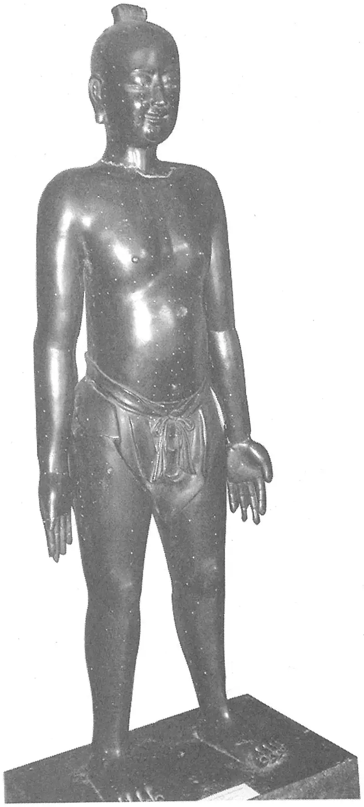

**图 1-9　明正统仿宋铜人**

〔p.80 (인쇄 60)〕

史研究总体水平的提高。

“一幅图有时胜过千言”。20年来参与发掘历史碎片，拼复针灸学术发展史图卷的亲身经历，使我产生了一种不断增强的感觉——考察史料时如果重要的（或必要的）图像实物不在场，会不由自主地产生一种不自信。以下通过几个典型案例来说明：医史研究过程中如果忽略了图像实物的信息，会陷入多么大的困境。

**案例一：“天圣铜人”与“天圣针经”**

我们知道北宋天圣四年（1026年）《铜人腧穴针灸图经》（又称“天圣针经”）堪称中国第一个国家针灸经穴标准，这一国家标准除了用文字表述之外，还创用铜质立体人像经穴模型——“天圣铜人”（见图1-9~图1-11）。对于《铜人腧穴针灸图经》的文本，我们从未怀疑过对它的理解是否正确，甚至也未曾想过不同朝代乃至同一时代不同人的理解是否相同。直到明正统仿宋铜人的发现之后，才突然意识到我们今天对于《铜人腧穴针灸图经》文本的理解与原作者的本意有多大的差异，及不同时代或同一时代的不同的人对于《铜人腧穴针灸图经》文本的理解差异有多么的大，特别是对于头部、肩部、腹部、大腿后部等处腧穴定位文字的理解差异更大。以颔厌、悬颅、悬厘三穴的定位文本为例：

颔厌二穴，在曲周下颞颥上廉。

悬颅二穴，在曲周上颞颥中。

悬厘二穴，在曲周上颞颥下廉。

（《铜人腧穴针灸图经》）

颔厌二穴在曲周下脑空上廉。

悬颅二穴在曲周上脑空中。

悬厘二穴在曲周上脑空下廉。

（《针灸资生经》）

1992年笔者在校勘宋代王执中《针灸资生经》时，发现该书在抄录《铜人腧穴针灸图经》腧穴时，将“颔厌”、“悬颅”、“悬厘”三穴定位文字中“颞颥上廉”、“颞颥中”、“颞颥下廉”之“颞颥”均改作了“脑空”，这

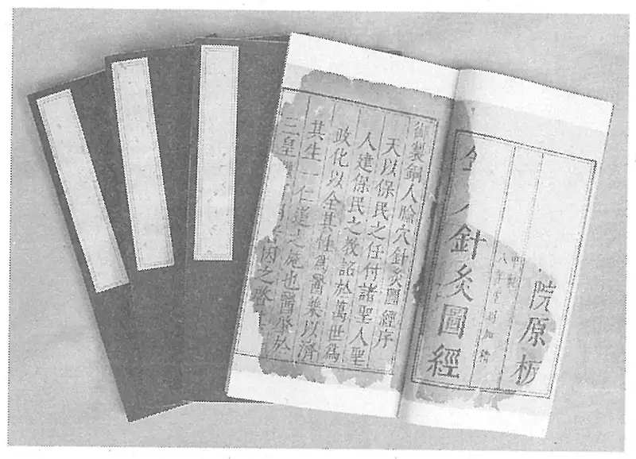

**图 1-10　明版《铜人腧穴针灸图经》**

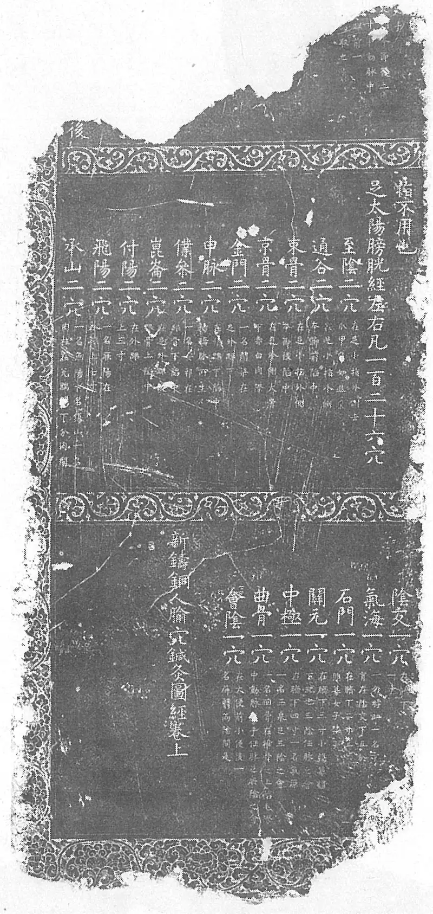

**图 1-11　《铜人腧穴针灸图经》宋代石刻**

〔p.81 (인쇄 61)〕

显然不是无心的失误，而是有意的改动（相应的穴图也是如此）。因为王执中于其他穴都是严格抄录《铜人腧穴针灸图经》原文的，即便对《铜人腧穴针灸图经》的腧穴定位有不同看法，也是以注文或按语的形式表述，而不是直接改文。为什么详于考证的王执中在对这几个腧穴定位的文字处理上显得如此“轻率”呢？随着正统铜人的发现，我们终于解开了这一疑团：原来正统铜人中此三穴的定位正是以“脑空”穴为参照的（见图1-12），想必王执中当年编《针灸资生经》时，不仅依据了宋本《铜人腧穴针灸图经》，一定还考察了天圣铜人原物，不然不可能如此改文。

不同时代对于相同腧穴定位文本理解差异的极端例子当数下肢部足太阳经穴“委阳”。

《黄帝明堂经》曰：委阳，在足太阳之前，少阳之后，出于腘中外廉两筋间，扶承下六寸，此足太阳之别络也。

《黄帝明堂经》以下诸书对委阳穴部位记载多相同，然而对于该穴的实际定位，在古代针灸明堂图、铜人图、针灸铜人中，几乎找不到两种完全相同的图或针灸铜人模型（见图1-13~图1-15）。

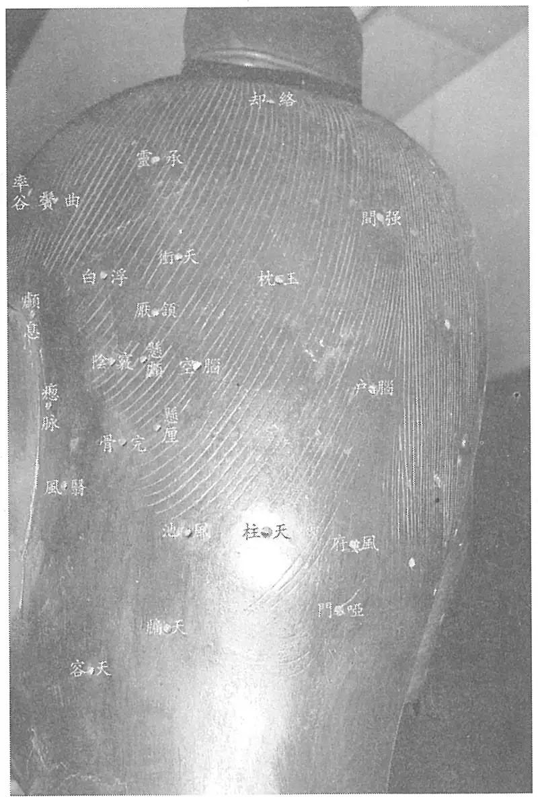

**图 1-12　明正统仿宋铜人（头部）**

如果不是这些针灸图、针灸铜人，真不知道传世针灸腧穴文献我们正确理解了多少？古人曰“欲指取穴，无图莫可”，虽针对取穴而言，同样适用于腧穴定位文献的理解。正是由于这个原因，从古至今的针灸经穴标准均要求有图有模型！

由此我们得到一个重要启示：由于文字表述的局限性和人体形态的不规则性，关于腧穴定位的文字描述很难确保在人体实际点穴的唯一性要求。也就是说对于同一腧穴定位的文字表述，不同的人会有不同的理解。因此，针灸铜人、明堂图等图像实物对于理解古代腧穴文献具有不可替代的重要作用！

**案例二：“穴图”与“穴方”**

敦煌出土的唐代卷子中有一种不知名灸方（编号为S.6168、S.6262，今人题作“灸法图”，见图1-16），所载方中两次出现“天窗”一穴，文字均注明该穴为“一穴”（不是成对的腧穴）。然而，数十年来不知有多少中外敦煌研究学者、医史研究者多少次考察这篇文献，都对这一极为明显的事实视而不见，无一例外地将方中“天窗”强解为人们熟知的颈部“天窗”穴。可是，只要看到敦煌卷子灸方取穴图便可发现此穴位于前头部正中线上。再通过对敦煌卷子灸方取穴图同期其他文献的考察，不难发现大量这样的例子，例如《千金要方》、《千金翼方》二书针灸方中所有的“天窗”穴，几乎全是指的头部“天窗”穴（即囟会穴的别名）。这些证据

〔p.82 (인쇄 62)〕

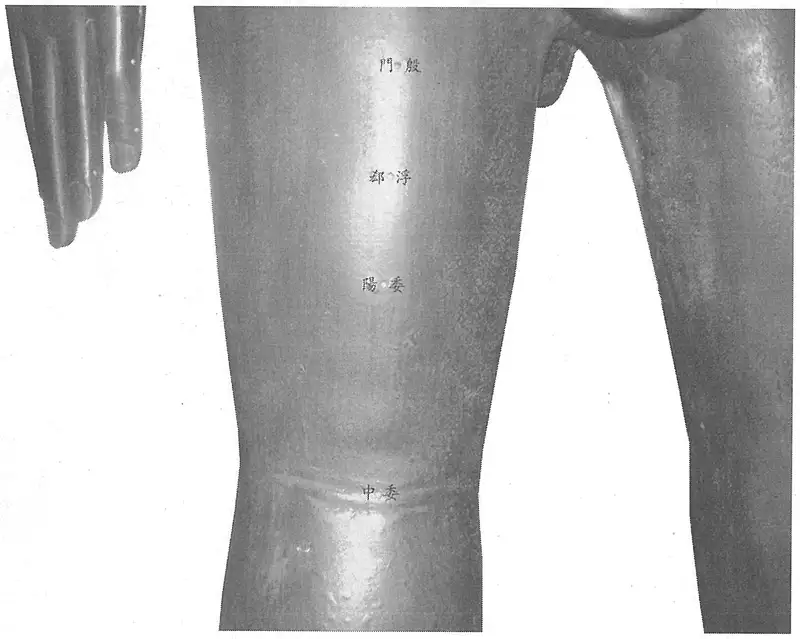

**图 1-13　明正统铜人（委阳穴）**

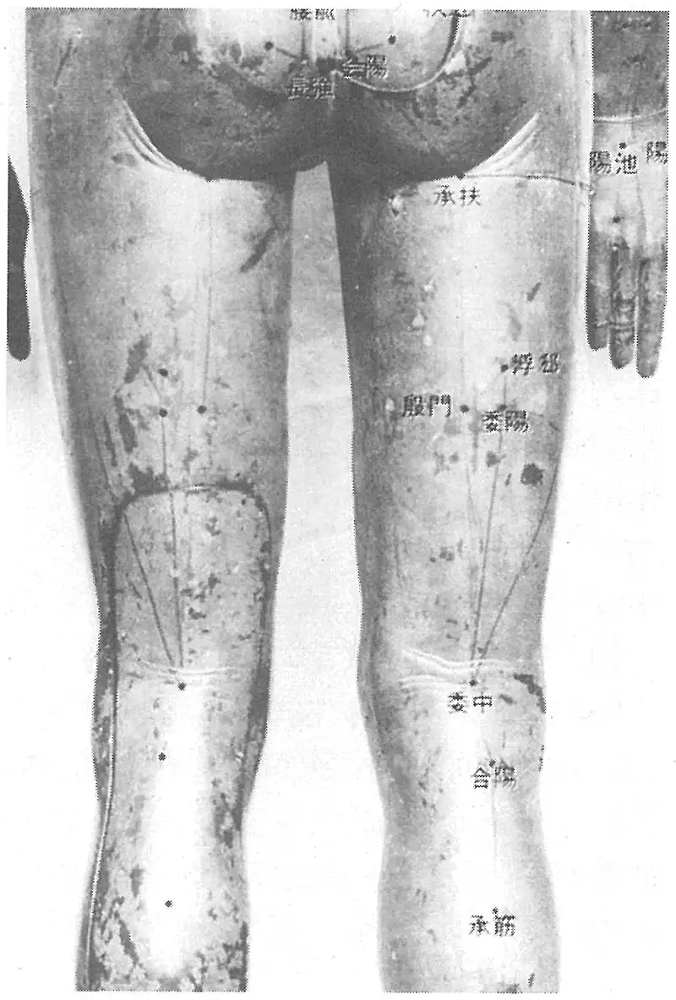

**图 1-14　日本上野博物馆藏铜人（委阳穴）**

〔p.83 (인쇄 63)〕

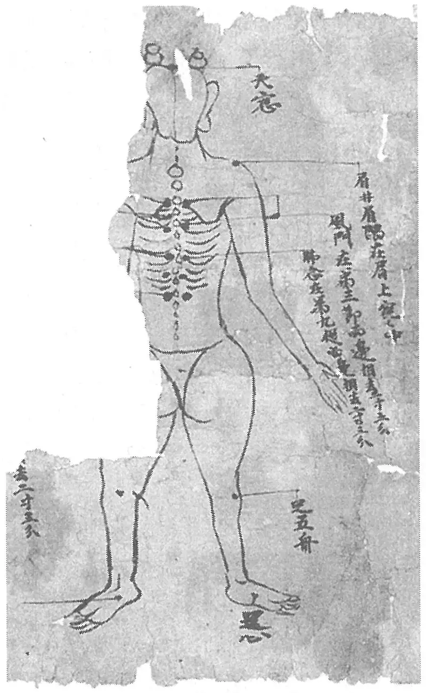

**图 1-15　韩国德寿宫铜人（委阳穴）**

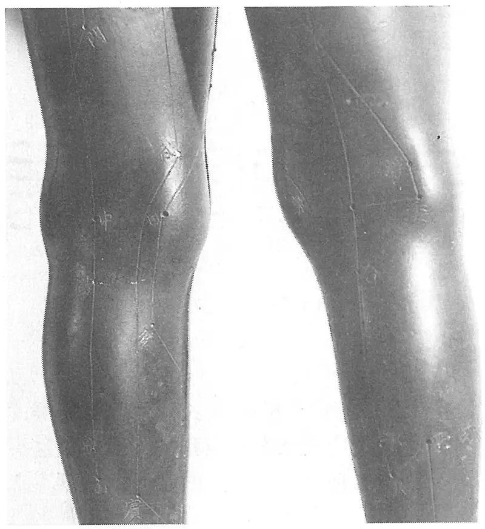

**图 1-16　敦煌出土文献佚名灸方图**

充分表明，隋唐时期人们习惯将头部“囟会”穴称作“天窗”[^12-1]，才会有敦煌卷子灸方中“天窗”一穴说法的存在。这一段被曲解的古代文献恢复了其本来面貌，借助的主要依据就是文字与图形。

汉以前的早期针灸文献有一个非常显著的特点，即腕踝部十二特定穴的穴名与相应的经脉名完全相同。由于人们不了解这一特点，将原本属于穴名的“足阳明”、“手阳明”等一直误解为经脉名。而上述这份珍贵的敦煌出土文献中的“灸法图”为我们提供了解决这一千古之谜的重要证据。

**案例三：**

对于整篇古代针灸文献误解之深、误解时间之长、误解人数之多者，莫过于对《素问》脉解篇。该篇记载了三阴三阳六脉病候的解说，千百年来，所有读过此篇的古今医家，都认定此篇解说的是足六经的经脉病候，而且除初唐杨上善一人之外，所有的古今医家都以经脉循行解说相应的病候。这期间，王冰实际上已经隐约意识到此篇所述与《灵枢》经脉篇的经脉病候不同，其于《素问》脉解篇末注曰：

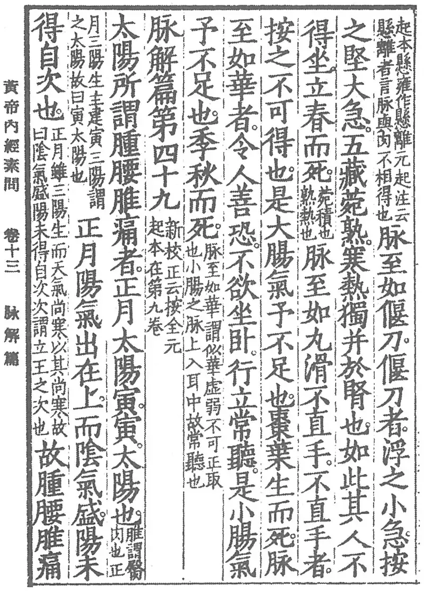

**图 1-17　影宋版《素问》**

[^12-1]: 请参见下篇“囟会”、“天窗”穴下的名实考。

〔p.84 (인쇄 64)〕

此一篇殊与前后经文不相连接，别释经脉发病之源，与《灵枢经》流注略同，所指殊异。

王冰的这一观点受到宋代林亿等人的反驳，从此这一闪现的思想火花再也没有引起过人们的注意。其实《脉解》篇通篇都以汉代盛行的“十二消息卦”（见图1-18）解说病候，不认识这一点，根本就无法读懂该篇原文。只要配以相应的卦图，那么该篇经文之义便一目了然。

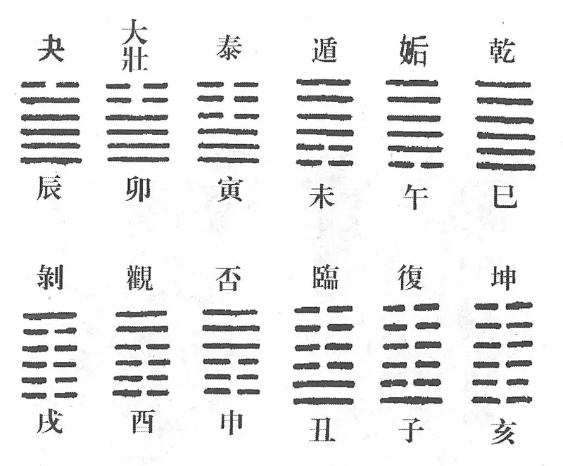

**图 1-18　十二消息卦**

读了以上典型实例，我们不禁会问：我们已经拥有的海量史料中有多少被正确地解读了？已被正确理解的史料中有多少被正确地拼成了固有的历史画面？当我们撞上历史这头大象时，在多数时间内、多数场合下，犹如盲人摸象，无论如何也看不清它的全貌。如果不幸的话，连象鼻、象尾也摸不到。

#### 3. 腧穴文献与针灸治疗文献 

相对于方药的本草文献和方书文献，针灸有腧穴文献与针灸治疗文献（针灸方）。很有意思的一个现象是：学中医的从没有将方书与本草书混淆过，而学针灸的至今也没有将针灸方症与腧穴主治分清楚。不少人将《针灸甲乙经》辑录的《黄帝明堂经》的腧穴主治条文、《千金要方·孔穴主对法》、《针灸资生经》视为针灸方。造成这种混乱的主要原因在于：第一，腧穴文献与针灸治疗文献之间存在着交叉现象；第二，某些上述腧穴文献在传抄过程中，形式上逐渐向典型的针灸方的形式演变，以致人们难辨其真面目。

古代传统腧穴书多以穴名为目，罗列主治病症、刺灸法等，在形式上很像本草书。本草文献所载之中药主治形式有两种，除了人们所熟知的以《神农本草经》为代表的第一种以“药名”、“药性”、“主治”、“禁忌”等项详细记述各味中药的内容外，还有第二种即自六朝陶弘景《本草经集注》始，历代本草书多在总论中具列“治病通用药”，即以病名为纲，将治疗某一病症的药名一一列出，而各论中则以药名为纲，详列药物主治等内容，前后呼应，相辅相成，极大地方便了临床医生临证时遣药处方。古代腧穴文献中也有与第二种本草文献性质相同的文献类型。早期的如唐代孙思邈编《千金要方》时，作《孔穴主对法》一篇载于卷三十，以病症为纲，类编腧穴主治，其意义与本草书中的“治病通用药”相仿。但孙氏在编写体例上有明显的不足之处，而且在取材上基本只采自《黄帝明堂经》一书。之后宋代王执中在《针灸资生经》中仿孙氏《孔穴主对法》之例，将《铜人腧穴针灸图经》、《太平圣惠方》、《千金要方》三书所载腧穴主治症均按病症排列，并以互见的方式较好地解决了保持原文的完整性与引录条文的重复性之间的矛盾，无论是在体例上还是取材上，都较《孔穴主对法》更胜一筹。篇末还多以按语的形式，附录大量的验方、医案，颇切合临床实用。这是《针灸资生经》一书的最大特点，也是该书深受广大针灸临床医生喜爱的重要因素。

〔p.85 (인쇄 65)〕

遗憾的是，无论是孙思邈的《千金要方·孔穴主对法》，还是王执中《针灸资生经》所集腧穴主治，多被后人误作针灸方，从而使这一在腧穴书编纂体例上的新尝试，未能在针灸腧穴专书中得到继承和完善，以至于在中国历史上从未产生过一部与宋、明本草学著作体例相类似的腧穴学专著。更令人遗憾的是，由于以上二书体例复杂，后人每多误解而错引，唐代以后腧穴文献所载之腧穴主治错误中有不少正是由此而生的。

正如考察中药主治不会采用“治病通用药”一类的文献一样，考察腧穴主治也不必采用“孔穴主对法”一类的文献。更不能采用《西方子明堂灸经》这类除了错误信息之外，没有新内容的文献。

##### (1) 腧穴文献与针灸治疗文献的交叉现象 

如前所述，中国第一部腧穴经典《黄帝明堂经》中的腧穴主治即主要从针灸方中归纳而成，尽管转变后的腧穴主治多已脱去针灸方的原形，但也留下了一些由针灸方脱胎而来的痕迹，甚至还保留了一些针灸方的旧貌，例如：

胞中有大疝瘕积聚，与阴相引而痛，苦涌泄上下出，补尺泽、太溪、手阳明、寸口，皆补之。

胸中膨膨然，甚则交两手而瞀，暴瘅内逆，刺经渠及天府。

喉痹，胸中暴逆，先取冲脉，后取三里、云门，皆泻之。

身懈㑊，寒，少气，热甚，恶人，心惕惕然，取光明及绝骨、跗上临泣立已。

不难看出，以上几方乃直接抄录早期文献中的针灸方的原形。

在《太平圣惠方》第九十九卷《针经》及第一百卷《明堂》中还可见到更加典型的针灸方原形，其中第一百卷末所载之《小儿明堂》则几乎悉为灸方。

针灸治疗文献中也常可见到典型的腧穴主治条文。例如：唐代孙思邈《千金要方》在辑录了大量唐以前针灸方的同时，也录有少量典型的腧穴主治条文，卷十第六篇所载四首形似针灸方的文字，即出自《针灸甲乙经》。

《千金翼方》卷二十六至卷二十八针灸证治多见于《千金要方》，然亦载录了较多甄权《针经》中的腧穴主治，如所载“治猥退风偏风半身不遂法”下除最后一条外，皆出于甄权腧穴书。如此针灸方与腧穴主治杂处一篇，后人多不能分辨。

##### (2) 由腧穴主治到针灸方的演变过程 

古代腧穴文献中的腧穴主治有时会以一种近似针灸方的形式出现。《针灸甲乙经》中的腧穴主治，即属此例。

宋代王执中仿孙思邈“孔穴主对法”例，将宋以前腧穴专书（如《铜人腧穴针灸图经》诸书）、专卷[如《千金要方》卷三十（孔穴主对法）、《太平圣惠方》卷九十九（针经）、《太平圣惠方》卷一百（明堂）]中之腧穴主治悉以孙氏“孔穴主对法”的形式重编，并按病症加以分类。至明初《普济方·针灸门》，针灸主治内容主要抄自《针灸资生经》，但在抄录时将王执中原书“穴名在上，病状在下”的形式改成“病状在上，穴名在下”的形式，从而使得在形式上更近于针灸方。而最后将《普济方》辗转抄录的大量腧穴主治内容潜移默化为针灸方者系稍后的《神应经》一书。该书所载针灸主治内容在形式上与典型的针灸方已看不出区别，然而因为其中绝大部分内容系据《普济方·针灸门》改编而来的，故属于严格意义上的针灸方却很少。

明以后的针灸书再抄录《神应经》针灸主治时，已全然不知其脱胎于腧穴主治的本来面目，将之直接作为针灸方对待。

将腧穴文献所载之腧穴主治与针灸治疗文献——针灸方所反映的腧穴临床应用实际加以比较，是研究腧穴主治的一项重要内容。但如果我们不能辨识真正的针灸方，而将腧穴文献当作针灸方与典型的腧穴文献加以比较，这样的研究将失去实际意义，并会得出错误的研究结论。

〔p.86 (인쇄 66)〕

#### 4. 腧穴文献的源流 

若要研究文献的价值，必须首先确定它属于原始文献还是间接文献的性质，而要搞清文献的源与流，又必须穷究传世的所有针灸文献。

根据对现存所有古代腧穴文献的系统考察发现，其源头文献可以分为四大支：第一支为《黄帝明堂经》；第二支为宋以前以甄权《针经》为主的诸家“明堂”；第三支为金元《窦太师针经》；第四支为明代高武的《针灸聚英》。其中，第一支《黄帝明堂经》原书已佚，其佚文主要保存于《黄帝内经明堂》（残存第一卷）、《针灸甲乙经》、《外台秘要·明堂》、《千金要方·针灸下·孔穴主对法》、《医心方·明堂》等文献中；第二支原文献也佚，其佚文主要保存于《千金翼方·针灸》、《外台秘要·明堂》、《太平圣惠方》卷九十九；第三支主要保存于《窦太师针经》（现存有甲本、乙本两种版本，以甲本质量为好）、《针灸玉龙歌》（腧穴注文）、《奇效良方》（仅辑录有奇穴主治）、《大本琼瑶神书》、《针方六集》、《循经考穴编》等文献中；最后一支《针灸聚英》经《针灸大成》的传承，对后世乃至现代针灸学教材均产生了十分深远的影响。

经过系统考察，对于以上四支腧穴文献所载腧穴主治经验成分有以下初步的判断：

第一支《黄帝明堂经》，主要来源于汉以前针灸治疗的针灸方，其中绝大多数出自单穴方。《内经》中所载的有关病症治疗的针灸方主治几乎均被《黄帝明堂经》编者所辑录，而且辑录时基本上保持了原文的完整性。这一点从前文所引之《内经》与《黄帝明堂经》委中穴主治的比较中，可以看得很清楚。这一支文献的主要问题是：由于出自诸家文献，对于多穴方主治的处理、“同名穴的辨识”以及“无穴名腧穴的辨识”存在着程度不同的问题。这一支文献经《外台秘要》，特别是《铜人腧穴针灸图经》的转引，对后世影响较大。

第二支甄权《针经》，其中所载腧穴主治临床实践成分极高，试引《太平圣惠方》卷九十九辑录的甄权《针经》前二穴的主治内容如下：

上星一穴，主疗头风，头肿，皮肿，面虚，鼻塞，头痛。针入二分，留十呼，泻五吸。针下气尽，更停针引之，得气即泻。灸亦得，然不及针，日灸三壮，至百五壮罢，不宜多灸。须停十余日，然后更灸。若灸即恐拔气太上，令人眼暗。故不用相续，加灸满五十壮，即以细三棱针刺头上，令宣通热气。若热不止，热气上冲头痛也。慎酒、面、荞麦。

囟会一穴，主疗鼻塞不闻香臭。宜灸之，日灸二七壮，至七日停。初灸之时即痛，五十壮已去即不痛，至七十即痛，痛即停灸。其鼻塞灸至四日便当渐可，至七日即瘥。针入二分，留三呼，得气即泻。主疗头风痛，白屑起，多睡，针之弥佳。针讫可以末盐生麻油相和，以揩发根下，遍头悉涂。数数用此二物涂发根下，即永无头风。八岁以上得针，八岁以下不得针，缘囟门未合。若针，不幸令人死矣。不宜食荞麦、热食及猪肉。

这里不但对腧穴主治症的描述非常细致，而且对具体针灸方法、疗程、针灸间隔时间以及针与灸的不同适应症等针灸基本问题的论述都极为详细，有很高的临床指导价值，其中的科学内涵已逐渐为医学界所重视。经过考察还发现，甄权《针经》佚文中的腧穴主治与甄权《针方》之间有极高的相关性。这也从另一方面提示：甄权《针经》多出自其临床经验的总结。而且由于该书出自一家经验之总结，不存在“同名异穴”等辨析问题。但由于所总结的腧穴主治多出自多穴方主治，故针对性不如《黄帝明堂经》强。这一支文献所载之腧穴主治经《太平圣惠方》，特别是《铜人腧穴针灸图经》的传承，对后世影响较大。

〔p.87 (인쇄 67)〕

第三支窦太师针灸，经其与同时代的《针灸集要》、《盘石金直刺秘传》、《玉龙歌》等针灸治疗文献对照，发现它们有较高的相关度，提示这一支文献所载之腧穴主治也主要出自临床经验的总结。与前二支文献不同的是，这一支文献载录了较多的经外穴主治（《奇效良方》、《针方六集》所辑之奇穴均出于此书）。但由于此书未曾刻板，现仅有手抄传本《杨氏家传针经图》，另有《大本琼瑶神书》、《循经考穴编》、《奇效良方》（仅辑录奇穴部分）、《针方六集》辑录有该书的少量内容，故对后世影响不广。

第四支《针灸聚英》，其中的腧穴主治经考察，除五输穴内容辑自《针经节要》（出自《铜人腧穴针灸图经》），另有少量内容辑自《针经摘英集》、《洁古云岐针经》和李东垣针方外，主要辑自《针灸资生经》（《针灸资生经》本身就是二次文献），也就是说这一支文献并非源头文献，但其通过《针灸大成》的传承对于现代腧穴主治的影响很大，故一并列出，以考明现代腧穴主治的源流。

《针灸聚英》之所以能对后世乃至现代腧穴主治产生了很大的影响，一个重要的因素在于明以后一直到现代的四百多年间，人们只知《针灸聚英》所载腧穴主治较明以前有很大的发展，却始终不知这些“发展”从何而来。针灸穴典研究工作中通过反复细致地考察，终于揭开了这个谜底：高武当年除了见有一本《铜人腧穴针灸图经》的节本——《针经节要》外，没有腧穴专书可供参考，其腧穴主治主要从宋代王执中《针灸资生经》一书中辑出。试以手阳明经穴“下廉”穴主治为例说明如下：

主眼痛，溺黄。

（《黄帝明堂经》）

治头风，臂肘痛；溺黄。

（《铜人腧穴针灸图经》）

主飧泄；劳瘵；小腹满；小便黄；便血；狂言；偏风，热风，冷痹不遂，风湿痹；小肠气不足，面无颜色，痃癖，腹痛若刀刺不可忍；飧泄，腹胁痛满，狂走，夹脐痛，食不化，喘息不能行；唇干涎出，乳痈。

（《针灸聚英》）

从以上列举文献可以看出，《针灸聚英》所载手阳明经“下廉”穴主治病症远远多于明以前文献的记载，那么如此大的“发展”又是如何产生的呢？经考察发现，其全部辑自《针灸资生经》一书：

肝俞（见咳逆）、小肠俞（见便赤）、蠡沟、照海（见疼）、下廉（见飧泄）、丘墟（见腋肿）、中都（见肠鸣）治小腹痛（《铜》）。

（《针灸资生经·小腹痛》卷三）

下管（见腹胀）、胃俞（见虚损）、脾俞、下廉（见飧泄）治羸瘦。

（《针灸资生经·劳瘵》卷三）

太溪（见伤寒无汗）、兑端（见渴）、阴谷（见腹胀）、下廉治溺黄。

（《针灸资生经·小便五色》卷三）

复留、太冲等（并见痢）、会阳（见泻）主便血（《千》）。下廉、幽门（《明》同）、太白（见吐泻）治泄利脓血（《铜》）。

（《针灸资生经·便血》卷三）

〔p.88 (인쇄 68)〕

下廉治狂言（见惊）。

（《针灸资生经·癫狂》卷四）

下廉疗偏风，热风，冷痹不遂，风湿痹。

（《针灸资生经·身寒痹》卷七）

下廉疗小肠气不足，面无颜色。灸小肠气，痃癖气发时，腹痛若刀刺不可忍者，并妇女本藏气血癖，走疰刺痛，或坐卧不得，或大小便不通，可思饮食。于左右脚下下第二指第一节曲纹中心各灸十壮，每壮如赤豆大。

（《针灸资生经·肾虚》卷三）

上廉治飧泄，腹胁痛满，狂走，夹脐腹痛，食不化，喘息不能行。

（《针灸资生经·胸胁痛》卷五）

下廉治唇干涎出。（《铜》见飧泄）。

（《针灸资生经·口舌干苦》卷六）

下廉主乳痈。

（《针灸资生经·乳痈》卷七）

而《针灸资生经》腧穴症治又是辑自《千金要方》、《铜人腧穴针灸图经》、《太平圣惠方》。经逐条考察，《针灸聚英》手“下廉”主治症中“飧泄”、“小腹满”、“狂言”、“唇干涎出”诸症原见于《铜人腧穴针灸图经》足“下廉”主治症；“偏风，热风，冷痹不遂，风湿痹”原见于《太平圣惠方》足“下廉”主治症；“乳痈”原出于《千金要方·针灸下·孔穴主对法》足“下廉”穴主治；“飧泄……喘息不能行”原出于《铜人腧穴针灸图经》足“上廉”主治症；“小肠气，面无颜色”原出于《太平圣惠方》卷九十九足“下廉”穴主治；“痃癖，腹痛若刀刺不可忍”为奇穴所主，更与“下廉”不相干。

也就是说，《针灸聚英》所载手阳明经穴“下廉”主治症中除“小便黄”一症出自《铜人腧穴针灸图经》手“下廉”穴主治外，其他各条均系足“下廉”、足“上廉”以及与“下廉”、“上廉”无关的奇穴的主治症。这些与手“下廉”穴不相干的主治症多被明以后乃至现代针灸学教材所承袭。

高武的错误还在于对《内经》原文的误解、对《千金要方·针灸下·孔穴主对法》体例的误解，及对于“母子补泻”的特殊理解而将《灵枢·经脉》所载之经脉病候抄于有关十二经五输穴主治中。所有这些错误使得《针灸聚英》一书所载之经穴主治远远多于明代以前的文献。

或许有人会问，高武怎么会犯如此多的不可思议的错误呢？其实并非不可思议。因为，第一，《针灸资生经》的体例极为复杂（详见下文）；第二，古书没有标点，且《针灸资生经》各条文字接排不另起行，断句非常困难；第三，高武当时手边没有腧穴专书，使其对“同名异穴”的辨识非常困难。

而我们更多思考的是，为什么《针灸聚英》经穴主治中如此多的严重错误，在近四百年的时间内都没有被发现？如何从根本上才能避免这类错误的发生呢？我们的答案是，一定要注重对文献源流的考察，理清文献传承的脉络，尽可能地采用源头文献。而要做到这一点，没有任何捷径可走，只能老老实实、扎扎实实地对现存所有针灸文献（包括综合性医书中的针灸部）进行从源到流的梳理，只有这样才谈得上去伪存真、正本清源。

除了上述4支主干文献外，宋代《铜人腧穴针灸图经》新增有13条主治，《医学入门·治病要穴》（其“经穴起止”篇所载之经穴主治多传《西方子明堂灸经》之误，不可用）、《类经图翼》也辑录少量其他来源的腧穴主治，皆可视为源头文献采用。

〔p.89 (인쇄 69)〕

### （二）症状组的鉴别与理解 

如前所述，现存最早的针灸腧穴经典《黄帝明堂经》所载之腧穴主治辑录自汉以前针灸方主治，并基本完整保留了原文的旧貌。这就使得该书所载之腧穴主治中保留有大量的有内在联系的症状组。例如：

巨阙，主心痛不可按，烦心，心痛，气满不得息。

（《黄帝明堂经》）

心俞，主心痛循循然，与背相引而痛，胸中悒悒不得息，心胀。

（《黄帝明堂经》）

以上二穴主治（非相关主治尚未全引），如果孤立地看，似乎是主治“心痛”、“烦心”、“气喘”等不同的症状，但联系其他相关论述，就不难发现这些症状间的内在联系。如：《黄帝明堂经》膻中穴主治为“主胸痹心痛，烦满，咳逆上气，唾，喘，短气不得息，口不能言”；《金匮要略·胸痹心痛短气病脉证治第九》曰：“胸痹之病，喘息欬唾，胸背痛，短气”，又曰：“胸痹不得卧，心痛彻背者，栝蒌薤白半夏汤主之”；《灵枢·胀论》曰：“夫心胀者，烦心短气，卧不安。”由此可知，心俞、巨阙、膻中三穴所主病症均为胸痹的典型症状。

再来看个更为复杂也更有说服力的例子：

膝关，主膝内廉痛引髌，不可屈伸，连腹引咽喉痛。

（《黄帝明堂经》）

曲泉，主丈夫癞疝，阴跳痛引篡中不得溺，暴痛引髌下节，时有热气，筋挛，膝痛不可屈伸，少腹痛引嗌，足厥痛。

（《黄帝明堂经》）

如果孤立地看，上述“膝关”穴主治多半会被理解为治疗“膝内廉痛”、“少腹痛”、“咽喉痛”三个独立的病症。可是如果知道足厥阴“是动”病是对阴疝的一组典型症状的描述，并且《黄帝明堂经》载下肢部足厥阴经穴除“膝关”穴外，都明确主治“阴疝”这一事实，便很容易作出这样的判断：上述膝关穴主治实为一组阴疝症状。再结合“曲泉”穴主治，即可使这一判断确凿无疑，同时基于这一判断可对《黄帝明堂经》膝关穴主治原文作出如下理解：阴疝少腹痛，上引咽喉痛，下引股膝内侧痛不可屈伸，膝关主之。

这样的表述使得膝关穴的主治意义一目了然：“膝内廉痛”、“少腹痛”、“咽喉痛”不是三个独立的病症，而是同一个病——阴疝的一组症候群。认识到这一点对于临床诊疗非常重要，因为这三个症状属于同一病证的一组症候群，那么它就好像是由一个开关控制的；而如果三个症状属于三个独立的病症，则分别由三个开关控制，临床的治疗思路会大不一样。

鉴别经穴主治中症候群的重要意义在于，如果我们不能辨识一组有内在联系的症候群，而从中任意截取一个症状，是无意义的，因为它不能反映这个穴的主治特征。

对于经穴主治中症候群的鉴别，最珍贵的资料当属《黄帝明堂经》，可惜现存的《黄帝明堂经》佚文的条文次序已经错乱，这就为症状组的鉴别增加了更大的难度。

### （三）腧穴“名实异同”的辨析 

由于针灸腧穴并不是在同一天由同一个人发现的，所以在腧穴的名称上就必然表现出以下两个特点：第一，同一穴有不同的名称，即所谓“同穴异名”现象；第二，不同的腧穴有相同的名称，即所谓“同名异穴”现象。不了解腧穴这两种现象，特别是第二种现象，就无法正确理解古代针灸文献。事实上，古今针灸文献中不少错误，正是由于不了解“同名异穴”现象造成的。针灸古籍中，正名相同的腧穴有九对：

〔p.90 (인쇄 70)〕

三里（手、足部各一）

五里（手、足部各一）

上廉（手、足部各一）

下廉（手、足部各一）

窍阴（头、足部各一）

临泣（头、足部各一）

通谷（足、腹部各一）

阳关（膝、腰部各一）

通里（经穴、经外穴各一）

这九对同名腧穴如出现在腧穴专书中，因其下均记有明确的腧穴部位，一般不会对理解或辨识造成障碍。但如果是腧穴部位与主治症相分离的针灸书，如《针灸甲乙经》、《千金要方·针灸下·孔穴主对法》、《针灸资生经》以及各类医书中所载的大量针灸方等，要准确地辨明这些文献中的九对同名穴，就绝非易事了。这是自汉代以后，特别是隋唐以后历代医家都面临的却一直没能解决的难题，也是腧穴主治标准化研究必须首先要解决的问题。

除了以上常见的同名穴外，古代文献中还有不少鲜为人知的同名穴。如“囟会”穴又名“天窗”，与手太阳经的“天窗”穴同名。经考察，敦煌卷子佚名氏的灸方中的“天窗”穴及《千金要方》、《千金翼方》所载针灸方中之“天窗”穴除少数难以考辨外，均指“囟会”穴。后人对此不解，多有将囟会与天窗二穴相混之处。又如，《内经》中的“廉泉”为舌下两脉，与任脉的“廉泉”同名，经外穴中的“外陵”与足阳明经穴的“外陵”同名，经外穴中的“关门”与足阳明经的“关门”同名等，皆详见本书各论相关腧穴下的按语。

在同名穴辨识方面出现错误最为严重，且对现代针灸学影响最大的是明代高武的《针灸聚英》一书。此外，南宋《西方子明堂灸经》一书在引录《千金要方·针灸下·孔穴主对法》时，也出现了大量同名穴相混的错误，但此书对后世及现代针灸书的影响不大。有关同名穴辨识方面的错误，详见总论附二“古代针灸文献中腧穴主治错误类析”。

### （四）脉与穴的辨识 

在特定的时期——汉代以前，特定的腧穴——脉口处穴，有着完全不为今人熟知的特定的名称——经穴古称，如果不能破译这些临床上最为常用的腧穴古称，那么早期的腧穴治疗文献就无法利用，中国第一部腧穴经典《黄帝明堂经》的腧穴主治源流也将无法考察，它的科学价值、文献价值也无法评价。因而可以说，辨识这类腧穴的古称是针灸学史上最关键的问题，是研究腧穴主治必须突破的第一关，甚至可以说，得到这一历史难题的谜底也就掌握了打开针灸学历史宝库的钥匙。以下先从一个典型的实例入手：

衄而不衃，血流，取足太阳；衃，取手太阳；不已，刺腕骨下；不已，刺腘中出血。

（《灵枢·杂病》）

厥，夹脊而痛者，至顶，头沉沉然，目𥇦𥇦然，腰脊强，取足太阳腘中血络。

（《灵枢·杂病》）

〔p.91 (인쇄 71)〕

腰痛，痛上寒，取足太阳、阳明；痛上热，取足厥阴；不可以俯仰，取足少阳；中热而喘，取足少阴、腘中血络。

（《灵枢·杂病》）

腰痛夹脊而痛，至头几几然，目𥇦𥇦欲僵仆，刺足太阳郄中出血。

（《素问·刺腰痛》）

足太阳脉令人腰痛，引项脊尻背如重状，刺其郄中太阳正经出血，春无见血。

（《素问·刺腰痛》）

解脉令人腰痛如引带，常如折腰状，善恐，刺解脉，在郄中结络如黍米，刺之血射以黑，见赤血而已。

（《素问·刺腰痛》）

足太阳之疟，令人腰痛头重，寒从背起，先寒后热熇熇暍暍然，热止汗出，难已，刺郄中出血。

（《素问·刺疟》）

十二疟者，其发各不同时，察其病形，以知其何脉之病也。先其发时如食顷而刺之，一刺则衰，二刺则知，三刺则已。不已，刺舌下两脉出血；不已，刺郄中盛经出血。

（《素问·刺疟》）

风痉身反折，先取足太阳（及）腘中（及）血络出血；中有寒，取三里。

（《灵枢·热病》）

以上9条文献中之“郄中”、“腘中”，实则同一穴，即委中穴。该穴早在《灵枢·本输》已经明确归入足太阳经穴。然而，第一条治疗衄血的针灸取穴“足太阳”却不包括经文明言属于“太阳正经”的委中穴。足见这里的“足太阳”与我们以往理解的“足太阳经脉”或“足太阳经穴”的概念不同。可是，在我们的头脑里，“足太阳”只有这两个义项。其实，这里的“足太阳”是古穴名（相当于“昆仑穴”），在《内经》还可见有更多的类似实例：

疟，脉小实急，灸胫少阴，刺指井。

（《素问·刺疟》）

**按**：此方中“胫少阴”与少阴经井穴对举，显然不能将其理解为经脉名。否则，原文当作“刺灸胫少阴”。“胫少阴”实乃“足少阴”的古称。《脉书》等又作“骭少阴”，义同。

痈不知所，按之不应手，乍来乍已，刺手太阴旁三痏与缨脉各二。腋痈大热，刺足少阳五；刺而热不止，刺手心主三，刺手太阴经络者、大骨之会各三。

霍乱，刺输旁五、足阳明及上旁三。

（《素问·通评虚实论》）

不论如何理解，此例中的“手太阴”、“足阳明”都只能是一个确定的局限部位，而无法理解成经脉名或经穴的统称。既然与十五络脉同名的穴称之为“络穴”，那么，与十二经同名的穴本可称作“经穴”，但“经穴”已用作指已归经的腧穴（相对于“经外穴”而言）的统称，故本书将那些与经脉名同名的穴称作“经脉穴”。

除十二经脉外，奇经八脉也有各自的代表穴，今仍可考知者：督脉（有二，一正当神庭穴处，一相当于印堂穴处）、阴𫏋（即照海穴）、阳𫏋（即申脉穴）、带脉（即足少阳“带脉”穴）、阳维（有二，一在外踝上三寸，一在耳后）。“冲脉”，作为穴名已见于《黄帝明堂经》，而部位未详，但从冲脉又名“气冲脉”来看，则知其代表穴即“气冲”穴。

〔p.92 (인쇄 72)〕

手少阴各一，阴阳𫏋各一。

（《素问·气府论》）

癃，取之阴𫏋，及三毛上及血络出血。目中赤痛，从内眦始，取之阴𫏋。

（《灵枢·热病》）

**按**：《素问·气府论》通篇都讲一个一个具体的腧穴，因而该篇中的“手少阴”、“阴阳𫏋”毫无疑问是穴名而不是相应的经脉名；而《灵枢》方中“阴𫏋”均为穴名，即照海穴[^13-1]，“阴𫏋”穴也见于《黄帝明堂经》针灸方中，直到宋代还作为“照海”穴的正式名称出现于《太平圣惠方》中。

三阴三阳之名除了用于经穴的古称之外，还用作相应的诊脉部位——脉口的名称。例如：

刺臂太阴脉，出血多立死。刺足少阴脉，重虚出血，为舌难以言。

（《素问·刺禁论》）

《素问·刺禁论》所记乃一个个具体的部位（包括刺脉部位或诊脉部位——脉口），故其中“手太阴”、“足少阴”无疑是指脉口名——太渊脉与太溪脉，而不是相应的经脉名。也只有刺脉口才会出现“出血多”的情况。同样的用法还见于《史记·扁鹊仓公列传》。所以，在阅读早期医学文献，对于“手太阴”、“手少阴”、“足少阴”这类三阴三阳之名，凡见于针灸方者，多为“经脉穴”穴名；凡见于针灸方而其缀以“脉”字者，多为十二（或十一）经脉脉口名，切不可想当然地将其一概理解为经脉名。

在传世文献中最早系统记载十二个“经脉穴”者为《脉经》，现据《千金要方》所录《脉经》原文[^14-2]抄录于下，并参照其他文献记载在括号内作简要说明。

心主（后世医书多作“手厥阴”）：在掌后横纹中（原注：即大陵穴也）。

手太阳：在手小指外侧本节（后）陷者中（原注：即后溪穴也）。

足厥阴：在足大指间（《千金要方》卷二十四谓“在足大指本节间”）。

足少阳：在足上第二指本节后一寸（原注：第二指当云“小指次指”，即临泣穴也。按：《诸病源候论》卷四十一谓“在足小指间本节后附骨上一寸陷中”）。

足少阴：在足内踝下动脉（原注：即太溪穴也。按：《诸病源候论》卷四十一作“足内踝后微近下前动脉”）。

足太阳：在足小指外侧本节后陷中（敦煌卷子灸法图等文献均作“在外踝后宛宛中”）。

手太阴：在鱼际间[^15-3]（原注：即太渊穴也。《千金翼方》卷二十七等文献作“寸口是也”）。

手阳明：在手腕中（原注：即阳溪穴也。按：《诸病源候论》卷四十一作“手大指本节后宛宛中”）。

足太阴：在足大指本节后一寸（《医心方》卷二十五引《玉匮针经》云：“足太阴穴在内踝后白肉际陷骨宛中”；《诸病源候论》卷四十一作“足内踝上三寸”）。

足阳明：在足上动脉（原注：即冲阳穴也。按：《诸病源候论》卷四十一作“太冲上二寸”）。

（手）少阴：在腕当小指后动脉（《太平圣惠方》卷一百作“在掌后去腕半寸陷者中）。

[^13-1]: 见下篇“照海”下的名实考。

[^14-2]: 传世本《脉经》在宋代被宋臣作了较大的改编，而《千金要方》改动较少，且现存有未经宋人改编的宋刊本，文字的可靠性较高。

[^15-3]: 此“鱼际”指掌骨后际，非指今之鱼际穴。

〔p.93 (인쇄 73)〕

（手）少阳：在手上第二指间去本节后一寸动脉是也（引自日本藏宋本《新雕孙真人千金方》卷十四。此处“第二指间”指无名指间，与“足少阳”中“第二指”义同）。

上述十二个“经脉穴”的部位，除“足太阴”穴在六朝以后变化较大外，其余各穴部位，诸书记载都很相近，其部位都不超过腕踝部，多与相应的脉口部位相当。

关于十二“经脉穴”的其他文献记载见附表1~附表6。

**附表 1　经脉穴“足阳明”与“手阳明”**

| 书名 | 足阳明 | 手阳明 |
|---|---|---|
| 《黄帝虾蟆经》 | 趺上五寸 |  |
| 《脉经》 | 足上动脉 | 手腕中 |
| 《诸病源候论》 | 太冲上二寸 | 大指本节后宛宛中 |
| 《龙门石刻药方》 | 足趺上三寸动脉 |  |
| 《千金要方》 | 足背部，去大指歧二寸 |  |
| 《千金翼方》 | 足拇指奇后三寸 | 腕后陷中动脉大指奇后 |
| 敦煌卷子 | 足趺上三寸动脉 |  |
| 《太平圣惠方》 | 足大拇指歧后二寸 | 虎口曲纹头 |
| 原穴 | 足趺上五寸动脉 | 手大指歧骨间 |
| 脉口 | 跗阳脉 | 手大指歧骨间至腕中动脉 |

**按**：“足阳明”、“手阳明”穴的部位与相应同名经脉的脉口、原穴部位非常一致。这表明早期的诊脉、刺脉部位演变为腧穴后，原脉名还成为穴名，以后作为同名经脉的原穴。

**附表 2　经脉穴“足太阴”与“手太阴”**

| 书名 | 足太阴 | 手太阴 |
|---|---|---|
| 《脉经》 |  | 鱼际间（太渊） |
| 《玉匮针经》 | 内踝后白肉际陷骨宛中 |  |
| 《诸病源候论》 | 足大指本节后一寸 | 大指本节后 |
| 《千金要方》 | 内踝上一夫；内踝上三寸 |  |
| 《千金翼方》 | 内踝后白肉际陷骨中、内踝上三寸 | 寸口中 |
| 原穴 | 足内侧核骨下 | 掌后陷中 |
| 脉口 |  | 寸口 |

**按**：“足太阴”穴部位变化的原因，详见各论“四、足太阴脾经穴”概说及三阴交穴下名实考。

**附表 3　经脉穴“足少阳”与“手少阳”**

| 书名 | 足少阳 | 手少阳 |
|---|---|---|
| 《脉经》 | 足上第二指本节后一寸（临泣） |  |
| 《诸病源候论》 | 足小指间本节后附骨上一寸 | 手小指间本节后二寸 |
| 《千金要方》 | 足第二指本节后一寸 | 第二指间本节后一寸动脉 |
| 《千金翼方》 | 足上第二指本节后一寸 |  |
| 原穴 | 足外踝下如前陷中 | 手表腕上 |

〔p.94 (인쇄 74)〕

**附表 4　经脉穴“足厥阴”与“手心主”**

| 书名 | 足厥阴 | 手心主 |
|---|---|---|
| 《脉经》 | 足大指间 | 掌后横纹中 |
| 《诸病源候论》 | 足大指歧间白肉际 | 掌后横纹 |
| 《千金要方》 | 足大指本节间 | 掌腕上约中 |
| 《千金翼方》 | 足大指本节间 | 掌后横纹中 |
| 《外台秘要》 |  | 手腕第一约理中当中指 |
| 原穴 | 足大指本节后二寸至一寸半 | 掌后两筋间 |
| 脉口 | 足大指间（太冲脉） |  |

**附表 5　经脉穴“足太阳”与“手太阳”**

| 书名 | 足太阳 | 手太阳 |
|---|---|---|
| 《脉经》 | 足小指本节后 | 手小指外本节后 |
| 《千金要方》 | 外踝下 | 手小指外侧本节后 |
| 《千金翼方》 | 外踝下后一寸 | 小指外侧后一寸白肉际宛宛中 |
| 敦煌卷子 | 外踝后宛宛中 | 手小指外后一寸 |
| 《太平圣惠方》 |  | 手小指曲纹头 |
| 原穴 | 足外侧大骨下 | 手外侧腕前 |
| 脉口 | 足外踝后跟骨上细动脉应手 |  |

**附表 6　经脉穴“足少阴”与“手少阴”**

| 书名 | 足少阴 | 手少阴 |
|---|---|---|
| 《灵枢》 | 内踝后 |  |
| 《黄帝虾蟆经》 | 足内踝后 |  |
| 《脉经》 | 足内踝下动脉 | 在腕当小指后动脉 |
| 《诸病源候论》 | 足内踝后微近下前动脉 |  |
| 《千金要方》 | 足内踝下动脉 |  |
| 《金匮玉函经》 |  | 在腕当小指动脉 |
| 《太平圣惠方》 |  | 在掌后去腕半寸陷中 |
| 原穴 | 足内踝后跟骨上动脉 | 掌后兑骨之端 |
| 脉口 | 太溪脉 | 神门脉 |

由上述附表及图1-19、图1-20可知，早期针灸方中那些三阴三阳之名是与十二经脉名完全同名的十二个腧穴名。其中“足阳明”、“手阳明”两个穴名是十二“经脉穴”中使用寿命最长的。尽管自宋以后，在针灸书中三阴三阳已不再作为穴名出现，但是在古代医书及历书中“足阳明”、“手阳明”还一直作为穴名出现，只是人们未必能识得其本义而已。

如果这类针灸方中的“经脉穴”下都一一注明部位，或如敦煌卷子灸方一样，都附有取穴图，那么今人绝不会产生误解。可是，为什么早期文献中都不对此一一注明呢？唯一的答案是，当时的人们对此不会产生歧义，所以不需要注明部位。正如今天的针灸方中如出现与十五络脉同名的络穴无须注明部位一样[^16-1]。

[^16-1]: 甚至对于“阴𫏋”、“阳𫏋”这样的穴名也无须注明，可能因为这两个穴名直到宋代腧穴文献中仍在使用，故人们较为熟悉。宋以后此“阴𫏋”、“阳𫏋”虽不用作腧穴的正名，但仍作为“照海”、“申脉”二穴的别名。

〔p.95 (인쇄 75)〕

这种与经脉名同名的腧穴——“经脉穴”，在《黄帝内经》、《黄帝明堂经》、《黄帝虾蟆经》、《金匮玉函经》、《脉经》、《龙门石刻药方》、《千金要方》、《千金翼方》、《外台秘要》、敦煌卷子，直至宋代的《太平圣惠方》等古医籍中都有明确的记载；早期的脉穴图（见图1-19、1-20）如《产经》脉图（见《医心方》卷二十二）、敦煌卷子灸方取穴图中也明确作为穴名标注。

需要指出的是，虽然十二“经脉穴”由腕踝部相应的脉口演变而来，但有的在部位上仍遗留有原先“脉”的特点，与今之“腧穴”概念不完全相同。例如“手太阴”实际上相当于太渊、经渠（还包括早期鱼际）穴之间的整个手太阴脉动处（脉口）；“手阳明”相当于合谷、阳溪穴之间的脉动处。故上述《脉经》等书所载“经脉穴”定位文字中仍见有一些如“足大指间”、“足上动脉”、“足内踝下动脉”、“手腕中”、“在腕当小指后动脉”等看似笼统的定位法，实则更符合古人原意。以后的医书又在脉口范围内，参照相应的经穴部位，对“经脉穴”作了较为明确的定位。例如“手少阴”在腕当小指后动脉，《太平圣惠方》以阴郄穴部位注之，因《黄帝明堂经》该穴在掌后动脉中，实则神门穴也在动脉中；又如“足阳明”穴为足上动脉，后世文献则有足拇指歧后“二寸”（《太平圣惠方》）、“三寸”（《龙门石刻药方》）、“四寸”

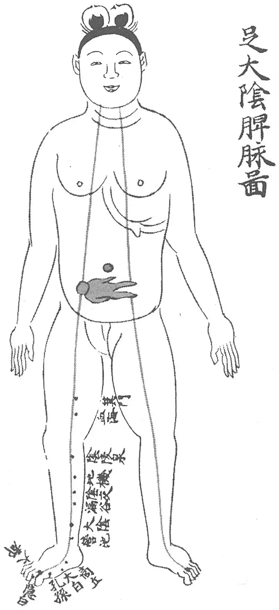

**图 1-19　《产经》“足太阴脾脉”穴**

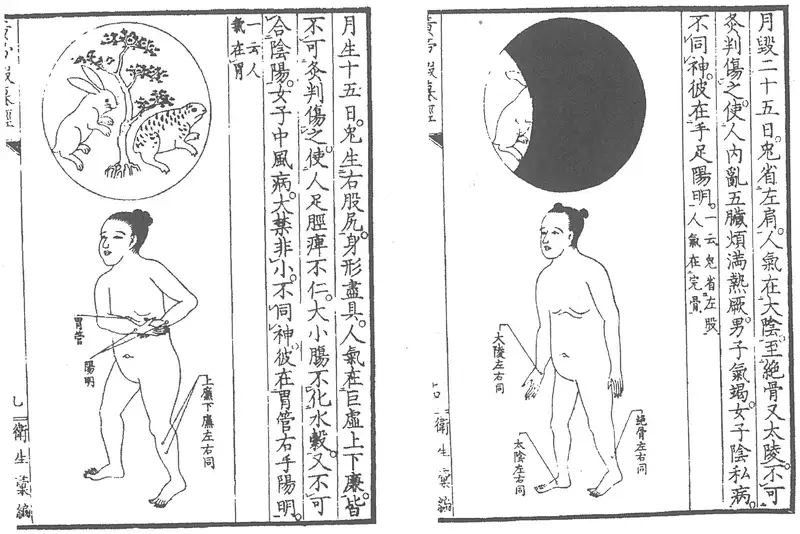

**图 1-20　《黄帝虾蟆经》“手阳明”、“足太阴”穴**

〔p.96 (인쇄 76)〕

（《千金要方》）等三种取法，实则均为足趺上动脉——趺阳脉处。

至此可知，对于《内经》针灸方中“手太阴”、“足阳明”等三阴三阳之名，多半不能理解为经脉名。否则，我们必然会对“刺手太阴旁三痏”治痈疽；“刺足阳明及上旁三”治霍乱（《素问·通评虚实论》）。这样的针灸方感到困惑不解。需注意的是，《内经》非一时一人之作，而且有些篇中五输穴已被归经，故我们还不能完全排除这样的可能性，即有些晚期文献针灸处方中的三阴三阳之名为五输穴的统称。

在“经脉”概念尚未形成的先秦时代，对于针灸方中“手太阴”、“足太阴”字样，人们只能理解成脉口名，而根本不可能理解为经脉名；在腧穴与经脉尚未结合的时代，每一条脉只有一个代表穴——“经脉穴”时，人们对于针灸方中的三阴三阳名也不可能理解为经脉名，正如我们今天不会将络穴名理解为络脉名一样；当络穴、五输穴等穴先后被归经后，人们对于针灸方中的三阴三阳名就可能产生不同的理解[^17-1]；而随着独取寸口脉法的盛行以及“经脉穴”有了新的专用名称之后，人们对于早期针灸方中的“经脉穴”便会想当然地理解成经脉名了。

关于十二“经脉穴”的源流，笔者《中国针灸学术史大纲》有详细考证，可参看。

[^17-1]: 此时有些针灸方中的“经脉穴”下开始注明部位，以避免产生误解。另一方面，直接注明“经”字，或指明具体的五输之序，例如《灵枢·癫狂》治四肢肿针灸方下曰：“取手太阴表里，足少阴、阳明之经，肉清取荥，骨清取井、经也。”

〔p.97 (인쇄 77)〕

## 附二：古代针灸文献中腧穴主治错误类析 

我们知道，信息在传递过程中会有衰减、失真现象，时空跨度越大，这种失真现象也就越严重。历经数千年的传承，针灸文献的失真现象不时发生，而历史上又没有进行及时的校正，使得这一现象随着时间的推移而日益严重。

从中国第一部腧穴经典《黄帝明堂经》开始，腧穴主治中就包含了因种种人为失误因素等所造成的错误，而以后的每一次对于腧穴主治的总结、整理不仅没有认真考察、纠正前代的错误，而且不断地出现新的错误，以至于经过多次总结、整理后，我们现在看到的腧穴主治（特别是一些常用穴的主治）与该穴实际能够主治的病症之间的距离越来越大。我们今天只有将历代腧穴主治中的混杂错乱一一分解开来，还其本来面目，才能总结出近于客观事实的腧穴主治规律。也只有把握了腧穴主治的基本规律，才能执简驭繁，才能有效地解决制约针灸学发展的针灸教育与针灸临床相脱节的问题。

本文重点列举古医书中带有普遍性的腧穴主治症错误，特别是对现代腧穴学影响较大的错误，对于仅出于一书或一人的错误暂不涉及。

### （一）甲穴主治误为乙穴主治 

在针灸腧穴书中常常能见到这样的错误：甲穴的主治症被归入乙穴主治症中。究其原因，主要有两大类，其一是传抄脱误；其二是后人的理解错误。因为早期的针灸方有用腧穴古称的，或只注明刺灸部位而无穴名者，或不同的腧穴而有相同的穴名，后人在将这类针灸方主治症归入相应腧穴主治症时，因各人的理解不同，很容易出现失误。

以下举例说明。

#### 1. 脱落穴名致误例 

古代腧穴书中腧穴文字多接排不分段，且无标点，如果脱漏一个穴名，或者抄错穴名，则甲穴主治就误作乙穴主治。

辄筋（一名神光，一名胆募），期门下五分陷中，第三肋端，横直蔽骨旁二寸五分，上直两乳，侧卧屈上足取之，胆之募。足太阳、少阳之会。《铜人腧穴针灸图经》灸五壮，针五分。《素注》七分。主太息善悲，小腹热，欲走，多唾，言语不正，四肢不收，呕吐宿汁，吞酸。

（《针灸聚英》卷一）

〔p.98 (인쇄 78)〕

上文“辄筋”下的全部文字均为足少阳经穴“日月”的内容[^18-1]，实际上脱落了“辄筋”穴的内容。《针灸大成》虽然补录了“辄筋”穴的内容，但于该穴下仍抄录了上述实为“日月”穴的主治病症。明以后针灸腧穴书皆沿袭此误。

#### 2. 同名穴鉴别失误例 

关于同名异穴的辨识，是历代腧穴文献整理者经常面对却一直没有解决的一道难题。在这方面，古代腧穴文献中错误最多、最严重的当数宋代《西方子明堂灸经》一书，而对后世针灸腧穴主治影响最大的则是明代高武的《针灸聚英》。

##### (1) 足部“窍阴”穴误作头部“窍阴”穴 

面肿，目痈肿，刺陷谷出血，立已。

犊鼻肿，可灸不可刺，其上坚勿攻，攻之者死。

痈疽，窍阴主之。

（《针灸甲乙经》卷十一第九下）

在《针灸甲乙经》中，以上“窍阴主之”条文前为足部阳明经穴主治条文，据该书腧穴主治条文排列序例，此处“窍阴”只能是足部少阳经穴，而不可能为头部“窍阴”穴。核之《千金要方》卷三十，以上病症也为足部“窍阴”主治，而王焘编《外台秘要》卷三十九明堂篇时却将上述《针灸甲乙经》主治条文误辑入头部“窍阴”穴中。

##### (2) 膝“阳关”误作腰“阳关” 

北宋王惟一编《铜人腧穴针灸图经》时，将王冰《素问》注文中腰“阳关”一穴纳入经穴，但未能补出该穴的主治症。

明代《针灸聚英》的腧穴主治主要是从王执中《针灸资生经》卷三至卷七辑录来的，而后者所录“阳关”穴主治症均系膝部足少阳经穴“阳关”的主症，高武不能辨识，将《针灸资生经》“阳关”穴的主治症分别归入两个不同的“阳关”穴中，才有了

腰阳关：主膝外不可屈伸，风痹不仁，筋挛不行。

（《针灸聚英》卷一）

《针灸聚英》之后的针灸书均沿袭了高武的这一错误。

##### (3) 手足“上廉”、“下廉”相混 

手阳明经穴“上廉”、“下廉”与足阳明经穴“巨虚上廉”、“巨虚下廉”是两组经常被混淆的经穴。如：

上廉……主小便黄赤，肠鸣，胸痛，偏风，半身不遂，骨髓冷，手足不仁，喘息，大肠气，脑风头痛。

（《针灸聚英》卷一）

以上主治症中，只有“小便黄赤，肠鸣”、“脑风头痛”系《铜人腧穴针灸图经》手阳明经穴“上廉”的主治症；“偏风，半身不遂”、“喘息”系《铜人腧穴针灸图经》足阳明“上廉”穴主治症；“骨髓冷”症见于《针灸资生经·虚损》卷二及卷四“骨疼”，原文作“骨髓冷疼，灸上廉七十壮（《千》）”，而《千金要方》卷十九原文作“骨髓冷疼痛，灸上廉七十壮。三里下三寸是穴”，可见，此“上廉”仍是足阳明经穴；“大肠气”并非病症，此系高武误抄《针灸资生经·少气》卷四“上廉治脏气（《明》云大肠气）不足”，完整的文字应是“大肠气不足”，见《太平圣惠方·针经》。《针灸聚英》之后的针灸书多沿袭了高氏这一错误。同时其他针灸古籍在对这组手足穴的辨识上也一再出现新的错误：

[^18-1]: 请参见各论相关穴下的名实考。

〔p.99 (인쇄 79)〕

此穴主泻胃中之热，与气冲、三里、巨虚下廉治同。

（《类经图翼》卷六上廉穴）

此条主治辑自《素问·水热穴论》，原文作：“气街、三里、巨虚上下廉，此八者以泻胃中之热也。”其中“巨虚上下廉”是指足阳明经“巨虚上廉”、“巨虚下廉”二穴。张介宾未能识别而将此条分别辑入足阳明上二穴及手阳明“上廉”、“下廉”二穴。

不论是直接从针灸治疗文献（针灸方）归纳腧穴主治，还是间接地据前代腧穴文献重整腧穴主治，只要原文献没有标明取穴部位，就不可避免地会出现同名穴辨识错误。

##### (4) “地五会”误作“天五会” 

《天星秘诀》云：耳鸣腰痛先此，后耳门及三里。

（《类经图翼》卷六人迎穴）

《天星秘诀》云：耳内蝉鸣先五会，次针耳门三里内。

（《类经图翼》卷八地五会穴）

《天星秘诀》中的“五会”是指足少阳经“地五会”穴，张介宾无法辨识，故将此方分别归“地五会”与“天五会”（即人迎穴）二穴下。

##### (5) 奇穴“巨骨”误作经穴“巨骨” 

巨骨……《明堂》灸三壮至七壮。《素注》禁针，针则倒悬一食顷乃得下针，针四分，泻之勿补，针出始得正卧。《明下》灸三壮。主惊痫破心吐血……。

（《针灸聚英》卷一）

以上所录“巨骨”穴刺灸法文字，系误引自《针灸资生经》所载《太平圣惠方·针经》奇穴“巨骨”，该穴位于任脉穴“鸠尾”稍上方，与手阳明大肠经“巨骨”是两个完全不同的穴。“惊痫破心吐血”又见于宋代《针灸资生经·惊痫》（卷四），原文录自《太平圣惠方·针经》所载奇穴“巨骨”主治症，明代高武编《针灸聚英》时因不解一穴二名而将奇穴“巨骨”的主治症误归于手阳明经“巨骨”穴中。

##### (6) 奇穴“通里”误作经穴“通里” 

通里，腕后一寸陷中，手少阴心脉之络……主妇人经血过多，崩中。

（《针灸聚英》卷一）

以上手少阴经“通里”穴主治症抄自杜思敬《针经摘英集》，原文作“治妇人经血过多不止，并崩中者，毫针刺足太阴经三阴交二穴，次针足厥阴经行间二穴，次足少阴经通里二穴，在足小指间上二寸骨罅间……”。这里的“通里”穴在足部，显然不是手少阴经“通里”。高氏竟手足不分，将其归入手少阴经“通里”穴中，《针灸聚英》之后的针灸古籍乃至今天的针灸教材多沿袭不改。

#### 3. 因穴名字形相近而致误例 

##### (1) “小海”误作“少海”穴例 

现行本《针灸甲乙经》中所有五条“小海”穴主治症均误作“少海主之”，现录之于下：

风眩头痛，少海主之。（卷七，第一下）

疟，背膂振寒，项痛引肘腋，腰痛引少腹，四肢不举，少海主之。（卷七，第五）

寒热取……腕骨、阳谷、少海……主之。（卷八，第一下）狂易，鱼际及合谷、腕骨、支正、少海、昆仑主之。（卷十一，第二）

〔p.100 (인쇄 80)〕

齿龋痛，合谷主之，又云少海主之。（卷十二，第六）

《针灸甲乙经》卷七至卷十二各篇中病症后的取穴顺序与其卷三中的腧穴排列顺序相合，即先取头面躯干部穴，后取四肢部穴，先取阴经穴，后取阳经穴，阴经按太阴、厥阴、少阴之序；阳经依阳明、少阳、太阳之序。上述五条病症中的前四条，在《针灸甲乙经》中均位于手太阳小肠经穴主症之后，第五条病症位于手阳明经穴主症之后。那么，按照《针灸甲乙经》的病症取穴规律，这五条病症下不应当取手少阴经穴“少海”。《医心方》卷二“孔穴主治法”篇中（该篇乃节录杨上善《黄帝内经明堂》编成），上述五条病症均为手太阳小肠经“小海”穴主症，此五条病症下取“小海”穴，才能与《针灸甲乙经》的病症取穴规律完全符合，足证今《针灸甲乙经》中上述五条病症后“少海”均系“小海”之误。

由于《针灸甲乙经》中这一错误发生得很早，后人又未能及时校正，特别是北宋王惟一编撰《铜人腧穴针灸图经》时，也不慎沿袭了其中部分错误，以致后世代代相袭，一直沿误至今。

##### (2) “大泉”误作“天泉”穴例 

《针灸聚英》“天泉”穴主治症载“目䀮䀮不明，恶风寒”。此系误录《千金要方》卷三十“大泉”穴主治症，原文为“肾输……大泉……胃输主目䀮䀮不明，恶风寒”。“大泉”即“太渊”穴，为避唐太祖名讳而改名。高武在引录《千金要方》腧穴主治症时，因不明该书特殊的体例及对腧穴辨识不准，出现了不少错误，而这些错误基本上均被明代以后针灸腧穴书所沿袭。

##### (3) “魄户”误作“魂户”穴例 

由于抄错穴名还出现了名不经见的新穴，给后人的辨识造成了困难。例如《太平圣惠方》卷一百除了载有“魄户”穴外，还载有“魂户”一穴，而“魂户”之名不见于宋以前医籍，宋人已有考证而终未还其本来面目，其实只要与原书稍加对照，便可真相大白：

|  |  |
|---|---|
| 魄户二穴，在第三椎下两旁各三寸宛宛中，正坐取之是穴。主背胛闷，无气力，劳损萎黄，五尸走疰，项强不得回顾。（《太平圣惠方》卷九十九） | 魂户二穴，在第三椎下两边各三寸陷者中，灸三壮。主背甲满闷，项急强不得顾，劳损虚乏，尸厥走疰，胸背连痛也。（《太平圣惠方》卷一百） |
| 魄户，在第三椎下两旁各三寸。正坐取之。灸五壮。主肩膊间急，悽厥恶寒，项背痛引颈，咳逆上气，呕吐，烦满，背痛不能引顾。（《外台秘要》） | 魄户二穴，在第三椎下两旁各三寸，正坐取之宛宛中，灸五壮。主肩膊间急痛，背气不能引顾，咳逆上喘也。（《太平圣惠方》卷一百） |

以上《太平圣惠方》卷九十九所载“魄户”穴内容采自甄权《针经》，而卷一百所录“魂户”穴主治症与其相类，故知该穴内容亦采自甄权《针经》，只是将穴名“魄户”误抄成“魂户”，并由于这一错误，《太平圣惠方》卷一百编者复从《外台秘要·明堂》中抄录了“魄户”。这样一来，使得本来十分明显的错误变得不易识别了。南宋王执中在编《针灸资生经》卷一时已经判断出《太平圣惠方》所载“魂户”是“魄户”之误，但在卷五仍将“魂户”断为“魂门”，明代高武据此将该条主治症增入“魂门”穴下，明以后针灸文献又多沿袭《针灸聚英》之误。

##### (4) “夹人中”误作“人中”例 

《针灸聚英》“水沟”穴主治症中有“黄疸，马黄，瘟疫，通身黄”症，此乃《千金要方》卷十所载“夹人中”穴的主治症。明以后针灸书皆沿袭此误。

〔p.101 (인쇄 81)〕

##### (5) “内昆仑”误作“昆仑”例 

《铜人腧穴针灸图经》于足太阳经穴“昆仑”下云：“阴肿痛，小儿发痫，瘛疭，炷如小麦大，可灸三壮。”其中“阴肿痛，炷如小麦大，可灸三壮”系录自《太平圣惠方》卷一百《明堂》所载之“内昆仑”穴主治症。内昆仑穴相当于足少阴经“太溪”穴，与足太阳经“昆仑”穴不同。

#### 4. 骨名误作穴名例 

《千金要方》卷十九曰：“失精，五脏虚竭，灸屈骨端五十壮。阴上横骨中央宛曲如却月中央是也。此名横骨。”这里的灸疗部位大致与《黄帝明堂经》载“曲骨”穴相当，《千金要方》卷三十即作为“曲骨”穴看待。而明代高武将此方中“横骨”误作穴名，而将此方主治症归于“横骨”穴主治症中[^19-1]，明以后针灸书多沿袭其误。

#### 5. 脉名误作穴名例 

廉泉，一名本池。在颔下结喉上舌本，阴维、任脉之会。主舌下肿难以言，舌纵涎出。咳逆上气，喘息呕沫，齿噤。

（《黄帝明堂经》）

《内经》言及“廉泉”者，凡八处，只有《灵枢·热病》所载之“廉泉”与《黄帝明堂经》同。然而传世本《灵枢》此处“廉泉”一穴，《黄帝内经太素》、《脉经》、《针灸甲乙经》皆无，则很可能不是《灵枢》原文。其他七处言“廉泉”者多指舌下两脉，并属于“足少阴”，而不是“任脉”穴：

黄帝曰：其咳上气穷诎胸痛者，取之奈何？岐伯曰：取之廉泉。黄帝曰：取之有数乎？岐伯曰：取天容者，无过一里，取廉泉者，血变而止。

（《灵枢·刺节真邪》）

十二疟者，其发各不同时，察其病形，以知其何脉之病也。先其发时如食顷而刺之，一刺则衰，二刺则知，三刺则已。不已，刺舌下两脉出血；不已，刺郄中盛经出血，又刺项已下夹脊者，必已。舌下两脉者，廉泉也。

（《素问·刺疟》）

少阴根于涌泉，结于廉泉。

（《灵枢·根结》）

足少阴舌下，厥阴毛中急脉各一。

（《素问·气府》）

善骂詈，日夜不休，治之取手阳明、太阳、太阴、舌下少阴。

（《灵枢·癫狂》）

由此可见，《黄帝明堂经》编者所见之汉以前针灸方中的“廉泉”至少有一部分是指“廉泉脉”，而不是“廉泉”穴。也就是说《黄帝明堂经》“廉泉”穴主治病症中至少有一部分不属于该穴主治。从该书所载两条主治症看，第二条的“咳逆上气，喘息呕沫，齿噤”与《灵枢·刺节真邪》很相似，可能来自“廉泉脉”主治。

[^19-1]: 详见各论相关穴下的名实考。

〔p.102 (인쇄 82)〕

#### 6. 传抄失误致误例 

##### (1) “阳纲”穴主治症误作“魂门”主治例 

《太平圣惠方》卷九十九魂门穴下云：“主食欲不下，腹中雷鸣，大便不节，小便赤黄也。”《针灸甲乙经》、《千金要方》、《外台秘要》、《医心方》诸书中此症皆系“阳纲”穴所主，《太平圣惠方》误录于“魂门”穴下，又重见于“阳纲”穴。王惟一编《铜人腧穴针灸图经》时，未能明辨，将《太平圣惠方》“魂门”穴内容全文照抄，宋以后针灸书又都沿袭《铜人腧穴针灸图经》之误。又《太平圣惠方》卷一百云“魂户二穴在第三椎下两边各三寸陷者中，灸三壮。主背甲满闷，项急强不得顾，劳损虚乏，尸厥走疰，胸背连痛也”。据该穴部位，知此文中“魂户”系“魄户”之讹。南宋王执中编撰《针灸资生经》时，也引录了此条主症，或以经穴中无“魂户”之名，便将《太平圣惠方》中“魂户”改作“魂门”，抄作“魂门疗尸厥走疰，胸背连痛”。明代高武《针灸聚英》魂门穴主症，在承《铜人腧穴针灸图经》之误的基础上，又增录了《针灸资生经》中这条“魂门”穴主症，乃错上加错也。

##### (2) “阴交”穴主治症误作“气海”主治例 

《铜人腧穴针灸图经》气海穴主治下云“治脐下冷气上冲，心下气结成块，状如覆杯，小便赤涩，妇人月事不调，带下崩中，因产恶露不止，绕脐疔痛，针入八分，得气即泻，泻后宜补之，可灸百壮”。其中“状如覆杯……可灸百壮”一节文字见于《太平圣惠方》阴交穴下，显然系王惟一将这段误录于气海穴中，宋以后的针灸书乃至今天的针灸教材皆承《铜人腧穴针灸图经》之误。

#### 7. 上下相应腧穴鉴别失误例 

手部“关冲”误作足部“窍阴”

《素问》、《灵枢》分别记载了一首治疗“喉痹舌卷”的针方，原文如下：

邪客于手少阳之络，令人喉痹舌卷，口干心烦，臂外廉痛，手不及头，刺手中指次指爪甲上，去端如韭叶各一痏，壮者立已，老者有顷已，左取右，右取左。

（《素问·缪刺论》）

喉痹舌卷，口中干，烦心心痛，臂内廉痛，不可及头，取手小指次指爪甲下，去端如韭叶。

（《灵枢·热病》）

《黄帝明堂经》编者对这一主治大致相同的针方，把《素问》的原方主症归于手少阳井穴“关冲”下，却将《灵枢》原方主症归于足少阳井穴“窍阴”中，欠妥。

#### 8. 络穴主治错误 

鸠尾，一名尾翳。在臆前蔽骨下五分，任脉之别。主腹皮痛，瘙痒。

（《黄帝明堂经》）

会阴，一名屏翳，任脉别络，夹督脉、冲脉之会。主实则腹皮痛，虚则痒搔。

（《黄帝明堂经》）

屋翳，在库房下一寸六分陷者中。主身肿皮痛，不可近衣，淫泺苛获，久则不仁。

（《黄帝明堂经》）

〔p.103 (인쇄 83)〕

任脉之别，名曰尾翳，下鸠尾，散于腹。实则腹皮痛，虚则痒搔，取之所别也。

（《灵枢·经脉》）

由于《灵枢·经脉》所载之任脉之络未言明其所别之处，故《黄帝明堂经》编者只好将任脉之络病候归于与“尾翳”相关的腧穴“鸠尾”、“会阴”二穴之中，这是一种不得已的处理方法。另外“屋翳”穴主治也明显受了任脉之络病候的影响。“鸠尾”、“会阴”、“屋翳”这三穴的主治所以与任脉络病候发生联系，只是因为它们三者（特别是前二者）的穴名与任脉之络“尾翳”相同或极相近。

#### 9. 不明体例致误例 

初唐孙思邈在编《千金要方·针灸下·孔穴主对法》时为了便于针灸临证选穴，特以病症为纲，将《黄帝明堂经》腧穴主治加以重编，即将主治同一类病症的腧穴集中编排（这一思路实际上与《针灸甲乙经》相同），并将主治症相似的腧穴合编为一条，穴名在上，主症在下。然而在编排上，孙思邈采用了一种非常奇特的体例，即：多穴主对条文下的主治症一般为第一穴的主治原文，而其他各穴主治只是与该条主治症的某个或某几个病症相同或相似。例如：

中冲、劳宫、大陵、间使、关冲、少冲、阳溪、天髎主热病烦心，心闷而汗不出，掌中热，心痛，身热如火，浸淫，烦满，舌本痛。

该条中所录主治病症，实为第一穴“中冲”的主治原文，而“劳宫”等七穴的主治症只与该条病症中某个或某几个病症相同或相近。由于后人不知这一特殊体例，因而在采用《孔穴主对法》腧穴主治时都出现了错误，唐以后腧穴书中不少腧穴主治错误正是由此而产生的，而且这类错误很难被发现而得到及时纠正。例如，王焘不解《千金要方·针灸下·孔穴主对法》体例在《外台秘要》中误录其文：

小肠俞：主少腹痛热控睾引腰脊，疝痛上冲心，腰脊强，溺难黄赤，口干。大小便难，淋痔。

以上“大小便难，淋痔”一条主治不见于《针灸甲乙经》、《医心方》卷二，也不见于敦煌本《黄帝明堂经》残页，仅见于《千金要方》卷三十，原文作“长强、小肠俞主大小便难，淋癃”，据《千金要方》此篇体例，此条主治应辑入第一穴“长强”穴下，而不可归入“小肠俞”穴中。今检《千金要方》此条主治的确见于《针灸甲乙经》、《医心方》卷二“长强”穴。王焘不明《千金要方》卷三十的体例故将长强的主治误归入“小肠俞”主治下。值得注意的，类似王焘这样的错误在唐以后时有发生，对后世乃至于现代的腧穴学产生了非常不好的影响。

### （二）甲穴主治混入乙穴主治 

#### 1. 误识穴名致误例 

这类失误常见的情况有两种：一种是甲穴的部分主治症混入乙穴主治症中。另一种是，二穴或二穴以上的腧穴主治症完全相混，这也是最为严重的错误。

〔p.104 (인쇄 84)〕

##### (1) “意舍”、“阳纲”、“魂门”主治症互误例 

| 《太平圣惠方》 | 《外台秘要》 |
|---|---|
| 意舍……主胸胁胀满，背痛恶寒，饮食不下，呕吐不留住也。 | 魂门……主胸胁胀满，背痛恶风寒，饮食不下，呕吐不留住。 |
| 阳刚……主食饮不下，腹中雷鸣，腹满胪胀，大便泄，消渴身热，面目黄，不嗜食，怠惰也。 | 意舍……主腹满胪胀，大便泄，消渴身热，面目黄。 |
| 魂门……主食饮不下，腹中雷鸣，大便不节，小便赤黄也。 | 阳刚……主饮食不下，腹中雷鸣，大便不节，小便赤黄。 |

从以上对照不难看出：《太平圣惠方》“意舍”穴下所录主治症完全是“魂门”穴的主治，“魂门”穴主治症又完全是“阳刚”穴主治症，“阳刚”穴主治症中“腹满……面目黄”乃“意舍”穴主治症，真是混乱不堪！

##### (2) “地机”、“阴陵泉”相混例 

《铜人腧穴针灸图经》地机穴主治症为“治女子血瘕，按之如汤沃股内至膝，丈夫溏泄，腹胁气胀，水肿腹坚，不嗜食，小便不利。”据《针灸甲乙经》、《千金要方》、《外台秘要》，上述病症均为“阴陵泉”穴主治症。王惟一在《铜人腧穴针灸图经》中误将“阴陵泉”穴主治症录于地机穴下，宋以后针灸书直至现代针灸学教材皆沿袭其误。

##### (3) “五枢”、“带脉”相混例 

《铜人腧穴针灸图经》五枢穴主治症为“治男子寒疝，阴卵上入小腹痛”。这里只录有男人病症，而无妇人病症，显然有脱文。经核查，该穴所主之妇人病症“妇人下赤白，里急，瘛疭”被王惟一混入“带脉”穴中作“带下赤白，里急，瘛疭”。

除以上所举三例外，同样的错误还有：“瘈脉”主治症混入“颅息”穴中；“胞肓”穴主治症混入“志室”中；“漏谷”主治症混入“三阴交”中；“兑端”主治症混入“正营”中；“仆参”主治症混入“金门”中，此不一一枚举。

#### 2. 因误抄穴名致误例 

由于古人在编书时的粗心，将原书中相同（同名异穴）、相近或相邻的穴名抄错，从而将甲穴的全部或部分内容混入乙穴中，这是腧穴文献中最为严重而又经常发生的一类错误。

| 《太平圣惠方·明堂》 | 《外台秘要·明堂》 |
|---|---|
| 地机二穴，在膝内侧转骨下陷者中，伸足取之，灸三壮。主腰痛不可俯仰，足痹痛，屈伸难也。 | 阴陵泉，在膝下内侧辅骨下陷者中，伸足乃得之，灸三壮。主……肾腰痛不可俯仰……足痹痛。 |
| 漏谷二穴……灸三壮。主足热痛，腿冷疼，不能久立，麻痹不仁也。 | 三阴交……灸三壮。主足下热，胫疼，不能久立，湿痹不能行。 |
| 三阴交……灸三壮。主膝内廉痛，小便不利，身重，足痿不能行也。 | 三阴交……灸三壮。主……膝内痛……小便不利……重身若饥，足痿不能行。 |
| 分水……主水病腹胀，绕脐痛，冲胸中不得息。甄权云：主水气浮肿，鼓胀肠鸣，状如雷声，时上冲心。日灸七壮，四百罢。 | 脐中，灸三壮。主水腹大脐平腹……绕脐痛，冲胸不得息。甄权云：主水肿鼓胀肠鸣，状如雷声，时上冲心，日灸七壮，至四百壮罢。 |
| 少海二穴，在肘大骨外去肘端五分陷者中，屈肘乃得之，灸五壮。主四肢不举，癫痫吐舌沫出，羊鸣也。 | 小海，在肘内大骨外去肘端半寸陷者中，屈肘乃得之，灸三壮。主……四肢不举。 |
|  | 天井、小海主癫疾羊痫，吐舌羊鸣戾颈。（《千金要方·针灸》） |

〔p.105 (인쇄 85)〕

以上《太平圣惠方》卷一百所载“地机”穴部位实为“阴陵泉”穴的部位，细核所记主治病症，据宋以前针灸文献，也均系“阴陵泉”主治症，因穴名抄错而使此二穴内容相混。《太平圣惠方》之后的所有针灸腧穴文献均沿袭了这一十分明显的错误；而所记“漏谷”、“三阴交”二穴的主治症又完全搞混了，“漏谷”穴下抄录的是“三阴交”主治症，而“三阴交”穴下传《外台秘要·明堂》之误，抄录的是“漏谷”穴主治症；“分水”穴主治症“水病腹肿”下文字均误录自《外台秘要·明堂》“脐中”穴内容；“少海”穴的部位及主治症均系“小海”穴的内容，分别采自《外台秘要》与《千金要方》（而根据《千金要方·针灸下·孔穴主对法》的体例，该书所记此条主治症应为“天井”穴所主）。本来，这一错误十分明显，但经《铜人腧穴针灸图经》转录后，宋以后针灸文献均沿袭此误。

#### 3. 因穴名脱落致误例 

##### (1) “前腋”主症混作“居髎”主治例 

《外台秘要》卷三十九胆经“居髎”穴下云：“在长平下八寸三分，监骨上陷者中，阳𫏋、足少阳之会。灸三壮。主腰引痛，少腹。在腋前两筋间。主肩前痛与胸相引，臂里挛急，手不得上举至肩。”这段文字中有两个表明腧穴部位的“在”字及两个表明腧穴主治的“主”字，显然是两个腧穴内容的标志。第二个穴于“在”字前脱落了穴名。《千金要方》卷三十有云：“前腋主肩腋前痛与胸相引”，又云：“前腋主臂里挛急，手不上举”，与《外台秘要》中第二个“主”字下病症几乎完全相同，可见《外台秘要》“居髎”下的一个穴为“前腋”。可是宋代王惟一在编写《铜人腧穴针灸图经》时，竟不加考察，仍将上述二穴主治症均置于“居髎”穴下，并且删去了原文中“前腋”穴的部位文字，遂使后人无以识别。《铜人腧穴针灸图经》以后的针灸文献，如宋代《圣济总录》、《西方子明堂灸经》，明代《普济方》、《针灸大全》、《针灸聚英》、《古今医统大全》、《医学入门》、《针灸大成》、《针方六集》、《循经考穴编》、《类经图翼》，清代《针灸逢源》、《勉学堂针灸集成》，现代《针灸传真》、《针灸指南》、《会元针灸学》等，均沿袭此误，未见更正。

##### (2) “五处”主治症混作“哑门”主治症例 

《外台秘要》哑门穴下云：“在项发际宛宛中，入系舌本，督脉、阳维之会，仰头取之。不可灸，灸令人喑。主项强，舌缓，喑不能言。脉旁去上星一寸五分。灸三壮。此以泻诸阳气，热，衄，善嚏，风头痛，汗不出，寒热，痓，脊强反折，瘛疭，癫疾，头重。”此例与例一相同，显然包含了两个穴的部位及主治内容。“喑不能言”以下文字，据《针灸甲乙经》、《医心方》诸书，系“五处”穴的部位、灸法及主治内容，而王惟一将上述两穴的内容归于“哑门”一穴下，写入《铜人腧穴针灸图经》中，宋以后针灸文献因袭《铜人腧穴针灸图经》，亦未予订正。

这类错误尤多见于《针灸甲乙经》一书中，且很难识别。

#### 4. 误断句致误例 

温溜治伤寒哕逆噫哕鬲中气闭寒灸腋下聚毛下附肋宛宛中五十壮千噫哕呕逆灸石关百壮。

（《针灸资生经·噫》卷三）

此条原文的正确形式应作：“温溜治伤寒哕逆。噫哕，鬲中气闭寒，灸腋下聚毛下附肋宛宛中五十壮（《千》）。噫哕呕逆，灸石关百壮。”高武未能正确断句，误将“伤寒哕逆。噫哕，鬲中气闭”均归入“温溜”穴主治症。

〔p.106 (인쇄 86)〕

类似的错误详见本书各论相关穴下的考证。

#### 5. 腧穴主治的讹传 

##### (1) 错会原文而误改腧穴主治例 

《太平圣惠方》卷一百石关穴主治下云：“主多唾呕沫，大便难，妇人无子，脏有恶血，腹厥痛绞刺不可忍也。”其中“子脏”一词系中医术语，指“胞中”、“胞宫”也，即今之“子宫”，宋以前针灸文献如《针灸甲乙经》、《千金要方》、《外台秘要》诸书皆作“妇人子脏中有恶血”，而《太平圣惠方》于“子”前添一“无”字，“脏”属下读，全失原文之本意。对于熟悉中医文献的人来说，这样的错误，似不难发现，可是自《太平圣惠方》之后的《铜人腧穴针灸图经》、《圣济总录》、《针灸大成》、《类经图翼》乃至今天的针灸腧穴学教材均沿袭了这一错误，令人遗憾。

又如《太平圣惠方》卷九十九肓门穴主治下云：“主心下肓大坚，妇人乳有余疾。”其中的“乳有余疾”在《针灸甲乙经》、《千金要方》、《外台秘要》、《医心方》中均作“乳余疾”。乳，产也，“乳余疾”即产后杂病。《神农本草经》及武威汉代医简中均记有“乳余疾”的病名，《名医别录》又记作“产乳余疾”、“产后余疾”，义同。而《太平圣惠方》作“乳有余疾”，则有失“乳余疾”本意。《铜人腧穴针灸图经》中“肓门”穴内容全文照抄《太平圣惠方》，宋以后针灸书，如《针灸聚英》、《针灸大成》等书又改作“乳疾”，今天的针灸教材中也作“妇人乳疾”，而《针灸学讲义》、《中国针灸学》等则径作“乳腺炎”，更与“乳余疾”本义大相径庭了。

##### (2) 误解原文之义 

《灵枢·热病》曰：“目中赤痛，从内眦始，取之阴𫏋”，高武在《针灸节要·目痛》卷二也引录此条。这里的“阴𫏋”是指穴名（照海），而不是指脉名，第一部腧穴专著《黄帝明堂经》所载照海穴正主此症。又《素问·缪刺》曰：“邪客于足阳𫏋之脉，令人目痛从内眦始，刺外踝之下半寸所各二痏”。可见，“阳𫏋”穴——申脉也主该症。而高武不但将《灵枢》针方中“阴𫏋”理解为脉名，而且将其主治症归入横骨、大赫、气穴、四满、中注、肓俞、商曲、石关、阴都、通谷、幽门等所有冲脉交会穴中，不详其义。《针灸聚英》之后针灸书多沿袭其误。

《针灸聚英》的腧穴主治经《针灸大成》一书的转载，对明以后的针灸腧穴学产生了极为深远的影响，对现代腧穴主治错误追根寻源的话，大多都可归结到《针灸聚英》中。

再举一例：

《玉龙赋》云：治痔漏。

（《类经图翼》卷六·太白穴）

《玉龙赋》：痔漏须寻太白，痃疟当求间使。

（《类经附翼》）

《玉龙赋》原文作“二白医痔漏，间使剿疟疾”。其中“二白”系奇穴，“在掌后横纹上四寸，两穴对并，一穴在筋中，一穴在筋外”（见《玉龙歌》）。张介宾不识此穴（其“奇俞”类亦未收此穴），而将其改作足太阴经穴“太白”，大误。

〔p.107 (인쇄 87)〕

### （三）非主治内容误作腧穴主治 

#### 1. 脉证误作主治症 

巨虚下廉：主次指间热，若脉陷……

（《黄帝明堂经》）

这是误录了诊候小肠病的脉象文字，这种诊法实例尚见于传世本《灵枢·邪气藏府病形》：

小肠病者，小腹痛，腰脊控睾而痛，时窘之后，当耳前热，若寒甚，若独肩上热甚，及手小指次指之间热，若脉陷者，此其候也，手太阳病也，取之巨虚下廉。

这是一条典型的标本脉法实例，是说手太阳标脉处——耳前部或热，或寒，或肩（眉）上热；手太阳本脉处——手小指次指间热，或脉陷者，即为小肠病，其病症为：小腹痛，腰脊控睾而痛，时窘之后。《黄帝明堂经》编者不解原文本义，将诊法内容误作小肠病症而归入其下合穴“巨虚下廉”中。类似的文字（“小指之间热”）还见于手太阳经“少泽”穴中，更是错上加错。

#### 2. 腧穴部位误作主治症 

《灵枢·寒热病》云：“暴喑气鞕，取扶突与舌本出血”，《黄帝内经太素·寒热杂说》卷二十六同。杨上善注云：“舌本，一名风府，在项入发际一寸督脉上。”显然，《灵枢》原方中“扶突”、“舌本”各是一穴。而《黄帝明堂经》在引录此方时，误将“舌本出血”作为一个症状归入“扶突”穴主治症中。这样一来，如果人们不能考知其出处，则根本无法知道文中“舌本”是与“扶突”并举的穴名，而只能将“舌本出血”理解成是与“暴喑气鞕”并列的病症。事实上《千金要方·针灸下·孔穴主对法》时，正是将此条文字中“舌本出血”误作扶突穴的主治症，云“扶突、大钟、窍阴主舌本出血”。《医心方》卷二载扶突穴主治症也有“暴梧喑，气哽与舌本出血”。

又，《黄帝明堂经》载“天突”穴主治症作“主咳逆上气，喘，暴喑不能言及舌下夹缝青脉”，此亦将穴位与主治症相混。其中的“舌下夹缝青脉”即《内经》中所谓少阴舌下之“廉泉”脉，《灵枢·刺节真邪》载该脉主治如下：

黄帝曰：其咳上气穷诎胸痛者，取之奈何？岐伯曰：取之廉泉。黄帝曰：取之有数乎？岐伯曰：取天容者，无过一里，取廉泉者，血变而止。帝曰：善哉。

因此，对于“天突”穴主治症较合理的处理方式有如下两种：其一，在“天突”穴下直接按原针灸方形式抄录；其二，将“舌下夹缝青脉”归入“天突”穴下，并作如下改编：“主咳逆上气，喘，暴喑不能言，及刺舌下夹缝青脉”。而如《黄帝明堂经》编者的处理方式，后人极易将“舌下夹缝青脉”误解为“天突”穴的主治症。事实上自唐代《千金要方·针灸下·孔穴主对法》之后的腧穴书，只要采用《黄帝明堂经》的这条主治，都出现了这样的误解。而且为了更合乎文理、医理，还将“舌下夹缝青脉”改作“舌下夹缝脉青”。鉴于此，我们在考察《黄帝明堂经》腧穴主治时，见有“及”或“与”字下为一具体部位时，应考虑此条主治是否出自同一多穴针灸方，其中的“及××”或“与××”很可能系原方中的取穴之一，而不能混同于主治症。

### （四）禁忌症误作主治症 

《太平圣惠方·针经》（卷九十九）载“耳门”穴主治症中有“主耳有脓及底耳，聤耳”；《太平圣惠方·明堂》（卷一百）同。此乃误录自《外台秘要》卷三十九“耳门”穴禁忌症“耳中有脓及底耳，聤耳，皆不宜灸”（此说出《灵枢·厥病》，原作“不可刺”）。因此句置于原《黄帝明堂经》耳门穴主治症之前，句首又衍一“主”字，故《太平圣惠方》《针经》、《明堂》两篇皆将其抄录于耳门穴主治症中。宋以后针灸书皆沿袭此误。

〔p.108 (인쇄 88)〕

可能有人会问，这么明显的错误，千百年来怎么就没有一人发现？关键的原因在于从古至今从未有过对历代文献进行从源到流的考察、梳理，各文献间相互承袭的关系不明，孤立研究文献的方法极难发现以上列举的这些盘根错节的错误。

### 延伸阅读 

　1. 黄龙祥．中国针灸学术史大纲[M]．北京：华夏出版社，2001.

　2. 黄龙祥．中国针灸史图鉴[M]．青岛：青岛出版社，2005.

　3. 黄龙祥，黄幼民．实验针灸表面解剖学[M]．北京：人民卫生出版社，2007.

　4. 黄龙祥．腧穴概念的演变[J]．针刺研究，1998(3)：161-162.

　5. 孙永显．浅析我国古代经络腧穴研究的标准姿势[J]．中医杂志，2003，44(5)：395-396.

　6. 周然宓．针灸医籍方位术语考[J]．中医函授通讯，1997，16(4)：32-33.

　7. 秦立新．论腧穴的非特异性[J]．上海针灸杂志，1997，13(2)：34-35.

　8. 杨光．对腧穴功效表述的探讨[J]．中国针灸，2004，24(8)：589-590.

　9. 陈尚杰，李红．三段针刺法与常规针刺法治疗肩周炎的对照研究[J]．中国针灸，2006，26(6)：421-423.

　10. 周然宓．论“全穴斜刺法”[J]．中国针灸，2002，22(12)：852-853.

　11. 常晓娟，徐斌．针刺深度与疗效关系的研究进展[J]．上海针灸杂志，2008，27(12)：48-50.

　12. 郜浩清．从现代医学的角度探讨面部疾病的针灸选穴[J]．现代中西医结合杂志，2008，17(33)：5135-5136.

　13. 吕炳强，李志道．坐骨神经与下肢腧穴关系[J]．针灸临床杂志，1995，11(9)：12-14.

　14. 韩永安．经穴名从349到361的演变[J]．上海针灸杂志，1989，8(3)：38.

　15. 沈晓明，杜元灏．腧穴别名与校勘[J]．中医文献杂志，2002(1)：35-36.

〔p.109 (인쇄 89)〕

# 各论 

〔p.110 (인쇄 90)〕

〔p.111 (인쇄 91)〕

